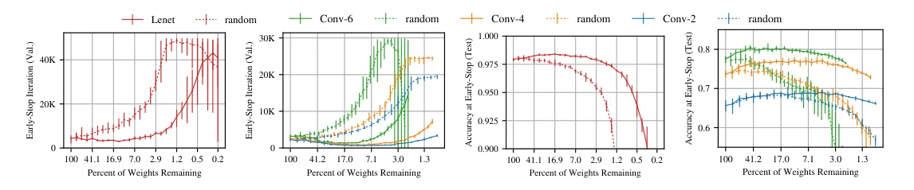
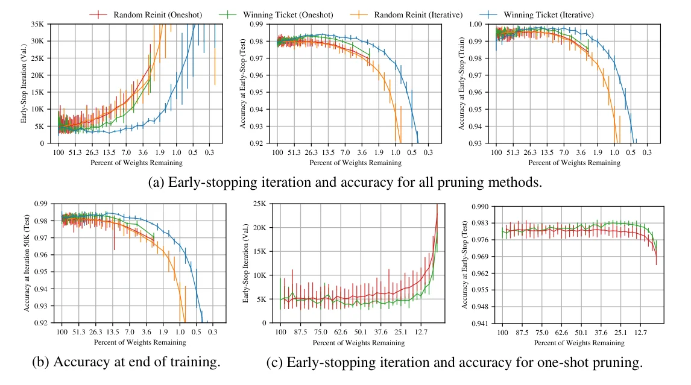
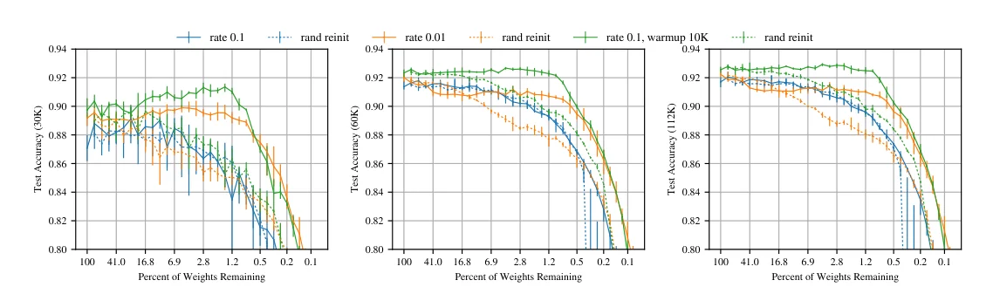

> - **논문**: The Lottery Ticket Hypothesis: Finding Sparse, Trainable Neural Networks
> - **저자**: Jonathan Frankle, Michael Carbin (MIT CSAIL)
> - **학회**: ICLR 2019 · [arXiv:1803.03635](https://arxiv.org/abs/1803.03635)
{: .prompt-tip }

> [Han 등의 가지치기]()는 학습된 네트워크의 90%를 잘라내도 정확도가 유지됨을 보였다. 그렇다면 왜 처음부터 그 작은 네트워크를 학습하지 않는가. 당시의 경험은 "가지치기로 얻은 희소 구조는 처음부터 학습하면 더 못 배운다"였고, Han 등과 Li 등 모두 그렇게 적었다. **The Lottery Ticket Hypothesis**는 여기에 한 가지 조건을 더한다. 살아남은 연결의 가중치를 학습된 값이 아니라 학습 전의 초기값으로 되돌리면, 그 희소 부분망은 처음부터 학습되고, 오히려 원래 네트워크보다 빨리 배우고 더 높은 테스트 정확도에 이른다는 것이다. 이 부분망이 "초기화 복권에 당첨된" **당첨 복권**(winning ticket)이다.

아래 Figure 1이 출발점이다. 점선은 같은 비율로 무작위로 뽑은 희소망이고 실선은 이 논문이 찾은 당첨 복권이다. 무작위 희소망은 작아질수록 조기 종료 시점이 늦어지고(왼쪽 두 그래프) 정확도가 떨어지지만(오른쪽 두 그래프), 당첨 복권은 꽤 작아질 때까지 오히려 빨라지고 정확해진다.


_Figure 1. 남은 가중치 비율에 따른 조기 종료 시점(왼쪽)과 그 시점의 테스트 정확도(오른쪽). Lenet은 MNIST, Conv-2/4/6은 CIFAR-10. 점선은 무작위 희소망(10회 평균), 실선은 당첨 복권(5회 평균). (출처: Frankle & Carbin, 2019)_

## 1. 가설

> 무작위 초기화된 밀집 순전파 네트워크는, 단독으로 학습했을 때 최대 같은 반복 횟수 안에 원래 네트워크의 테스트 정확도에 도달하도록 **초기화된** 부분망을 포함한다.

형식적으로, 초기 파라미터 $$\theta_0 \sim \mathcal{D}_\theta$$의 네트워크 $$f(x; \theta)$$가 반복 $$j$$에 정확도 $$a$$에 도달한다면, 마스크 $$m \in \{0,1\}^{|\theta|}$$가 존재해 $$f(x; m \odot \theta_0)$$를 학습하면 $$j' \le j$$, $$a' \ge a$$, $$\lVert m \rVert_0 \ll |\theta|$$이다. 핵심 대조 실험은 같은 마스크에 새 초기값 $$\theta_0'$$를 넣는 것이다. 당첨 복권은 재초기화하면 원래 성능에 못 미치므로, 구조만으로는 설명되지 않고 **구조와 초기값의 조합**이 중요하다는 증거가 된다.

## 2. 당첨 복권 찾기

1. 무작위 초기화 $$f(x; \theta_0)$$.
2. $$j$$번 학습해 $$\theta_j$$를 얻는다.
3. $$\theta_j$$에서 크기가 가장 작은 $$p\%$$를 잘라 마스크 $$m$$을 만든다(층별, 출력층은 절반 비율).
4. 남은 파라미터를 $$\theta_0$$의 값으로 **되돌린다**: $$f(x; m \odot \theta_0)$$.

한 번에 자르는 one-shot보다, $$n$$라운드에 걸쳐 매번 생존 가중치의 $$p^{1/n}\%$$를 자르고 되돌리기를 반복하는 **반복 가지치기**가 더 작은 당첨 복권을 찾는다. 비용은 네트워크를 15번 이상 연속 학습하는 수준이다. 깊은 네트워크(ResNet-18, VGG-19)에서는 층마다 같은 비율로 자르면 파라미터가 적은 층이 병목이 되므로, 모든 합성곱 층에 걸쳐 전역으로 가장 작은 가중치를 자른다.

## 3. 실험 설정

논문 Figure 2의 네트워크·학습 설정을 표로 옮겼다. 합성곱은 모두 3×3이고 초기화는 Gaussian Glorot이다. "학습 속도"는 최소 검증 손실에 도달한 반복(조기 종료 시점)으로 잰다.

| 네트워크 | 합성곱 | FC | 파라미터 (전체 / conv) | 반복 / 배치 | Optimizer | 라운드당 가지치기 |
|---|---|---|---|---|---|---|
| Lenet (MNIST) | 없음 | 300, 100, 10 | 266K | 50K / 60 | Adam 1.2e-3 | fc 20% |
| Conv-2 | 64, 64, pool | 256, 256, 10 | 4.3M / 38K | 20K / 60 | Adam 2e-4 | conv 10%, fc 20% |
| Conv-4 | 64, 64, pool, 128, 128, pool | 256, 256, 10 | 2.4M / 260K | 25K / 60 | Adam 3e-4 | conv 10%, fc 20% |
| Conv-6 | 위 + 256, 256, pool | 256, 256, 10 | 1.7M / 1.1M | 30K / 60 | Adam 3e-4 | conv 15%, fc 20% |
| ResNet-18 | 16, 3×[16, 16], 3×[32, 32], 3×[64, 64] | avg-pool, 10 | 274K / 270K | 30K / 128 | SGD+momentum 0.9 | conv 20% (전역), fc 0% |
| VGG-19 | 2×64, pool, 2×128, pool, 4×256, pool, 4×512, pool, 4×512 | avg-pool, 10 | 20.0M | 112K / 64 | SGD+momentum 0.9 | conv 20% (전역), fc 0% |

- Lenet의 출력층은 나머지의 절반 비율로 자른다.
- VGG-19는 Liu et al.(2019)과 같은 설정으로 160 epoch(112,480 반복), 80·120 epoch에 학습률을 1/10로 줄인다. ResNet-18은 3만 반복, 2만·2만 5천 반복에 1/10로 줄인다. 둘 다 배치 정규화, weight decay, 데이터 증강을 쓴다.
- 결과는 Lenet·Conv 계열이 5회 평균, 재초기화는 당첨 복권마다 3번씩(점당 15회)이다.

## 4. 실험 결과

**Lenet-300-100 (MNIST).** 반복 가지치기로 남은 비율 $$P_m$$이 100%에서 21%로 줄어들 때 당첨 복권은 더 빨리 배운다. 21%에서 조기 종료 시점이 원래보다 38% 빠르고, 13.5%에서 테스트 정확도가 0.3%p 이상 높으며, 3.6%까지 줄어야 원래 네트워크 수준으로 돌아온다. 무작위 재초기화하면 21.1%부터 정확도가 떨어지기 시작하고(당첨 복권은 2.9%까지 유지) 학습이 점점 느려진다. 21%에서 당첨 복권은 재초기화 대비 2.51배 빨리 최소 검증 손실에 도달하고 0.5%p 더 정확하다. 5만 반복까지 학습하면 거의 모든 네트워크가 훈련 정확도 100%인데도 당첨 복권의 테스트 정확도가 최대 0.35%p 높아, 일반화 간극이 더 작다. 한 번에 자르는 one-shot도 당첨 복권을 찾지만($$67.5\% \ge P_m \ge 17.6\%$$에서 더 빨리 학습, $$95.0\% \ge P_m \ge 5.17\%$$에서 더 정확), 반복 가지치기가 더 작은 크기까지 버틴다(아래 Figure 4).


_Figure 4. Lenet에서 one-shot·반복 가지치기의 당첨 복권과 무작위 재초기화 비교. (a) 조기 종료 시점과 그때의 테스트·훈련 정확도, (b) 5만 반복 시점 테스트 정확도, (c) one-shot만 확대. (출처: Frankle & Carbin, 2019)_

| Lenet, 반복 가지치기 | 결과 |
|---|---|
| 조기 종료가 가장 빠른 지점 | $$P_m = 21\%$$, 원래보다 38% 빠름 |
| 테스트 정확도 | $$P_m = 13.5\%$$에서 0.3%p 넘게 향상, 3.6%에서 원래 수준으로 복귀 |
| 원래 정확도 아래로 떨어지는 지점 | 당첨 복권 2.9%, 재초기화 21.1% |
| $$P_m = 21\%$$에서 재초기화 대비 | 2.51배 빠르게 최소 검증 손실 도달, 0.5%p 더 정확 |

**Conv-2/4/6 (CIFAR-10).** 효과가 더 크다. 최고치가 나온 $$P_m$$은 지표마다 다르다.

| 네트워크 | 최소 검증 손실 도달 | 테스트 정확도 최대 향상 | 드롭아웃 0.5 추가 시 |
|---|---|---|---|
| Conv-2 | 3.5배 빠름 ($$P_m$$ 8.8%) | +3.4%p ($$P_m$$ 4.6%) | 초기 +2.1%p, 가지치기로 최대 +2.3%p 더 |
| Conv-4 | 3.5배 빠름 ($$P_m$$ 9.2%) | +3.5%p ($$P_m$$ 11.1%) | 초기 +3.0%p, 가지치기로 최대 +4.6%p 더 |
| Conv-6 | 2.5배 빠름 ($$P_m$$ 15.1%) | +3.3%p ($$P_m$$ 26.4%) | 초기 +2.4%p, 가지치기로 최대 +4.7%p 더 |

세 네트워크 모두 $$P_m > 2\%$$에서 원래 정확도를 넘는다. 재초기화하면 Conv-2/4는 중간 수준 가지치기에서 정확도가 잠시 유지되거나 오르기도 해, 구조만으로도 일부 이득이 있음을 시사한다. 드롭아웃 0.5와 함께 써도 당첨 복권이 발견되고 두 효과가 더해진다(위 표 오른쪽 열).

**VGG-19, ResNet-18 (CIFAR-10).** 배치 정규화, 가중치 감쇠, 학습률 스케줄, 증강을 쓰는 실제적 설정이다. 여기서 방법은 **학습률에 민감**하다. VGG-19를 표준 학습률 0.1로 학습하면 반복 가지치기가 당첨 복권을 찾지 못하고 재초기화와 차이가 없다. 0.01로 낮추면 익숙한 패턴이 돌아오지만($$P_m \ge 3.5\%$$까지 원래 정확도의 1%p 이내) 원래 정확도에는 못 미쳐 엄밀히는 당첨 복권이 아니다. 0부터 초기 학습률까지 1만 반복의 선형 **워밍업**을 더하면 0.1에서 밀집망 정확도도 약 1%p 오르고, $$P_m \ge 1.5\%$$까지 그 정확도를 넘는 당첨 복권이 나온다(아래 Figure 7의 초록 실선).


_Figure 7. 반복 가지치기한 VGG-19의 3만·6만·11만 2천 반복 시점 테스트 정확도. 파랑은 학습률 0.1, 주황은 0.01, 초록은 0.1 + 워밍업 1만 반복이고 점선은 각각의 무작위 재초기화. (출처: Frankle & Carbin, 2019)_

ResNet-18도 비슷하다. 학습률 0.01에서는 당첨 복권을 찾지만 최고 정확도(89.5%, $$41.7\% \ge P_m \ge 21.9\%$$)가 학습률 0.1로 학습한 원래 네트워크(90.5%)에 못 미친다. 워밍업 2만 반복에 학습률 0.03으로 $$P_m = 27.1\%$$에서 90.5%에 도달하고 $$P_m \ge 11.8\%$$까지 당첨 복권을 찾지만, 원래 학습률 0.1에서는 워밍업을 써도 끝내 찾지 못했다.

## 5. 코드로 보기: 작은 MLP에서 반복 가지치기와 재초기화 비교

32차원 입력 10클래스 합성 문제에서 2층 MLP(128-128)를 학습하고, 7라운드에 걸쳐 매 라운드 20%를 크기 기준으로 자른 뒤 (a) 초기값으로 되돌린 당첨 복권과 (b) 같은 마스크에 새 초기값을 넣은 네트워크를 각각 200/800스텝 학습해 비교한다.

```python
import torch, torch.nn as nn
torch.manual_seed(0); torch.set_num_threads(1)
# synthetic 10-class problem: 32-d inputs, sparse ground-truth structure
Wtrue = torch.randn(32, 10) * (torch.rand(32, 10) < 0.3)
def data(n, seed):
    g = torch.Generator().manual_seed(seed); x = torch.randn(n, 32, generator=g)
    return x, (x @ Wtrue + 0.5 * torch.randn(n, 10, generator=g)).argmax(1)
Xtr, Ytr = data(400, 1); Xte, Yte = data(2000, 2)
def make(): return nn.Sequential(nn.Linear(32, 128), nn.ReLU(), nn.Linear(128, 128), nn.ReLU(), nn.Linear(128, 10))
def train(net, masks, steps, seed):
    g = torch.Generator().manual_seed(seed); opt = torch.optim.Adam(net.parameters(), 2e-3); hist = []
    for s in range(steps):
        i = torch.randint(0, 400, (128,), generator=g); loss = nn.functional.cross_entropy(net(Xtr[i]), Ytr[i]); opt.zero_grad(); loss.backward(); opt.step()
        with torch.no_grad():
            for p, m in zip(net.parameters(), masks):
                if m is not None: p.mul_(m)
        if (s + 1) % 100 == 0:
            with torch.no_grad(): hist.append((net(Xte).argmax(1) == Yte).float().mean().item() * 100)
    return hist
torch.manual_seed(0); net = make()
init = [p.detach().clone() for p in net.parameters()]
masks = [torch.ones_like(p) if p.dim() == 2 else None for p in net.parameters()]
dense_hist = train(net, masks, 800, 0)
print(f"dense network: accuracy after 200 / 400 / 800 steps = {dense_hist[1]:.1f} / {dense_hist[3]:.1f} / {dense_hist[7]:.1f}%")
# iterative magnitude pruning, 20% per round; survivors are reset to their ORIGINAL initial values
print("\nround  remaining   winning ticket (reset to init)   random re-init   [accuracy at step 200 / 800]")
for rnd in range(1, 8):
    with torch.no_grad():
        for p, m in zip(net.parameters(), masks):
            if m is not None:
                alive = p[m.bool()].abs(); thr = alive.kthvalue(int(0.2 * alive.numel())).values
                m.mul_((p.abs() > thr).float())
    remaining = sum(m.sum().item() for m in masks if m is not None) / sum(m.numel() for m in masks if m is not None)
    with torch.no_grad():
        for p, p0, m in zip(net.parameters(), init, masks): p.copy_(p0 * (m if m is not None else 1))
    wt = train(net, masks, 800, rnd)
    torch.manual_seed(100 + rnd); rnet = make()
    with torch.no_grad():
        for p, m in zip(rnet.parameters(), masks):
            if m is not None: p.mul_(m)
    rr = train(rnet, masks, 800, rnd)
    print(f"{rnd:>5}  {remaining*100:7.1f}%        {wt[1]:5.1f} / {wt[7]:5.1f}                 {rr[1]:5.1f} / {rr[7]:5.1f}")
```

```text
dense network: accuracy after 200 / 400 / 800 steps = 64.6 / 64.5 / 64.5%

round  remaining   winning ticket (reset to init)   random re-init   [accuracy at step 200 / 800]
    1     80.0%         65.0 /  65.5                  65.6 /  66.0
    2     64.0%         64.6 /  64.9                  67.4 /  67.5
    3     51.2%         66.0 /  66.1                  66.8 /  67.8
    4     41.0%         67.2 /  67.0                  67.0 /  67.0
    5     32.8%         66.7 /  67.3                  67.2 /  67.2
    6     26.2%         67.0 /  66.8                  66.0 /  66.0
    7     21.0%         65.0 /  65.7                  64.9 /  65.8
```

- 이 toy에서는 **당첨 복권의 이점이 재현되지 않는다.** 800스텝 기준으로 되돌린 초기값과 무작위 재초기화의 정확도가 대부분의 라운드에서 1%p 안에서 엇갈리고(2·3라운드는 오히려 재초기화가 2.6·1.7%p 앞선다), 둘 다 밀집 네트워크(64.5%)보다 0.4~3.3%p 높다. 가지치기 자체가 과적합을 줄이는 효과만 보인다.
- 이유는 짐작할 수 있다. 데이터 400개에 파라미터 2만 개인 작은 문제는 어떤 초기값에서도 쉽게 학습되는 과잉 매개변수 체제이고, 논문 5절이 지적하듯 이 체제에서는 재초기화해도 잘 학습된다(Liu 등의 관찰과 일치). 당첨 복권의 이점은 MNIST·CIFAR 규모와 더 깊은 가지치기(수 % 수준)에서 나타났고, 여기서는 그 조건이 성립하지 않는다. 논문 결과를 신뢰하되 toy로 쉽게 재현되는 현상은 아니라는 점을 보여 주는 결과로 남겨 둔다.

## 6. 해석

**1. 질문의 방향을 바꿨다.** 가지치기 연구가 "학습 후 얼마나 줄일 수 있나"를 물었다면, 이 논문은 "학습 전에 작은 네트워크를 찾을 수 있나"를 묻는다. 당첨 복권이 존재한다면 학습 자체를 희소하게 만들 수 있다는 희망이 생기고, 이후 SNIP, GraSP, RigL, 초기 가지치기(early-bird ticket), 그리고 Frankle 자신의 후속 연구(rewinding, linear mode connectivity)로 이어졌다.

**2. 초기값의 역할을 실험적으로 분리했다.** 분리의 근거는 같은 마스크에 다른 초기값을 넣는 대조군 설계이다. 부록 F는 당첨 복권의 가중치가 학습 중 다른 가중치보다 더 멀리 이동함을 보여, "초기값이 이미 정답에 가깝다"는 설명을 배제한다. 이점은 최적화 알고리즘·데이터·모델의 상호작용에 있다는 것이고, 후속 연구는 이를 손실 지형의 선형 연결성으로 설명한다.

**3. Liu 등과의 논쟁은 체제의 차이로 정리된다.** [Rethinking the Value of Network Pruning]()은 최적 학습률(0.1)에서 당첨 복권 초기화가 무작위 초기화보다 낫지 않다고 보고했고, 이 논문도 VGG-19에서 학습률 0.1, 80% 가지치기까지는 그 결과를 확인한다. 차이는 그 너머에 있다. 98.5%까지 자르면 초기값이 중요해진다. 즉 **과잉 매개변수가 충분하면 구조만으로 충분하고, 극단적으로 희소해지면 초기값이 필요**하다는 것이 양쪽을 아우르는 그림이고, 위 toy도 전자의 체제에 있다.

**4. 일반화에 대한 Occam's Hill.** 테스트 정확도가 가지치기에 따라 올랐다가 내려가는 패턴은 원래 네트워크는 너무 크고(과적합) 극단적으로 자른 것은 너무 작다는 그림을 준다. 압축 가능성과 일반화의 연결(Zhou 등, Arora 등의 압축 기반 일반화 경계)에 "큰 네트워크는 더 단순한 표현을 명시적으로 포함한다"는 보완적 관점을 더한다.

**5. 평가를 읽을 때 주의할 점.** MNIST와 CIFAR-10, 소형 네트워크에 한정된다(ImageNet은 반복 가지치기 비용 때문에 제외). 깊은 네트워크에서는 원래 학습률 0.1로 워밍업 없이 학습하면 당첨 복권을 찾지 못했고, ResNet-18은 워밍업을 더해도 0.1에서는 끝내 못 찾았다. 비구조적 희소성이라 하드웨어 이득은 없다. "학습 속도"의 지표는 최소 검증 손실 시점이라는 대리 지표이다. 저자들도 "SGD가 당첨 복권을 찾아 학습한다"는 추측(conjecture)은 검증하지 않았다고 명시한다.

## 7. 정리

| 항목 | 내용 |
|---|---|
| 가설 | 밀집 네트워크 안에 원래 초기값으로 단독 학습하면 같은 정확도·속도에 이르는 희소 부분망이 있다 |
| 방법 | 학습 → 크기 가지치기 → 생존 가중치를 $$\theta_0$$로 되돌림, $$n$$라운드 반복(깊은 망은 전역 가지치기) |
| 대조 | 같은 마스크 + 무작위 재초기화 → 느리고 부정확 |
| 결과 | Lenet 3.6%, Conv-2/4/6 2%까지 원래 정확도 유지, 최대 3.5배 빠른 학습, +3.5%p 정확도, 더 작은 일반화 간극 |
| 조건 | VGG-19·ResNet-18은 낮은 학습률 또는 워밍업이 필요, 워밍업 없는 학습률 0.1에서는 실패(ResNet-18은 워밍업을 써도 0.1에서 실패) |
| 한계 | 소규모 데이터셋, 비구조적 희소성, 학습 15회 이상의 탐색 비용 |

## References

- Frankle, Carbin, "The Lottery Ticket Hypothesis: Finding Sparse, Trainable Neural Networks," ICLR 2019. [arXiv:1803.03635](https://arxiv.org/abs/1803.03635)
- Liu, Sun, Zhou, Huang, Darrell, "Rethinking the Value of Network Pruning," ICLR 2019. [arXiv:1810.05270](https://arxiv.org/abs/1810.05270)
- Han, Pool, Tran, Dally, "Learning both Weights and Connections for Efficient Neural Networks," NeurIPS 2015. [arXiv:1506.02626](https://arxiv.org/abs/1506.02626)
- Frankle, Dziugaite, Roy, Carbin, "Linear Mode Connectivity and the Lottery Ticket Hypothesis," ICML 2020. [arXiv:1912.05671](https://arxiv.org/abs/1912.05671)
- Zhou, Lan, Liu, Yosinski, "Deconstructing Lottery Tickets: Zeros, Signs, and the Supermask," NeurIPS 2019. [arXiv:1905.01067](https://arxiv.org/abs/1905.01067)
