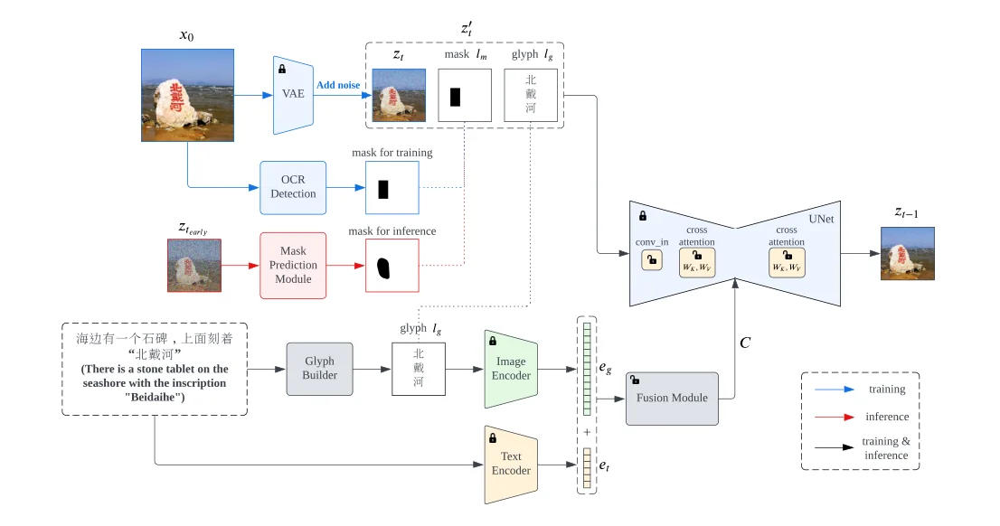
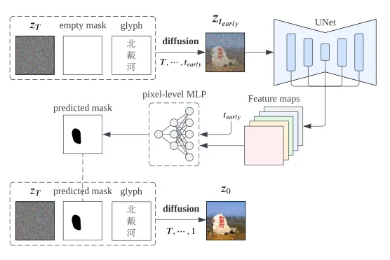

> - **논문**: GlyphDraw: Seamlessly Rendering Text with Intricate Spatial Structures in Text-to-Image Generation
> - **저자**: Jian Ma, Mingjun Zhao, Chen Chen, Ruichen Wang, Di Niu, Haonan Lu, Xiaodong Lin (OPPO Research Institute, University of Alberta, Rutgers University)
> - **학회**: arXiv preprint 2023 · [arXiv:2303.17870](https://arxiv.org/abs/2303.17870)
{: .prompt-tip }

> DALL-E 2, Imagen, Stable Diffusion은 그림은 잘 그리지만 글자는 잘 못 쓴다. Imagen은 T5-XXL 같은 큰 언어 모델 덕에 영어 철자를 어느 정도 맞히지만, 획이 1~20개이고 상용 글자가 수천 개인 한자는 character-aware 모델로도 안 된다. **GlyphDraw**는 글자를 텍스트 토큰으로만 알려 주는 대신 **글리프 이미지와 위치 마스크를 명시적 조건**으로 넣는다. Stable Diffusion의 극히 일부만 학습해 DrawTextExt 벤치마크에서 중국어 74%, 영어 75%의 OCR 정확도를 내면서 FID는 거의 유지했다.


_Figure 1. GlyphDraw가 그린 중국어(위 두 줄)와 영어(아래 줄) 시각 텍스트. 각 그림 아래가 입력 프롬프트이다. (출처: Ma et al., 2023)_

## 1. 문제: 글자는 자연 물체와 다르다

"天空(하늘)"이라는 글자의 픽셀은 몇 개의 획으로 된 2차원 구조이고, 하늘의 사진은 "구름이 점점이 박힌 파란 화면"이다. 둘의 잠재 분포는 완전히 다르며, 글자는 획이 조금만 틀어져도 다른 글자가 된다. 따라서 두 가지가 필요하다. 글자 모양을 어떻게 알려 줄 것인가(glyph control), 그리고 글자 영역의 픽셀을 이웃 배경에 영향을 주지 않고 어떻게 제어할 것인가(location control)이다. 저자들은 중국어 Stable Diffusion을 텍스트 데이터로 그냥 fine-tuning해 보았지만 완전히 실패했고(정확도 0%), ControlNet에 글리프를 넣는 변형도 폰트·크기·원근 차이 때문에 작동하지 않았다.

## 2. 방법

### 두 경로로 주입되는 글리프와 마스크

Stable Diffusion의 UNet은 잠재 $$z_t$$를 입력받고 조건 $$C$$를 cross-attention의 키·값으로 쓴다. GlyphDraw는 아래 Figure 2처럼 양쪽을 모두 바꾼다.


_Figure 2. 위: 잠재 경로(노이즈 잠재 + 위치 마스크 + 글리프 이미지를 이어 붙여 UNet 입력으로). 아래: 조건 경로(CLIP 이미지·텍스트 인코더 출력을 융합 모듈로 합쳐 cross-attention 키·값으로). 자물쇠가 풀린 `conv_in`, $$W_K, W_V$$, 융합 모듈만 학습한다. 빨간 선은 추론 때의 마스크 예측 경로. (출처: Ma et al., 2023)_

- **잠재 경로.** 글리프 이미지 $$l_g$$(흰 배경 가운데에 글자만 있는 회색조)와 이진 위치 마스크 $$l_m$$을 $$z_t$$에 채널로 이어 붙인다. $$z'_t = \text{concat}(z_t, l_g, l_m)$$이고, 입력 채널이 늘어난 만큼 conv_in을 조정한다.
- **조건 경로.** 고정된 CLIP 이미지 인코더로 글리프 임베딩 $$e_g$$, 텍스트 인코더로 프롬프트 임베딩 $$e_t$$를 뽑고, **융합 모듈** $$M$$(6층 Transformer)로 합쳐 $$C = M[\text{concat}(e_g, e_t)]$$를 만든다.

학습 때 마스크는 OCR 검출로 얻은 사각형이고, 글리프 이미지는 OCR로 인식한 글자를 렌더링한 것이다.

### 무엇을 학습하는가

전부 fine-tuning하면 개방 도메인 능력을 잊어버린다(catastrophic forgetting). 그래서 글자 생성에 필요한 부분만 갱신한다. 늘어난 입력을 받는 conv_in, 융합 모듈, 그리고 cross-attention의 $$W_K^{(i)}, W_V^{(i)}$$이다. 조건 $$C$$는 키·값으로만 들어가므로 텍스트→이미지 매핑을 바꾸는 데는 이 두 행렬이면 충분하다는 관찰(Custom Diffusion)을 따른다. 전체 1.9B 중 약 0.1B만 학습하고, 수렴도 빨라진다.

### 손실 가중

글자 영역의 학습을 강조하기 위해 마스크 기반 가중치를 더한다.

$$
\mathcal{L} = \mathbb{E}\left[\lVert \epsilon - \epsilon_\theta \rVert_2^2 + \alpha \lVert (\epsilon - \epsilon_\theta) * (1 - l_m) \rVert_2^2\right], \qquad \alpha = 0.5
$$

### 추론: 마스크 예측과 두 단계 샘플링

추론 때는 원본 이미지가 없어 OCR 마스크를 얻을 수 없다. 그래서 처음 몇 단계($$t = T, \ldots, t_{early}$$)를 빈 마스크로 돌리면서 UNet 특징에 **픽셀 단위 MLP**(5층, 정답 마스크와의 MSE로 학습)를 붙여 마스크를 예측한다(아래 Figure 3).


_Figure 3. 빈 마스크로 $$t_{early}$$까지 디퓨전을 돌린 뒤 UNet 특징 맵에서 픽셀 단위 MLP가 마스크를 예측하고, 그 마스크로 처음부터 다시 디퓨전을 돌린다. (출처: Ma et al., 2023)_
 예측 마스크는 무작위 마스크와 달리 원근을 따르는 사각형이 되어 글자가 자연스럽게 기울어진다. 그다음 DDIM으로 완전한 디퓨전을 다시 돌리되, 앞쪽 $$(1-r)T$$단계($$t = T, \ldots, rT+1$$)는 GlyphDraw로, 나머지 $$rT$$단계는 글리프·마스크 없이 원래 Stable Diffusion으로 샘플링한다. $$r$$은 글자 정확도와 개방 도메인 품질의 트레이드오프이고 기본값은 0.5이다. 글자가 필요 없으면 마스크를 1로 채우면 된다. 사용자가 마스크를 직접 줄 수도 있다.

### 데이터

LAION, Zero23M, Wukong과 웹 크롤링에서 OCR로 글자가 있는 이미지를 골라 필터링하고(인식 신뢰도 0.8 이상, 글자 하나가 이미지의 0.7%(중국어)·0.2%(영어) 이상, 글자 중심이 가장자리에서 10% 이상 안쪽, 글자 덩어리가 여러 개인 이미지·광고 이미지 제외), 캡션이 들쭉날쭉해서 BLIP-2로 다시 생성한 뒤 글자를 따옴표로 캡션에 넣는다. 중국어 792K장(3.3M 글자, 4.8K 종), 영어 1.9M장(2.3M 단어)이다.

### 구현 디테일

| 항목 | 값 |
|---|---|
| 모델 구성 | VAE + UNet + CLIP 이미지·텍스트 인코더 + 융합 모듈, 총 1.9B 중 약 0.1B 학습 |
| 베이스 모델 | Stable Diffusion v2-base. 중국어 모델은 이 체크포인트의 텍스트 인코더만 중국어 이미지-텍스트 100M쌍으로 다시 학습한 것(텍스트 인코더는 Chinese CLIP), 영어는 원래 OpenCLIP ViT-H 그대로 |
| 토큰 길이 | CLIP 이후 이미지 257, 텍스트 64 |
| 융합 모듈 | Transformer 6층, head 8개, hidden 1024 |
| 학습 | lr 2e-5, $$\alpha = 0.5$$, A100 24장, 20 epoch, GPU당 batch 25 |
| OCR (데이터·평가) | PP-OCRv2 |
| 마스크 예측 | 5층 MLP |
| 추론 | $$T = 50$$, $$t_{early} = 35$$(마스크 예측 15단계), $$r = 0.5$$(GlyphDraw 25 + SD 25단계), DDIM |
| 평가 | DrawTextExt Spelling의 OCR 정확도(시드 3개 평균), MS-COCO FID-10k |

## 3. 코드로 보기: 학습 파라미터, 손실 가중, 추론 스케줄

Stable Diffusion 1.x의 cross-attention 차원으로 $$W_K, W_V$$의 파라미터 수를 세어 "약 0.1B"가 어디서 나오는지 확인하고, 손실 가중과 추론 스케줄을 숫자로 본다.

```python
# which parameters GlyphDraw trains on top of Stable Diffusion 1.x
ctx = 768                                                   # CLIP text embedding width
cross_attn_dims = [320, 320, 640, 640, 1280, 1280] + [1280] + [1280, 1280, 1280, 640, 640, 640, 320, 320, 320]
wk_wv = sum(2 * ctx * d for d in cross_attn_dims)           # W_K, W_V of every cross-attention block
conv_in_sd = 4 * 320 * 9; conv_in_gd = (4 + 1 + 1) * 320 * 9  # latent + glyph channel + mask channel
fusion = 6 * (4 * 1024 ** 2 + 2 * 1024 * 4 * 1024)          # 6-layer transformer, 1024 hidden (attention + FFN)
trainable = wk_wv + conv_in_gd + fusion
total = 1.9e9                                               # paper: VAE + UNet + CLIP + fusion
print(f"W_K/W_V of {len(cross_attn_dims)} cross-attention blocks: {wk_wv/1e6:6.1f}M")
print(f"conv_in (4 -> 6 input channels):                {conv_in_gd/1e3:6.1f}K  (SD: {conv_in_sd/1e3:.1f}K)")
print(f"fusion transformer (6 x 1024):                  {fusion/1e6:6.1f}M")
print(f"trainable total: {trainable/1e6:.0f}M of {total/1e9:.1f}B = {100*trainable/total:.1f}%   (paper: ~0.1B, 'only 3%')")

# loss weighting (Eq. 4): extra weight alpha on the character region
import numpy as np
alpha = 0.5; lm = np.ones((8, 8)); lm[2:5, 1:7] = 0          # mask: 0 where characters are
weight = 1 + alpha * (1 - lm)
print()
print(f"per-pixel loss weight: background {weight[0,0]:.1f}, text region {weight[3,3]:.1f}  (text pixels are {100*(lm==0).mean():.0f}% of the latent but get {100*weight[lm==0].sum()/weight.sum():.0f}% of the loss)")

# inference schedule: T = 50, t_early = 35, r = 0.5
T, t_early, r = 50, 35, 0.5
print()
print(f"mask prediction: {T - t_early} early steps with an empty mask -> pixel-wise MLP predicts the mask")
print(f"regeneration:    {int(r*T)} steps with GlyphDraw (glyph + mask priors) + {T - int(r*T)} steps with plain Stable Diffusion")
```

```text
W_K/W_V of 16 cross-attention blocks:   19.2M
conv_in (4 -> 6 input channels):                  17.3K  (SD: 11.5K)
fusion transformer (6 x 1024):                    75.5M
trainable total: 95M of 1.9B = 5.0%   (paper: ~0.1B, 'only 3%')

per-pixel loss weight: background 1.0, text region 1.5  (text pixels are 28% of the latent but get 37% of the loss)

mask prediction: 15 early steps with an empty mask -> pixel-wise MLP predicts the mask
regeneration:    25 steps with GlyphDraw (glyph + mask priors) + 25 steps with plain Stable Diffusion
```

- 학습 파라미터의 대부분은 **융합 모듈(75M)**이고 $$W_K, W_V$$는 19M, conv_in은 17K에 불과하다. 합계 95M으로 논문의 약 0.1B와 맞고, 전체 1.9B 대비 5%이다. 논문이 말하는 "3%"는 $$W_K, W_V$$(논문 값 25M)가 UNet 865M에서 차지하는 비율이다. 위 계산이 19M으로 조금 작은 것은 SD 1.x의 조건 차원 768을 가정했기 때문이다. 논문의 베이스인 SD v2-base는 OpenCLIP ViT-H 텍스트 인코더라 조건 차원이 1024이고, 이 값으로 다시 세면 $$2 \times 1024 \times 12{,}480 \approx 25.6$$M으로 논문 값과 맞는다.
- 손실 가중은 글자 영역의 픽셀당 가중치를 1.5배로 올린다. 글자가 잠재의 28%를 차지하면 손실의 37%를 받는다.
- 추론은 마스크 예측 15단계 + 재생성 50단계(GlyphDraw 25 + SD 25)로, 원래 Stable Diffusion보다 1.3배의 UNet 호출이 든다.

## 4. 실험

**DrawTextExt Spelling.** "街边的路牌上写着 *(길가 표지판에 *라고 쓰여 있다)" 식 템플릿에 상용 중국어 글자·단어 10,000개, 고빈도 영어 단어 10,000개를 넣고 OCR 정확도와 MS-COCO FID-10k를 잰다.

| 방법 | 중국어 정확도 | FID | 영어 정확도 | FID |
|---|---|---|---|---|
| Stable Diffusion | 0.00 | 15.87 | 0.14 | 14.69 |
| SD + fine-tuning | 0.00 | 20.09 | 15.01 | 20.24 |
| ControlNetDraw | 0.00 | 15.91 | 7.18 | 14.63 |
| Imagen(DeepFloyd IF) | - | - | 44.54 | - |
| GlyphDraw w/o loss weighting | 68.60 | 17.27 | 64.96 | 16.92 |
| GlyphDraw w/o location mask | 66.15 | 17.68 | 65.79 | 17.85 |
| GlyphDraw w/ random mask | 60.23 | 16.78 | 60.55 | 16.09 |
| GlyphDraw w/o glyph latent | 69.88 | 17.36 | 65.21 | 16.58 |
| GlyphDraw + all UNet layers | 74.21 | 19.01 | 77.29 | 19.78 |
| GlyphDraw + all UNet attention layers | 72.24 | 17.95 | 76.74 | 18.01 |
| GlyphDraw ($$W_K, W_V$$만) | **74.00** | **16.89** | 75.23 | **16.02** |

- 단순 fine-tuning과 ControlNetDraw는 중국어에서 0%이다. 글리프 정보 없이 의미 표현만으로 획을 배우는 것은 불가능하고, ControlNet은 조건과 출력의 정확한 대응을 가정하는데 글리프와 실제 글자 사이에는 폰트·원근 차이가 있다.
- Imagen은 언어 모델 덕에 영어 44.5%이지만 명시적 글리프에는 못 미친다.
- 각 구성 요소(손실 가중, 위치 마스크, 글리프 잠재)를 빼면 중국어에서 4~8%p, 영어에서 9~10%p 떨어지고, 무작위 마스크는 예측 마스크보다 14~15%p 나쁘다.
- UNet 전체(865M)를 학습하면 정확도는 비슷하거나 조금 높지만 FID가 19로 나빠진다. 개방 도메인 능력을 잃은 것이다. attention 층 전체(100M, UNet의 12%)도 FID가 18 안팎이다. $$W_K, W_V$$(25M, UNet의 3%)만 학습하면 정확도 손실은 전체 학습 대비 중국어 0.2%p, 영어 2%p에 그치고 FID는 가장 좋다. 원래 SD와 비교한 FID 상승은 중국어 1.02, 영어 1.33이다.

## 5. 해석

**1. "모르는 것은 보여 줘라"는 전략이다.** 언어 모델의 암묵적 철자 지식은 100B 파라미터 이상에서야 영어에 작동하고 한자에는 작동하지 않는다. 글리프 이미지를 직접 조건으로 넣으면 모델은 획을 외울 필요 없이 보고 베끼면서 배경에 녹이는 법만 배우면 된다. 이후 TextDiffuser, AnyText 등이 같은 전략(글리프 + 위치 조건)을 표준으로 삼았다.

**2. 조건을 두 경로로 넣은 이유.** 잠재 채널의 글리프는 "어디에 어떤 모양"이라는 공간 정보를, 융합 모듈의 글리프 임베딩은 cross-attention을 거친 전역 의미 정보를 준다. ablation에서 잠재 쪽 글리프를 빼면 중국어 4%p, 영어 10%p가 떨어지는 것은 두 경로의 역할이 겹치지 않는다는 뜻이다.

**3. 파라미터 효율 학습은 품질 보존 장치이다.** [ALBERT]()처럼 파라미터를 줄여 메모리를 아끼는 것이 아니라, 학습 범위를 제한해 잊지 않게 하는 용도이다. 위 계산처럼 학습 파라미터의 대부분이 새로 추가한 융합 모듈이고, 원래 UNet에서는 $$W_K, W_V$$ 19M만 건드린다. 전체 학습이 FID를 중국어 2.1, 영어 3.8만큼 올린 것이 이 제약의 가치를 보여 준다.

**4. 추론 때 원래 모델로 돌아가는 설계.** 글자의 구조는 디퓨전 초반에 정해지고 후반은 질감이다. 후반을 원래 Stable Diffusion에 맡기면 글자 정확도를 거의 잃지 않으면서 개방 도메인 품질을 되찾는다. [T-Stitch]()가 단계별로 다른 모델을 잇는 것과 같은 관찰이다.

**5. 평가를 읽을 때 주의할 점.** DrawTextExt는 저자들이 만든 벤치마크이고 프롬프트가 템플릿이라 실제 사용 분포보다 쉽다. OCR 정확도는 OCR 도구의 한계와 섞인다. 저자들도 그릴 글자 수가 늘수록 정확도가 떨어지고(학습 데이터의 평균 길이가 중국어 4.17자, 영어 7.19글자로 짧음), 글자 상자를 여러 개 만들지 못한다는 점을 한계로 적는다. 추론 비용(마스크 예측 + 두 단계)과 학습 비용(24 A100, 20 epoch)은 작지 않다. 위 파라미터 계산은 SD 1.x의 조건 차원을 가정한 추정이라 실제 베이스(SD v2-base)와 $$W_K, W_V$$ 크기가 조금 다르다.

## 6. 정리

| 항목 | 내용 |
|---|---|
| 문제 | 디퓨전 모델은 글자, 특히 한자를 못 씀; fine-tuning·ControlNet·언어 모델 모두 불충분 |
| 글리프 제어 | 글리프 이미지를 잠재 채널(concat)과 조건 임베딩(CLIP 이미지 인코더 + 융합 모듈) 양쪽에 주입 |
| 위치 제어 | OCR 마스크를 잠재 채널로; 추론 때는 초반 15단계로 픽셀 MLP가 마스크 예측 |
| 학습 범위 | conv_in + 융합 모듈 + cross-attention $$W_K, W_V$$ ≈ 0.1B(1.9B 중), 손실 가중 $$\alpha = 0.5$$ |
| 추론 | 25단계 GlyphDraw + 25단계 원래 SD($$r = 0.5$$) |
| 결과 | 중국어 74.0% / FID 16.89, 영어 75.2% / FID 16.02(SD 0% / 15.87, Imagen 영어 44.5%) |

## References

- Ma, Zhao, Chen, Wang, Niu, Lu, Lin, "GlyphDraw: Seamlessly Rendering Text with Intricate Spatial Structures in Text-to-Image Generation," 2023. [arXiv:2303.17870](https://arxiv.org/abs/2303.17870)
- Rombach et al., "High-Resolution Image Synthesis with Latent Diffusion Models," CVPR 2022. [arXiv:2112.10752](https://arxiv.org/abs/2112.10752)
- Liu et al., "Character-Aware Models Improve Visual Text Rendering," ACL 2023. [arXiv:2212.10562](https://arxiv.org/abs/2212.10562)
- Kumari et al., "Multi-Concept Customization of Text-to-Image Diffusion," CVPR 2023. [arXiv:2212.04488](https://arxiv.org/abs/2212.04488)
- Zhang, Rao, Agrawala, "Adding Conditional Control to Text-to-Image Diffusion Models," ICCV 2023. [arXiv:2302.05543](https://arxiv.org/abs/2302.05543)
