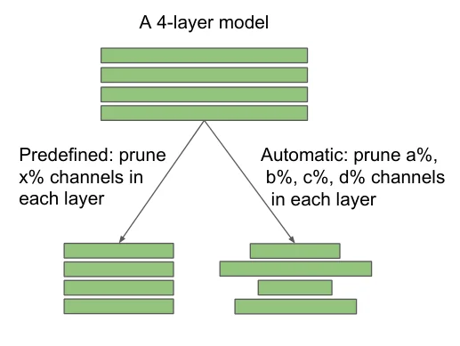
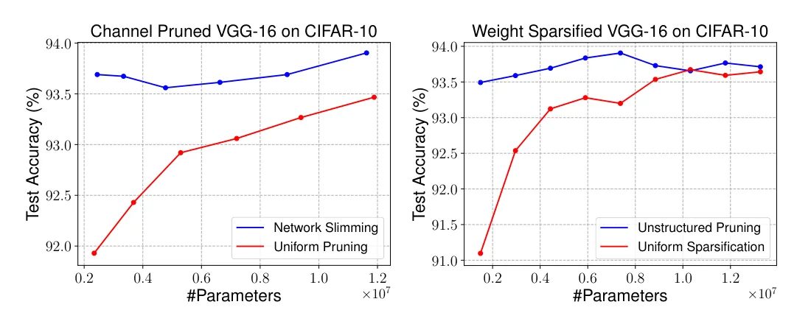
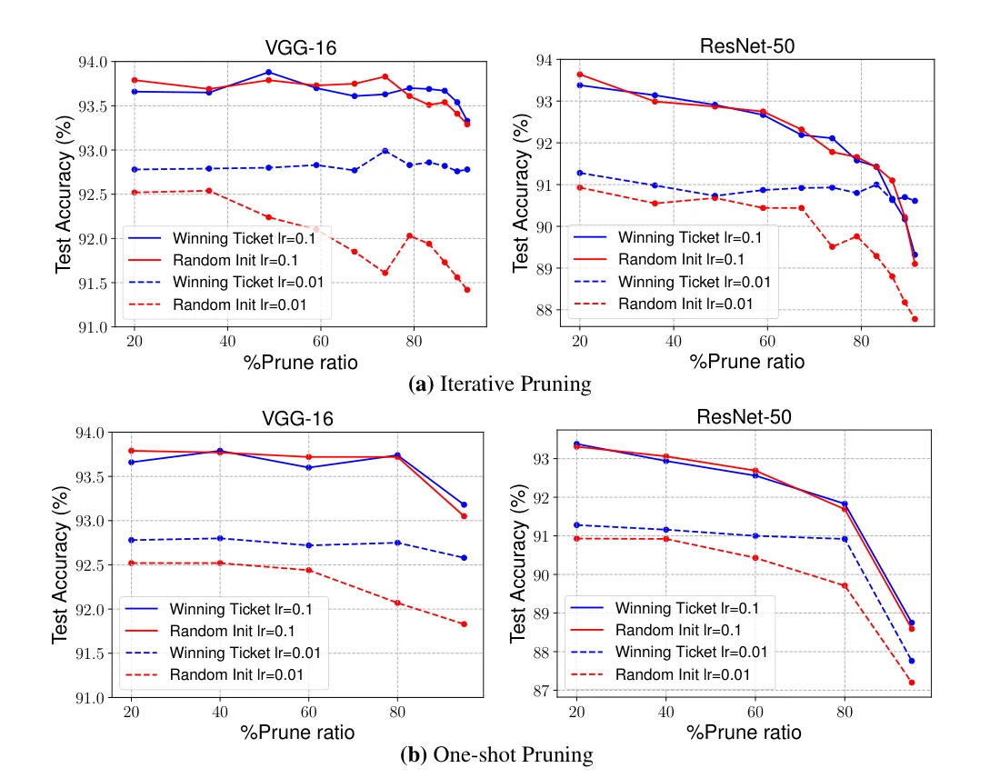

> - **논문**: Rethinking the Value of Network Pruning
> - **저자**: Zhuang Liu, Mingjie Sun, Tinghui Zhou, Gao Huang, Trevor Darrell (UC Berkeley, Tsinghua University)
> - **학회**: ICLR 2019 · [arXiv:1810.05270](https://arxiv.org/abs/1810.05270) · [코드](https://github.com/Eric-mingjie/rethinking-network-pruning)
{: .prompt-tip }

> 가지치기의 표준 파이프라인은 큰 모델 학습 → 가지치기 → 미세조정의 3단계이고, 그 뒤에는 두 가지 믿음이 있습니다. 큰 과잉 매개변수 모델에서 시작해야 좋은 작은 모델이 나온다는 것, 그리고 살아남은 "중요한" 가중치가 최종 모델에 필수라는 것입니다. **Rethinking the Value of Network Pruning**은 최신 **구조적** 가지치기 방법들을 공정한 예산으로 다시 돌려 보고, 두 믿음 모두 구조적 가지치기에서는 성립하지 않는다고 보고합니다. 가지치기된 구조를 **무작위 초기화에서 처음부터 학습**하면 미세조정과 같거나 더 좋습니다. 그렇다면 자동 가지치기 알고리즘이 하는 일은 중요한 가중치를 고르는 것이 아니라 **효율적인 구조를 찾는 것**입니다.

## 1. 두 종류의 가지치기

목표 구조를 누가 정하느냐로 나눕니다. **사전 정의**(predefined) 방법은 사람이 "각 층에서 채널 50%"처럼 비율을 정하므로 어떤 채널을 자르든 구조는 같습니다(Li 등의 L1 필터 가지치기, ThiNet, He 등의 채널 가지치기). **자동**(automatic) 방법은 층 간 중요도를 전역 비교해 층마다 다른 비율을 알고리즘이 정합니다(Network Slimming, Sparse Structure Selection). 비구조적 가지치기(Han 등)도 0의 위치가 학습으로 정해지므로 자동에 속합니다.


_Figure 2. 사전 정의 가지치기는 모든 층에서 같은 비율 $$x\%$$를 자르고, 자동 가지치기는 층마다 다른 비율 $$a, b, c, d\%$$를 알고리즘이 정합니다. (출처: Liu et al., 2019)_

사전 정의 방법에 대해 처음부터 학습이 미세조정과 같다면 **파이프라인 전체가 불필요**합니다. 자동 방법에 대해서도 같다면, 큰 모델 학습은 구조를 찾기 위해서만 필요하고 가중치는 버려도 됩니다.

## 2. 공정한 비교를 위한 설계

핵심 쟁점은 **작은 모델을 얼마나 오래 학습하느냐**입니다. 큰 모델과 같은 에폭을 쓰면 작은 모델은 에폭당 계산이 적어 불리합니다. 그래서 둘을 보고합니다.

- **Scratch-E**: 큰 모델과 같은 에폭 수.
- **Scratch-B**: 큰 모델 학습과 같은 **FLOPs 예산**(ImageNet에서는 FLOPs가 2배 이상 줄면 에폭을 2배로, 여전히 큰 모델보다 적은 계산). 학습률 스케줄도 비례해 늘립니다.

미세조정 비용은 계산에 넣지 않았으므로 비교는 오히려 가지치기 쪽에 유리합니다. 원 논문의 공개 구현이 있으면 그대로 쓰고, 없으면 재구현해 비슷한 결과를 확인하며, 모델만 공개된 경우(ThiNet, He 등)는 프레임워크 차이 때문에 큰 모델 대비 **상대 정확도 하락**으로 비교합니다. CIFAR는 5개 시드 평균, 학습/미세조정은 CIFAR 160/40 에폭, ImageNet 90/20 에폭입니다.

| 항목 | 설정 |
|---|---|
| 데이터셋 | CIFAR-10, CIFAR-100, ImageNet |
| 네트워크 | 각 방법의 원 논문과 같은 (모델, 데이터셋) 쌍. VGG, ResNet, PreResNet, DenseNet |
| 평가 방법 | 사전 정의 4개(L1 필터, ThiNet, 회귀 기반 채널, Soft Filter Pruning은 부록), 자동 2개(Network Slimming, Sparse Structure Selection), 비구조적 1개(Han 등) |
| Optimizer | SGD + Nesterov momentum, 계단식 학습률 감소 |
| 초기화 | He 초기화 (비구조적 희소망은 남은 가중치 수에 맞춰 표준편차를 다시 조정했지만 이득은 없었음) |
| 학습 / 미세조정 | CIFAR 160 / 40 에폭, ImageNet 90 / 20 에폭. 미세조정은 큰 모델 학습의 가장 낮은 학습률 |
| Scratch-B | 같은 FLOPs가 되도록 에폭을 늘림. ImageNet에서 FLOPs가 2배 넘게 줄면 에폭만 2배 |
| 프레임워크 | PyTorch (ThiNet·회귀 기반 채널은 원 논문이 Caffe라 큰 모델 대비 상대 하락으로 비교) |

## 3. 결과

**사전 정의 구조적 가지치기.** L1 필터 가지치기(표 1)는 모든 행에서 처음부터 학습이 미세조정 이상이고, ImageNet ResNet-34에서는 Scratch-B가 눈에 띄게 높습니다(ResNet-34-A: 미세조정 72.56, Scratch-E 72.77, Scratch-B 73.03). ThiNet(표 2)에서 VGG-16과 ResNet-50 모두 Scratch가 대부분 더 좋고, 유일한 예외는 FLOPs를 15배 줄인 VGG-Tiny의 Scratch-E인데 예산이 너무 작기 때문이며 Scratch-B(큰 모델의 1/7 예산)는 미세조정과 같습니다. 회귀 기반 채널 가지치기(표 3)도 같은 결론입니다.

아래는 각 방법의 대표 행을 모은 것입니다(Top-1 정확도 %, CIFAR는 5회 평균. ThiNet은 큰 모델 대비 상대 변화).

| 방법 | 데이터셋 / 모델 | 미세조정 | Scratch-E | Scratch-B |
|---|---|---|---|---|
| L1 필터 (사전 정의) | ImageNet ResNet-34-A | 72.56 | 72.77 | **73.03** |
| L1 필터 (사전 정의) | CIFAR-10 ResNet-110-B | 92.69 | 92.89 | **93.60** |
| ThiNet (사전 정의) | ImageNet VGG-Conv | −1.23 | −2.75 | **+0.21** |
| ThiNet (사전 정의) | ImageNet ResNet50-30% | −6.72 | −5.21 | **−4.56** |
| 회귀 기반 채널 (사전 정의) | ImageNet VGG-16-5x | −2.67 | −3.46 | **−0.51** |
| Network Slimming (자동) | ImageNet VGG-11, 50% | 68.62 | 70.00 | **71.18** |
| Network Slimming (자동) | CIFAR-100 PreResNet-164, 60% | 74.17 | 75.05 | **75.73** |
| Sparse Structure Selection (자동) | ImageNet ResNet-26 | 71.82 | 72.55 | **73.41** |
| Han 등 (비구조적) | CIFAR-10 PreResNet-110, 95% | **92.35** | 91.23 | 91.55 |
| Han 등 (비구조적) | ImageNet ResNet-50, 60% | **76.09** | 73.69 | 74.91 |

Sparse Structure Selection은 원래 미세조정이 없어서 "미세조정" 열이 가지치기 직후 정확도입니다.

**자동 구조적 가지치기.** Network Slimming(표 4)은 10개 설정 중 8개에서 Scratch-B가 미세조정을 넘고 Scratch-E는 표준편차 안에서 조금 낮습니다. ImageNet VGG-11 50%에서 미세조정 68.62, Scratch-E 70.00, Scratch-B 71.18로 격차가 큽니다. 잔차 블록을 자르는 Sparse Structure Selection(표 5)은 모든 모델에서 Scratch-B가 최고입니다.

**비구조적 가지치기(Han 등, 표 6).** 여기서는 그림이 달라집니다. CIFAR에서 80% 이하 가지치기는 Scratch-B가 미세조정과 대등하지만, **95%에서는 미세조정이 더 좋은 경우가 생기고**(PreResNet-110, DenseNet-BC-100. VGG-19는 95%에서도 Scratch-B가 더 좋습니다), **ImageNet에서는 Scratch-B가 대부분 미세조정보다 눈에 띄게 낮습니다**(ResNet-50 60%: 미세조정 76.09, Scratch-B 74.91. VGG-16 30%만 Scratch-B 74.02로 미세조정 73.68보다 높음). 매우 희소한 네트워크를 직접 학습하기 어렵거나 데이터셋 규모 때문일 수 있고, 비구조적 가지치기가 가중치 분포를 크게 바꾼다는 점도 지적합니다. 구조적과 비구조적 가지치기의 본질적 차이입니다.

## 4. 가지치기는 구조 탐색이다

가중치를 물려받는 효과를 분리하고 **구조 자체**의 가치를 재기 위해, 가지치기로 얻은 구조와 **균일 가지치기**(모든 층에서 같은 비율) 구조를 둘 다 처음부터 학습해 비교합니다. VGG-16 CIFAR-10에서 Network Slimming 구조는 같은 정확도를 균일 구조의 **5배 적은 파라미터**로 냅니다. 비구조적 가지치기 패턴도 균일 희소화보다 훨씬 효율적입니다(아래 Figure 3).


_Figure 3. 모두 처음부터 학습한 VGG-16(CIFAR-10)의 파라미터 수 대비 정확도. 왼쪽은 채널 가지치기(Network Slimming 대 균일 가지치기), 오른쪽은 가중치 희소화(비구조적 가지치기 대 균일 희소화). 5회 평균. (출처: Liu et al., 2019)_

| VGG-16 층 (Network Slimming 60%) | 1 | 2 | 3–4 | 5–6 | 7 | 8 | 9 | 10 | 11 | 12 | 13 |
|---|---|---|---|---|---|---|---|---|---|---|---|
| 원래 채널 | 64 | 64 | 128 | 256 | 256 | 512 | 512 | 512 | 512 | 512 | 512 |
| 남은 채널 (5회 평균) | 39.0 | 64.0 | 127.8, 128.0 | 255.0, 250.5 | 226.0 | 217.3 | 120.0 | 63.0 | 47.8 | 62.0 | 88.8 |

앞쪽 층은 거의 그대로 두고 512채널짜리 뒤쪽 층을 크게 줄입니다. 전체 4,224채널 중 1,689.2개가 남습니다. 가지치기된 VGG는 층마다 남는 채널 수가 5회 실행에서 매우 일관되고(위 표, 표준편차 최대 6.6채널), 3×3 커널의 희소 패턴도 단계별로 일관됩니다.

이 패턴은 **설계 지침**으로 쓸 수 있습니다. 단계별 평균 채널 수로 새 구조를 만드는 "Guided Pruning"은 가지치기 구조와 대등하고, CIFAR-10 VGG-16에서 뽑은 패턴을 CIFAR-100 VGG-19에 옮긴 "Transferred Guided Pruning"도 균일 가지치기보다 훨씬 좋습니다. 큰 모델을 학습하지 않고도 효율적인 구조를 얻을 수 있다는 뜻입니다. 다만 ResNet·DenseNet처럼 이미 설계가 균형 잡힌 현대 구조에서는 가지치기 구조가 거의 균일해 균일 가지치기와 비슷합니다. VGG의 중복이 층마다 불균형해서 가지치기가 찾아낼 것이 있었던 것입니다.

## 5. 코드로 보기: 미세조정 대 처음부터 학습

합성 10클래스 문제에서 256유닛 2층 MLP를 학습한 뒤, 각 층에서 L1 노름이 큰 유닛 64/32/16개만 남기는 사전 정의 구조적 가지치기를 하고, (a) 물려받은 가중치를 미세조정, (b) 같은 구조를 같은 스텝으로 처음부터 학습(Scratch-E), (c) 같은 계산 예산으로 처음부터 학습(Scratch-B)을 3개 시드로 비교합니다.

```python
import torch, torch.nn as nn, torch.nn.functional as F
torch.manual_seed(0); torch.set_num_threads(1)
Wtrue = torch.randn(32, 10) * (torch.rand(32, 10) < 0.3)
def data(n, seed):
    g = torch.Generator().manual_seed(seed); x = torch.randn(n, 32, generator=g)
    return x, (x @ Wtrue + 0.5 * torch.randn(n, 10, generator=g)).argmax(1)
Xtr, Ytr = data(3000, 1); Xte, Yte = data(2000, 2)
def make(h): return nn.Sequential(nn.Linear(32, h), nn.ReLU(), nn.Linear(h, h), nn.ReLU(), nn.Linear(h, 10))
def train(net, steps, lr=2e-3, seed=0):
    g = torch.Generator().manual_seed(seed); opt = torch.optim.Adam(net.parameters(), lr)
    for _ in range(steps):
        i = torch.randint(0, 3000, (128,), generator=g); loss = F.cross_entropy(net(Xtr[i]), Ytr[i]); opt.zero_grad(); loss.backward(); opt.step()
def acc(net):
    with torch.no_grad(): return (net(Xte).argmax(1) == Yte).float().mean().item() * 100
def prune_channels(net, keep):                       # structured: keep the hidden units with the largest L1 norm, build a smaller dense net
    small = make(keep)
    W1, b1, W2, b2, W3, b3 = [p.detach() for p in net.parameters()]
    k1 = W1.abs().sum(1).topk(keep).indices.sort().values; k2 = W2.abs().sum(1).topk(keep).indices.sort().values
    small[0].weight.data, small[0].bias.data = W1[k1].clone(), b1[k1].clone()
    small[2].weight.data, small[2].bias.data = W2[k2][:, k1].clone(), b2[k2].clone()
    small[4].weight.data, small[4].bias.data = W3[:, k2].clone(), b3.clone()
    return small
E = 600
big = make(256); train(big, E)
print(f"large model (256 units): {acc(big):.1f}%   trained {E} steps")
print("\nkeep   fine-tuned pruned   Scratch-E (same steps)   Scratch-B (same compute)   [mean of 3 seeds]")
for keep in (64, 32, 16):
    ft, se, sb = [], [], []
    for seed in range(3):
        p = prune_channels(big, keep); train(p, 150, 5e-4, seed); ft.append(acc(p))
        s = make(keep); train(s, E, seed=seed); se.append(acc(s))
        budget = int(E * (256 / keep) ** 2 * 0.5)          # a smaller net costs about (keep/256)^2 per step; cap the budget at 4E
        s2 = make(keep); train(s2, min(budget, 4 * E), seed=seed); sb.append(acc(s2))
    print(f"{keep:>4}   {sum(ft)/3:>14.1f}%   {sum(se)/3:>20.1f}%   {sum(sb)/3:>22.1f}%")
```

```text
large model (256 units): 80.3%   trained 600 steps

keep   fine-tuned pruned   Scratch-E (same steps)   Scratch-B (same compute)   [mean of 3 seeds]
  64             70.5%                   80.8%                     79.1%
  32             56.6%                   80.8%                     79.4%
  16             36.3%                   78.7%                     80.5%
```

- 세 가지 크기 모두에서 처음부터 학습이 미세조정을 크게 앞섭니다. 16유닛으로 줄이면 미세조정은 36%인데 Scratch-B는 80.5%로 큰 모델(80.3%)과 같습니다. 큰 모델에서 "중요한" 유닛을 물려받는 것이 오히려 나쁜 지역 최솟값에 가두는, 논문이 지적한 현상이 과장된 형태로 나타납니다.
- 이 toy의 미세조정은 논문보다 훨씬 불리한 설정(짧은 미세조정, 작은 학습률)이라 격차의 크기는 믿을 것이 못 되지만, 방향은 논문과 같습니다. 작은 구조는 그 자체로 충분한 표현력이 있고, 큰 모델의 가중치가 필요하지 않다는 점입니다.

## 6. 복권 가설과의 비교

[Lottery Ticket Hypothesis]()는 가지치기된 구조에 **원래 초기값**을 되돌리면 무작위 초기화보다 낫다고 주장하는데, 이 논문의 결론과 충돌하는 것처럼 보입니다. 저자들은 비구조적 가지치기에서 두 초기화를 직접 비교해, 복권 논문이 쓴 **낮은 학습률(0.01)**에서는 당첨 복권 초기화가 더 좋지만 **최적 학습률(0.1)**에서는 차이가 없고 무작위 초기화가 오히려 좋은 경우도 있다고 보고합니다. 구조적 가지치기에서는 어느 학습률에서도 이점이 없습니다.


_Figure 7. CIFAR-10 비구조적 가지치기에서 당첨 복권 초기화(파랑)와 무작위 초기화(빨강) 비교. 실선은 학습률 0.1, 점선은 0.01. (a) 반복 가지치기, (b) one-shot. 5회 평균. (출처: Liu et al., 2019)_

| CIFAR-10 VGG-16, one-shot 비구조적 | 학습률 0.1: 당첨 복권 / 무작위 | 학습률 0.01: 당첨 복권 / 무작위 |
|---|---|---|
| 가지치기 전 | 93.76 | 92.69 |
| 20% | 93.66 / 93.79 | 92.78 / 92.52 |
| 80% | 93.74 / 93.72 | 92.75 / 92.07 |
| 95% | 93.18 / 93.05 | 92.58 / 91.83 |

학습률 0.01에서는 당첨 복권이 0.3~0.8%p 앞서지만, 그 정확도가 학습률 0.1의 무작위 초기화보다 0.5~1%p 낮습니다. 저자들은 작은 학습률에서는 가중치가 초기값에서 멀리 움직이지 않기 때문에 원래 초기값이 도움이 되는 것이라고 추측합니다. 복권 논문도 이 수준(80%)까지는 결과를 확인했고, 차이는 극단적 희소성(98%)에서 나타난다고 답했습니다. 두 논문을 합치면 "과잉 매개변수가 충분하면 구조가 중요하고, 극단적 희소성에서는 초기값도 중요하다"가 됩니다.

## 7. 해석

**1. 베이스라인의 문제를 공론화했습니다.** 많은 가지치기 논문이 "처음부터 학습"을 베이스라인으로 넣었지만, 에폭 수를 작은 모델에 맞추지 않았거나 하이퍼파라미터를 충분히 조정하지 않았습니다. Scratch-B라는 예산 개념은 이후 효율적 모델 비교의 표준 질문("같은 계산으로 비교했는가")이 됐습니다.

**2. 가지치기를 신경망 구조 탐색(NAS)의 한 형태로 다시 자리매김했습니다.** 층별 채널 수를 정하는 것은 NAS가 강화학습이나 진화로 푸는 문제의 일부이고, 자동 가지치기는 큰 모델 한 번 학습으로 그 답을 줍니다. 이후 "가지치기 = 탐색" 관점은 AMC, MetaPruning, 그리고 [EdgeViTs]() 같은 경량 구조 설계의 사전 지식으로 흡수됐습니다.

**3. 구조적과 비구조적의 차이를 분명히 했습니다.** 채널을 자르면 남는 것은 여전히 **밀집 작은 네트워크**라 처음부터 학습이 쉽지만, 개별 가중치를 95% 자르면 매우 희소한 네트워크가 되어 학습 자체가 어렵습니다. [Deep Compression]()의 비구조적 파이프라인에서 미세조정이 여전히 유용한 이유입니다.

**4. 실용적 결론은 단순합니다.** 사전 학습된 큰 모델이 이미 있으면 가지치기+미세조정이 시간을 아끼지만, 없다면 목표 구조를 바로 학습해도 됩니다. 그리고 가지치기 결과에서 배울 것은 가중치가 아니라 **층별 폭의 패턴**입니다.

**5. 평가를 읽을 때 주의할 점.** 구조적 가지치기 결론은 분류 과제와 CIFAR/ImageNet에 대한 것이고(부록에 검출 전이 실험이 있음), ImageNet 비구조적 가지치기에서는 결론이 뒤집힙니다. Scratch-B의 에폭 연장이 "충분한 수렴"을 보장하지는 않으며, 저자들도 단계적 학습률 스케줄에서 완전 수렴을 정의하기 어렵다고 인정합니다. 위 toy의 미세조정은 논문의 설정보다 약해 격차가 과장되어 있습니다.

## 8. 정리

| 항목 | 내용 |
|---|---|
| 질문 | 가지치기 후 미세조정이 같은 구조를 처음부터 학습하는 것보다 나은가 |
| 설계 | Scratch-E(같은 에폭) / Scratch-B(같은 FLOPs 예산), 5시드, 원 구현 사용 |
| 구조적(6개 방법) | 처음부터 학습 ≥ 미세조정, 사전 정의 방법은 파이프라인 자체가 불필요 |
| 비구조적(Han) | CIFAR 80% 이하는 대등, 95%(일부 모델)와 ImageNet(대부분)에서는 미세조정이 우세 |
| 재해석 | 자동 가지치기의 가치 = 층별 폭의 구조 탐색, 패턴은 다른 모델·데이터셋으로 전이 가능 |
| 복권 가설 | 최적 학습률에서는 당첨 복권 초기화의 이점 없음, 차이는 극단적 희소성에서 |

## References

- Liu, Sun, Zhou, Huang, Darrell, "Rethinking the Value of Network Pruning," ICLR 2019. [arXiv:1810.05270](https://arxiv.org/abs/1810.05270)
- Li, Kadav, Durdanovic, Samet, Graf, "Pruning Filters for Efficient ConvNets," ICLR 2017. [arXiv:1608.08710](https://arxiv.org/abs/1608.08710)
- Liu et al., "Learning Efficient Convolutional Networks through Network Slimming," ICCV 2017. [arXiv:1708.06519](https://arxiv.org/abs/1708.06519)
- Luo, Wu, Lin, "ThiNet: A Filter Level Pruning Method for Deep Neural Network Compression," ICCV 2017. [arXiv:1707.06342](https://arxiv.org/abs/1707.06342)
- Frankle, Carbin, "The Lottery Ticket Hypothesis," ICLR 2019. [arXiv:1803.03635](https://arxiv.org/abs/1803.03635)
- He, Lin, Liu, Wang, Li, Han, "AMC: AutoML for Model Compression and Acceleration on Mobile Devices," ECCV 2018. [arXiv:1802.03494](https://arxiv.org/abs/1802.03494)
