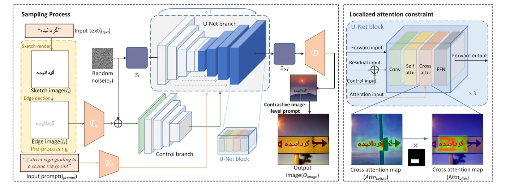
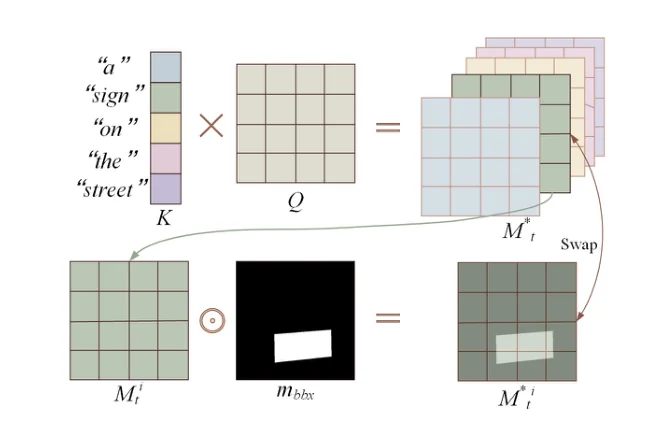
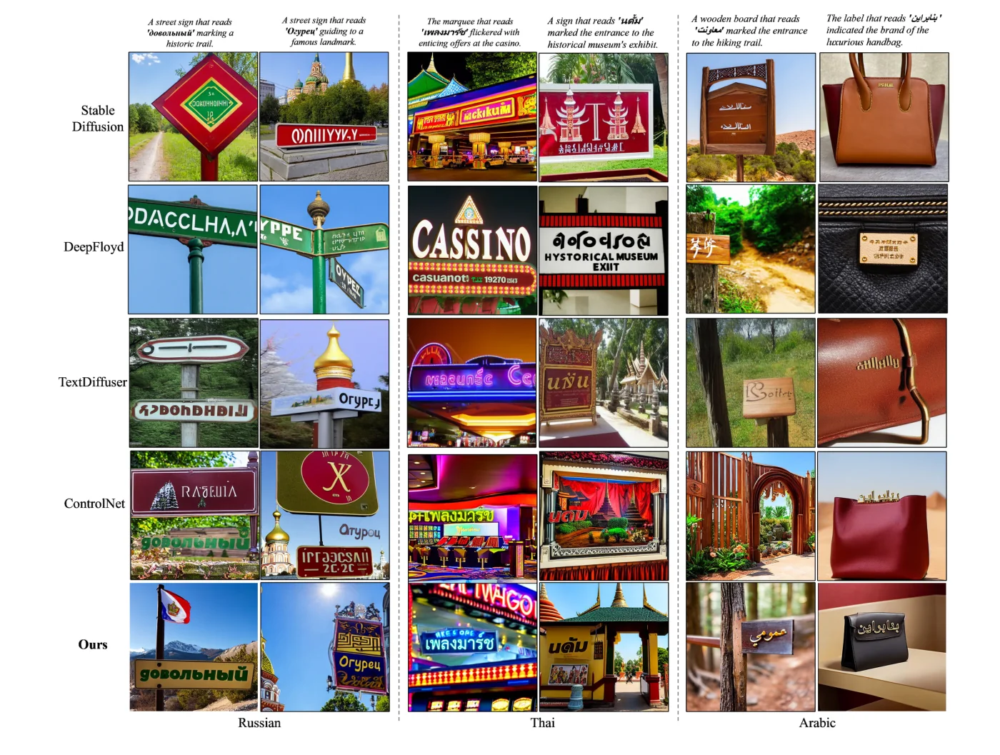

> - **논문**: Brush Your Text: Synthesize Any Scene Text on Images via Diffusion Model
> - **저자**: Lingjun Zhang, Xinyuan Chen, Yaohui Wang, Yue Lu, Yu Qiao (East China Normal University, Shanghai AI Laboratory)
> - **학회**: AAAI 2024 · [arXiv:2312.12232](https://arxiv.org/abs/2312.12232) · [코드](https://github.com/ecnuljzhang/brush-your-text)
{: .prompt-tip }

> [GlyphDraw]()는 글리프 조건을 학습시켜 글자를 쓰게 했다. 하지만 아랍어, 태국어, 카자흐어처럼 데이터가 적은 수천 개의 언어마다 수십만 장을 모아 학습할 수는 없다. **Diff-Text**(논문 제목은 Brush Your Text)는 **학습이 전혀 없는** 틀이다. 글자를 스케치로 렌더링해 Canny 에지를 뽑고 기존 ControlNet에 넣되, 에지가 "이상한 무늬"가 아니라 "표지판 위의 글자"로 해석되도록 cross-attention과 가이던스를 추론 때만 조작한다. 다섯 언어에서 OCR 정확도가 기존 방법 대비 평균 25%p 올랐다.

## 1. 문제: 에지는 글자로 읽히지 않는다

ControlNet(canny)에 렌더링한 글자의 에지를 주면 모양은 따라오지만 두 가지가 어긋난다.

- **위치의 비합리성.** 글자가 허공이나 하늘에 떠 있고, 표지판·간판 같은 글자가 놓일 물체와 무관하게 배치된다.
- **획의 오해.** 학습 데이터에 드문 문자는 에지가 물체 윤곽으로 해석되어 "O"가 원형 무늬가 되거나 획이 덧붙어 읽을 수 없게 된다. 소수 언어에서 특히 심하다.

Prompt-to-Prompt의 관찰처럼, 프롬프트의 단어가 이미지의 어디에 영향을 주는지는 cross-attention 맵이 결정한다. Diff-Text는 이 맵과 가이던스를 조작해 두 문제를 해결한다.

## 2. 방법

### 전처리와 전체 흐름


_Figure 2. 왼쪽: 입력 텍스트를 스케치로 렌더링하고 에지를 뽑아 ControlNet(control branch)에 넣고, 장면 프롬프트는 U-Net branch로 넣는다. 오른쪽: U-Net 블록의 cross-attention에서 "sign" 토큰의 attention 맵을 글자 상자 마스크로 제한하는 과정. (출처: Zhang et al., 2024)_

입력 텍스트 $$I_{text}$$를 무작위 폰트로 흰 바탕에 검은 글자 스케치 $$I_s$$로 렌더링하고(위치는 사용자가 주거나 무작위), Canny로 에지 이미지 $$I_e$$를 만들어 ControlNet 분기에 넣는다. 장면 설명 프롬프트 $$I_{prompt}$$는 텍스트 인코더로 UNet 분기에 들어간다. 모델은 runwayml/stable-diffusion-v1-5와 lllyasviel/sd-controlnet-canny 그대로이고, 512×512 출력이다.

### Localized attention constraint

글자 상자는 스케치에서 바로 알 수 있으므로 상자 마스크 $$m_{bbx}$$를 만든다. 프롬프트에서 글자가 놓일 만한 단어("sign", "billboard", "label", "notice", "board", "blackboard", "slogan", "logo" 등 단어 목록)의 토큰 인덱스 집합 $$I$$에 대해, 매 디퓨전 단계·모든 층에서 cross-attention 맵 $$M_t \in \mathbb{R}^{HW \times d_t}$$를 고친다.

$$
M_t^{*} = \{\lambda \cdot M_t^{i} \odot m_{bbx} \mid i \in I\}, \qquad \lambda = 6.0
$$


_Figure 3. "sign" 토큰의 attention 맵 $$M_t^i$$에 글자 상자 마스크 $$m_{bbx}$$를 원소별로 곱해 새 맵으로 바꿔 끼운다(swap). (출처: Zhang et al., 2024)_

"sign" 토큰은 글자 상자 안에서만, 더 강하게 attention하도록 강제된다. 그러면 표지판이 글자 자리에 생기고, 글자가 그 위에 얹혀 배경과 자연스럽게 섞인다. UNet 분기와 ControlNet 분기 모두에 적용한다.

### Contrastive image-level prompts

attention 제한은 글자를 받칠 물체가 생성될 때만 작동한다. "sign" 토큰의 attention이 0에 가까우면 아무 효과가 없다. 그래서 이미지 수준 조건에도 양·음의 방향을 준다.

- **양의 프롬프트(PIP)** $$I'_e$$: 원래 에지 이미지에 글자 상자의 테두리(폭 1픽셀)를 그려 넣은 것. 네트워크에 "여기 사각형 물체가 있다"는 힌트를 줘서 표지판류를 유도한다.
- **음의 프롬프트(NIP)** $$\varnothing$$: 완전히 흰 스케치. 에지 조건이 없는 예측을 기준점으로 삼아 에지 방향을 강조한다.

가이던스 식은 classifier-free guidance를 확장한 형태이다.

$$
\begin{aligned}
\tilde\epsilon &= \epsilon(z_t, \varnothing, \varnothing) + s_{cfg}\left[\epsilon(z_t, \varnothing, I_{prompt}) - \epsilon(z_t, \varnothing, \varnothing)\right] + s_{neg}\left[\epsilon'(z_t, I_e, I_{prompt}) - \epsilon(z_t, \varnothing, I_{prompt})\right] \\
\epsilon' &= \epsilon(z_t, I_e, I_{prompt}) + s_{pos}\left[\epsilon(z_t, I'_e, I_{prompt}) - \epsilon(z_t, I_e, I_{prompt})\right]
\end{aligned}
$$

$$s_{cfg} = 7.5$$, $$s_{neg} = 2.0$$, $$s_{pos} = 0.1$$이다. $$s_{pos}$$는 배경에 표지판이 나타나는 강도를, $$s_{neg}$$는 글자의 선명도를 조절한다. 부록은 이 식을 베이즈 정리로 $$\nabla \log P(z_t) + \nabla \log P(I_{prompt} \mid z_t) + \nabla \log P(I_e \mid z_t, I_{prompt})$$로 나눈 두 조건 CFG로 설명한다.

### 구현 디테일

| 항목 | 값 |
|---|---|
| 프레임워크 | Hugging Face Diffusers |
| 사전학습 모델 | `runwayml/stable-diffusion-v1-5`, `lllyasviel/sd-controlnet-canny` (추가 학습 없음) |
| 출력 해상도 | 512×512, 추론은 A100 1장 |
| Attention 제한 | UNet 분기와 ControlNet 분기 모두, $$\lambda = 6.0$$ |
| 가이던스 | $$s_{cfg} = 7.5$$, $$s_{neg} = 2.0$$, $$s_{pos} = 0.1$$ |
| 단어 목록 | sign, billboard, label, promotions, notice, marquee, board, blackboard, slogan, whiteboard, logo |
| 비교 모델 설정 | SD·ControlNet은 50 step, CFG 7.5(ControlNet control scale 1.0), DeepFloyd는 기본 3단 캐스케이드(1024×1024), TextDiffuser는 template 모드에 같은 스케치 입력 |

## 3. 코드로 보기: attention 제한과 가이던스 식

무작위 cross-attention 맵에서 "sign" 토큰의 attention 질량이 상자 안으로 얼마나 모이는지 보고, 가이던스 식이 네 번의 UNet 호출을 어떤 가중치로 섞는지 확인한다.

```python
import numpy as np
rng = np.random.default_rng(0)
H = W = 16; tokens = ["a", "street", "with", "a", "sign", "at", "night"]
M = rng.random((H * W, len(tokens))); M /= M.sum(0, keepdims=True)      # cross-attention map, HW x tokens
bbox = np.zeros((H, W)); bbox[5:9, 3:13] = 1; mask = bbox.reshape(-1)  # text box from the rendered sketch
I = [i for i, t in enumerate(tokens) if t in {"sign", "billboard", "notice", "board"}]
lam = 6.0
M_star = M.copy()
for i in I: M_star[:, i] = lam * M[:, i] * mask                           # localized attention constraint
def inside(Mx, i): return Mx[mask == 1, i].sum() / Mx[:, i].sum()
print(f"box covers {mask.mean()*100:.0f}% of the pixels")
for i, t in enumerate(tokens):
    print(f"  token '{t:<6}' attention mass inside box: before {inside(M, i):.2f}  after {inside(M_star, i):.2f}")

# contrastive image-level prompts: the guided noise estimate is a linear combination of four U-Net calls
def guided(e_uu, e_up, e_ep, e_eposp, s_cfg=7.5, s_neg=2.0, s_pos=0.1):
    e_prime = e_ep + s_pos * (e_eposp - e_ep)                              # positive image-level prompt (box drawn on edge image)
    return e_uu + s_cfg * (e_up - e_uu) + s_neg * (e_prime - e_up)         # negative image-level prompt (blank sketch) as baseline
e = {k: rng.standard_normal(4) for k in ["uu", "up", "ep", "eposp"]}
cfg_only = e["uu"] + 7.5 * (e["up"] - e["uu"])
print()
print("with s_neg = 0, s_pos = 0 the rule reduces to classifier-free guidance:",
      np.allclose(guided(e["uu"], e["up"], e["ep"], e["eposp"], s_neg=0, s_pos=0), cfg_only))
full = guided(e["uu"], e["up"], e["ep"], e["eposp"])
print("effective weights on the four calls (s_cfg=7.5, s_neg=2.0, s_pos=0.1):")
for name, w in [("eps(z, none, none)", 1 - 7.5), ("eps(z, none, prompt)", 7.5 - 2.0), ("eps(z, edge, prompt)", 2.0 * (1 - 0.1)), ("eps(z, edge+box, prompt)", 2.0 * 0.1)]:
    print(f"  {name:<26} {w:+.2f}")
print("weights sum to", round((1 - 7.5) + (7.5 - 2.0) + 2.0 * 0.9 + 2.0 * 0.1, 6), "-> the estimate stays on the noise scale")
```

```text
box covers 16% of the pixels
  token 'a     ' attention mass inside box: before 0.16  after 0.16
  token 'street' attention mass inside box: before 0.14  after 0.14
  token 'with  ' attention mass inside box: before 0.16  after 0.16
  token 'a     ' attention mass inside box: before 0.17  after 0.17
  token 'sign  ' attention mass inside box: before 0.15  after 1.00
  token 'at    ' attention mass inside box: before 0.15  after 0.15
  token 'night ' attention mass inside box: before 0.16  after 0.16

with s_neg = 0, s_pos = 0 the rule reduces to classifier-free guidance: True
effective weights on the four calls (s_cfg=7.5, s_neg=2.0, s_pos=0.1):
  eps(z, none, none)         -6.50
  eps(z, none, prompt)       +5.50
  eps(z, edge, prompt)       +1.80
  eps(z, edge+box, prompt)   +0.20
weights sum to 1.0 -> the estimate stays on the noise scale
```

- 상자는 픽셀의 16%인데, 제한 전 "sign" 토큰의 attention은 그 비율만큼(15%)만 상자 안에 있었고 제한 후에는 **100%**가 상자 안에 있다. 다른 토큰은 건드리지 않으므로 배경 묘사는 그대로이다.
- 가이던스는 네 번의 노이즈 예측(무조건, 프롬프트만, 에지+프롬프트, 에지+상자+프롬프트)의 선형 결합이고, $$s_{neg} = s_{pos} = 0$$이면 정확히 CFG로 돌아간다. 가중치 합이 1이라 예측의 스케일은 유지되며, 에지 조건 쪽에 +2.0의 가중치를 줘서 획을 선명하게 만든다. 대신 UNet 호출이 단계당 2회에서 4회로 늘어난다.

## 4. 실험

공개된 다국어 벤치마크가 없어서, 다국어 어휘에서 5자 이상 단어를 언어별 3,000개 뽑고 ChatGPT로 프롬프트를 만들어 방법마다 15,000장(5개 언어 × 3,000)을 생성한다. 지표는 CLIPScore(프롬프트에 "that reads 'xxx'"를 붙여 계산), OCR 정확도(easy-OCR, 단어 단위 일치), 정규화 편집 거리 $$1 - D(s, \tilde s)/\max(\lvert s \rvert, \lvert \tilde s \rvert)$$ 기반 정확도이다.

| 언어 | 지표 | Stable Diffusion | DeepFloyd | TextDiffuser | ControlNet | Diff-Text |
|---|---|---|---|---|---|---|
| 아랍어 | 정확도 / 편집 정확도 | 0.00 / 16.65 | 0.00 / 13.17 | 0.00 / 11.58 | 3.29 / 34.80 | **33.13 / 72.93** |
| 태국어 | 정확도 / 편집 정확도 | 0.00 / 10.70 | 0.00 / 14.51 | 0.00 / 11.64 | 7.16 / 36.34 | **38.41 / 82.97** |
| 러시아어 | 정확도 / 편집 정확도 | 0.00 / 14.60 | 0.00 / 26.05 | 1.38 / 37.72 | 9.79 / 39.21 | **39.29 / 80.58** |
| 영어 | 정확도 / 편집 정확도 | 0.08 / 32.75 | 16.67 / 66.20 | 43.91 / 84.84 | 12.88 / 40.04 | **61.03 / 89.52** |
| 중국어 | 정확도 / 편집 정확도 | 0.00 / 3.89 | 0.00 / 6.83 | 0.00 / 9.60 | 5.88 / 26.81 | **32.40 / 68.75** |

| CLIPScore ↑ | SD | DeepFloyd | TextDiffuser | ControlNet | Diff-Text |
|---|---|---|---|---|---|
| 아랍어 | 0.7961 | 0.7335 | 0.8084 | 0.8067 | **0.8138** |
| 태국어 | 0.7733 | 0.7926 | 0.7873 | 0.8059 | **0.8164** |
| 러시아어 | 0.7948 | 0.8201 | 0.8335 | 0.8306 | **0.8632** |
| 영어 | 0.7879 | 0.8658 | **0.8666** | 0.7334 | 0.8649 |
| 중국어 | 0.8265 | 0.8347 | 0.8201 | 0.8312 | **0.8351** |


_Figure 5. 러시아어(왼쪽 두 열), 태국어(가운데), 아랍어(오른쪽)에서 SD, DeepFloyd, TextDiffuser, ControlNet, Diff-Text(맨 아래) 비교. (출처: Zhang et al., 2024)_

- 소수 언어에서 SD, DeepFloyd, TextDiffuser(영어 학습)는 정확도 0~1.4%이다. 같은 사전학습 모델을 쓰는 ControlNet도 3~10%인데, 추론만 바꾼 Diff-Text가 **33~39%**로 올린다. 에지 조건이 있었어도 "글자로 해석"되지 않았던 것이 문제였음을 보여 준다.
- 영어에서는 전용 학습 모델 TextDiffuser(43.9%)보다 높은 61.0%이다. CLIPScore는 영어에서만 3위(1위 TextDiffuser와 0.0017 차)이고 나머지 네 언어는 1위라 배경 품질을 잃지 않는다.
- 정성 비교에서 SD와 DeepFloyd는 영어도 단어를 여러 번 반복하거나 철자를 틀리고, ControlNet은 글자를 허공에 띄운다.
- 정량 ablation(논문 Table 2)은 세 요소가 모두 필요하다는 것을 보여 준다. 특히 NIP를 빼면 정확도가 3분의 1 이하로 떨어진다.

| 설정 | CLIPScore | 정확도 | 편집 정확도 |
|---|---|---|---|
| Attention 제한 없음 | 0.8065 | 31.42 | 74.30 |
| PIP 없음 | 0.7935 | 27.68 | 70.92 |
| NIP 없음 | 0.7718 | 10.39 | 50.95 |
| **전체 모델** | **0.8108** | **35.48** | **77.22** |

- Attention 히트맵은 제한 없이 "sign" 토큰이 흩어지던 것이 제한 후 글자 상자에 모이는 것을 보여 준다. $$s_{pos}$$를 키우면 표지판이 더 뚜렷해지지만 너무 크면 표지판이 평평하고 도드라져 보이고, $$s_{neg}$$를 키우면 글자가 선명해지지만 너무 크면 글자가 엉뚱한 곳에 떠 있게 된다.
- 수치를 읽을 때는 OCR 자체의 상한도 봐야 한다. 렌더링한 스케치(정답 글자 그대로)를 easy-OCR에 넣었을 때 정확도가 영어 92.80, 중국어 60.85, 아랍어 60.67, 태국어 72.05, 러시아어 53.67%이다. 소수 언어의 33~39%는 이 상한에 비춰 읽어야 한다.

## 5. 해석

**1. 학습 없는 방법이 학습한 방법을 이긴 지점이 분명하다.** 소수 언어처럼 데이터가 없는 상황에서 그렇다. GlyphDraw와 TextDiffuser는 언어별 수십만 장이 필요하지만 Diff-Text는 폰트 파일만 있으면 된다. 반대로 데이터가 많은 영어·중국어에서는 학습 방법이 더 높은 정확도에 이를 여지가 있다(GlyphDraw 중국어 74%, 벤치마크는 다름).

**2. 문제를 "모양"이 아니라 "해석"으로 재정의했다.** ControlNet은 이미 모양을 정확히 따라온다. 부족한 것은 그 모양이 글자이고 표지판 위에 있어야 한다는 의미적 해석이고, 이것을 cross-attention이 담당한다는 Prompt-to-Prompt 계열의 발견을 생성 제어에 활용했다. 위 실험의 attention 질량 변화가 그 조작에 해당한다.

**3. 가이던스 식의 확장은 CFG의 자연스러운 일반화이다.** 텍스트 조건에 대한 CFG처럼 이미지 조건에도 "없음"과 "있음"의 차이 방향을 더하고, 거기에 "상자 힌트" 방향을 하나 더 얹었다. [디퓨전 가속]() 논문들이 CFG 호출을 줄이려 애쓰는 반면 여기서는 호출을 단계당 4회(CFG의 2배)로 늘려 품질을 사는 반대 방향을 택했다.

**4. 한계는 조건의 출처에 있다.** 글자 위치와 폰트가 스케치에서 정해지므로 디퓨전 모델이 장면에 맞는 폰트·원근·조명을 스스로 고르지 못한다. GlyphDraw의 마스크 예측이 원근을 반영한 것과 대비된다. 긴 문장, 곡면 위의 글자, 여러 줄 배치도 다루지 않는다. 저자들이 직접 꼽은 실패 사례는 작은 글자(획이 뭉개져 읽을 수 없음), 글자 색 제어 불가, 그리고 의도하지 않은 영어 글자가 섞여 나오는 경우이다. 상자 위치와 단어 목록을 사람이 정해야 한다는 점은 GPT-4로 자동화할 수 있다고 제안한다.

**5. 평가를 읽을 때 주의할 점.** 테스트 프롬프트는 ChatGPT로 생성했고 "sign"류 단어가 포함되기 쉬워 방법에 유리할 수 있다. OCR 정확도는 easy-OCR의 언어별 성능에 의존하며, 단어 수준 완전 일치라 편집 거리 지표와 차이가 크다. 비교 대상 중 TextDiffuser는 템플릿 모드로, DeepFloyd는 1024 해상도로 돌려 조건이 완전히 같지는 않다. 위 toy의 attention 맵은 무작위라 실제 모델에서 "sign" 토큰이 처음부터 얼마나 집중되어 있는지는 보여 주지 못한다.

## 6. 정리

| 항목 | 내용 |
|---|---|
| 문제 | 소수 언어 장면 텍스트는 학습 데이터가 없고, ControlNet 에지는 글자로 해석되지 않음 |
| 입력 | 텍스트 → 스케치(무작위 폰트, 상자 위치) → Canny 에지 → ControlNet; 장면 프롬프트 → UNet |
| Attention 제한 | "sign"류 토큰의 cross-attention을 $$\lambda = 6$$배 하고 글자 상자 밖은 0 |
| 대조 프롬프트 | PIP(에지 + 상자 테두리, $$s_{pos} = 0.1$$), NIP(흰 스케치 기준, $$s_{neg} = 2.0$$), CFG $$s_{cfg} = 7.5$$ |
| 비용 | 학습 0, 추론 때 단계당 UNet 호출 4회 |
| 결과 | 아랍어·태국어·러시아어 정확도 33~39%(ControlNet 3~10%), 영어 61.0%(TextDiffuser 43.9%) |

## References

- Zhang, Chen, Wang, Lu, Qiao, "Brush Your Text: Synthesize Any Scene Text on Images via Diffusion Model," AAAI 2024. [arXiv:2312.12232](https://arxiv.org/abs/2312.12232)
- Zhang, Rao, Agrawala, "Adding Conditional Control to Text-to-Image Diffusion Models," ICCV 2023. [arXiv:2302.05543](https://arxiv.org/abs/2302.05543)
- Hertz et al., "Prompt-to-Prompt Image Editing with Cross Attention Control," ICLR 2023. [arXiv:2208.01626](https://arxiv.org/abs/2208.01626)
- Chen et al., "TextDiffuser: Diffusion Models as Text Painters," NeurIPS 2023. [arXiv:2305.10855](https://arxiv.org/abs/2305.10855)
- Ho, Salimans, "Classifier-Free Diffusion Guidance," 2022. [arXiv:2207.12598](https://arxiv.org/abs/2207.12598)
