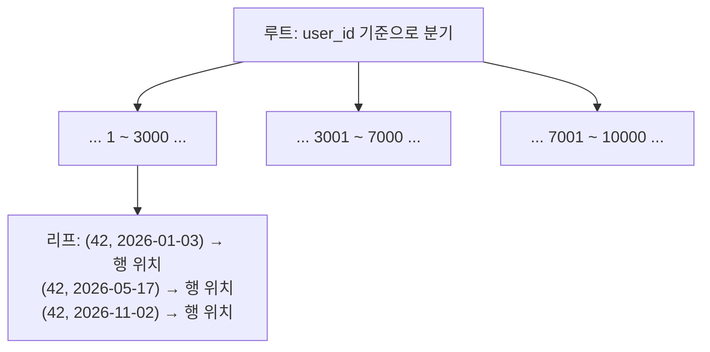

인덱스는 특정 조건으로 데이터를 찾을 때 탐색 범위를 줄여 주는 자료구조입니다. 책의 색인처럼 필요한 위치를 빠르게 찾도록 돕지만, 모든 컬럼에 무조건 추가하는 것은 좋지 않습니다.

> 책의 색인 비유는 "정렬된 목록으로 위치를 바로 찾는다"는 점까지만 맞습니다. 실제 인덱스는 데이터가 바뀔 때마다 DB가 자동으로 함께 고쳐야 하는 **별도의 자료구조**라서, 책 색인과 달리 쓰기 비용이 듭니다.
{: .prompt-info }

## 인덱스가 없으면 무슨 일이 생기나

인덱스가 없는 테이블에서 `WHERE user_id = 42`를 찾으려면 DB는 **모든 행을 처음부터 끝까지 읽어야** 합니다. 이를 풀 테이블 스캔(full table scan)이라 하고, 행이 N개면 시간은 N에 비례(O(N))합니다.

대부분의 관계형 DB는 인덱스를 **B-Tree**(정확히는 B+Tree 계열)로 만듭니다. B-Tree는 키를 정렬된 상태로 유지하는 균형 트리라서, 원하는 키까지 O(log N)번의 비교로 내려갈 수 있습니다. 한 노드에 키를 수백 개씩 담기 때문에, 행이 수억 개여도 보통 트리 높이는 3~4단계에 그칩니다. 디스크를 몇 번만 읽어도 원하는 위치에 닿는다는 뜻입니다.



## 조회 패턴을 먼저 확인하기

예를 들어 사용자별 주문을 자주 조회한다면 `orders.user_id`를 조건으로 사용하는 쿼리를 살펴볼 수 있습니다.

```sql
SELECT id, created_at, total
FROM orders
WHERE user_id = 42
ORDER BY created_at DESC;
```

실제 데이터베이스에서 실행 계획을 확인한 뒤, 이 조건과 정렬에 맞는 인덱스를 검토합니다. **실행 계획(execution plan)**이란 DB가 쿼리를 어떤 순서와 방법(풀 스캔인지, 어떤 인덱스를 쓰는지)으로 처리할지 정한 계획으로, `EXPLAIN` 명령으로 볼 수 있습니다.

```sql
CREATE INDEX idx_orders_user_created
ON orders (user_id, created_at);
```

이 인덱스는 `(user_id, created_at)` 쌍을 정렬해 둡니다. 그래서 `user_id = 42`인 구간을 한 번에 찾을 수 있고, **그 구간 안은 이미 `created_at` 순으로 정렬되어 있으므로** `ORDER BY created_at DESC`를 위해 따로 정렬할 필요도 없습니다(인덱스를 거꾸로 읽으면 됩니다).

## 직접 확인해 보기 (Python + SQLite)

설치 없이 Python 표준 라이브러리의 `sqlite3`만으로 실행할 수 있는 예제입니다. 주문 50만 건을 넣고 인덱스 전후의 실행 계획과 시간을 비교합니다.

```python
import random
import sqlite3
import time

conn = sqlite3.connect(":memory:")  # 파일 없이 메모리에 임시 DB 생성
cur = conn.cursor()
cur.execute("""
CREATE TABLE orders (
    id         INTEGER PRIMARY KEY,
    user_id    INTEGER NOT NULL,
    created_at TEXT    NOT NULL,
    total      INTEGER NOT NULL
)""")

# 사용자 1만 명, 주문 50만 건의 가짜 데이터
random.seed(0)
rows = [(random.randint(1, 10_000),
         f"2026-{random.randint(1, 12):02d}-{random.randint(1, 28):02d}",
         random.randint(1_000, 100_000)) for _ in range(500_000)]
cur.executemany("INSERT INTO orders (user_id, created_at, total) VALUES (?, ?, ?)", rows)

query = """
SELECT id, created_at, total
FROM orders
WHERE user_id = 42
ORDER BY created_at DESC
"""

def show_plan(label):
    print(f"[{label}]")
    for row in cur.execute("EXPLAIN QUERY PLAN " + query):
        print("  ", row[-1])  # 마지막 열이 사람이 읽는 실행 계획

def timeit(label, n=50):
    start = time.perf_counter()
    for _ in range(n):
        cur.execute(query).fetchall()
    print(f"[{label}] 평균 {(time.perf_counter() - start) / n * 1000:.2f} ms")

show_plan("인덱스 없음")
timeit("인덱스 없음")

cur.execute("CREATE INDEX idx_orders_user_created ON orders (user_id, created_at)")
show_plan("복합 인덱스 (user_id, created_at)")
timeit("복합 인덱스 (user_id, created_at)")

# 선두 컬럼(user_id) 없이 created_at만 조건으로 쓰면?
print("[created_at만 조건]")
for row in cur.execute("EXPLAIN QUERY PLAN SELECT * FROM orders WHERE created_at = '2026-03-01'"):
    print("  ", row[-1])
```

실행 결과 (Python 3.14, SQLite 3.50.4 — 시간은 실행 환경마다 다릅니다):

```text
[인덱스 없음]
   SCAN orders
   USE TEMP B-TREE FOR ORDER BY
[인덱스 없음] 평균 13.97 ms
[복합 인덱스 (user_id, created_at)]
   SEARCH orders USING INDEX idx_orders_user_created (user_id=?)
[복합 인덱스 (user_id, created_at)] 평균 0.03 ms
[created_at만 조건]
   SCAN orders
```

결과를 읽는 방법은 다음과 같습니다.

- **인덱스 없음**: `SCAN orders`는 풀 테이블 스캔, `USE TEMP B-TREE FOR ORDER BY`는 정렬을 위해 임시 구조를 따로 만들었다는 뜻입니다.
- **복합 인덱스**: `SEARCH ... USING INDEX`로 바뀌었고, 정렬 단계가 사라졌습니다. 인덱스 순서를 그대로 쓰기 때문입니다.
- **created_at만 조건**: 같은 인덱스가 있는데도 다시 `SCAN`입니다. 이것이 아래에서 설명할 선두 컬럼 규칙입니다.

## 복합 인덱스의 컬럼 순서

복합 인덱스의 컬럼 순서는 중요합니다. `(user_id, created_at)` 인덱스는 전화번호부가 "성 → 이름" 순으로 정렬된 것과 같습니다. 성만 알아도 찾을 수 있지만, 이름만 알아서는 처음부터 다 훑어야 합니다.

| 조건 | `(user_id, created_at)` 인덱스 사용 |
| --- | --- |
| `WHERE user_id = 42` | 사용 |
| `WHERE user_id = 42 AND created_at >= '2026-06-01'` | 사용 (두 컬럼 모두 활용) |
| `WHERE created_at = '2026-03-01'` | 보통 사용 못 함 (선두 컬럼이 빠짐) |

이를 **선두 컬럼(leftmost prefix) 규칙**이라고 합니다. 어떤 쿼리가 첫 번째 컬럼을 조건으로 사용하는지 등 실제 조회 패턴을 확인해야 합니다. 위 예시가 모든 데이터베이스와 상황에서 최선의 인덱스라는 뜻은 아닙니다.

<details markdown="1">
<summary>더 알아보기: 선두 컬럼이 빠져도 인덱스를 쓰는 경우</summary>

Oracle, MySQL 8.0 이상, SQLite 등은 선두 컬럼의 값 종류가 아주 적을 때 각 값마다 인덱스를 건너뛰며 찾는 **skip scan**을 쓰기도 합니다. 다만 옵티마이저가 통계를 보고 판단하는 것이라 항상 일어나지는 않습니다. 위 실험에서도 user_id 종류가 1만 개라 SQLite는 풀 스캔을 골랐습니다.

또 SELECT하는 컬럼이 모두 인덱스 안에 있으면 테이블 본문을 읽지 않고 인덱스만으로 답할 수 있는데, 이런 인덱스를 **커버링 인덱스(covering index)**라고 합니다. 위 예제에서 `total`까지 인덱스에 넣으면 커버링 인덱스가 되지만, 그만큼 인덱스가 커집니다.
</details>

## 비용도 함께 고려하기

인덱스는 조회를 빠르게 할 수 있지만 저장 공간을 사용하고, 데이터 삽입·수정·삭제 시 함께 갱신되어야 합니다. 인덱스가 5개인 테이블에 행 하나를 넣으면, 테이블 본문과 함께 B-Tree 5개를 모두 고쳐야 합니다.

데이터가 적거나 선택도가 낮은 컬럼에서는 인덱스가 기대만큼 도움이 되지 않을 수도 있습니다. **선택도(selectivity)**란 조건 하나로 전체 행 중 얼마나 적은 비율이 걸러지는지를 말합니다. 예를 들어 값이 `Y`/`N` 두 개뿐인 컬럼은 조건을 걸어도 절반이 남으므로, 인덱스를 따라 행을 하나씩 찾아가는 것보다 그냥 전체를 읽는 편이 빠를 수 있습니다.

따라서 느린 쿼리를 측정하고 실행 계획을 확인한 다음, 대표 데이터로 성능을 비교해 인덱스를 결정하는 것이 좋습니다. DB마다 명령이 조금씩 다릅니다.

| DB | 실행 계획 보기 |
| --- | --- |
| MySQL 8.0+ | `EXPLAIN` / `EXPLAIN ANALYZE` |
| PostgreSQL | `EXPLAIN` / `EXPLAIN ANALYZE` |
| SQLite | `EXPLAIN QUERY PLAN` |

`EXPLAIN ANALYZE`는 쿼리를 **실제로 실행**하고 걸린 시간까지 보여 주므로, 운영 DB에서 `UPDATE`·`DELETE`에 쓸 때는 주의해야 합니다.

## 참고 자료

- [SQLite – Query Planning](https://www.sqlite.org/queryplanner.html)
- [PostgreSQL – Using EXPLAIN](https://www.postgresql.org/docs/current/using-explain.html)
- [MySQL 8.0 – Multiple-Column Indexes](https://dev.mysql.com/doc/refman/8.0/en/multiple-column-indexes.html)
