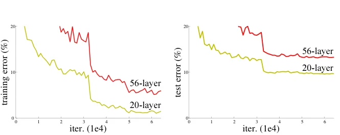
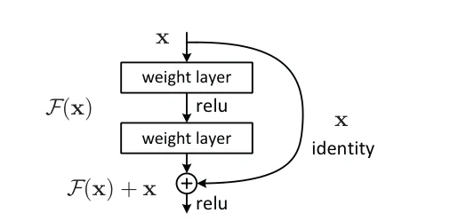
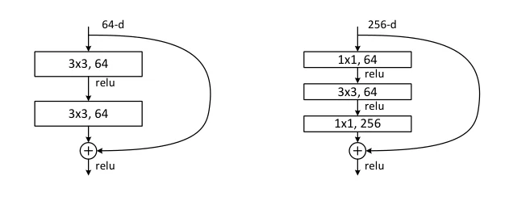

> - **논문**: Deep Residual Learning for Image Recognition
> - **저자**: Kaiming He, Xiangyu Zhang, Shaoqing Ren, Jian Sun (Microsoft Research)
> - **학회**: CVPR 2016 · [arXiv:1512.03385](https://arxiv.org/abs/1512.03385)
{: .prompt-tip }

> CNN Architecture 시리즈의 첫 글이다. 이후 다룰 [DenseNet, SE-Net, RepVGG](), [MobileNetV2]()가 모두 ResNet의 Residual 구조를 바탕으로 하기 때문에 시작점으로 골랐다.

## 1. 깊을수록 좋을까?

VGG는 3×3 필터를 쌓아 네트워크를 16~19층까지 깊게 만들었고, 깊어질수록 성능이 좋아진다는 걸 보여 줬다. 그렇다면 50층, 100층으로 더 쌓으면 더 좋아질까?

실제로는 그렇지 않았다. 두 가지 벽이 있었다.

### Gradient Vanishing / Exploding

역전파는 chain rule에 따라 각 층의 미분값을 계속 곱해 나간다.

$$
\frac{\partial L}{\partial x_1} = \frac{\partial L}{\partial x_n}\prod_{i=1}^{n-1}\frac{\partial x_{i+1}}{\partial x_i}
$$

이 값들이 1보다 작으면 앞쪽 층으로 갈수록 gradient가 0에 가까워지고(vanishing), 1보다 크면 폭발한다(exploding). 다만 이 문제는 **Batch Normalization**과 좋은 초기화(He initialization)로 상당 부분 해결됐다.

### Degradation

진짜 문제는 그다음이었다. BN을 써서 학습 자체는 되는데도, 층을 더 쌓으면 오히려 정확도가 떨어졌다. 논문에서는 CIFAR-10에서 56층 plain network가 20층보다 **train error까지 더 높게** 나오는 결과를 보여 준다(아래 Figure 1).


_Figure 1. CIFAR-10에서 20층·56층 plain network의 training error(왼쪽)와 test error(오른쪽). 56층이 학습 오차부터 더 높다. (출처: He et al., 2016)_

ImageNet에서도 같은 현상이 나온다. 34층 plain network는 18층보다 top-1 error가 높고(28.54% vs 27.94%), 학습 내내 training error도 더 높았다. 논문은 BN을 썼기 때문에 forward 신호와 backward gradient의 크기가 모두 정상이었다고 확인하고, 원인을 gradient vanishing이 아닌 **최적화 난이도**로 본다. 학습 iteration을 3배로 늘려도 degradation은 그대로였다.

Train error가 높다는 것은 overfitting이 원인이 아니라는 뜻이다. 깊은 네트워크가 최적화 자체를 못 하고 있다는 것이다.

생각해 보면 이상한 일이다. 20층 네트워크 뒤에 아무것도 안 하는 층(identity mapping) 36개만 붙여도 56층 네트워크는 최소한 20층만큼은 나와야 한다. 그런데 여러 비선형 층으로 identity를 학습하는 것조차 어렵다는 게 문제였다.

## 2. Residual Learning

ResNet(He et al., 2015)의 아이디어는 간단하다. **목표 함수 $$H(x)$$를 직접 배우지 말고, 입력과의 차이만 배우자.**

$$
F(x) = H(x) - x \quad\Longrightarrow\quad H(x) = F(x) + x
$$

- 층들이 학습하는 것은 **잔차(residual)** $$F(x)$$이다.
- 입력 $$x$$는 층을 거치지 않고 그대로 더해진다. 이 지름길이 **shortcut(skip) connection**이다.


_Figure 2. Residual learning의 기본 블록. weight layer 두 개가 $$F(x)$$를 만들고, 입력 $$x$$가 identity shortcut으로 더해진 뒤 ReLU를 통과한다. (출처: He et al., 2016)_

만약 최적의 변환이 identity라면 $$F(x)=0$$만 만들면 된다. 가중치를 0 근처로 보내는 건 identity를 처음부터 만들어 내는 것보다 훨씬 쉽다. 이미 앞에서 배운 정보 $$x$$를 그대로 가져오고, 필요한 수정분만 덧붙이는 셈이다.

### Gradient 관점

역전파에서도 장점이 있다.

$$
\frac{\partial L}{\partial x} = \frac{\partial L}{\partial H}\left(\frac{\partial F}{\partial x} + 1\right)
$$

$$+1$$ 항 덕분에 $$F$$의 gradient가 아무리 작아져도 gradient가 최소한 그대로 전달되는 통로가 생긴다.

> 엄밀히 말하면 원래 ResNet은 덧셈 **뒤에** ReLU를 한 번 더 통과시켜서, 이 통로가 완전한 identity는 아니다. 같은 저자들의 후속 논문(He et al., ECCV 2016)은 BN·ReLU를 conv **앞으로** 옮긴 **pre-activation** 구조로 shortcut을 순수한 identity로 만들었고, 1000층 이상에서도 학습이 잘되는 것을 보였다.
{: .prompt-info }

### Shortcut의 장점

- 추가 파라미터가 없음 (identity shortcut 기준)
- 연산 복잡도가 거의 늘지 않음 (덧셈 한 번)
- 구현이 매우 간단함

## 3. Identity Shortcut vs Projection Shortcut

$$F(x)$$와 $$x$$를 더하려면 차원이 같아야 한다.

- **Identity shortcut**: 차원이 같을 때 그대로 더한다.

$$
y = F(x, \{W_i\}) + x
$$

- **Projection shortcut**: 차원이 다를 때 $$W_s$$(보통 1×1 conv)로 맞춰 준다.

$$
y = F(x, \{W_i\}) + W_s x
$$

ResNet은 stage가 바뀔 때마다 채널 수를 2배로 늘리고 feature map 크기를 절반으로 줄인다. 이때 shortcut에서 차원을 맞추는 방법으로 논문은 세 가지 옵션을 비교한다. 어느 옵션이든 feature map 크기가 바뀌는 곳에서는 stride 2를 쓴다.

| 옵션 | 차원이 늘어나는 곳 | 나머지 shortcut | ResNet-34 top-1 / top-5 err (%) |
|---|---|---|---|
| plain-34 (shortcut 없음) | - | - | 28.54 / 10.02 |
| A | zero-padding (파라미터 없음) | identity | 25.03 / 7.76 |
| B | projection (1×1 conv) | identity | 24.52 / 7.46 |
| C | projection | 모두 projection | 24.19 / 7.40 |

<small>ImageNet validation, 10-crop testing (논문 Table 3)</small>

세 옵션 모두 plain보다 훨씬 좋고, 옵션끼리의 차이는 작다. 논문은 B가 A보다 나은 이유를 zero-padding된 채널에는 residual learning이 없기 때문으로, C가 B보다 조금 나은 이유를 projection 13개가 더한 파라미터 때문으로 본다. projection은 degradation 해결에 필수가 아니므로, 이후 실험은 메모리와 모델 크기를 아끼기 위해 B를 쓴다. 위 PyTorch 구현은 옵션 B에 해당한다.

## 4. Basic Block과 Bottleneck Block

### Basic Block (ResNet-18/34)

3×3 conv 두 개를 한 묶음으로 쓰고 shortcut을 연결한다.

```python
import torch.nn as nn

class BasicBlock(nn.Module):
    expansion = 1

    def __init__(self, in_ch, out_ch, stride=1):
        super().__init__()
        self.conv1 = nn.Conv2d(in_ch, out_ch, 3, stride, 1, bias=False)
        self.bn1 = nn.BatchNorm2d(out_ch)
        self.conv2 = nn.Conv2d(out_ch, out_ch, 3, 1, 1, bias=False)
        self.bn2 = nn.BatchNorm2d(out_ch)
        self.relu = nn.ReLU(inplace=True)

        self.shortcut = nn.Identity()
        if stride != 1 or in_ch != out_ch:          # projection shortcut
            self.shortcut = nn.Sequential(
                nn.Conv2d(in_ch, out_ch, 1, stride, bias=False),
                nn.BatchNorm2d(out_ch),
            )

    def forward(self, x):
        out = self.relu(self.bn1(self.conv1(x)))
        out = self.bn2(self.conv2(out))
        return self.relu(out + self.shortcut(x))    # F(x) + x

import torch
block = BasicBlock(64, 128, stride=2)               # stage가 바뀌는 블록: projection shortcut 사용
print(block(torch.randn(1, 64, 56, 56)).shape)      # torch.Size([1, 128, 28, 28])
```

### Bottleneck Block (ResNet-50/101/152)

50층 이상에서는 연산량을 줄이기 위해 **1×1 → 3×3 → 1×1** 구조를 쓴다.


_Figure 5. 왼쪽: ResNet-34의 basic block (64채널), 오른쪽: ResNet-50/101/152의 bottleneck block (256채널). 두 블록의 연산량은 비슷하다. (출처: He et al., 2016)_

1. 1×1 conv로 채널을 줄이고 (256 → 64)
2. 줄어든 채널에서 3×3 conv를 수행하고 (64 → 64)
3. 1×1 conv로 다시 채널을 늘린다 (64 → 256)

비싼 3×3 연산을 좁은 채널에서만 하기 때문에 연산량이 크게 줄어든다. 이때 shortcut은 넓은 쪽(256채널)끼리 연결되므로, **projection 대신 identity shortcut을 쓰는 것이 특히 중요하다.** 여기에 projection을 쓰면 블록의 크기와 연산량이 거의 두 배가 되기 때문이다. 아래 코드로 세어 보면 256→64→256 bottleneck 본체는 70,400개, 256→256 projection shortcut(1×1 conv + BN)은 66,048개이다.

```python
class Bottleneck(nn.Module):
    expansion = 4

    def __init__(self, in_ch, mid_ch, stride=1):
        super().__init__()
        out_ch = mid_ch * self.expansion
        self.block = nn.Sequential(
            nn.Conv2d(in_ch, mid_ch, 1, bias=False), nn.BatchNorm2d(mid_ch), nn.ReLU(inplace=True),
            nn.Conv2d(mid_ch, mid_ch, 3, stride, 1, bias=False), nn.BatchNorm2d(mid_ch), nn.ReLU(inplace=True),
            nn.Conv2d(mid_ch, out_ch, 1, bias=False), nn.BatchNorm2d(out_ch),
        )
        self.shortcut = nn.Identity()
        if stride != 1 or in_ch != out_ch:
            self.shortcut = nn.Sequential(
                nn.Conv2d(in_ch, out_ch, 1, stride, bias=False), nn.BatchNorm2d(out_ch)
            )
        self.relu = nn.ReLU(inplace=True)

    def forward(self, x):
        return self.relu(self.block(x) + self.shortcut(x))

b = Bottleneck(256, 64)
print(b(torch.randn(1, 256, 56, 56)).shape)         # torch.Size([1, 256, 56, 56])
print(sum(p.numel() for p in b.parameters()))       # 70400 (identity shortcut이라 shortcut 파라미터 0)
```

위 코드는 stride를 3×3 conv에 둔다. 원 논문은 stride를 첫 1×1 conv에 뒀는데, torchvision 등은 정확도가 조금 더 좋은 이 방식을 써서 흔히 **ResNet v1.5**라고 부른다.

## 5. 구현 디테일

| 항목 | ImageNet | CIFAR-10 |
|---|---|---|
| 데이터 | 1.28M 학습 / 50k 검증 / 100k 테스트, 1000 클래스 | 50k 학습 / 10k 테스트, 10 클래스 |
| 구조 | 18/34층 basic block, 50/101/152층 bottleneck | 첫 3×3 conv + 6n층(feature map 32/16/8, 필터 16/32/64) + GAP + FC, 총 6n+2층 |
| Augmentation | 짧은 변을 [256, 480]에서 무작위로 resize한 뒤 224×224 crop, 좌우 반전, 픽셀 평균 빼기, 표준 color augmentation | 4픽셀 padding 후 32×32 crop, 좌우 반전 |
| 정규화·초기화 | conv 직후·activation 전에 BN, He 초기화, dropout 없음 | 같음 |
| Optimizer | SGD, momentum 0.9, weight decay 0.0001, batch 256 | SGD, momentum 0.9, weight decay 0.0001, batch 128 (GPU 2장) |
| Learning rate | 0.1에서 시작, error가 정체되면 1/10, 최대 60×10⁴ iteration | 0.1에서 시작, 32k·48k iteration에서 1/10, 64k에서 종료 |
| 테스트 | 비교 실험은 10-crop, 최종 결과는 짧은 변 {224, 256, 384, 480, 640} 다중 스케일 평균 | 원본 32×32 한 장 |

ResNet-110은 lr 0.1로 바로 시작하면 수렴이 늦어서, training error가 80% 아래로 내려갈 때까지(약 400 iteration) lr 0.01로 warm-up한 뒤 0.1로 돌아간다.

## 6. 결과

### ImageNet

| 모델 | top-1 err (%) | top-5 err (%) | FLOPs |
|---|---|---|---|
| VGG-16 | 28.07 | 9.33 | 15.3×10⁹ |
| plain-34 | 28.54 | 10.02 | 3.6×10⁹ |
| ResNet-34 (B) | 24.52 | 7.46 | 3.6×10⁹ |
| ResNet-50 | 22.85 | 6.71 | 3.8×10⁹ |
| ResNet-101 | 21.75 | 6.05 | 7.6×10⁹ |
| ResNet-152 | **21.43** | **5.71** | 11.3×10⁹ |

<small>ImageNet validation, 10-crop testing (논문 Table 3). FLOPs는 Table 1과 본문 값.</small>

- 같은 깊이의 plain network와 비교하면, plain은 깊어질수록 error가 오르고(18층 27.94% → 34층 28.54%) ResNet은 깊어질수록 error가 내려간다(27.88% → 25.03%, 옵션 A). Degradation 문제가 해결된 것이다. 18층에서는 둘의 정확도가 비슷하지만 ResNet이 초반에 더 빨리 수렴한다.
- 50층 이후로도 degradation 없이 깊을수록 좋아진다. 최종 테스트 방식(Table 4)으로 잰 ResNet-152의 단일 모델 top-5 error는 **4.49%**로, 이전 방법들의 앙상블 결과보다도 낮다.
- 깊이가 다른 6개 모델을 앙상블해서 테스트셋 top-5 error **3.57%**로 ILSVRC 2015 분류 부문 1위를 차지했다. 사람의 top-5 오차율로 흔히 인용되는 약 5%를 넘어선 결과로 자주 소개된다.
- 152층이지만 연산량은 11.3 GFLOPs로 VGG-16/19(15.3/19.6 GFLOPs)보다 적다. 파라미터도 약 60M으로, VGG-16(약 138M)보다 적다.

### CIFAR-10

| 모델 | 층 수 | 파라미터 | test error (%) |
|---|---|---|---|
| ResNet | 20 | 0.27M | 8.75 |
| ResNet | 56 | 0.85M | 6.97 |
| ResNet | 110 | 1.7M | **6.43** (5회 평균 6.61±0.16) |
| ResNet | 1202 | 19.4M | 7.93 |

<small>논문 Table 6</small>

1202층 네트워크도 최적화 문제 없이 training error 0.1% 미만까지 학습된다. 다만 test error는 110층보다 나쁜데, 논문은 작은 데이터셋에 비해 모델이 너무 커서 생긴 overfitting으로 본다. 이 실험에는 dropout 같은 강한 정규화를 쓰지 않았다.

## 7. 정리

| 키워드 | 핵심 |
|---|---|
| Degradation | 깊을수록 train error도 오르는 최적화 문제 |
| Residual Learning | $$H(x)$$ 대신 $$F(x)=H(x)-x$$를 학습 |
| Shortcut | 파라미터 없이 입력을 출력에 더함, gradient 통로 역할 |
| Projection | 차원이 바뀌는 곳에서만 1×1 conv 사용 |
| Bottleneck | 1×1–3×3–1×1로 깊은 모델의 연산량 절감 |

Residual connection은 이후 거의 모든 딥러닝 모델의 기본 부품이 됐다. Transformer 블록의 "Add & Norm"도 같은 아이디어이다. shortcut을 더하기 대신 **concat**으로 연결한 **DenseNet**은 [CNN 아키텍처 계보 글]()에서 다룬다.

## References

- He et al., "Deep Residual Learning for Image Recognition," CVPR 2016. [arXiv:1512.03385](https://arxiv.org/abs/1512.03385)
- He et al., "Identity Mappings in Deep Residual Networks," ECCV 2016. [arXiv:1603.05027](https://arxiv.org/abs/1603.05027)
- Simonyan & Zisserman, "Very Deep Convolutional Networks for Large-Scale Image Recognition," ICLR 2015.
