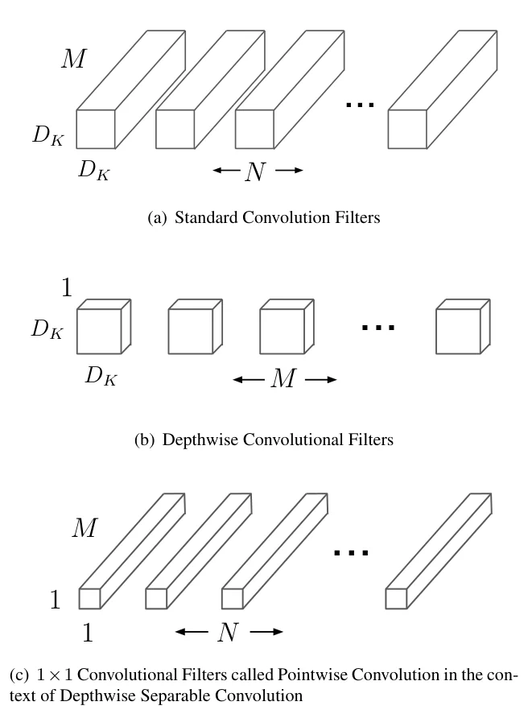
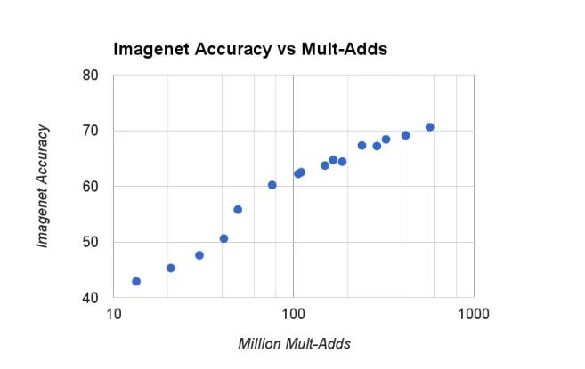

> - **논문**: MobileNets: Efficient Convolutional Neural Networks for Mobile Vision Applications
> - **저자**: Andrew G. Howard, Menglong Zhu, Bo Chen, Dmitry Kalenichenko, Weijun Wang, Tobias Weyand, Marco Andreetto, Hartwig Adam (Google)
> - **학회**: arXiv preprint 2017 · [arXiv:1704.04861](https://arxiv.org/abs/1704.04861)
{: .prompt-tip }

> 경량화 시리즈의 첫 글이다. 이후 다룰 [ShuffleNet](), [Mobile-Former]() 등은 모두 이 글에서 다루는 **Depthwise Separable Convolution**을 기본 부품으로 쓴다.

## 1. 왜 경량화가 필요한가

ResNet, VGG 같은 모델은 정확도는 높지만 크기가 크다.

| 모델 | 파라미터 | 모델 크기 |
|---|---|---|
| VGG-16 | 약 138M | 500MB 이상 |
| ResNet-152 | 약 60M | 약 230MB |

서버라면 문제없지만 스마트폰, 웨어러블, IoT 기기에 올리려면 다음 조건을 만족해야 한다.

- **작은 모델 크기** (저장 공간, 메모리)
- **낮은 연산량** (지연 시간)
- **낮은 전력 소모** (배터리)
- 그러면서도 **쓸 만한 정확도**

MobileNet(Howard et al., 2017)은 이 문제를 "합성곱 연산 자체를 쪼개는" 방식으로 푼다.

## 2. 아이디어의 뿌리: 필터 분해 (Factorization)

Inception 계열에서 이미 비슷한 시도가 있었다. 5×5 필터 하나를 3×3 필터 두 개로 바꾸면 receptive field는 같지만 파라미터는

$$
5 \times 5 = 25 \quad\rightarrow\quad 3\times3 + 3\times3 = 18
$$

로 **약 28% 줄어든다.** 그 사이에 ReLU를 넣으면 비선형성까지 늘어나 성능도 좋아진다. 요지는 "큰 연산을 작은 연산 여러 개로 나눠도 표현력은 크게 잃지 않는다"는 것이다.

MobileNet은 이를 **공간 방향과 채널 방향**으로 분해한다.

## 3. 일반 Convolution의 연산량

기호를 먼저 정리한다.

- 입력 feature map: $$D_F \times D_F$$, 채널 $$M$$
- 커널 크기: $$D_K \times D_K$$
- 출력 채널(필터 개수): $$N$$

일반 conv는 필터 하나가 **모든 입력 채널을 한 번에** 본다.

- 필터 하나, 위치 하나의 계산량: $$D_K^2 \cdot M$$
- 필터 개수: $$N$$
- 출력 위치 수: $$D_F^2$$

$$
\text{Cost}_{\text{conv}} = D_K^2 \cdot M \cdot N \cdot D_F^2
$$

## 4. Depthwise Separable Convolution

일반 conv가 한 번에 하던 두 가지 일, 즉 **공간 정보 섞기**와 **채널 정보 섞기**를 두 단계로 나눈다. 아래 Figure 2가 필터 모양의 차이이다.


_Figure 2. (a) 일반 합성곱 필터 $$N$$개(각각 $$D_K \times D_K \times M$$), (b) 채널마다 하나씩인 depthwise 필터 $$M$$개($$D_K \times D_K \times 1$$), (c) 채널을 섞는 1×1 pointwise 필터 $$N$$개($$1 \times 1 \times M$$). (출처: Howard et al., 2017)_

### Step 1. Depthwise Convolution: 공간만 본다

채널마다 **3×3 필터를 하나씩** 따로 적용한다. 채널끼리는 섞지 않는다.

- 필터 하나의 계산량: $$D_K^2 \cdot 1$$
- 필터 개수: $$M$$ (입력 채널 수만큼)

$$
\text{Cost}_{\text{dw}} = D_K^2 \cdot M \cdot D_F^2
$$

### Step 2. Pointwise Convolution: 채널만 섞는다

1×1 conv로 채널을 섞어 $$N$$개의 출력 채널을 만든다.

- 필터 하나의 계산량: $$1^2 \cdot M$$
- 필터 개수: $$N$$

$$
\text{Cost}_{\text{pw}} = M \cdot N \cdot D_F^2
$$

### 얼마나 줄어드나

$$
\frac{\text{Cost}_{\text{dw}} + \text{Cost}_{\text{pw}}}{\text{Cost}_{\text{conv}}}
= \frac{D_K^2 M D_F^2 + M N D_F^2}{D_K^2 M N D_F^2}
= \frac{1}{N} + \frac{1}{D_K^2}
$$

3×3 커널($$D_K=3$$)이고 출력 채널이 충분히 크면 $$1/N$$은 무시할 수 있으므로 **연산량이 약 1/8 ~ 1/9**로 줄어든다. 논문에서는 이렇게 줄여도 ImageNet 정확도가 약 1%p밖에 떨어지지 않았다고 보고한다(논문 Table 4).

| 모델 | ImageNet Top-1 | Mult-Adds | 파라미터 |
|---|---|---|---|
| 모든 층을 일반 conv로 만든 MobileNet | 71.7% | 4,866M | 29.3M |
| MobileNet (depthwise separable) | 70.6% | 569M | 4.2M |

```python
import torch.nn as nn

def depthwise_separable(in_ch, out_ch, stride=1):
    return nn.Sequential(
        # depthwise: groups=in_ch → 채널별로 독립적인 3x3 conv
        nn.Conv2d(in_ch, in_ch, 3, stride, 1, groups=in_ch, bias=False),
        nn.BatchNorm2d(in_ch),
        nn.ReLU(inplace=True),
        # pointwise: 1x1 conv로 채널 섞기
        nn.Conv2d(in_ch, out_ch, 1, bias=False),
        nn.BatchNorm2d(out_ch),
        nn.ReLU(inplace=True),
    )
```

PyTorch에서는 `groups=in_ch` 한 줄이 depthwise conv를 만든다. (원 논문은 ReLU라고만 적었지만, 공식 TensorFlow 구현과 MobileNetV2는 저정밀도 연산에 유리하도록 출력을 6에서 자르는 **ReLU6**를 썼다.)

### 직접 비교: 파라미터는 1/9, 속도는?

256채널 → 256채널, 56×56 feature map에서 일반 3×3 conv와 비교한다.

```python
import time
import torch
import torch.nn as nn

std = nn.Conv2d(256, 256, 3, 1, 1, bias=False)
ds = depthwise_separable(256, 256)           # 위에서 정의한 함수
count = lambda m: sum(p.numel() for p in m.parameters() if p.dim() > 1)  # conv 가중치만
print(count(std), count(ds), round(count(ds) / count(std), 3))

x = torch.randn(8, 256, 56, 56)
for name, m in [("standard", std), ("dw-separable", ds)]:
    m.eval()
    with torch.no_grad():
        for _ in range(3): m(x)              # 워밍업
        t = time.perf_counter()
        for _ in range(10): m(x)
    print(f"{name:13s} {(time.perf_counter() - t) / 10 * 1000:.1f} ms")
```

```text
589824 67840 0.115
standard      60.1 ms
dw-separable  34.8 ms
```

(PyTorch 2.13 CPU에서 측정한 예시이며, 시간은 환경마다 다르다.)

파라미터와 연산량은 약 1/9로 줄었는데 시간은 2배도 빨라지지 않았다. Depthwise conv는 채널마다 따로 계산해서 불러온 데이터 하나당 계산량(arithmetic intensity)이 매우 낮다. 그래서 연산 장치보다 **메모리 대역폭**이 병목이 되고, GPU처럼 큰 행렬 곱에 최적화된 하드웨어에서는 이 차이가 더 두드러지기도 한다. "FLOPs가 적다 = 빠르다"가 아니라는 점은 [ShuffleNetV2]()가 설계 원칙으로 정리했다.

### 전체 구조와 학습 설정

MobileNet은 첫 층만 일반 3×3 conv(stride 2, 32채널)이고 나머지는 모두 depthwise separable 블록이다. 다운샘플링은 depthwise conv의 stride 2로 하고, 채널은 32 → 64 → 128 → 256 → 512(14×14에서 5번 반복) → 1024로 늘어난 뒤 7×7 평균 풀링과 FC 1000으로 끝난다. depthwise와 pointwise를 따로 세면 **28층**이고, 모든 conv 뒤에 BN과 ReLU가 붙는다.

연산의 대부분은 1×1 conv에 몰려 있다(논문 Table 2). 1×1 conv는 im2col 재배열 없이 바로 GEMM으로 계산할 수 있어 구현 효율이 좋다는 것이 저자들의 설계 근거이다.

| 층 종류 | Mult-Adds 비중 | 파라미터 비중 |
|---|---|---|
| Conv 1×1 (pointwise) | 94.86% | 74.59% |
| Conv DW 3×3 | 3.06% | 1.06% |
| Conv 3×3 (첫 층) | 1.19% | 0.02% |
| Fully Connected | 0.18% | 24.33% |

| 학습 설정 | 값 |
|---|---|
| 프레임워크 | TensorFlow |
| Optimizer | RMSprop, 비동기 경사 하강(Inception V3와 비슷) |
| 정규화·증강 | 큰 모델보다 약하게: side head·label smoothing 없음, 작은 crop 크기 제한으로 왜곡 축소 |
| Weight decay | depthwise 필터에는 거의 또는 전혀 주지 않음(파라미터가 매우 적기 때문) |
| 모델 크기별 설정 | ImageNet 실험은 크기와 상관없이 같은 학습 설정 |

## 5. 더 줄이기: 두 개의 Hyper-parameter

MobileNet은 기기 사양에 맞게 모델 크기를 조절할 수 있는 손잡이를 두 개 제공한다.

### Width Multiplier $$\alpha$$

모든 층의 채널 수를 $$\alpha$$배로 줄인다($$0 < \alpha \le 1$$). 입력 채널 $$M \rightarrow \alpha M$$, 출력 채널 $$N \rightarrow \alpha N$$이 되므로 연산량과 파라미터가 대략 $$\alpha^2$$배가 된다. 보통 1.0, 0.75, 0.5, 0.25를 쓴다.

### Resolution Multiplier $$\rho$$

입력 해상도를 줄인다. 224, 192, 160, 128 같은 값을 쓰며, feature map 크기가 줄어드니 연산량이 대략 $$\rho^2$$배가 된다. 파라미터 수는 변하지 않는다.

$$
\text{Cost} = D_K^2 \cdot \alpha M \cdot \rho^2 D_F^2 + \alpha M \cdot \alpha N \cdot \rho^2 D_F^2
$$

논문 Table 3은 14×14×512 입력, 3×3×512×512 커널인 내부 층 하나에 이 기법들을 차례로 적용한 예이다.

| 층 하나에 누적 적용 | Mult-Adds | 파라미터 |
|---|---|---|
| 일반 conv | 462M | 2.36M |
| Depthwise separable | 52.3M | 0.27M |
| $$\alpha = 0.75$$ | 29.6M | 0.15M |
| $$\rho = 0.714$$ (224 → 160) | 15.1M | 0.15M |

ImageNet에서 두 손잡이를 각각 돌린 결과는 다음과 같다(논문 Table 6, 7).

| 모델 | Top-1 | Mult-Adds | 파라미터 |
|---|---|---|---|
| 1.0 MobileNet-224 | 70.6% | 569M | 4.2M |
| 0.75 MobileNet-224 | 68.4% | 325M | 2.6M |
| 0.5 MobileNet-224 | 63.7% | 149M | 1.3M |
| 0.25 MobileNet-224 | 50.6% | 41M | 0.5M |
| 1.0 MobileNet-192 | 69.1% | 418M | 4.2M |
| 1.0 MobileNet-160 | 67.2% | 290M | 4.2M |
| 1.0 MobileNet-128 | 64.4% | 186M | 4.2M |

$$\alpha = 0.25$$에서 정확도가 크게 꺾이는 것 말고는 완만하게 떨어진다. 층을 줄이는 것보다 폭을 줄이는 쪽이 낫다는 비교도 있다. 14×14×512 블록 5개를 뺀 Shallow MobileNet은 65.3%(307M, 2.9M)로, 비슷한 비용의 0.75 MobileNet(68.4%)보다 3%p 낮다.


_Figure 4. $$\alpha \in \{1, 0.75, 0.5, 0.25\}$$와 해상도 $$\{224, 192, 160, 128\}$$를 조합한 16개 모델의 Mult-Adds(로그 축) 대 ImageNet 정확도. 거의 로그 선형이고 $$\alpha = 0.25$$에서 꺾인다. (출처: Howard et al., 2017)_

## 6. 결과

| 모델 | ImageNet Top-1 | 파라미터 | Mult-Adds |
|---|---|---|---|
| VGG-16 | 71.5% | 138M | 15,300M |
| GoogLeNet | 69.8% | 6.8M | 1,550M |
| **MobileNet 1.0-224** | **70.6%** | **4.2M** | **569M** |

VGG-16과 거의 같은 정확도를 **파라미터 1/32, 연산량 1/27**로 달성했다. 더 작은 0.50 MobileNet-160은 60.2%(76M Mult-Adds, 1.32M 파라미터)로, AlexNet(57.2%, 720M, 60M)보다 4%p 높으면서 45배 작고 연산은 9.4배 적고, SqueezeNet(57.5%, 1,700M, 1.25M)과 크기는 비슷하면서 연산은 22배 적다.

분류 밖에서도 백본으로 쓴다. COCO 검출(mAP, AP@[.5:.95]) 결과는 다음과 같다(논문 Table 13).

| 프레임워크 | 백본 | mAP | Mult-Adds | 파라미터 |
|---|---|---|---|---|
| SSD 300 | VGG | 21.1% | 34.9B | 33.1M |
| SSD 300 | Inception V2 | 22.0% | 3.8B | 13.7M |
| SSD 300 | MobileNet | 19.3% | 1.2B | 6.8M |
| Faster R-CNN 600 | VGG | 25.7% | 149.6B | 138.5M |
| Faster R-CNN 600 | Inception V2 | 21.9% | 129.6B | 13.3M |
| Faster R-CNN 600 | MobileNet | 19.8% | 30.5B | 6.1M |

이 밖에 Stanford Dogs 세밀 분류(83.3%, Inception V3 84%), PlaNet 위치 추정, 얼굴 속성 분류(distillation과 결합해 기준 모델 대비 Mult-Adds 1%로 비슷한 mean AP), FaceNet distillation 실험도 실려 있다.

## 7. 다음 단계: MobileNetV2의 Inverted Residual

MobileNetV2(2018)는 두 가지를 더한다.

### Linear Bottleneck

채널을 좁게 압축한 상태에서 ReLU를 쓰면 0 이하의 값이 잘려 정보가 손실된다. 차원이 낮을수록 이 손실이 치명적이다. 그래서 채널을 줄이는 마지막 1×1 conv 뒤에는 ReLU를 빼고 **선형 출력**을 쓴다.

### Inverted Residual

ResNet의 bottleneck은 "넓게 → 좁게 → 넓게"이고 넓은 쪽끼리 shortcut을 연결한다. MobileNetV2는 반대로 **"좁게 → 넓게(×6 확장) → 좁게"**로 만들고 **좁은 쪽끼리** shortcut을 연결한다.

- 저차원 텐서에 필요한 정보가 압축되어 있다고 가정
- 블록의 입출력이 작아 **메모리 사용이 효율적** (모바일에서 중요)
- 확장된 고차원 공간에서만 depthwise conv로 비선형 변환 수행

## 8. 정리

| 키워드 | 핵심 |
|---|---|
| Depthwise conv | 채널별 독립 3×3 conv, 공간 정보만 처리 |
| Pointwise conv | 1×1 conv, 채널 정보만 처리 |
| 연산량 비율 | $$1/N + 1/D_K^2$$, 3×3 기준 약 1/8~1/9 |
| $$\alpha$$, $$\rho$$ | 채널 폭과 해상도로 크기–정확도 trade-off 조절 |
| V2 | Linear Bottleneck + Inverted Residual |

1×1 pointwise conv마저 무겁다는 문제를 **Group Convolution + Channel Shuffle**로 푼 **ShuffleNet**은 [CNN 아키텍처 계보 글]()에서 다룬다.

## References

- Howard et al., "MobileNets: Efficient Convolutional Neural Networks for Mobile Vision Applications," 2017. [arXiv:1704.04861](https://arxiv.org/abs/1704.04861)
- Sandler et al., "MobileNetV2: Inverted Residuals and Linear Bottlenecks," CVPR 2018. [arXiv:1801.04381](https://arxiv.org/abs/1801.04381)
- Szegedy et al., "Rethinking the Inception Architecture for Computer Vision," CVPR 2016.
