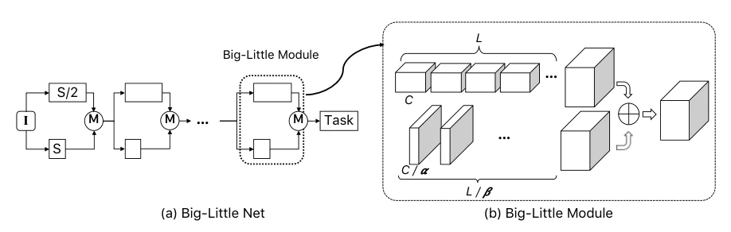
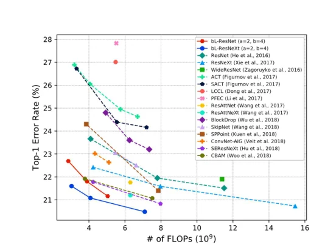

> - **논문**: Big-Little Net: An Efficient Multi-Scale Feature Representation for Visual and Speech Recognition
> - **저자**: Chun-Fu (Richard) Chen, Quanfu Fan, Neil Mallinar, Tom Sercu, Rogerio Feris (IBM T.J. Watson Research Center)
> - **학회**: ICLR 2019 · [arXiv:1807.03848](https://arxiv.org/abs/1807.03848) · [코드](https://github.com/IBM/BigLittleNet)
{: .prompt-tip }

> 이미지 인식에서 다중 스케일 특징은 중요하지만, 고해상도 feature map에 깊은 네트워크를 그대로 적용하면 비싸다. **Big-Little Net**(bL-Net)의 아이디어는 단순하다. 해상도가 낮은 입력에는 크고 깊은 가지(Big-Branch)를, 해상도가 높은 입력에는 얇고 얕은 가지(Little-Branch)를 두고, 둘을 더해서 다음 단계로 보낸다. [ResNet](), ResNeXt, SEResNeXt에 그대로 끼워 넣어 FLOPs를 최대 2배 이상 줄이면서 top-1 오류를 낮췄다.

## 1. 문제: 모든 스케일에 같은 용량을 쓸 필요가 있는가

기존 다중 스케일 설계(Hourglass, 해상도별 네트워크를 따로 돌려 합치는 방식 등)는 여러 해상도의 특징을 만들되 각 해상도에 비슷한 용량의 네트워크를 둔다. 그래서 스케일 수가 늘면 비용도 그만큼 늘어난다. 그런데 고해상도 특징은 **세부 정보**를, 저해상도 특징은 **의미 정보**를 담는다. 의미 정보를 뽑는 데는 깊은 네트워크가 필요하지만, 세부 정보를 보존하는 데는 얕은 네트워크로 충분할 수 있다. 그리고 비용은 해상도의 제곱에 비례하므로, 비싼 연산을 저해상도로 옮기면 전체 비용이 크게 줄어든다.

## 2. 방법

### bL-module

ResNet의 한 단계(같은 해상도의 블록 묶음)를 두 가지로 나눈다. 아래 Figure 1의 (a)가 전체 네트워크, (b)가 모듈 하나이다.


_Figure 1. (a) bL-module을 여러 번 쌓은 Big-Little Net. M은 가지를 합치는 병합 연산이다. (b) Big-Branch는 원래 블록 구조(폭 C, 깊이 L)를 따르고, Little-Branch는 채널을 α배, 층 수를 β배 줄인다. (출처: Chen et al., 2019)_

- **Big-Branch.** 입력을 1/2 해상도로 줄인 뒤 원래 단계와 같은 폭, 같은 깊이(또는 더 깊게)로 처리한다. 가로·세로가 각각 절반이라 픽셀 수가 1/4이므로 비용도 1/4이다.
- **Little-Branch.** 원래 해상도에서 채널을 $$\alpha$$배 줄이고 층 수를 $$\beta$$배 줄여 처리한다. 입력·출력 채널이 모두 $$1/\alpha$$이므로 conv 비용은 $$1/\alpha^2$$, 층 수까지 고려하면 $$1/(\alpha^2 \beta)$$이다.

Big-Branch 출력은 bilinear 업샘플링하고, Little-Branch 출력은 1×1 conv로 채널을 맞춘 뒤 **가중치 1의 원소별 덧셈**으로 합치고, residual block 하나로 한 번 더 섞는다. 논문은 결합 방식(덧셈, concatenation)과 가지 수 $$K > 2$$도 실험했지만 두 가지와 덧셈이 가장 효율적이었다(아래 ablation). 논문은 $$\alpha, \beta$$를 적절히 고르면 Little-Branch 비용이 bL-Net 전체의 1/6, 원래 네트워크의 1/12 수준이라고 설명한다. $$\alpha = 2, \beta = 4$$의 bL-ResNet-50은 FLOPs가 baseline보다 약 30% 적다(4.09G → 2.85G). 첫 7×7 stem과 마지막 단계(2048채널)는 나누지 않는다.

ResNet-50에 적용할 때는 단계마다 전환 블록 하나를 두 가지가 공유하므로 Big-Branch는 원래보다 블록이 1개 적고, Little-Branch 블록 수는 $$\lceil L/\beta \rceil - 1$$(최소 1)이라 bL-ResNet-50에서는 모든 단계에서 1개이다. bL-ResNet-101/152는 14×14 단계에 몰린 블록 일부를 56×56, 28×28 단계로 옮겨 Big-Branch가 큰 스케일 정보를 더 보게 했다.

### 왜 되는가

Little-Branch가 가볍다는 것은 고해상도 경로에 용량이 거의 없다는 뜻이다. 그런데도 성능이 유지되거나 올라가는 이유는, Big-Branch가 저해상도에서 의미 특징을 충분히 뽑고 Little-Branch는 세부 정보를 보존해 더해 주는 역할만 하면 되기 때문이다. 논문은 $$\alpha, \beta$$를 바꿔 가며 Little-Branch 비용이 전체의 15% 미만이어도 저해상도 표현을 잘 보완한다고 보고한다.

## 3. 코드로 보기: 가지별 비용

28×28, 256채널, 6개 conv 층의 단계를 bL-module로 바꿨을 때 Big/Little 가지의 MAC 수가 baseline 대비 얼마인지 센다.

```python
import torch, torch.nn as nn, torch.nn.functional as F

def count_macs(model, x):
    macs = []
    def hook(mod, inp, out):
        if isinstance(mod, nn.Conv2d):
            k = mod.kernel_size[0] * mod.kernel_size[1] * mod.in_channels // mod.groups
            macs.append(out.numel() // out.shape[0] * k)
    hs = [m.register_forward_hook(hook) for m in model.modules()]
    with torch.no_grad(): model(x)
    for h in hs: h.remove()
    return sum(macs)

def stack(C_in, C, K):
    layers = [nn.Conv2d(C_in, C, 3, padding=1)] + [nn.Conv2d(C, C, 3, padding=1) for _ in range(K - 1)]
    return nn.Sequential(*[m for l in layers for m in (l, nn.ReLU())])

class BigLittle(nn.Module):
    def __init__(self, C, K, alpha, beta):
        super().__init__()
        self.big = stack(C, C, K)                             # low resolution, full width, deep
        self.little = stack(C, C // alpha, max(1, K // beta)) # high resolution, narrow, shallow
        self.proj = nn.Conv2d(C // alpha, C, 1)               # match channels before merging
    def forward(self, x):
        b = self.big(F.avg_pool2d(x, 2))
        b = F.interpolate(b, scale_factor=2, mode="bilinear", align_corners=False)
        return F.relu(b + self.proj(self.little(x)))          # merge by addition

C, K = 256, 6
x = torch.randn(1, C, 28, 28)
base = count_macs(stack(C, C, K), x)
print(f"baseline stage: {K} convs x {C}ch @28x28 -> {base/1e9:.3f} GMACs")
print("alpha  beta   big     little  total   ratio")
for alpha, beta in [(2, 4), (2, 2), (4, 4), (4, 2)]:
    m = BigLittle(C, K, alpha, beta)
    big = count_macs(m.big, F.avg_pool2d(x, 2)); lit = count_macs(nn.Sequential(m.little, m.proj), x)
    tot = count_macs(m, x)
    print(f"{alpha:>5}  {beta:>4}   {big/base:.3f}   {lit/base:.3f}   {tot/base:.3f}   {tot/base:.2f}x")
print()
print("paper, bL-ResNet-50 (alpha=2, beta=4): 2.85 GFLOPs vs 4.09 GFLOPs = 0.70x (stem and last stage are not split)")
```

```text
baseline stage: 6 convs x 256ch @28x28 -> 2.775 GMACs
alpha  beta   big     little  total   ratio
    2     4   0.250   0.093   0.343   0.34x
    2     2   0.250   0.176   0.426   0.43x
    4     4   0.250   0.046   0.296   0.30x
    4     2   0.250   0.067   0.317   0.32x

paper, bL-ResNet-50 (alpha=2, beta=4): 2.85 GFLOPs vs 4.09 GFLOPs = 0.70x (stem and last stage are not split)
```

- Big-Branch는 해상도 1/2이므로 정확히 baseline의 1/4이다. Little-Branch는 $$\alpha = 2, \beta = 4$$에서 9%로, 합쳐서 **34%**이다. 논문이 말한 "Little-Branch는 전체의 1/6"은 bL-Net 전체 기준이라, 단계 하나만 센 여기서는 0.093/0.343 ≈ 27%로 더 크게 나온다. 실제 네트워크에서는 나누지 않는 stem과 마지막 단계가 분모에 더해진다.
- $$\alpha$$를 4로 올리면 Little-Branch 비용이 더 줄지만 정확도 손실이 커진다. 논문은 $$\alpha = 2, \beta = 4$$를 기본으로 잡았다.
- 전체 네트워크의 비율(bL-ResNet-50에서 0.70배)이 단계 하나의 비율(0.34배)보다 큰 것은 stem, 마지막 단계, 분류기를 나누지 않기 때문이다.

## 4. 구현 디테일

논문 Appendix A.1, B.1에 적힌 학습 설정이다.

| 항목 | 이미지 분류 (ImageNet) | 음성 인식 (Switchboard+Fisher 2000h) |
|---|---|---|
| 프레임워크 | Tensorpack (TensorFlow) | PyTorch |
| 학습 길이 | 110 epoch | 16 epoch |
| Batch | 256 | 512 (GPU 2장 × 256) |
| Optimizer | Nesterov momentum 0.9, weight decay 1e-4 | Nesterov momentum 0.9, weight decay 1e-6, gradient clipping 10 |
| Learning rate | 초기 0.1, cosine schedule | 0.03, 10 epoch부터 epoch마다 $$\sqrt{0.5}$$배 |
| 입력 | 224×224 random crop (평가: 짧은 변 256으로 resize 후 중앙 224 crop) | 64 logmel × 49 frame, 1·2차 미분을 쌓아 3채널 |
| 출력 | 1000 클래스 | 32k tied CD state, 4M n-gram LM으로 디코딩 |
| 기본 $$\alpha, \beta$$ | 2, 4 | 2, 3 (가장 좋은 설정) |

음성 모델은 시간 축으로는 padding·stride를 하지 않고 **주파수 축으로만** 다운샘플링한다. 그래서 Big-Branch는 주파수 해상도만 절반이 되고, 가지마다 커널이 보는 "가로세로 비율"이 달라진다.

## 5. 실험

**ImageNet, ResNet-50 백본 (Table 1).** $$\alpha, \beta$$를 바꾼 모든 bL-ResNet-50이 baseline보다 정확하면서 가볍다. 변형 간 차이가 작다는 것은 전체의 15% 미만인 가벼운 Little-Branch로도 저해상도 표현을 잘 보완한다는 뜻이다.

| 모델 | Top-1 오류 | GFLOPs | Params (M) |
|---|---|---|---|
| ResNet-50 | 23.66% | 4.09 | 25.55 |
| bL-ResNet-50 ($$\alpha = 2, \beta = 2$$) | 22.72% | 2.91 (1.41×) | 26.97 |
| **bL-ResNet-50 ($$\alpha = 2, \beta = 4$$)** | **22.69%** | 2.85 (1.44×) | 26.69 |
| bL-ResNet-50 ($$\alpha = 4, \beta = 2$$) | 23.20% | 2.49 (1.64×) | 26.31 |
| bL-ResNet-50 ($$\alpha = 4, \beta = 4$$) | 23.15% | 2.48 (1.65×) | 26.24 |

$$\alpha = 2 \to 4$$로 채널을 더 줄이면 FLOPs는 0.4G 줄지만 오류가 약 0.5%p 오른다. 반대로 $$\beta$$(깊이 축소)는 2와 4의 차이가 거의 없다. 논문은 이를 "Little-Branch는 **넓고 얕게**(작은 $$\alpha$$, 큰 $$\beta$$)"라는 설계 원칙으로 정리한다.

**더 깊고 넓은 백본 (Table 2).** Tesla K80, 배치 16 기준 속도이다.

| 모델 | Top-1 오류 | GFLOPs | 속도(ms/batch) |
|---|---|---|---|
| ResNet-101 | 21.95% | 7.80 | 186 |
| bL-ResNet-101 | 21.80% | 3.89 (2.01×) | 140 (1.33×) |
| ResNet-152 | 21.51% | 11.51 | 266 |
| bL-ResNet-152 | 21.16% | 5.04 (2.28×) | 178 (1.49×) |
| ResNeXt-101 (64×4d) | 20.73% | 15.46 | 485 |
| bL-ResNeXt-101 (64×4d) | 20.48% | 7.14 (2.17×) | 263 (1.98×) |
| SEResNeXt-101 (32×4d) | 21.00% | 7.97 | 376 |
| bL-SEResNeXt-101 (32×4d) | 20.87% | 4.08 (1.95×) | 235 (1.60×) |

깊은 모델일수록 절감이 크다(bL-ResNet-50 1.4배, 101 2.0배, 152 2.3배). bL-ResNet-101은 FLOPs 2배 절감에 오류도 낮고, 절감된 FLOPs를 입력 해상도 256에 쓰면 baseline보다 여전히 가벼우면서 더 정확해진다.

| 모델 (@256) | Top-1 오류 | GFLOPs | baseline 대비 |
|---|---|---|---|
| bL-ResNet-101@256 | 21.04% | 5.08 (1.54×) | −0.91%p |
| bL-ResNet-152@256 | 20.34% | 6.58 (1.75×) | −1.17%p |
| bL-ResNeXt-101@256 (64×4d) | 19.65% | 9.32 (1.66×) | −1.08%p |
| bL-SEResNeXt-101@256 (32×4d) | 19.87% | 5.33 (1.50×) | −1.13%p |

실제 속도 향상(1.3~2.0배)은 FLOPs 절감 비율(1.4~2.3배)보다 조금 작다. 논문은 GPU 속도가 이론 FLOPs 절감과 대체로 일치한다고만 쓰고 차이의 원인은 따로 분석하지 않는데, 업샘플링·병합처럼 FLOPs에 잘 안 잡히는 연산이 원인으로 보인다.


_Figure 2. ResNet·ResNeXt를 가속하는 다른 방법(pruning, 동적 라우팅, attention 변형)과의 FLOPs 대비 top-1 오류 비교. 빨강·파랑 실선이 bL-ResNet, bL-ResNeXt이다. (출처: Chen et al., 2019)_

위 Figure 2처럼 bL-ResNet-101은 같은 FLOPs에서 BlockDrop, SkipNet, ConvNet-AIG보다 top-1 정확도가 각각 3.7%p, 2.2%p, 1.2%p 높고, PFEC·LCCL 같은 pruning보다 약 5%p 높다. SEResNeXt, CBAM과 비교하면 비슷한 FLOPs에서 약 1%p 좋거나, 같은 정확도를 약 1.7배 적은 FLOPs로 낸다.

**Ablation (Appendix A.3~A.4, bL-ResNet-50).**

| 실험 | 설정 | Top-1 오류 | GFLOPs |
|---|---|---|---|
| 병합 방식 | **덧셈, K = 2 (기본)** | **22.69%** | 2.85 |
| | concatenation, K = 2 | 24.04% | 2.01 |
| | 덧셈, K = 3 (1/4 해상도까지) | 24.12% | 3.91 |
| 병합 횟수 | **m = 4 (기본)** | **22.69%** | 2.85 |
| | m = 2 | 23.48% | 2.74 |
| | m = 1 | 24.57% | 2.64 |
| 저해상도 입력만 | ResNet-50-lowres | 26.10% | 1.29 |

- concatenation은 FLOPs가 더 적지만 오류가 약 1.4%p 높다. 가지를 3개로 늘리면 Big-Branch가 1/4 해상도까지 내려가 표현력이 떨어지고, 병합 비용 때문에 FLOPs도 거의 줄지 않는다.
- 병합 횟수를 줄여도 FLOPs는 거의 안 줄고 오류만 오른다. 반대로 bL-ResNet-101에서 병합을 4회에서 7회로 늘리면 21.80% → 21.85%로 이득이 없고 FLOPs만 3.89G → 5.21G로 늘어난다. 논문은 feature 차원이 바뀌기 직전마다 한 번씩 합치는 것이 가장 효율적이라고 결론짓는다.
- 입력 해상도를 그냥 절반으로 줄인 ResNet-50-lowres는 FLOPs가 1/3이지만 오류가 2.4%p 오른다. Appendix의 정성 결과에 따르면 고해상도 Little-Branch가 새 부리 모양, 무당벌레 점 같은 작은 단서를 살려 준다.

부록에는 ShuffleNetV2(2× 폭 26.85% → bL@256 26.38%, FLOPs 비슷)와 Faster R-CNN+FPN 검출(COCO bbox mAP 39.2 → 39.5, FLOPs 1.55배 절감) 결과도 있다.

**음성 인식 (Table 3, Hub5'00).** ResNet-22 음향 모델에 같은 구조를 적용했다. WER은 Switchboard(SWB)와 CallHome(CH) 평균이다.

| 모델 | GFLOPs | WER 평균 | SWB | CH |
|---|---|---|---|---|
| ResNet-22 | 1.11 | 14.67% | 11.15% | 18.17% |
| bL-ResNet-22 ($$\alpha = 4, \beta = 1$$) | 0.68 (1.63×) | 14.72% | 11.24% | 18.18% |
| bL-ResNet-22 ($$\alpha = 4, \beta = 2$$) | 0.66 (1.68×) | 14.47% | 10.95% | 17.95% |
| bL-ResNet-22 ($$\alpha = 4, \beta = 3$$) | 0.65 (1.70×) | 14.66% | 11.25% | 18.05% |
| **bL-ResNet-22 ($$\alpha = 2, \beta = 3$$)** | 0.77 (1.43×) | **14.46%** | 11.10% | **17.80%** |
| bL-ResNet-22 ($$\alpha = 4, \beta = 1$$), concat | 0.70 (1.58×) | 14.67% | 11.31% | 18.00% |

가장 좋은 $$\alpha = 2, \beta = 3$$이 FLOPs를 약 30% 줄이면서 평균 WER을 0.2%p 낮춘다. 이미지 분류와 같은 경향으로, $$\beta$$를 키워 Little-Branch를 짧게 해도 WER이 나빠지지 않고, $$\alpha$$를 4에서 2로 줄여 채널을 남기는 쪽이 중요하다.

## 6. 해석

**1. 해상도와 용량의 짝을 바꿨다.** 아이디어는 한 문장이지만, "비용은 해상도의 제곱, 의미 특징은 깊이"라는 두 사실을 정확히 겨냥했다. 위 계산처럼 Big-Branch 하나만으로 비용이 1/4로 떨어지고, 나머지는 Little-Branch로 세부를 보충하는 구조이다.

**2. 어떤 백본에도 끼워 넣을 수 있는 모듈 설계이다.** ResNet, ResNeXt, SE 블록을 바꾸지 않고 단계 수준에서만 나눴기 때문에, [CNN 아키텍처 계보]()의 다른 개선(SE, group conv)과 그대로 결합된다. 표에서 SEResNeXt와 결합해도 절감 비율이 유지된다.

**3. 절감한 비용을 해상도에 재투자한다는 발상이 유용하다.** @256 실험은 같은 FLOPs 예산에서 "더 큰 입력 + bL"이 "원래 입력 + 원래 네트워크"보다 낫다는 뜻이다. EfficientNet의 복합 스케일링과 [MobileNetV3]()의 "해상도가 multiplier보다 좋은 트레이드오프"라는 관찰과 통한다.

**4. 이후 설계와의 연결.** 고해상도 저용량 + 저해상도 고용량이라는 배치는 Octave Convolution(저주파/고주파 채널 분리), HRNet의 다중 해상도 병렬 스트림, [RevCol]()의 다단계 열 구조와 비교해 볼 수 있다. 주파수 관점에서는 [MWCNN]()처럼 저주파 성분에 연산을 집중하는 것과 같은 직관이다.

**5. 평가를 읽을 때 주의할 점.** baseline을 모두 저자들이 재학습했기 때문에 원 논문 값과 조금 다르다. 속도는 K80, 배치 16 기준이라 최신 GPU나 배치 1의 모바일 환경에서는 두 가지의 병렬성과 병합 비용이 다르게 작용한다. 위 toy는 단계 하나의 conv MAC만 센 것이고, 업샘플링·정규화·메모리 비용은 포함하지 않았다.

## 7. 정리

| 항목 | 내용 |
|---|---|
| 문제 | 모든 해상도에 같은 용량을 쓰면 고해상도 경로가 비용을 지배 |
| Big-Branch | 1/2 해상도, 원래 폭·깊이 → 비용 1/4 |
| Little-Branch | 원래 해상도, 채널 $$1/\alpha$$, 깊이 $$1/\beta$$ → 비용 $$1/(\alpha^2 \beta)$$ |
| 병합 | 업샘플 + 1×1 투영 후 원소별 덧셈(차원이 바뀌기 전마다), 기본 $$\alpha = 2, \beta = 4$$ |
| 결과 | bL-ResNet-50 22.69% / 2.85G(baseline 23.66% / 4.09G), bL-ResNet-152 FLOPs 2.28배 절감, 음성 WER 14.67% → 14.46%(FLOPs 약 30% 절감) |
| 활용 | 절감한 FLOPs를 해상도 256에 재투자하면 baseline보다 0.7~1.2%p 정확하면서 FLOPs는 여전히 적음 |

## References

- Chen et al., "Big-Little Net: An Efficient Multi-Scale Feature Representation for Visual and Speech Recognition," ICLR 2019. [arXiv:1807.03848](https://arxiv.org/abs/1807.03848)
- He, Zhang, Ren, Sun, "Deep Residual Learning for Image Recognition," CVPR 2016. [arXiv:1512.03385](https://arxiv.org/abs/1512.03385)
- Xie et al., "Aggregated Residual Transformations for Deep Neural Networks," CVPR 2017. [arXiv:1611.05431](https://arxiv.org/abs/1611.05431)
- Chen et al., "Drop an Octave: Reducing Spatial Redundancy in Convolutional Neural Networks with Octave Convolution," ICCV 2019. [arXiv:1904.05049](https://arxiv.org/abs/1904.05049)
