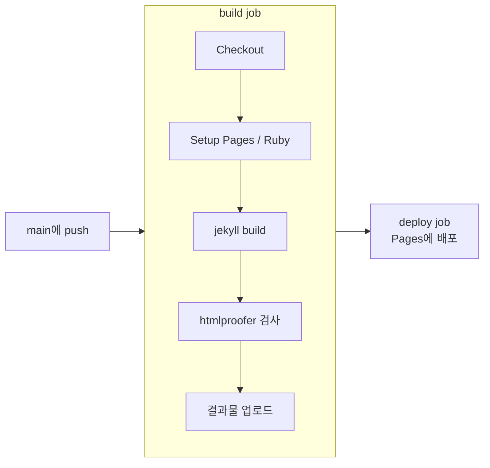

정적 블로그는 소스 변경을 감지해 빌드하고 배포하는 과정을 자동화하기 좋습니다. 이 저장소는 GitHub Actions 워크플로로 `main` 브랜치의 변경을 GitHub Pages에 배포합니다.

먼저 등장하는 용어를 정리합니다.

- **정적 사이트(static site)**: 요청이 올 때마다 서버가 페이지를 만드는 대신, 미리 만들어 둔 HTML 파일을 그대로 보내 주는 사이트입니다. Jekyll은 마크다운 글을 이런 HTML 파일로 바꿔 주는 **정적 사이트 생성기**입니다.
- **CI/CD**: 코드가 바뀔 때마다 빌드·테스트(CI, 지속적 통합)와 배포(CD, 지속적 배포)를 자동으로 실행하는 방식입니다.
- **GitHub Actions**: 저장소에 푸시 같은 이벤트가 생기면 GitHub의 서버(러너)에서 정해진 작업을 실행해 주는 기능입니다. 작업 내용은 `.github/workflows/` 폴더의 YAML 파일(**워크플로**)에 적습니다.

> 배포가 자동화되기 전에는 로컬에서 직접 빌드한 `_site` 폴더를 올리거나, GitHub Pages의 기본 Jekyll 빌드에 맡겨야 했습니다. 기본 빌드는 허용된 플러그인만 쓸 수 있어서, Chirpy처럼 별도 플러그인과 최신 Jekyll이 필요한 테마는 Actions로 직접 빌드하는 방식을 권장합니다.
{: .prompt-info }

## 배포 파이프라인의 흐름

워크플로는 대략 다음 순서로 동작합니다.

1. 저장소 코드를 체크아웃합니다.
2. GitHub Pages 배포 정보를 설정하고 Ruby 환경을 준비합니다.
3. Bundler 의존성을 복원한 뒤 Jekyll로 사이트를 빌드합니다.
4. HTML 링크 검사를 실행합니다.
5. 빌드 결과물을 Pages에 업로드하고 배포합니다.



이 과정 덕분에 글을 추가하거나 수정한 뒤 `main`에 푸시하면 매번 수동으로 빌드 결과를 올리지 않아도 됩니다.

## 워크플로 파일 읽어 보기

아래는 이 블로그의 `.github/workflows/pages-deploy.yml`에서 핵심만 옮긴 것입니다. (Chirpy Starter가 제공하는 파일을 거의 그대로 사용합니다. 액션 버전은 이 저장소 기준이며, 새로 만들 때는 각 액션 저장소에서 최신 버전을 확인하세요.)


```yaml
name: "Build and Deploy"
on:
  push:
    branches: [main, master]
    paths-ignore: [.gitignore, README.md, LICENSE]  # 이 파일만 바뀌면 배포 생략
  workflow_dispatch:          # Actions 탭에서 수동 실행 버튼 제공

permissions:
  contents: read              # 저장소 코드 읽기
  pages: write                # Pages에 배포
  id-token: write             # 배포 시 OIDC 토큰 발급

concurrency:
  group: "pages"
  cancel-in-progress: true    # 새 푸시가 오면 진행 중인 배포를 취소

jobs:
  build:
    runs-on: ubuntu-latest
    steps:
      - name: Checkout
        uses: actions/checkout@v7
        with:
          fetch-depth: 0      # 전체 커밋 기록을 받아 옴 (아래 설명)

      - name: Setup Pages
        id: pages
        uses: actions/configure-pages@v6

      - name: Setup Ruby
        uses: ruby/setup-ruby@v1
        with:
          ruby-version: 3.4
          bundler-cache: true # Gemfile.lock 기준으로 gem 캐시

      - name: Build site
        run: bundle exec jekyll b -d "_site${{ steps.pages.outputs.base_path }}"
        env:
          JEKYLL_ENV: "production"

      - name: Test site
        run: bundle exec htmlproofer _site --disable-external

      - name: Upload site artifact
        uses: actions/upload-pages-artifact@v5
        with:
          path: "_site${{ steps.pages.outputs.base_path }}"

  deploy:
    needs: build              # build가 성공해야 실행
    runs-on: ubuntu-latest
    environment:
      name: github-pages
      url: ${{ steps.deployment.outputs.page_url }}
    steps:
      - name: Deploy to GitHub Pages
        id: deployment
        uses: actions/deploy-pages@v5
```


몇 가지 줄은 이유를 알고 쓰면 좋습니다.

- **`fetch-depth: 0`**: `checkout`은 기본으로 마지막 커밋 하나만 받아 옵니다. 이 블로그는 `_plugins/posts-lastmod-hook.rb`가 `git log`로 글의 마지막 수정 시각을 계산하므로, 전체 기록이 없으면 수정일이 표시되지 않습니다.
- **`permissions`**: 워크플로가 받는 `GITHUB_TOKEN`의 권한을 필요한 만큼만 열어 둡니다. 특히 `id-token: write`는 `deploy-pages`가 **OIDC 토큰**(GitHub가 "이 요청은 이 저장소의 이 워크플로에서 왔다"고 서명해 주는 일회용 신분증)을 받아 Pages에 자신을 증명하는 데 필요합니다. 그래서 개인 액세스 토큰 같은 비밀 값을 저장소에 넣을 필요가 없습니다.
- **job을 둘로 나눈 이유**: `build`는 코드를 읽기만 하고, 실제로 사이트를 바꾸는 `deploy`는 `github-pages` 환경(environment)에서만 실행됩니다. 환경에는 "main 브랜치에서만 배포 허용" 같은 보호 규칙을 걸 수 있어서, 권한이 큰 단계를 좁게 가둘 수 있습니다.
- **`htmlproofer`**: 빌드된 HTML에서 깨진 내부 링크, 없는 이미지 경로 등을 찾아 실패시킵니다. 깨진 링크가 있는 글이 배포되기 전에 막아 주는 테스트 단계입니다.

> 저장소 **Settings → Pages → Build and deployment → Source**가 `GitHub Actions`로 되어 있어야 이 워크플로의 결과물이 사이트에 반영됩니다.
{: .prompt-warning }

## 실패한 배포 확인하기

사이트가 업데이트되지 않으면 저장소의 **Actions** 탭에서 가장 최근 실행을 확인합니다. 빌드 실패라면 로그에서 front matter 형식, 의존성 설치, 링크 검사 결과를 먼저 확인합니다. 로컬에서는 Ruby와 Bundler를 준비한 뒤 `bundle exec jekyll build`로 빌드 오류를 확인할 수 있습니다.

자주 만나는 원인은 다음과 같습니다.

| 증상 | 흔한 원인 | 확인할 곳 |
| --- | --- | --- |
| 빌드는 성공했는데 새 글이 안 보임 | front matter의 `date`가 **미래 시각**이라 Jekyll이 건너뜀 (기본값 `future: false`) | 글의 `date`와 시간대(`+0900`) |
| `Test site` 단계 실패 | 깨진 내부 링크, 잘못된 이미지 경로 | htmlproofer 로그에 찍힌 파일과 링크 |
| `Build site` 단계 실패 | front matter YAML 문법 오류(콜론·따옴표), Liquid 문법 충돌 | 로그의 파일 이름과 줄 번호 |
| 코드 블록 안의 `{{ }}`가 사라지거나 빌드 실패 | Jekyll이 이를 Liquid 문법으로 해석 | 해당 블록을 Liquid의 `raw` … `endraw` 태그로 감싸기 (이 글의 YAML 예시도 그렇게 감쌌습니다) |

### 실제로 겪은 실패 사례

이 블로그도 처음 며칠 동안 배포가 네 번 실패했습니다. 네 번 모두 `Build site`는 성공하고 **`Test site`(htmlproofer) 단계**에서 `Process completed with exit code 1`로 멈췄고, 그 때문에 결과물 업로드와 배포 단계가 생략됐습니다. 즉 사이트는 만들어졌지만 링크 검사에서 걸린 것입니다.

| 언제 | 원인 | 고친 방법 |
|---|---|---|
| 블로그를 처음 만들 때 | 소개 글 front matter의 썸네일(`image.path`)과 본문 이미지가 **존재하지 않는 파일**을 가리킴 | 해당 이미지 항목을 지운 커밋에서 바로 통과 |
| 글 8편을 처음 올릴 때 | 참고 문헌의 링크 하나가 `http://`로 시작 | `https://`로 한 글자 바꾼 커밋에서 바로 통과 |

두 번째는 의외였습니다. 워크플로에서 `--disable-external`로 외부 링크 접속 검사를 껐는데도 실패했기 때문입니다. html-proofer는 외부 링크에 실제로 접속하지 않더라도 **링크가 HTTPS인지는 기본으로 검사**합니다(`enforce_https` 옵션). 그래서 참고 문헌을 적을 때도 `https://` 주소를 쓰는 습관이 필요합니다.

> 실패한 실행의 로그는 Actions 탭에서 해당 실행 → `build` job → `Test site` 단계를 펼치면 어떤 파일의 어떤 링크가 문제인지 정확히 나옵니다. 로컬에서 같은 검사를 하려면 `bundle exec jekyll build` 후 `bundle exec htmlproofer _site --disable-external`을 실행합니다.
{: .prompt-tip }

## 안전한 변경 반영

큰 변경은 별도 브랜치에서 미리보기와 빌드를 확인한 다음 병합하는 편이 안전합니다. 배포 권한은 필요한 범위로 제한하고, 토큰이나 비밀 값은 글이나 저장소 파일에 직접 기록하지 않습니다. 꼭 필요한 비밀 값은 저장소 **Settings → Secrets and variables → Actions**에 넣고 워크플로에서 `secrets.이름`으로 참조합니다.

## 참고 자료

- [GitHub Docs – Using custom workflows with GitHub Pages](https://docs.github.com/en/pages/getting-started-with-github-pages/using-custom-workflows-with-github-pages)
- [GitHub Docs – About security hardening with OpenID Connect](https://docs.github.com/en/actions/security-for-github-actions/security-hardening-your-deployments/about-security-hardening-with-openid-connect)
- [Chirpy – Getting Started](https://chirpy.cotes.page/posts/getting-started/)
- [Jekyll – Configuration Options (`future`)](https://jekyllrb.com/docs/configuration/options/)
