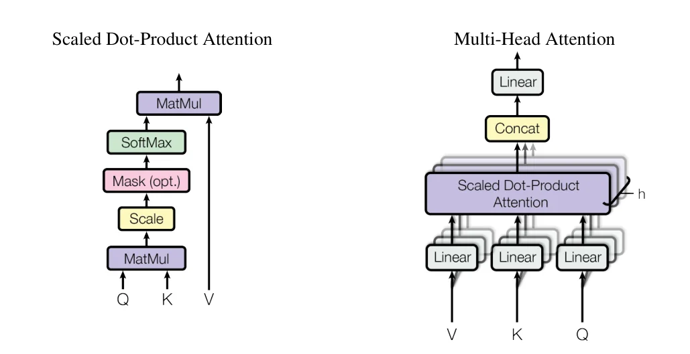
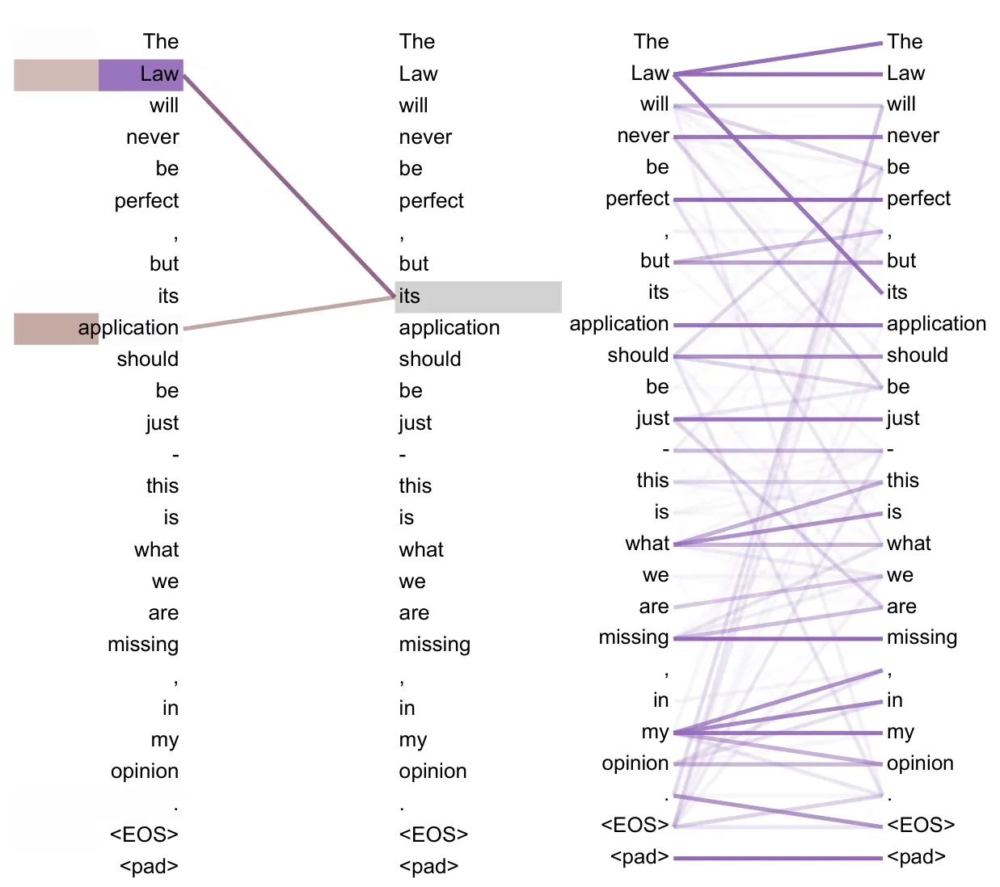
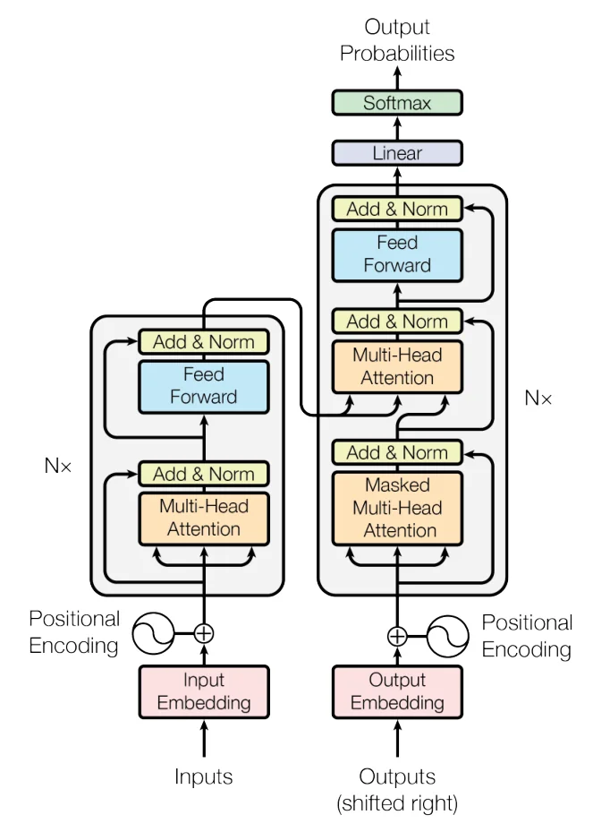

> - **논문**: Attention Is All You Need
> - **저자**: Ashish Vaswani, Noam Shazeer, Niki Parmar, Jakob Uszkoreit, Llion Jones, Aidan N. Gomez, Łukasz Kaiser, Illia Polosukhin (Google Brain, Google Research, University of Toronto)
> - **학회**: NeurIPS 2017 · [arXiv:1706.03762](https://arxiv.org/abs/1706.03762) · [코드(tensor2tensor)](https://github.com/tensorflow/tensor2tensor)
{: .prompt-tip }

> Transformer 시리즈의 첫 글이다. 이후 글에서 다룰 ViT, PoolFormer, Mobile-Former, GPT는 모두 이 구조에서 출발하기 때문에, 여기서는 **"왜 Attention만으로 충분했는가"**에 집중해서 정리한다.

## 1. 등장 배경: seq2seq와 RNN의 한계

Transformer 이전의 번역 모델은 대부분 **seq2seq(Encoder–Decoder) + RNN** 구조였다.

- **Encoder**: "I am a student" 같은 입력 문장을 하나의 고정 길이 **Context Vector**로 압축
- **Decoder**: 이 Context Vector를 받아 "나는 학생이다"를 한 단어씩 생성

이 구조에는 두 가지 문제가 있다.

1. **병목(Bottleneck)**: 문장이 아무리 길어도 마지막 hidden state 하나에 모든 정보를 욱여넣어야 한다. 입력이 길어질수록 앞쪽 정보가 소실된다.
2. **순차 연산**: RNN은 $$t$$번째 hidden state를 계산하려면 $$t-1$$번째가 끝나야 한다. 한 번에 한 단어씩만 처리하므로 GPU 병렬화가 어렵고, 시퀀스가 길어질수록 먼 과거로 가는 기울기가 소실(Vanishing Gradient)되기 쉽다.

## 2. Attention: 중요한 단어에 집중하기

첫 번째 문제를 해결한 것이 **Attention**이다. Decoder가 단어를 생성할 때마다 마지막 hidden state 하나만 보는 대신, Encoder의 모든 time step hidden state를 다시 들여다보고 지금 필요한 것에 가중치를 준다.

동작은 세 단계이다.

1. 현재 Decoder 상태와 각 Encoder hidden state를 비교해 **Attention Score**를 구한다. (Bahdanau et al., 2015는 작은 신경망으로 점수를 매기는 additive 방식, Luong et al., 2015는 내적 방식을 썼다. 여기서는 이해하기 쉬운 내적으로 설명한다.)
2. Score에 **Softmax**를 적용해 합이 1인 **Attention Weight**로 바꾼다.
3. 각 hidden state에 weight를 곱해 더한 **Weighted Vector(Context)**를 Decoder 입력에 사용한다.

간단한 예시로 확인해 보자. Score가 `[13, 9, 9]`라면

$$
\text{softmax}([13, 9, 9]) \approx [0.964,\ 0.018,\ 0.018]
$$

이므로 Context는 거의 $$0.964 \cdot H_1$$이 된다. Score 차이가 4밖에 안 나도 Softmax가 지수 함수이기 때문에 한 단어에 강하게 집중하게 된다.

하지만 이 시점의 Attention은 여전히 RNN 위에 얹힌 보조 장치였고, 순차 연산 문제는 그대로였다.

## 3. Transformer의 아이디어: RNN을 빼고 Attention만 남기자

2017년 Vaswani et al.의 *Attention Is All You Need*는 RNN을 제거한다. 모든 단어를 한 번에 병렬로 넣고, 단어 사이의 관계는 전부 Attention으로 계산한다.

이렇게 하면 두 가지가 새로 필요해진다.

- 단어끼리의 관계를 계산하는 방법 → **Self-Attention**
- 병렬로 넣으면서 사라진 **순서 정보** → **Positional Encoding**

## 4. Self-Attention과 Q, K, V

다음 문장을 예로 든다.

> "The animal didn't cross the street because **it** was too tired."

사람은 `it`이 `animal`을 가리킨다는 걸 바로 알지만, 모델은 문장 안의 다른 단어들과의 관계를 계산해야 알 수 있다. **Self-Attention**은 같은 문장 안의 단어들끼리 Attention을 수행해 이 관계를 학습한다.

각 토큰 임베딩 $$X$$에 학습 가능한 행렬 세 개를 곱해 세 가지 역할의 벡터를 만든다.

$$
Q = XW_Q,\quad K = XW_K,\quad V = XW_V
$$

| 벡터 | 역할 | 비유 |
|---|---|---|
| **Query** | 지금 분석하려는 단어가 "무엇을 찾는지" | 검색어 |
| **Key** | 각 단어가 "어떤 정보를 갖고 있는지" 보여주는 꼬리표 | 문서 제목 |
| **Value** | 실제로 가져갈 내용 | 문서 본문 |

> 검색 비유는 "Query와 Key를 비교해 Value를 가져온다"는 흐름까지만 맞다. 실제 검색은 가장 잘 맞는 문서 하나를 고르지만, Attention은 **모든 Value를 가중 평균**한다. 또 Q, K, V는 모두 같은 입력 $$X$$에서 학습된 행렬로 만들어지므로, 무엇이 "검색어"가 될지도 학습으로 정해진다.
{: .prompt-info }

Query와 모든 Key를 내적해 관련도를 구하고, 그 비율대로 Value를 섞는다. 이것이 **Scaled Dot-Product Attention**이다.

$$
\text{Attention}(Q, K, V) = \text{softmax}\left(\frac{QK^\top}{\sqrt{d_k}}\right)V
$$


_Figure 2. 왼쪽: Scaled Dot-Product Attention (MatMul → Scale → 선택적 Mask → SoftMax → V와 MatMul). 오른쪽: 이를 $$h$$개 병렬로 수행하는 Multi-Head Attention. (출처: Vaswani et al., 2017)_

### 왜 $$\sqrt{d_k}$$로 나누나?

$$Q, K$$의 각 성분이 평균 0, 분산 1이라면 내적 $$q \cdot k$$의 분산은 $$d_k$$가 된다. 차원이 커질수록 값이 커지고, Softmax가 한쪽으로 극단적으로 쏠려 **gradient가 거의 0**이 된다. $$\sqrt{d_k}$$로 나눠 분산을 1로 되돌리는 것이다.

논문은 내적 대신 작은 신경망으로 점수를 매기는 additive attention과도 비교한다. $$d_k$$가 작을 때는 두 방식이 비슷하지만, $$d_k$$가 크면 스케일링 없는 내적이 additive보다 나빠진다. 그래도 내적 방식을 고른 이유는 행렬 곱 하나로 계산할 수 있어 실제로 더 빠르고 메모리를 덜 쓰기 때문이다.

```python
import torch
import torch.nn.functional as F

def scaled_dot_product_attention(q, k, v, mask=None):
    # q, k, v: (batch, heads, seq_len, d_k)
    d_k = q.size(-1)
    scores = q @ k.transpose(-2, -1) / d_k ** 0.5   # (B, H, L, L)
    if mask is not None:
        scores = scores.masked_fill(mask == 0, float("-inf"))  # 가릴 위치는 softmax 후 0이 되도록
    attn = F.softmax(scores, dim=-1)
    return attn @ v, attn

torch.manual_seed(0)
B, H, L, d_k = 1, 2, 4, 8
q, k, v = (torch.randn(B, H, L, d_k) for _ in range(3))

causal = torch.tril(torch.ones(L, L))   # Decoder용: 자기 자신과 과거만 보도록 하삼각 행렬
out, attn = scaled_dot_product_attention(q, k, v, mask=causal)
print(out.shape)                         # torch.Size([1, 2, 4, 8])
print(attn[0, 0].round(decimals=2))      # 첫 번째 head의 attention weight

# PyTorch 2.0+ 내장 함수와 결과 비교
ref = F.scaled_dot_product_attention(q, k, v, is_causal=True)
print(torch.allclose(out, ref, atol=1e-6))  # True
```

```text
torch.Size([1, 2, 4, 8])
tensor([[1.0000, 0.0000, 0.0000, 0.0000],
        [0.5900, 0.4100, 0.0000, 0.0000],
        [0.1000, 0.5800, 0.3200, 0.0000],
        [0.3500, 0.1800, 0.4200, 0.0600]])
True
```

각 행이 "이 토큰이 어떤 토큰을 얼마나 참고했는가"이고, 행의 합은 1이다. 마스크 때문에 대각선 위쪽(미래 토큰)은 모두 0이다. 실무에서는 직접 구현하기보다 PyTorch 2.0부터 제공되는 `F.scaled_dot_product_attention`을 쓴다. 이 함수는 조건이 맞으면 FlashAttention 같은 메모리 효율적인 커널로 자동 전환된다.

## 5. Multi-Head Attention: 여러 시각으로 보기

Attention을 한 번만 하면 하나의 관점(예: 대명사–명사 관계)만 학습하기 쉽다. 그래서 $$d_{model}=512$$를 $$h=8$$개의 head로 나눠($$d_k = 64$$) **각자 다른 $$W_Q, W_K, W_V$$로 Attention을 수행**한 뒤 이어 붙인다.

$$
\text{MultiHead}(Q,K,V) = \text{Concat}(\text{head}_1, \dots, \text{head}_h)W_O
$$

head 수를 바꾸는 실험(연산량은 고정, 아래 9장 표)에서 single-head는 가장 좋은 설정보다 BLEU가 0.9 낮았고, head를 32개로 늘려도 오히려 떨어졌다.

학습된 모델을 분석해 보면 어떤 head는 문법적 관계를, 어떤 head는 가까운 위치를 주로 보는 식으로 역할이 나뉘는 경향이 관찰된다. 아래 Figure 4는 앞에서 본 `it` 예시처럼 대명사가 가리키는 대상을 찾는 것으로 보이는 head이다.


_Figure 4. Encoder 5층(전체 6층)의 attention head 시각화. 오른쪽: head 5의 전체 attention, 왼쪽: 단어 'its'에서 나가는 attention만 따로 표시한 head 5·6. 'its'가 'Law'와 'application'에 집중한다. 원 논문의 세로 방향 그림을 가로로 돌렸다. (출처: Vaswani et al., 2017)_

다만 역할이 항상 깔끔하게 나뉘는 것은 아니고, 상당수 head는 제거해도 성능이 거의 떨어지지 않는다는 연구(Michel et al., 2019)도 있다. head를 나눠도 전체 연산량은 single-head와 거의 같다는 점도 장점이다.

## 6. Word Embedding

단어는 처음에 **one-hot vector**로 표현된다. `고양이 = [1,0,0,0]`, `강아지 = [0,1,0,0]`처럼 구분은 명확하지만, 단어 수만큼 차원이 늘어나고 모든 단어 사이의 거리가 같아서 "고양이와 강아지가 비슷하다"는 정보를 담지 못한다.

임베딩은 이를 더 작은 $$K$$차원의 dense vector로 바꾼다.

| | 동물 | 무리생활 | 꼬리 |
|---|---|---|---|
| 고양이 | 0.7 | 0.1 | 0.7 |
| 강아지 | 0.7 | 0.6 | 0.7 |
| 사람 | 0.7 | 0.8 | 0.2 |

(실제 임베딩 차원에는 이렇게 사람이 읽을 수 있는 의미가 붙지 않지만, 직관적으로는 이런 느낌이다.)

Transformer는 입력 임베딩, 출력 임베딩, 마지막 softmax 직전 linear layer가 **같은 가중치 행렬을 공유**하고, 임베딩 층에서는 이 가중치에 $$\sqrt{d_{model}}$$을 곱해 쓴다.

## 7. Positional Encoding: 순서를 다시 넣어주기

RNN은 순서대로 읽으니 위치 정보가 자연스럽게 들어가지만, Self-Attention은 입력 토큰의 순서를 바꾸면 출력도 똑같이 순서만 바뀌는 성질(**permutation equivariance**)이 있다. 위치 정보가 없으면 "I love you"와 "you love I"를 구분하지 못한다. 그래서 임베딩에 위치 벡터를 더해 준다.

$$
PE_{(pos,\,2i)} = \sin\left(\frac{pos}{10000^{2i/d_{model}}}\right),\qquad
PE_{(pos,\,2i+1)} = \cos\left(\frac{pos}{10000^{2i/d_{model}}}\right)
$$

sin과 cos을 함께 쓰는 이유는 다음과 같다.

- **위치마다 고유한 값**: 차원마다 주기가 다른 파형을 섞기 때문에 서로 다른 위치가 같은 벡터를 갖지 않는다.
- **상대 위치를 선형 변환으로 표현**: 삼각함수 덧셈 정리 덕분에 $$PE_{pos+k}$$를 $$PE_{pos}$$의 선형 함수로 쓸 수 있다. 모델이 "k칸 떨어진 단어"라는 관계를 배우기 쉬워진다.
- **값의 범위가 [-1, 1]**: 임베딩 값을 압도하지 않는다.

논문은 학습 가능한 위치 임베딩도 실험했는데 성능은 거의 같았고(dev BLEU 25.7 vs sinusoidal 25.8), 학습 때보다 긴 문장에도 적용할 수 있을 것이라는 이유로 sinusoidal 방식을 택했다. 이후 BERT·GPT-2는 학습 가능한 위치 임베딩을, 최근 LLM은 RoPE(회전 위치 임베딩)를 주로 쓴다.

```python
import math
import torch

def sinusoidal_pe(max_len, d_model):
    pe = torch.zeros(max_len, d_model)
    pos = torch.arange(max_len).unsqueeze(1)
    div = torch.exp(torch.arange(0, d_model, 2) * (-math.log(10000.0) / d_model))
    pe[:, 0::2] = torch.sin(pos * div)
    pe[:, 1::2] = torch.cos(pos * div)
    return pe  # (max_len, d_model)
```

## 8. 전체 구조

Encoder와 Decoder는 각각 같은 블록을 $$N=6$$번 쌓은 구조이다.


_Figure 1. Transformer 전체 구조. 왼쪽이 Encoder, 오른쪽이 Decoder 블록이고 각각 $$N$$번 쌓는다. Decoder 입력은 한 칸 오른쪽으로 민 정답 문장이다. (출처: Vaswani et al., 2017)_

**Encoder 블록**
1. Multi-Head Self-Attention
2. Add & LayerNorm (Residual connection)
3. Position-wise Feed-Forward Network ($$512 \to 2048 \to 512$$)
4. Add & LayerNorm

**Decoder 블록**
1. **Masked** Multi-Head Self-Attention: 미래 단어를 보지 못하도록 마스킹
2. **Cross-Attention**: Query는 Decoder, Key/Value는 Encoder 출력
3. Feed-Forward Network
4. 각 단계마다 Add & LayerNorm

> 원 논문은 `x + Sublayer(x)`를 더한 뒤에 LayerNorm을 하는 **Post-LN** 구조이다. 이후 층이 깊어지면 Post-LN이 학습 초기에 불안정하다는 점이 알려져, GPT-2 이후 대부분의 모델은 Sublayer 앞에 LayerNorm을 두는 **Pre-LN**(`x + Sublayer(LN(x))`)을 쓴다.
{: .prompt-info }

### Batch Norm 대신 Layer Norm을 쓰는 이유

- **Batch Norm**: 배치 안의 샘플들끼리 같은 feature를 정규화한다. 문장 길이가 제각각이고 배치가 작으면 통계가 불안정하다.
- **Layer Norm**: 샘플 하나 안의 feature들끼리 정규화한다. 배치 크기와 문장 길이에 영향을 받지 않는다.

### 연산 복잡도: Self-Attention의 대가

시퀀스 길이를 $$n$$, 표현 차원을 $$d$$라고 할 때 논문은 층 하나의 비용을 이렇게 비교한다.

| 층 종류 | 층당 연산량 | 순차 연산 수 | 두 토큰 사이 최대 경로 길이 |
|---|---|---|---|
| Self-Attention | $$O(n^2 \cdot d)$$ | $$O(1)$$ | $$O(1)$$ |
| Recurrent | $$O(n \cdot d^2)$$ | $$O(n)$$ | $$O(n)$$ |
| Convolution (커널 $$k$$) | $$O(k \cdot n \cdot d^2)$$ | $$O(1)$$ | $$O(\log_k n)$$ |

- **순차 연산 $$O(1)$$**: 모든 위치를 한 번에 계산하므로 GPU 병렬화가 쉽다.
- **최대 경로 길이 $$O(1)$$**: 첫 단어와 마지막 단어가 한 번의 Attention으로 바로 연결되므로 먼 거리의 관계를 배우기 쉽다.
- **대가는 $$n^2$$**: 모든 토큰 쌍의 점수를 계산하므로 문장이 2배 길어지면 Attention 연산과 메모리가 4배가 된다. 문장 길이 $$n$$이 차원 $$d$$보다 짧은 번역 문장에서는 RNN보다 싸지만, 긴 문서나 고해상도 이미지에서는 이것이 병목이 된다. 이후 Sparse Attention, Linformer, FlashAttention 같은 연구가 이 문제를 다룬다.

## 9. 실험과 구현 디테일

### 학습 설정

| 항목 | 값 |
|---|---|
| 데이터 | WMT 2014 영어–독일어 약 450만 문장 쌍 (BPE, 공유 어휘 약 37,000), 영어–프랑스어 3,600만 문장 (word-piece 32,000) |
| 배치 | 길이가 비슷한 문장끼리 묶어, 배치당 source·target 토큰 각 약 25,000개 |
| 모델 크기 | base: $$N=6$$, $$d_{model}=512$$, $$d_{ff}=2048$$, $$h=8$$, $$d_k=d_v=64$$ (65M) / big: $$d_{model}=1024$$, $$d_{ff}=4096$$, $$h=16$$ (213M) |
| 하드웨어·시간 | P100 GPU 8장 머신 한 대. base는 step당 0.4초로 100K step(12시간), big은 step당 1.0초로 300K step(3.5일) |
| Optimizer | Adam, $$\beta_1=0.9$$, $$\beta_2=0.98$$, $$\epsilon=10^{-9}$$ |
| Learning rate | $$d_{model}^{-0.5}\cdot\min(\text{step}^{-0.5},\ \text{step}\cdot\text{warmup}^{-1.5})$$. warmup 4000 step 동안 선형 증가 후 step의 역제곱근에 비례해 감소 |
| 정규화 | 각 sub-layer 출력(residual 덧셈 전)과 임베딩+PE 합에 dropout (base 0.1, big 0.3), label smoothing 0.1 |
| 추론 | beam size 4, length penalty 0.6, 최대 길이 입력+50. base는 마지막 체크포인트 5개, big은 20개를 평균 |

Label smoothing은 모델을 덜 확신하게 만들어 perplexity는 나빠지지만, 정확도와 BLEU는 오른다고 논문은 설명한다.

### 번역 결과 (newstest2014)

| 모델 | EN-DE BLEU | EN-FR BLEU | 학습 비용 (FLOPs, EN-DE) |
|---|---|---|---|
| GNMT + RL | 24.6 | 39.92 | 2.3·10¹⁹ |
| ConvS2S | 25.16 | 40.46 | 9.6·10¹⁸ |
| MoE | 26.03 | 40.56 | 2.0·10¹⁹ |
| GNMT + RL Ensemble | 26.30 | 41.16 | 1.8·10²⁰ |
| ConvS2S Ensemble | 26.36 | 41.29 | 7.7·10¹⁹ |
| Transformer (base) | 27.3 | 38.1 | **3.3·10¹⁸** |
| **Transformer (big)** | **28.4** | **41.8** | 2.3·10¹⁹ |

<small>논문 Table 2</small>

- EN-DE에서 big 모델이 앙상블을 포함한 기존 최고 기록보다 BLEU가 2.0 이상 높다. base 모델도 기존 모든 모델·앙상블보다 좋은데, 학습 비용은 그 일부에 불과하다.
- EN-FR에서는 단일 모델 최고 기록이고, 학습 비용은 이전 최고 모델의 1/4 미만이다. (본문 6.1절에는 41.0으로 적혀 있지만 표와 초록은 41.8이다.)

### Ablation (EN-DE dev, newstest2013)

| 변경 | 설정 | dev BLEU |
|---|---|---|
| base | $$h=8$$, $$d_k=64$$ | 25.8 |
| head 수 (연산량 고정) | $$h=1$$ ($$d_k=512$$) / 4 / 16 / 32 ($$d_k=16$$) | 24.9 / 25.5 / 25.8 / 25.4 |
| key 차원만 축소 | $$d_k=16$$ / 32 | 25.1 / 25.4 |
| 모델 크기 | $$N=2$$ / $$d_{model}=1024$$ / $$d_{ff}=4096$$ | 23.7 / 26.0 / 26.2 |
| dropout 제거 | $$P_{drop}=0$$ | 24.6 |
| 위치 표현 | 학습 가능한 위치 임베딩 | 25.7 |
| big | $$d_{model}=1024$$, $$d_{ff}=4096$$, $$h=16$$, 300K step | 26.4 |

<small>논문 Table 3. checkpoint 평균 없이 beam search로 측정</small>

- head는 많을수록 좋은 것이 아니고, 8~16개 근처가 가장 좋다.
- $$d_k$$를 줄이면 성능이 떨어진다. 논문은 Query–Key 호환성을 판단하는 일이 쉽지 않아서, 내적보다 정교한 함수가 도움이 될 수 있다고 본다.
- 모델이 클수록 좋고, dropout은 overfitting을 막는 데 효과가 크다.

같은 구조를 영어 구문 분석(WSJ Penn Treebank)에 4층 Transformer로 적용해도 과제별 튜닝 없이 WSJ만 쓴 설정에서 F1 91.3(같은 설정 최고는 RNN Grammar의 91.7), semi-supervised 설정에서 92.7로 같은 설정의 기존 모델(최고 92.1)보다 높았다.

## 10. 정리

| 문제 | Transformer의 해법 |
|---|---|
| 고정 길이 Context Vector 병목 | 모든 토큰을 직접 참조하는 Attention |
| RNN의 순차 연산 | 전체 시퀀스를 한 번에 처리하는 Self-Attention |
| 병렬화로 사라진 순서 정보 | Sinusoidal Positional Encoding |
| 하나의 관점만 학습 | Multi-Head Attention |
| 깊은 네트워크 학습 | Residual Connection + LayerNorm |

Transformer 시리즈의 다음 글 [경량 Vision Transformer 동향]()에서는 이 구조를 이미지에 적용한 **Vision Transformer(ViT)**를 다룬다. 이미지를 16×16 패치로 잘라 "단어"처럼 다루는 방식과, ImageNet 규모에서는 ResNet보다 성능이 낮았던 이유(**inductive bias** 부족)를 살펴본다.

## References

- Vaswani et al., "Attention Is All You Need," NeurIPS 2017. [arXiv:1706.03762](https://arxiv.org/abs/1706.03762)
- Bahdanau et al., "Neural Machine Translation by Jointly Learning to Align and Translate," ICLR 2015. [arXiv:1409.0473](https://arxiv.org/abs/1409.0473)
- Michel et al., "Are Sixteen Heads Really Better than One?," NeurIPS 2019. [arXiv:1905.10650](https://arxiv.org/abs/1905.10650)
- Xiong et al., "On Layer Normalization in the Transformer Architecture," ICML 2020. (Pre-LN vs Post-LN) [arXiv:2002.04745](https://arxiv.org/abs/2002.04745)
- Jay Alammar, "The Illustrated Transformer" — <https://jalammar.github.io/>
- <https://yngie-c.github.io/nlp/2020/07/01/nlp_transformer/>
