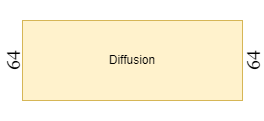
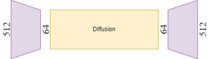
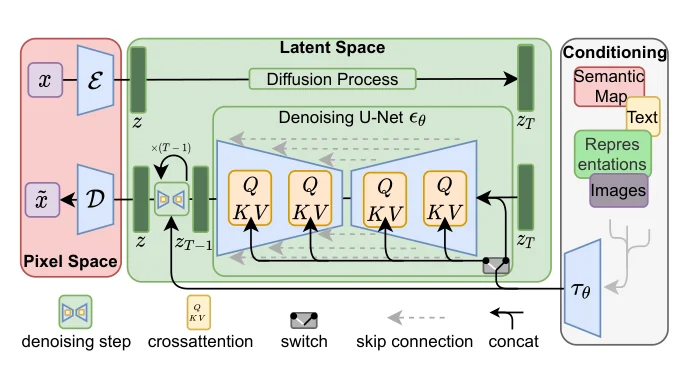
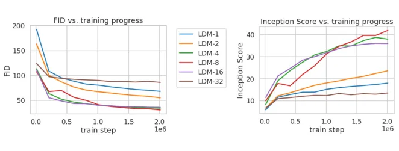
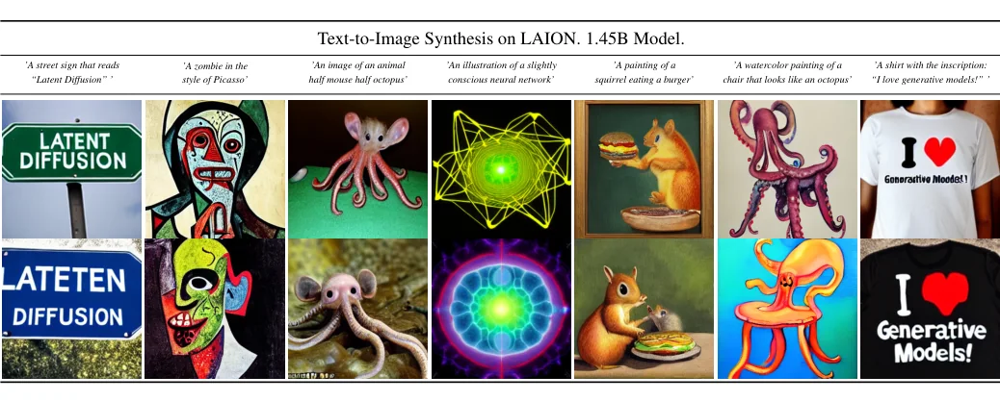

> - **논문**: High-Resolution Image Synthesis with Latent Diffusion Models
> - **저자**: Robin Rombach, Andreas Blattmann, Dominik Lorenz, Patrick Esser, Björn Ommer (LMU Munich & IWR Heidelberg University, Runway ML)
> - **학회**: CVPR 2022 · [arXiv:2112.10752](https://arxiv.org/abs/2112.10752) · [코드·모델](https://github.com/CompVis/latent-diffusion)
{: .prompt-tip }

> 생성형 AI 시리즈의 첫 글이다. Stable Diffusion의 기반이 된 **LDM**을 정리한다. 다음 글에서는 LDM을 몇 step 만에 샘플링하도록 만든 **Latent Consistency Model(LCM)**로 이어간다.

## 1. Diffusion Model 30초 복습

Diffusion Model은 두 과정으로 이루어진다.

- **Forward process**: 이미지 $$x_0$$에 가우시안 노이즈를 조금씩 $$T$$번 더해서 완전한 노이즈 $$x_T$$로 만든다. 학습할 것이 없는 고정된 과정이다.
- **Reverse process**: 노이즈에서 시작해 한 step씩 노이즈를 걷어내며 이미지를 복원한다. 이 과정을 신경망(보통 U-Net)이 학습한다.

실제로 학습하는 것은 "이 step에서 더해진 노이즈가 무엇인지" 맞히는 것이다.

$$
L_{DM} = \mathbb{E}_{x,\ \epsilon \sim \mathcal{N}(0,1),\ t}\left[\ \lVert \epsilon - \epsilon_\theta(x_t, t) \rVert_2^2\ \right]
$$

GLIDE, Imagen, DALL·E 2 등이 이 방식으로 뛰어난 이미지를 만들었지만 큰 문제가 하나 있었다.

## 2. 문제: 픽셀 공간은 너무 비싸다

Diffusion은 수백~수천 step 동안 U-Net을 반복 실행한다. 그런데 이 연산을 **픽셀 단위**로 하면

- 512×512×3 이미지면 한 step마다 약 78만 개의 값을 처리해야 하고
- 학습에 GPU 수백 일이 걸리며 (논문이 예로 든 ADM은 V100 150~1000일)
- 추론도 느리다 (같은 모델로 샘플 5만 장을 만드는 데 A100 한 장으로 약 5일)

그래서 기존 모델들은 저해상도(예: 64×64)에서 diffusion을 돌리고 별도의 super-resolution 모델로 키우는 방식을 많이 썼다.


_픽셀 공간 Diffusion: 저해상도(64) 이미지에서 직접 denoising (출처: 직접 작성)_

더 근본적인 문제도 있다. 이미지의 bit 중 상당수는 사람이 거의 알아채지 못하는 고주파 디테일이다. 픽셀 공간 diffusion은 이런 의미 없는 디테일까지 모델링하느라 연산을 낭비한다.

## 3. 아이디어: 압축은 Autoencoder에, 생성은 Diffusion에

LDM은 학습을 두 단계로 나눈다.

| 단계 | 담당 | 역할 |
|---|---|---|
| **Perceptual Compression** | Autoencoder | 사람이 못 알아채는 디테일을 버리고 이미지를 작은 latent로 압축 |
| **Semantic Compression** | Diffusion Model | 압축된 latent 공간에서 "무엇을 그릴지"라는 의미 구조를 생성 |


_LDM: 512 해상도 이미지를 Encoder로 64 크기 latent로 압축 → latent에서 Diffusion → Decoder로 512 복원 (출처: 직접 작성)_

Autoencoder는 한 번만 학습해 두면 여러 diffusion 모델에 재사용할 수 있다. 논문의 Autoencoder는 모두 OpenImages로 학습했다.

논문이 그린 전체 구조는 아래 Figure 3과 같다. 왼쪽 빨간 영역이 픽셀 공간의 Encoder $$\mathcal{E}$$와 Decoder $$\mathcal{D}$$, 가운데 초록 영역이 latent 공간의 diffusion, 오른쪽이 조건 인코더 $$\tau_\theta$$이다.


_Figure 3. LDM 구조. 조건은 입력에 이어 붙이거나(concat) U-Net 중간의 cross-attention($$Q$$, $$KV$$ 블록)으로 넣는다. (출처: Rombach et al., 2022)_

## 4. Stage 1: Perceptual Image Compression

Encoder $$\mathcal{E}$$는 이미지 $$x \in \mathbb{R}^{H\times W\times 3}$$를 latent $$z = \mathcal{E}(x) \in \mathbb{R}^{h \times w \times c}$$로 압축하고, Decoder $$\mathcal{D}$$가 다시 복원한다.

$$
f = \frac{H}{h} \in \{1, 2, 4, 8, 16, 32\}
$$

이 **downsampling factor $$f$$**가 LDM에서 가장 중요한 hyper-parameter이다.

### 흐릿해지지 않게 압축하기

L1/L2 같은 픽셀 단위 loss만 쓰면 복원 이미지가 흐릿(blurry)해진다. 평균적으로 오차가 작은 답이 "흐릿한 평균 이미지"이기 때문이다. 그래서 LDM의 Autoencoder는 다음을 함께 쓴다.

- **Perceptual loss (LPIPS)**: 픽셀이 아닌 사전학습된 네트워크의 feature 공간에서 비교
- **Patch-based adversarial loss**: 작은 패치 단위로 진짜/가짜를 구분하는 discriminator를 붙여 국소적인 사실감(local realism)을 강화

latent 공간이 너무 제멋대로 퍼지지 않도록 약한 KL 정규화(KL-reg) 또는 vector quantization(VQ-reg)도 함께 사용한다. "약하다"는 것은 숫자로 보면 분명하다. KL 항의 가중치가 약 $$10^{-6}$$이고, VQ는 codebook을 크게 잡는다. 복원 품질을 최대한 지키고 정규화는 latent 분산이 폭주하지 않을 정도로만 건다.

### 2D 구조를 유지한다

이전 연구(예: VQGAN + Transformer)는 latent를 1D 시퀀스로 펼쳐서 썼지만, LDM은 latent를 **2D feature map 그대로** 둔다. 그래서 diffusion에서 U-Net의 convolution이 가진 inductive bias(공간적 국소성)를 그대로 활용할 수 있고, 압축률을 크게 높이지 않아도 품질이 유지된다.

반대로 1D 시퀀스를 autoregressive로 모델링하는 방식은 시퀀스가 길면 감당이 안 되어 강하게 압축할 수밖에 없고, 그만큼 복원 품질을 잃는다. 논문 Figure 1·Table 8의 ImageNet-val 복원 성능이 그 차이를 보여 준다.

| Autoencoder | $$f$$ | PSNR ↑ | R-FID ↓ |
|---|---|---|---|
| **LDM (VQ, $$\lvert Z \rvert$$=8192, c=3)** | 4 | **27.43** | **0.58** |
| LDM (KL, c=3) | 4 | 27.53 | 0.27 |
| LDM (VQ, $$\lvert Z \rvert$$=16384, c=4) | 8 | 23.07 | 1.14 |
| LDM (KL, c=4) | 8 | 24.19 | 0.90 |
| DALL-E | 8 | 22.8 | 32.01 |
| VQGAN ($$\lvert Z \rvert$$=16384) | 16 | 19.9 | 4.98 |

($$c$$는 latent 채널 수, R-FID는 복원 이미지의 FID)

## 5. Stage 2: Latent 공간에서의 Diffusion

목적 함수는 픽셀 $$x_t$$ 대신 latent $$z_t$$를 쓴다는 것 말고는 그대로이다.

$$
L_{LDM} = \mathbb{E}_{\mathcal{E}(x),\ \epsilon \sim \mathcal{N}(0,1),\ t}\left[\ \lVert \epsilon - \epsilon_\theta(z_t, t) \rVert_2^2\ \right]
$$

| 기호 | 의미 |
|---|---|
| $$\mathcal{E}(x)$$ | 입력 이미지의 latent |
| $$\epsilon$$ | 정규분포 노이즈 |
| $$\epsilon_\theta$$ | U-Net이 예측한 노이즈 |
| $$z_t$$ | 시점 $$t$$의 noisy latent |

$$f=8$$이면 512×512 이미지가 64×64 latent가 되므로 U-Net이 처리하는 공간 크기가 **1/64**로 줄어든다. Stable Diffusion의 latent는 채널이 4개라, 전체 값의 개수로 보면 $$512 \times 512 \times 3 = 786{,}432$$개에서 $$64 \times 64 \times 4 = 16{,}384$$개로 약 1/48이다. 생성이 끝나면 Decoder를 딱 한 번 통과시켜 이미지로 바꾼다.

<details markdown="1">
<summary>더 알아보기: Stable Diffusion 코드에 나오는 0.18215는 무엇인가</summary>

KL 정규화를 약하게 건 Autoencoder의 latent는 분산이 1이 아니다. 그런데 diffusion은 데이터가 대략 표준정규분포 크기라고 가정하고 노이즈 스케줄을 짠다. 그래서 LDM 논문은 KL 쪽 latent를 첫 학습 배치에서 추정한 표준편차 $$\hat\sigma$$로 나눠 분산을 1 근처로 맞추는데(VQ 쪽은 원래 분산이 1에 가까워 그대로 둔다), Stable Diffusion v1에서 이 값이 `1 / 0.18215`이다. `diffusers`의 `vae.config.scaling_factor`가 이 값이고, Encoder 출력에는 곱하고 Decoder 입력 전에는 나눈다. 이 상수를 빼먹어 생성 이미지가 엉망이 되는 것이 흔한 실수이다.
</details>

## 6. Conditioning: Cross-Attention으로 텍스트를 넣기

"우주복을 입은 고양이"처럼 조건을 주려면 U-Net이 텍스트를 볼 수 있어야 한다. LDM은 U-Net 중간 층에 **Cross-Attention**을 넣는다.

$$
Q = W_Q\,\varphi(z_t),\qquad K = W_K\,\tau_\theta(y),\qquad V = W_V\,\tau_\theta(y)
$$

$$
\text{Attention}(Q, K, V) = \text{softmax}\left(\frac{QK^\top}{\sqrt{d}}\right)V
$$

- **Query**: U-Net의 중간 feature(이미지 쪽)
- **Key, Value**: 조건 $$y$$를 인코더 $$\tau_\theta$$로 변환한 것(텍스트 쪽)

[Transformer 글]()의 Self-Attention과 수식은 같지만, **Q와 K/V가 서로 다른 출처**라는 점만 다르다. 이미지의 각 위치가 "텍스트의 어떤 단어와 관련 있는지" 보고 그 정보를 가져오는 구조이다.

$$\tau_\theta$$를 바꾸면 텍스트뿐 아니라 semantic map, layout, 저해상도 이미지 등 다양한 조건을 같은 방식으로 넣을 수 있다는 것이 큰 장점이다. (LDM 논문의 text-to-image 모델은 $$\tau_\theta$$로 Transformer를 처음부터 함께 학습했고, 이후 Stable Diffusion v1은 이를 **고정된(frozen) CLIP ViT-L/14 텍스트 인코더**로 바꿨다.) 논문의 $$\tau_\theta$$는 BERT 토크나이저로 자른 토큰 77개를 받는 32층, 1280차원 Transformer이고, 식 (3)처럼 U-Net $$\epsilon_\theta$$와 함께 학습된다.

$$
L_{LDM} = \mathbb{E}_{\mathcal{E}(x),\ y,\ \epsilon \sim \mathcal{N}(0,1),\ t}\left[\ \lVert \epsilon - \epsilon_\theta(z_t, t, \tau_\theta(y)) \rVert_2^2\ \right]
$$

semantic map, 저해상도 이미지처럼 **공간 정렬된 조건**은 cross-attention 대신 latent에 채널 방향으로 이어 붙이는(concat) 쪽이 간단하다. super-resolution과 inpainting 실험이 이 방식이다.

```python
import torch.nn as nn

class CrossAttention(nn.Module):
    def __init__(self, query_dim, context_dim, heads=8, dim_head=64):
        super().__init__()
        inner = heads * dim_head
        self.heads = heads
        self.to_q = nn.Linear(query_dim, inner, bias=False)     # 이미지 feature
        self.to_k = nn.Linear(context_dim, inner, bias=False)   # 텍스트 임베딩
        self.to_v = nn.Linear(context_dim, inner, bias=False)
        self.to_out = nn.Linear(inner, query_dim)

    def forward(self, x, context):
        # x: (B, H*W, query_dim), context: (B, L_text, context_dim)
        B, N, _ = x.shape
        h = self.heads
        q = self.to_q(x).view(B, N, h, -1).transpose(1, 2)
        k = self.to_k(context).view(B, context.size(1), h, -1).transpose(1, 2)
        v = self.to_v(context).view(B, context.size(1), h, -1).transpose(1, 2)
        out = nn.functional.scaled_dot_product_attention(q, k, v)   # PyTorch 2.0+
        return self.to_out(out.transpose(1, 2).reshape(B, N, -1))

import torch

attn = CrossAttention(query_dim=320, context_dim=768)   # SD v1 첫 단계 채널 320, CLIP 임베딩 768
x = torch.randn(2, 64 * 64, 320)                        # 64x64 latent feature를 펼친 것
ctx = torch.randn(2, 77, 768)                           # 토큰 77개짜리 텍스트 임베딩
print(attn(x, ctx).shape)                               # torch.Size([2, 4096, 320])
```

출력 크기는 이미지 쪽(Query)과 같고, 텍스트 길이(77)는 attention 안에서만 쓰인다. 이미지의 4096개 위치가 각각 77개 토큰 중 어디를 참고할지 고르는 구조이다.

## 7. 평가 지표

생성 모델은 "정답"이 없어서 평가 지표를 따로 알아둬야 한다.

| 지표 | 무엇을 보나 | 좋은 방향 |
|---|---|---|
| **IS** (Inception Score) | InceptionV3의 분류 확률로 이미지의 **품질(선명도)**과 **다양성** 평가 | 높을수록 |
| **FID** (Fréchet Inception Distance) | 진짜/가짜 이미지 feature 분포 사이의 거리 | 낮을수록 |
| **LPIPS** | 사전학습 네트워크(VGG 등) feature 기준의 지각적 거리 | 용도에 따라 |
| **PSNR / SSIM** | 픽셀 단위 복원 정확도 (super-resolution, inpainting 등) | 높을수록 |

이 중 **FID**가 가장 널리 쓰인다. IS는 진짜 데이터와 비교하지 않는다는 한계가 있다.

## 8. 구현 디테일

논문 Appendix E의 설정 중 재현에 필요한 것을 모았다. 모든 LDM은 **A100 한 장**으로 학습했다.

| 항목 | 값 |
|---|---|
| Autoencoder 학습 데이터 | OpenImages (평가는 ImageNet-val) |
| Diffusion | $$T = 1000$$, linear noise schedule, time-conditional U-Net |
| $$f$$ 비교 실험 (ImageNet, class-conditional) | 모든 $$f$$에서 모델 크기 391M~396M, 2M iteration, A100 1장. batch는 LDM-1이 7, LDM-4가 40, LDM-8이 64, LDM-16·32가 112 |
| 무조건 생성 (CelebA-HQ·FFHQ·LSUN, 256²) | LDM-4: latent 64×64×3, 274M, 채널 224, attention 해상도 32·16·8. LSUN-Churches만 LDM-8(294M) |
| Text-to-image | LDM-KL-8, 1.45B, LAION-400M, $$\tau_\theta$$ = 32층·1280차원 Transformer(토큰 77개, BERT 토크나이저) |
| Class-conditional | $$\tau_\theta$$ = 512차원 학습 가능한 class embedding 1개 |
| 샘플링 | DDIM. 표 결과는 대부분 100~250 step, classifier-free guidance $$s = 1.5$$(ImageNet·COCO) |
| Inpainting | Places, 256×256 crop으로 학습, 512×512 crop으로 평가 (LaMa 프로토콜) |

## 9. 실험

### Downsampling factor의 trade-off

논문은 $$f \in \{1, 2, 4, 8, 16, 32\}$$로 바꿔가며 LDM-$$f$$를 비교한다. 계산 자원(A100 1장), 학습 step, 파라미터 수를 모두 맞춘 비교이다.


_Figure 6. ImageNet class-conditional LDM을 2M step 학습하며 잰 FID(왼쪽)와 Inception Score(오른쪽). 100 DDIM step으로 샘플링했다. (출처: Rombach et al., 2022)_

- **$$f$$가 작을 때 (LDM-1, 2)**: 사실상 픽셀 공간과 같아서 학습이 매우 느림
- **$$f$$가 너무 클 때 (LDM-32)**: 압축 과정에서 정보가 너무 많이 사라져 품질이 일찍 정체됨
- **$$f = 4 \sim 16$$**: 효율과 품질의 균형이 가장 좋음. 2M step 뒤 LDM-8과 픽셀 기반 LDM-1의 FID 차이가 **38**이다.

샘플링 속도까지 함께 본 비교(논문 Figure 7)에서는 LDM-4와 LDM-8이 가장 좋았고, ImageNet처럼 복잡한 데이터일수록 압축을 덜 해야 품질이 유지됐다. 학습 속도와 샘플 품질은 $$f$$에 대해 trade-off 관계이고, 그 균형점을 찾은 것이 LDM의 성과이다.

### 무조건 생성 (Table 1, 256×256, FID ↓)

| 데이터셋 | LDM | 비교 대상 |
|---|---|---|
| CelebA-HQ | **5.11** (LDM-4, 500 step) | LSGM 7.22, UDM 7.16, PGGAN 8.0 |
| FFHQ | 4.98 (LDM-4, 200 step) | StyleGAN 4.16, ProjectedGAN 3.08 |
| LSUN-Churches | 4.02 (LDM-8, 200 step) | StyleGAN2 3.86, DDPM 7.89 |
| LSUN-Bedrooms | 2.95 (LDM-4, 200 step) | ADM 1.90, StyleGAN 2.35 |

CelebA-HQ에서는 당시 최고 FID를 냈다. 나머지에서는 GAN과 ADM보다 약간 뒤지지만, Precision·Recall에서는 GAN보다 Recall이 높다(예: FFHQ에서 LDM 0.50, StyleGAN 0.46). LSUN-Bedrooms에서 ADM에 근접한 것은 파라미터 절반, 학습 자원 1/4로 얻은 결과이다.

### Class-conditional ImageNet (Table 3, 256×256)

| 모델 | FID ↓ | IS ↑ | 파라미터 |
|---|---|---|---|
| BigGAN-deep | 6.95 | 203.6 | 340M |
| ADM | 10.94 | 100.98 | 554M |
| ADM-G (classifier guidance) | 4.59 | 186.7 | 608M |
| LDM-4 | 10.56 | 103.49 | 400M |
| **LDM-4-G** (CFG $$s = 1.5$$) | **3.60** | **247.67** | 400M |

모두 250 DDIM step 기준이다. 학습 비용은 LDM-4가 271 V100-day, ADM이 916 V100-day이다(논문 Table 18, A100은 V100의 2.2배로 환산).

### Text-to-image (Table 2, MS-COCO 256×256)

| 모델 | FID ↓ | IS ↑ | 파라미터 |
|---|---|---|---|
| CogView | 27.10 | 18.20 | 4B |
| LAFITE | 26.94 | 26.02 | 75M |
| GLIDE | 12.24 | - | 6B |
| Make-A-Scene | 11.84 | - | 4B |
| LDM-KL-8 | 23.31 | 20.03 | 1.45B |
| **LDM-KL-8-G** (CFG $$s = 1.5$$) | 12.63 | 30.29 | 1.45B |

guidance를 쓰면 GLIDE(6B)와 비슷한 FID를 1/4 크기 모델로 낸다.


_Figure 5. LAION으로 학습한 1.45B LDM-KL-8의 text-to-image 샘플. 200 DDIM step, guidance $$s = 10$$. (출처: Rombach et al., 2022)_

### Super-resolution과 inpainting

- **ImageNet 64→256 super-resolution** (Table 5): LDM-4(169M, 100 step)의 FID는 2.8(val 통계 기준)로 SR3(625M)의 5.2보다 낮지만, IS는 166.3으로 SR3의 180.1보다 낮다. PSNR·SSIM은 단순 회귀 모델이 가장 높다(27.9 / 0.801).
- **Places 512×512 inpainting** (Table 7, 전체 샘플): 큰 LDM-4(387M, 512에서 반 epoch fine-tuning)가 FID 1.50으로 LaMa 2.21(재계산 2.23), CoModGAN 1.82보다 좋다. LPIPS는 LaMa(0.134)가 약간 낮다(LDM 0.137).
- Inpainting 효율(Table 6): 같은 파라미터 수에서 LDM-4는 픽셀 기반 LDM-1보다 학습 처리량이 약 3배(0.11 → 0.32~0.35 samples/s)이고, 6 epoch 뒤 FID는 24.74에서 14.99~15.95로 낮다.

## 10. 한계

논문이 직접 밝힌 한계는 두 가지이다.

- 픽셀 diffusion보다 훨씬 싸졌지만, 순차 샘플링은 여전히 GAN보다 느리다.
- Autoencoder 복원 손실은 $$f = 4$$에서 매우 작지만, 픽셀 단위 정밀도가 필요한 작업에서는 **복원 능력 자체가 병목**이 될 수 있다. 논문은 super-resolution 모델이 이미 이 영향을 받는다고 본다.

## 11. 정리

| 키워드 | 핵심 |
|---|---|
| 문제 | 픽셀 공간 diffusion은 고주파 디테일까지 모델링해서 비쌈 |
| 해법 | Autoencoder로 perceptual 압축 → latent에서 diffusion |
| Autoencoder | Perceptual loss + Patch GAN으로 blur 없이 압축, 2D 구조 유지 |
| Conditioning | U-Net 안의 Cross-Attention, 조건 인코더 교체로 다양한 조건 처리 |
| Trade-off | Downsampling factor $$f$$: 작으면 느리고, 크면 품질 정체. LDM-4·8이 최선 |
| 결과 | ImageNet FID 3.60(ADM-G 4.59), CelebA-HQ FID 5.11, Places inpainting FID 1.50, A100 1장으로 학습 |

LDM 덕분에 diffusion 연산량은 크게 줄었지만, sampling step이 수십 번 필요하다는 문제는 남았다. 다음 글에서는 이를 **1~4 step**까지 줄인 **Latent Consistency Model(LCM)**을 다룬다.

## References

- Rombach et al., "High-Resolution Image Synthesis with Latent Diffusion Models," CVPR 2022. [arXiv:2112.10752](https://arxiv.org/abs/2112.10752)
- Heusel et al., "GANs Trained by a Two Time-Scale Update Rule Converge to a Local Nash Equilibrium," NeurIPS 2017. (FID)
- Ho et al., "Denoising Diffusion Probabilistic Models," NeurIPS 2020.
- Esser et al., "Taming Transformers for High-Resolution Image Synthesis," CVPR 2021.
