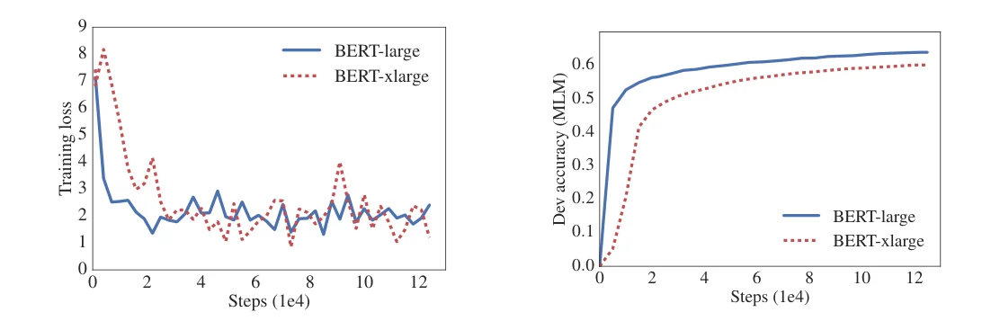
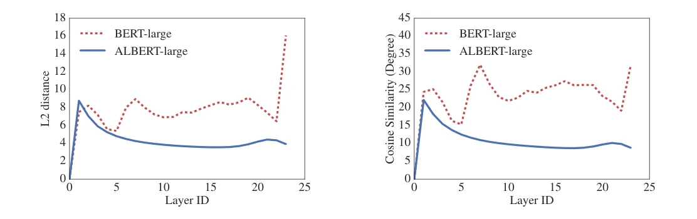
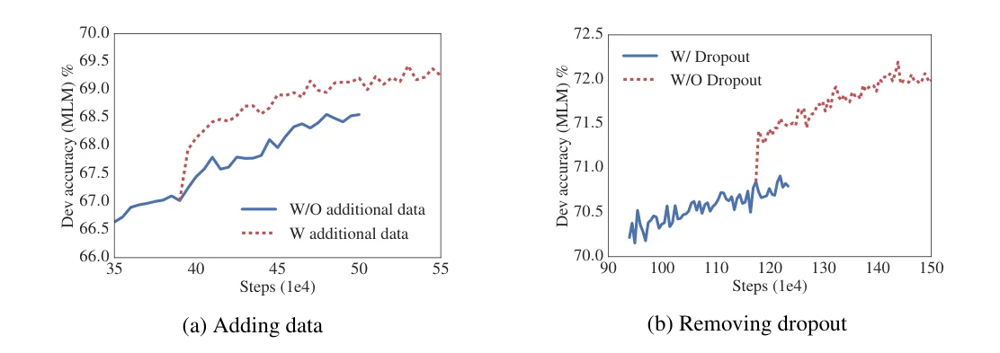

> - **논문**: ALBERT: A Lite BERT for Self-supervised Learning of Language Representations
> - **저자**: Zhenzhong Lan, Mingda Chen, Sebastian Goodman, Kevin Gimpel, Piyush Sharma, Radu Soricut (Google Research, Toyota Technological Institute at Chicago)
> - **학회**: ICLR 2020 · [arXiv:1909.11942](https://arxiv.org/abs/1909.11942)
{: .prompt-tip }

> "더 좋은 NLP 모델은 그냥 더 큰 모델인가?" [Transformer 인코더]() 기반의 BERT는 클수록 좋았지만, BERT-large의 은닉 크기를 2배로 키운 BERT-xlarge(1.27B)는 오히려 성능이 떨어졌다(RACE 73.9% → 54.3%). 메모리 한계와 학습 불안정 때문이다. **ALBERT**(A Lite BERT)는 파라미터를 줄이는 두 기법으로 이 벽을 넘고, 문장 순서 예측 손실로 BERT의 NSP를 대체한다. 그 결과 BERT-large보다 **파라미터가 적은 ALBERT-xxlarge**가 앙상블 기준 RACE 89.4%, GLUE 89.4, SQuAD 2.0 F1 92.2로 당시 최고 기록을 세웠다.

## 1. 문제: 크기를 키우는 세 가지 장애물

- **메모리.** 수억~수십억 파라미터는 GPU/TPU 메모리에 바로 부딪힌다. gradient checkpointing이나 가역 층은 속도를 희생해 메모리를 아낀다.
- **통신.** 분산 학습의 통신량은 파라미터 수에 비례한다.
- **모델 열화.** BERT-xlarge처럼 커질수록 성능이 떨어지는 현상이 있는데, 아래 Figure 1처럼 과적합 징후 없이 MLM 정확도 자체가 낮다.


_Figure 1. BERT-large와 은닉 크기를 2배로 키운 BERT-xlarge의 학습 loss(왼쪽)와 dev MLM 정확도(오른쪽). 학습 loss는 비슷한데 MLM 정확도는 xlarge가 계속 낮다. (출처: Lan et al., 2020)_

ALBERT의 파라미터 축소는 메모리와 통신을 동시에 줄이고, 저자들은 축소가 정규화 역할도 해서 학습을 안정시킨다고 주장한다.

## 2. 방법

### 분해된 임베딩 파라미터화

BERT에서 WordPiece 임베딩 크기 $$E$$는 은닉 크기 $$H$$와 같다. 그런데 임베딩은 **문맥 독립** 표현이고 은닉층은 **문맥 의존** 표현이라, 은닉층이 훨씬 커야 한다($$H \gg E$$). 또 어휘 $$V$$가 3만이므로 $$E = H$$면 $$H$$를 키울 때마다 $$V \times H$$ 행렬이 함께 커진다. ALBERT는 원-핫을 먼저 $$E$$차원에 투영하고 다시 $$H$$로 올린다.

$$
O(V \times H) \;\to\; O(V \times E + E \times H)
$$

$$E = 128$$이면 $$H$$가 4096이어도 임베딩은 4M 정도에 머문다.

### 층 간 파라미터 공유

12~24개 Transformer 층이 **모든 파라미터(attention과 FFN)를 공유**한다. 깊이를 늘려도 파라미터가 늘지 않는다. Universal Transformer, Deep Equilibrium Model과 닮았지만, 저자들은 ALBERT의 층별 입출력 임베딩이 수렴하지 않고 진동하며, BERT보다 층 사이 전이가 훨씬 부드럽다는 점(L2 거리와 코사인 유사도)을 보고한다. 공유가 파라미터를 안정시킨다는 해석이다.


_Figure 2. 각 층 입력과 출력 임베딩 사이의 L2 거리(왼쪽)와 각도(오른쪽). ALBERT-large는 BERT-large보다 값이 작고 매끄럽지만 24층까지 0으로 수렴하지는 않는다. (출처: Lan et al., 2020)_

### 문장 순서 예측(SOP)

BERT의 NSP는 "두 세그먼트가 이어지는가"를 맞히는데, 부정 예시를 다른 문서에서 뽑기 때문에 주제 예측만으로도 풀린다. 주제 예측은 쉽고 MLM과 겹쳐서 다운스트림에 별 도움이 안 된다(XLNet, RoBERTa는 NSP를 제거). ALBERT의 **SOP**는 긍정 예시는 같지만, 부정 예시를 **같은 두 세그먼트의 순서를 바꾼 것**으로 만든다. 주제는 같으므로 담화 수준의 일관성만으로 풀어야 한다.

### 설정

| 모델 | 파라미터 | 층 | $$H$$ | $$E$$ | 공유 |
|---|---|---|---|---|---|
| BERT-base | 108M | 12 | 768 | 768 | 없음 |
| BERT-large | 334M | 24 | 1024 | 1024 | 없음 |
| BERT-xlarge | 1270M | 24 | 2048 | 2048 | 없음 |
| ALBERT-base | 12M | 12 | 768 | 128 | 전체 |
| ALBERT-large | 18M | 24 | 1024 | 128 | 전체 |
| ALBERT-xlarge | 59M | 24 | 2048 | 128 | 전체 |
| ALBERT-xxlarge | 233M | 12 | 4096 | 128 | 전체 |

ALBERT-large는 BERT-large의 **1/18**이고 1.7배 빨리 학습된다. ALBERT-xxlarge는 24층도 결과가 비슷해서 주로 12층 결과를 보고한다.

## 3. 구현 디테일

비교에 쓴 BERT도 저자들이 같은 설정으로 다시 학습한 것이다.

| 항목 | 값 |
|---|---|
| 사전학습 데이터 | BookCorpus + English Wikipedia (압축 전 약 16GB). 최종 모델만 XLNet·RoBERTa의 추가 데이터 사용 |
| 입력 | `[CLS] x1 [SEP] x2 [SEP]`, 최대 길이 512, 10% 확률로 더 짧은 시퀀스 생성 |
| 어휘 | 30,000, SentencePiece (XLNet과 같은 방식) |
| 구조 | Transformer 인코더, GELU, FFN $$4H$$, head 수 $$H/64$$ |
| 마스킹 | n-gram 마스킹, 최대 $$n = 3$$, 길이 확률 $$p(n) \propto 1/n$$ |
| 최적화 | LAMB, lr 0.00176, batch 4096, 기본 125k step |
| 하드웨어 | Cloud TPU v3 64~1024개 (모델 크기에 따라) |
| Fine-tuning | 과제별 lr 1e-5~5e-5, batch 16~128, 분류기 dropout 0.1, 최대 길이 512(SQuAD v1.1만 384). RTE·STS·MRPC는 MNLI 체크포인트에서 시작 |
| 최종 모델 | ALBERT-xxlarge, MLM + SOP, dropout 제거, 1M·1.5M step |

## 4. 코드로 보기: 파라미터는 어디서 줄어드는가

BERT 표기($$V = 30000$$, FFN $$4H$$, 헤드 $$H/64$$)로 각 설정의 파라미터 수를 계산해 논문 표와 맞춰 보고, 임베딩 분해와 층 공유가 각각 얼마를 줄이는지 본다.

```python
V, max_pos = 30000, 512

def layer_params(H):
    attn = 4 * (H * H + H)                 # Q, K, V, O projections
    ffn = H * 4 * H + 4 * H + 4 * H * H + H
    ln = 2 * 2 * H
    return attn + ffn + ln

def total(L, H, E, shared):
    emb = V * E + max_pos * E + 2 * E + (E * H if E != H else 0)   # factorized: V x E then E x H
    enc = layer_params(H) * (1 if shared else L)
    pooler = H * H + H
    return emb + enc + pooler

print("model            L    H     E   shared   params      paper")
for name, L, H, E, shared, paper in [("BERT-base", 12, 768, 768, False, "108M"), ("BERT-large", 24, 1024, 1024, False, "334M"),
                                     ("BERT-xlarge", 24, 2048, 2048, False, "1270M"), ("ALBERT-base", 12, 768, 128, True, "12M"),
                                     ("ALBERT-large", 24, 1024, 128, True, "18M"), ("ALBERT-xlarge", 24, 2048, 128, True, "59M"),
                                     ("ALBERT-xxlarge", 12, 4096, 128, True, "233M")]:
    print(f"{name:<15} {L:>3} {H:>5} {E:>5}   {str(shared):<6}  {total(L, H, E, shared)/1e6:>6.1f}M     {paper}")
print()
print("embedding table alone, V = 30000:")
for H in (768, 1024, 2048, 4096):
    print(f"  H={H:<5} tied E=H: {V*H/1e6:>6.1f}M    factorized E=128: {(V*128 + 128*H)/1e6:>5.1f}M")
print()
print("ALBERT-base, E=128: all-shared 12M vs not-shared 89M -> which part is shared matters")
H = 768; a = 4 * (H * H + H); f = H * 4 * H + 4 * H + 4 * H * H + H
print(f"  per layer: attention {a/1e6:.2f}M, FFN {f/1e6:.2f}M -> sharing FFN removes {11*f/1e6:.0f}M, sharing attention removes {11*a/1e6:.0f}M")
```

```text
model            L    H     E   shared   params      paper
BERT-base        12   768   768   False    109.1M     108M
BERT-large       24  1024  1024   False    334.6M     334M
BERT-xlarge      24  2048  2048   False   1275.3M     1270M
ALBERT-base      12   768   128   True      11.7M     12M
ALBERT-large     24  1024   128   True      17.7M     18M
ALBERT-xlarge    24  2048   128   True      58.7M     59M
ALBERT-xxlarge   12  4096   128   True     222.6M     233M

embedding table alone, V = 30000:
  H=768   tied E=H:   23.0M    factorized E=128:   3.9M
  H=1024  tied E=H:   30.7M    factorized E=128:   4.0M
  H=2048  tied E=H:   61.4M    factorized E=128:   4.1M
  H=4096  tied E=H:  122.9M    factorized E=128:   4.4M

ALBERT-base, E=128: all-shared 12M vs not-shared 89M -> which part is shared matters
  per layer: attention 2.36M, FFN 4.72M -> sharing FFN removes 52M, sharing attention removes 26M
```

- 단순 계산이 논문 표와 거의 일치한다(xxlarge만 10M 차이, 세부 구성 차이). BERT-large 334M 중 임베딩은 31M이고 나머지 300M이 24개 층이다. 따라서 **대부분의 절감은 층 공유**에서 나오고, 임베딩 분해는 $$H$$를 키울 때 임베딩이 따라 커지는 것을 막는 역할을 한다($$H = 4096$$에서 123M → 4.4M).
- ALBERT-base에서 FFN 공유가 52M, attention 공유가 26M을 줄인다. 논문 ablation에서 성능 하락이 주로 FFN 공유에서 온다는 것과 짝지어 읽으면, "절감의 대부분과 손실의 대부분이 같은 곳(FFN)에서 온다"는 트레이드오프가 보인다.

## 5. 실험

**전체 비교(125k 스텝, dev, 논문 Table 3).** SQuAD는 F1/EM, 나머지는 정확도이고 Avg는 다섯 과제 평균이다(SQuAD는 F1과 EM을 먼저 평균). 속도는 같은 TPU 수에서 BERT-xlarge 대비 학습 처리량이다.

| 모델 | 파라미터 | SQuAD1.1 | SQuAD2.0 | MNLI | SST-2 | RACE | Avg | 속도 |
|---|---|---|---|---|---|---|---|---|
| BERT-base | 108M | 90.5/83.3 | 80.3/77.3 | 84.1 | 91.7 | 68.3 | 82.1 | 17.7배 |
| BERT-large | 334M | 92.4/85.8 | 83.9/80.8 | 85.8 | 92.2 | 73.8 | 85.1 | 3.8배 |
| BERT-xlarge | 1270M | 86.3/77.9 | 73.8/70.5 | 80.5 | 87.8 | 39.7 | 76.7 | 1.0 |
| ALBERT-base | 12M | 89.3/82.1 | 79.1/76.1 | 81.9 | 89.4 | 63.5 | 80.1 | 21.1배 |
| ALBERT-large | 18M | 90.9/84.1 | 82.1/79.0 | 83.8 | 90.6 | 68.4 | 82.4 | 6.5배 |
| ALBERT-xlarge | 59M | 93.0/86.5 | 85.9/83.1 | 85.4 | 91.9 | 73.9 | 85.5 | 2.4배 |
| **ALBERT-xxlarge** | 233M | **94.1/88.3** | **88.1/85.1** | **88.0** | **95.2** | **82.3** | **88.7** | 1.2배 |

BERT-large 평균 85.1 대 ALBERT-xxlarge 88.7이다. 세부로는 SQuAD v1.1 +1.7, SQuAD v2.0 +4.2, MNLI +2.2, SST-2 +3.0, RACE +8.5이다. 파라미터는 BERT-large의 70%이다. BERT-xlarge는 BERT-base보다도 나쁘다(평균 76.7). 처리량은 ALBERT-large가 BERT-large보다 1.7배, ALBERT-xlarge가 BERT-xlarge보다 2.4배 빠르다. 단, ALBERT-xxlarge는 $$H = 4096$$이라 BERT-large보다 **3배 느리다**.

**임베딩 크기.** 공유 없는 조건에서는 $$E$$가 클수록 조금 좋고(64: 81.3 → 768: 82.3), 전체 공유 조건에서는 $$E = 128$$이 가장 좋다(80.1). 이후 모든 설정이 $$E = 128$$이다.

**공유 전략(ALBERT-base, $$E = 128$$).** 공유 없음 81.6 → attention만 공유 81.7 → FFN만 공유 80.2 → 전체 공유 80.1. **attention 공유는 손실이 없고 FFN 공유가 손실의 원인**이다. $$E = 768$$에서는 손실이 더 크다(-2.5).

| 공유 전략 | $$E = 768$$ 파라미터 | $$E = 768$$ Avg | $$E = 128$$ 파라미터 | $$E = 128$$ Avg |
|---|---|---|---|---|
| 공유 없음 (BERT 방식) | 108M | 82.3 | 89M | 81.6 |
| attention만 공유 | 83M | 81.6 | 64M | 81.7 |
| FFN만 공유 | 57M | 79.5 | 38M | 80.2 |
| 전체 공유 (ALBERT 방식) | 31M | 79.8 | 12M | 80.1 |

**NSP vs SOP.** 보조 손실 없음 79.0, NSP 79.2, SOP 80.1(평균). 내재 과제를 보면 NSP로 학습한 모델은 SOP 과제를 52.0%(무작위 수준)로 푼다. NSP는 주제 이동만 배운다는 뜻이다. 반면 SOP 모델은 NSP 과제를 78.9%, SOP를 86.5%로 푼다. 다중 문장 과제(SQuAD, RACE)에서 SOP의 이득이 크다.

| 보조 손실 | MLM | NSP 과제 | SOP 과제 | SQuAD2.0 | RACE | Avg |
|---|---|---|---|---|---|---|
| 없음 | 54.9 | 52.4 | 53.3 | 78.1/75.3 | 61.7 | 79.0 |
| NSP | 54.5 | **90.5** | 52.0 | 77.2/74.6 | 62.3 | 79.2 |
| **SOP** | 54.0 | 78.9 | **86.5** | **80.0/77.1** | **64.0** | **80.1** |

(ALBERT-base, 앞 세 열은 내재 과제 정확도)

**같은 시간 학습.** BERT-large를 400k 스텝(34시간) 학습한 것과 ALBERT-xxlarge 125k 스텝(32시간)을 비교하면 87.2 대 88.7로, 시간 기준으로도 ALBERT가 앞선다. RACE 차이는 5.2%이다.

**추가 데이터와 dropout.** XLNet·RoBERTa가 쓴 추가 데이터를 넣으면 SQuAD(Wikipedia 기반)만 빼고 모두 오른다. 1M 스텝 뒤에도 과적합이 없어서 dropout을 제거했더니 MLM 정확도와 다운스트림 모두 올랐다. 큰 Transformer에서 dropout이 해롭다는 첫 보고라고 저자들은 적는다.


_Figure 3. (a) 추가 데이터를 넣은 뒤 dev MLM 정확도, (b) 약 118만 step에서 dropout을 끈 뒤 MLM 정확도가 뛰어오르는 모습. (출처: Lan et al., 2020)_

숫자로는 추가 데이터가 ALBERT-base 평균을 80.1에서 80.8로(SQuAD는 소폭 하락), dropout 제거가 ALBERT-xxlarge(약 1M step) 평균을 90.4에서 90.7로 올렸다.

**최종 기록.** 추가 데이터, dropout 제거, 1.5M 스텝, 앙상블로 GLUE 89.4, SQuAD 2.0 F1 92.2, RACE 89.4%이다.

| 모델 | SQuAD2.0 test (F1/EM) | RACE test | GLUE test |
|---|---|---|---|
| BERT-large (단일) | 89.1/86.3 | 72.0 | - |
| XLNet (단일) | 89.1/86.3 | 81.8 | 88.4 (앙상블) |
| RoBERTa (단일) | 89.8/86.8 | 83.2 | 88.5 (앙상블) |
| ALBERT 1.5M (단일) | 90.9/88.1 | 86.5 | - |
| **ALBERT (앙상블)** | **92.2/89.7** | **89.4** | **89.4** |

(2019년 9월 리더보드 기준. RACE 앙상블 이전 최고는 DCMI+ 84.1로, ALBERT 단일 모델 86.5가 이미 2.4%p 앞선다.)

## 6. 해석

**1. "가볍다"는 파라미터이지 연산이 아니다.** ALBERT-xxlarge는 BERT-large보다 파라미터는 적지만 $$H = 4096$$이라 연산량과 추론 시간은 훨씬 크다. 논문 제목의 Lite는 메모리와 통신을 뜻하고, 추론 효율을 원한다면 [지식 증류]()나 [양자화]()가 필요하다. ALBERT의 공헌은 "같은 메모리로 더 큰 $$H$$를 쓸 수 있다"는 것이다.

**2. 공유는 정규화이자 제약이다.** 층 공유가 BERT-xlarge의 열화를 피하게 해 준 것은 사실이지만, 같은 구성(ALBERT-base, $$E = 128$$)에서 공유 없는 모델보다 성능이 낮은 것도 사실이다(12M에서 80.1 대 89M에서 81.6). [HyperNetworks]()의 완화된 공유처럼, 어느 정도 공유할지는 트레이드오프이고 "attention은 공유하고 FFN은 공유하지 않는" 중간 설계가 더 나은 지점일 수 있다고 ablation이 암시한다.

**3. SOP는 보조 손실 설계의 교과서적 예이다.** 과제가 왜 쉬운지 진단하고(주제 예측으로 풀림), 쉬운 경로를 막도록 부정 예시를 바꿨다. 내재 과제 교차 평가(NSP 모델로 SOP 풀기)로 진단이 맞았음을 보인 점이 깔끔하다.

**4. 분해 임베딩은 [LLM]() 시대에 다시 보인다.** 어휘가 10만 이상, $$H$$가 수천인 모델에서 임베딩 행렬은 수억 파라미터이다. 입력·출력 임베딩 공유(tied embeddings)나 저차원 투영은 ALBERT의 논리를 그대로 따른다.

**5. 평가를 읽을 때 주의할 점.** 최종 기록은 추가 데이터, dropout 제거, 1.5M 스텝, 앙상블이 모두 들어간 값이라 구조의 기여만 분리하기 어렵다. 공정 비교 구간인 Table 3에서도 ALBERT-xxlarge는 BERT-large보다 학습 시간이 길다(같은 시간 비교는 Table 7). 공유 모델의 "진동하는 임베딩" 해석은 관찰이지 메커니즘 설명은 아니다.

## 7. 정리

| 항목 | 내용 |
|---|---|
| 문제 | BERT를 키우면 메모리·통신 한계와 성능 열화(xlarge RACE 54.3%) |
| 임베딩 분해 | $$V \times H \to V \times E + E \times H$$, $$E = 128$$ |
| 층 간 공유 | 모든 층이 attention + FFN 공유, 손실은 주로 FFN 공유에서 |
| SOP | 부정 예시 = 같은 세그먼트의 순서 교환, NSP는 SOP를 못 풀고 SOP는 NSP를 풂 |
| 크기 | ALBERT-large 18M(BERT-large 334M의 1/18), 1.7배 빠른 학습 |
| 결과 | ALBERT-xxlarge(233M) 평균 88.7 vs BERT-large 85.1; 최종 GLUE 89.4, SQuAD 2.0 F1 92.2, RACE 89.4% |
| 주의 | 파라미터는 적지만 xxlarge의 연산량은 BERT-large의 3배 |

## References

- Lan, Chen, Goodman, Gimpel, Sharma, Soricut, "ALBERT: A Lite BERT for Self-supervised Learning of Language Representations," ICLR 2020. [arXiv:1909.11942](https://arxiv.org/abs/1909.11942)
- Devlin, Chang, Lee, Toutanova, "BERT: Pre-training of Deep Bidirectional Transformers for Language Understanding," NAACL 2019. [arXiv:1810.04805](https://arxiv.org/abs/1810.04805)
- Liu et al., "RoBERTa: A Robustly Optimized BERT Pretraining Approach," 2019. [arXiv:1907.11692](https://arxiv.org/abs/1907.11692)
- Dehghani et al., "Universal Transformers," ICLR 2019. [arXiv:1807.03819](https://arxiv.org/abs/1807.03819)
- You et al., "Large Batch Optimization for Deep Learning: Training BERT in 76 minutes," ICLR 2020. [arXiv:1904.00962](https://arxiv.org/abs/1904.00962)
