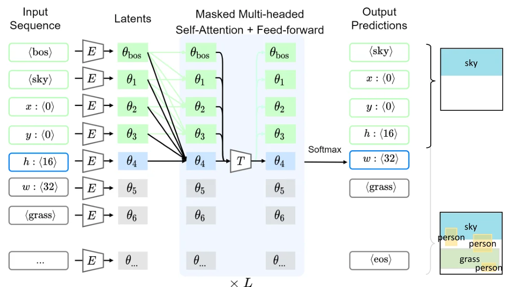
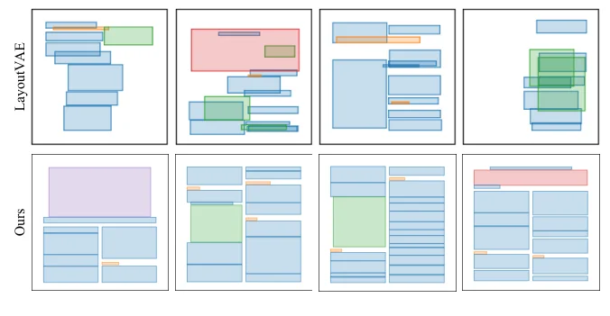

> - **논문**: LayoutTransformer: Layout Generation and Completion with Self-attention
> - **저자**: Kamal Gupta, Justin Lazarow, Alessandro Achille, Larry Davis, Vijay Mahadevan, Abhinav Shrivastava (University of Maryland, UC San Diego, Amazon AWS)
> - **학회**: ICCV 2021 · [프로젝트 페이지](https://kampta.github.io/layout)
{: .prompt-tip }

> 복잡한 장면은 단순한 도형 원소들의 **배치**로 표현된다. 문서는 제목·본문·그림 상자, 앱 화면은 버튼·아이콘·텍스트, 자연 이미지는 물체 바운딩 박스, 3D 의자는 등받이·팔걸이·다리이다. **LayoutTransformer**는 이 모든 도메인을 하나의 토큰 열 모델로 다룬다. 각 원소를 (카테고리, x, y, h, w) 다섯 토큰으로 펼치고, [Transformer 디코더]()가 다음 토큰을 예측한다. 빈 캔버스에서 생성하거나, 몇 개의 원소가 주어진 상태에서 나머지를 완성하거나, 기존 레이아웃의 가능도를 계산할 수 있고, 네 도메인에서 같은 구조와 하이퍼파라미터로 경쟁력 있는 결과를 냈다.

## 1. 문제: 외형보다 배치

장면 이해는 외형 지각과 구조 이해의 두 과정이라는 인지과학 근거에서 출발한다. 생성 모델 연구는 얼굴·동물처럼 **단일 객체의 외형**에 집중해 왔고, 큰 장면을 만들 때는 장면 그래프나 분할 마스크 같은 레이아웃 대리물을 입력으로 받았다. 레이아웃 자체를 생성하는 연구(LayoutGAN, LayoutVAE)는 원소 수가 고정되거나 라벨 집합을 먼저 받아야 했고, 도메인별 가정이 많았다. 저자들이 원하는 것은 원소 수가 가변이고, 부분 레이아웃에서 이어 갈 수 있으며, 도메인 제약이 없는 모델이다.

## 2. 방법

### 레이아웃을 열로

레이아웃은 $$n$$개 노드의 완전 그래프로 보고 관계는 attention이 배우게 둔다. 각 원소의 구조 정보(카테고리)는 학습된 임베딩으로, 기하 정보 $$g_i = [x_i, y_i, h_i, w_i]$$(중심 좌표와 크기, 캔버스 기준 정규화)는 **필드마다 따로** $$d$$차원으로 투영한다. 그리고 전부 하나의 열로 펼친다.

$$
\mathcal{G} = (s_{\langle bos \rangle};\; s_1, x_1, y_1, h_1, w_1;\; \ldots;\; s_n, x_n, y_n, h_n, w_n;\; s_{\langle eos \rangle}), \qquad p(\theta_{1:5n+2}) = \prod_j p(\theta_j \mid \theta_{1:j-1})
$$

길이 $$5n + 2$$의 열에 대한 자기회귀 분포이다. $$\langle eos \rangle$$를 예측하면 멈추므로 원소 수가 가변이다.


_Figure 2. 장난감 예시로 본 구조. 입력 토큰을 임베딩 $$E$$로 $$\theta_j$$로 바꾸고, 마스크된 self-attention 층이 앞쪽 토큰만 보며 다음 토큰(여기서는 sky 원소의 $$w$$)을 예측한다. 학습 때는 정답 열을 넣는 teacher forcing을 쓴다. (출처: Gupta et al., 2021)_

### 좌표를 이산화

$$x, y, h, w$$에 **8비트 균일 양자화**를 적용하고 범주형 분포로 모델링한다. 연속 값을 이산화하는 것은 PixelCNN++ 같은 이미지 생성 연구에서 쓰인 방식이지만 레이아웃에서는 처음이다. 근사 오차가 생기는 대신 임의의 분포(다봉, 격자 정렬)를 표현할 수 있고, 저자들은 이것이 문서나 앱 화면처럼 강한 대칭과 정렬이 있는 데이터에서 특히 중요하다고 관찰한다. 연속 회귀는 두 열 사이의 평균을 예측하지만, 범주형은 두 열 중 하나를 고른다.

### 모델과 학습

- 보이는 원소 $$K$$개(0일 수 있음)를 **무작위 순열**로 입력하고, 출력은 항상 중심 좌표의 **래스터 순서**로 생성한다. 순서가 학습에 중요하다는 것을 확인했고, 순서 불변 집합 생성은 향후 과제로 남긴다.
- 디코더는 마스크된 멀티헤드 attention + FFN의 $$L = 6$$층, $$d = 512$$, 8헤드이다. 학습은 teacher forcing이다.
- 손실은 이산 필드에는 label smoothing($$\epsilon = 0.1$$)을 건 KL, 연속 필드(3D 부품 임베딩)에는 L1이다.

$$
\mathcal{L} = \mathbb{E}_{\theta \sim \text{Disc.}}\big[\,\text{KL}(\text{SoftMax}(\theta^L)\ \Vert\ p(\theta'))\,\big] + \lambda\, \mathbb{E}_{\theta \sim \text{Cont.}}\big[\,\lVert \theta - \theta' \rVert_1\,\big]
$$

- 샘플링은 nucleus sampling(top-p 0.9)이 greedy나 beam search보다 좋다.
- 3D(PartNet)에서는 부품의 복셀을 3D CNN 오토인코더로 $$d$$차원 잠재 벡터로 만들어 카테고리 자리에 넣고, 위치·크기는 3D로 확장한다.

### 구현 디테일

| 항목 | 값 |
|---|---|
| 디코더 | $$d = 512$$, $$L = 6$$, head 8개. 모든 데이터셋에서 같은 구조 |
| 좌표 | 중심 $$(x, y)$$와 크기 $$(h, w)$$를 캔버스 크기로 정규화한 뒤 8비트(256단계) 양자화 |
| 손실 | label smoothing $$\epsilon = 0.1$$, $$\lambda = 1$$ |
| 최적화 | Adam ($$\beta_1 = 0.9$$, $$\beta_2 = 0.99$$), lr $$10^{-4}$$ (PartNet은 $$10^{-5}$$), validation loss로 early stopping |
| 샘플링 | nucleus sampling, top-p 0.9 |
| 3D 부품 | $$64^3$$ 복셀, PQ-Net 방식으로 부품 오토인코더를 따로 학습, 카테고리별 별도 모델 |
| 데이터 분할 | COCO: 공식 val을 test로, train의 5%를 validation. RICO: 무작위 5% validation, 15% test. PubLayNet: dev를 test로 |

## 3. 코드로 보기: 열 표현과 이산화의 효과

두 열(column) 문서 레이아웃을 합성해 토큰 열로 펼치고, 본문 원소의 $$x$$ 좌표를 연속 가우시안과 8비트 범주형으로 각각 모델링했을 때 샘플이 실제 열 위에 떨어지는 비율을 비교한다.

```python
import numpy as np
rng = np.random.default_rng(0)
# synthetic two-column document layouts: each element is (category, x, y, h, w) with x in one of two columns
cats = ["title", "text", "figure", "caption"]
def make_layout():
    n = rng.integers(3, 7); els = [("title", 0.5, 0.06, 0.06, 0.8)]
    for _ in range(n):
        col = float(rng.choice([0.27, 0.73])); c = str(rng.choice(cats[1:]))
        els.append((c, col, rng.uniform(0.15, 0.95), rng.uniform(0.05, 0.2), 0.42))
    return sorted(els, key=lambda e: (e[2], e[1]))                     # raster order of centroids

def to_sequence(layout, bits=8):
    q = lambda v: int(round(v * (2 ** bits - 1)))                       # 8-bit uniform quantization
    seq = ["<bos>"]
    for c, x, y, h, w in layout: seq += [c, q(x), q(y), q(h), q(w)]
    return seq + ["<eos>"]
L = make_layout()
print("layout with", len(L), "elements -> sequence of", len(to_sequence(L)), "tokens (5n + 2)")
print(to_sequence(L)[:12], "...")

# why discrete coordinates: the x position of body elements is bimodal (two columns)
xs = np.array([e[1] for _ in range(2000) for e in make_layout()[1:]])
print()
print(f"x of body elements: mean {xs.mean():.3f}, values seen: {sorted(set(np.round(xs, 2).tolist()))}")
print(f"  continuous regression (MSE-optimal) predicts x = {xs.mean():.2f}  -> a column that does not exist")
q = np.round(xs * 255).astype(int); hist = np.bincount(q, minlength=256) / len(q)
top = np.argsort(-hist)[:2]
print(f"  categorical over 256 bins: p({top[0]/255:.2f}) = {hist[top[0]]:.2f}, p({top[1]/255:.2f}) = {hist[top[1]]:.2f}, everything else {1 - hist[top].sum():.2f}")

# samples from the two parameterizations: how often do they land on a real column?
test = rng.standard_normal(10000) * xs.std() + xs.mean()                 # Gaussian fit (continuous regression + noise)
cat = rng.choice(256, 10000, p=hist) / 255                               # categorical fit
on_col = lambda s: np.mean(np.min(np.abs(s[:, None] - np.array([[0.27, 0.73]])), 1) < 0.02)
print(f"  samples within 0.02 of a real column: Gaussian {on_col(test)*100:.0f}%, categorical {on_col(cat)*100:.0f}%")
```

```text
layout with 7 elements -> sequence of 37 tokens (5n + 2)
['<bos>', 'title', 128, 15, 15, 204, 'text', 186, 39, 46, 107, 'figure'] ...

x of body elements: mean 0.498, values seen: [0.27, 0.73]
  continuous regression (MSE-optimal) predicts x = 0.50  -> a column that does not exist
  categorical over 256 bins: p(0.27) = 0.50, p(0.73) = 0.50, everything else 0.00
  samples within 0.02 of a real column: Gaussian 8%, categorical 100%
```

- 원소 7개가 37개 토큰이 되고, 좌표는 0~255의 정수이다. 카테고리와 네 좌표가 각각 하나의 토큰이라 attention이 "어느 원소의 어느 필드"를 볼지 따로 가중할 수 있다.
- 본문 $$x$$는 0.27 또는 0.73 두 값뿐인데, MSE 회귀는 존재하지 않는 0.50을 예측한다. 가우시안 샘플은 8%만 실제 열 근처에 떨어지고, 범주형은 100%이다. 논문이 문서·앱 레이아웃에서 정렬이 잘 보존된다고 보고한 이유가 이 차이이다.

## 4. 실험

**COCO 바운딩 박스(171개 카테고리, 중앙값 42개 원소).** COCO Panoptic 2017의 thing 80개 + stuff 91개 카테고리 박스로, 학습 레이아웃 118,280개, 평가 5,000개이다. 검증 레이아웃의 NLL(importance sampling으로 계산)과, 생성 레이아웃을 Layout2Im으로 이미지화한 IS·FID이다.

| 모델 | NLL ↓ | IS ↑ | FID ↓ |
|---|---|---|---|
| LayoutGAN | - | 3.2 | 89.6 |
| LayoutVAE | 3.29 | 7.1 | 64.1 |
| ObjGAN | 5.24 | 7.5 | 62.3 |
| sg2im | 3.4 | 3.3 | 85.8 |
| LayoutTransformer | **2.28** | **7.6** | **57.0** |

LayoutVAE와 ObjGAN은 라벨 집합을 조건으로 받는 유리한 설정인데도 NLL에서 뒤처진다. 생성된 박스 중심의 $$y$$ 분포는 실제와 비슷하다(하늘은 위, 도로·바다는 아래). 다만 생성 초반에 person, car 같은 고빈도 카테고리로 치우치는 편향이 있다.

**RICO 앱 화면(25개 카테고리, 중앙값 36개)과 PubLayNet 문서(5개 카테고리, 중앙값 33개).** RICO는 레이아웃 62,951개, PubLayNet은 원소 128개 이하로 거른 학습 레이아웃 335,703개이다. 두 데이터는 캔버스를 거의 다 덮고, 원소가 겹치지 않으며, 양 축으로 정렬되어 있다. 후처리 없이도 생성 레이아웃이 정렬을 유지한다. 같은 초기 원소에서 여러 완성을 샘플링할 수 있다.


_Figure 10. PubLayNet 문서 레이아웃 생성 결과. 위: LayoutVAE, 아래: LayoutTransformer. 아래쪽은 박스가 두 열에 맞춰 정렬되고 거의 겹치지 않는다. (출처: Gupta et al., 2021)_

이를 수치로 보기 위해 Overlap(원소 간 IoU)과 Coverage(캔버스 점유율)를 쟀다(논문 Table 4, 단위 %, 실제 데이터에 가까울수록 좋음).

| 모델 | RICO NLL ↓ | RICO Coverage | RICO Overlap | PubLayNet NLL ↓ | PubLayNet Coverage | PubLayNet Overlap |
|---|---|---|---|---|---|---|
| sg2im | 7.43 | 25.2 | 16.5 | 7.12 | 30.2 | 3.4 |
| ObjGAN | 4.21 | 39.2 | 36.4 | 4.20 | 38.9 | 8.2 |
| LayoutVAE | 2.54 | 41.5 | 34.1 | 2.45 | 40.1 | 14.5 |
| LayoutGAN | - | 37.3 | 31.4 | - | 45.3 | 8.3 |
| **LayoutTransformer** | **1.07** | 33.6 | 23.7 | **1.10** | 47.0 | 0.13 |
| 실제 데이터 | - | 36.6 | 22.4 | - | 57.1 | 0.1 |

NLL은 두 데이터셋 모두 가장 낮고, PubLayNet의 Overlap은 0.13%로 실제(0.1%)와 거의 같다. 다만 RICO의 Coverage만 보면 LayoutGAN(37.3%)이 LayoutTransformer(33.6%)보다 실제 값(36.6%)에 더 가깝다. 모든 통계에서 앞서는 것은 아니다.

**PartNet 3D(의자 6,305개, 램프 1,188개).** 부품 하나에서 시작해 나머지 부품의 잠재 벡터와 3D 위치·크기를 순차 생성한다. JSD, MMD, Coverage, 1-NNA의 모든 지표에서 PointFlow, StructureNet, IM-Net, PQ-Net 대비 1·2위이다(JSD 0.81, MMD-EMD 7.38, 1-NNA-EMD 59.11).

| 모델 (Chair) | JSD ↓ | MMD-CD ↓ | MMD-EMD ↓ | Cov-CD ↑ | Cov-EMD ↑ | 1-NNA-CD ↓ | 1-NNA-EMD ↓ |
|---|---|---|---|---|---|---|---|
| PointFlow | 1.74 | 2.42 | 7.87 | 46.83 | 46.98 | 60.88 | 59.89 |
| StructureNet | 4.77 | 0.97 | 15.24 | 29.67 | 31.7 | 75.32 | 74.22 |
| IM-Net | 0.84 | **0.74** | 12.28 | 52.35 | 54.12 | 68.52 | 67.12 |
| PQ-Net | 0.83 | 0.83 | 14.16 | 54.91 | **60.72** | 71.31 | 67.8 |
| **LayoutTransformer** | **0.81** | 0.79 | **7.38** | **55.25** | 55.44 | **60.67** | **59.11** | 실패 사례로 램프의 부품이 서로 연결되지 않는 경우가 있는데, 부품 오토인코더와 레이아웃 생성기를 따로 학습한 한계이다.

**레이아웃에서 의미가 생긴다.** 카테고리 임베딩의 t-SNE에서 COCO 상위 카테고리끼리 뭉치고, window-blind와 curtain처럼 상위 카테고리가 달라도 함께 나타나는 것은 가까이 놓인다. word2vec 식 유추도 된다. snowboard:snow::surfboard:? → waterdrops, sea, sand. car:road::train:? → railroad, platform. mouse:keyboard::spoon:? → knife, fork, oven. 언어 임베딩을 전혀 쓰지 않고 **배치만 배워서** 얻은 결과이다.

## 5. 해석

**1. 언어 모델의 레시피를 레이아웃에 그대로 옮겼다.** 토큰화, 자기회귀 분해, 마스크된 디코더, label smoothing, nucleus sampling까지 GPT 계열의 구성 요소이다. 레이아웃을 "문장"으로 보면 생성·완성·가능도 계산이 한 모델에서 추가 비용 없이 나온다. 이후 LayoutDM, LayoutGPT, 그리고 LLM에 레이아웃을 직접 쓰게 하는 연구들이 이 표현을 이어받았다.

**2. 이산화는 표현력의 선택이다.** 연속 좌표를 범주형으로 바꾸는 것은 정보를 버리는 것처럼 보이지만, 위 실험처럼 다봉 분포를 표현할 수 있게 된다. 디퓨전 모델이 연속 공간에서 다봉성을 처리하는 방식과 비교하면, 자기회귀 + 이산화는 정렬이 중요한 설계 데이터에 특히 맞는 선택이다.

**3. 속성 분리는 작은 결정이지만 효과가 크다.** 카테고리와 네 좌표를 합쳐 하나의 벡터로 만드는 기존 방식과 달리, 필드마다 토큰을 두면 attention이 "같은 $$x$$를 가진 원소들"처럼 특정 필드에만 집중할 수 있다. 저자들은 정렬 보존이 여기서 나온다고 가정한다.

**4. 순서 문제는 남아 있다.** 레이아웃은 집합인데 모델은 열을 요구하므로 래스터 순서를 강제했다. 생성 초반의 고빈도 카테고리 편향도 이 순서 의존성과 관련이 있을 수 있다. [GlyphDraw]()나 [Diff-Text]()처럼 텍스트를 장면에 넣는 과제에서도 "어디에 놓을 것인가"는 레이아웃 문제이고, 이런 모델이 위치 사전 분포로 쓰일 수 있다.

**5. 평가를 읽을 때 주의할 점.** LayoutGAN과 LayoutVAE는 공개 코드가 없어 저자들이 재구현했고, LayoutGAN은 학습이 불안정해 원 논문과 다를 수 있다고 적는다. NLL은 생성 샘플의 품질을 재지 못해 Layout2Im을 거친 FID로 보완했지만, 이것은 이미지 생성기의 성능과 섞인 지표이다. 의미 임베딩 관찰은 정성적이고, 유추 예시는 선별된 것이다. 위 toy는 두 열 구조를 알고 만든 합성 데이터라 효과가 과장되어 보일 수 있다.

## 6. 정리

| 항목 | 내용 |
|---|---|
| 표현 | 원소 = (카테고리, x, y, h, w), 레이아웃 = 길이 $$5n + 2$$의 토큰 열, 좌표는 8비트 범주형 |
| 모델 | 마스크된 Transformer 디코더 6층, $$d = 512$$, 입력은 무작위 순열, 출력은 래스터 순서 |
| 학습 | teacher forcing, label smoothing KL(이산) + L1(연속), nucleus sampling |
| 기능 | 빈 캔버스 생성, 부분 레이아웃 완성, 가능도 계산 |
| 결과 | COCO NLL 2.28(LayoutVAE 3.29), FID 57.0; RICO·PubLayNet 정렬 보존; PartNet 의자 전 지표 1·2위 |
| 관찰 | 레이아웃만 학습해도 카테고리 임베딩에 의미 구조(군집, 유추)가 생김 |

## References

- Gupta, Lazarow, Achille, Davis, Mahadevan, Shrivastava, "LayoutTransformer: Layout Generation and Completion with Self-attention," ICCV 2021. [arXiv:2006.14615](https://arxiv.org/abs/2006.14615)
- Li et al., "LayoutGAN: Generating Graphic Layouts with Wireframe Discriminators," ICLR 2019. [arXiv:1901.06767](https://arxiv.org/abs/1901.06767)
- Jyothi et al., "LayoutVAE: Stochastic Scene Layout Generation from a Label Set," ICCV 2019. [arXiv:1907.10719](https://arxiv.org/abs/1907.10719)
- Zhao et al., "Image Generation from Layout," CVPR 2019. [arXiv:1811.11389](https://arxiv.org/abs/1811.11389)
- Holtzman et al., "The Curious Case of Neural Text Degeneration," ICLR 2020. [arXiv:1904.09751](https://arxiv.org/abs/1904.09751)
