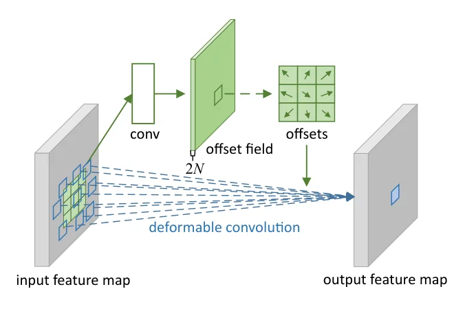
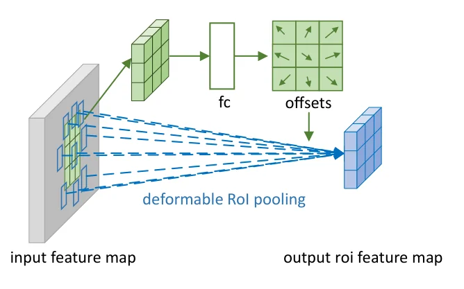
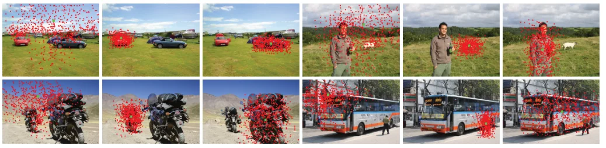

> - **논문**: Deformable Convolutional Networks
> - **저자**: Jifeng Dai, Haozhi Qi, Yuwen Xiong, Yi Li, Guodong Zhang, Han Hu, Yichen Wei (Microsoft Research Asia)
> - **학회**: ICCV 2017 · [arXiv:1703.06211](https://arxiv.org/abs/1703.06211) · [코드](https://github.com/msracver/Deformable-ConvNets)
{: .prompt-tip }

> [CNN 기초]()에서 본 convolution은 항상 **정사각형 격자** 모양으로 주변을 본다. 하지만 실제 물체는 크기, 자세, 관점, 부분 변형에 따라 모양이 제각각이다. **Deformable Convolutional Networks(DCN)**는 필터가 볼 위치를 입력에 맞춰 학습으로 움직이게 한다.

## 1. CNN의 특징 복습

- **2차원 feature map**: 입력의 공간적·지역적 정보를 유지
- **Sliding filter**: 5×5 입력에 3×3 필터를 쓰면 파라미터는 9개. 같은 연결을 FC로 만들면 25×9 = 225개가 필요
- **Inductive bias**: 처음 보는 데이터도 추론할 수 있게 하는 가정들
  - **Locality**: 의미 있는 관계는 가까운 요소들 사이에 있다
  - **Translation equivariance**: 위치가 바뀌어도 같은 필터로 같은 패턴을 찾는다 (입력이 밀리면 출력도 똑같이 밀림)

| | Fully Connected | CNN |
|---|---|---|
| 연결 | 모든 입력이 결과에 영향 | **가까운 입력만** 영향 |
| 결과 | 입력의 중요도 판별이 어려움 | 지역 특징을 잘 파악 |

비슷하게 RNN은 **시간**에 대한 inductive bias를 가져 음성 같은 순차 데이터에 강하다.

## 2. CNN의 약점: 기하학적 변형

CNN은 같은 크기·모양의 격자로만 보기 때문에, 크기와 모양이 극단적으로 변하는 물체(잎, 머리카락, 사람의 자세)에 약하다. 기존에는 세 가지 방법으로 대응했다.

| 방법 | 내용 | 한계 |
|---|---|---|
| 데이터 증강 | Affine 변환, augmentation으로 다양한 변형을 학습 | 큰 모델과 많은 데이터 비용, **알려진** 변형만 대응 |
| 변환 불변 특징 | SIFT 같은 불변 특징·알고리즘 | 수작업 설계, 복잡한 변형에는 어려움 |
| Multi-scale 집계 | 해상도를 줄여 가며 여러 feature map에서 추출 | 새 구조를 만들고 다시 학습해야 함 |

공통 한계는 **기하학적 변환을 고정되고 알려진 것으로 가정**한다는 점이다. 모델링하지 못한 새로운 변형에는 일반화되지 않는다.

## 3. Deformable Convolution

### 일반 convolution

3×3 필터의 샘플링 위치 집합을

$$
\mathcal{R} = \{(-1, -1), (-1, 0), \dots, (0, 0), \dots, (1, 1)\}
$$

이라 하면, 출력 위치 $$p_0$$의 값은

$$
y(p_0) = \sum_{p_n \in \mathcal{R}} w(p_n)\cdot x(p_0 + p_n)
$$

이다. 위치가 항상 같은 격자이다.

### Offset 추가

각 샘플링 위치에 **학습되는 offset** $$\Delta p_n$$을 더한다.

$$
y(p_0) = \sum_{p_n \in \mathcal{R}} w(p_n)\cdot x(p_0 + p_n + \Delta p_n)
$$

- Offset은 같은 입력 feature map에 별도의 conv 층을 적용해 얻는다. 이 conv는 본래 conv와 커널 크기·dilation이 같고 출력 해상도도 같다. 3×3 필터라면 위치 9개 × (x, y) = **18채널**($$2N$$, $$N = \lvert \mathcal{R} \rvert$$)의 offset map이 출력된다.
- 입력 feature에 따라 offset이 달라지므로, 물체가 커지면 넓게, 회전하면 돌려서, 변형되면 그 모양을 따라 샘플링한다.
- Offset 층은 0으로 초기화해 처음에는 일반 convolution처럼 동작한다.


_Figure 2. 3×3 deformable convolution. 위쪽 conv가 입력 feature map에서 $$2N$$채널 offset field를 만들고, 각 출력 위치는 그 offset만큼 옮겨진 9개 위치(파란 사각형)에서 값을 모은다. (출처: Dai et al., 2017)_

### Bilinear Interpolation

Offset은 소수라서 $$p_0 + p_n + \Delta p_n$$이 픽셀 사이에 떨어질 수 있다. 그래서 주변 4개 픽셀을 **선형 보간(bilinear interpolation)**해서 값을 얻는다.

$$
x(p) = \sum_q G(q, p)\cdot x(q),\qquad G(q, p) = g(q_x, p_x)\cdot g(q_y, p_y),\quad g(a, b) = \max(0, 1 - \lvert a - b\rvert)
$$

보간이 미분 가능하므로 offset도 역전파로 함께 학습된다.

```python
import torch
import torch.nn as nn
from torchvision.ops import deform_conv2d

class DeformConv2d(nn.Module):
    def __init__(self, in_ch, out_ch, k=3, padding=1):
        super().__init__()
        self.weight = nn.Parameter(torch.empty(out_ch, in_ch, k, k))
        nn.init.kaiming_uniform_(self.weight, a=1)
        self.offset = nn.Conv2d(in_ch, 2 * k * k, k, padding=padding)   # 위치마다 (dx, dy)
        nn.init.zeros_(self.offset.weight); nn.init.zeros_(self.offset.bias)
        self.padding = padding

    def forward(self, x):
        offset = self.offset(x)                                         # (B, 18, H, W)
        return deform_conv2d(x, offset, self.weight, padding=self.padding)   # 내부에서 bilinear 보간

x = torch.randn(1, 64, 32, 32)
print(DeformConv2d(64, 64)(x).shape)        # torch.Size([1, 64, 32, 32])

# offset이 0이면 일반 convolution과 결과가 같아야 한다
torch.manual_seed(0)
m = DeformConv2d(8, 8)
x = torch.randn(1, 8, 16, 16)
print(torch.allclose(m(x), torch.nn.functional.conv2d(x, m.weight, padding=1), atol=1e-5))  # True
```

offset 층을 0으로 초기화했으므로 학습 시작 시점에는 일반 convolution과 정확히 같다. 사전학습된 CNN의 conv 층을 deformable 버전으로 바꿔 끼워도 처음에는 성능이 그대로이고, 학습하면서 필요한 만큼만 격자를 벗어나게 된다. 실무에서 DCN을 기존 backbone에 "안전하게" 추가할 수 있는 이유이다.

> 대가도 있다. 위 예에서 offset 층의 파라미터(1,314개)가 본래 conv 가중치(576개)보다 많고, 샘플링 위치가 불규칙해져 메모리 접근이 흩어지기 때문에 같은 FLOPs의 일반 conv보다 실제 실행이 느리다. 그래서 보통 모든 층이 아니라 backbone의 뒤쪽 몇 단계에만 넣는다.
{: .prompt-info }

## 4. Deformable RoI Pooling

[Object Detection]()의 RoI Pooling은 크기가 제각각인 영역을 FC 층에 넣기 위해 $$k \times k$$개의 칸(bin)으로 나눠 pooling한다. 이 칸의 위치도 고정되어 있다.

Deformable RoI Pooling은 칸마다 offset을 준다.

1. 일반 RoI pooling으로 feature를 뽑음
2. **FC 층**으로 칸별 정규화된 offset $$\Delta\hat{p}_{ij}$$를 예측
3. RoI 크기에 비례하게 스케일링: $$\Delta p_{ij} = \gamma\,\Delta\hat{p}_{ij} \circ (w, h)$$ ($$\gamma = 0.1$$)
4. 옮겨진 위치에서 bilinear 보간으로 average pooling

$$
y(i, j) = \sum_{p \in \text{bin}(i, j)} \frac{x(p_0 + p + \Delta p_{ij})}{n_{ij}}
$$

($$n_{ij}$$: 칸 안의 픽셀 수)


_Figure 3. 3×3 deformable RoI pooling. 일반 RoI pooling 결과를 fc 층에 넣어 칸별 offset을 얻고, 옮겨진 칸에서 다시 pooling한다. (출처: Dai et al., 2017)_

물체의 부분(머리, 다리 등)이 어디 있든 각 칸이 해당 부분으로 이동해 특징을 뽑는다. offset을 RoI의 너비·높이로 정규화하는 이유는 offset 학습이 RoI 크기와 무관해지게 하기 위해서이다. R-FCN의 position-sensitive RoI pooling에도 같은 방식을 적용하는데, 이때는 fc 대신 conv 층이 전체 해상도의 offset field를 만든다.

## 5. 구현 디테일

| 항목 | 값 |
|---|---|
| Backbone | ImageNet으로 사전학습한 ResNet-101, Aligned-Inception-ResNet |
| Backbone 수정 | 평균 pooling·fc 제거, 1×1 conv로 1024채널 축소, conv5의 stride를 2 → 1로 줄이고 dilation 2로 보상 (출력 stride 16) |
| Deformable conv 위치 | ResNet-101의 마지막 3×3 conv 3개(res5a, b, c) |
| Offset 층 초기화·lr | 가중치 0으로 초기화. lr은 기존 층의 $$\beta$$배($$\beta = 1$$, Faster R-CNN의 fc offset 층만 0.01) |
| RoI pooling | 7×7 bin, offset 크기 $$\gamma = 0.1$$ |
| Segmentation 학습 | 짧은 변 360(VOC)·1024(Cityscapes), 30k·45k iteration, GPU 8장에 장당 이미지 1장, lr $$10^{-3}$$ → 마지막 1/3에서 $$10^{-4}$$ |
| Detection 학습 | 짧은 변 600, VOC 30k·COCO 240k iteration, GPU 8장, lr은 위와 동일 |

## 6. 결과

- 기존 네트워크의 일부 conv 층과 RoI pooling만 바꾸면 되므로, 새 구조를 설계하지 않고 간단한 수정으로 적용할 수 있다.
- ResNet-101 기준 파라미터 증가는 작았고(DeepLab 46.0M → 46.1M, 논문 Table 4), COCO test-dev에서 ResNet-101 기반 Faster R-CNN의 mAP@[0.5:0.95]가 **29.4 → 33.1**(상대적으로 약 13%), R-FCN은 **30.8 → 34.5**로 올랐다(논문 Table 5).
- Semantic segmentation(DeepLab), 객체 검출(Faster R-CNN, R-FCN)에서 일관되게 성능이 올랐다.
- 학습된 offset을 시각화하면, 큰 물체에서는 샘플링 위치가 넓게 퍼지고 작은 물체에서는 좁게 모이며 배경에서는 비교적 넓게 퍼지는 등 물체의 크기와 모양에 맞춰 적응했다(아래 Figure 6).


_Figure 6. 세 장씩 한 묶음으로, 3층의 3×3 deformable 필터를 거슬러 올라간 샘플링 위치($$9^3 = 729$$개, 빨간 점)를 배경(왼쪽), 작은 물체(가운데), 큰 물체(오른쪽)의 활성 위치(초록 점)에 대해 그린 것이다. (출처: Dai et al., 2017)_

### COCO test-dev 검출 (Table 5, mAP@[0.5:0.95])

| 검출기 | Backbone | 일반 | Deformable | 작은 물체 | 큰 물체 |
|---|---|---|---|---|---|
| class-aware RPN | ResNet-101 | 23.2 | 25.8 | 6.9 → 7.2 | 35.1 → 40.7 |
| Faster R-CNN | ResNet-101 | 29.4 | **33.1** | 9.0 → 11.6 | 47.1 → 51.2 |
| R-FCN | ResNet-101 | 30.8 | **34.5** | 11.8 → 14.0 | 44.8 → 50.3 |
| Faster R-CNN | Aligned-Inception-ResNet | 30.8 | 34.1 | 9.6 → 12.2 | 49.0 → 52.4 |
| R-FCN | Aligned-Inception-ResNet | 32.9 | 36.1 | 12.5 → 14.8 | 48.3 → 52.2 |

R-FCN + Aligned-Inception-ResNet에 multi-scale test와 iterative box averaging까지 더하면 35.5 → **37.5**이다. 이런 추가 기법과 deformable의 이득이 겹치지 않고 더해진다.

### Ablation (ResNet-101, VOC·Cityscapes)

몇 개 층을 deformable로 바꿀지(Table 1)와 dilation을 키운 atrous conv와의 비교(Table 3)이다. DeepLab은 mIoU(VOC / Cityscapes), 검출기는 VOC 2007 test의 mAP@0.5 / mAP@0.7이다.

| 설정 | DeepLab | Faster R-CNN | R-FCN |
|---|---|---|---|
| 기준 (atrous, dilation 2) | 69.7 / 70.4 | 78.1 / 62.1 | 80.0 / 61.8 |
| atrous, dilation 6 | 73.6 / 72.7 | 78.5 / 62.3 | 80.2 / 63.5 |
| deformable conv 1층 (res5c) | 73.9 / 73.5 | 78.6 / 63.8 | 80.6 / 63.0 |
| **deformable conv 3층** (기본) | **75.2 / 75.2** | 78.6 / 63.3 | 81.4 / 64.7 |
| deformable conv 6층 | 74.8 / 75.1 | 78.7 / 64.0 | 81.5 / 65.4 |
| deformable RoI pooling만 | - | 78.3 / 66.6 | 81.2 / 65.0 |
| **deformable conv + RoI pooling** | - | **79.3 / 66.9** | **82.6 / 68.5** |

- dilation을 키우는 것만으로도 성능이 오르지만 과제마다 최적 값이 달랐다(DeepLab은 6, Faster R-CNN은 4). deformable은 값을 고를 필요 없이 그보다 좋다.
- deformable RoI pooling은 엄격한 mAP@0.7에서 효과가 크다(Faster R-CNN 62.1 → 66.6).
- Table 3의 deformable conv 줄에서 DeepLab VOC 값은 75.3으로, Table 1의 75.2와 0.1 다르다(논문 원문 그대로).
- 실행 시간(K40 GPU, Table 4)은 Faster R-CNN이 0.190초 → 0.234초, R-FCN이 0.170초 → 0.193초로 늘었다. 파라미터는 58.3M → 59.9M, 47.1M → 49.5M이다.

offset이 물체 크기를 따라간다는 것도 숫자로 확인했다. 필터 안 인접 샘플링 위치 사이 거리의 평균(effective dilation)이 res5c 층에서 작은 물체 5.3, 중간 5.8, 큰 물체 8.4, 배경 6.2였다.

후속 **DCNv2**는 각 샘플링 위치에 **변조(modulation) 가중치**까지 학습해, 어느 위치를 얼마나 반영할지도 조절한다.

## 7. 정리

| | 일반 Convolution | Deformable Convolution |
|---|---|---|
| 샘플링 위치 | 고정된 격자 | 격자 + **학습된 offset** |
| 소수 위치 처리 | 해당 없음 | **Bilinear interpolation** |
| RoI Pooling | 고정된 bin | bin마다 offset (FC로 예측) |
| 비용 | 기준 | 파라미터 소폭 증가 |
| 장점 | 단순 | 크기·회전·변형에 적응 |

## References

- Dai et al., "Deformable Convolutional Networks," ICCV 2017. [arXiv:1703.06211](https://arxiv.org/abs/1703.06211)
- [torchvision.ops.deform_conv2d](https://pytorch.org/vision/stable/generated/torchvision.ops.deform_conv2d.html)
- Zhu et al., "Deformable ConvNets v2: More Deformable, Better Results," CVPR 2019.
- Jaderberg et al., "Spatial Transformer Networks," NeurIPS 2015.
- Lowe, "Distinctive Image Features from Scale-Invariant Keypoints (SIFT)," IJCV 2004.
