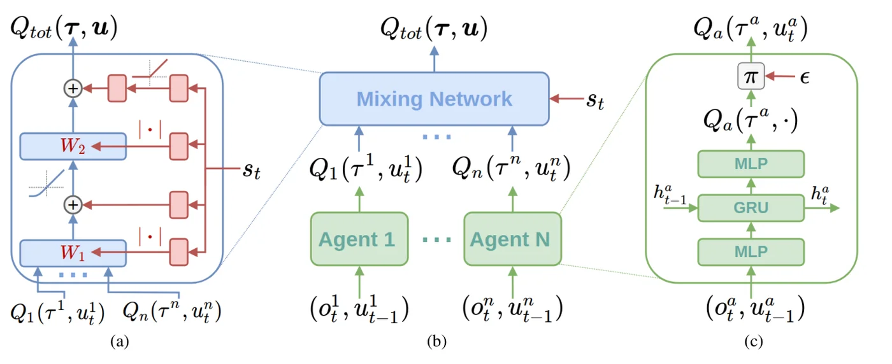
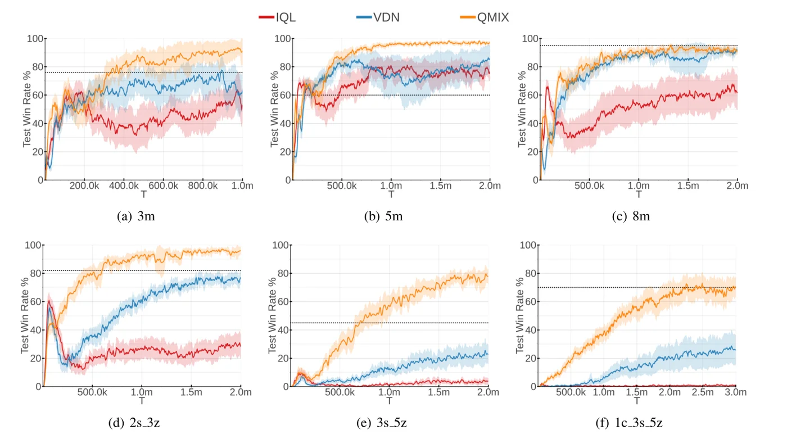
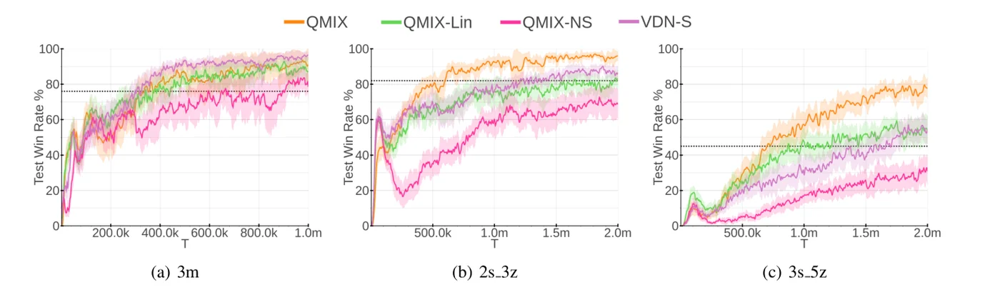

> - **논문**: QMIX: Monotonic Value Function Factorisation for Deep Multi-Agent Reinforcement Learning
> - **저자**: Tabish Rashid, Mikayel Samvelyan, Christian Schroeder de Witt, Gregory Farquhar, Jakob Foerster, Shimon Whiteson (University of Oxford, Russian-Armenian University)
> - **학회**: ICML 2018 · [arXiv:1803.11485](https://arxiv.org/abs/1803.11485)
{: .prompt-tip }

> Agent 시리즈의 첫 글로, 여러 에이전트가 협력해야 하는 **멀티에이전트 강화학습(MARL)**의 대표 알고리즘 QMIX를 정리한다. Actor-Critic 기반인 [COMA]()와 달리 QMIX는 Q-Learning 기반이다.

## 1. 문제 상황: 협력하는 여러 에이전트

스타크래프트에서 마린 5기가 적과 싸우는 상황을 생각해 보자.

- 각 마린은 자기 주변만 볼 수 있고(partial observation)
- 다른 마린과 관측을 공유하지 않으며
- 보상은 팀 전체가 하나의 팀 보상으로 받는다.

실제로 행동할 때(execution)는 각자 자기 관측만으로 움직여야 하지만, 학습할 때(training)는 시뮬레이터에서 전체 상태를 볼 수 있다. 이렇게 학습은 중앙에서, 실행은 분산해서 하는 틀을 **CTDE**(Centralised Training with Decentralised Execution)라고 한다.

질문은 다음과 같다.

> 팀 전체의 가치 $$Q_{tot}$$를 학습하면서도, 각 에이전트가 자기 $$Q_a$$만 보고 행동해도 팀 전체에 최선인 행동이 나오게 할 수 있을까?

## 2. 이전 방법들

### Independent Q-Learning (IQL)

가장 단순한 방법은 에이전트마다 Q-Learning을 따로 돌리는 것이다.

- Joint action을 전혀 고려하지 않음
- 각 에이전트 입장에서는 다른 에이전트도 같이 학습하며 바뀌기 때문에 환경이 계속 변하는 것처럼 보임 → **non-stationary**
- 2인 Pong 같은 단순한 환경에서는 잘되기도 하지만, 에이전트 수가 늘수록 학습이 불안정해짐

### Value Decomposition Network (VDN)

VDN은 팀 가치를 개별 가치의 **단순 합**으로 분해한다.

$$
Q_{tot}(\boldsymbol{\tau}, \mathbf{u}) = \sum_{a=1}^{n} Q_a(\tau^a, u^a)
$$

($$\boldsymbol{\tau}$$: joint action-observation history, $$\mathbf{u}$$: joint action)

합이므로 각자 자기 $$Q_a$$를 최대화하면 $$Q_{tot}$$도 최대가 된다. 덕분에 중앙 학습이 가능해졌지만 한계가 있다.

1. **표현력 부족**: 팀 가치를 단순 합으로만 표현할 수 있어서, 에이전트 간 복잡한 상호작용을 담지 못함
2. **전역 상태 미사용**: 학습 때 볼 수 있는 전체 상태 $$s$$를 활용하지 않음

## 3. QMIX의 핵심: Monotonicity

QMIX는 "단순 합"이라는 조건을 더 넓은 조건으로 바꾼다. 필요한 것은 다음 성질(IGM, Individual-Global-Max)이다.

$$
\arg\max_{\mathbf{u}} Q_{tot}(\boldsymbol{\tau}, \mathbf{u}) =
\begin{pmatrix}
\arg\max_{u^1} Q_1(\tau^1, u^1) \\
\vdots \\
\arg\max_{u^n} Q_n(\tau^n, u^n)
\end{pmatrix}
$$

즉, 각자가 자기 이익을 최대화하는 것만으로 팀 전체의 최적 행동이 나와야 한다. 이를 보장하는 충분조건으로 QMIX는 **단조성(monotonicity)**을 강제한다.

$$
\frac{\partial Q_{tot}}{\partial Q_a} \ge 0, \quad \forall a
$$

어떤 에이전트의 $$Q_a$$가 오르면 $$Q_{tot}$$는 절대 내려가지 않는다는 뜻이다. 단순 합은 이 조건을 만족하는 특수한 경우일 뿐이고, QMIX는 이 조건만 지키면 비선형 혼합도 허용한다.

이렇게 하면 두 가지를 얻는다.

- 학습 중 $$\max_{\mathbf{u}} Q_{tot}$$를 각자의 argmax로 쉽게 계산할 수 있어 **off-policy 학습이 tractable**해짐
- 중앙 정책과 분산 정책이 일관성을 가짐

## 4. 네트워크 구조

QMIX는 세 부분으로 구성된다. 아래 Figure 2의 (c)가 agent network, (a)가 mixing network와 hypernetwork(빨간색), (b)가 둘을 합친 전체 구조이다.


_Figure 2. (a) Mixing network. 빨간 hypernetwork가 상태 $$s_t$$로 파란 mixing 층의 가중치·bias를 만들고, 가중치에는 절댓값을 씌운다. (b) 전체 구조. (c) Agent network(MLP–GRU–MLP). (출처: Rashid et al., 2018)_

### (1) Agent Network

각 에이전트는 DRQN(MLP + GRU + MLP)으로 자기 관측 $$o_t^a$$와 이전 행동 $$u_{t-1}^a$$를 받아 $$Q_a(\tau^a, \cdot)$$를 출력한다. 부분 관측이라 과거 이력을 기억하기 위해 GRU를 쓴다. 실행할 때는 이 네트워크만 있으면 된다.

### (2) Mixing Network

각 에이전트의 $$Q_1, \dots, Q_n$$을 입력받아 $$Q_{tot}$$를 출력하는 작은 feed-forward 네트워크이다. 단조성을 지키기 위해 **가중치를 모두 0 이상**으로 제한한다. (ELU 같은 단조 증가 활성 함수와 음이 아닌 가중치의 조합은 단조 함수이다.)

### (3) Hypernetworks

Mixing network의 가중치와 bias는 직접 학습하지 않고, 전역 상태 $$s$$를 입력받는 hypernetwork가 생성한다.

- 가중치를 만드는 hypernetwork 출력에는 **절댓값**을 씌워 non-negative를 보장
- bias는 부호 제한이 없음 (단조성에 영향을 주지 않기 때문)
- 마지막 bias는 2층 네트워크(ReLU 포함)로 생성

상태를 mixing network의 입력으로 그냥 넣지 않는 데는 이유가 있다. 상태를 직접 입력하면 그 경로의 가중치도 non-negative로 묶여서 상태가 $$Q_{tot}$$에 영향을 주는 방식이 단조적으로 제한된다. Hypernetwork로 가중치를 만들면 상태는 **임의의 비선형 방식으로** $$Q_{tot}$$에 영향을 줄 수 있다.

```python
import torch
import torch.nn as nn
import torch.nn.functional as F

class QMixer(nn.Module):
    def __init__(self, n_agents, state_dim, embed_dim=32):
        super().__init__()
        self.n_agents, self.embed_dim = n_agents, embed_dim
        # hypernetworks: 상태 s → mixing network의 가중치/bias
        self.hyper_w1 = nn.Linear(state_dim, n_agents * embed_dim)
        self.hyper_b1 = nn.Linear(state_dim, embed_dim)
        self.hyper_w2 = nn.Linear(state_dim, embed_dim)
        self.hyper_b2 = nn.Sequential(
            nn.Linear(state_dim, embed_dim), nn.ReLU(), nn.Linear(embed_dim, 1)
        )

    def forward(self, agent_qs, state):
        # agent_qs: (B, n_agents), state: (B, state_dim)
        B = agent_qs.size(0)
        w1 = torch.abs(self.hyper_w1(state)).view(B, self.n_agents, self.embed_dim)  # ≥ 0
        b1 = self.hyper_b1(state).view(B, 1, self.embed_dim)
        hidden = F.elu(torch.bmm(agent_qs.unsqueeze(1), w1) + b1)                   # (B, 1, E)

        w2 = torch.abs(self.hyper_w2(state)).view(B, self.embed_dim, 1)             # ≥ 0
        b2 = self.hyper_b2(state).view(B, 1, 1)
        q_tot = torch.bmm(hidden, w2) + b2
        return q_tot.view(B)

# 단조성 확인: Q_tot를 각 Q_a로 미분한 값이 모두 0 이상인가?
torch.manual_seed(0)
mixer = QMixer(n_agents=3, state_dim=10)
agent_qs = torch.randn(4, 3, requires_grad=True)     # 배치 4, 에이전트 3
state = torch.randn(4, 10)
mixer(agent_qs, state).sum().backward()
print(agent_qs.grad)                  # 모든 원소가 양수
print((agent_qs.grad >= 0).all())     # tensor(True)
```

가중치는 무작위로 초기화했지만 $$\partial Q_{tot} / \partial Q_a$$가 모두 양수로 나온다. 단조성이 학습 결과가 아니라 네트워크 구조(절댓값 + 단조 증가 활성 함수)로 보장된다는 뜻이다.

## 5. 학습

DQN과 같은 방식으로 replay buffer에 transition $$\langle s, \mathbf{u}, r, s' \rangle$$을 저장하고, 대상이 $$Q_{tot}$$라는 점만 다르다.

$$
\mathcal{L}(\theta) = \sum_{i=1}^{b}\left[\left(y_i^{tot} - Q_{tot}(\boldsymbol{\tau}, \mathbf{u}, s;\theta)\right)^2\right]
$$

$$
y^{tot} = r + \gamma \max_{\mathbf{u}'} Q_{tot}(\boldsymbol{\tau}', \mathbf{u}', s';\theta^-)
$$

$$\theta^-$$는 target network 파라미터이다. 여기서 $$\max_{\mathbf{u}'}$$는 원래 joint action 전체를 탐색해야 하지만(에이전트 수에 대해 지수적), 단조성 덕분에 각 에이전트의 argmax만 구하면 된다. QMIX가 실용적인 이유가 여기에 있다.

전체 loss는 팀 보상 하나로 end-to-end 학습되며, agent network와 mixing network가 함께 업데이트된다.

## 6. 구현 디테일

부록(Appendix C)에 적힌 StarCraft II 실험 설정이다.

| 항목 | 값 |
|---|---|
| Agent network | DRQN: FC → GRU(hidden 64) → FC. 모든 에이전트가 파라미터를 공유하고, 관측에 agent id one-hot을 붙임 |
| Mixing network | hidden 1층 32 unit, ELU |
| Hypernetwork | 층마다 linear 1층 + 절댓값. 마지막 bias만 hidden 32 unit + ReLU의 2층 |
| 탐색 | 에이전트별 독립 $$\epsilon$$-greedy, $$\epsilon$$을 50k step 동안 1.0 → 0.05로 선형 감소 |
| 할인율 | $$\gamma = 0.99$$ |
| Replay buffer | 최근 5,000 에피소드, 32 에피소드씩 균등 샘플링, 에피소드 전체를 unroll해서 학습 |
| Target network | 200 학습 에피소드마다 갱신 |
| Optimizer | RMSprop, lr $$5\times 10^{-4}$$ ($$\alpha = 0.99$$, weight decay·momentum 없음) |
| 에피소드 길이 제한 | 3m·5m 60 step, 8m·2s3z 120, 3s5z 150, 1c3s5z 200 (시간 안에 못 이기면 패배) |
| 관측·상태 | 시야 9, 사거리 6. 관측은 시야 안 유닛의 거리·상대 좌표(이질적인 맵은 유닛 종류 포함), 전역 상태는 전체 유닛의 좌표·체력·실드·쿨다운과 아군의 직전 행동 |
| 평가 | 100 에피소드마다 학습을 멈추고 greedy로 20 에피소드를 돌려 test win rate 측정, 방법마다 20 run 평균 |

Two-Step Game은 더 작은 설정(hidden 64 unit의 DQN, mixing 8 unit, $$\epsilon = 1$$ 고정, batch 32, 10k step)을 쓴다.

## 7. 실험

### Two-Step Game: 표현력 비교

첫 step에서 에이전트 1의 선택에 따라 서로 다른 보상 행렬의 게임(State 2A, 2B)으로 넘어가는 간단한 게임이다(첫 step에서 에이전트 2의 행동은 영향이 없음). 2A는 무엇을 골라도 보상이 7이고, 2B는 둘 다 B를 골라야 8, 한쪽만 B면 1, 둘 다 A면 0이다. 최적 전략은 첫 step에 B로 가서 (B, B)를 고르는 것이다.

$$\epsilon = 1$$로 모든 상태를 충분히 탐색하게 한 뒤 학습된 $$Q_{tot}$$를 보면 차이가 분명하다(Table 2, State 2B).

| State 2B의 $$Q_{tot}$$ | (A, A) | (A, B) | (B, A) | (B, B) |
|---|---|---|---|---|
| 실제 보상 | 0 | 1 | 1 | 8 |
| VDN | -1.87 | 2.31 | 2.33 | 6.51 |
| **QMIX** | **0.00** | **1.00** | **1.00** | **8.00** |

- **VDN**: 단순 합으로는 2B의 보상 구조를 표현하지 못해 (B, B)를 6.51로 낮게 본다. 그래서 State 1에서 2A로 가는 행동(약 6.94)을 2B로 가는 행동(약 6.35)보다 높게 평가해 보상 7인 차선 전략에 머문다.
- **QMIX**: 2B의 값을 거의 정확히 표현하고, State 1에서 B(약 7.92)를 골라 보상 8을 받는다.

부록의 최종 보상(Table 6)은 IQL 7, VDN 7, VDN-S 7, QMIX-Lin 7, **QMIX 8, QMIX-NS 8**이다. 이 게임에서는 각 에이전트가 전체 상태를 입력으로 받기 때문에 hypernetwork 없이 비선형 혼합만 있어도(QMIX-NS) 최적을 찾는다.

### StarCraft II 마이크로 컨트롤

| 맵 | 구성 |
|---|---|
| 3m / 5m / 8m | 마린 3·5·8기 |
| 2s3z | 스토커 2 + 질럿 3 |
| 3s5z | 스토커 3 + 질럿 5 |
| 1c3s5z | 거신 1 + 스토커 3 + 질럿 5 |

- 행동: `move[방향]`, `attack[적 ID]`, `stop`, `no-op`
- 자동 공격 같은 게임 내장 매크로는 끄고 강화학습 능력만 평가
- 팀 보상: 입힌 피해량 + 적 처치 시 10점 + 전멸 시 200점, 최댓값 20으로 정규화

**결과**


_Figure 3. IQL, VDN, QMIX의 test win rate(20 run 평균, 95% 신뢰구간). 점선은 전체 상태를 보는 규칙 기반 휴리스틱(가장 가까운 적을 죽을 때까지 공격)의 승률이다. (출처: Rashid et al., 2018)_

- **IQL**: 다른 에이전트의 학습으로 환경이 계속 변해 학습이 매우 불안정. 어느 맵에서도 안정적으로 이기는 정책을 배우지 못함
- **VDN**: 모든 맵에서 IQL보다 좋고, 5m·8m처럼 **집중 사격(focus fire)**이 핵심인 맵에서 강함. 하지만 정교한 컨트롤이 필요한 3m에서는 약함
- **QMIX**: 모든 맵에서 가장 강하거나 대등함. 8m은 집중 사격만으로 충분해서 VDN과 비슷하고, 역할이 다른 유닛이 섞인 2s3z, 3s5z, 1c3s5z에서 격차가 큼. 3s5z와 1c3s5z에서는 VDN이 휴리스틱 승률에도 못 미침

논문에는 학습 곡선만 있고 최종 승률 표는 없다. 숫자로 나온 것은 비교 기준선인 휴리스틱의 승률(Table 7)뿐이다.

| 맵 | 3m | 5m | 8m | 2s3z | 3s5z | 1c3s5z |
|---|---|---|---|---|---|---|
| 휴리스틱 승률(%) | 76 | 60 | 95 | 82 | 45 | 70 |

학습된 행동도 다르다. 2s3z에서 QMIX는 아군 질럿이 적 질럿을 먼저 막아 세우는 동안 스토커가 안전한 거리에서 사격하도록 배운다(질럿이 스토커의 카운터이기 때문). VDN은 위치를 고려하지 않고 왼쪽으로 달려가 사거리에 들어온 적을 공격한다.

### Ablation

| 변형 | 내용 | 결과 |
|---|---|---|
| QMIX-NS | Hypernetwork 없이 mixing 가중치를 상태와 무관하게 학습 (절댓값으로 단조성은 유지) | 2s3z·3s5z에서 VDN과 비슷하거나 약간 나음 |
| QMIX-Lin | Mixing network의 hidden layer 제거 (상태로 가중치를 정하는 선형 혼합) | 3m에서는 QMIX와 비슷, 2s3z·3s5z에서 QMIX보다 낮음 |
| VDN-S | VDN에 상태 의존 항 $$V(s)$$(hidden 32, ReLU)를 추가 | 3m에서는 QMIX와 비슷, 이질적인 맵에서는 QMIX보다 낮음 |


_Figure 4. 3m, 2s3z, 3s5z에서 QMIX와 ablation의 승률. 같은 종류 유닛만 있는 3m에서는 차이가 작고, 이질적인 맵에서 QMIX가 앞선다. (출처: Rashid et al., 2018)_

결론적으로 비선형 혼합과 hypernetwork를 이용한 전역 상태 활용이 **둘 다** 있어야 성능이 나온다. 상태 정보 없이 비선형 혼합만 하는 것은 항상 도움이 되지는 않는다.

## 8. 정리

| | IQL | VDN | QMIX |
|---|---|---|---|
| 팀 가치 | 없음 | $$\sum_a Q_a$$ | 단조 비선형 혼합 |
| 전역 상태 활용 | ✕ | ✕ | ○ (hypernetwork) |
| 분산 실행 일관성 | ✕ | ○ | ○ |
| 표현력 | 낮음 | 제한적 | 더 넓음 |

QMIX의 한계도 분명하다. 단조성은 IGM의 **충분조건일 뿐 필요조건은 아니라서**, 한 에이전트의 선택에 따라 다른 에이전트의 최적 행동이 뒤바뀌는(non-monotonic) 문제는 표현하지 못한다.

후속 연구에서 자주 쓰는 예시가 다음 보상 행렬이다(에이전트 1이 행, 에이전트 2가 열을 고름).

| | A | B | C |
|---|---|---|---|
| **A** | **8** | -12 | -12 |
| **B** | -12 | 0 | 0 |
| **C** | -12 | 0 | 0 |

최적은 둘 다 A를 골라 8을 받는 것이지만, 한쪽만 A를 고르면 -12라는 큰 벌을 받는다. 에이전트 1 입장에서 "A가 좋다"는 평가가 상대가 무엇을 고르느냐에 따라 뒤집히므로, $$Q_{tot}$$를 개별 Q의 단조 함수로 쓰면 이 구조를 정확히 표현할 수 없고 QMIX는 (B, B) 같은 안전한 차선책에 머물기 쉽다. 이 한계를 다룬 연구로 QTRAN(Son et al., 2019), Weighted QMIX(Rashid et al., 2020), QPLEX(Wang et al., 2021) 등이 있다.

## References

- Rashid et al., "QMIX: Monotonic Value Function Factorisation for Deep Multi-Agent Reinforcement Learning," ICML 2018. [arXiv:1803.11485](https://arxiv.org/abs/1803.11485)
- Rashid et al., "Weighted QMIX: Expanding Monotonic Value Function Factorisation for Deep Multi-Agent Reinforcement Learning," NeurIPS 2020. [arXiv:2006.10800](https://arxiv.org/abs/2006.10800)
- Sunehag et al., "Value-Decomposition Networks For Cooperative Multi-Agent Learning," AAMAS 2018.
- Foerster et al., "Counterfactual Multi-Agent Policy Gradients," AAAI 2018.
- Samvelyan et al., "The StarCraft Multi-Agent Challenge," AAMAS 2019.
