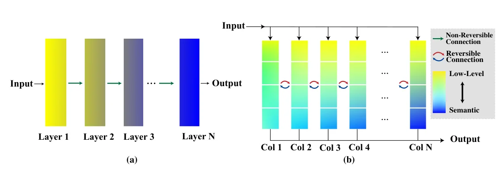
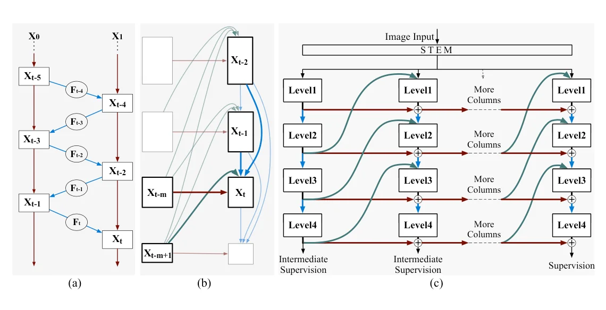
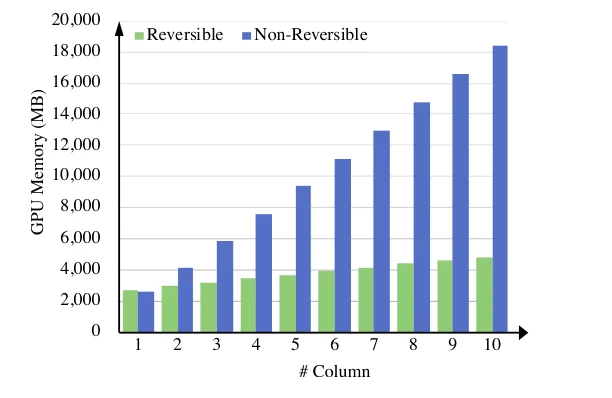

> - **논문**: Reversible Column Networks
> - **저자**: Yuxuan Cai, Yizhuang Zhou, Qi Han, Jianjian Sun, Xiangwen Kong, Jun Li, Xiangyu Zhang (MEGVII Technology, Beijing Academy of Artificial Intelligence)
> - **학회**: ICLR 2023 · [arXiv:2212.11696](https://arxiv.org/abs/2212.11696) · [코드](https://github.com/megvii-research/RevCol)
{: .prompt-tip }

> 보통의 백본은 층을 지날수록 과제와 무관한 정보를 버리고 의미 정보만 남깁니다(정보 병목). 그런데 사전학습한 백본을 검출이나 분할처럼 **다른 과제에 옮기면** 버린 정보가 필요할 수 있습니다. **RevCol**(Reversible Column Networks)은 반대 원리를 택합니다. 입력 정보를 **버리지 않고(가역) 저수준과 의미 수준으로 점점 분리**하는 것입니다. 구조는 같은 서브네트워크(열)를 여러 개 세우고 열 사이를 **다단계 가역 연결**로 잇는 것이고, 부산물로 활성값 메모리가 열 수와 무관해집니다. RevCol-H는 ImageNet 90.0%, COCO 63.8 AP$$^{box}$$, ADE20K 61.0 mIoU를 기록했습니다.

## 1. 문제: 정보 병목은 전이에 불리하다

정보 병목 원리에 따르면 깊은 네트워크는 층마다 입력 $$x$$에 대한 상호 정보 $$I(x; h)$$를 줄이고 라벨에 대한 정보 $$I(y; h)$$를 키웁니다. 분류에는 유리하지만 두 가지 문제가 있습니다.

- 버린 정보는 복구되지 않으므로, 사전학습 과제와 다른 다운스트림 과제(밀집 예측, 영역 분할)에 필요한 저수준 정보가 사라집니다.
- 사전학습 데이터와 다운스트림 사이에 **도메인 차이**가 크면 더 불리합니다.

그래서 저자들은 "모든 정보를 보존하되, 과제와 관련된 특징을 **분리(disentangle)**하라"는 목표를 세웁니다. 가역 네트워크(RevNet)는 정보를 보존하지만, 기존 설계는 한 스트림 안에서 특징을 섞기만 하고 분리하지는 않습니다.


_Figure 1. (a) 일반 단일 열 네트워크는 층을 지날수록 저수준(노랑) 정보가 의미(파랑) 정보로 바뀌며 사라집니다. (b) RevCol은 열 사이를 가역 연결로 잇고, 열이 뒤로 갈수록 한 열 안에서 저수준과 의미 정보가 레벨별로 나뉩니다. (출처: Cai et al., 2023)_

## 2. 방법

### 다단계 가역 유닛

RevNet의 가역 블록은 두 입력 $$(x_1, x_2)$$에서 두 출력을 만들고, 역산할 때 $$x_1 = y_1 - F(y_2)$$ 식으로 되돌립니다. RevCol은 이것을 $$m$$개 입력으로 일반화합니다. 특징들을 하나의 긴 수열 $$x_1, x_2, \ldots$$로 보고,

$$
x_t = F_t(x_{t-1}, x_{t-m+1}) + \gamma\, x_{t-m}, \qquad x_{t-m} = \gamma^{-1}\left(x_t - F_t(x_{t-1}, x_{t-m+1})\right)
$$

로 정의합니다. $$F_t$$는 임의의 비가역 네트워크(실제로는 ConvNeXt 블록 묶음)이고, $$\gamma$$는 가역인 간단한 연산(채널별 스케일)입니다. 수열을 $$m$$개씩 묶으면 **한 묶음이 하나의 열**이 되고, 열 안의 $$m$$개 특징은 서로 다른 해상도의 $$m$$개 **레벨**(1/4, 1/8, 1/16, 1/32)입니다. 열 $$i$$의 레벨 $$t$$는 같은 열의 아래 레벨($$t-1$$)과 이전 열의 위 레벨($$t+1$$)을 융합한 뒤, 이전 열의 같은 레벨을 $$\gamma$$로 스케일해 더합니다. 역산은 열의 맨 위 레벨부터 아래로 내려가며 순서대로 풀 수 있습니다.

RevNet과 달리 한 열 안의 레벨은 **해상도가 모두 달라도** 됩니다. 가역성은 열과 열 사이의 덧셈에서만 요구되기 때문입니다. 저자들은 이 덕분에 $$m$$이 크면 feature map 크기 제약이 크게 풀린다고 적습니다. 원래 일반형(Eq. 2)은 $$F_t$$가 앞선 $$m-1$$개 특징을 모두 받지만, 입력을 늘려도 정확도 이득은 작고 GPU 자원은 많이 들어서 위처럼 두 입력만 쓰는 단순화된 형태(Eq. 3)를 씁니다.


_Figure 2. (a) RevNet의 가역 유닛. (b) 다단계 가역 유닛, 레벨 $$t$$의 입력이 강조되어 있습니다. (c) RevCol 전체 구조. 파란 화살표가 같은 열의 아래 레벨, 초록 곡선이 이전 열의 위 레벨, 빨간 화살표가 $$\gamma$$로 스케일되어 더해지는 이전 열의 같은 레벨입니다. (출처: Cai et al., 2023)_

### 가역 열 아키텍처

- 입력 이미지는 stem(patch embedding)을 거쳐 **모든 열의 레벨 1 입력**으로 들어갑니다. 열은 같은 구조지만 가중치가 같을 필요는 없습니다.
- 열 안에서 레벨이 올라갈수록 의미 수준이 높아지고, **열이 뒤로 갈수록** 각 레벨의 특징이 점점 분리됩니다. 마지막 열의 레벨 4를 분류에, 마지막 열의 네 레벨 모두를 FPN처럼 밀집 예측에 씁니다.
- **중간 지도(intermediate supervision).** 열 사이 연결은 가역이어도 열 **안의** downsampling 블록은 정보를 버릴 수 있습니다. 그래서 앞쪽 열의 **레벨 4 특징**에 보조 헤드 두 개를 붙입니다. 하나는 입력 이미지를 복원하는 decoder(BCE 재구성 손실, 입력 정보 유지), 하나는 linear classifier(CE 손실, 의미 정보 추출)입니다. 8열 모델이면 2·4·6열에 중간 지도를 걸고 8열에는 원래 분류 손실을 겁니다. 가중치는 $$\alpha_i = 3, 2, 1, 0$$(재구성), $$\beta_i = 0.18, 0.35, 0.53, 1$$(분류)로, 앞 열일수록 재구성 쪽이 큽니다.
- **블록 수정.** 각 열은 ConvNeXt 블록으로 만들고, 현재 열의 아래 레벨(downsample)과 이전 열의 위 레벨(upsample)을 더하는 fusion 모듈을 넣습니다. 학습 속도를 위해 ConvNeXt의 7×7 depthwise conv를 **3×3**으로 줄였습니다. $$\gamma$$는 학습 가능한 채널별 스케일이고, 역산 오차가 커지지 않도록 $$\lvert\gamma\rvert$$가 $$10^{-3}$$보다 작아지지 않게 자릅니다.

모델 크기는 다음과 같습니다(Section 3).

| 모델 | 채널 $$C$$ | 블록 $$B$$ | 열 수 | 파라미터 / FLOPs |
|---|---|---|---|---|
| RevCol-T | (64, 128, 256, 512) | (2, 2, 4, 2) | 4 | 30M / 4.5G |
| RevCol-S | (64, 128, 256, 512) | (2, 2, 4, 2) | 8 | 60M / 9.0G |
| RevCol-B | (72, 144, 288, 576) | (1, 1, 3, 2) | 16 | 138M / 16.6G |
| RevCol-L | (128, 256, 512, 1024) | (1, 2, 6, 2) | 8 | 273M / 39.0G |
| RevCol-XL | (224, 448, 896, 1792) | (1, 2, 6, 2) | 8 | 834M / 350G (384²) |
| RevCol-H | (360, 720, 1440, 2880) | (1, 2, 6, 2) | 8 | 2,158M / 2,537G (640²) |

### 메모리

가역이므로 역전파 때 활성값을 저장하지 않고 **마지막 열의 특징에서 앞 열을 다시 계산**합니다. 열 수를 아무리 늘려도 저장해야 하는 활성값은 한 열 분량입니다. 대신 순전파를 한 번 더 하는 계산 비용이 듭니다.


_Figure 4. 열 하나를 1G FLOPs로 고정하고 열 수를 늘릴 때의 학습 GPU 메모리(V100, batch 64, FP16). 비가역 구조는 열 수에 비례해 늘고, RevCol은 거의 일정합니다. (출처: Cai et al., 2023)_

위 Figure 4처럼 10열에서 비가역 구조는 약 18GB, RevCol은 약 5GB입니다. 완전히 일정하지 않은 이유는 역전파 때 재계산에 필요한 연산 가중치 등을 따로 보관해야 하기 때문이라고 저자들은 설명합니다.

## 3. 코드로 보기: 가역 유닛의 역산

4레벨, 16채널의 장난감 열을 여러 개 쌓고, **마지막 열의 특징만으로** 첫 열의 특징을 복원해 오차를 잽니다. $$\gamma$$와 정밀도에 따라 오차가 어떻게 커지는지도 봅니다.

```python
import torch, torch.nn as nn
torch.manual_seed(0)
m, C = 4, 16                       # levels per column, channels

class Fuse(nn.Module):             # F_t: fuse lower level (same column) and higher level (previous column)
    def __init__(s, C):
        super().__init__(); s.net = nn.Sequential(nn.Linear(2 * C, 2 * C), nn.GELU(), nn.Linear(2 * C, C))
    def forward(s, lower, higher): return s.net(torch.cat([lower, higher], -1))

def col_forward(prev, Fs, x0, gamma):           # x_t = F_t(x_{t-1}, x_{t-m+1}) + gamma * x_{t-m}
    cur = []
    for t in range(m):
        lower = x0 if t == 0 else cur[t - 1]
        higher = prev[t + 1] if t + 1 < m else torch.zeros_like(prev[t])
        cur.append(Fs[t](lower, higher) + gamma * prev[t])
    return cur

def col_inverse(cur, Fs, x0, gamma):            # x_{t-m} = (x_t - F_t(...)) / gamma, top level first
    prev = [None] * m
    for t in reversed(range(m)):
        lower = x0 if t == 0 else cur[t - 1]
        higher = prev[t + 1] if t + 1 < m else torch.zeros_like(cur[t])
        prev[t] = (cur[t] - Fs[t](lower, higher)) / gamma
    return prev

def run(n_cols, gamma, dtype):
    Fs = nn.ModuleList([Fuse(C) for _ in range(m)]).to(dtype)
    x0 = torch.randn(32, C, dtype=dtype)
    feats = [torch.zeros(32, C, dtype=dtype) for _ in range(m)]
    history = []
    for _ in range(n_cols):
        feats = col_forward(feats, Fs, x0, gamma); history.append(feats)
    # keep only the LAST column, walk back to column 1
    back = history[-1]
    for _ in range(n_cols - 1):
        back = col_inverse(back, Fs, x0, gamma)
    return max((a - b).abs().max().item() for a, b in zip(back, history[0]))

print("reconstruction error of column-1 features from the last column only")
print("cols  gamma   float32      float64")
for n_cols in (4, 8):
    for gamma in (1.0, 0.5, 0.2):
        e32 = run(n_cols, gamma, torch.float32); e64 = run(n_cols, gamma, torch.float64)
        print(f"{n_cols:>4}  {gamma:>5}   {e32:.2e}    {e64:.2e}")
print()
print("activation memory (feature maps kept for backward)")
print("cols  naive(N*m)  reversible(m)")
for n_cols in (4, 8, 12, 20):
    print(f"{n_cols:>4}  {n_cols*m:>10}  {m:>13}")
```

```text
reconstruction error of column-1 features from the last column only
cols  gamma   float32      float64
   4    1.0   1.79e-07    3.33e-16
   4    0.5   8.94e-07    1.89e-15
   4    0.2   1.31e-05    3.28e-14
   8    1.0   5.36e-07    8.88e-16
   8    0.5   2.37e-05    6.93e-14
   8    0.2   5.32e-02    6.07e-11

activation memory (feature maps kept for backward)
cols  naive(N*m)  reversible(m)
   4          16              4
   8          32              4
  12          48              4
  20          80              4
```

- $$\gamma = 1$$이면 float32에서도 8개 열을 거슬러 올라가 $$10^{-7}$$ 수준으로 복원됩니다. 가역성이 "근사"가 아니라 정확한 대수적 성질이기 때문입니다.
- $$\gamma$$가 작아지면 역산 때 $$\gamma^{-1}$$을 곱하면서 반올림 오차가 **열 수만큼 지수적으로** 증폭됩니다. $$\gamma = 0.2$$, 8열에서 float32 오차는 0.05까지 커집니다. 논문이 $$\gamma$$를 단순 스케일로 두고 역산 안정성을 신경 쓰는 이유가 여기 있습니다.
- 메모리 표가 보여 주듯 naive 역전파는 열 수에 비례해 활성값을 저장하지만, 가역 구조는 한 열 분량만 저장하고 나머지는 재계산합니다.

## 4. 구현 디테일

부록 D의 학습 설정입니다(Table 11~14). 사전학습 해상도는 224²입니다.

| 항목 | ImageNet-1K (T/S/B) | ImageNet-22K (B/L/XL) | 168M 추가 데이터 (XL/H) |
|---|---|---|---|
| Epoch (warmup) | 300 (20) | 90 (5) | 10 (0.15) |
| Batch / peak lr | 4096 / 4e-3 | 5120 / 5e-4 | 5120 / 6.25e-4 |
| Optimizer | AdamW (0.9, 0.999), cosine | AdamW, cosine | AdamW, cosine |
| Weight decay | 0.05 | 0.1 | 0.05 |
| Drop path | 0.1 / 0.3 / 0.4 | 0.3 | 0.2 |
| 기타 | EMA 0.9999, label smoothing 0.1, RandAug(9, 0.5), Mixup 0.8, CutMix 1.0, Random erase 0.25 | label smoothing 0.1, RandAug(9, 0.5) | |

- **168M 데이터**: 라벨이 일부만 있는 웹 이미지에 ViT-Huge teacher(ImageNet-1K 89.0%)로 pseudo label을 만들어 반지도 학습합니다. 검증 이미지와 겹치는 중복 약 1,200장을 직접 찾아 제거했습니다.
- **ImageNet-1K fine-tuning**(B/L/XL/H): 384²(H는 640²), 30 epoch, batch 512, lr 5e-5.
- **COCO**: Cascade Mask R-CNN, 36 epoch, batch 16, lr 2e-4(IN-1K) / 1e-4(IN-22K).
- **ADE20K**: UperNet, 80k step, batch 16, lr 4e-5, crop 512²(IN-1K) / 640²(IN-22K). 다운스트림 fine-tuning에는 중간 지도를 쓰지 않습니다.
- **커널 패딩 트릭**(RevCol-H만): 사전학습한 3×3 커널을 아주 작은 값(표준편차 1e-7)으로 채워 검출 7×7, 분할 13×13으로 키운 뒤 fine-tuning. AP$$^{box}$$ 0.5~0.8, mIoU 0.7~1.0이 오릅니다.

## 5. 실험

### ImageNet-1K (Table 1)

| 모델 | Params | FLOPs | Top-1 |
|---|---|---|---|
| ConvNeXt-T | 29M | 4.5G | 82.1 |
| **RevCol-T** | 30M | 4.5G | **82.2** |
| ConvNeXt-S | 50M | 8.7G | 83.1 |
| **RevCol-S** | 60M | 9.0G | **83.5** |
| ConvNeXt-B | 88M | 15.4G | 83.8 |
| **RevCol-B** | 138M | 16.6G | **84.1** |
| RevCol-XL↑ (IN-22K, 384²) | 834M | 350G | 88.2 |
| RevCol-XL↑ (추가 데이터, 384²) | 834M | 350G | 89.4 |
| RevCol-H↑ (추가 데이터, 640²) | 2,158M | 2,537G | **90.0** |

같은 학습 설정에서 RevCol-T/S/B는 ConvNeXt보다 0.1 / 0.4 / 0.3%p 높습니다. FLOPs는 비슷하지만 RevCol-B는 파라미터가 138M으로 ConvNeXt-B(88M)보다 훨씬 많습니다. 168M 장의 반지도 데이터로 사전학습한 RevCol-H는 ImageNet-1K fine-tuning으로 **90.0%**를 기록합니다.

### COCO와 ADE20K (Table 2, 3)

| 백본 (사전학습) | COCO AP$$^{box}$$ | COCO AP$$^{mask}$$ | ADE20K mIoU (ss / ms) |
|---|---|---|---|
| ConvNeXt-T (IN-1K) | 50.4 | 43.7 | 46.0 / 46.7 |
| **RevCol-T** (IN-1K) | 50.6 | 43.8 | 47.4 / 47.6 |
| ConvNeXt-S (IN-1K) | 51.9 | 45.0 | 48.7 / 49.6 |
| **RevCol-S** (IN-1K) | 52.6 | 45.5 | 47.9 / 49.0 |
| ConvNeXt-B (IN-22K) | 54.0 | 46.9 | 52.6 / 53.1 |
| **RevCol-B** (IN-22K) | 55.0 | 47.5 | 52.7 / 53.3 |
| ConvNeXt-L (IN-22K) | 54.8 | 47.6 | 53.2 / 53.7 |
| **RevCol-L** (IN-22K) | 55.9 | 48.4 | 53.4 / 53.7 |

COCO(Cascade Mask R-CNN, minival)에서는 모든 크기에서 같은 급의 ConvNeXt보다 AP$$^{box}$$가 높고, 모델이 클수록 차이가 커집니다(T +0.2, IN-22K L +1.1). ADE20K(UperNet)에서는 T에서 앞서지만 S는 ConvNeXt보다 낮고, B·L은 비슷합니다. 즉 "밀집 예측에서 이득"은 검출에서 분명하고 분할에서는 섞여 있습니다.

RevCol-H는 HTC++로 61.1 AP$$^{box}$$, Objects365로 추가 fine-tuning한 뒤 DINO로 **63.8** AP$$^{box}$$(COCO minival), ADE20K에서 Mask2Former로 **61.0** mIoU(ms)입니다. 저자들은 동적 커널을 쓰지 않는 순수 CNN 중 최고라고 주장합니다.

### Ablation (Table 5~8)

| 실험 | 결과 (ImageNet-1K Top-1) |
|---|---|
| 열 수 (FLOPs 약 4.5G 고정) | 1열 81.9, 4열 82.2, **8열 82.3**, 12열 82.2, 20열 81.0 |
| 연결 방식 | HRNet 식 다중 열(가역 없음) 78.8, RevNet 식 단일 열 가역 81.6, **RevCol 82.2** |
| 중간 지도 없음 → 있음 | T 81.4 → 82.2, S 83.0 → 83.5, B 83.2 → 84.1 |
| 커널 크기 (RevCol-T) | 3×3 82.2, 5×5 82.5, 7×7 82.5, 11×11 82.5 |

- **열 수**: 4~12열까지는 성능이 유지되고, 20열이면 각 열이 너무 얇아져 떨어집니다. 열 하나의 FLOPs를 고정하고 열을 늘리면 같은 FLOPs의 단일 열 모델보다 항상 좋습니다(Figure 3).
- **연결 방식**: 가역성과 다중 열 융합이 모두 필요합니다.
- **중간 지도**: Top-1이 0.5~0.9%p 오르고, COCO(1× schedule) AP$$^{box}$$도 0.4~0.6 오릅니다. AP$$^{mask}$$는 T에서만 +0.4이고 S·B는 그대로입니다.
- **커널 크기**: 5×5부터 Top-1 +0.3%p, AP$$^{box}$$는 11×11에서 +1.1까지 오르지만 학습 효율 때문에 기본값은 3×3입니다.

## 6. 해석

**1. 설계 원리를 뒤집은 논문입니다.** "정보를 버리는 대신 분리하라"는 목표는 기존 백본 설계의 전제를 건드립니다. 분류에서는 동등하고 전이에서 이득이 커진다는 실험 패턴이 이 주장과 일치합니다. 다만 분리가 실제로 일어났는지는 CKA 유사도 같은 간접 증거로만 보여 줍니다.

**2. 가역성은 메모리 기법에서 아키텍처 원리로 승격됩니다.** RevNet에서 가역성은 메모리를 아끼는 수단이었습니다. RevCol에서는 정보 보존이라는 설계 목표를 보장하는 수단이면서, 열 수라는 스케일링 축을 열어 주는 열쇠입니다. 위 실험처럼 역산은 정확하지만 $$\gamma$$와 정밀도에 민감하므로 구현에서는 주의가 필요합니다.

**3. 다단계 융합은 HRNet, FPN의 계보에 있습니다.** 열 사이에서 아래 레벨과 위 레벨을 동시에 보는 융합은 HRNet의 다중 해상도 교환과 닮았습니다. ablation에서 HRNet 식 연결이 3.4%p 뒤진 것은 가역 덧셈이 단순한 융합 이상의 역할을 한다는 뜻입니다. [Big-Little Net]()이 해상도별 용량을 나눈 것과 비교하면, RevCol은 해상도별 **정보**를 나눕니다.

**4. 중간 지도는 가역성의 부족분을 메웁니다.** 가역이어도 학습 신호가 마지막 열에만 걸리면 앞 열이 무엇을 보존할지 모릅니다. 재구성 + 분류의 두 손실은 "저수준은 아래 레벨에, 의미는 위 레벨에"라는 분리 목표를 명시적으로 알려 줍니다. [지식 증류]()의 깊은 지도와 같은 역할입니다.

**5. 평가를 읽을 때 주의할 점.** 90.0%와 63.8 AP는 168M 장의 비공개 데이터, Objects365, 거대한 모델(2.1B)에서 나온 값이라 구조 자체의 이득과 데이터·규모의 이득을 분리하기 어렵습니다. 공정 비교인 T/S/B 수준에서 ConvNeXt 대비 이득은 분류에서 0.1~0.4%p 수준이고, B는 파라미터가 1.5배 이상 많습니다. 가역 재계산은 학습 시간을 늘리고, 추론 때는 메모리 이득이 없습니다. 위 toy는 선형층 기반의 작은 열이라 실제 ConvNeXt 블록의 수치 거동과 다를 수 있습니다.

## 7. 정리

| 항목 | 내용 |
|---|---|
| 목표 | 정보 병목 대신 정보 보존 + 분리(disentangle) |
| 가역 유닛 | $$x_t = F_t(x_{t-1}, x_{t-m+1}) + \gamma x_{t-m}$$, 위 레벨부터 역산 |
| 구조 | 같은 구조의 열 여러 개, 열 안은 4레벨(1/4~1/32), 열 사이 다단계 가역 연결 |
| 중간 지도 | 앞쪽 열의 레벨 4에 BCE 재구성 + CE 분류 헤드, 앞 열일수록 재구성 가중치가 큼 |
| 메모리 | 활성값 저장이 열 수와 무관(O(1)), 대신 재계산 |
| 결과 | T/S/B 82.2/83.5/84.1%, H 90.0% / COCO 63.8 AP / ADE20K 61.0 mIoU; 열 수 ablation 1→8→20: 81.9→82.3→81.0 |

## References

- Cai, Zhou, Han, Sun, Kong, Li, Zhang, "Reversible Column Networks," ICLR 2023. [arXiv:2212.11696](https://arxiv.org/abs/2212.11696)
- Gomez, Ren, Urtasun, Grosse, "The Reversible Residual Network: Backpropagation Without Storing Activations," NeurIPS 2017. [arXiv:1707.04585](https://arxiv.org/abs/1707.04585)
- Liu et al., "A ConvNet for the 2020s," CVPR 2022. [arXiv:2201.03545](https://arxiv.org/abs/2201.03545)
- Wang et al., "Deep High-Resolution Representation Learning for Visual Recognition," TPAMI 2020. [arXiv:1908.07919](https://arxiv.org/abs/1908.07919)
- Tishby, Zaslavsky, "Deep Learning and the Information Bottleneck Principle," 2015. [arXiv:1503.02406](https://arxiv.org/abs/1503.02406)
