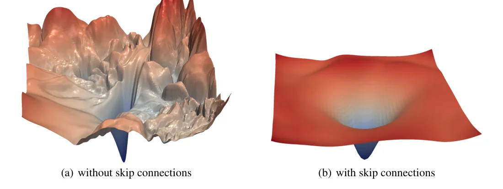
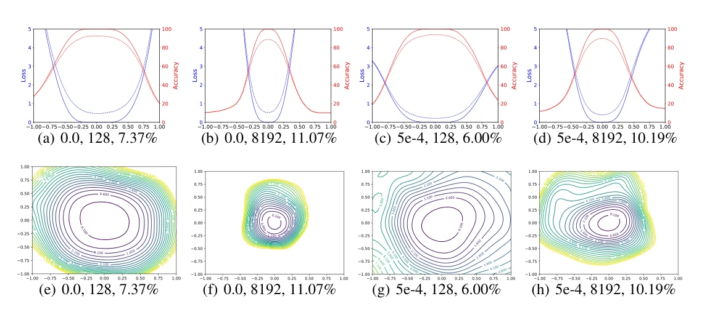
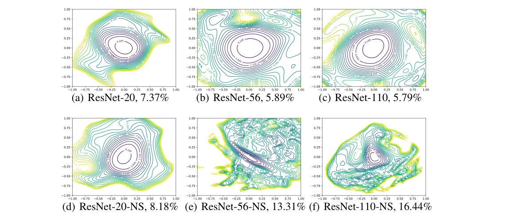

> - **논문**: Visualizing the Loss Landscape of Neural Nets
> - **저자**: Hao Li, Zheng Xu, Gavin Taylor, Christoph Studer, Tom Goldstein (University of Maryland, United States Naval Academy, Cornell University)
> - **학회**: NeurIPS 2018 · [arXiv:1712.09913](https://arxiv.org/abs/1712.09913) · [코드](https://github.com/tomgoldstein/loss-landscape)
{: .prompt-tip }

> 왜 어떤 네트워크는 잘 학습되고 어떤 네트워크는 안 되는가. 손실 함수의 "지형"을 보면 답이 보일 것 같지만, 수백만 차원의 함수를 2차원 그림으로 그리는 순간 무엇을 보고 있는지가 불분명해진다. 이 논문은 기존 시각화의 함정을 짚고, **필터 정규화**라는 간단한 수정으로 서로 다른 네트워크의 지형을 비교 가능하게 만든 뒤, skip connection이 지형을 어떻게 바꾸는지 보여 준다. 아래 Figure 1의 "ResNet-56 with/without skip connections" 그림이 이 논문에서 나왔다.


_Figure 1. 필터 정규화한 두 무작위 방향으로 그린 ResNet-56의 손실 곡면. (a) skip connection 없음, (b) 있음. (출처: Li et al., 2018)_

## 1. 문제: 기존 1D·2D 플롯은 비교할 수 없다

가장 단순한 시각화는 최소점 $$\theta^*$$ 주변에서 무작위 방향 $$\delta$$를 잡고 $$f(\alpha) = L(\theta^* + \alpha \delta)$$를 그리는 것이다. 두 최소점 사이를 선형 보간해 "SGD가 지나간 길에 장애물이 없더라"는 관찰(Goodfellow et al.)도 같은 종류이다. 이 방법에는 **스케일 불변성**이라는 함정이 있다.

ReLU 네트워크에서 한 층의 가중치를 10배 키우고 다음 층을 10배 줄이면 함수는 그대로이다. Batch Normalization이 있으면 한 층만 임의로 스케일해도 그대로이다. 그런데 가중치가 큰 네트워크에서는 같은 크기의 섭동 $$\delta$$가 상대적으로 작아서 지형이 평평하게 보이고, 가중치가 작으면 뾰족하게 보인다. 따라서 "평평한 최소점이 일반화가 좋다"는 주장도, 두 네트워크의 1D 플롯 비교도, 가중치 스케일을 통제하지 않으면 의미가 없다.

## 2. 방법: 필터 정규화

방향 $$\delta$$를 뽑은 뒤, **필터 단위로** 크기를 맞춘다. 층 $$i$$의 $$j$$번째 필터(FC 층이면 뉴런 하나의 가중치 벡터)에 대해

$$
d_{i,j} \leftarrow \frac{d_{i,j}}{\lVert d_{i,j} \rVert}\, \lVert \theta_{i,j} \rVert
$$

로 섭동의 크기를 해당 필터의 가중치 크기에 비례시킨다(노름은 Frobenius 노름). 이렇게 하면 어떤 필터를 10배 키워도 섭동이 함께 10배 커져서, 플롯이 스케일 변환에 불변이 된다. 기존 방식(Im et al.)은 방향 전체를 한 번에 정규화했고, 이 방법은 필터마다 따로 맞춘다. 2D 플롯은 두 방향 $$\delta, \eta$$를 모두 정규화해 $$L(\theta^* + \alpha \delta + \beta \eta)$$를 등고선으로 그리고, BN 파라미터에는 섭동을 주지 않는다. 논문은 필터 정규화된 플롯의 날카로움이 일반화 오차와 높은 상관관계를 보인다는 것을 배치 크기와 weight decay를 바꿔 가며 보여 준다. 정규화 없이 그리면 큰 배치가 오히려 평평해 보이는 경우가 생긴다(4장).

## 3. 코드로 보기: 같은 함수, 다른 그림

two-moons 분류를 작은 ReLU MLP로 학습한 뒤, 1층을 10배 키우고 2층을 1/10로 줄인 **함수가 동일한** 파라미터를 하나 더 만든다. 같은 무작위 방향을 따라 1D 손실 곡선을 정규화 없이, 그리고 필터 정규화로 그려 비교한다.

```python
import torch, torch.nn as nn, numpy as np
torch.manual_seed(0); np.random.seed(0); torch.set_num_threads(1)
# two-moons data
n = 400; t = np.random.rand(n) * np.pi
X = np.concatenate([np.stack([np.cos(t), np.sin(t)], 1), np.stack([1 - np.cos(t), 0.5 - np.sin(t)], 1)])
X = torch.tensor(X + 0.1 * np.random.randn(2 * n, 2), dtype=torch.float32)
Y = torch.tensor([0] * n + [1] * n)
net = nn.Sequential(nn.Linear(2, 64), nn.ReLU(), nn.Linear(64, 64), nn.ReLU(), nn.Linear(64, 2))
opt = torch.optim.Adam(net.parameters(), 1e-2); lossf = nn.CrossEntropyLoss()
for _ in range(400):
    loss = lossf(net(X), Y); opt.zero_grad(); loss.backward(); opt.step()
theta = [p.detach().clone() for p in net.parameters()]

def loss_at(params):
    with torch.no_grad():
        for p, v in zip(net.parameters(), params): p.copy_(v)
        return lossf(net(X), Y).item()

# a rescaled network: layer1 x10, layer2 /10 -> exactly the same function (ReLU is positively homogeneous)
theta_s = [theta[0] * 10, theta[1] * 10, theta[2] / 10, theta[3], theta[4], theta[5]]
print(f"loss(theta) = {loss_at(theta):.4f}   loss(rescaled theta) = {loss_at(theta_s):.4f}   (same function)")
print(f"||theta|| = {torch.cat([p.flatten() for p in theta]).norm():.1f}   ||rescaled|| = {torch.cat([p.flatten() for p in theta_s]).norm():.1f}")

d = [torch.randn_like(p) for p in theta]
def filter_normalize(d, ref):          # per filter (row of a weight matrix): ||d_i|| <- ||theta_i||
    out = []
    for di, ti in zip(d, ref):
        if di.dim() == 2: out.append(di / di.norm(dim=1, keepdim=True) * ti.norm(dim=1, keepdim=True))
        else: out.append(torch.zeros_like(di))        # biases are left out, as in the paper
    return out
alphas = [-1.0, -0.5, -0.25, 0.0, 0.25, 0.5, 1.0]
print()
print("1-D loss curve L(theta + alpha * d) along one random direction")
print("alpha           " + "".join(f"{a:>8}" for a in alphas))
for name, base, direc in [("raw, theta        ", theta, d), ("raw, rescaled     ", theta_s, d),
                          ("filter-norm, theta", theta, filter_normalize(d, theta)),
                          ("filter-norm, resc.", theta_s, filter_normalize(d, theta_s))]:
    row = [loss_at([b + a * v for b, v in zip(base, direc)]) for a in alphas]
    print(name + "".join(f"{r:>8.3f}" for r in row))
loss_at(theta)
```

```text
loss(theta) = 0.0001   loss(rescaled theta) = 0.0001   (same function)
||theta|| = 16.2   ||rescaled|| = 69.2

1-D loss curve L(theta + alpha * d) along one random direction
alpha               -1.0    -0.5   -0.25     0.0    0.25     0.5     1.0
raw, theta          29.138   2.099   0.415   0.000   0.203   0.887   6.417
raw, rescaled      175.476  26.389  11.055   0.000  10.608  20.697  23.862
filter-norm, theta   2.220   0.117   0.001   0.000   0.012   0.297   1.525
filter-norm, resc.   2.220   0.117   0.001   0.000   0.012   0.297   1.525
```

- 두 파라미터는 손실이 같은 **동일한 함수**인데, 정규화 없는 곡선은 전혀 다르다. 원래 파라미터는 $$\alpha = 0.25$$에서 손실 0.2, 재스케일 파라미터는 10.6이다. 10배로 키운 1층(이 때문에 전체 파라미터 노름이 16에서 69로 커진다)은 섭동에 둔감해지고, 1/10로 줄어든 2층은 극도로 민감해지기 때문이다. 이 그림만 보면 재스케일 쪽이 훨씬 "뾰족한 최소점"처럼 보인다.
- 필터 정규화를 하면 두 곡선이 **소수점 셋째 자리까지 일치**한다. 섭동이 각 뉴런의 가중치 크기에 비례하므로 스케일 변환이 상쇄된다. 논문이 "날카로움을 비교하려면 먼저 이것부터 해야 한다"고 말하는 이유가 이 표 하나로 드러난다.

## 4. 실험

모두 CIFAR-10, VGG-9와 ResNet 계열이다.

### 실험 설정

| 항목 | 값 |
|---|---|
| 배치 크기 실험 | BN이 있는 9층 VGG, 배치 128 vs 8192(학습 데이터의 16.4%), weight decay 0 vs 5e-4 |
| 구조 실험 모델 | ResNet-20/56/110, shortcut을 뺀 ResNet-20/56/110-noshort, 필터 수를 $$k$$ = 2, 4, 8배로 늘린 Wide-ResNet-56, DenseNet-121 |
| 학습 | SGD + Nesterov momentum, batch 128, weight decay 5e-4, 300 epoch |
| 학습률 | 0.1에서 시작해 150, 225, 275 epoch에 1/10. 깊은 noshort 모델(예: ResNet-56-noshort)은 초기 lr 0.01 |
| Hessian 고유값 | Hessian-vector product만 쓰는 implicitly restarted Lanczos 방법 |

### 배치 크기와 날카로움

| weight decay | 배치 | 테스트 오류 |
|---|---|---|
| 0 | 128 | 7.37% |
| 0 | 8192 | 11.07% |
| 5e-4 | 128 | **6.00%** |
| 5e-4 | 8192 | 10.19% |

두 해를 잇는 **정규화 없는 1D 보간**으로 보면 결론이 weight decay에 따라 뒤집힌다. weight decay가 0이면 작은 배치 쪽이 넓고 큰 배치 쪽이 뾰족하지만, weight decay를 켜면 큰 배치 쪽이 오히려 훨씬 평평해 보인다. 그런데 테스트 오류는 두 경우 모두 작은 배치가 낮다. 원인은 가중치 크기이다. 작은 배치는 epoch당 업데이트 횟수가 많아 weight decay의 수축 효과를 더 많이 받으므로, weight decay를 켜면 작은 배치 쪽 가중치가 작아지고 작은 가중치는 같은 섭동에 더 민감해 보인다. BN이 있어서 이 스케일 차이는 함수와 무관한데도 그림을 바꾼다.


_Figure 3. 필터 정규화한 1D(위)·2D(아래) 플롯. 각 제목은 weight decay, 배치 크기, 테스트 오류이다. 큰 배치(b, d, f, h)가 일관되게 더 좁다. (출처: Li et al., 2018)_

위 Figure 3처럼 필터 정규화로 각 최소점 주변을 따로 그리면 weight decay와 무관하게 큰 배치의 최소점이 더 좁고, 날카로움과 테스트 오류가 함께 움직인다. 다만 차이는 정규화 없는 플롯에서 보이던 것보다 훨씬 작다.

### Skip connection과 깊이


_Figure 5. 깊이별 ResNet(위)과 shortcut을 뺀 noshort 변형(아래)의 2D 등고선과 테스트 오류. (출처: Li et al., 2018)_

| 깊이 | ResNet | ResNet-noshort |
|---|---|---|
| 20 | 7.37% | 8.18% |
| 56 | 5.89% | 13.31% |
| 110 | 5.79% | 16.44% |

ResNet은 깊어질수록 오류가 내려가지만, noshort 변형은 깊어질수록 급격히 나빠진다. Figure 5에서 ResNet은 20층과 110층의 0.1 등고선 폭과 모양이 거의 같은 반면, ResNet-56-noshort는 **중심을 벗어나면 급격히 비볼록한 혼돈 지형**이고 gradient가 중심을 가리키지 않는 영역이 넓다. ResNet-110-noshort는 모든 방향으로 더 가파르다. 얕은 네트워크(20층)는 shortcut 없이도 지형이 온순하다. 깊이가 비볼록성을 만들고 skip connection이 그것을 막는다는 것이 이 논문의 대표 그림이다. 121층 DenseNet도 눈에 띄는 비볼록성이 없다.

저자들은 이것을 초기화와도 연결한다. 잘 동작하는 지형은 손실 4 이상까지 이어지는 넓고 거의 볼록한 분지가 중심을 둘러싸고, 보통의 초기화는 손실이 2.5 미만이므로 처음부터 이 분지 안에서 출발한다. 반대로 혼돈 지형은 볼록한 영역이 얕아서 초기점이 혼돈 영역에 떨어지기 쉽다. 실제로 skip connection 없는 156층 네트워크는 아주 작은 학습률로도 SGD로 학습되지 않았다.

### 폭

Wide-ResNet-56처럼 층마다 필터 수를 $$k$$배로 늘리면 지형이 점점 평평하고 볼록해지며 오류도 내려간다(Figure 6).

| 필터 배수 $$k$$ | 1 | 2 | 4 | 8 |
|---|---|---|---|---|
| Wide-ResNet-56 | 5.89% | 5.07% | 4.34% | **3.93%** |
| Wide-ResNet-56-noshort | 13.31% | 10.26% | 9.69% | 8.70% |

폭이 비볼록성을 완화하고, shortcut은 최소점을 크게 넓힌다. 가장 볼록한 지형(shortcut이 있는 Wide-ResNet)이 가장 잘 일반화한다.

### 비볼록성의 정량화

2D 플롯이 "볼록해 보인다"고 실제로 볼록한 것은 아니다. 무작위 가우시안 방향으로 줄인 플롯의 주곡률은 전체 공간 주곡률의 가중 평균이므로, 저차원 플롯에 비볼록성이 보이면 원래 공간에도 반드시 있지만, 볼록해 보인다고 원래 공간이 볼록하다는 보장은 없다(양의 곡률이 우세하다는 뜻일 뿐). 그래서 저자들은 격자점마다 Hessian의 최소·최대 고유값 비율 $$\lvert \lambda_{min} / \lambda_{max} \rvert$$를 계산해 색으로 그린다(Figure 7). 볼록해 보이는 영역은 실제로 비율이 작고(거의 볼록), 혼돈 지형에서는 음의 곡률이 큰 영역이 넓게 퍼져 있다. DenseNet처럼 볼록해 보이는 곡면에서는 넓은 영역에서 음의 고유값이 양의 고유값의 1% 미만이다. 그러므로 그림은 저차원 투영이지만 비볼록 구조를 **과소 표현할 뿐 날조하지는 않는다**.

### 궤적 시각화

SGD의 학습 궤적을 무작위 방향에 투영하면 거의 움직이지 않는 것처럼 보이는데, 궤적이 **극히 저차원 부분공간**에 놓여 있기 때문이다. 궤적의 PCA 상위 두 성분으로 투영하면 진행이 보이고, 대부분의 변동이 두 성분에 담긴다.

## 5. 해석

**1. 방법론 논문이다.** 가장 큰 기여는 "ResNet은 평평하다"는 결론보다, 그 결론을 말할 수 있게 만든 정규화이다. 위 실험처럼 정규화 없이는 같은 함수도 다르게 그려지므로, 이 논문 이전의 1D 날카로움 비교는 대부분 다시 봐야 한다. flat minima 논쟁(Dinh et al.의 "날카로움은 재파라미터화로 조작 가능")에 대한 실용적 답이기도 하다.

**2. 아키텍처가 최적화 난이도를 결정한다는 직관에 그림을 붙였다.** [ResNet]()이 왜 깊어질 수 있는지, 폭이 왜 도움이 되는지, DenseNet이 왜 학습이 쉬운지를 하나의 틀(지형의 비볼록성)로 설명한다. 이후 NAS나 [RevCol]() 같은 구조 설계 논문이 "학습 가능성"을 논할 때 이 틀을 빌린다.

**3. 저차원 투영의 한계를 스스로 재는 점이 좋다.** Hessian 고유값 비율로 "그림이 보여 주는 볼록성이 진짜인가"를 확인한 부분은 시각화 논문으로서 성실한 태도이다. 그래도 2D 단면은 전체 지형의 극히 일부라는 점을 잊으면 안 된다.

**4. 최적화 하이퍼파라미터 해석에도 쓸 수 있다.** 배치 크기, weight decay, 학습률이 최소점의 날카로움을 바꾼다는 관찰은 [옵티마이저와 스케줄러]()에서 다룬 large-batch 학습의 어려움과 직접 연결된다. 다만 상관이지 인과를 증명한 것은 아니다.

**5. 평가를 읽을 때 주의할 점.** 필터 정규화는 ReLU와 BN의 스케일 불변성은 처리하지만, 모든 재파라미터화 불변성을 처리하지는 않는다. "날카로움 ↔ 일반화" 상관은 CIFAR-10의 특정 구조에서 관찰된 것이고 Transformer 등으로 일반화하려면 별도 검증이 필요하다. 위 toy는 BN 없는 은닉층 2개짜리 MLP라 스케일 불변성이 ReLU의 양의 동차성에서만 나오며, 편향은 섭동 방향에서 제외했다(논문 본문은 BN 파라미터에 섭동을 주지 않는다고 적는다).

## 6. 정리

| 항목 | 내용 |
|---|---|
| 문제 | 가중치 스케일 불변성 때문에 기존 1D·2D 손실 플롯은 네트워크 간 비교가 불가능 |
| 방법 | 무작위 방향을 필터(뉴런)별로 $$\lVert d_{i,j} \rVert = \lVert \theta_{i,j} \rVert$$가 되도록 정규화 |
| 관찰 1 | 필터 정규화된 날카로움이 일반화 오차와 상관(배치 128 vs 8192: 7.37% vs 11.07%, weight decay 5e-4에서 6.00% vs 10.19%) |
| 관찰 2 | skip connection 제거 시 깊을수록 혼돈 지형(noshort 20/56/110: 8.18 / 13.31 / 16.44%, ResNet은 7.37 / 5.89 / 5.79%) |
| 관찰 3 | 폭 증가와 DenseNet 연결이 지형을 평평하게 함(Wide-ResNet-56, $$k=8$$: 3.93%) |
| 검증 | Hessian 고유값 비율로 투영의 볼록성이 진짜임을 확인, SGD 궤적은 저차원 부분공간 |

## References

- Li, Xu, Taylor, Studer, Goldstein, "Visualizing the Loss Landscape of Neural Nets," NeurIPS 2018. [arXiv:1712.09913](https://arxiv.org/abs/1712.09913)
- Goodfellow, Vinyals, Saxe, "Qualitatively Characterizing Neural Network Optimization Problems," ICLR 2015. [arXiv:1412.6544](https://arxiv.org/abs/1412.6544)
- Keskar et al., "On Large-Batch Training for Deep Learning: Generalization Gap and Sharp Minima," ICLR 2017. [arXiv:1609.04836](https://arxiv.org/abs/1609.04836)
- Dinh, Pascanu, Bengio, Bengio, "Sharp Minima Can Generalize For Deep Nets," ICML 2017. [arXiv:1703.04933](https://arxiv.org/abs/1703.04933)
- He, Zhang, Ren, Sun, "Deep Residual Learning for Image Recognition," CVPR 2016. [arXiv:1512.03385](https://arxiv.org/abs/1512.03385)
