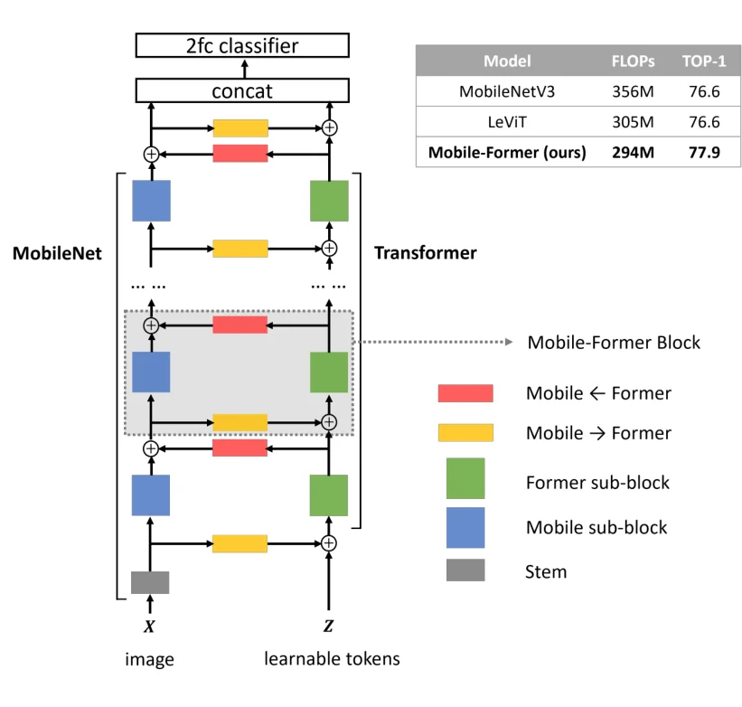
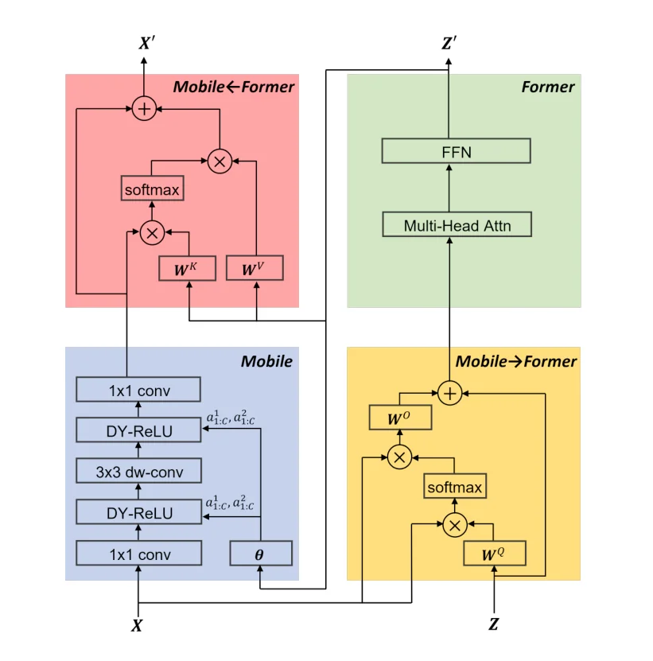
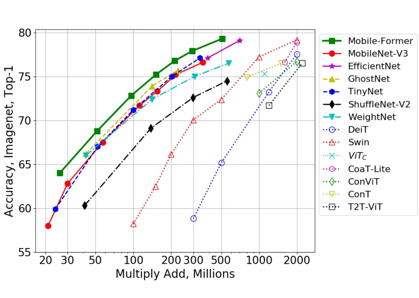

> - **논문**: Mobile-Former: Bridging MobileNet and Transformer
> - **저자**: Yinpeng Chen, Xiyang Dai, Dongdong Chen, Mengchen Liu, Xiaoyi Dong, Lu Yuan, Zicheng Liu (Microsoft, University of Science and Technology of China)
> - **학회**: CVPR 2022 · [코드](https://github.com/aaboys/mobileformer)
{: .prompt-tip }

> [경량 Vision Transformer 동향]()에서 "CNN과 Transformer를 섞는 것"이 경량화의 핵심 방향이라고 정리했습니다. **Mobile-Former**는 둘을 **앞뒤로 쌓지 않고 나란히(병렬로)** 두고, 그 사이를 가벼운 cross-attention 다리로 양방향 연결합니다.

## 1. 배경: 작은 연산량에서는 아직 MobileNet이 강하다

ViT, DeiT 같은 Vision Transformer는 큰 모델에서 CNN을 넘어섰습니다. 하지만 **300M FLOPs 이하**처럼 연산량이 작은 영역에서 순위를 매기면 여전히 **MobileNet 계열**(MobileNetV2/V3, GhostNet, MicroNet)이 우세합니다. 특히 MobileNetV2의 **Inverted Residual Block**을 쓰는 모델들이 강합니다.

두 구조의 장점은 서로 보완적입니다.

| | CNN (MobileNet) | Transformer |
|---|---|---|
| 강점 | **Local** 정보 처리, 압도적인 연산 효율 | **Global** 상호작용 |
| 약점 | 멀리 떨어진 위치 사이의 관계 | 연산량 ($$O(N^2)$$), 데이터 요구량 |

그래서 둘을 합치는 연구가 많았지만, 대부분은 **직렬** 결합이었습니다.

- Transformer 앞에 convolution을 전처리처럼 두기 (*Early Convolutions Help Transformers See Better*)
- 중간중간 섞어 쓰기 (MobileViT 등)

## 2. Mobile-Former의 아이디어: 병렬 구조와 양방향 다리

Mobile-Former는 두 갈래를 **동시에** 돌립니다(아래 Figure 1).


_Figure 1. 왼쪽 Mobile(MobileNet)은 이미지를, 오른쪽 Former(Transformer)는 무작위 초기화된 학습 토큰을 처리하고, 노랑(Mobile→Former)·빨강(Mobile←Former) 다리로 정보를 주고받습니다. 오른쪽 위 표는 MobileNetV3, LeViT와의 FLOPs·정확도 비교입니다. (출처: Chen et al., 2022)_

- **Mobile**: 이미지 feature map $$X \in \mathbb{R}^{HW \times C}$$를 처리. MobileNetV2 기반 inverted residual block으로 **local feature** 추출
- **Former**: 소수의 **global token** $$Z \in \mathbb{R}^{M \times d}$$를 처리. Multi-Head Attention과 FFN으로 **global** 연산

핵심은 Former가 이미지 패치 전체가 아니라 **학습 가능한 토큰 6개**($$M = 6$$, $$d = 192$$)만 다룬다는 점입니다. 토큰은 처음에 무작위로 초기화되어 학습됩니다. 토큰 수가 적으니 self-attention 비용이 거의 들지 않습니다.

두 갈래 사이는 **Mobile → Former**, **Former → Mobile** 두 방향의 가벼운 cross-attention으로 연결됩니다. 이 네 부분을 묶은 것이 **Mobile-Former Block**입니다.

$$
(X, Z) \;\xrightarrow{\text{Mobile-Former Block}}\; (X', Z')
$$

출력 $$X', Z'$$는 다음 블록의 입력이 됩니다.

### Inverted Residual Block 복습

- **ResNet bottleneck**: Wide → Narrow → Wide. 가운데 좁은 부분이 병목(bottleneck)
- **MobileNetV2 inverted residual**: Narrow → **Wide** → Narrow. 가운데를 넓혀 depthwise conv를 하고, 입출력이 좁아 메모리 효율적

자세한 내용은 [MobileNet 글]()에 있습니다.

## 3. Mobile-Former Block의 네 단계


_Figure 3. Mobile-Former 블록의 네 부분. Mobile(파랑)은 ReLU 대신 Dynamic ReLU를 쓰고, 그 계수는 Former 출력 토큰에서 $$\theta$$로 만듭니다. 이미지 쪽에는 $$W^Q, W^K, W^V$$가 없고 토큰 쪽에만 projection이 있습니다. (출처: Chen et al., 2022)_

### (1) Mobile → Former: 이미지 정보를 토큰으로 모으기

Global token이 **Query**, 이미지 feature가 **Key와 Value**가 되는 cross-attention입니다.

$$
Z^{out} = Z + \Big[\text{Attn}\big(\tilde{z}_i W_i^Q,\ \tilde{x}_i,\ \tilde{x}_i\big)\Big]_{i=1:h} W^O
$$

- $$\tilde{z}_i, \tilde{x}_i$$: $$i$$번째 head로 나눈 토큰과 feature
- $$W^O$$: 여러 head의 출력을 합칠 때 쓰는 가중치

**경량화 포인트**: 일반 attention이라면 $$X$$에도 $$W^K, W^V$$를 곱해야 하지만, 이미지 쪽은 위치 수 $$HW$$가 커서 비쌉니다. 그래서 **Key와 Value에 projection을 하지 않고 $$X$$를 그대로** 씁니다. 연산은 토큰 쪽(크기 $$M$$)에만 몰려서, 비용이 $$O(M \cdot HW \cdot C)$$로 **이미지 크기에 선형**입니다.

또 이 연산은 inverted residual 블록의 **좁은 쪽(bottleneck)** 채널에서 이루어져 비용이 더 줄어듭니다.

### (2) Former: 토큰끼리 전역 정보 교환

토큰 6개에 대해 일반 Transformer처럼 **Multi-Head Self-Attention → FFN**을 수행합니다. 토큰이 이미지 전체에서 모은 정보를 서로 교환하는 단계입니다. FFN 확장 비율은 4가 아니라 2이고, post-LayerNorm을 씁니다. 토큰 수가 매우 적어 이 부분의 연산량은 $$O(M^2 d + M d^2)$$로 전체에서 아주 작습니다.

### (3) Mobile: Dynamic ReLU를 쓴 inverted residual

입력 $$X$$에 inverted residual 블록(1×1 확장 → depthwise 3×3 → 1×1 축소)을 적용합니다. 다른 점은 활성 함수로 **Dynamic ReLU**를 쓴다는 것입니다.

일반 ReLU는 모양이 고정되어 있고, PReLU·Leaky ReLU는 음수 쪽 기울기 하나만 바뀝니다. Dynamic ReLU는 **입력에 따라 음수·양수 양쪽의 기울기와 절편을 모두** 바꿉니다.

$$
y_c = \max_{k}\big(a_c^k(\cdot)\,x_c + b_c^k(\cdot)\big)
$$

원래 Dynamic ReLU는 feature map을 average pooling한 뒤 MLP 2층으로 계수를 만들지만, Mobile-Former에서는 pooling 없이 이 계수를 **Former가 출력한 global token**(첫 번째 토큰 $$z'_1$$)에 MLP 2층을 적용해 만듭니다. depthwise conv는 모든 블록에서 3×3입니다. 이미지 전체 맥락을 본 토큰이 "이 입력에서는 활성 함수를 어떤 모양으로 할지"를 정해 주는 셈입니다. [SENet]()이 채널 가중치를 입력에 따라 바꾸는 것과 비슷한 발상입니다.

### (4) Former → Mobile: 전역 정보를 이미지로 돌려주기

이번에는 반대로 이미지 feature가 **Query**, 갱신된 토큰 $$Z'$$이 **Key와 Value**입니다.

$$
X^{out} = X + \Big[\text{Attn}\big(\tilde{x}_i,\ \tilde{z}'_i W_i^K,\ \tilde{z}'_i W_i^V\big)\Big]_{i=1:h}
$$

이번에도 이미지 쪽(Query)에는 projection을 하지 않습니다. 각 위치가 "전역 토큰 중 나와 관련 있는 정보"를 가져와 **local feature와 global token을 융합**합니다.

연산량은 Mobile이 $$O(HWC^2)$$로 대부분을 차지하고, 두 다리는 $$O(MHWC + MdC)$$입니다. Mobile-Former-294M에서 Former와 두 다리를 합친 비용은 35M FLOPs로 전체의 **12%**입니다.

```python
import torch
import torch.nn as nn

class Mobile2Former(nn.Module):
    """Query: token(Z), Key/Value: feature map(X) — X 쪽 projection 없음"""
    def __init__(self, dim_tok, dim_x, heads=2):
        super().__init__()
        self.heads = heads
        self.q = nn.Linear(dim_tok, dim_x)           # W^Q (토큰 쪽만)
        self.o = nn.Linear(dim_x, dim_tok)           # W^O

    def forward(self, x, z):                         # x: (B, HW, C), z: (B, M, d)
        B, N, C = x.shape
        h = self.heads
        q = self.q(z).view(B, -1, h, C // h).transpose(1, 2)          # (B, h, M, C/h)
        kv = x.view(B, N, h, C // h).transpose(1, 2)                  # (B, h, HW, C/h)
        attn = (q @ kv.transpose(-2, -1) / (C // h) ** 0.5).softmax(-1)
        out = (attn @ kv).transpose(1, 2).reshape(B, -1, C)            # (B, M, C)
        return z + self.o(out)

class Former2Mobile(nn.Module):
    """Query: feature map(X) — projection 없음, Key/Value: token(Z')"""
    def __init__(self, dim_tok, dim_x, heads=2):
        super().__init__()
        self.heads = heads
        self.k = nn.Linear(dim_tok, dim_x)           # W^K
        self.v = nn.Linear(dim_tok, dim_x)           # W^V

    def forward(self, x, z):
        B, N, C = x.shape
        h = self.heads
        q = x.view(B, N, h, C // h).transpose(1, 2)
        k = self.k(z).view(B, -1, h, C // h).transpose(1, 2)
        v = self.v(z).view(B, -1, h, C // h).transpose(1, 2)
        attn = (q @ k.transpose(-2, -1) / (C // h) ** 0.5).softmax(-1)  # (B, h, HW, M)
        return x + (attn @ v).transpose(1, 2).reshape(B, N, C)

x, z = torch.randn(2, 56 * 56, 24), torch.randn(2, 6, 192)
z = Mobile2Former(192, 24)(x, z)
print(Former2Mobile(192, 24)(x, z).shape)    # torch.Size([2, 3136, 24])
```

Attention 행렬 크기가 $$(HW \times M)$$이라, $$M = 6$$이면 일반 self-attention의 $$(HW \times HW)$$보다 훨씬 작습니다. 위 예시의 56×56 feature map이라면 $$3136 \times 6 = 18{,}816$$개 대 $$3136 \times 3136 \approx 980$$만 개로, 약 520배 차이입니다. 두 다리 모듈의 파라미터도 각각 9,432개, 9,264개에 불과합니다(위 코드 기준, `sum(p.numel() for p in m.parameters())`로 확인).

> 위 코드는 구조를 보여 주기 위한 단순화 버전입니다. 논문 구현에는 LayerNorm, 다리 모듈 안의 채널 차원 맞추기 등 세부 처리가 더 있습니다. 또 위 코드의 토큰 수 $$M$$은 입력 `z`의 크기로 정해지며, 실제 모델에서는 `nn.Parameter`로 선언해 학습합니다.
{: .prompt-info }

## 4. 전체 구조

ImageNet 분류용 **Mobile-Former-294M**(294M FLOPs) 기준입니다.

- Stem: 3×3 conv + 가벼운 bottleneck
- **Mobile-Former Block 11개**, 모든 블록이 **192차원 global token 6개**를 공유하며 전달
- 이미지 크기에 따라 여러 stage로 구성되고, stage마다 해상도를 절반으로 줄이며 채널을 늘림. 해상도를 줄이는 블록은 Mobile 쪽에 stride 2 depthwise conv를 둔 downsampling 버전
- **Head**: 마지막 local feature(7×7×1152)를 average pooling한 뒤 **첫 번째 global token과 concat**(1344차원)하고, h-swish를 사이에 둔 FC 두 개(1920 → 1000)로 분류

| Stage | 해상도 | 구성 | 출력 채널 |
|---|---|---|---|
| stem | 224² → 112² | 3×3 conv (stride 2) | 16 |
| 1 | 112² | bneck-lite | 16 |
| 2 | 56² | Mobile-Former↓, Mobile-Former | 24 |
| 3 | 28² | Mobile-Former↓, Mobile-Former | 48 |
| 4 | 14² | Mobile-Former↓, Mobile-Former ×3 | 96 → 128 |
| 5 | 7² | Mobile-Former↓, Mobile-Former ×2, 1×1 conv | 192 → 1152 |

위는 Mobile-Former-294M의 구성입니다(Table 1). 연산량 예산에 맞춰 폭과 깊이를 바꾼 26M ~ 508M FLOPs의 7개 버전이 있습니다.

## 5. 구현 디테일

| 항목 | 값 |
|---|---|
| ImageNet 학습 | 224×224, scratch부터 AdamW 450 epoch, cosine decay, batch 1024 |
| Augmentation | Mixup, AutoAugment, Random erasing (lr·weight decay·dropout은 모델 크기별로 다름, 부록) |
| Ablation 학습 | Mobile-Former-294M, 300 epoch |
| RetinaNet | 표준 설정, ImageNet 사전학습에서 12 epoch(1×), 입력 800×1333 기준 FLOPs |
| End-to-end 검출(E2E-MF) | 300 epoch, GPU 8장 × 이미지 2장, AdamW lr 1e-5(backbone) / 1e-4(head), 200 epoch에 1/10, weight decay 1e-4, dropout 0.1, backbone BN 고정, object query 100개 × 256채널 |

## 6. 결과


_Figure 2. ImageNet top-1 정확도 대 연산량(MAdds). Swin과 DeiT는 저자들이 100M~2G FLOPs로 줄여 직접 구현한 것입니다. (출처: Chen et al., 2022)_

### ImageNet: 효율적인 CNN과 비교 (Table 2)

| 모델 | Params | MAdds | Top-1 |
|---|---|---|---|
| MobileNetV3 Small 1.0× (160²) | 2.5M | 30M | 62.8 |
| **Mobile-Former-26M** | 3.2M | 26M | **64.0** |
| MobileNetV3 Small 1.0× | 2.5M | 57M | 67.5 |
| **Mobile-Former-52M** | 3.5M | 52M | **68.7** |
| MobileNetV3 1.0× (160²) | 5.4M | 112M | 71.7 |
| **Mobile-Former-96M** | 4.6M | 96M | **72.8** |
| ShuffleNetV2 1.0× + WeightNet 4× | 5.1M | 141M | 72.4 |
| MobileNetV3 0.75× | 4.0M | 155M | 73.3 |
| **Mobile-Former-151M** | 7.6M | 151M | **75.2** |
| MobileNetV3 1.0× | 5.4M | 217M | 75.2 |
| **Mobile-Former-214M** | 9.4M | 214M | **76.7** |
| MobileNetV3 1.25× | 7.5M | 356M | 76.6 |
| EfficientNet-B0 | 5.3M | 390M | 77.1 |
| **Mobile-Former-294M** | 11.4M | 294M | **77.9** |
| ShuffleNetV2 2× + WeightNet 4× | 18.1M | 573M | 76.5 |
| **Mobile-Former-508M** | 14.0M | 508M | **79.3** |

- Mobile-Former-294M은 top-1 **77.9%**로, MobileNetV3 1.25×(356M, 76.6%)보다 **1.3%p 높으면서 연산량은 약 17% 적습니다.**
- 26M부터 508M까지 일곱 구간 모두에서 같은 급의 효율적인 CNN보다 높습니다. MobileNetV3 대비 차이는 구간별로 1.1~1.9%p로, 특정 구간에 몰리지 않고 **고르게** 앞섭니다.
- ViT 계열과 비교하면 Mobile-Former-294M(77.9%)이 1.0G FLOPs의 Swin-1G(77.3%)보다, Mobile-Former-508M(79.3%)이 2.0G의 Swin-2G(79.2%)보다 높습니다. distillation과 1000 epoch 학습을 쓰는 LeViT(305M, 76.6%)도 넘습니다.

### Ablation (Mobile-Former-294M, 300 epoch)

| 실험 | 설정 → Top-1 |
|---|---|
| 구성 요소 (Table 4) | Mobile만(ReLU) 74.2 → + Former와 다리 76.8 (+2.6, FLOPs 259M → 290M) → + Dynamic ReLU 77.8 (+1.0) |
| 토큰 수 (Table 5) | 1개 77.1, 3개 77.6, **6개 77.8**, 9개 77.7 |
| 토큰 차원 (Table 6) | 64: 76.8, 128: 77.3, **192: 77.8**, 256: 77.8, 320: 77.6 |
| Former 구성 (Table 7) | MHA + FFN 77.8, FFN 제거 77.5, MHA 대신 position-mixing MLP 77.3 |

토큰 **1개**만으로도 77.1%가 나오고, 6개를 넘기면 더 오르지 않습니다. Former의 FFN은 빼도 0.3%p만 떨어지는데, Mobile의 1×1 conv와 Mobile→Former의 $$W^O$$가 채널 융합을 나눠 맡기 때문이라고 저자들은 봅니다.

### Object Detection (COCO val2017)

| RetinaNet backbone | AP | backbone MAdds |
|---|---|---|
| ShuffleNetV2 | 25.9 | 2.6G |
| MF-151M | 34.2 | 2.6G |
| MobileNetV3 | 27.2 | 4.7G |
| **MF-214M** | **35.8** | 3.9G |
| ResNet-50 | 36.5 | 84G |
| **MF-508M** | **38.0** | 9.8G |

- RetinaNet(1×)에서 MF-214M은 MobileNetV3보다 연산량이 적으면서 AP가 **8.6** 높고, MF-508M은 backbone 연산량이 약 7배(65G~84G)인 ResNet-50, PVT-Tiny, ConT-M보다 높습니다.
- backbone과 DETR의 encoder/decoder를 모두 Mobile-Former 블록으로 바꾼 **E2E-MF-508M**은 300 epoch 학습으로 43.3 AP를 얻어, 500 epoch 학습한 DETR(42.0 AP)보다 1.3 높으면서 FLOPs는 41.4G 대 86G, 파라미터는 26.3M 대 41.3M입니다. 공간별로 다른 Dynamic ReLU(+1.1 AP), 다중 해상도 head(+0.9), query 위치 임베딩 갱신(+1.9)이 합쳐 39.4 → 43.3이 됩니다.

### 한계

- **작은 이미지에서는 느립니다.** CPU 지연 시간 비교에서 이미지가 클 때는 MobileNetV3보다 빠르지만, 해상도가 작아지면 MobileNetV3에 밀립니다. Former와 다리의 projection은 해상도와 무관한 고정 비용인데 PyTorch 구현이 convolution만큼 효율적이지 않기 때문입니다.
- **파라미터 효율은 낮습니다.** Mobile-Former-294M의 분류 head가 전체 11.4M 중 4.6M(40%)을 차지합니다. Former와 다리도 연산량은 작지만 파라미터는 작지 않습니다.

## 7. 정리

| 요소 | 역할 | 경량화 포인트 |
|---|---|---|
| Mobile (inverted residual) | Local feature | MobileNet의 효율 그대로 |
| Former (6개 토큰) | Global 상호작용 | 토큰 수가 적어 self-attention 비용 미미 |
| Mobile → Former | 이미지 정보를 토큰으로 수집 | 이미지 쪽 Key/Value projection 제거 |
| Former → Mobile | 전역 정보를 이미지로 전달 | 이미지 쪽 Query projection 제거 |
| Dynamic ReLU | 토큰이 활성 함수 모양을 결정 | 전역 맥락을 local 연산에 반영 |

Mobile-Former는 CNN과 Transformer를 **직렬로 섞는 대신 병렬로 두고 얇은 다리로 잇는** 설계로, 작은 연산량 영역에서 MobileNet을 넘어선 사례입니다.

## References

- Chen et al., "Mobile-Former: Bridging MobileNet and Transformer," CVPR 2022. [arXiv:2108.05895](https://arxiv.org/abs/2108.05895)
- Chen et al., "Dynamic ReLU," ECCV 2020.
- Sandler et al., "MobileNetV2: Inverted Residuals and Linear Bottlenecks," CVPR 2018.
- Howard et al., "Searching for MobileNetV3," ICCV 2019.
- Xiao et al., "Early Convolutions Help Transformers See Better," NeurIPS 2021.
- Mehta & Rastegari, "MobileViT," ICLR 2022.
