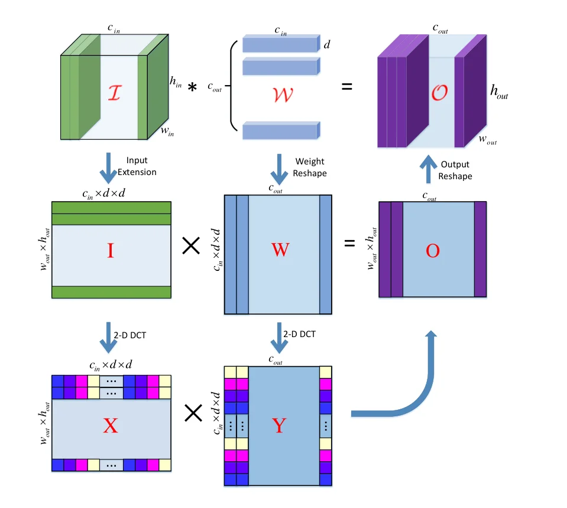
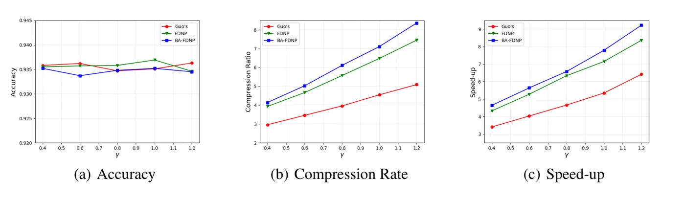
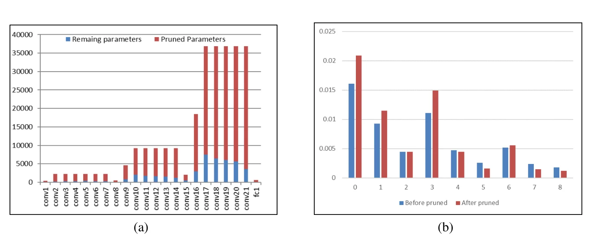

> - **논문**: Frequency-Domain Dynamic Pruning for Convolutional Neural Networks
> - **저자**: Zhenhua Liu, Jizheng Xu, Xiulian Peng, Ruiqin Xiong (Peking University, Microsoft Research Asia)
> - **학회**: NeurIPS 2018
{: .prompt-tip }

> 가중치 가지치기는 보통 **공간 영역**에서, 즉 커널의 각 원소를 따로 본다. 그런데 자연 이미지가 지역적으로 매끄럽기 때문에 학습된 필터도 대부분 매끄럽고, 매끄러운 신호는 주파수 영역에서 희소하다. **Frequency-Domain Dynamic Pruning**(FDNP)은 필터를 2-D DCT로 변환해 계수를 가지치기한다. 공간 영역의 동적 가지치기(DNS)와 같은 조건에서 LeNet-5 150배(DNS 108배), AlexNet 22.6배(DNS 17.7배), ResNet-110 8.4배 압축을 정확도 손실 없이 달성했다.

## 1. 문제: 공간 영역 가지치기는 필터의 중복을 다 못 본다

[Deep Compression]()류의 크기 기반 가지치기와 Dynamic Network Surgery(DNS, 잘못 자른 연결을 되살리는 splicing 포함)는 모두 공간 영역 가중치를 본다. 하지만 3×3이나 5×5 커널의 원소들은 **서로 상관**되어 있다. 매끄러운 필터는 저주파 성분 몇 개로 거의 표현되고 나머지는 작다. 공간 영역에서는 이 중복이 "모든 원소가 적당히 큰" 모습으로 숨어 있어서 임계값 기반으로는 잘리지 않는다. 변환을 거치면 에너지가 소수 계수에 모여 잘라 낼 여지가 커진다.

## 2. 방법

### DCT 영역의 합성곱

im2col로 입력을 $$(w_{out} h_{out}) \times (c_{in} d^2)$$ 행렬 $$I$$, 가중치를 $$(c_{in} d^2) \times c_{out}$$ 행렬 $$W$$로 펼치면 합성곱은 $$O = IW$$이다. 각 $$d \times d$$ 커널에 2-D DCT를 적용하는 것은 정규직교 행렬 $$B$$(1-D DCT 행렬의 크로네커 곱)를 곱하는 것이고, $$c_{in}$$개 커널을 한꺼번에 변환하는 행렬 $$A = E_{c_{in}} \otimes B$$도 정규직교이다. 가중치 계수 $$Y = AW$$, 입력 계수 $$X = I A^\top$$로 두면

$$
XY = I A^\top A W = IW = O
$$

이므로 **공간 영역 합성곱이 주파수 영역의 행렬 곱으로 정확히** 바뀐다(아래 Figure 1).


_Figure 1. 입력을 im2col로 펼친 $$I$$와 가중치를 펼친 $$W$$의 곱이 합성곱 출력 $$O$$이고, 각각의 $$d\times d$$ 블록에 2-D DCT를 적용한 $$X$$와 $$Y$$의 곱도 같은 $$O$$가 된다. (출처: Liu et al., 2018)_

conv 층의 출력을 입력으로 받는 FC 층은 앞 conv 층의 feature map 크기를 DCT 크기로 삼아 같은 방식을 적용하고, 그 외 FC 층은 상관이 약해 공간 영역에서 가지치기한다.

### 동적 가지치기(FDNP)

이진 마스크 $$T$$로 계수를 켜고 끈다.

$$
\min_{Y, T} L\!\left(D^{-1}(Y \otimes T)\right), \qquad T_{i,j} = f(Y_{i,j})
$$

DNS처럼 두 임계값을 써서 $$\lvert Y \rvert < a$$면 끄고, $$> b$$면 켜고, 사이면 **이전 상태를 유지**한다. $$a = 0.9(\mu + \gamma\sigma)$$, $$b = 1.1(\mu + \gamma\sigma)$$로 층별 계수의 평균과 표준편차에서 정하고, $$\gamma$$가 층의 압축률을 조절한다. 역전파는 DCT가 선형이므로 $$\partial L / \partial y = D(\partial L / \partial w)$$로 공간 기울기를 변환하면 되고, 꺼진 계수도 함께 갱신해서 잘못 잘린 계수가 되살아날 수 있게 한다.

### 대역 적응 압축률(BA-FDNP)

주파수마다 중요도가 다르므로 $$k = u + v$$로 대역을 $$2d - 1$$개로 나누고 대역별 $$\gamma_k$$를 둔다. 저주파에는 작은 $$\gamma$$(덜 자름), 고주파에는 큰 $$\gamma$$(많이 자름)를 주며, 베타 분포 모양의 함수 $$g(x; \lambda, \omega) = x^{\lambda - 1}(1 - x)^{\omega - 1}$$, $$x = (k + 1) / 2d$$로 매개화한다($$\lambda = 1.0, \omega = 0.8$$).

### 이론 가속

계수의 비영 비율이 $$\eta$$일 때 주파수 영역 곱셈은 $$\eta c_{in} d^2 c_{out} w_{out} h_{out}$$이고, 입력 DCT 비용 $$2d \cdot d^2 c_{in} w_{out} h_{out}$$이 추가된다. 층당 가속은

$$
r_s = \frac{c_{out}}{2d + \eta c_{out}}
$$

로, 공간 영역의 $$1/\xi$$보다 변환 비용만큼 불리하지만 $$\eta$$를 더 작게 만들 수 있다는 것이 논문의 주장이다.

## 3. 코드로 보기: DCT 영역 합성곱과 에너지 집중

5×5 DCT로 (1) 주파수 영역 곱이 공간 합성곱과 같은지, (2) 매끄러운 필터와 백색 잡음 필터에서 에너지 95%를 담는 계수 비율이 공간·DCT 영역에서 어떻게 다른지, (3) 동적 마스크와 대역별 $$\gamma_k$$, (4) 가속 공식의 값을 본다.

```python
import numpy as np
rng = np.random.default_rng(0)
d = 5
# orthonormal DCT-II matrix and its 2-D (Kronecker) version
D = np.array([[np.sqrt((1 if k == 0 else 2) / d) * np.cos(np.pi * (2 * n + 1) * k / (2 * d)) for n in range(d)] for k in range(d)])
B = np.kron(D, D)                                  # (d*d) x (d*d), orthonormal
print("B^T B = I:", np.allclose(B.T @ B, np.eye(d * d)))

# (1) convolution = matrix product in the DCT domain: O = I W = (I A^T)(A W)
cin, cout, npatch = 3, 8, 50
A = np.kron(np.eye(cin), B)
I = rng.standard_normal((npatch, cin * d * d)); W = rng.standard_normal((cin * d * d, cout))
O_spatial = I @ W; O_freq = (I @ A.T) @ (A @ W)
print("spatial conv == DCT-domain product:", np.allclose(O_spatial, O_freq), f"(max diff {np.abs(O_spatial-O_freq).max():.1e})")

# (2) energy compaction: smooth filters need far fewer DCT coefficients
def frac_for_energy(coefs, e=0.95):
    s = np.sort(coefs ** 2, axis=1)[:, ::-1]; c = np.cumsum(s, 1) / s.sum(1, keepdims=True)
    return np.mean((c < e).sum(1) + 1) / coefs.shape[1]
white = rng.standard_normal((2000, d * d))
k = np.array([1, 4, 6, 4, 1]); g = np.outer(k, k) / 256.0
smooth = np.array([np.array([[np.sum(np.pad(f, 2)[i:i+5, j:j+5] * g) for j in range(d)] for i in range(d)]).ravel()
                   for f in rng.standard_normal((2000, d, d))])
print()
print("fraction of coefficients holding 95% of the energy")
for name, F_ in [("white-noise filters", white), ("smooth filters", smooth)]:
    print(f"  {name:<20} spatial {frac_for_energy(F_):.2f}   DCT {frac_for_energy(F_ @ B.T):.2f}")

# (3) dynamic mask with hysteresis thresholds a, b and band-adaptive rates gamma_k
Y = smooth @ B.T
mu, sigma = np.abs(Y).mean(), np.abs(Y).std()
def mask_update(Y, T, gamma):
    a, b = 0.9 * (mu + gamma * sigma), 1.1 * (mu + gamma * sigma)
    return np.where(np.abs(Y) < a, 0, np.where(np.abs(Y) > b, 1, T))
T = np.ones_like(Y)
for gamma in (0.5, 1.0, 1.5):
    T = mask_update(Y, T, gamma); print(f"gamma={gamma}: kept {T.mean()*100:5.1f}% of DCT coefficients")
band = np.add.outer(np.arange(d), np.arange(d)).ravel()               # k = u + v
x = (band + 1) / (2 * d); gk = x ** (1.0 - 1) * (1 - x) ** (0.8 - 1)   # beta(1.0, 0.8), increasing in k
gk = gk / gk.min()
print("band k=u+v:   " + " ".join(f"{k}" for k in range(2 * d - 1)))
print("rel. gamma_k: " + " ".join(f"{gk[band == k][0]:.1f}" for k in range(2 * d - 1)))

# (4) theoretical speed-up: r_s = c_out / (2d + eta * c_out)
print()
print("speed-up per layer, d=3:  eta (kept)   spatial 1/xi   frequency c_out/(2d + eta c_out)")
for eta, cout in [(0.10, 64), (0.10, 256), (0.05, 64), (0.05, 256)]:
    print(f"                          {eta:.2f} c_out={cout:<4}  {1/eta:>8.1f}x      {cout/(2*3 + eta*cout):>8.1f}x")
```

```text
B^T B = I: True
spatial conv == DCT-domain product: True (max diff 2.1e-14)

fraction of coefficients holding 95% of the energy
  white-noise filters  spatial 0.59   DCT 0.58
  smooth filters       spatial 0.62   DCT 0.25
gamma=0.5: kept  18.2% of DCT coefficients
gamma=1.0: kept  12.4% of DCT coefficients
gamma=1.5: kept   8.8% of DCT coefficients
band k=u+v:   0 1 2 3 4 5 6 7 8
rel. gamma_k: 1.0 1.0 1.1 1.1 1.1 1.2 1.2 1.4 1.6

speed-up per layer, d=3:  eta (kept)   spatial 1/xi   frequency c_out/(2d + eta c_out)
                          0.10 c_out=64        10.0x           5.2x
                          0.10 c_out=256       10.0x           8.1x
                          0.05 c_out=64        20.0x           7.0x
                          0.05 c_out=256       20.0x          13.6x
```

- 정규직교성 덕분에 주파수 영역 곱은 공간 합성곱과 $$10^{-14}$$ 수준으로 일치한다. 근사가 아니라 등식이다.
- 백색 잡음 필터는 어느 영역에서나 비슷하게 퍼져 있지만(0.59 대 0.58), **매끄러운 필터는 DCT에서 25%의 계수로 95% 에너지**를 담는다(공간 영역 62%). 학습된 필터가 매끄러울수록 주파수 영역 가지치기의 이점이 커진다는 논문의 전제를 이 숫자가 보여 준다.
- 두 임계값 마스크는 $$\gamma$$로 보존 비율을 조절하고, 베타 함수 기반 $$\gamma_k$$는 고주파 대역일수록 임계값을 높인다.
- 가속 공식에서 변환 비용 $$2d$$ 때문에 $$c_{out}$$이 작은 층은 공간 영역보다 불리하다. $$c_{out} = 64$$, $$\eta = 0.1$$이면 5.2배(공간 10배)이고, 채널이 많고 $$\eta$$가 작을수록 격차가 줄어든다. 논문은 ResNet-110에서 압축률(8.4배)보다 높은 가속(9.2배)을 보고하는데, 저자들은 출력 feature map이 큰 층에서 더 많이 잘렸기 때문이라고 본다.

## 4. 구현 디테일

모든 실험은 Caffe로, 미리 학습한 참조 모델에서 출발해 가지치기와 fine-tuning을 함께 한다. momentum 0.9, weight decay 0.0001은 공통이다.

| 항목 | LeNet-5 (MNIST) | AlexNet (ImageNet) | ResNet-20/110 (CIFAR-10) |
|---|---|---|---|
| 참조 모델 학습 | lr 0.1, 4K마다 1/10, xavier 초기화, 10K iter | 450K iter | lr 0.1, 40K마다 1/10, msra 초기화, 100K iter, flip·translation 증강 |
| 가지치기 학습 | batch 64, 최대 15K iter | conv 층 350K iter, FC 층 350K iter를 따로(한쪽을 자르는 동안 다른 쪽은 갱신만), lr 0.01, 100K마다 1/10, batch 32 | batch 100, 최대 150K iter |
| 압축률 $$\gamma$$ | 층별로 수동 설정 | 층별로 수동 설정 | 모든 층 같은 $$\gamma$$ |
| 주파수 영역 적용 범위 | conv 층 + 첫 FC 층 | conv 층 + 첫 FC 층(나머지 FC 2개는 공간 영역 DNS) | 3×3 conv(1×1 conv는 공간 영역 DNS) |
| BA-FDNP | $$\lambda = 1.0$$, $$\omega = 0.8$$ | 같음 | 같음 |

> 본문의 반복 수와 Table 1·3의 "Iterations" 열(LeNet-5 FDNP 20K, AlexNet FDNP 70K)이 서로 맞지 않는다. 여기서는 본문 값을 적었다.
{: .prompt-warning }

## 5. 실험

**LeNet-5(MNIST).** 431K 파라미터, 99.07%에서 출발한다(Table 1).

| 방법 | 파라미터 | 정확도 | 압축 |
|---|---|---|---|
| Han et al. | 34.5K | 99.08% | 12.5× |
| DNS | 4.0K | 99.09% | 108× |
| FDNP | 3.3K | 99.07% | 130× |
| BA-FDNP | 2.8K | 99.08% | 150× |

층별로 보면 conv1 12%, conv2 2.1%, fc1 0.5%, fc2 3.6%만 남아 모든 층에서 DNS(14.2%, 3.1%, 0.7%, 4.3%)보다 적다.

**AlexNet(ImageNet).** 61M, top-1 56.58%에서 출발한다(Table 3).

| 방법 | Top-1 | Top-5 | 파라미터 | 압축 |
|---|---|---|---|---|
| 참조 모델 | 56.58% | 79.88% | 61M | 1× |
| Han et al. | 57.23% | 80.33% | 6.8M | 9× |
| DNS | 56.91% | 80.01% | 3.45M | 17.7× |
| FDNP | 56.84% | 80.02% | 2.9M | 20.9× |
| BA-FDNP | 56.82% | 79.96% | 2.7M | **22.6×** |

FDNP 계열이 DNS보다 더 많이 자르면서 정확도는 참조 모델보다 높다(DNS보다는 0.07~0.09%p 낮음). 층별 남은 비율(BA-FDNP)은 conv1 42.3%, conv5 23.8%, fc1 3.0%로 모든 층에서 DNS보다 적다. 마지막 두 FC 층은 DNS 방식으로 공간 영역에서 잘랐는데도 더 많이 잘렸는데, 저자들은 다른 층의 표현력이 남아 있어서라고 해석한다.

**ResNet-20/110(CIFAR-10).** 참조 91.86% / 93.41%. 1×1 conv는 공간 영역 DNS로 처리한다.


_Figure 3. ResNet-110에서 $$\gamma$$(0.4~1.2)에 따른 정확도, 압축률, 이론 가속. 빨강이 공간 영역 DNS(Guo's), 초록이 FDNP, 파랑이 BA-FDNP이다. (출처: Liu et al., 2018)_

위 Figure 3처럼 같은 $$\gamma$$에서 FDNP는 DNS보다 압축률과 가속이 크고 정확도는 비슷하며, BA-FDNP는 더 좋다. 정확도를 참조 모델과 같게 유지하면서 BA-FDNP는 다음을 얻는다.

| 모델 | 참조 정확도 | 압축 | 이론 가속 |
|---|---|---|---|
| ResNet-20 | 91.86% | 6.5× | 6.4× |
| ResNet-110 | 93.41% | **8.4×** | **9.2×** |


_Figure 4. ResNet-20에 BA-FDNP를 적용한 뒤 (a) 층별 남은(파랑)·잘린(빨강) 파라미터 수($$\gamma = 1.2$$), (b) 대역 $$k = u + v$$별 계수 에너지의 가지치기 전후 비교. (출처: Liu et al., 2018)_

같은 $$\gamma$$를 줘도 층마다 남는 비율이 다르고, 가지치기 뒤 계수 에너지는 저주파 대역에 더 몰린다. 고주파 계수가 더 많이 잘렸다는 뜻이다.

## 6. 해석

**1. 좌표계를 바꾸면 같은 임계값 기준이 더 잘 듣는다.** 알고리즘(DNS)은 그대로 두고 가지치기할 **표현**만 바꿨다. 위 실험의 62% → 25%가 보여 주듯 변환은 중복을 드러내는 도구이고, 가지치기 기준은 그다음 문제이다. Winograd 영역 가지치기([Speed Is All You Need]()에서 다룬 Winograd 변환 위에서 자르는 방법)나 저랭크 분해도 같은 발상의 다른 좌표계이다.

**2. 전제는 "필터가 매끄럽다"이다.** 백색 잡음 필터에서는 이점이 전혀 없다. 첫 층의 가버 모양 필터나 깊은 층의 텍스처 필터는 대체로 매끄럽지만, 1×1 conv는 공간 구조가 없어 논문도 공간 영역으로 돌아간다. 커널이 작아지고 1×1과 depthwise가 많은 [MobileNet]() 계열에서는 이 방법의 적용 범위가 좁다.

**3. 이론 가속과 실제 가속은 다르다.** 가속은 "곱셈 수"로 계산한 것이고, 주파수 영역의 희소 행렬 곱과 입력 DCT를 효율적으로 구현한 실측은 없다. [필터 가지치기]()가 비정형 희소성의 한계로 지적한 문제가 그대로 남는다.

**4. 대역 적응은 자연스러운 사전 지식 주입이다.** JPEG의 양자화 테이블이 고주파를 거칠게 양자화하듯, 고주파 계수에 높은 임계값을 주는 것은 이미지 압축의 오랜 경험을 가져온 것이다. [CEMNet]()이나 [MWCNN]()처럼 주파수 영역에서 직접 학습하는 접근과 함께 읽으면, "어떤 변환이 네트워크에 맞는가"라는 공통 질문이 보인다.

**5. 평가를 읽을 때 주의할 점.** LeNet과 AlexNet의 비교값은 원 논문에서 가져왔고 ResNet의 DNS는 저자들이 재현했다. 압축률은 희소 인덱스 저장 비용을 포함하는지 명시되어 있지 않다. 양자화나 허프만 코딩과의 결합은 future work로 남아 있고, ImageNet 결과는 AlexNet 하나이다. 위 toy의 "매끄러운 필터"는 가우시안 필터를 통과시킨 잡음이라 실제 학습된 필터보다 더 매끄러울 수 있다.

## 7. 정리

| 항목 | 내용 |
|---|---|
| 전제 | 학습된 필터는 공간적으로 매끄러워 DCT 계수가 희소 |
| 변환 | $$Y = AW$$, $$X = IA^\top$$, $$A$$ 정규직교 → $$XY = IW$$ 정확히 성립 |
| 가지치기 | DNS식 두 임계값 $$a, b$$로 동적 마스크, 꺼진 계수도 갱신(splicing) |
| 대역 적응 | $$k = u + v$$ 대역별 $$\gamma_k$$, 베타 함수로 고주파일수록 많이 자름 |
| 가속 | 층당 $$c_{out} / (2d + \eta c_{out})$$, DCT 비용이 있지만 $$\eta$$가 작음 |
| 결과 | LeNet-5 150×, AlexNet 22.6×(DNS 17.7×), ResNet-110 8.4× 압축 / 9.2× 가속, 정확도 유지 |

## References

- Liu, Xu, Peng, Xiong, "Frequency-Domain Dynamic Pruning for Convolutional Neural Networks," NeurIPS 2018. [NeurIPS Proceedings](https://papers.nips.cc/paper/2018/hash/a9a6653e48976138166de32772b1bf40-Abstract.html)
- Guo, Yao, Chen, "Dynamic Network Surgery for Efficient DNNs," NeurIPS 2016. [arXiv:1608.04493](https://arxiv.org/abs/1608.04493)
- Han, Pool, Tran, Dally, "Learning both Weights and Connections for Efficient Neural Networks," NeurIPS 2015. [arXiv:1506.02626](https://arxiv.org/abs/1506.02626)
- Chen et al., "Compressing Convolutional Neural Networks in the Frequency Domain," KDD 2016. [arXiv:1506.04449](https://arxiv.org/abs/1506.04449)
- Wang et al., "CNNpack: Packing Convolutional Neural Networks in the Frequency Domain," NeurIPS 2016.
