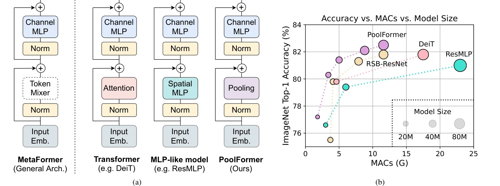
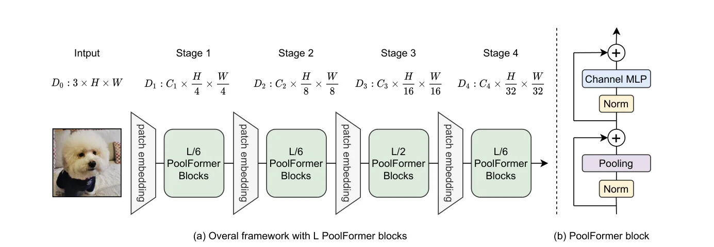

> - **논문**: MetaFormer Is Actually What You Need for Vision
> - **저자**: Weihao Yu, Mi Luo, Pan Zhou, Chenyang Si, Yichen Zhou, Xinchao Wang, Jiashi Feng, Shuicheng Yan (Sea AI Lab, National University of Singapore)
> - **학회**: CVPR 2022 · [arXiv:2111.11418](https://arxiv.org/abs/2111.11418) · [코드](https://github.com/sail-sg/poolformer)
{: .prompt-tip }

> Vision Transformer가 잘되는 것은 흔히 **Self-Attention** 덕분이라고 생각합니다. 이 논문은 이 생각에 의문을 던집니다. Attention을 **아무 학습 파라미터도 없는 평균 풀링**으로 바꿔도 성능이 거의 유지된다면, 진짜 핵심은 attention이 아니라 **Transformer의 전체 구조(MetaFormer)**라는 주장입니다.

## 1. Transformer 블록 다시 보기

[Transformer]() 인코더 블록은 이렇게 생겼습니다.

$$
Y = \text{Attention}\big(\text{Norm}(X)\big) + X,\qquad Z = \text{MLP}\big(\text{Norm}(Y)\big) + Y
$$

이를 두 부분으로 나눠 볼 수 있습니다.

1. **토큰 사이의 정보를 섞는 부분** (Self-Attention) → **Token Mixer**
2. **그 나머지** (Normalization, Shortcut, Channel MLP)

논문은 Token Mixer를 **구체적으로 정하지 않은** 이 일반 구조를 **MetaFormer**라고 부릅니다(아래 Figure 1 (a)).


_Figure 1. (a) Token Mixer를 비워 둔 MetaFormer와, 그 자리에 Attention·Spatial MLP·Pooling을 넣은 Transformer, MLP 계열, PoolFormer. (b) ImageNet-1K 정확도 대 MACs, 원 크기는 파라미터 수입니다. (출처: Yu et al., 2022)_

$$
Y = \text{TokenMixer}\big(\text{Norm}(X)\big) + X
$$

$$
Z = \sigma\big(\text{Norm}(Y)\,W_1\big)W_2 + Y
$$

- 입력 이미지를 패치로 나눠 $$N$$개의 토큰, 각 $$C$$차원으로 임베딩
- Norm은 Layer Normalization 또는 Batch Normalization 등
- Channel MLP는 채널을 $$C \to rC \to C$$로 늘렸다 줄임 ($$W_1, W_2$$는 학습 파라미터, $$\sigma$$는 GELU나 ReLU)

## 2. 기존의 생각: Attention이 핵심이다

ViT 이후 많은 연구가 **attention을 더 잘 만드는** 데 집중했습니다. Attention의 유연성과 용량을 활용하려는 방향입니다.

- ConViT (convolution의 inductive bias를 attention에 섞음)
- PVT (피라미드 구조)
- Transformer in Transformer
- Swin Transformer (shifted window attention)

한편 최근에는 **attention 같은 입력 의존적(token dependent) 모듈이 비효율적**이라는 연구들도 나왔습니다. 고정된 attention 패턴이나 하드코딩된 가우시안 attention으로도 번역 성능이 크게 떨어지지 않는다는 결과들입니다.

### 다른 Token Mixer들

- **FNet**: Token Mixer 자리에 **푸리에 변환**을 넣어 토큰을 섞음. 학습 파라미터 없이 추론이 크게 빨라지고 정확도 손실은 작았습니다.
- **MLP-Mixer**: 모든 층을 **MLP로만** 구성. 토큰 축으로 MLP를 적용해 토큰을 섞습니다. MetaFormer 구조를 그대로 지키면서 **Token Mixer만 바꾼** 예이고, ViT에 근접한 성능을 냈습니다.

Token Mixer를 바꿔도 잘된다면, **공통된 나머지 구조**가 중요한 것이 아닐까요?

## 3. PoolFormer: 가장 단순한 Token Mixer

이를 확인하려고 논문은 Token Mixer를 **극단적으로 단순한 연산**, 평균 풀링으로 바꿉니다.

$$
T' = \text{AvgPool}(T) - T
$$

- 입력은 $$C \times H \times W$$ 형태의 feature map
- 풀링 크기 $$K$$(기본 3)의 **stride 1** average pooling으로 주변 토큰 정보를 섞음
- **원래 값 $$T$$를 빼는** 이유: 바로 뒤에 residual shortcut으로 $$T$$가 다시 더해지므로, 빼지 않으면 자기 자신이 두 번 들어감

**학습 파라미터가 하나도 없고**, 연산량은 토큰 수에 **선형**입니다. Attention은 $$O(N^2)$$입니다.

```python
import torch.nn as nn

class Pooling(nn.Module):
    def __init__(self, pool_size=3):
        super().__init__()
        self.pool = nn.AvgPool2d(pool_size, stride=1, padding=pool_size // 2, count_include_pad=False)

    def forward(self, x):                        # x: (B, C, H, W)
        return self.pool(x) - x                  # shortcut에서 x가 다시 더해짐

class PoolFormerBlock(nn.Module):
    def __init__(self, dim, mlp_ratio=4, pool_size=3):
        super().__init__()
        self.norm1 = nn.GroupNorm(1, dim)        # 채널·공간 전체 정규화 (LayerNorm 변형)
        self.token_mixer = Pooling(pool_size)
        self.norm2 = nn.GroupNorm(1, dim)
        self.mlp = nn.Sequential(nn.Conv2d(dim, dim * mlp_ratio, 1), nn.GELU(),
                                 nn.Conv2d(dim * mlp_ratio, dim, 1))     # Channel MLP (1x1 conv)

    def forward(self, x):
        x = x + self.token_mixer(self.norm1(x))
        return x + self.mlp(self.norm2(x))

import torch

block = PoolFormerBlock(64)
x = torch.randn(2, 64, 56, 56)
print(block(x).shape)                                        # torch.Size([2, 64, 56, 56])
print(sum(p.numel() for p in block.token_mixer.parameters()))   # 0 → token mixer는 파라미터 없음
print(sum(p.numel() for p in block.parameters()))               # 33344 → 전부 Norm과 Channel MLP
```

블록의 파라미터는 모두 Norm과 Channel MLP에 있고, 토큰을 섞는 부분에는 하나도 없습니다. 그런데도 잘 동작한다는 것이 이 논문의 핵심 주장입니다.

> 다만 "attention이 필요 없다"로 확대 해석하면 안 됩니다. 이 결과는 ImageNet 분류처럼 **지역 정보가 중요한 비전 과제**에서 나온 것이고, 아래 ablation에서도 뒤쪽 단계에 attention을 섞으면 성능이 더 올랐습니다. 긴 거리의 관계가 중요한 언어 모델에서는 여전히 attention이 핵심입니다.
{: .prompt-info }

### 전체 구조


_Figure 2. (a) 블록 $$L$$개를 네 단계에 $$L/6, L/6, L/2, L/6$$개씩 나눈 PoolFormer 전체 구조. 단계 사이의 patch embedding이 해상도를 줄입니다. (b) PoolFormer 블록. (출처: Yu et al., 2022)_

- CNN처럼 **4단계 계층 구조**: 해상도를 $$\frac{H}{4} \to \frac{H}{8} \to \frac{H}{16} \to \frac{H}{32}$$로 줄이며 채널을 늘림. 단계 사이에서 patch embedding으로 downsampling(첫 단계 7×7 stride 4, 나머지 3×3 stride 2)
- 크기별 변형: **PoolFormer-S12, S24, S36, M36, M48** (숫자는 전체 블록 수, S/M은 채널 폭)
- 계층 구조라 Detection, Segmentation의 backbone으로 바로 쓸 수 있음

| 모델 | 단계별 채널 | 단계별 블록 수 | 파라미터 | MACs |
|---|---|---|---|---|
| S12 | 64, 128, 320, 512 | 2, 2, 6, 2 | 11.9M | 1.8G |
| S24 | 64, 128, 320, 512 | 4, 4, 12, 4 | 21.4M | 3.4G |
| S36 | 64, 128, 320, 512 | 6, 6, 18, 6 | 30.8M | 5.0G |
| M36 | 96, 192, 384, 768 | 6, 6, 18, 6 | 56.1M | 8.8G |
| M48 | 96, 192, 384, 768 | 8, 8, 24, 8 | 73.4M | 11.6G |

모든 모델에서 pooling 크기 3×3, MLP 확장 비율 4입니다(Table 1).

## 4. 구현 디테일

| 항목 | 값 |
|---|---|
| ImageNet 학습 | 224², 300 epoch(warmup 5), AdamW, weight decay 0.05, cosine decay |
| 배치와 학습률 | batch 4096, peak lr = 1e-3 × batch/1024 = 4e-3 |
| 증강·정규화 | MixUp α 0.8, CutMix α 1.0, RandAugment(부록 표에는 AutoAugment), Random erasing 0.25, label smoothing 0.1, dropout 없음 |
| Stochastic depth | S12·S24 0.1, S36 0.2, M36 0.3, M48 0.4 |
| LayerScale 초기값 | S12·S24 1e-5, S36·M36·M48 1e-6 |
| Norm | Modified LayerNorm(토큰·채널 축 전체 평균·분산, `GroupNorm(1, C)`) |
| 구현 | timm 기반, TPU에서 학습 |
| COCO | RetinaNet·Mask R-CNN, 1× schedule(12 epoch), AdamW lr 1e-4, batch 16, 짧은 변 800, mmdetection, A100 8장 |
| ADE20K | Semantic FPN, batch 32로 40k iter, AdamW lr 2e-4(poly, power 0.9), 512×512 crop, mmsegmentation, A100 8장 |

> 부록 Table 6에는 "peak learning rate used in the paper"가 4e-4로 적혀 있지만, 같은 표의 공식(batch/1024 × 1e-3)과 본문은 batch 4096에서 4e-3입니다. 여기서는 본문 값을 따랐습니다.
{: .prompt-warning }

## 5. 결과

### ImageNet 분류 (Table 2)

| 모델 | Token Mixer | Params | MACs | Top-1 |
|---|---|---|---|---|
| RSB-ResNet-34 | - (CNN) | 22M | 3.7G | 75.5 |
| RSB-ResNet-50 | - (CNN) | 26M | 4.1G | 79.8 |
| DeiT-S | Attention | 22M | 4.6G | 79.8 |
| DeiT-B | Attention | 86M | 17.5G | 81.8 |
| PVT-Medium | Attention | 44M | 6.7G | 81.2 |
| ResMLP-S24 | Spatial MLP | 30M | 6.0G | 79.4 |
| gMLP-B | Spatial MLP | 73M | 15.8G | 81.6 |
| PoolFormer-S12 | Pooling | 12M | 1.8G | 77.2 |
| **PoolFormer-S24** | Pooling | 21M | 3.4G | **80.3** |
| **PoolFormer-S36** | Pooling | 31M | 5.0G | **81.4** |
| PoolFormer-M36 | Pooling | 56M | 8.8G | 82.1 |
| **PoolFormer-M48** | Pooling | 73M | 11.6G | **82.5** |

- PoolFormer-S24(80.3%)는 DeiT-S(79.8%)보다 높으면서 MACs가 26% 적고(3.4G 대 4.6G), ResMLP-S24(79.4%)보다 파라미터·연산이 모두 적습니다.
- PoolFormer-S36(81.4%)은 PVT-Medium(81.2%)보다 파라미터 30%, MACs 25%가 적습니다.
- PoolFormer-M48(82.5%)은 DeiT-B(81.8%)보다 파라미터가 적고(73M 대 86M) MACs는 2/3 수준입니다.

학습 파라미터가 없는 pooling으로, **더 적은 파라미터와 연산**에서 attention 기반 모델 이상의 정확도를 냈습니다. 같은 300 epoch로 학습한 RSB-ResNet보다도 좋습니다. 저자들은 pooling의 지역 모델링 능력이 convolution보다 훨씬 약하므로, 이 성능은 MetaFormer라는 구조 덕분이라고 해석합니다. 부록에서는 S12를 더 오래 학습하면 77.2%(300 epoch)에서 78.8%(2000 epoch 이상)까지 오릅니다.

### Ablation (PoolFormer-S12, Table 5)

| 변경 | Top-1 |
|---|---|
| 기본(Pooling, MLN, GELU) | 77.2 |
| Pooling → **Identity** | 74.3 |
| Pooling → 고정 무작위 행렬(학습 안 함) | 75.8 |
| Pooling → Depthwise conv | 78.1 |
| Pooling 크기 3 → 5 / 7 / 9 | 77.2 / 77.1 / 76.8 |
| MLN → LayerNorm / BatchNorm / 없음 | 76.5 / 76.4 / 46.1 |
| GELU → ReLU / SiLU | 76.4 / 77.2 |
| Residual 제거 / Channel MLP 제거 | 0.1 / 5.7 |
| 4단계만 Attention [P, P, P, A] | 78.3 (14.0M, 1.9G) |
| 3·4단계 Attention [P, P, A, A] | **81.0** (16.5M, 2.5G) |
| 4단계만 Spatial FC / 3·4단계 Spatial FC | 77.5 / 77.9 |

- Pooling 대신 **아무것도 하지 않는 identity**를 Token Mixer로 써도 ImageNet top-1이 **74.3%**나 나왔습니다. 토큰을 섞지 않아도 MetaFormer 구조만으로 상당한 성능이 나온다는 뜻입니다. 학습하지 않는 무작위 행렬로 섞어도 75.8%입니다.
- 반대로 Norm(46.1%), residual(0.1%), Channel MLP(5.7%)를 빼면 학습이 무너집니다. "나머지 구조"가 핵심이라는 주장의 다른 면입니다.
- 앞쪽 단계는 pooling, 뒤쪽 두 단계만 attention을 쓰는 **혼합 구조**는 81.0%로 pooling만 쓴 것보다 3.8%p 높습니다. 같은 81.0%를 내는 ResMLP-B24는 파라미터 7배(116M), MACs 9.2배(23.0G)가 필요합니다.

### 다른 과제 (Table 3, 4)

| Backbone | RetinaNet AP | Mask R-CNN AP$$^{b}$$ / AP$$^{m}$$ | ADE20K mIoU (Semantic FPN) |
|---|---|---|---|
| ResNet-18 | 31.8 | 34.0 / 31.2 | 32.9 |
| **PoolFormer-S12** | **36.2** | **37.3 / 34.6** | **37.2** |
| ResNet-50 | 36.3 | 38.0 / 34.4 | 36.7 |
| **PoolFormer-S24** | **38.9** | **40.1 / 37.0** | **40.3** |
| ResNet-101 | 38.5 | 40.4 / 36.4 | 38.8 |
| **PoolFormer-S36** | **39.5** | **41.0 / 37.7** | **42.0** |

COCO 객체 검출·인스턴스 분할, ADE20K 의미 분할 모두에서 같은 급의 ResNet backbone보다 좋고, ADE20K에서는 PVT(Tiny 35.7, Small 39.8, Medium 41.6)보다도 높습니다.

## 6. Contribution: Attention is not all you need

- Transformer 계열 모델의 성능 원인은 attention이 아니라 **MetaFormer라는 일반 구조**에 있다.
- MetaFormer 형태의 모델 자체가 분류·검출·분할 등 **컴퓨터 비전 전반에서 핵심**이다.
- PoolFormer 자체가 최고 성능 모델은 아니지만, **평균 풀링만으로도** 높은 성능을 보인 만큼 MetaFormer 구조에 대한 연구를 촉진했다.

이후 같은 저자들은 다양한 Token Mixer를 MetaFormer 틀에서 비교하는 후속 연구로 이어갔고, [경량 ViT]() 설계에서도 "attention을 일부만 쓰는" 방향의 근거가 됐습니다.

## 7. 정리

| 구성 | 역할 | PoolFormer에서 |
|---|---|---|
| Token Mixer | 토큰 간 정보 교환 | **AvgPool − identity** (파라미터 0) |
| Norm | 안정화 | GroupNorm(1 그룹) |
| Shortcut | 정보 보존 | 그대로 |
| Channel MLP | 채널 간 변환 | 1×1 conv 두 개 |

## References

- Yu et al., "MetaFormer Is Actually What You Need for Vision," CVPR 2022. [arXiv:2111.11418](https://arxiv.org/abs/2111.11418)
- Lee-Thorp et al., "FNet: Mixing Tokens with Fourier Transforms," NAACL 2022.
- Tolstikhin et al., "MLP-Mixer: An all-MLP Architecture for Vision," NeurIPS 2021.
- Tay et al., "Synthesizer: Rethinking Self-Attention for Transformer Models," ICML 2021.
- You, Sun & Iyyer, "Hard-Coded Gaussian Attention for Neural Machine Translation," ACL 2020.
- Raganato et al., "Fixed Encoder Self-Attention Patterns in Transformer-Based Machine Translation," 2020.
