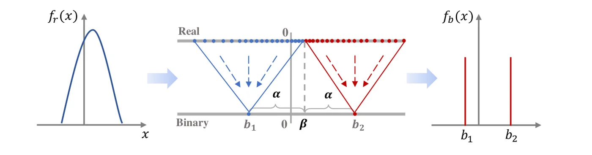
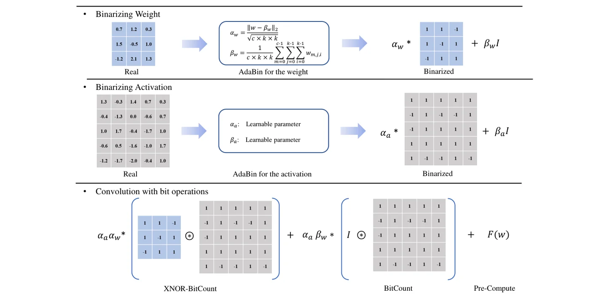
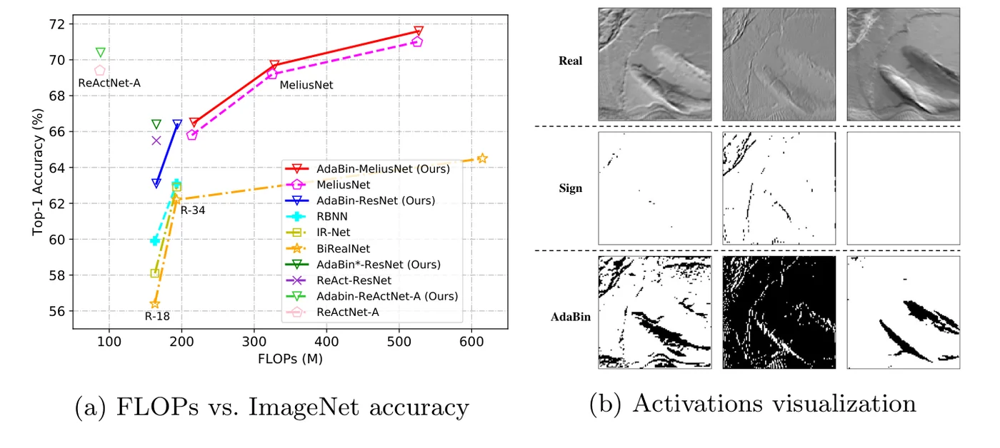

> - **논문**: AdaBin: Improving Binary Neural Networks with Adaptive Binary Sets
> - **저자**: Zhijun Tu, Xinghao Chen, Pengju Ren, Yunhe Wang (Xi'an Jiaotong University, Huawei Noah's Ark Lab)
> - **학회**: ECCV 2022 · [arXiv:2208.08084](https://arxiv.org/abs/2208.08084) · [코드(PyTorch)](https://github.com/huawei-noah/Efficient-Computing/tree/master/BinaryNetworks/AdaBin)
{: .prompt-tip }

> [BNN 총정리]()에서 본 방법들은 대부분 값을 **{-1, +1}**(또는 그 배율)로 고정해서 이진화했습니다. **AdaBin**은 두 값의 **중심과 간격 자체를 층마다 데이터에 맞게** 조정해, 이진화된 분포가 실수 분포와 더 비슷해지게 만듭니다.

## 1. 아이디어: 고정된 {-1, +1}의 한계

실수 가중치와 활성값의 분포는 층마다 다릅니다. 어떤 층은 0을 중심으로 대칭이지만, 어떤 층은 **한쪽으로 치우쳐** 있거나 **폭이 좁거나 넓습니다.** 이런 분포를 항상 0 대칭인 {-1, +1}로 바꾸면 정보 손실이 큽니다.

AdaBin은 이진값을 **$$\{b_1, b_2\} = \{\beta - \alpha,\ \beta + \alpha\}$$**로 둡니다.

- $$\beta$$: 두 값의 **중심(center)**
- $$\alpha$$: 중심에서 각 값까지의 **거리(distance)**

중심의 왼쪽 데이터는 $$b_1$$으로, 오른쪽 데이터는 $$b_2$$로 **두 클러스터**처럼 나뉩니다. $$\alpha, \beta$$가 분포에 따라 바뀌므로, 실수 데이터를 **적응적으로 최적의 두 클러스터**로 나누는 셈입니다(아래 Figure 2).


_Figure 2. AdaBin quantizer. 왼쪽 실수 분포 $$f_r(x)$$의 값이 중심 $$\beta$$를 기준으로 $$b_1 = \beta - \alpha$$, $$b_2 = \beta + \alpha$$ 두 값으로 모입니다. (출처: Tu et al., 2022)_

기존 BNN은 가중치·활성값이 모두 {-1, +1}이라 곱셈 결과가 두 종류뿐이고, {0, +1}을 쓰는 SiBNN·SiMaN도 두세 종류입니다. AdaBin은 $$a_{b1}, a_{b2}, w_{b1}, w_{b2}$$가 모두 다른 실수라서 **네 종류**의 곱이 나옵니다. 기존 방식은 AdaBin에서 $$\alpha, \beta$$를 특정 값으로 고정한 특수한 경우입니다.

$$
\mathcal{B}(x) = \begin{cases} \beta + \alpha & x \ge \beta \\ \beta - \alpha & x < \beta \end{cases} \;=\; \alpha\,\text{sign}(x - \beta) + \beta
$$

### Contribution

- 1bit 값의 **중심과 거리를 조정**하는 효과적인 이진화 방법 AdaBin 제안
- 층마다 가중치와 활성값의 이진 집합을 구하는 **새로운 전략**으로 full-precision 네트워크와의 격차 축소
- CIFAR-10과 ImageNet에서 SOTA보다 우수

## 2. 가중치 이진화: Weight Equalization

가중치의 이진 집합은 실수 가중치 분포와 이진화된 분포의 **차이(KL divergence)를 최소화**하는 방향으로 정합니다.

$$
\min_{\alpha_w, \beta_w}\ D_{KL}\big(P_r(w)\ \|\ P_b(w_b)\big)
$$

신경망 가중치 분포에 대한 정확한 식이 없어 KL divergence를 직접 계산하기는 어렵습니다. 그래서 가중치가 **종 모양(bell-shaped)** 분포를 따른다고 가정하면, 최적값이 **평균과 표준편차**로 간단히 정리됩니다.

$$
\beta_w = \frac{1}{n}\sum_i w_i,\qquad \alpha_w = \sqrt{\frac{1}{n}\sum_i(w_i - \beta_w)^2}
$$

- 출력 채널마다 따로 구하는 **채널별 파라미터**
- 학습 중 실수 가중치가 바뀔 때마다 함께 갱신

### 1bit 저장

추론할 때 이진 가중치는

$$
w_b = \alpha_w\,b_w + \beta_w,\qquad b_w \in \{-1, +1\}
$$

로 분해되므로, $$b_w$$는 **1bit**로 저장하고 채널별 $$\alpha_w, \beta_w$$만 추가로 둡니다. 기존 BNN과 마찬가지로 약 **32배 메모리 절약**을 달성합니다.

Convolution도 비트 연산으로 계산할 수 있습니다. 활성값도 $$a_b = \alpha_a b_a + \beta_a$$로 쓰면, 길이 $$n$$인 두 벡터의 내적은 다음 네 항으로 펼쳐집니다.

$$
a_b \cdot w_b = \underbrace{\alpha_a\alpha_w\,(b_a \cdot b_w)}_{\text{XNOR + popcount}} + \underbrace{\alpha_a\beta_w \sum_i b_{a,i}}_{\text{입력 비트 합}} + \underbrace{\beta_a\alpha_w \sum_i b_{w,i}}_{\text{미리 계산 가능}} + \underbrace{n\,\beta_a\beta_w}_{\text{상수}}
$$

첫 항만 기존 BNN과 같은 XNOR·popcount이고, 셋째·넷째 항은 가중치가 고정되면 미리 계산해 둘 수 있습니다. 둘째 항은 입력 비트의 개수만 세면 되므로(popcount 한 번) 추가 비용이 작습니다. 논문의 Figure 3은 셋째·넷째 항을 묶어 $$F(w)$$로 표시합니다.


_Figure 3. 가중치는 평균·표준편차로, 활성값은 학습된 $$\alpha_a, \beta_a$$로 이진화한 뒤, convolution을 XNOR-BitCount 항 + BitCount 항 + 미리 계산하는 $$F(w)$$로 나눕니다. (출처: Tu et al., 2022)_

논문은 $$n = c = 256$$, $$k = 3$$, 출력 14×14인 층을 예로, IR-Net의 이진 convolution 대비 연산은 **2.74%**, 파라미터는 **1.37%**만 늘어난다고 계산합니다. 이론상 실수 convolution 대비 **60.85배 가속, 31배 메모리 절약**입니다.

## 3. 활성값 이진화: Gradient-based Optimization

활성값은 입력마다 바뀌므로 가중치처럼 매번 통계를 계산할 수 없습니다. 그래서 활성값의 중심 $$\beta_a$$와 거리 $$\alpha_a$$를 **학습 파라미터**로 두고 경사하강법으로 최적화합니다.

$$
a_b = \alpha_a\,\text{sign}\Big(\frac{a - \beta_a}{\alpha_a}\Big) + \beta_a
$$

역전파는 sign을 **hard-tanh**로 근사하는 STE로 계산합니다.

$$
\frac{\partial a_b}{\partial a} \approx \mathbf{1}\Big[\Big\lvert\frac{a - \beta_a}{\alpha_a}\Big\rvert \le 1\Big]
$$

초기값은 $$\beta_a = 0$$, $$\alpha_a = 1$$이라서 학습 시작 시점에는 기존 sign 함수와 똑같이 동작하고, 학습하면서 층마다 다른 값으로 옮겨 갑니다. 추론할 때는 모든 층의 $$\alpha_a, \beta_a$$를 **고정**합니다.

```python
import torch
import torch.nn as nn

class AdaBinWeight(nn.Module):
    def forward(self, w):                                   # w: (C_out, C_in, k, k)
        beta = w.mean(dim=(1, 2, 3), keepdim=True)
        alpha = w.std(dim=(1, 2, 3), keepdim=True, unbiased=False)   # 위 식처럼 1/n로 나눔
        b = torch.sign(w - beta)
        w_b = alpha * b + beta
        return w_b.detach() - w.detach() + w                # STE

class AdaBinActivation(nn.Module):
    def __init__(self):
        super().__init__()
        self.alpha = nn.Parameter(torch.ones(1))
        self.beta = nn.Parameter(torch.zeros(1))

    def forward(self, a):
        u = (a - self.beta) / self.alpha
        hard = torch.clamp(u, -1, 1)                        # backward용 (hard-tanh)
        out = torch.sign(u).detach() - hard.detach() + hard
        return self.alpha * out + self.beta

torch.manual_seed(0)
w = torch.randn(2, 3, 3, 3) * 0.1 + torch.tensor([0.05, -0.02]).view(2, 1, 1, 1)
w_b = AdaBinWeight()(w)
print([sorted(set(w_b[c].flatten().tolist())) for c in range(2)])   # 채널마다 서로 다른 두 값
```

출력 채널마다 $$\{\beta - \alpha, \beta + \alpha\}$$ 두 값만 나오고, 그 두 값의 중심이 채널마다 다르게(0이 아닌 곳에) 잡히는 것을 확인할 수 있습니다. (구조를 보여 주기 위한 단순화 코드이며, `torch.sign(0) = 0` 처리나 $$\alpha_a$$가 0 이하로 내려가지 않게 하는 처리는 생략했습니다.)

## 4. 비선형성: Maxout

AdaBin으로 이진화한 값을 보면, 일부 층에서는 이진값이 **거의 모두 양수**였습니다($$\beta$$가 양수 쪽으로 이동). 그러면 음수 쪽 기울기만 바꾸는 **PReLU는 비선형성 측면에서 의미가 없어집니다.**

그래서 양수 쪽과 음수 쪽 기울기를 **모두 학습**하는 **Maxout** 형태의 활성 함수를 씁니다.

$$
f_c(x) = \gamma^+_c\,\text{ReLU}(x) - \gamma^-_c\,\text{ReLU}(-x)
$$

- $$\gamma^+_c, \gamma^-_c$$: $$c$$번째 채널의 양수·음수 부분에 대한 학습 가능한 계수
- PReLU처럼 초기값은 $$\gamma^+ = 1$$, $$\gamma^- = 0.25$$
- 이름은 Maxout이지만, Goodfellow et al.(2013)의 원래 Maxout(여러 선형 함수 중 최댓값)과 달리 여기서는 **양·음 두 구간의 기울기를 각각 학습하는 piecewise linear 함수**입니다. 원 Maxout에서 두 조각만 쓰는 특수한 경우에 가깝습니다.

```python
class Maxout(nn.Module):
    def __init__(self, channels):
        super().__init__()
        self.pos = nn.Parameter(torch.ones(1, channels, 1, 1))
        self.neg = nn.Parameter(torch.full((1, channels, 1, 1), 0.25))

    def forward(self, x):
        return self.pos * torch.relu(x) - self.neg * torch.relu(-x)
```

## 5. 실험

### 학습 설정

| 항목 | CIFAR-10 | ImageNet |
|---|---|---|
| 학습 | 400 epoch, batch 256 | 120 epoch, 처음부터 학습 |
| Optimizer | SGD, momentum 0.9 | SGD, momentum 0.9 |
| Learning rate | 0.1에서 시작, cosine annealing (IR-Net 방식) | 0.1에서 시작, cosine annealing (IR-Net 방식) |
| Augmentation | ResNet 논문과 같은 전처리 | ResNet 논문과 같은 전처리 |
| 구현 | PyTorch, MindSpore | 같음 |

`*` 표시 결과는 ReActNet의 2단계 학습 설정을 따른 것입니다. 객체 검출(PASCAL VOC, SSD300)은 BiDet 설정을 따라 Adam, lr 0.001로 200 epoch 학습하고 160·180 epoch에서 lr을 0.1배씩 줄였습니다.

### CIFAR-10

| 모델 | 실수 모델 | 직전 최고 | **AdaBin** |
|---|---|---|---|
| ResNet-18 | 94.8 | ReCU 92.8 | **93.1** |
| ResNet-20 | 91.7 | RBNN 87.8 | **88.2** |
| VGG-Small | 94.1 | SLB 92.0 | **92.3** |

<small>top-1 정확도(%), W/A = 1/1 (논문 Table 2)</small>

- **ResNet-18**: ReCU보다 0.3%p 높고, BNN과 실수 모델의 격차를 **1.7%p**로 줄임
- **ResNet-20**: 당시 최고였던 RBNN보다 0.4%p 향상
- **VGG-small**: 가중치와 활성값을 모두 1bit로 이진화하면서 SLB보다 0.3%p 높음

### ImageNet

일반 backbone(AlexNet, ResNet)에 적용한 경우와, BNN 전용 구조(BDenseNet, MeliusNet, [ReActNet]())에 적용한 경우를 실험했습니다.

| 모델 | 실수 모델 | 비교 방법 | **AdaBin** |
|---|---|---|---|
| AlexNet | 56.6 / 80.0 | SiBNN 50.5 / 74.6 | **53.9 / 77.6** |
| ResNet-18 | 69.6 / 89.2 | IR-Net 58.1 / 80.0, ReCU 61.0 / 82.6 | **63.1 / 84.3** |
| ResNet-18 (`*`) | - | ReActNet 65.5 / 86.1 | **66.4 / 86.5** |
| ResNet-34 | 73.3 / 91.3 | ReCU 65.1 / 85.8 | **66.4 / 86.6** |

<small>top-1 / top-5 정확도(%), W/A = 1/1 (논문 Table 3)</small>

- **AlexNet**: 당시 최고였던 SiBNN보다 **3.4%p** 높고, 실수 모델과의 격차를 2.7%p로 줄임
- **ResNet-18**: IR-Net의 이진화 함수와 비선형 모듈을 AdaBin 양자화기와 Maxout으로 바꾼 것만으로 5.0%p 향상, ReCU보다 2.1%p 높음
- **ResNet-34**: ReCU보다 1.3%p 향상
- **ReActNet 학습 설정(2단계 학습)**: ResNet-18 기반으로 **66.4%**, ReActNet보다 0.9%p 향상

BNN 전용 구조에 붙여도 연산량은 거의 그대로이고 정확도가 오릅니다.

| 구조 | OPs (×10⁸) 원본 → AdaBin | top-1 원본 → AdaBin |
|---|---|---|
| BDenseNet28 | 2.09 → 2.11 | 62.6 → 63.7 (+1.1) |
| MeliusNet22 | 2.08 → 2.10 | 63.6 → 64.6 (+1.0) |
| MeliusNet59 | 5.25 → 5.27 | 71.0 → 71.6 (+0.6) |
| ReActNet-A | 0.87 → 0.88 | 69.4 → 70.4 (+1.0) |

<small>논문 Table 4 일부 (MeliusNet29·42는 +0.7, +0.5)</small>


_Figure 1. (a) FLOPs 대비 ImageNet top-1 정확도. AdaBin을 붙인 구조(실선)가 같은 연산량에서 더 높습니다. (b) ImageNet ResNet-18 2번째 층 활성값. sign으로 이진화하면 대부분 한쪽 값으로 뭉개지지만, AdaBin은 실수 활성값의 윤곽을 더 많이 남깁니다. (출처: Tu et al., 2022)_

검출(PASCAL VOC, SSD300)에서도 AdaBin은 mAP 64.0, real-valued shortcut을 더한 구조에서 **69.4**로, 검출 전용 BNN인 AutoBiDet(53.5 / 67.5)보다 각각 10.5, 1.9 높습니다. 실수 모델은 72.4입니다.

### Ablation

CIFAR-10 ResNet-20에서 양자화기를 하나씩 바꾼 결과입니다(논문 Table 6a).

| 가중치 집합 | 활성값 집합 | 비선형성 | 정확도 (%) |
|---|---|---|---|
| $$\{-\alpha, +\alpha\}$$ | {-1, +1} | PReLU | 85.7 |
| $$\{w_{b1}, w_{b2}\}$$ | {-1, +1} | PReLU | 86.3 |
| $$\{-\alpha, +\alpha\}$$ | $$\{a_{b1}, a_{b2}\}$$ | PReLU | 87.3 |
| $$\{w_{b1}, w_{b2}\}$$ | $$\{a_{b1}, a_{b2}\}$$ | PReLU | 87.7 |
| $$\{w_{b1}, w_{b2}\}$$ (학습 파라미터) | $$\{a_{b1}, a_{b2}\}$$ | Maxout | 86.7 |
| $$\{w_{b1}, w_{b2}\}$$ | $$\{a_{b1}, a_{b2}\}$$ | **Maxout** | **88.2** |

- 가중치 equalization만 넣으면 +0.6%p, 활성값 이진화만 바꾸면 +1.6%p, 둘을 합치면 vanilla BNN보다 +2.0%p입니다.
- 가중치의 $$\alpha_w, \beta_w$$를 통계로 구하지 않고 활성값처럼 학습 파라미터로 두면 86.7%로 크게 떨어집니다. 논문은 이를 근거로 가중치 쪽에서는 KL divergence 기반 정렬이 중요하다고 봅니다.

ImageNet ResNet-18에서 Maxout 계수를 바꾼 결과(Table 6b)는 비선형성이 없으면 top-1 53.2%, $$\gamma^+$$만 62.8%, $$\gamma^-$$만(=PReLU) 62.9%, 둘 다 쓰면 **63.1%**입니다. 계수 하나만 넣어도 9%p 넘게 오르고, 둘을 함께 쓸 때 가장 좋습니다.

### 분포를 맞추는 것이 핵심

Figure 1(b)와 위 ablation이 같은 이야기를 합니다. 이진값의 위치를 실수 분포에 맞추면 이진 feature가 담는 정보가 늘고, 그만큼 정확도가 오릅니다. **BNN의 정확도에는 가중치와 활성값의 분포를 어떻게 두 값으로 옮기느냐가 중요**하다는 것을 다시 확인한 셈입니다.

## 6. 정리

| 요소 | 기존 BNN | AdaBin |
|---|---|---|
| 이진값 | $$\{-\alpha, +\alpha\}$$ (0 대칭) | $$\{\beta - \alpha, \beta + \alpha\}$$ (**중심 이동 가능**) |
| 가중치 집합 | 평균 절댓값 배율 | **평균·표준편차** (KL 최소화) |
| 활성값 집합 | 고정 threshold | **학습되는** $$\alpha_a, \beta_a$$ |
| 비선형성 | PReLU | **Maxout** (양·음 기울기 모두 학습) |
| 메모리 | 1bit | 1bit + 채널별 $$\alpha, \beta$$ |

## References

- Tu et al., "AdaBin: Improving Binary Neural Networks with Adaptive Binary Sets," ECCV 2022. [arXiv:2208.08084](https://arxiv.org/abs/2208.08084)
- Liu et al., "ReActNet," ECCV 2020.
- Qin et al., "Forward and Backward Information Retention for Accurate Binary Neural Networks (IR-Net)," CVPR 2020.
- Xu et al., "ReCU: Reviving the Dead Weights in Binary Neural Networks," ICCV 2021.
- Goodfellow et al., "Maxout Networks," ICML 2013.
