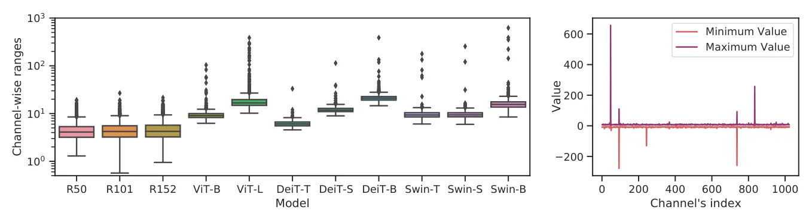
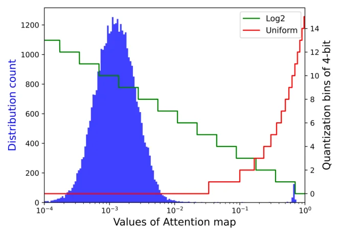
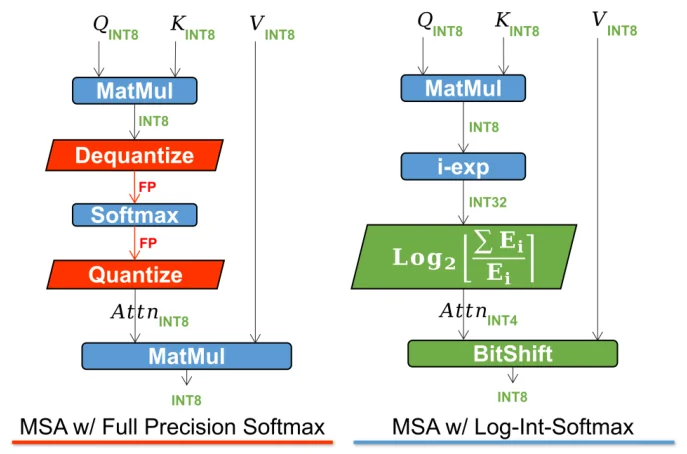

> - **논문**: FQ-ViT: Post-Training Quantization for Fully Quantized Vision Transformer
> - **저자**: Yang Lin, Tianyu Zhang, Peiqin Sun, Zheng Li, Shuchang Zhou (MEGVII Technology)
> - **학회**: IJCAI 2022 · [arXiv:2111.13824](https://arxiv.org/abs/2111.13824) · [코드](https://github.com/megvii-research/FQ-ViT)
{: .prompt-tip }

> [Quantization]()은 CNN에서는 INT8로 거의 손실 없이 적용되지만, Vision Transformer에 적용하면 성능이 크게 떨어집니다. 특히 **LayerNorm과 Softmax**는 양자화가 어려워 보통 실수(FP32)로 남겨 둡니다. **FQ-ViT**는 학습 없이(PTQ) 이 두 연산까지 포함해 ViT를 **완전히(fully) 양자화**합니다.

## 1. Quantization 복습

양자화는 **수치의 상대적인 크기를 보존하면서 정밀도를 줄이는** 과정입니다. 보통 FP32를 INT8 이하의 정수로 바꿉니다. 예를 들어 [0, 5.64] 범위의 실수를 8bit로 바꾸면 가장 큰 5.64는 255 근처의 정수가 됩니다.

### Uniform Quantization

입력 $$X$$를 $$b$$bit로 양자화하는 식은 다음과 같습니다.

$$
X_Q = \text{Q}(X \mid b) = \text{clip}\Big(\Big\lfloor\frac{X}{s}\Big\rceil + zp,\ 0,\ 2^b - 1\Big)
$$

$$
s = \frac{u - l}{2^b - 1},\qquad zp = \text{clip}\Big(\Big\lfloor-\frac{l}{s}\Big\rceil,\ 0,\ 2^b - 1\Big)
$$

- $$l, u$$: 양자화할 범위의 최솟값과 최댓값 (이 범위를 넘는 값은 clip)
- $$s$$ (**scale**): 정수 하나가 나타내는 실수 범위의 크기
- $$zp$$ (**zero point**): 실수 0에 대응하는 정수

### Log2 Quantization

균일한 간격 대신 **지수(2의 거듭제곱) 간격**으로 양자화합니다.

$$
X_Q = \text{clip}\big(\big\lfloor-\log_2 X\big\rceil,\ 0,\ 2^b - 1\big)
$$

0 근처의 작은 값을 촘촘하게 표현합니다. 위 식은 Softmax 출력처럼 값이 (0, 1)에 있을 때의 형태(논문 식 15)이고, 일반형(식 6)은 부호를 따로 떼고 $$\lvert X \rvert / \max(\lvert X \rvert)$$에 log를 취합니다.

## 2. ViT 양자화가 어려운 이유

### 완전 양자화하면 크게 무너진다

- LayerNorm과 Softmax를 **제외하고** 나머지만 8bit로 양자화하면 하락이 작음
- 하지만 MinMax로 **모두 8bit 양자화**하면 성능이 크게 떨어짐. DeiT는 비교적 덜 떨어지지만(DeiT-B 81.85% → 78.02%), ViT는 거의 무너지고(ViT-B 84.53% → 23.64%, ViT-L 85.81% → 3.37%), Swin은 모델마다 차이가 큼(Swin-S 83.20% → 74.37%, Swin-B 83.60% → 25.58%)

### 원인 1: LayerNorm 입력의 채널 간 편차

마지막 LayerNorm 입력의 **채널별 범위(최솟값~최댓값)**를 비교하면

- CNN(ResNet-50/101/152, LayerNorm이 없으므로 같은 위치인 4번째 stage 출력)은 채널 간 범위 차이가 **작음**. ResNet-152의 최대 범위/중앙 범위는 21.6/4.2
- Transformer 계열은 일부 채널의 범위가 중앙값의 **40배**를 넘을 만큼 차이 남. Swin-B는 622.5/15.5
- Swin-B의 채널별 최솟값·최댓값을 보면 몇몇 채널만 **크게 튀는 값(outlier)**이 있음


_Figure 2. 왼쪽: 모델별 마지막 LayerNorm 입력의 채널별 범위(log 축). 오른쪽: full precision Swin-B의 채널별 최솟값과 최댓값. (출처: Lin et al., 2022)_

모든 채널에 **하나의 scale**을 쓰는 layer-wise 양자화로는 이를 잡을 수 없습니다. 큰 채널에 맞추면 작은 채널은 몇 개의 정수에 뭉개지고, 작은 채널에 맞추면 큰 채널이 잘립니다. 채널마다 다른 scale을 쓰면 해결되지만, 그러면 LayerNorm 계산(채널 전체의 평균·분산)을 **정수로 할 수 없습니다.**

### 원인 2: Attention map의 극단적인 분포

기존 방식은 Q, K, V를 INT8로 양자화해 $$QK^\top$$를 정수로 계산하지만, **Softmax를 지나려면 FP32로 역양자화**했다가 다시 양자화해야 합니다. 그래서 attention 기반 모델은 CNN과 달리 모든 부분을 양자화하기 어렵습니다.

또 Softmax 출력(attention map)은 대부분 **0 근처**에 몰려 있고, 소수만 1에 가깝습니다. ViT-L의 모든 attention map을 평균하면 값의 약 **98.8%가 1/16보다 작습니다.** 4bit 균일 양자화는 이 많은 값에 bin을 1개만 주지만, log2 양자화는 12개를 줍니다(아래 Figure 3). 실제로 균일 양자화로 attention map을 8bit에서 **4bit**로 줄이면, DeiT-T의 ImageNet top-1이 **8.69%**로 떨어집니다(8bit 대비 63.05%p 하락).


_Figure 3. ViT-L attention map 값의 분포(x축 log 눈금)와 4bit 균일·log2 양자화의 bin. 작은 값 영역에서 log2가 훨씬 많은 bin을 씁니다. (출처: Lin et al., 2022)_

## 3. Power-of-Two Factor (PTF): LayerNorm 양자화

채널마다 다른 scale을 주되, **공통 scale에 2의 거듭제곱만 곱한** 형태로 제한합니다.

$$
X_Q = \text{clip}\Big(\Big\lfloor\frac{X}{2^{\alpha_c}\,s}\Big\rceil + zp,\ 0,\ 2^b - 1\Big),\qquad \alpha_c \in \{0, 1, \dots, K\}
$$

- $$s$$: 모든 채널이 공유하는 layer-wise scale. 논문은 전체 범위로 구한 scale을 $$2^K$$로 나눈 $$s = \frac{\max(X) - \min(X)}{2^b - 1} / 2^K$$로 둡니다. 즉 $$\alpha_c = 0$$인 채널은 전체 범위의 $$1/2^K$$만 표현하고, 범위가 큰 채널일수록 $$\alpha_c$$가 커집니다.
- $$\alpha_c$$: 채널 $$c$$의 **power-of-two factor**. 값이 큰 채널은 $$\alpha_c$$를 키워 넓은 범위를 표현
- 채널별 $$\alpha_c$$는 보정 데이터에서 $$\lVert X_c - \lfloor X_c / 2^{\alpha_c}s \rceil \cdot 2^{\alpha_c}s \rVert^2$$가 가장 작아지도록 선택
- 하이퍼파라미터 $$K$$는 모든 모델의 채널 간 편차를 덮도록 **$$K = 3$$**을 기본값으로 씁니다.

이렇게 하면 채널마다 정수 표현은 다르지만, $$2^{\alpha_c}$$를 곱하는 것은 **비트 shift**라서 모든 채널을 **같은 scale로 맞추는 연산을 정수로** 할 수 있습니다. 그 결과 LayerNorm의 평균·분산 계산을 정수 연산으로 수행할 수 있습니다.

```python
import torch

def ptf_quantize(x, s, zp, alpha, bits=8):
    """x: (..., C), alpha: (C,) 정수 power-of-two factor"""
    scale = s * (2.0 ** alpha)                       # 채널별 scale = 공통 scale × 2^α
    q = torch.clamp(torch.round(x / scale) + zp, 0, 2 ** bits - 1)
    return q

def ptf_align(q, zp, alpha):
    """정수 영역에서 shift로 공통 scale에 맞춤 → LayerNorm 통계를 정수로 계산 가능"""
    return (q - zp).long() << alpha.long()            # (q - zp) × 2^α

# 4개 채널 중 마지막 채널만 범위가 40배 큰 LayerNorm 입력을 흉내 냄
torch.manual_seed(0)
x = torch.randn(1000, 4) * torch.tensor([1.0, 1.0, 1.0, 40.0])
dequant = lambda q, s, zp, a: (q - zp) * s * (2.0 ** a)

# (1) layer-wise: 전체 범위 하나로 scale을 정함
s_lw = (x.max() - x.min()) / 255
zp_lw = torch.round(-x.min() / s_lw)
a0 = torch.zeros(4)
err_lw = (dequant(ptf_quantize(x, s_lw, zp_lw, a0), s_lw, zp_lw, a0) - x).abs().mean(0)

# (2) PTF: 작은 채널 범위로 공통 scale을 정하고, 채널마다 오차가 가장 작은 α를 고름
small = x[:, :3]
s = (small.max() - small.min()) / 255
zp = torch.round(-small.min() / s)
alpha = torch.zeros(4)
for c in range(4):
    errs = [(dequant(ptf_quantize(x[:, c], s, zp, torch.tensor(float(a))), s, zp, a) - x[:, c]).abs().mean()
            for a in range(7)]
    alpha[c] = int(torch.stack(errs).argmin())
err_ptf = (dequant(ptf_quantize(x, s, zp, alpha), s, zp, alpha) - x).abs().mean(0)

print(alpha.tolist())                  # [0.0, 0.0, 0.0, 5.0]
print(err_lw.numpy().round(4))         # [0.2584 0.2648 0.2681 0.2617]
print(err_ptf.numpy().round(4))        # [0.0079 0.008  0.0081 0.2682]
```

layer-wise 양자화는 큰 채널 하나에 맞춰 scale을 크게 잡는 바람에, **나머지 세 채널의 오차가 0.26**이나 됩니다. PTF는 작은 채널 기준으로 scale을 잡고 큰 채널에만 $$2^5 = 32$$배를 곱해 주므로, 작은 채널의 오차가 **약 33배 줄고**(0.008) 큰 채널의 오차는 그대로입니다. 그러면서도 채널별 차이는 정수 shift(`ptf_align`)로 맞출 수 있어 LayerNorm 통계를 정수로 계산할 수 있습니다. 논문 식으로는 $$\hat X_Q = (X_Q - zp) \ll \alpha$$로 shift한 뒤 $$\mu(X) \approx s \cdot \mu(\hat X_Q)$$, $$\sigma(X) \approx s \cdot \sigma(\hat X_Q)$$를 구합니다. 이 toy는 이해를 위해 작은 채널 범위로 $$s$$를 정하고 $$\alpha$$를 0~6까지 찾았지만, 논문은 위처럼 전체 범위 $$/ 2^K$$로 $$s$$를 정하고 $$\alpha \in \{0, \dots, 3\}$$에서 고릅니다.

## 4. Log-Int-Softmax (LIS): Attention 양자화

### Log2 양자화로 attention map 표현

Attention map은 0 근처에 몰린 분포이므로 **log2 양자화**가 잘 맞습니다. 작은 값들을 촘촘하게 표현하면서 4bit로도 정보를 유지합니다.

### 정수만으로 Softmax 계산

Softmax의 $$\exp$$를 **정수 다항식 근사**(I-BERT의 i-exp)로 계산하고, 그 결과를 바로 log2 양자화합니다.

$$
\text{LIS}(s \cdot X_Q) = N - \log_2 \Big\lfloor \frac{\sum \text{i-exp}(X_Q)}{\text{i-exp}(X_Q)} \Big\rceil,\qquad N = 2^b - 1
$$

정수 $$\log_2$$는 값이 1인 첫 비트 위치를 찾고(Find First One) 그 바로 뒤 비트 값을 더하는 식으로 shift만으로 구현합니다. Softmax 출력은 항상 (0, 1)이므로 log2 양자화에 보정 데이터가 필요 없다는 장점도 있습니다.

양자화된 attention이 $$2^{-k}$$ 형태이므로, Value와 곱하는 연산은 **곱셈 대신 비트 shift**가 됩니다.

$$
\text{Attn}\cdot V \approx \sum_j 2^{-\tilde{a}_j}\,V_j = \sum_j \big(V_j \gg \tilde{a}_j\big)
$$

다만 오른쪽 shift를 그대로 하면 잘림 오차가 크므로, 실제로는 $$N - \text{Attn}_Q$$를 출력으로 두고 scale을 $$1/2^N$$으로 잡아 $$\frac{1}{2^N}(V_Q \ll (N - \text{Attn}_Q))$$처럼 왼쪽 shift를 씁니다.


_Figure 4. 왼쪽: Softmax를 실수로 두면 앞뒤로 역양자화·재양자화가 필요합니다. 오른쪽: LIS는 i-exp(INT32) → 정수 log2 → 4bit attention → BitShift로 MSA 전체를 정수로 처리합니다. (출처: Lin et al., 2022)_

Figure 4처럼 중간에 FP32로 역양자화할 필요 없이 **Q·K 계산 → Softmax → Value 곱**까지 정수로 처리됩니다. Attention map을 **4bit**로 줄이면서도 정확도를 유지하고, 8bit 균일 양자화와 같은 성능을 메모리 절반으로 얻습니다.

## 5. 결과

### 구현 디테일

| 항목 | 값 |
|---|---|
| 보정 데이터 | ImageNet 또는 COCO 학습 이미지 1,000장을 무작위 추출, 평가는 검증 셋 |
| Weight 양자화 | 대칭(symmetric), 채널별, MinMax로 고정 |
| Activation 양자화 | 비대칭(asymmetric), layer-wise |
| Conv, Linear, MatMul | 균일 MinMax 양자화 |
| LayerNorm 입력 | PTF, $$K = 3$$ |
| Softmax | LIS (attention map 4bit) 또는 8bit |
| 비트 표기 | W/A/Attn = weight / activation / attention map 비트 수 |

### ImageNet (Table 1, top-1 %)

| 방법 | W/A/Attn | DeiT-T | DeiT-S | DeiT-B | ViT-B | ViT-L | Swin-T | Swin-S | Swin-B |
|---|---|---|---|---|---|---|---|---|---|
| Full Precision | 32/32/32 | 72.21 | 79.85 | 81.85 | 84.53 | 85.81 | 81.35 | 83.20 | 83.60 |
| MinMax | 8/8/8 | 70.94 | 75.05 | 78.02 | 23.64 | 3.37 | 64.38 | 74.37 | 25.58 |
| EMA | 8/8/8 | 71.17 | 75.71 | 78.82 | 30.30 | 3.53 | 70.81 | 75.05 | 28.00 |
| Percentile | 8/8/8 | 71.47 | 76.57 | 78.37 | 46.69 | 5.85 | 78.78 | 78.12 | 40.93 |
| OMSE | 8/8/8 | 71.30 | 75.03 | 79.57 | 73.39 | 11.32 | 79.30 | 78.96 | 48.55 |
| Bit-Split* | 8/8/8 | - | 77.06 | 79.42 | - | - | - | - | - |
| PTQ for ViT* | 8/8/8 | - | 77.47 | 80.48 | - | - | - | - | - |
| **FQ-ViT** | 8/8/8 | 71.61 | 79.17 | 81.20 | 83.31 | 85.03 | 80.51 | 82.71 | 82.97 |
| **FQ-ViT** | 8/8/4 | 71.07 | 78.40 | 80.85 | 82.68 | 84.89 | 80.04 | 82.47 | 82.38 |

\* LayerNorm과 Softmax를 양자화하지 않은 결과입니다.

- **Weight·activation 8bit, attention map 4bit**로 LayerNorm과 Softmax까지 **모두 양자화**하고도, FP32 대비 손실이 0.7~1.9%p입니다(Swin-S 0.73%p, ViT-L 0.92%p, ViT-B 1.85%p).
- LayerNorm과 Softmax를 실수로 남긴 Bit-Split, PTQ for ViT도 DeiT-S·DeiT-B에서 4bit attention의 FQ-ViT보다 낮습니다.
- 기존 PTQ 방법은 ViT-L에서 3~11%대로 무너지지만 FQ-ViT는 85.03%입니다.

### COCO (Table 2, bbox mAP)

| 방법 | W/A/Attn | Mask R-CNN (Swin-S) | Cascade Mask R-CNN (Swin-S) |
|---|---|---|---|
| Full Precision | 32/32/32 | 48.5 | 52.0 |
| MinMax | 8/8/8 | 32.8 | 35.2 |
| EMA | 8/8/8 | 37.9 | 40.4 |
| Percentile | 8/8/8 | 41.6 | 44.7 |
| OMSE | 8/8/8 | 42.6 | 44.9 |
| **FQ-ViT** | 8/8/8 | 47.8 | 51.4 |
| **FQ-ViT** | 8/8/4 | 47.2 | 50.8 |

### Ablation (Table 3, ViT-B, ImageNet)

| 설정 | PTF | LIS | BitOPs (G) | Top-1 (%) |
|---|---|---|---|---|
| Full Precision | - | - | - | 84.53 |
| Baseline #8 (MinMax, attention 8bit) | ✗ | ✗ | 1118.51 | 23.64 |
| | ✓ | ✗ | 1118.52 | **83.31** |
| Baseline #4 (MinMax, attention 4bit) | ✓ | ✗ | 1118.34 | 7.96 |
| | ✓ | ✓ | 1117.76 | **82.68** |

PTF 하나로 ViT-B가 23.64%에서 83.31%로 돌아오고, BitOPs는 0.01G만 늘어납니다. attention을 4bit로 줄이면 균일 양자화로는 7.96%까지 떨어지지만 LIS를 쓰면 82.68%이고 BitOPs는 오히려 줄어듭니다. 논문은 attention map 시각화(Figure 5)에서도 6bit, 4bit 균일 양자화가 attention 영역을 거의 지워 버리는 반면 LIS는 8bit와 비슷한 모양을 유지한다고 보입니다.

## 6. 정리

| 어려운 부분 | 원인 | FQ-ViT의 해결 |
|---|---|---|
| LayerNorm | 채널 간 범위 차이가 큼 (중앙값의 40배 이상) | **PTF**: 공통 scale × $$2^{\alpha_c}$$, shift로 정수 정렬 |
| Softmax | 0 근처에 몰린 분포, FP32 왕복 필요 | **LIS**: log2 양자화 + 정수 exp, shift로 Value 곱 |
| 학습 비용 | - | **PTQ**: 재학습 없이 보정 데이터만 사용 |

ViT를 엣지 기기에서 돌리려면 모든 연산이 정수여야 하는 경우가 많아, FQ-ViT의 "완전 양자화"는 [Edge AI 하드웨어]() 관점에서 특히 의미가 있습니다.

## References

- Lin et al., "FQ-ViT: Post-Training Quantization for Fully Quantized Vision Transformer," IJCAI 2022. [arXiv:2111.13824](https://arxiv.org/abs/2111.13824)
- Kim et al., "I-BERT: Integer-only BERT Quantization," ICML 2021.
- Jacob et al., "Quantization and Training of Neural Networks for Efficient Integer-Arithmetic-Only Inference," CVPR 2018.
- NVIDIA, "Achieving FP32 Accuracy for INT8 Inference Using Quantization Aware Training with TensorRT"
