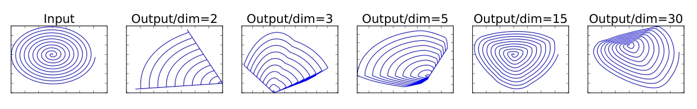
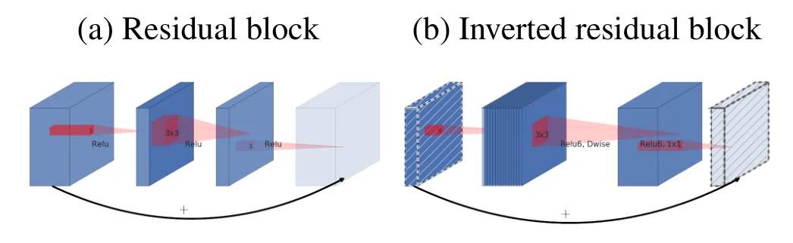
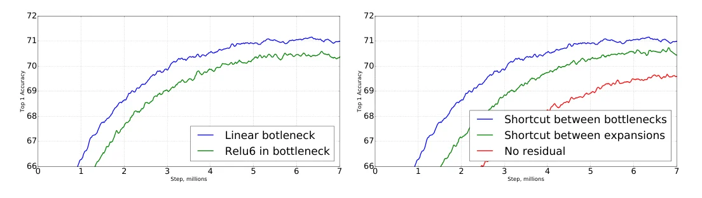

> - **논문**: MobileNetV2: Inverted Residuals and Linear Bottlenecks
> - **저자**: Mark Sandler, Andrew Howard, Menglong Zhu, Andrey Zhmoginov, Liang-Chieh Chen (Google)
> - **학회**: CVPR 2018 · [arXiv:1801.04381](https://arxiv.org/abs/1801.04381)
{: .prompt-tip }

> [MobileNet V1]()은 depthwise separable convolution으로 연산량을 8~9배 줄였습니다. **MobileNetV2**는 그 위에 블록 구조를 다시 설계합니다. 핵심은 두 가지입니다. 채널이 적은 **bottleneck 층에서는 비선형성을 빼고**(linear bottleneck), 잔차 연결은 넓은 층이 아니라 **얇은 bottleneck 사이에 건다**(inverted residual). 같은 정확도에서 V1보다 연산량과 메모리를 함께 줄였고, SSDLite·DeepLabv3와 결합해 검출과 분할까지 모바일에서 돌아가게 만든 논문입니다.

## 1. 관찰: ReLU는 저차원에서 정보를 파괴한다

논문의 출발점은 "manifold of interest" 가설입니다. 어떤 층의 활성값 집합은 고차원 공간 안의 **낮은 차원 매니폴드**에 놓여 있다고 봅니다. 그렇다면 채널 수를 줄여도(width multiplier) 정보를 보존할 수 있을 것 같은데, 실제로는 ReLU가 끼어 있어서 두 가지 문제가 생깁니다.

- ReLU 출력이 0이 아닌 영역에서 ReLU는 **선형 변환**입니다. 즉 비선형성은 0으로 잘리는 부분에서만 나옵니다.
- 입력 매니폴드가 ReLU 출력 공간의 저차원 부분공간에 놓이려면, 그 매니폴드는 입력 공간의 **저차원 부분공간에 들어 있어야** 합니다. 채널이 적은 공간에서 ReLU를 거치면 잘려 나간 정보는 복구되지 않습니다.

아래 Figure 1의 실험이 이를 보여 줍니다. 2차원 나선을 임의의 행렬 $$T$$로 $$n$$차원에 올려 ReLU를 통과시킨 뒤 $$T^{-1}$$로 되돌리면, $$n = 2, 3$$일 때는 나선의 여러 점이 한데 뭉개져 정보가 사라지고, $$n = 15 \sim 30$$이면 변환은 강하게 비볼록하지만 나선의 모양은 대체로 남습니다.


_Figure 1. 2차원 나선을 n차원으로 올려 ReLU를 적용한 뒤 다시 2차원으로 되돌린 결과. 차원이 낮을수록 점들이 겹쳐 정보가 사라집니다. (출처: Sandler et al., 2018)_

결론은 둘입니다. **비선형성은 채널이 많은 곳에 두고, 채널이 적은 bottleneck에는 선형 층만 둔다.**

## 2. 방법

### Linear bottleneck + inverted residual

V2의 기본 블록은 입력 $$k$$채널, 확장 비율 $$t$$에 대해 세 층으로 구성됩니다.

| 층 | 입력 → 출력 | 연산 |
|---|---|---|
| 확장 | $$h \times w \times k \to h \times w \times tk$$ | 1×1 conv, ReLU6 |
| 공간 | $$h \times w \times tk \to \frac{h}{s} \times \frac{w}{s} \times tk$$ | 3×3 depthwise conv(stride $$s$$), ReLU6 |
| 투영 | $$\frac{h}{s} \times \frac{w}{s} \times tk \to \frac{h}{s} \times \frac{w}{s} \times k'$$ | 1×1 conv, **비선형성 없음** |

곱셈-덧셈 수는 $$h \cdot w \cdot k \cdot t \,(k + d^2 + k')$$입니다. 확장 때문에 1×1 항이 하나 더 붙지만, depthwise 층이 저렴해서 전체는 V1보다 작은 입력·출력 채널로 같은 표현력을 냅니다. 논문은 $$t = 6$$을 기본으로 쓰고, 5~10 사이에서는 성능이 비슷하며 작은 네트워크일수록 작은 $$t$$가 약간 낫다고 보고합니다.

잔차 연결은 **bottleneck끼리**, 즉 얇은 $$k$$채널 텐서 사이에 겁니다. 기존 [ResNet]() bottleneck은 넓은 층을 입출력으로 두고 가운데를 좁히는 반면, 여기서는 얇은 층이 입출력이고 가운데가 넓습니다. 그래서 "inverted"입니다(아래 Figure 3).


_Figure 3. (a) 기존 residual block은 넓은 층끼리 잇고, (b) inverted residual block은 빗금 친 얇은 선형 bottleneck끼리 잇습니다. 빗금은 비선형성이 없는 층입니다. (출처: Sandler et al., 2018)_

이렇게 하면 다음 블록으로 넘어가는 텐서가 얇아서 **메모리**가 줄고, 블록 내부의 넓은 텐서는 블록 안에서만 살다가 사라집니다.

비선형성으로는 ReLU6($$\min(\max(x, 0), 6)$$)을 씁니다. 저정밀 연산에서 값의 범위를 고정해 주기 때문입니다.

### 아키텍처

첫 층은 32채널 일반 3×3 conv(stride 2), 그 뒤 residual bottleneck 블록들($$t = 1$$인 첫 블록을 빼면 모두 $$t = 6$$), 1×1 conv로 1280채널, 7×7 average pooling, 1×1 conv 분류기입니다(Table 2).

| 입력 | 연산 | $$t$$ | 출력 채널 $$c$$ | 반복 $$n$$ | stride $$s$$ |
|---|---|---|---|---|---|
| 224²×3 | conv2d 3×3 | - | 32 | 1 | 2 |
| 112²×32 | bottleneck | 1 | 16 | 1 | 1 |
| 112²×16 | bottleneck | 6 | 24 | 2 | 2 |
| 56²×24 | bottleneck | 6 | 32 | 3 | 2 |
| 28²×32 | bottleneck | 6 | 64 | 4 | 2 |
| 14²×64 | bottleneck | 6 | 96 | 3 | 1 |
| 14²×96 | bottleneck | 6 | 160 | 3 | 2 |
| 7²×160 | bottleneck | 6 | 320 | 1 | 1 |
| 7²×320 | conv2d 1×1 | - | 1280 | 1 | 1 |
| 7²×1280 | avgpool 7×7 | - | - | 1 | - |
| 1×1×1280 | conv2d 1×1 | - | 클래스 수 | - | - |

본문은 "19개의 residual bottleneck 층"이라고 쓰지만, 위 표의 반복 수 $$n$$을 더하면 bottleneck 블록은 17개입니다. 기본 모델은 224×224 입력에서 **3.4M 파라미터, 300M MAdds**이고, width multiplier 0.35~1.4와 입력 해상도 96~224로 크기를 조절합니다(파라미터 1.7M~6.9M). 1.4 배율에서는 585M MAdds, 74.7%까지 올라갑니다. V1과 달리 배율이 1보다 작을 때도 마지막 1×1 conv(1280채널)에는 배율을 적용하지 않아 작은 모델의 성능을 지킵니다.

### 메모리 효율적 추론

추론 때 메모리를 지배하는 것은 각 연산의 입력과 출력 텐서의 합입니다. V2는 블록 사이를 지나는 텐서가 얇은 bottleneck이라 이 값이 작습니다. 블록 내부의 넓은 $$tk$$ 텐서는 depthwise 연산이 채널별로 독립이라는 점을 이용해 **채널을 $$t$$조각으로 나눠 순차 계산**할 수 있습니다. 1×1 확장 → depthwise → 1×1 투영을 한 조각씩 처리하고 결과를 누적하면, 넓은 텐서를 한 번에 메모리에 올릴 필요가 없습니다. 이렇게 블록 하나를 연산 하나로 보면 메모리는 블록 안의 큰 텐서가 아니라 bottleneck 텐서 크기가 지배합니다. 논문 Table 3은 해상도별로 반드시 메모리에 올려야 하는 텐서를 비교하는데, 16비트 활성값 기준으로 최댓값이 V1 1600Kb, ShuffleNet(2x, g=3) 600Kb, V2 400Kb입니다. 조각을 나눠도 곱셈-덧셈 수는 변하지 않지만, 행렬곱 하나를 여러 개로 쪼개면 캐시 miss가 늘어 실제로는 2~5조각 정도가 적당합니다.

## 3. 코드로 보기: ReLU의 차원별 정보 손실과 블록의 비용

Figure 1의 나선 실험을 재현하고, 56×56×64 입력에서 세 종류 블록의 파라미터·MAdds·최대 중간 텐서를 비교합니다.

```python
import numpy as np
rng = np.random.default_rng(0)

# --- (1) paper Fig. 1: a 2-D spiral pushed through ReLU in n dimensions and projected back
t = np.linspace(0.5, 3 * np.pi, 400)
spiral = np.stack([t * np.cos(t), t * np.sin(t)]) / (3 * np.pi)      # 2 x 400
print("ReLU in n dims applied to a 2-D manifold, then projected back with the pseudo-inverse")
print("   n   rel. error (raw)   rel. error after best rescaling   (mean over 50 random T)")
for n in (2, 3, 5, 15, 30):
    errs, shape_errs = [], []
    for _ in range(50):
        T = rng.standard_normal((n, 2))
        back = np.linalg.pinv(T) @ np.maximum(0, T @ spiral)
        errs.append(np.linalg.norm(back - spiral) / np.linalg.norm(spiral))
        s = (back * spiral).sum() / (back * back).sum()            # best global rescaling
        shape_errs.append(np.linalg.norm(s * back - spiral) / np.linalg.norm(spiral))
    print(f"{n:>4}   {np.mean(errs):.3f}                 {np.mean(shape_errs):.3f}")

# --- (2) inverted residual vs. classic bottleneck at the same input: params and MAdds
def madds_params(H, C_in, C_mid, C_out, k_dw=3, pointwise_in=True):
    p = C_in * C_mid + C_mid * k_dw * k_dw + C_mid * C_out
    m = H * H * p
    return m, p
H, C = 56, 64
print()
print("block @56x56, 64 channels in/out")
print("type                        expansion  params     MAdds     largest tensor (values)")
for name, mid in [("classic bottleneck (1/4)", C // 4), ("plain 3x3 conv x2", None), ("inverted residual (t=6)", 6 * C)]:
    if mid is None:
        p = 2 * C * C * 9; m = H * H * p; big = C * H * H
    else:
        m, p = madds_params(H, C, mid, C); big = mid * H * H
    print(f"{name:<27} {('-' if mid is None else f'{mid/C:.2f}x'):>9}  {p:>8,}  {m/1e6:>7.1f}M  {big:>16,}")
t = 6
print()
print(f"memory-efficient inference: split the expanded {t*C}x{H}x{H} tensor into t={t} slices")
print(f"  naive peak  = bottleneck + expanded = {C*H*H + t*C*H*H:,} values")
print(f"  sliced peak = 2 bottlenecks + 1 slice = {2*C*H*H + C*H*H:,} values  ({(C*H*H + t*C*H*H)/(3*C*H*H):.2f}x less)")
```

```text
ReLU in n dims applied to a 2-D manifold, then projected back with the pseudo-inverse
   n   rel. error (raw)   rel. error after best rescaling   (mean over 50 random T)
   2   0.891                 0.735
   3   0.789                 0.681
   5   0.716                 0.684
  15   0.556                 0.391
  30   0.523                 0.306

block @56x56, 64 channels in/out
type                        expansion  params     MAdds     largest tensor (values)
classic bottleneck (1/4)        0.25x     2,192      6.9M            50,176
plain 3x3 conv x2                   -    73,728    231.2M           200,704
inverted residual (t=6)         6.00x    52,608    165.0M         1,204,224

memory-efficient inference: split the expanded 384x56x56 tensor into t=6 slices
  naive peak  = bottleneck + expanded = 1,404,928 values
  sliced peak = 2 bottlenecks + 1 slice = 602,112 values  (2.33x less)
```

- ReLU를 거친 뒤 의사역행렬로 되돌리면 $$n$$이 커질수록 복원 오차가 줄어듭니다. 원시 오차가 0.5 근처에서 멈추는 것은 ReLU가 음수 절반을 잘라 **스케일이 절반**으로 줄기 때문이고, 최적 스케일을 맞춘 뒤의 모양 오차는 $$n = 2$$의 0.74에서 $$n = 30$$의 0.31로 계속 내려갑니다. 비선형성을 저차원에 두면 복구 불가능한 손실이 크다는 Figure 1의 메시지와 같습니다.
- inverted residual은 같은 입출력 채널에서 두 장의 3×3 conv보다 파라미터와 MAdds가 적지만, **블록 안의 확장 텐서는 입력의 6배**입니다. 이것을 그대로 두면 메모리 피크가 1.4M 값인데, 채널을 6조각으로 나누면 0.6M으로 2.3배 줄어듭니다. 논문이 말하는 메모리 효율적 추론이 이 계산입니다.

## 4. 실험

### 학습·평가 설정

| 항목 | 값 |
|---|---|
| ImageNet 학습 | TensorFlow, RMSProp(decay 0.9, momentum 0.9), 모든 층 뒤 BN, dropout, weight decay 0.00004 |
| Learning rate | 초기 0.045, epoch마다 0.98배 감소 |
| 병렬화 | 비동기 GPU worker 16개, batch 96 |
| 지연 측정 | Google Pixel 1의 큰 코어 1개, TF-Lite |
| COCO 검출 | TensorFlow Object Detection API, 입력 320×320, trainval35k 학습 / test-dev 평가. SSDLite 첫 층은 15번째 층의 확장 출력(output stride 16), 나머지는 마지막 층(output stride 32)에 연결 |
| VOC 분할 | PASCAL VOC 2012 + 추가 라벨, COCO로 사전학습, 512×512 입력, mIOU |

### ImageNet 분류 (Table 4)

| 네트워크 | Top-1 | 파라미터 | MAdds | CPU (Pixel 1) |
|---|---|---|---|---|
| MobileNetV1 | 70.6 | 4.2M | 575M | 113ms |
| ShuffleNet (1.5) | 71.5 | 3.4M | 292M | - |
| ShuffleNet (x2) | 73.7 | 5.4M | 524M | - |
| NASNet-A | 74.0 | 5.3M | 564M | 183ms |
| **MobileNetV2** | 72.0 | 3.4M | 300M | 75ms |
| **MobileNetV2 (1.4)** | 74.7 | 6.9M | 585M | 143ms |

기본 MobileNetV2는 V1보다 1.4%p 정확하면서 MAdds는 약 절반, 지연은 113ms → 75ms입니다. NASNet-A보다는 정확도가 2%p 낮지만 연산량은 절반 수준이고 지연은 2.4배 짧습니다. 1.4 배율 모델은 NASNet-A보다 정확하면서 빠릅니다. ShuffleNet은 그룹 합성곱과 shuffle이 TF-Lite에서 효율적으로 지원되지 않아 지연을 재지 않았습니다.

### COCO 검출 (Table 6)

SSD의 예측 층을 depthwise separable로 바꾼 **SSDLite**는 MobileNetV2 백본에서 SSD 대비 파라미터 14.8M → 2.1M, MAdds 1.25B → 0.35B입니다(Table 5).

| 네트워크 | mAP | 파라미터 | MAdds | CPU |
|---|---|---|---|---|
| SSD300 | 23.2 | 36.1M | 35.2B | - |
| SSD512 | 26.8 | 36.1M | 99.5B | - |
| YOLOv2 | 21.6 | 50.7M | 17.5B | - |
| MNet V1 + SSDLite | 22.2 | 5.1M | 1.3B | 270ms |
| **MNet V2 + SSDLite** | 22.1 | 4.3M | 0.8B | 200ms |

MobileNetV2 + SSDLite는 YOLOv2보다 20배 적은 연산과 10배 적은 파라미터로 더 높은 mAP를 냅니다.

### VOC 분할 (Table 7, 일부)

| 백본 | Output stride | ASPP | 다중 스케일·반전 | mIOU | 파라미터 | MAdds |
|---|---|---|---|---|---|---|
| MNet V1 | 16 | ✓ | | 75.29 | 11.15M | 14.25B |
| MNet V2\* | 16 | ✓ | | 75.70 | 4.52M | 5.8B |
| **MNet V2\*** | 16 | | | **75.32** | 2.11M | **2.75B** |
| ResNet-101 | 16 | ✓ | | 80.49 | 58.16M | 81.0B |
| ResNet-101 | 8 | ✓ | ✓ | 82.70 | 58.16M | 4870.6B |

MNet V2\*는 DeepLabv3 헤드를 마지막 층(1280채널) 대신 **마지막에서 두 번째 feature map(320채널)** 위에 올린 모델입니다. 여기서 ASPP까지 빼면 75.32% mIOU에 2.75B MAdds로, 논문이 온디바이스 후보로 꼽은 설정입니다. 다중 스케일·좌우 반전 추론은 MAdds를 수십~수백 배 늘려 모바일에는 맞지 않습니다.

### Ablation (Figure 6)


_Figure 6. 왼쪽: bottleneck에 비선형성을 넣었을 때(ReLU6)와 선형으로 둘 때의 ImageNet top-1 학습 곡선. 오른쪽: shortcut을 bottleneck 사이, 확장 층 사이에 걸거나 빼었을 때. (출처: Sandler et al., 2018)_

bottleneck에 ReLU6를 넣은 모델보다 **선형 bottleneck**이 더 정확합니다(그래프상 약 71%대 대 70%대). 선형 층은 표현력이 엄밀히는 더 작은데도 성능이 좋다는 것이 "비선형성이 저차원에서 정보를 파괴한다"는 가설의 근거입니다. 잔차 연결은 확장 층 사이보다 **bottleneck 사이**에 거는 쪽이 낫고, 잔차가 없으면 가장 나쁩니다. 정확한 수치는 그래프로만 제시됩니다.

## 5. 해석

**1. 가설이 구조를 결정했습니다.** "활성값은 저차원 매니폴드에 있다"는 가설에서 "저차원에서는 ReLU를 빼라"와 "비선형성은 확장된 곳에 두라"가 바로 나옵니다. 위 나선 실험처럼 가설을 그림 하나로 보여 준 뒤, ablation(Figure 6a)으로 실제 네트워크에서 확인한 구성이 설득력 있습니다.

**2. inverted residual은 메모리 설계입니다.** 연산량만 보면 V1 블록과 큰 차이가 없습니다. 차이는 블록 사이를 지나는 텐서가 얇다는 점이고, 이것이 모바일에서 중요한 메모리와 캐시 효율로 이어집니다. [Edge AI 하드웨어]()에서 보듯 임베디드 추론은 SRAM 용량에 묶여 있고, 이것이 이 설계가 이후 MobileNetV3, EfficientNet, [MobileViT]() 등 거의 모든 경량 모델의 기본 블록이 된 이유입니다.

**3. 표현력과 용량을 분리했습니다.** 논문은 bottleneck 입출력을 "용량(capacity)", 내부 확장을 "표현력(expressiveness)"으로 해석합니다. 두 축을 따로 조절할 수 있다는 관점이 이후 NAS 탐색 공간(MnasNet, [MobileNetV3]())에서 확장 비율과 채널 수를 독립 변수로 두는 근거가 됩니다.

**4. 백본만이 아니라 헤드도 바꿨습니다.** SSDLite와 DeepLabv3 헤드의 경량화는 "백본이 가벼워도 헤드가 무거우면 소용없다"는 당연하지만 자주 잊히는 점을 짚습니다. 특히 분할에서 ASPP 제거와 320채널 feature 사용이 MAdds를 지배적으로 줄입니다.

**5. 평가를 읽을 때 주의할 점.** 지연 시간은 Pixel 1 단일 큰 코어, TF-Lite 기준이라 다른 기기·런타임에서는 순위가 바뀔 수 있습니다. 메모리 효율적 추론의 400Kb는 bottleneck 블록을 연산 하나로 처리(조각 분할)하는 구현을 전제로 한 수치이고, 일반 프레임워크는 확장 텐서를 통째로 올립니다. 위 toy의 나선 오차는 무작위 $$T$$에 대한 평균이라 특정 학습된 변환의 거동과는 다릅니다.

## 6. 정리

| 항목 | 내용 |
|---|---|
| 문제 | 얇은 층에 ReLU를 두면 정보가 복구 불가능하게 손실됨 |
| Linear bottleneck | 채널이 적은 투영 층에는 비선형성을 두지 않음 |
| Inverted residual | 1×1 확장($$t = 6$$) → 3×3 depthwise → 1×1 선형 투영, 잔차는 얇은 bottleneck 사이에 연결 |
| 메모리 | 블록 사이 텐서가 얇고, 확장 텐서는 채널을 나눠 순차 계산 가능 |
| 결과 | ImageNet 72.0% / 300M MAdds / 75ms(Pixel 1), SSDLite 22.1 mAP / 0.8B, DeepLabv3 75.3% mIOU / 2.75B |
| 영향 | 이후 경량 CNN·ViT 하이브리드의 기본 블록 |

## References

- Sandler, Howard, Zhu, Zhmoginov, Chen, "MobileNetV2: Inverted Residuals and Linear Bottlenecks," CVPR 2018. [arXiv:1801.04381](https://arxiv.org/abs/1801.04381)
- Howard et al., "MobileNets: Efficient Convolutional Neural Networks for Mobile Vision Applications," 2017. [arXiv:1704.04861](https://arxiv.org/abs/1704.04861)
- Liu et al., "SSD: Single Shot MultiBox Detector," ECCV 2016. [arXiv:1512.02325](https://arxiv.org/abs/1512.02325)
- Chen et al., "Rethinking Atrous Convolution for Semantic Image Segmentation," 2017. [arXiv:1706.05587](https://arxiv.org/abs/1706.05587)
