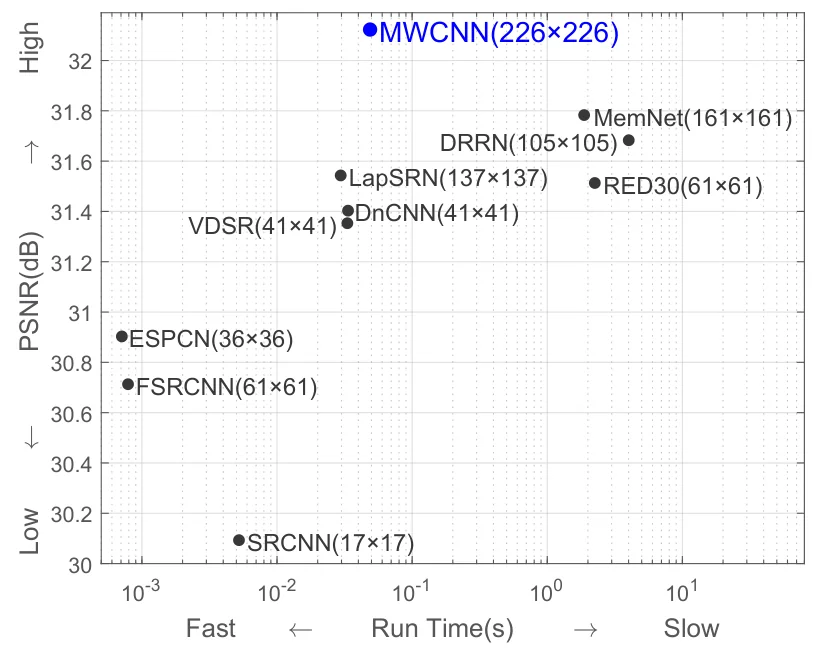
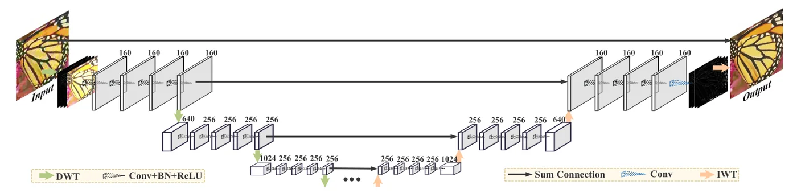
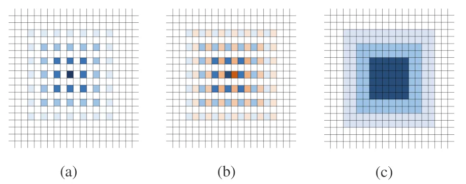

> - **논문**: Multi-level Wavelet-CNN for Image Restoration
> - **저자**: Pengju Liu, Hongzhi Zhang, Kai Zhang, Liang Lin, Wangmeng Zuo (Harbin Institute of Technology, Sun Yat-Sen University)
> - **학회**: CVPR Workshops 2018 · [arXiv:1805.07071](https://arxiv.org/abs/1805.07071) · [코드](https://github.com/lpj0/MWCNN)
{: .prompt-tip }

> 영상 복원 네트워크는 입력과 같은 크기의 출력을 내야 하므로 보통 풀링 없는 완전 합성곱 구조를 씁니다. 그러면 **수용 영역을 키우려면 깊어지거나 커널이 커져야** 하고 비용이 급증합니다. dilated convolution은 비용 없이 수용 영역을 키우지만 **gridding**(격자무늬로 띄엄띄엄 보는 현상)이 생깁니다. **MWCNN**(Multi-level Wavelet-CNN)은 U-Net의 풀링을 **이산 웨이블릿 변환(DWT)**으로, 업샘플링을 **역변환(IWT)**으로 바꿉니다. DWT는 가역이므로 다운샘플링해도 정보가 사라지지 않고, 해상도가 1/2이 될 때마다 수용 영역은 2배로 자랍니다.

## 1. 문제: 수용 영역, 효율, 정보 손실의 삼각 관계

아래 Figure 1이 상황을 요약합니다. SRCNN(17×17), VDSR·DnCNN(41×41)은 수용 영역이 작고, MemNet(161×161), DRRN(105×105)은 크지만 느리며, FSRCNN은 수용 영역이 비교적 커도(61×61) PSNR이 낮습니다.


_Figure 1. 초해상도(×4) 모델들의 실행 시간(GTX 1080) 대 PSNR. 괄호 안은 각 모델의 수용 영역입니다. (출처: Liu et al., 2018)_

풀링은 수용 영역을 키우지만 세부 정보를 버리고, dilated filtering은 체커보드 패턴의 희소 샘플링이라 인접 픽셀이 전혀 겹치지 않는 위치의 정보에 의존하는 **지역 정보의 불일치**가 생깁니다. 필요한 것은 "다운샘플링은 하되 정보는 버리지 않는" 연산입니다.

## 2. 방법

### 웨이블릿 패킷 변환에서 MWCNN으로

2-D DWT는 네 필터 $$f_{LL}, f_{LH}, f_{HL}, f_{HH}$$로 영상을 합성곱한 뒤 2배 다운샘플링해 네 부대역 $$x_1 \ldots x_4$$를 만듭니다. 쌍직교성 덕분에 $$x = \text{IWT}(x_1, x_2, x_3, x_4)$$로 **정확히 복원**됩니다. 부대역을 다시 DWT하면 다단계 웨이블릿 패킷 변환(WPT)이고, WPT는 비선형이 없는 완전 합성곱 네트워크의 특수한 경우입니다. MWCNN은 WPT의 **각 단계 사이에 CNN 블록을 끼운** 것이며, 블록이 항등 함수면 WPT로 돌아갑니다. 네 부대역을 **모두 한 CNN 블록의 입력**으로 넣는 점이 중요한데, 부대역 간 의존성을 무시하는 deep convolutional framelets(저주파·고주파에 다른 CNN)와 달리 부대역 간 관계도 학습합니다.

### 구조: 수정된 U-Net


_Figure 3. MWCNN 구조. 수축 경로는 DWT와 CNN 블록, 확장 경로는 CNN 블록과 IWT로 이루어지고, 상자 위 숫자는 채널 수입니다. 같은 단계끼리는 덧셈(sum connection)으로 잇습니다. (출처: Liu et al., 2018)_

위 Figure 3처럼 U-Net에서 세 가지를 바꿉니다.

1. max pooling → DWT, 업컨볼루션 → IWT.
2. DWT가 채널을 4배로 늘리므로(1/4 해상도), 각 CNN 블록은 **채널을 줄이는** 압축 역할을 합니다. 일반 U-Net은 반대로 다운샘플링 후 채널을 늘립니다.
3. 수축·확장 경로의 결합은 concatenation 대신 **원소별 덧셈**입니다.

각 CNN 블록은 3×3 conv + BN + ReLU 4층이고, 3단계로 총 24층입니다. 채널은 1단계 160, 2단계 256, 3단계 256이며 DWT 직후에는 640, 1024가 됩니다. 손실은 출력과 정답의 $$\ell_2$$이고, 잔차 학습을 명시적으로 쓰지 않습니다(구조에 자연스럽게 내장된다고 봅니다). 기본 웨이블릿은 Haar이고 DB2도 실험했습니다.

### 풀링, dilated filtering과의 관계

Haar의 $$f_{LL}$$은 모두 1인 2×2 필터라 $$(f_{LL} \otimes x) \downarrow_2$$는 **합 풀링**입니다. 저주파 부대역만 쓰면 DWT/IWT가 풀링/업컨볼루션 역할을 하고, 네 부대역을 모두 쓰면 정보 손실이 없습니다. 또한 factor 2 dilated 3×3 합성곱은

$$
(x \otimes_2 k)(2i-1, 2j-1) = \left((x_1 - x_2 - x_3 + x_4) \otimes k\right)(i, j) / 4
$$

처럼 부대역 위의 일반 3×3 합성곱으로 쓸 수 있습니다. 즉 dilated conv는 "부대역 4장에 대한 3×3 합성곱"의 **특수한 경우**이고, MWCNN은 그보다 일반적이면서 gridding이 없습니다.


_Figure 4. 3층 CNN의 수용 영역. (a) factor 2 dilated filtering은 체커보드 모양으로 띄엄띄엄 보고, (b) 이웃한 두 픽셀(파랑, 주황)이 전혀 겹치지 않는 위치에 의존합니다. (c) MWCNN은 빈틈 없이 수용 영역이 넓어집니다. (출처: Liu et al., 2018)_

## 3. 코드로 보기: Haar DWT의 성질들

Haar DWT를 stride 2의 고정 2×2 필터 4개로 구현해 (1) 정확한 복원, (2) max pooling의 정보 손실과 비교, (3) LL = 합 풀링, (4) dilated conv와의 등가식, (5) 수용 영역 계산을 확인합니다.

```python
import torch, torch.nn.functional as F
torch.manual_seed(0)
# 2-D Haar DWT as four fixed 2x2 filters with stride 2 (orthonormal scaling 1/2)
f = torch.tensor([[[1., 1.], [1., 1.]], [[-1., -1.], [1., 1.]], [[-1., 1.], [-1., 1.]], [[1., -1.], [-1., 1.]]]) / 2
dwt_w = f.unsqueeze(1)                                # 4 x 1 x 2 x 2
def dwt(x):                                           # (B, C, H, W) -> (B, 4C, H/2, W/2)
    B, C, H, W = x.shape
    return F.conv2d(x.reshape(B * C, 1, H, W), dwt_w, stride=2).reshape(B, 4 * C, H // 2, W // 2)
def iwt(y):
    B, C4, h, w = y.shape; C = C4 // 4
    return F.conv_transpose2d(y.reshape(B * C, 4, h, w), dwt_w, stride=2).reshape(B, C, 2 * h, 2 * w)

x = torch.randn(2, 3, 32, 32)
y = dwt(x)
print("DWT:", tuple(x.shape), "->", tuple(y.shape), "  IWT back:", tuple(iwt(y).shape),
      f"  max |IWT(DWT(x)) - x| = {(iwt(y) - x).abs().max():.1e}")
# pooling throws information away, DWT does not
mp = F.max_pool2d(x, 2); up = F.interpolate(mp, scale_factor=2, mode="nearest")
print(f"max-pool then nearest-upsample: relative error {((up - x).norm() / x.norm()):.2f};  3 levels of DWT then IWT: {(iwt(iwt(iwt(dwt(dwt(dwt(x)))))) - x).abs().max():.1e}")
# the LL band is sum-pooling (up to the scale factor)
print("LL band == 2 * avg_pool2d(x, 2):", torch.allclose(y[:, 0::4][:, :3], 2 * F.avg_pool2d(x, 2), atol=1e-5))

# Eq. (5): 3x3 dilated (factor 2) convolution at odd positions == 3x3 convolution over (x1 - x2 - x3 + x4) / 4
k = torch.randn(1, 1, 3, 3); img = torch.randn(1, 1, 32, 32)
dil = F.conv2d(img, k, dilation=2, padding=2)                    # same size output
x1, x2, x3, x4 = [dwt(img)[:, i:i + 1] * 2 for i in range(4)]    # unnormalized Haar sums (paper's definition)
sub = F.conv2d((x1 - x2 - x3 + x4) / 4, k, padding=1)
print("dilated conv at (2i-1, 2j-1) == conv on Haar subbands:", torch.allclose(dil[..., 0::2, 0::2], sub, atol=1e-4))

# receptive field: 24 layers of 3x3 conv, plain vs. with DWT between 3 levels (4 convs per level, symmetric U-Net)
def rf(layers):                                                   # layers: list of (kernel, stride)
    r, j = 1, 1
    for k_, s in layers: r += (k_ - 1) * j; j *= s
    return r
plain = [(3, 1)] * 24
mw = [(3, 1)] * 4 + [(2, 2)] + [(3, 1)] * 4 + [(2, 2)] + [(3, 1)] * 4 + [(3, 1)] * 4 + [(2, 0.5)] + [(3, 1)] * 4 + [(2, 0.5)] + [(3, 1)] * 4
def rf2(layers):
    r, j = 1, 1
    for k_, s in layers:
        r += (k_ - 1) * j if s >= 1 else 0; j *= s
    return r
print()
print(f"receptive field, 24 conv layers: plain FCN {rf(plain)}x{rf(plain)}   with 2 DWT levels in between {int(rf2(mw))}x{int(rf2(mw))}   (dilated-2 everywhere: {rf([(5,1)]*24)}, with gridding)")
```

```text
DWT: (2, 3, 32, 32) -> (2, 12, 16, 16)   IWT back: (2, 3, 32, 32)   max |IWT(DWT(x)) - x| = 2.4e-07
max-pool then nearest-upsample: relative error 1.45;  3 levels of DWT then IWT: 4.8e-07
LL band == 2 * avg_pool2d(x, 2): True
dilated conv at (2i-1, 2j-1) == conv on Haar subbands: True

receptive field, 24 conv layers: plain FCN 49x49   with 2 DWT levels in between 116x116   (dilated-2 everywhere: 97, with gridding)
```

- DWT는 $$C$$채널을 $$4C$$채널, 1/4 해상도로 바꾸고, 그 결과는 IWT로 $$10^{-7}$$ 수준에서 복원됩니다. 3단계를 거듭해도 마찬가지입니다. max pooling은 되돌릴 수 없어 복원 오차가 100%를 넘습니다.
- LL 부대역은 (정규화 상수를 빼면) 평균 풀링이고, 논문의 식 (5)처럼 **dilated conv의 출력이 부대역 조합 위의 일반 conv와 정확히 일치**합니다.
- 24층 네트워크에서 모두 3×3 conv면 수용 영역이 49인데, DWT를 두 번 끼우면 116으로 커집니다. dilated-2를 전부 쓰면 97이지만 gridding이 생깁니다. 논문의 MWCNN은 수용 영역이 226 이상이라고 적고 있는데, 이 toy는 확장 경로의 효과를 단순화한 계산이라 그보다 작습니다.

## 4. 실험

### 학습 설정

| 항목 | 값 |
|---|---|
| 학습 데이터 | BSD 200장 + DIV2K 800장 + WED 4,744장 |
| 패치 | 수용 영역이 226×226 이상이므로 240×240 패치 24×6,000 = 144,000개 |
| 열화 설정 | 잡음 σ = 15, 25, 50 / 초해상도 ×2, ×3, ×4(bicubic 업샘플 결과를 입력, Y 채널) / JPEG Q = 10, 20, 30, 40(Y 채널) |
| 모델 수 | 열화 설정마다 모델 하나씩 |
| Optimizer | Adam($$\beta_1 = 0.9$$, $$\beta_2 = 0.999$$, $$\epsilon = 10^{-8}$$), batch 24 |
| Learning rate | 40 epoch 동안 0.001 → 0.0001로 지수 감소 |
| 증강 | 회전·뒤집기 |
| 손실 | $$\ell_2$$ (잔차 학습 공식은 쓰지 않음) |
| 환경 | MatConvNet + cuDNN 6.0, i7-5820K, GTX 1080 1장, 모델 하나에 약 2일 |
| 웨이블릿 | 기본 Haar, 3단계(24층) |

### 잡음 제거 (Table 1, 그레이, PSNR dB)

| 데이터 | σ | BM3D | DnCNN | IRCNN | RED30 | MemNet | MWCNN |
|---|---|---|---|---|---|---|---|
| Set12 | 15 | 32.37 | 32.86 | 32.77 | - | - | **33.15** |
| Set12 | 25 | 29.97 | 30.44 | 30.38 | - | - | **30.79** |
| Set12 | 50 | 26.72 | 27.18 | 27.14 | 27.34 | 27.38 | **27.74** |
| BSD68 | 15 | 31.08 | 31.73 | 31.63 | - | - | **31.86** |
| BSD68 | 25 | 28.57 | 29.23 | 29.15 | - | - | **29.41** |
| BSD68 | 50 | 25.62 | 26.23 | 26.19 | 26.35 | 26.35 | **26.53** |
| Urban100 | 15 | 32.34 | 32.67 | 32.49 | - | - | **33.17** |
| Urban100 | 25 | 29.70 | 29.97 | 29.82 | - | - | **30.66** |
| Urban100 | 50 | 25.94 | 26.28 | 26.14 | 26.48 | 26.64 | **27.42** |

BSD68에서는 DnCNN보다 0.1~0.3dB 앞서는 정도지만, 잡음이 세고 구조가 반복되는 Urban100에서는 **1.1dB** 넘게 차이가 납니다(본문은 "1.2dB"로 적었지만 표 값의 차이는 1.14dB). 큰 수용 영역과 주파수·위치 정보 보존이 텍스처 복원에 유리하다는 해석입니다.

### 초해상도 (Table 2, Y 채널 PSNR dB, 일부)

| 데이터 | 배율 | VDSR | SRResNet | LapSRN | DRRN | MemNet | WaveResNet | MWCNN |
|---|---|---|---|---|---|---|---|---|
| Set5 | ×2 | 37.53 | - | 37.52 | 37.74 | 37.78 | 37.57 | **37.91** |
| Set5 | ×4 | 31.35 | 32.05 | 31.54 | 31.68 | 31.74 | 31.52 | **32.12** |
| Set14 | ×2 | 33.03 | - | 33.08 | 33.23 | 33.28 | 33.09 | **33.70** |
| Set14 | ×4 | 28.01 | **28.49** | 28.19 | 28.21 | 28.26 | 28.11 | 28.41 |
| BSD100 | ×4 | 27.29 | 27.56 | 27.32 | 27.38 | 27.40 | 27.32 | **27.62** |
| Urban100 | ×2 | 30.76 | - | 30.41 | 31.23 | 31.31 | 30.96 | **32.30** |
| Urban100 | ×4 | 25.18 | 26.07 | 25.21 | 25.44 | 25.50 | 25.36 | **26.27** |

Urban100에서는 VDSR보다 0.9~1.4dB 높습니다. 34층에 더 큰 데이터로 학습한 SRResNet과 ×4에서 Set5, BSD100은 약간 앞서고 Set14는 비슷합니다(28.41 대 28.49). 한 단계 웨이블릿만 쓰는 WaveResNet은 VDSR보다 조금 나은 수준이라, **다단계**가 필요함을 보여 줍니다. NTIRE 2018 SR 챌린지 Track 1(×8)에서는 개선한 MWCNN이 1위보다 0.37dB 낮았습니다.

### JPEG 아티팩트 제거 (Table 3, PSNR dB)

| 데이터 | Q | JPEG | ARCNN | DnCNN | MemNet | MWCNN |
|---|---|---|---|---|---|---|
| Classic5 | 10 | 27.82 | 29.03 | 29.40 | 29.69 | **30.01** |
| Classic5 | 20 | 30.12 | 31.15 | 31.63 | 31.90 | **32.16** |
| LIVE1 | 10 | 27.77 | 28.96 | 29.19 | 29.45 | **29.69** |
| LIVE1 | 20 | 30.07 | 31.29 | 31.59 | 31.83 | **32.04** |

Q = 10, 20에서 2위(MemNet)보다 0.2~0.3dB 높습니다. Q = 30, 40에서도 MWCNN이 가장 높습니다.

### 실행 시간 (Table 4, 초, 512×512 입력)

| 작업 | 비교 대상 | MWCNN |
|---|---|---|
| 잡음 제거 (σ = 50) | DnCNN 0.0487, RED30 4.702, MemNet 3.606 | 0.0907 |
| 초해상도 (×2) | VDSR 0.0575, LapSRN 0.0357, DRRN 8.050, MemNet 3.605 | 0.0780 |
| JPEG (Q = 10) | ARCNN 0.0532, DnCNN 0.0568, MemNet 3.607 | 0.0811 |

MWCNN은 RED30, MemNet, DRRN보다 수십 배 이상 빠르고(이 셋은 PSNR도 낮음), VDSR·DnCNN·LapSRN보다는 1.4~2.2배 느립니다. 깊이·폭이 아니라 DWT 결합이 효과의 원천이라고 저자들은 정리합니다.

### 변형 비교 (Table 5, PSNR dB / 실행 시간 초)

| 변형 | Set12 (σ=50) | Urban100 (σ=50) | Classic5 (Q=10) |
|---|---|---|---|
| Dilated (hybrid dilated conv) | 27.45 / 0.181 | 26.56 / 0.764 | 29.72 / 0.287 |
| Dilated-2 (모든 층 dilation 2) | 24.81 / 0.185 | 24.18 / 0.960 | 29.49 / 0.302 |
| U-Net (같은 구조, 풀링·concat) | 27.42 / 0.079 | 26.68 / 0.357 | 29.61 / 0.093 |
| U-Net+S (덧셈 연결) | 27.41 / 0.074 | 26.72 / 0.341 | 29.60 / 0.082 |
| U-Net+D (학습형 다운샘플링) | 27.46 / 0.080 | 26.99 / 0.355 | 29.68 / 0.097 |
| DCF (부대역별 별도 CNN, 재구현) | 27.38 / 0.081 | 26.65 / 0.354 | 29.57 / 0.104 |
| WaveResNet | 27.49 / 0.179 | - | - |
| **MWCNN (Haar)** | 27.74 / 0.078 | 27.42 / 0.343 | 30.01 / 0.088 |
| MWCNN (DB2) | 27.77 / 0.134 | 27.48 / 0.634 | 30.04 / 0.195 |
| MWCNN (HD: 수축 Haar, 확장 DB2) | 27.73 / 0.101 | 27.35 / 0.447 | 29.97 / 0.136 |

- gridding이 있는 Dilated-2는 크게 떨어집니다(Set12 24.81).
- 덧셈 연결(U-Net+S)은 PSNR을 잃지 않고 시간만 줄입니다.
- 웨이블릿 대신 풀링이나 학습형 다운샘플링 필터를 쓰면 0.3~0.7dB 낮고, 부대역을 따로 처리하는 DCF도 낮습니다.
- DB2는 Haar보다 0.03~0.06dB 높지만 시간이 1.7~2.2배 걸려, 저자들은 Haar를 기본으로 택합니다.

**단계 수(Table 6, σ = 50).** MWCNN-1/2/3/4의 Urban100 PSNR은 26.08 / 27.10 / 27.42 / 27.44dB이고 시간은 0.212 / 0.303 / 0.338 / 0.348초입니다. 4단계는 3단계보다 거의 나아지지 않아 3단계(24층)를 기본으로 씁니다.

## 5. 해석

**1. 고정된 가역 변환을 네트워크의 일부로 쓴 것이 핵심입니다.** DWT는 학습 파라미터가 없고 정확히 되돌릴 수 있습니다. 이 덕분에 "다운샘플링 = 정보 손실"이라는 U-Net의 전제가 깨지고, 수용 영역을 키우는 비용이 거의 사라집니다. [RevCol]()이 가역성을 백본 설계 원리로 삼은 것과 통하고, 복원처럼 세부 정보가 중요한 과제에서 특히 맞는 선택입니다.

**2. dilated conv의 일반화라는 관점이 깔끔합니다.** 위 실험에서 보듯 dilated conv는 부대역 조합 하나에 대한 conv와 같습니다. MWCNN은 네 부대역에 독립된 커널을 쓰므로 표현력이 더 크고, 위치 정보가 섞이지 않아 gridding이 없습니다. 비슷한 시기의 space-to-depth, PixelShuffle(sub-pixel conv)도 같은 "해상도를 채널로 바꾸기"의 변형으로 읽을 수 있습니다.

**3. 주파수 영역 접근 중 가장 실용적인 형태입니다.** [CEMNet]()처럼 연산 전체를 주파수 영역으로 옮기지 않고, [FDNP]()처럼 가중치 표현만 바꾸지도 않습니다. 변환을 **공간 축소에만** 쓰고 학습은 그대로 두었기 때문에 기존 CNN 도구와 그대로 호환됩니다.

**4. 압축과 효율의 관점으로도 읽힙니다.** DWT 직후 채널이 4배가 되지만 바로 CNN 블록이 줄여 주므로, 고해상도 처리를 저해상도·다채널로 바꾸는 셈입니다. [Big-Little Net]()이 저해상도에 큰 용량을 두는 것과 같은 효율 논리이고, 차이는 고주파 정보를 별도 채널로 **보존**한다는 점입니다.

**5. 평가를 읽을 때 주의할 점.** 학습 데이터가 DnCNN·VDSR의 원 설정보다 훨씬 크므로(WED 4,744장 포함) 성능 차이의 일부는 데이터에서 올 수 있습니다. 변형 비교(Table 5)는 잡음 제거 σ = 50과 JPEG Q = 10 두 설정에서만 했고, DCF는 코드가 없어 저자들이 다시 구현한 것입니다. 실행 시간은 MatConvNet, GTX 1080 기준입니다. 위 toy의 수용 영역 계산은 확장 경로를 단순화했고, "226 이상"이라는 논문 수치의 정확한 계산 방식은 논문에 없습니다.

## 6. 정리

| 항목 | 내용 |
|---|---|
| 문제 | 복원 네트워크에서 수용 영역·효율·정보 보존을 동시에 얻기 어려움, dilated conv는 gridding |
| 핵심 | U-Net의 풀링 → DWT(가역, 채널 4배), 업컨볼루션 → IWT, 결합은 덧셈 |
| 블록 | 각 단계 3×3 conv + BN + ReLU 4층, 다운샘플 후 채널 축소, 3단계 24층 |
| 관계 | LL = 합 풀링, dilated-2 conv = 부대역 조합 위의 conv(특수 경우) |
| 결과 | 잡음 제거 Urban100 σ=50에서 DnCNN +1.14dB, SR Set5 ×2 37.91dB, JPEG +0.2~0.3dB |
| 속도 | RED30·MemNet·DRRN보다 훨씬 빠르고 VDSR·DnCNN보다 약간 느림 |

## References

- Liu, Zhang, Zhang, Lin, Zuo, "Multi-level Wavelet-CNN for Image Restoration," CVPR Workshops 2018. [arXiv:1805.07071](https://arxiv.org/abs/1805.07071)
- Ronneberger, Fischer, Brox, "U-Net: Convolutional Networks for Biomedical Image Segmentation," MICCAI 2015. [arXiv:1505.04597](https://arxiv.org/abs/1505.04597)
- Zhang et al., "Beyond a Gaussian Denoiser: Residual Learning of Deep CNN for Image Denoising," TIP 2017. [arXiv:1608.03981](https://arxiv.org/abs/1608.03981)
- Yu, Koltun, "Multi-Scale Context Aggregation by Dilated Convolutions," ICLR 2016. [arXiv:1511.07122](https://arxiv.org/abs/1511.07122)
- Bae, Yoo, Ye, "Beyond Deep Residual Learning for Image Restoration: Persistent Homology-Guided Manifold Simplification," CVPR Workshops 2017. [arXiv:1611.06345](https://arxiv.org/abs/1611.06345)
