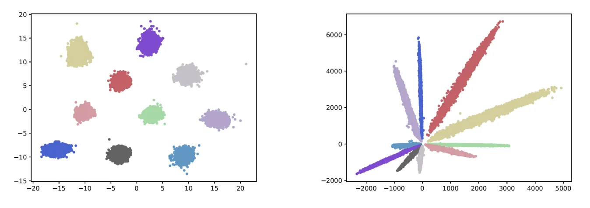
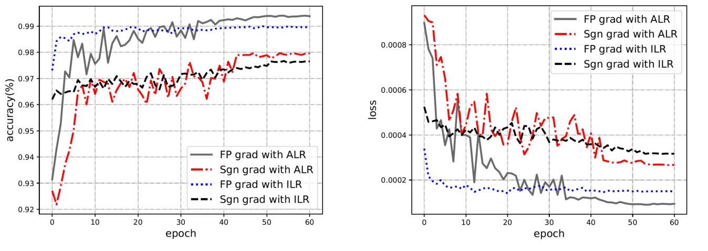

> - **논문**: AdderNet: Do We Really Need Multiplications in Deep Learning?
> - **저자**: Hanting Chen, Yunhe Wang, Chunjing Xu, Boxin Shi, Chao Xu, Qi Tian, Chang Xu (Peking University, Huawei Noah's Ark Lab, Peng Cheng Laboratory, The University of Sydney)
> - **학회**: CVPR 2020 · [arXiv:1912.13200](https://arxiv.org/abs/1912.13200)
{: .prompt-tip }

> CNN 연산의 대부분은 **곱셈–덧셈(MAC)**입니다. 하드웨어에서 곱셈기는 덧셈기보다 훨씬 크고 전력을 많이 씁니다. **AdderNet**은 convolution의 곱셈을 **뺄셈의 절댓값과 덧셈**으로 바꿉니다. 이 글은 AdderNet의 원리와 함께, 덧셈기를 더 가볍게 만드는 **근사 덧셈기(approximate adder)**와 이를 하드웨어로 평가하는 도구들을 정리합니다.

## 1. Convolution을 거리로 다시 보기

일반 convolution은 입력 패치 $$X$$와 필터 $$F$$의 **내적(cross-correlation)**입니다.

$$
Y(m, n, t) = \sum_{i}\sum_{j}\sum_{k}X(m+i, n+j, k)\times F(i, j, k, t)
$$

내적은 두 벡터가 **얼마나 비슷한지**를 재는 한 가지 방법입니다. 그렇다면 다른 유사도, 예를 들어 **L1 거리**를 써도 되지 않을까요?

$$
Y(m, n, t) = -\sum_{i}\sum_{j}\sum_{k}\big\lvert X(m+i, n+j, k) - F(i, j, k, t)\big\rvert
$$

- 곱셈이 **뺄셈과 절댓값**으로 바뀌고, 나머지는 덧셈
- 입력과 필터가 비슷할수록 거리가 작으므로, 음수를 붙여 **클수록 비슷하게**
- 출력이 항상 0 이하라서 바로 뒤에 **Batch Normalization**을 둬 분포를 맞춤. BN에는 곱셈이 남지만, 출력 원소마다 한 번이라 convolution의 곱셈 수($$k^2 C_{in}$$배)에 비하면 무시할 만큼 작다는 것이 논문의 설명입니다. ResNet의 $$C_{in} = 512$$, $$k = 3$$ 층이면 그 비율이 $$9 \times 512 = 4{,}608$$배입니다(논문 본문에는 4068로 적혀 있는데, 계산하면 4,608입니다).
- 뺄셈은 보수(complement code)를 쓰면 덧셈으로 처리할 수 있어서, 하드웨어 입장에서는 덧셈만 남습니다.

유사도를 내적 대신 L1 거리로 재면 feature 공간의 모양도 달라집니다. 아래 Figure 1은 MNIST로 학습한 LeNet++의 feature를 그린 것입니다.


_Figure 1. 왼쪽: AdderNet의 feature, 오른쪽: CNN의 feature. CNN은 클래스가 **각도**로 나뉘고, AdderNet은 클래스마다 **중심점 주위로 모입니다.** (출처: Chen et al., 2020)_

입력과 필터가 대략 정규화돼 있으면 내적은 코사인 유사도와 같아지므로 CNN feature가 방사형으로 퍼지고, L1 거리는 "중심에서 얼마나 가까운가"를 보므로 덩어리로 모인다는 것이 논문의 해석입니다. 모양은 달라도 클래스를 구분하는 능력은 비슷합니다. 같은 이유로 학습된 가중치 분포도 CNN은 가우시안, AdderNet은 라플라스 분포에 가깝게 나옵니다.

## 2. 학습: 기울기를 어떻게 구할까

L1 거리의 미분은 부호 함수라 그대로 쓰면 학습이 잘되지 않습니다.

### 필터에 대한 기울기: Full-precision gradient

$$\partial Y / \partial F = \text{sign}(X - F)$$ 대신, 크기 정보까지 담긴 차이 자체를 씁니다.

$$
\frac{\partial Y(m, n, t)}{\partial F(i, j, k, t)} = X(m+i, n+j, k) - F(i, j, k, t)
$$

L2 거리의 기울기 방향과 같아, 필터가 입력 쪽으로 더 잘 이동합니다.

### 입력에 대한 기울기: HardTanh

입력 쪽 기울기는 앞 층으로 계속 전달되므로, 크기를 그대로 쓰면 층이 깊어질수록 **폭발**할 수 있습니다. 그래서 **HardTanh로 [-1, 1]에 자릅니다.**

$$
\frac{\partial Y(m, n, t)}{\partial X(m+i, n+j, k)} = \text{HT}\big(F(i, j, k, t) - X(m+i, n+j, k)\big)
$$

### Adaptive Learning Rate

AdderNet은 출력 분산이 CNN보다 훨씬 커서(가중치 분산이 $$10^{-3}$$ 수준이면 CNN은 분산이 그만큼 곱해져 작아지지만, AdderNet은 더해짐), 뒤따르는 BN을 거치며 기울기가 매우 작아집니다. MNIST LeNet-5-BN의 첫 iteration에서 필터 기울기의 L2 norm은 다음과 같았습니다(논문 Table 1).

| 모델 | Layer 1 | Layer 2 | Layer 3 |
|---|---|---|---|
| AdderNet | 0.0009 | 0.0012 | 0.0146 |
| CNN | 0.2261 | 0.2990 | 0.4646 |

기울기가 CNN보다 수백 배 작은 데다 층마다 크기도 크게 다르므로, 학습률을 한꺼번에 키우는 대신 층별로 조절합니다.

$$
\Delta F_l = \gamma\times\alpha_l\times\Delta L(F_l),\qquad \alpha_l = \frac{\eta\sqrt{k}}{\lVert\Delta L(F_l)\rVert_2}
$$

($$k$$: 필터의 원소 수, $$\eta$$: hyper-parameter, $$\gamma$$: 네트워크 전체의 global learning rate)

기울기를 L2 norm으로 나누므로 어느 층이든 필터가 거의 같은 보폭으로 움직입니다. MNIST에서 $$\eta$$를 1, 0.5, 0.2, 0.1, 0.05로 바꿨을 때 정확도는 99.26, 99.30, 99.35, **99.40**, 99.32%로, 논문은 $$\eta = 0.1$$을 모든 실험에 씁니다.

```python
import torch

class AdderFunction(torch.autograd.Function):
    @staticmethod
    def forward(ctx, X_col, W_col):
        """X_col: (K, L) im2col된 입력, W_col: (C_out, K) 필터 → (C_out, L)"""
        ctx.save_for_backward(X_col, W_col)
        return -(W_col.unsqueeze(2) - X_col.unsqueeze(0)).abs().sum(1)

    @staticmethod
    def backward(ctx, grad_out):
        X_col, W_col = ctx.saved_tensors
        diff = X_col.unsqueeze(0) - W_col.unsqueeze(2)                    # (C_out, K, L)
        grad_W = (diff * grad_out.unsqueeze(1)).sum(2)                    # full-precision gradient
        grad_X = (torch.clamp(-diff, -1, 1) * grad_out.unsqueeze(1)).sum(0)   # HardTanh(F - X)
        return grad_X, grad_W
```

이 backward는 **일부러 진짜 기울기와 다르게** 정의한 것이라, `torch.autograd.gradcheck`로 검사하면 통과하지 않는 것이 정상입니다. 필터 쪽은 부호 대신 차이를, 입력 쪽은 잘린 값을 쓰는 "설계된 근사 기울기"이기 때문입니다.

im2col로 펼친 뒤 계산하는 구조는 [CNN 기초]()의 im2col과 같습니다. 다만 일반 conv는 im2col 후 **행렬 곱(matmul)** 하나로 끝나지만, AdderNet은 "뺄셈–절댓값–합"이라 기존의 고도로 최적화된 행렬 곱 라이브러리를 그대로 쓸 수 없고, **별도의 커널**(예: CUDA extension)이 필요합니다. Backward도 `weight.mm(grad_out)` 같은 행렬 곱 대신 위처럼 차이 기반으로 계산해야 합니다.

## 3. 결과

### 학습 설정

| 항목 | MNIST | CIFAR-10/100 | ImageNet |
|---|---|---|---|
| 모델 | LeNet-5-BN (FC층도 adder로 교체) | VGG-small, ResNet-20, ResNet-32 | ResNet-18, ResNet-50 |
| Optimizer | NAG, momentum 0.9, weight decay 5e-4 | - | NAG, momentum 0.9, weight decay 1e-4 |
| Learning rate | 0.1, cosine decay | 0.1, polynomial 스케줄 | cosine decay |
| 학습 길이·배치 | 50 epoch, batch 256 | 400 epoch, batch 256 | 150 epoch, batch 256 |
| 기타 | 입력 32×32, $$\eta = 0.1$$ | 첫 층과 마지막 층은 BNN 관례대로 일반 conv 유지 | 전처리는 ResNet 논문과 동일 |

실험은 V100 GPU와 PyTorch로 했고, 연산 수를 셀 때 BN·첫 층·마지막 층은 뺐습니다. 최적화된 CUDA·cuDNN adder 커널이 없어서 **실제 추론 시간은 비교하지 않았습니다.** 대신 VIA Nano 2000 CPU의 명령어 지연(곱셈 4, 덧셈 2)으로 계산하면 LeNet-5가 CNN 약 2.6M, AdderNet 약 1.7M 사이클이라는 이론값만 제시합니다.

### CIFAR

| 모델 | 방법 | 곱셈 | 덧셈 | XNOR | CIFAR-10 | CIFAR-100 |
|---|---|---|---|---|---|---|
| VGG-small | BNN | 0 | 0.65G | 0.65G | 89.80 | 65.41 |
| | **AdderNet** | 0 | 1.30G | 0 | **93.72** | **72.64** |
| | CNN | 0.65G | 0.65G | 0 | 93.80 | 72.73 |
| ResNet-20 | BNN | 0 | 41.17M | 41.17M | 84.87 | 54.14 |
| | **AdderNet** | 0 | 82.34M | 0 | **91.84** | **67.60** |
| | CNN | 41.17M | 41.17M | 0 | 92.25 | 68.14 |
| ResNet-32 | BNN | 0 | 69.12M | 69.12M | 86.74 | 56.21 |
| | **AdderNet** | 0 | 138.24M | 0 | **93.01** | **69.02** |
| | CNN | 69.12M | 69.12M | 0 | 93.29 | 69.74 |

<small>정확도(%), 논문 Table 2</small>

### ImageNet

| 모델 | 방법 | 곱셈 | 덧셈 | XNOR | top-1 | top-5 |
|---|---|---|---|---|---|---|
| ResNet-18 | BNN | 0 | 1.8G | 1.8G | 51.2 | 73.2 |
| | **AdderNet** | 0 | 3.6G | 0 | **67.0** | **87.6** |
| | CNN | 1.8G | 1.8G | 0 | 69.8 | 89.1 |
| ResNet-50 | BNN | 0 | 3.9G | 3.9G | 55.8 | 78.4 |
| | **AdderNet** | 0 | 7.7G | 0 | **74.9** | **91.7** |
| | CNN | 3.9G | 3.9G | 0 | 76.2 | 92.9 |

<small>정확도(%), 논문 Table 3. ResNet-18 AdderNet은 본문에 66.8 / 87.4로 적혀 있어 표와 조금 다릅니다.</small>

- CIFAR-10/100에서 같은 구조의 CNN과 0.1~0.7%p 차이로 거의 같은 정확도. MNIST에서는 CNN과 똑같이 99.4%
- **ImageNet ResNet-50**에서 곱셈 없이 top-1 **74.9%** (CNN 76.2%, 1.3%p 차이). ResNet-18은 차이가 2.8%p로 조금 더 큽니다.
- 같은 "곱셈 없는" 접근인 BNN보다 훨씬 높은 정확도 (ResNet-50 기준 BNN 55.8%보다 19.1%p 높음)
- 대신 덧셈 수는 CNN의 **2배**입니다. 곱셈 하나를 뺄셈 하나로 바꾸고 누적 덧셈은 그대로 남기 때문입니다. 덧셈이 곱셈보다 싸다는 전제가 있어야 이득입니다.

### Ablation: 기울기와 학습률


_Figure 3. MNIST LeNet-5-BN에서 기울기 종류(FP: full-precision, Sgn: sign)와 학습률 방식(ALR: adaptive, ILR: 학습률 100배 일괄 증가)에 따른 정확도(왼쪽)와 loss(오른쪽). (출처: Chen et al., 2020)_

| 필터 기울기 | 학습률 | MNIST 정확도 (%) |
|---|---|---|
| full-precision | 그대로 | 54.91 |
| sign | 그대로 | 29.26 |
| sign | ILR (×100) | 97.72 |
| sign | ALR | 97.99 |
| full-precision | ILR (×100) | 98.99 |
| **full-precision** | **ALR** | **99.40** |

학습률을 그대로 두면 기울기가 너무 작아 학습이 거의 되지 않고, sign 기울기는 학습률을 키워도 98%를 넘지 못합니다. 두 기법을 모두 써야 CNN과 같은 99.40%에 도달합니다.

후속 연구는 AdderNet에 knowledge distillation, 양자화, shift 연산을 결합하거나(ShiftAddNet), 하드웨어 가속기 구현으로 이어졌습니다.

## 4. 덧셈기를 더 가볍게: Approximate Adder

AdderNet은 연산이 대부분 덧셈이 되므로, **덧셈기 자체를 가볍게** 만들면 이득이 커집니다.

### 왜 근사 연산인가

- **저전력·부정확 허용 응용**: 신경망, 영상·음성 처리처럼 약간의 오차는 결과에 거의 영향이 없는 분야가 많습니다. 정확한 덧셈기 대신 **트랜지스터 수가 적은 근사 덧셈기**로 면적과 전력을 줄일 수 있습니다.
- **이미 부정확한 데이터**: 수 체계의 한계, glitch 등으로 원래 데이터에 오차가 있다면, 그것을 정확하게 계산하는 것은 과도한 비용입니다.

### 근사 덧셈기의 예

- 표준 28-트랜지스터 CMOS full adder를 **10-트랜지스터** 구조로 줄이는 연구들
- **AXA (Approximate XOR/XNOR-based Adder)** 계열: XOR/XNOR 게이트 중심으로 회로를 단순화. 진리표의 일부 입력 조합에서 **Sum이나 Carry가 틀리는** 대신 트랜지스터와 전력이 줄어듦
- 다비트 덧셈에서는 보통 **상위 비트는 정확한 덧셈기**(ripple-carry 등), **하위 비트만 근사 덧셈기**로 구성해 큰 오차를 피함
- Prefix adder 계열에서는 하위 비트의 carry 계산 단계를 생략하는 식으로 근사

근사 덧셈기의 오차는 입력 분포에 따라 다르므로, 신경망에 넣기 전에 **실제 가중치·활성 분포(예: 양자화된 가우시안 분포)에서 오차의 평균과 최댓값**을 측정해 어떤 구조가 적합한지 고릅니다.

## 5. 하드웨어 평가 도구

### Systolic Array

여러 개의 처리 소자(PE)를 **격자 모양**으로 배치하고, 데이터가 심장 박동(systole)처럼 이웃 PE로 **규칙적으로 흘러가며** 연산되는 구조입니다. 행렬 곱에 매우 효율적이라 Google TPU 등 NN 가속기의 기본 구조입니다. AdderNet의 덧셈 연산도 같은 구조에서 PE만 바꿔 처리할 수 있습니다.

### SCALE-Sim

Systolic array로 신경망을 돌렸을 때 **사이클 수, 메모리 접근, 활용률** 등이 어떻게 나오는지 시뮬레이션하는 도구입니다(2018, 이후 V2를 거쳐 2025년 V3 공개).

- **하드웨어 설정 파일**: 배열 크기, SRAM 크기, dataflow 방식 등
- **모델 설정 파일**: 층별 입력 크기, 필터 크기, 채널 수 등을 **CSV**로 기술. 모델이 병렬 구조여도 설정에서는 층을 **직렬로 나열**해야 함
- V2부터는 층을 행렬 곱(GEMM) 크기로도 기술할 수 있어, 행렬 곱으로 표현되는 RNN·Transformer 층도 시뮬레이션할 수 있음

### PyTorch CUDA Extension

새로운 연산(AdderNet의 덧셈 커널, 근사 덧셈기 모델링)을 GPU에서 빠르게 돌리려면 C++/CUDA로 직접 구현해 PyTorch에 붙입니다. 기본 순서는 다음과 같습니다.

1. GPU 메모리 할당 (`cudaMalloc`)
2. 데이터 복사 (`cudaMemcpy`)
3. 커널 실행 → 결과 전송
4. 메모리 해제 (`cudaFree`)

```python
# setup.py — C++(.cpp)와 CUDA(.cu) 소스를 묶어 PyTorch 확장으로 빌드
from setuptools import setup
from torch.utils.cpp_extension import BuildExtension, CUDAExtension

setup(
    name="adder_cuda",
    ext_modules=[CUDAExtension("adder_cuda", ["adder.cpp", "adder_kernel.cu"])],
    cmdclass={"build_ext": BuildExtension},
)
```

알고리즘과 API를 `.cu`에, 배열 처리를 `.cpp`에 두는 식으로 역할을 나눠 구성할 수 있습니다. 대규모 실험은 CPU로는 너무 오래 걸리므로 GPU 커널이 사실상 필수입니다.

## 6. 정리

| 개념 | 핵심 |
|---|---|
| AdderNet | 내적 대신 **L1 거리** → 곱셈 제거 |
| 필터 기울기 | 부호 대신 **차이 그대로**(full-precision) |
| 입력 기울기 | **HardTanh**로 잘라 폭발 방지 |
| 학습률 | 층별 **adaptive learning rate** |
| Approximate adder | 트랜지스터를 줄인 근사 덧셈기, 하위 비트에만 적용 |
| 평가 도구 | Systolic array, SCALE-Sim, CUDA extension |

## References

- Chen et al., "AdderNet: Do We Really Need Multiplications in Deep Learning?," CVPR 2020. [arXiv:1912.13200](https://arxiv.org/abs/1912.13200)
- [PyTorch – Custom C++ and CUDA Extensions](https://pytorch.org/tutorials/advanced/cpp_extension.html)
- You et al., "ShiftAddNet: A Hardware-Inspired Deep Network," NeurIPS 2020.
- Yang et al., "Approximate XOR/XNOR-based Adders for Inexact Computing," IEEE NANO 2013.
- Gupta et al., "Low-Power Digital Signal Processing Using Approximate Adders," IEEE TCAD 2013.
- Samajdar et al., "SCALE-Sim: Systolic CNN Accelerator Simulator," 2018.
- Kung, "Why Systolic Architectures?," IEEE Computer 1982.

