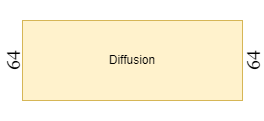
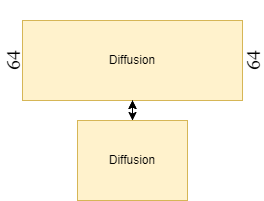
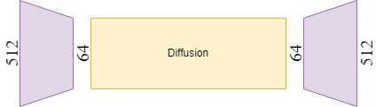
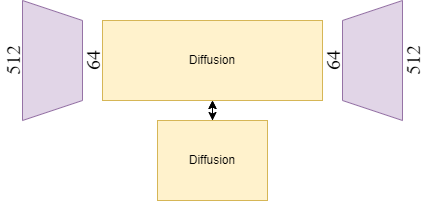
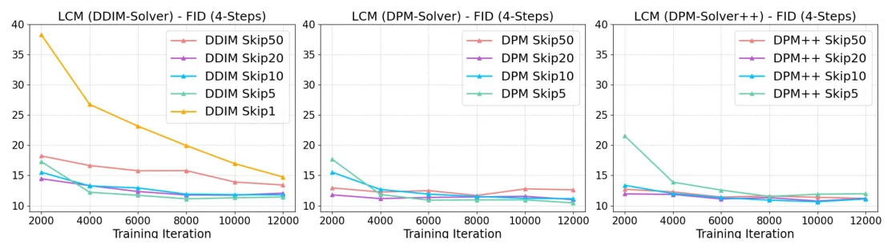
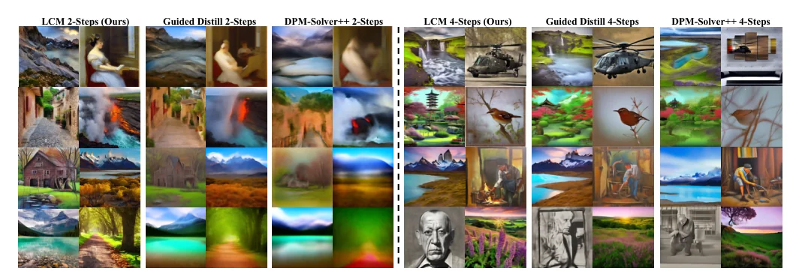
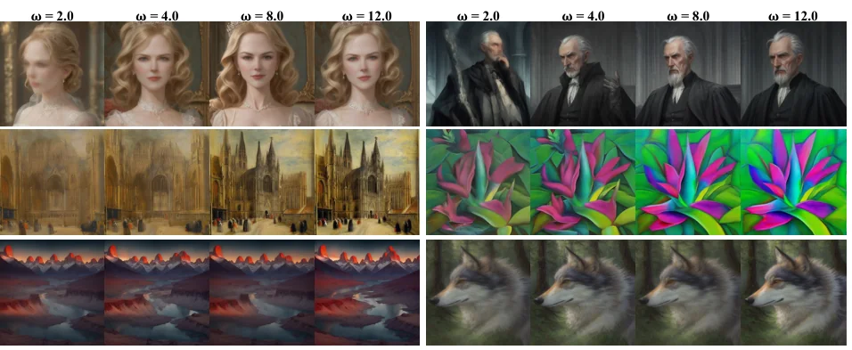

> - **논문**: Latent Consistency Models: Synthesizing High-Resolution Images with Few-Step Inference
> - **저자**: Simian Luo, Yiqin Tan, Longbo Huang, Jian Li, Hang Zhao (Tsinghua University IIIS)
> - **학회**: arXiv preprint, 2023 · [arXiv:2310.04378](https://arxiv.org/abs/2310.04378) · [프로젝트 페이지](https://latent-consistency-models.github.io/)
{: .prompt-tip }

> [Latent Diffusion Model]()은 연산을 latent 공간으로 옮겨 diffusion을 크게 가볍게 만들었지만, 여전히 이미지 한 장에 수십 step의 denoising이 필요했다. **Latent Consistency Model(LCM)**(Luo et al., 2023)은 Stable Diffusion을 **2~4 step**만으로 고해상도 이미지를 만드는 모델로 증류(distillation)한다.

## 1. 문제: Diffusion은 느리다

Diffusion 모델은 노이즈에서 시작해 reverse process를 수십~수백 번 반복해야 이미지가 나온다. 그래서 생성 속도가 느리다. 이를 줄이는 방법은 크게 두 가지이다.

1. **더 좋은 ODE solver**: DDIM, DPM-Solver처럼 같은 궤적을 더 큰 보폭으로 따라가기 (그래도 보통 20 step 이상)
2. **Distillation**: 여러 step을 몇 step 만에 해내는 모델로 지식을 증류하기

LCM은 2번 방향이며, 그중 **Consistency Model**(Song et al., 2023)을 latent 공간과 텍스트 조건 생성으로 확장한 것이다.

## 2. 배경: SDE와 PF-ODE

### ODE와 SDE

- **ODE(상미분방정식)**: 함수와 그 도함수 사이의 관계식. 도함수와 초기값을 알면 원래 함수(궤적)를 추정할 수 있다.
- **SDE(확률미분방정식)**: ODE에 무작위 노이즈 항이 더해진 것

Song et al.(2021)은 diffusion의 forward 과정(데이터 → 노이즈)을 연속 시간 **SDE**로 표현했다.

$$
dx_t = f(t)\,x_t\,dt + g(t)\,dw_t
$$

### PF-ODE (Probability Flow ODE)

같은 SDE에 대해, **시점마다 같은 확률 분포 $$p_t(x)$$를 갖지만 노이즈 항이 없는(결정적인) ODE**가 존재한다.

$$
\frac{dx_t}{dt} = f(t)\,x_t - \frac{1}{2}g(t)^2\,\nabla_x\log p_t(x_t)
$$

여기서 $$\nabla_x \log p_t$$(score)는 학습된 diffusion 모델의 노이즈 예측으로 근사한다. 이렇게 하면 노이즈 $$x_T$$에서 데이터 $$x_0$$까지 가는 경로가 하나의 정해진 궤적이 된다. 기존 diffusion 샘플링은 이 궤적을 여러 step으로 수치 적분하며 따라가는 것이다.

## 3. Consistency Model

### Consistency Function

아이디어는 "궤적을 한 step씩 따라가지 말고, **궤적 위의 어느 점에서든 한 번에 출발점 $$x_0$$으로** 가는 함수를 학습하자"는 것이다.

$$
f: (x_t, t) \mapsto x_\epsilon
$$

($$\epsilon$$은 0에 아주 가까운 시점)

이 함수는 두 가지 성질을 만족해야 한다.

- **Self-consistency**: 같은 PF-ODE 궤적 위의 점이라면 어떤 $$t$$에서 넣어도 출력이 같아야 한다.

  $$
  f(x_t, t) = f(x_{t'}, t'),\quad \forall\, t, t' \in [\epsilon, T]
  $$

- **Boundary condition**: 출발점에서는 자기 자신을 내놓아야 한다.

  $$
  f(x_\epsilon, \epsilon) = x_\epsilon
  $$

경계 조건은 skip connection 형태로 구조적으로 강제한다.

$$
f_\theta(x, t) = c_{skip}(t)\,x + c_{out}(t)\,F_\theta(x, t),\qquad c_{skip}(\epsilon) = 1,\ c_{out}(\epsilon) = 0
$$

$$t = \epsilon$$이면 네트워크 출력 $$F_\theta$$가 무시되고 입력이 그대로 나온다.

### 학습 방법 두 가지

- **Consistency Training (CT)**: 사전학습 모델 없이, 같은 데이터에 다른 노이즈 수준을 준 두 점의 consistency function 출력 차이를 줄이도록 처음부터 학습
- **Consistency Distillation (CD)**: **사전학습된 diffusion 모델(teacher)**을 이용해 학습. LCM이 쓰는 방식이다.

### Consistency Distillation

1. 데이터 $$x$$에 노이즈를 더해 $$x_{t_{n+1}}$$을 만든다.
2. Teacher diffusion 모델과 ODE solver로 한 step만 이동해 같은 궤적 위의 이웃 점 $$\hat{x}^\phi_{t_n}$$을 얻는다.
3. 두 점을 consistency 모델에 넣은 출력이 같아지도록 학습한다.

$$
\mathcal{L}_{CD}(\theta, \theta^-; \phi) = \mathbb{E}\Big[\lambda(t_n)\, d\big(f_\theta(x_{t_{n+1}}, t_{n+1}),\ f_{\theta^-}(\hat{x}^\phi_{t_n}, t_n)\big)\Big]
$$

| 기호 | 의미 |
|---|---|
| $$\theta$$ | 학습 중인 consistency 모델 |
| $$\theta^-$$ | $$\theta$$의 **EMA**(지수 이동 평균), target 네트워크 역할 |
| $$\phi$$ | 사전학습된 diffusion 모델(teacher) |
| $$\hat{x}^\phi_{t_n}$$ | teacher로 한 step 이동한 점 |
| $$\lambda$$ | 시점별 가중치 |
| $$d$$ | 거리 함수 (L2, LPIPS 등) |

이웃한 두 점의 출력을 같게 만드는 것을 모든 구간에서 반복하면 궤적 전체의 출력이 $$x_0$$로 일치하게 된다. DQN의 target 네트워크처럼 EMA 모델을 목표로 써서 학습을 안정시킨다.

## 4. Latent Consistency Model

### 구조 비교

일반 diffusion은 저해상도(64) 픽셀 공간에서 여러 step denoising한다.


_픽셀 공간 Diffusion (출처: 직접 작성)_

Consistency Model은 같은 픽셀 공간에서 teacher diffusion을 few-step 모델로 증류한다.


_Consistency Model: teacher diffusion(위)에서 student(아래)로 증류 (출처: 직접 작성)_

LDM은 512 해상도 이미지를 Encoder로 64 크기 latent로 압축한 뒤 diffusion한다.


_Latent Diffusion Model (출처: 직접 작성)_

LCM은 두 아이디어를 합친다. Stable Diffusion(LDM)의 latent 공간에서 consistency distillation을 수행한다.


_Latent Consistency Model: latent 공간에서 teacher LDM을 few-step 모델로 증류 (출처: 직접 작성)_

픽셀 대신 작은 latent에서 증류하므로 학습이 가볍고, 원래 Consistency Model이 다루기 어려웠던 **512~768 고해상도 텍스트 조건 생성**이 가능해진다. 원래 Consistency Model 논문의 실험은 ImageNet 64×64, LSUN 256×256 같은 픽셀 공간 이미지 생성에 머물렀다.

Consistency function은 teacher의 noise 예측 $$\hat\epsilon_\theta$$로 parameterize하고, teacher와 같은 가중치로 초기화한다.

$$
f_\theta(z, c, t) = c_{skip}(t)\,z + c_{out}(t)\left(\frac{z - \sigma_t\,\hat\epsilon_\theta(z, c, t)}{\alpha_t}\right)
$$

괄호 안은 "현재 노이즈 예측으로 추정한 $$z_0$$"이다. teacher가 $$v$$-prediction 모델이면 그에 맞는 식을 쓴다(768 해상도 실험의 SD 2.1이 이 경우).

### Classifier-Free Guidance (CFG) 복습

텍스트 조건 생성에서는 품질을 위해 **CFG**를 쓴다. 조건이 있는 예측과 없는 예측을 섞어, 조건 쪽에 더 큰 가중치를 준다.

$$
\tilde{\epsilon}_\theta(z_t, \omega, c, t) = (1 + \omega)\,\epsilon_\theta(z_t, c, t) - \omega\,\epsilon_\theta(z_t, \varnothing, t)
$$

- $$\epsilon_\theta(z_t, c, t)$$: 텍스트 조건 $$c$$가 있는 노이즈 예측
- $$\epsilon_\theta(z_t, \varnothing, t)$$: 조건 없는 노이즈 예측
- $$\omega$$: guidance scale (클수록 프롬프트를 강하게 따름)

> 이 식은 LCM 논문의 표기이다. `diffusers` 등에서 흔히 쓰는 $$\epsilon_\varnothing + s(\epsilon_c - \epsilon_\varnothing)$$ 형태로 바꾸면 $$s = 1 + \omega$$이다. 그래서 라이브러리의 `guidance_scale` 값과 논문의 $$\omega$$는 1만큼 차이 날 수 있다.
{: .prompt-info }

문제는 CFG를 쓰면 step마다 모델을 두 번 돌려야 한다는 것이다.

### One-Stage Guided Distillation

LCM은 CFG가 적용된 PF-ODE 자체를 증류한다. Teacher가 한 step 이동할 때 **CFG를 적용한 노이즈 예측**을 쓰고, guidance scale $$\omega$$를 student의 **입력 조건**으로 넣는다.

$$
f_\theta: (z_t, \omega, c, t) \mapsto z_0
$$

Teacher가 한 step 이동한 점은 CFG 식을 ODE solver $$\Psi$$에 그대로 적용해 추정한다.

$$
\hat{z}^{\Psi,\omega}_{t_n} \approx z_{t_{n+1}} + (1+\omega)\,\Psi(z_{t_{n+1}}, t_{n+1}, t_n, c) - \omega\,\Psi(z_{t_{n+1}}, t_{n+1}, t_n, \varnothing)
$$

학습할 때 $$\omega$$는 $$[\omega_{min}, \omega_{max}] = [2, 14]$$에서 균등하게 뽑는다. $$\omega$$는 Fourier embedding을 거쳐 원래 timestep embedding에 더해지고, 이 projection은 ControlNet처럼 0으로 초기화해 학습 초반에 teacher의 동작을 망가뜨리지 않게 한다.

그래서 추론할 때는 CFG를 위해 두 번 돌릴 필요 없이 한 번의 forward로 guidance가 반영된 결과가 나온다. 기존 Guided-Distill(Meng et al., 2023)은 CFG 증류와 step 수 줄이기를 두 단계로 나눠서, 2-step 모델 하나에 A100 최소 45 GPU-day가 든다는 추정이 있다. LCM은 한 단계로 끝내므로 이 비용과 단계 사이 오차 누적을 피한다.

### Skipping-Step

이웃한 step($$t_{n+1} \to t_n$$)끼리만 consistency를 맞추면 문제가 생긴다. Stable Diffusion의 time schedule은 1,000 step이라 이웃한 두 점 $$z_{t_{n+1}}$$, $$z_{t_n}$$이 이미 거의 같고, 그래서 consistency loss가 아주 작아 수렴이 느리다. LCM은 **$$k$$ step 떨어진 점**($$t_{n+k} \to t_n$$)끼리 맞춰 schedule 길이를 수천에서 수십으로 줄인다. $$k$$가 너무 크면 이번에는 ODE solver의 근사 오차가 커지므로, 논문은 $$k = 20$$을 쓴다.


_Figure 3. ODE solver(DDIM, DPM-Solver, DPM-Solver++)와 skipping step $$k$$에 따른 4-step FID 학습 곡선. DDIM에서 $$k=1$$은 느리게 수렴하고, $$k=5\sim20$$은 2,000 iteration 안에 거의 수렴한다. (출처: Luo et al., 2023)_

위 Figure 3에서 보듯 DDIM은 $$k = 50$$에서 오히려 나빠지고, 2차 solver인 DPM-Solver/DPM-Solver++는 $$k = 50$$에서도 잘 버틴다. $$k = 20$$은 세 solver 모두에서 무난해서 메인 실험에 쓰였다.

### 효율

초록이 강조하는 "**A100 약 32시간**"은 논문 Figure 1의 모델(Dreamshaper-V7 버전 SD를 증류)을 4,000 training step만 학습한 경우이다. 아래 표의 메인 실험은 A100 8장으로 100K iteration을 학습했다. 어느 쪽이든 diffusion을 처음부터 학습하는 비용에 비하면 매우 작다.

## 5. Multi-step 샘플링

LCM은 1 step으로도 이미지를 만들 수 있지만, 몇 step을 쓰면 품질이 좋아진다. 방법은 **"한 번에 $$z_0$$ 예측 → 다시 노이즈 추가 → 다시 예측"**을 반복하는 것이다.

1. $$\hat{z}_0 = f_\theta(z_{T}, \omega, c, T)$$
2. $$\hat{z}_0$$에 더 작은 시점 $$t$$만큼 노이즈를 다시 더해 $$z_t$$
3. $$\hat{z}_0 = f_\theta(z_t, \omega, c, t)$$
4. 정해진 step 수만큼 반복 후 Decoder로 이미지 복원

`diffusers` 라이브러리로 바로 써 볼 수 있다. (CUDA GPU가 필요하고, LCM 파이프라인은 diffusers 0.22 이후 버전에 포함되어 있다. 처음 실행하면 수 GB의 모델 가중치를 내려받는다.)

```python
import torch
from diffusers import DiffusionPipeline

pipe = DiffusionPipeline.from_pretrained("SimianLuo/LCM_Dreamshaper_v7", torch_dtype=torch.float16).to("cuda")

image = pipe(
    "a photo of a cat wearing an astronaut suit, high detail",
    num_inference_steps=4,       # 일반 SD는 25~50 step
    guidance_scale=8.0,          # ω, 모델 입력으로 들어감 (두 번 돌리지 않음)
).images[0]
image.save("lcm_cat.png")
```

> CFG가 모델 안에 증류되어 있어서, 일반 Stable Diffusion처럼 매 step 조건 없는 예측을 따로 계산하지 않는다. 그 대가로 **negative prompt가 거의 효과가 없고**, guidance 세기를 바꾸는 폭도 학습 때 넣어 준 $$\omega$$ 범위 안으로 제한된다. 속도와 맞바꾼 제어 자유도라고 볼 수 있다.
{: .prompt-warning }

## 6. 구현 디테일

| 항목 | 512×512 설정 | 768×768 설정 |
|---|---|---|
| 데이터 | LAION-Aesthetics-6+ (12M 쌍, aesthetic score > 6) | LAION-Aesthetics-6.5+ (650K 쌍, score > 6.5) |
| Teacher | SD-V2.1-Base ($$\epsilon$$-prediction) | SD-V2.1 ($$v$$-prediction) |
| 학습 | 100K iteration, batch 72, A100 8장 | 100K iteration, batch 16, A100 8장 |
| Optimizer | Rectified Adam, lr 8e-6, EMA $$\mu = 0.999943$$ | 같음 |
| ODE solver / skip | DDIM, $$k = 20$$ | 같음 |
| Guidance 범위 | $$\omega \in [2, 14]$$, Fourier embedding + zero init | 같음 |
| 평가 | 테스트 프롬프트 10K개 × 3장 = 30K장, FID와 CLIP score(ViT-g/14) | 같음 |

ODE solver는 학습(증류)할 때만 쓰고 추론에는 쓰지 않는다. 비교 대상 Guided-Distill은 코드가 공개되지 않아 저자들이 직접 재현했고, 원 논문의 batch 512 대신 LCM과 같은 batch(72/16)·100K iteration으로 맞췄다. 그래서 Guided-Distill 수치는 원 논문 설정보다 불리할 수 있다고 논문도 인정한다.

## 7. 실험 결과

### 정량 결과 (Table 1, 512×512, $$\omega = 8$$)

| 방법 | FID 1 step ↓ | 2 step | 4 step | 8 step | CLIP 1 step ↑ | 2 step | 4 step | 8 step |
|---|---|---|---|---|---|---|---|---|
| DDIM | 183.29 | 81.05 | 22.38 | 13.83 | 6.03 | 14.13 | 25.89 | 29.29 |
| DPM-Solver | 185.78 | 72.81 | 18.53 | 12.24 | 6.35 | 15.10 | 26.64 | 29.54 |
| DPM-Solver++ | 185.78 | 72.81 | 18.43 | 12.20 | 6.35 | 15.10 | 26.64 | **29.55** |
| Guided-Distill | 108.21 | 33.25 | 15.12 | 13.89 | 12.08 | 22.71 | 27.25 | 28.17 |
| **LCM** | **35.36** | **13.31** | **11.10** | **11.84** | **24.14** | **27.83** | **28.69** | 28.84 |

768×768(Table 2, LAION-Aesthetics-6.5+)에서도 경향이 같다. 4 step 기준 LCM은 FID 13.53 / CLIP 28.60으로 Guided-Distill(16.70 / 28.45)과 DPM-Solver++(20.08 / 27.26)를 앞선다. 2 step에서는 FID 16.32 대 30.70(Guided-Distill), 67.14(DPM-Solver++)로 차이가 더 크다.

- 차이는 **1~2 step에서 가장 크다.** 1 step FID가 DDIM 183.29, Guided-Distill 108.21인데 LCM은 35.36이다.
- 512 해상도에서 LCM 4 step의 FID 11.10은 DPM-Solver++ 8 step(12.20)보다도 낮다.
- 다만 8 step이 되면 training-free solver가 CLIP score에서 LCM을 따라잡는다(DPM-Solver++ 29.55 대 LCM 28.84). LCM의 강점은 4 step 이하 구간에 한정된다.


_Figure 2. LAION-Aesthetic-6.5+ 프롬프트로 2 step(왼쪽), 4 step(오른쪽) 생성한 결과. 각 묶음은 LCM, Guided-Distill, DPM-Solver++ 순서이다. (출처: Luo et al., 2023)_

Figure 2에서 DPM-Solver++ 2 step은 형체만 남은 흐릿한 이미지이고, Guided-Distill도 디테일이 뭉개지는 반면 LCM은 2 step에서도 윤곽과 질감이 살아 있다.

### Guidance scale $$\omega$$의 효과

$$\omega$$를 키우면 CLIP score(프롬프트 일치·품질)는 오르고 FID(다양성)는 나빠지는, 일반 CFG와 같은 trade-off가 나타난다. 2, 4, 8 step 사이의 성능 차이는 작지만 1 step은 뚜렷하게 뒤처져, 논문도 1 step은 개선 여지가 있다고 적는다.


_Figure 5. 같은 프롬프트를 $$\omega$$ = 2, 4, 8, 12로 바꿔 4 step 생성한 결과. $$\omega$$가 입력으로 증류되어 있어 한 번의 forward로 guidance 세기를 바꿀 수 있다. (출처: Luo et al., 2023)_

### Latent Consistency Fine-tuning (LCF)

이미 증류된 LCM을 teacher 없이 특정 스타일 데이터셋에 맞춰 바로 fine-tuning하는 방법도 제안한다. Consistency Training처럼 데이터만으로 학습하므로, 그 데이터로 학습된 teacher diffusion이 필요 없다. Pokemon, Simpsons 데이터셋(각각 수백 쌍, 90% 학습 / 10% 테스트)에 768 해상도 LCM을 lr 8e-6으로 30K iteration fine-tuning해 4 step으로 해당 스타일 이미지를 생성했다. 이 부분은 정성 결과만 있고 정량 수치는 없다.

이후 LCM 증류를 LoRA 가중치로 만들어 다른 Stable Diffusion 모델에 끼워 쓰는 **LCM-LoRA**로 발전해, 실시간 이미지 생성 도구에 널리 쓰였다.

## 8. 정리

| 개념 | 핵심 |
|---|---|
| PF-ODE | 노이즈 → 데이터로 가는 결정적인 궤적 |
| Consistency function | 궤적 위 어느 점에서든 **한 번에 $$x_0$$로** |
| Self-consistency | 같은 궤적의 모든 점이 같은 출력 |
| Consistency Distillation | teacher로 한 step 이동한 점과 출력을 맞추기 (EMA target) |
| LCM | Stable Diffusion의 **latent 공간**에서 CD |
| Guided distillation | CFG를 증류해 $$\omega$$를 입력으로 → 추론 1회 |
| Skipping-step | $$k$$ step 떨어진 점끼리 맞춰 증류 가속 ($$k = 20$$) |
| 결과 | 512 해상도 4 step FID 11.10, 1 step FID 35.36 (Guided-Distill 108.21) |

다음 Diffusion 글에서는 이미지 속에 글자를 정확하게 그리는 [TextDiffuser]()를 다룬다.

## References

- Luo et al., "Latent Consistency Models: Synthesizing High-Resolution Images with Few-Step Inference," 2023. [arXiv:2310.04378](https://arxiv.org/abs/2310.04378)
- Song et al., "Consistency Models," ICML 2023. [arXiv:2303.01469](https://arxiv.org/abs/2303.01469)
- [Hugging Face diffusers – Latent Consistency Model](https://huggingface.co/docs/diffusers/using-diffusers/inference_with_lcm)
- Song et al., "Score-Based Generative Modeling through Stochastic Differential Equations," ICLR 2021.
- Ho & Salimans, "Classifier-Free Diffusion Guidance," 2022.
- Rombach et al., "High-Resolution Image Synthesis with Latent Diffusion Models," CVPR 2022.
- Luo et al., "LCM-LoRA: A Universal Stable-Diffusion Acceleration Module," 2023.
