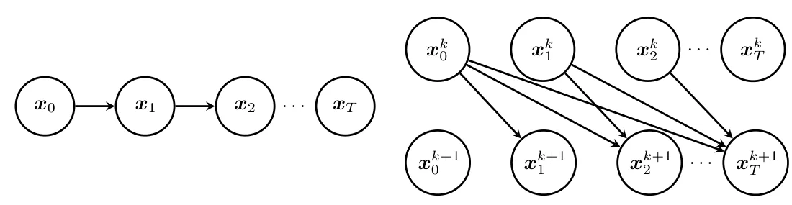
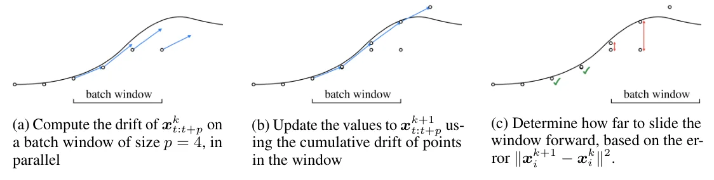
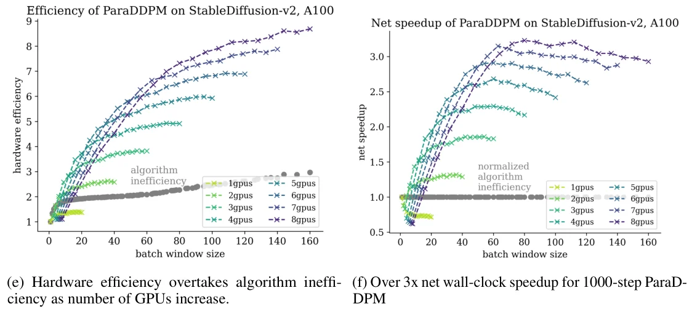

> - **논문**: Parallel Sampling of Diffusion Models
> - **저자**: Andy Shih, Suneel Belkhale, Stefano Ermon, Dorsa Sadigh, Nima Anari (Stanford University)
> - **학회**: NeurIPS 2023 · [arXiv:2305.16317](https://arxiv.org/abs/2305.16317) · [코드](https://github.com/AndyShih12/paradigms)
{: .prompt-tip }

> Diffusion 모델의 샘플링은 느리다. [DDPM]()은 샘플 하나에 1,000번의 순차 디노이징이 필요하고, [DDIM이나 DPM-Solver]()는 step 수를 줄이는 대신 품질을 조금 내준다. **ParaDiGMS**(Parallel Diffusion Generative Model Sampling)는 다른 축을 연다. step 수는 그대로 두고 여러 step을 병렬로 계산해, 연산을 더 쓰는 대가로 지연 시간을 줄인다. 로봇 제어와 이미지 생성 모델 전반에서 품질 손실 없이 2~4배 빨라졌다.

## 1. 문제: 품질 대 속도가 아니라 연산 대 속도

사전학습된 diffusion 모델을 빠르게 샘플링하는 기존 방법은 모두 디노이징 step 수를 줄이는 것이었다. DDPM의 확률적 샘플링은 step을 줄이면 품질이 크게 떨어지므로, DDIM과 DPM-Solver는 SDE 대신 주변 분포가 같은 **probability flow ODE**를 풀어 50 step 정도에서도 버티게 만든다. 그래도 품질을 속도와 맞바꾸는 구조는 같다.

이 논문의 질문은 "같은 step 수를 더 빨리 할 수 없나"이다. 단순한 병렬화는 샘플 여러 개를 동시에 만들어 **처리량**을 높일 뿐이고, 샘플 하나의 **지연 시간**은 줄이지 못한다. 디노이징은 $$x_{t-1}$$이 $$x_t$$에 의존하는 사슬 구조라 병렬화가 불가능해 보인다. 그런데 가능하다.

## 2. Picard 반복: 추측하고 다듬기

ODE $$x' = s(x, t)$$, 초깃값 $$x_0$$의 해는 적분 꼴로 쓸 수 있다.

$$
x_t = x_0 + \int_0^t s(x_u, u)\, du
$$

**Picard 반복**은 해 전체 $$\{x^k_t\}$$를 먼저 추측한 뒤, 그 추측 위에서 적분을 계산해 모든 시각의 값을 한꺼번에 갱신한다.

$$
x^{k+1}_t = x^k_0 + \int_0^t s(x^k_u, u)\, du
$$

$$s$$가 시간에 연속이고 위치에 Lipschitz 연속이면(Picard-Lindelöf 정리) 반복은 유일한 해로 수렴한다. step 크기 $$1/T$$로 이산화하면 다음과 같다.

$$
x^{k+1}_t = x^k_0 + \frac{1}{T} \sum_{i=0}^{t-1} s\!\left(x^k_i, \tfrac{i}{T}\right)
$$

순차 샘플링에서는 $$x_t$$가 $$x_{t-1}$$에만 의존했지만, 이 갱신식에서는 **모든 이전 시각**에 의존한다. 계산 그래프에 건너뛰는 간선이 생겨 정보가 사슬을 따라 빠르게 전파된다(아래 Figure 1, 2).


_Figure 1(왼쪽), Figure 2(오른쪽). 순차 샘플링은 $$x_t$$가 직전 값에만 의존하는 사슬이지만, Picard 반복에서는 $$x^{k+1}_t$$가 이전 반복의 모든 앞선 점 $$x^k_{0:t}$$에 의존하는 건너뛰는 간선이 생긴다. (출처: Shih et al., 2023)_

 그리고 반복 한 번 안에서 비싼 계산 $$\{s(x^k_i, i/T)\}$$는 서로 독립이므로 전부 병렬로 할 수 있고, 그 결과를 prefix sum으로 모으는 비용은 무시할 만하다. 병렬 자원이 충분하면 샘플링 시간은 step 수 $$T$$가 아니라 **수렴까지의 반복 횟수 $$K$$**에 비례한다.

최악의 경우에도 $$K \le T$$이다. $$k$$번 반복하면 앞의 $$k$$개 점은 순차 해와 정확히 같아지기 때문이다. 반대로 현재 추측에서 계산한 drift가 참값에서의 drift와 같다면 한 번에 수렴한다(Proposition 1). 실제로는 $$K$$가 $$T$$보다 훨씬 작았다.

Diffusion에 적용할 때 drift $$s(x_t, t/T)/T$$는 $$p_\theta(x_{t+1} \mid x_t) - x_t$$, 즉 한 step의 이동량으로 두면 되고, Euler 대신 DDIM이나 DPM-Solver 같은 고차 방법으로 근사해도 된다. 그래서 step 수를 줄이는 기존 방법과 **곱해서** 쓸 수 있다(ParaDDPM, ParaDDIM, ParaDPMSolver).

## 3. 실제 알고리즘

### 세 가지 현실적 문제

- **GPU 메모리**: 모든 시각의 점 $$x_{0:T}$$를 들고 있어야 하는데 이미지 모델에서는 너무 크다. 그래서 크기 $$p$$의 **창**(batch window) 안의 점들만 반복하고, 창의 앞부분이 수렴하는 대로 공격적으로 창을 앞으로 민다(sliding window). 창 전체가 수렴할 때까지 기다리지 않는다.
- **SDE**: Picard 반복은 결정론적 ODE의 고정점을 찾는다. DDPM의 역방향 SDE는 노이즈가 위치와 무관하므로, **노이즈를 미리 전부 뽑아** drift에 흡수하면 결정론적 ODE가 되고 Lipschitz 조건도 유지된다.
- **종료 조건**: 반복의 변화량 $$\|x^{k+1}_i - x^k_i\|^2$$이 허용 오차 아래로 떨어지면 수렴으로 본다. 수렴률이 2배 이상인 선형 수렴을 가정하면 허용 오차 $$4\epsilon^2 \sigma_t^2 / T^2$$로 최종 샘플 분포가 DDPM 분포와 total variation $$\epsilon$$ 이내임을 보장한다(Proposition 2). 이는 최악의 경우 분석이고, 실험에서는 훨씬 느슨한 $$\frac{1}{D}\|x^{k+1}_i - x^k_i\|^2 \le \tau^2 \sigma_i^2$$($$\tau = 0.1$$, $$D$$는 데이터 차원)로도 품질 손실이 없었다.


_Figure 3. 한 반복의 세 단계. (a) 창($$p = 4$$) 안 점들의 drift를 병렬로 계산 → (b) drift 누적합으로 값 갱신 → (c) 변화량이 허용 오차 안에 든 점까지 창을 앞으로 밂. (출처: Shih et al., 2023)_

### Algorithm 1

```text
노이즈 z_i ~ N(0, σ_i² I)를 모든 i에 대해 미리 뽑는다          (SDE → ODE)
x_0 ~ N(0, I), 창 안의 점들을 x_0으로 초기화
t = 0인 동안 t < T:
    y_{t+j} ← p_θ(x_{t+j}, t+j) − x_{t+j}      j = 0..p-1    (drift를 병렬로 계산)
    x_{t+j+1} ← x_t + Σ_{i=t}^{t+j} y_i + Σ_{i=t}^{t+j} z_i   (Picard 갱신 = 창 왼쪽 값 + 누적합)
    error_j ← (1/D)‖x^{new}_{t+j} − x^{old}_{t+j}‖²
    stride ← 오차가 τ²σ_j²를 넘는 첫 j (없으면 p)              (수렴한 만큼 창을 민다)
    새로 창에 들어온 점들은 창의 마지막 값으로 초기화
    t ← t + stride
```

4행의 drift 계산이 가장 비싼 부분이고 병렬화할 수 있는 부분이다. Euler 대신 다른 solver를 쓰려면 4~5행(논문 Algorithm 1의 5~6행)만 바꾸면 된다.

## 4. 코드로 보기: 반복 11번으로 step 100개를 풀다

2차원 가우시안 혼합을 데이터로 두고, 사전학습 모델 대신 $$\mathbb{E}[x_0 \mid x_t]$$를 해석적으로 계산하는 "완벽한 디노이저"로 DDIM 100 step을 돌린다. 순차 샘플링과 ParaDiGMS를 같은 초깃값에서 비교한다.

```python
import torch

torch.manual_seed(0)
T, D = 100, 2                                               # 디노이징 step 수, 데이터 차원

# 1) 사전학습 모델 대신 정답을 아는 가우시안 혼합(성분 분산 1)을 데이터로 쓴다. x_t = √a·x0 + √(1-a)·ε
means = torch.tensor([[3.0, 3.0], [-3.0, 3.0], [0.0, -3.0]])
def alpha(t):                                               # t = 0(노이즈)에서 1(데이터)로 갈수록 신호 비율 a가 커진다
    return torch.tensor(0.001 + 0.998 * t)
def x0_hat(x, t):                                           # E[x0 | x_t]: 디노이저가 예측해야 할 값(여기서는 해석적으로 계산)
    a = alpha(t)
    w = torch.softmax(-((x - a.sqrt() * means) ** 2).sum(-1) / 2, -1)[:, None]
    return (w * (means + a.sqrt() * (x - a.sqrt() * means))).sum(0)
def drift(x, t):                                            # 한 step의 이동량: DDIM으로 구한 다음 시각의 점 - 현재 점
    a1, a2 = alpha(t), alpha(min(t + 1 / T, 1.0))
    x0 = x0_hat(x, t); eps = (x - a1.sqrt() * x0) / (1 - a1).sqrt()
    return (a2.sqrt() * x0 + (1 - a2).sqrt() * eps) - x

# 2) 순차 샘플링: step을 하나씩 밟는다 (모델 호출 T번, 모두 직렬)
x = torch.randn(D)
seq = [x.clone()]
for i in range(T):
    x = x + drift(x, i / T); seq.append(x.clone())
seq = torch.stack(seq)

# 3) ParaDiGMS: 창 안의 점들에서 drift를 병렬로 계산해 Picard 반복으로 갱신하고, 수렴한 만큼 창을 민다
p, tau = 20, 1e-3                                            # 창 크기, 허용 오차(변화량의 제곱 평균)
xs = seq[0].repeat(T + 1, 1)                                 # 모든 시각을 초깃값으로 채운 첫 추측
t, iters, evals = 0, 0, 0
while t < T:
    w = min(p, T - t)
    drifts = torch.stack([drift(xs[t + j], (t + j) / T) for j in range(w)])   # 창 안의 w개 평가는 서로 독립 → 병렬 가능
    evals += w
    new = xs[t] + torch.cumsum(drifts, 0)                    # Picard 갱신: 창 왼쪽 값 + drift의 누적합
    err = ((new[:-1] - xs[t + 1:t + w]) ** 2).mean(-1)       # 시각별 변화량
    stride = next((j + 1 for j in range(w - 1) if err[j] > tau), w)   # 허용 오차 안에 든 만큼 창을 민다
    xs[t + 1:t + w + 1] = new
    xs[t + w + 1:] = new[-1]                                  # 창이 새로 덮는 점은 마지막 값으로 초기화
    t += stride; iters += 1
print(f"순차 샘플링: 모델 호출 {T}회, 직렬 step {T}회")
print(f"ParaDiGMS : 모델 호출 {evals}회, 병렬 반복 {iters}회 (창 {p}, 허용 오차 {tau})")
print(f"최종 샘플 차이 |x_T(병렬) - x_T(순차)| = {(xs[T] - seq[T]).norm():.4f}, 궤적 전체 최대 차이 = {(xs - seq).norm(dim=-1).max():.4f}")
```

```text
순차 샘플링: 모델 호출 100회, 직렬 step 100회
ParaDiGMS : 모델 호출 198회, 병렬 반복 11회 (창 20, 허용 오차 0.001)
최종 샘플 차이 |x_T(병렬) - x_T(순차)| = 0.0133, 궤적 전체 최대 차이 = 0.0134
```

순차 샘플링은 모델을 100번 직렬로 부른다. ParaDiGMS는 모델 호출이 198번으로 두 배 가까이 늘었지만, 그 호출이 20개씩 병렬로 묶여 **직렬 반복은 11번**이다. 창 20개의 drift를 한 번에 계산할 수 있는 하드웨어라면 직렬 깊이가 100에서 11로 줄어드는 셈이다. 결과 궤적은 순차 해와 0.013 이내로 같다. 논문 Table 4에서 1,000 step DDPM의 모델 호출이 2,504번으로 늘면서 병렬 반복은 50번이 된 것과 같은 구조이다. 허용 오차를 낮추면 반복이 늘고 오차가 줄며, 높이면 그 반대이다.

## 5. 실험

### Diffusion Policy: 로봇 제어

[Diffusion Policy]()는 예측 horizon 16, 재계획 horizon 8로 행동 시퀀스를 생성하므로, 에피소드 길이 1,200인 Kitchen 작업에서는 샘플 150개 × 100 step = 15,000번의 디노이징이 필요하다. A40 한 장, $$\tau = 0.1$$, 창 크기 20이고, 보상은 평가 에피소드 200개의 평균이다(표준오차 ±0.03).

| 작업 | 관측 | 최대 길이 | 에피소드당 샘플 | 디노이징 차원 |
|---|---|---|---|---|
| Square | 상태 | 400 | 50 | 112 (행동 7 × 16) |
| PushT | 상태 | 300 | 38 | 32 (행동 2 × 16) |
| Kitchen | 이미지 | 1,200 | 150 | 112 (행동 7 × 16) |

스케줄러는 DDPM 100 step, DDIM/DPM-Solver 15 step이고, 세 작업 모두 convolution 기반 구조이다. 아래 표는 순차 → ParaDiGMS 순서이다(Table 1~3).

| 작업 | 방법 | 모델 호출 | 병렬 반복 | 보상 | 에피소드 시간 | 속도 |
|---|---|---|---|---|---|---|
| Square | DDPM 100 | 100 → 392 | 25 | 0.85 → 0.85 | 37.0s → 10.0s | 3.7배 |
| Square | DDIM 15 | 15 → 47 | 7 | 0.83 → 0.85 | 5.72s → 3.58s | 1.6배 |
| Square | DPMSolver 15 | 15 → 41 | 6 | 0.85 → 0.83 | 5.80s → 3.28s | 1.8배 |
| PushT | DDPM 100 | 100 → 386 | 24 | 0.81 → 0.83 | 32.3s → 8.33s | 3.9배 |
| Kitchen | DDPM 100 | 100 → 390 | 25 | 0.85 → 0.84 | 112s → 33.3s | 3.4배 |
| Kitchen | DDIM 15 | 15 → 47 | 7 | 0.80 → 0.80 | 16.9s → 9.45s | 1.8배 |
| Kitchen | DPMSolver 15 | 15 → 41 | 6 | 0.79 → 0.80 | 17.4s → 8.89s | 2.0배 |

PushT의 DDIM, DPM-Solver도 각각 1.7배, 2.0배 빨라졌다. 모델 호출은 4배 가까이 늘지만 시간은 병렬 반복 수에 묶이므로 줄어든다. 어려운 Kitchen에서는 DDIM과 DPM-Solver가 step을 줄이며 보상이 떨어졌지만(DDPM 0.85 대 0.80, 0.79) ParaDDPM은 보상을 유지하면서 3.4배 빨라졌다. 샘플 하나의 시간으로는 100 step Diffusion Policy가 0.74초에서 0.2초가 되었다.

### Stable Diffusion v2와 LSUN

768×768 이미지를 4×96×96 latent에서 만드는 SD v2이다. 큰 모델은 창 크기를 키우면 GPU 하나가 FLOPS에 묶여 병렬 효율이 금방 포화하므로 **여러 GPU**로 FLOPS를 늘린다. 순 가속은 두 요인의 비율이다.

- **알고리즘 비효율**: 수렴까지 반복하므로 모델 호출이 2~3배 늘어남. GPU 종류와 무관
- **하드웨어 효율**: 창 80개를 GPU 4장(장당 20개)에서 평가하면 순차 80번보다 약 5배 빠름


_Figure 4(e, f). 왼쪽: 창 크기에 따른 GPU 수별 하드웨어 효율(색 선)과 알고리즘 비효율(회색, 늘어난 모델 호출 비율). 오른쪽: 둘의 비율인 순 가속. GPU 8장, 창 80 근처에서 3배를 넘는다. (출처: Shih et al., 2023)_

위 Figure 4처럼 창 80개를 A100 8장에 나누면 1,000 step ParaDDPM이 **3배 이상** 빨라진다. GPU 1장에서는 창을 키워도 순 가속이 1 아래에 머문다. 품질은 COCO2017 캡션 1,000개의 CLIP score(ViT-g-14)로 확인했다(guidance 7.5, Table 4).

| 방법 | 허용 오차 $$\tau$$ | 모델 호출 | 병렬 반복 | CLIP | 시간 | 속도 |
|---|---|---|---|---|---|---|
| DDPM 1000 | 1e-1 | 1000 → 2504 | 50 | 32.1 → 32.1 | 50.0s → 14.6s | 3.4배 |
| DPMSolver 200 | 1e-1 | 200 → 422 | 15 | 31.7 → 31.7 | 10.3s → 2.6s | 4.0배 |
| DDIM 200 | 1e-1 | 200 → 432 | 15 | 31.9 → 31.9 | 10.3s → 2.6s | 4.0배 |
| DDIM 100 | 5e-2 | 100 → 229 | 19 | 31.9 → 31.9 | 5.3s → 2.0s | 2.7배 |
| DDIM 50 | 5e-2 | 50 → 91 | 17 | 31.9 → 31.9 | 2.6s → 1.1s | 2.4배 |
| DDIM 25 | 1e-2 | 25 → 93 | 17 | 31.7 → 31.7 | 1.3s → 1.0s | 1.3배 |

step이 적을수록 가속이 줄어든다. 25 step에서는 병렬 반복(17)이 원래 step 수(25)와 크게 다르지 않아 1.3배에 그친다.

픽셀 공간(3×256×256)의 LSUN Church에서는 5,000장의 FID로 확인했다(Table 5, 허용 오차 DDPM 5e-1, DDIM 1e-3, A100).

| 방법 | 모델 호출 | 병렬 반복 | FID ↓ | 시간 | 속도 |
|---|---|---|---|---|---|
| DDPM 1000 | 1000 → 2583 | 45 | 12.8 → 12.9 | 24.0s → 6.1s | 3.9배 |
| DDIM 500 | 500 → 1375 | 41 | 15.5 → 15.3 | 12.2s → 3.7s | 3.3배 |
| DDIM 100 | 100 → 373 | 23 | 15.1 → 14.8 | 2.5s → 1.0s | 2.5배 |
| DDIM 50 | 50 → 168 | 17 | 15.3 → 15.7 | 1.2s → 0.7s | 1.7배 |
| DDIM 25 | 25 → 70 | 15 | 15.6 → 15.9 | 0.6s → 0.6s | 1.0배 |

1,000 step DDPM이 FID 12.8에 24.0초였는데 ParaDDPM은 12.9에 6.1초이다. 500 step DDIM은 FID 15.5에 12.2초이므로, **ParaDDPM이 500 step DDIM보다 품질도 좋고 두 배 빠르다**. step을 줄이는 방법이 버린 품질을 되찾으면서 속도까지 얻은 결과이다. 반면 25 step DDIM에서는 가속이 없었다(1.0배). LSUN 모델은 Diffusers에 DPM-Solver가 아직 통합되지 않아 비교에서 빠졌다.

### 허용 오차

200 step ParaDDIM(SD v2)에서 $$\tau$$를 바꾸면 반복과 속도가 달라진다(Table 6, 순차 200 step은 CLIP 31.9, 10.3초).

| $$\tau$$ | 병렬 반복 | CLIP | 시간 | 속도 |
|---|---|---|---|---|
| 5e-3 | 36 | 31.9 | 7.4s | 1.4배 |
| 1e-2 | 28 | 31.9 | 5.1s | 2.0배 |
| 5e-2 | 19 | 31.9 | 3.3s | 3.1배 |
| **1e-1** | **15** | **31.9** | **2.6s** | **4.0배** |
| 5e-1 | 13 | 31.5 | 2.1s | 4.9배 |
| 1 | 12 | 31.5 | 1.9s | 5.4배 |

$$10^{-1}$$까지는 CLIP이 그대로이고 그보다 크면 31.5로 떨어지므로, 논문은 $$10^{-1}$$을 골랐다.

### 구현: 다중 GPU

다중 GPU 병렬은 `torch.nn.DataParallel`과 `torch.multiprocessing` 두 방식을 시험했고 후자가 더 빨랐다. GPU 0에 Algorithm 1의 메인 루프를 도는 producer 프로세스 하나를 두고, GPU마다 consumer 프로세스를 하나씩 띄워 drift 계산(Algorithm 1의 5행)을 나눠 맡긴다. producer는 GPU 자원을 거의 쓰지 않아 GPU 하나를 따로 주지 않는 편이 나았다. 부록의 LSUN 가속 그래프(Figure 5)는 DataParallel로 잰 것이라 Table 5보다 가속이 작게 나온다.

## 6. 한계

- 수렴할 때까지 반복하므로 **총 모델 호출이 늘어난다**. 연산이 제한되어 있고 처리량을 최대로 내야 하는 사용자에게는 맞지 않는다. 대화형 이미지 생성, 실시간 로봇 정책처럼 지연 시간이 중요한 곳을 위한 방법이다.
- 허용 오차 아래에서 멈추므로 순차 샘플러의 근사이다. 다만 보고한 설정에서는 측정 가능한 품질 저하가 없었다.
- 하드웨어 효율이 좋아질수록 알고리즘 비효율과의 격차가 벌어지므로, GPU가 발전하면 순 가속도 커진다. 병렬 반복 수는 순차 step의 1/20이라 그 상한은 멀다.

## 7. 해석

**1. 새 축을 열었다.** 지금까지 diffusion 가속은 step 수, 모델 크기, solver 차수라는 세 축 위에 있었고 셋 다 품질과 맞바꿨다. ParaDiGMS는 **연산량**이라는 네 번째 축을 열었고, 다른 세 축과 직교하므로 곱해서 쓴다. ParaDPMSolver 200 step이 4.0배 빨라진 것이 그 예이다. [LLM의 speculative decoding]()이 "남는 연산으로 메모리 병목을 우회"했다면, 이 논문은 "남는 연산으로 직렬 깊이를 줄인다."

**2. 사슬 구조도 병렬로 풀 수 있다.** 디노이징이 순차적이라는 것은 자명해 보이지만, ODE의 해는 적분 방정식의 고정점이기도 하다. 고정점 반복은 전체 궤적을 동시에 다듬을 수 있고, 수렴이 빠른 이유는 diffusion의 drift가 매끄럽기 때문이다. 위 예제에서 완벽한 디노이저로 100 step을 11번의 반복에 푼 것은 그 매끄러움의 증거이다. 실제 신경망 디노이저에서도 1,000 step이 50번에 수렴했다.

**3. 로봇에서 효과가 가장 크다.** 이미지는 처리량이 중요한 경우가 많지만, 로봇 정책은 샘플 하나의 지연이 곧 제어 주기이다. 0.74초가 0.2초가 되면 실시간 실행이 가시권에 들어온다. 로봇 학습을 연구하는 저자들(Stanford)이 다른 연구진의 Diffusion Policy로 실험한 이유도 여기에 있다.

**4. 품질을 "되찾는" 방법이기도 하다.** LSUN 결과에서 ParaDDPM이 500 step DDIM보다 품질과 속도 모두 좋았다. step을 줄이는 대신 전체 step을 병렬로 돌리면 DDPM의 품질을 지키면서 DDIM의 속도를 넘을 수 있다. "품질 대 속도"에서 "연산 대 속도"로의 전환이 실제로 의미하는 바가 이것이다.

**5. 평가를 읽을 때 주의할 점.** 가속 배율은 A40 한 장(로봇) 또는 A100 여러 장(이미지)에서의 값이고, 연산 비용은 2~4배 늘어난 상태이다. "품질 손실 없음"은 보상, CLIP, FID 기준이며 허용 오차에 따라 달라진다. 다중 GPU 구현도 DataParallel과 multiprocessing에 따라 결과가 달랐다(Table 5가 Figure 5보다 좋은 이유).

## 8. 정리

| 항목 | 내용 |
|---|---|
| 목표 | step 수를 줄이지 않고 사전학습 diffusion 모델의 샘플 지연 시간 단축 |
| 원리 | ODE 해를 적분 방정식의 고정점으로 보고 Picard 반복. 반복 안의 drift 계산은 모두 독립이라 병렬 |
| 알고리즘 | 창 $$p$$개의 drift를 병렬 계산 → 누적합으로 갱신 → 허용 오차 안에 든 만큼 창을 밈. SDE는 노이즈를 미리 뽑아 ODE로 |
| 호환 | DDIM, DPM-Solver, classifier-free guidance와 결합 가능(ParaDDIM, ParaDPMSolver) |
| 결과 | Diffusion Policy 3.4~3.9배(DDPM), SD v2 1000 step 3.4배, LSUN 3.9배. 보상·CLIP·FID 유지 |
| 비용 | 모델 호출 2~4배 증가. 처리량이 아니라 지연 시간을 위한 방법 |

## References

- Shih et al., "Parallel Sampling of Diffusion Models," NeurIPS 2023. [arXiv:2305.16317](https://arxiv.org/abs/2305.16317)
- Song, Meng, Ermon, "Denoising Diffusion Implicit Models," ICLR 2021. [arXiv:2010.02502](https://arxiv.org/abs/2010.02502)
- Lu et al., "DPM-Solver: A Fast ODE Solver for Diffusion Probabilistic Model Sampling in Around 10 Steps," NeurIPS 2022. [arXiv:2206.00927](https://arxiv.org/abs/2206.00927)
- Chi et al., "Diffusion Policy: Visuomotor Policy Learning via Action Diffusion," RSS 2023. [arXiv:2303.04137](https://arxiv.org/abs/2303.04137)
- Song et al., "Accelerating Feedforward Computation via Parallel Nonlinear Equation Solving," ICML 2021. [arXiv:2002.03629](https://arxiv.org/abs/2002.03629)
