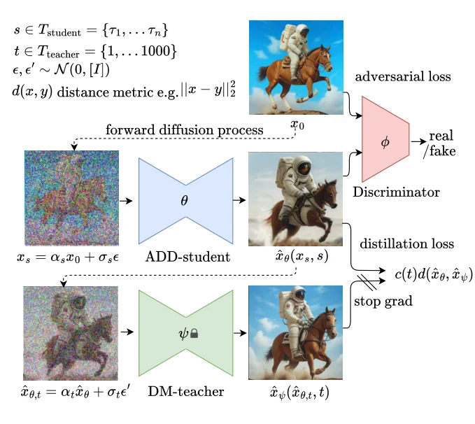
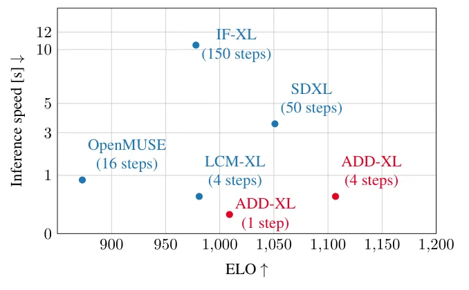
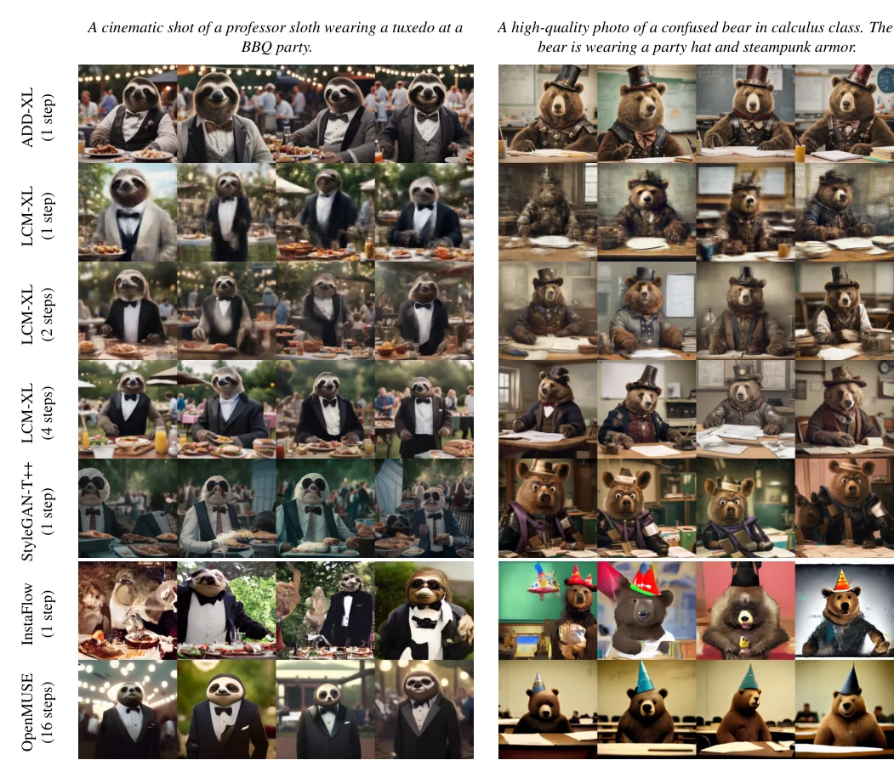

> - **논문**: Adversarial Diffusion Distillation
> - **저자**: Axel Sauer, Dominik Lorenz, Andreas Blattmann, Robin Rombach (Stability AI)
> - **학회**: arXiv preprint, 2023 · [arXiv:2311.17042](https://arxiv.org/abs/2311.17042) · [코드](https://github.com/Stability-AI/generative-models)
{: .prompt-tip }

> [Latent Consistency Model]()은 4 step 생성을 가능하게 했지만, 4 step 샘플도 자주 흐릿하고 artifact가 보이며 step을 더 줄이면 심해진다. GAN은 한 번에 만들지만 품질이 diffusion에 못 미친다. **Adversarial Diffusion Distillation**(ADD)은 둘을 합친다. 사전학습 diffusion 모델을 학생으로 두고, **판별기**로 한 step 출력을 실제 이미지 manifold 위에 올리며, **고정된 교사 diffusion 모델**의 score distillation으로 구성 능력을 지킨다. 한 step으로 LCM-XL 4 step을 이기고, 4 step으로 교사 SDXL을 이겼다. SDXL Turbo의 바탕이 된 방법이다.

## 1. 문제: 빠른 생성기들의 공통 결함

| 방법 | 장점 | 단점 |
|---|---|---|
| Progressive/guidance distillation | step을 4~8로 줄임 | 성능이 크게 떨어질 수 있고 반복 학습이 필요 |
| Consistency Model, LCM, LCM-LoRA | 4 step에서 인상적, 반복 학습 불필요 | **4 step 샘플이 흐릿하고 artifact**, step을 더 줄이면 악화 |
| InstaFlow (Rectified Flow) | 1 step | 같은 흐림 문제 |
| 텍스트-이미지 GAN (StyleGAN-T, GigaGAN) | 한 번에 생성 | 품질이 diffusion에 뒤짐. 안정적 학습을 위한 섬세한 구조가 필요해 확장이 어렵고 classifier-free guidance 같은 도구가 없음 |

GAN을 큰 데이터로 키운 연구들은 판별기에만 기대면 안 되고 사전학습된 분류기나 CLIP으로 텍스트 정렬을 보강해야 한다는 것을 알았지만, 판별 네트워크를 과하게 쓰면 artifact가 생긴다. ADD는 그 보강 신호를 **사전학습 diffusion 모델의 기울기**(score distillation)에서 가져오고, 생성기를 처음부터 학습하는 대신 diffusion 모델 가중치로 초기화하며, GAN식 decoder 구조 대신 표준 diffusion 프레임워크를 그대로 써서 반복 정제가 자연스럽게 가능하게 한다.

## 2. 학습 절차

세 네트워크가 등장한다(아래 Figure 2).


_Figure 2. ADD 학습 구조. 학생(파랑)은 노이즈를 섞은 실제 이미지 $$x_s$$를 디노이징하고, 그 출력은 (a) 판별기의 adversarial loss와 (b) 다시 흐린 뒤 고정된 교사(초록)가 복원한 목표와의 distillation loss로 평가된다. (출처: Sauer et al., 2023)_

- **ADD-student** $$\hat x_\theta$$: 사전학습 UNet diffusion 모델로 초기화. 학습 대상
- **판별기** $$D_\phi$$: 학습 대상
- **DM 교사** $$\hat x_\psi$$: 가중치 고정

실제 이미지 $$x_0$$에 forward diffusion $$x_s = \alpha_s x_0 + \sigma_s \epsilon$$을 걸어 노이즈 입력을 만들고, 학생이 디노이징한 $$\hat x_\theta(x_s, s)$$를 두 손실로 평가한다.

$$
\mathcal{L} = \mathcal{L}^G_{\text{adv}}\big(\hat x_\theta(x_s, s), \phi\big) + \lambda \mathcal{L}_{\text{distill}}\big(\hat x_\theta(x_s, s), \psi\big)
$$

학생의 timestep $$s$$는 $$N = 4$$개의 정해진 집합 $$T_{\text{student}} = \{\tau_1, \ldots, \tau_n\}$$에서 균등하게 뽑는다. 추론 때 순수 노이즈에서 시작해야 하므로 $$\tau_n = 1000$$으로 두고 **zero-terminal SNR**을 강제한다. latent diffusion에도 그대로 적용되며, 교사와 학생이 latent를 공유하면 증류 손실을 latent에서 계산할 수도 있지만 픽셀 공간에서 계산하는 쪽이 기울기가 안정적이었다. $$\lambda = 2.5$$이다.

### Adversarial loss

StyleGAN-T의 판별기 설계를 따른다. 고정된 사전학습 feature network $$F$$(ViT) 위에 여러 층의 feature $$F_k$$마다 가벼운 학습 가능한 **판별기 head** $$D_{\phi,k}$$를 붙인다. 손실은 hinge loss이다.

$$
\mathcal{L}^G_{\text{adv}} = -\mathbb{E}_{s, \epsilon, x_0}\Big[\sum_k D_{\phi,k}\big(F_k(\hat x_\theta(x_s, s))\big)\Big]
$$

$$
\mathcal{L}^D_{\text{adv}} = \mathbb{E}_{x_0}\Big[\sum_k \max\big(0, 1 - D_{\phi,k}(F_k(x_0))\big) + \gamma R1(\phi)\Big] + \mathbb{E}_{\hat x_\theta}\Big[\sum_k \max\big(0, 1 + D_{\phi,k}(F_k(\hat x_\theta))\big)\Big]
$$

R1 gradient penalty는 픽셀이 아니라 각 판별기 head의 입력에 대해 계산하며, 128² 이상의 해상도에서 특히 도움이 되었다($$\gamma = 10^{-5}$$).

판별기에는 **projection**으로 조건을 준다. 텍스트 임베딩 $$c_{\text{text}}$$(CLIP-ViT-g-14 텍스트 인코더)는 보통 하는 일이지만, 이 설정에서는 **이미지 조건**도 가능하다. $$\tau < 1000$$이면 학생은 입력 이미지 $$x_0$$의 신호를 일부 받으므로, 생성된 샘플을 판별할 때 $$x_0$$의 임베딩 $$c_{\text{img}}$$(DINOv2 ViT-L의 CLS)을 함께 주면 학생이 입력을 제대로 활용하도록 유도된다.

### Score distillation loss

$$
\mathcal{L}_{\text{distill}} = \mathbb{E}_{t, \epsilon'}\Big[c(t)\, d\big(\hat x_\theta,\ \hat x_\psi(\text{sg}(\hat x_{\theta, t}); t)\big)\Big]
$$

학생의 출력 $$\hat x_\theta$$를 교사의 forward process로 다시 흐려 $$\hat x_{\theta,t} = \alpha_t \hat x_\theta + \sigma_t \epsilon'$$을 만들고, 교사의 디노이징 결과 $$\hat x_\psi(\hat x_{\theta,t}, t) = (\hat x_{\theta,t} - \sigma_t \hat\epsilon_\psi)/\alpha_t$$를 **복원 목표**로 삼는다. 흐리지 않은 입력은 교사에게 분포 밖이므로 반드시 흐려서 넣는다. 거리 $$d$$는 제곱 오차이고, 가중치 $$c(t)$$는 두 가지를 본다.

- **지수 가중**: $$c(t) = \alpha_t$$. 노이즈가 클수록 기여가 작음
- **SDS 가중**: $$c(t) = \frac{\alpha_t}{2\sigma_t} w(t)$$로 두면 이 손실의 기울기가 DreamFusion의 **Score Distillation Sampling** 목표와 정확히 같아진다(부록 A). NFSD(noise-free score distillation) 변형도 시험

이 꼴의 장점은 복원 목표를 직접 시각화할 수 있고, 교사를 여러 step 연속으로 돌리는 것도 자연스럽다는 점이다. 추론 때는 classifier-free guidance를 쓰지 않아 메모리도 줄어든다.

## 3. 코드로 보기: 증류 손실의 기울기는 SDS 기울기다

부록 A의 유도를 숫자로 확인한다. 교사 디노이저를 고정된 작은 MLP로 두고, 학생이 만든 샘플 $$\hat x$$ 자체를 변수로 둔다.

```python
import torch, torch.nn as nn

torch.manual_seed(0)
D = 16
# 고정된 교사 디노이저 ε̂_ψ(x_t, t)와, 학생이 만든 샘플 x̂_θ (여기서는 파라미터 θ 대신 샘플 자체를 변수로 둔다)
teacher = nn.Sequential(nn.Linear(D + 1, 64), nn.SiLU(), nn.Linear(64, D))
for p in teacher.parameters(): p.requires_grad_(False)
x_hat = torch.randn(D, requires_grad=True)
t, alpha_t, sigma_t = 0.5, 0.8 ** 0.5, 0.2 ** 0.5           # 교사의 노이즈 스케줄(α_t² + σ_t² = 1)
eps_prime = torch.randn(D)                                  # 학생 샘플을 교사의 forward process로 흐리는 노이즈
x_t = alpha_t * x_hat + sigma_t * eps_prime                 # x̂_θ,t: 교사는 흐려진 입력만 받는다(깨끗한 입력은 분포 밖)

def eps_pred(xt): return teacher(torch.cat([xt, torch.tensor([t])]))

# 1) ADD의 증류 손실: 교사가 복원한 x̂_ψ(sg(x̂_θ,t), t)를 목표로 하는 MSE. 가중치 c(t) = α_t/(2σ_t)·w(t), w(t) = 1
x_psi = (x_t.detach() - sigma_t * eps_pred(x_t.detach())) / alpha_t          # stop-gradient 뒤 교사의 x0 예측
c_t = alpha_t / (2 * sigma_t)
L_distill = c_t * ((x_hat - x_psi) ** 2).sum()
g_distill, = torch.autograd.grad(L_distill, x_hat)

# 2) SDS(DreamFusion) 기울기: w(t)·(ε̂_ψ(x_t, t) − ε')·∂x/∂θ. 여기서 변수가 샘플 자체이므로 ∂x/∂θ = I, w(t) = 1
g_sds = eps_pred(x_t.detach()) - eps_prime
print(f"증류 손실 기울기와 SDS 기울기의 최대 차이: {(g_distill - g_sds).abs().max():.2e}")
print(f"기울기 크기: {g_distill.norm():.3f} (둘이 같은 벡터)")

# 3) 깨끗한 학생 샘플을 교사에 그대로 넣으면(흐리지 않으면) 목표가 달라진다
x_psi_clean = (x_hat.detach() - sigma_t * eps_pred(x_hat.detach())) / alpha_t
print(f"흐린 입력 vs 깨끗한 입력으로 만든 교사 목표의 차이: {(x_psi - x_psi_clean).norm():.3f}")
```

```text
증류 손실 기울기와 SDS 기울기의 최대 차이: 2.38e-07
기울기 크기: 3.714 (둘이 같은 벡터)
흐린 입력 vs 깨끗한 입력으로 만든 교사 목표의 차이: 1.998
```

$$x_\psi$$에 stop-gradient를 걸면 $$\hat x - \hat x_\psi = \frac{\sigma_t}{\alpha_t}(\hat\epsilon_\psi - \epsilon')$$이므로, 제곱 오차의 기울기 $$2c(t)(\hat x - \hat x_\psi)$$에 $$c(t) = \alpha_t/(2\sigma_t)$$를 넣으면 정확히 $$\hat\epsilon_\psi - \epsilon'$$, 즉 SDS 기울기가 된다. 수치로도 $$10^{-7}$$ 차이이다. 따라서 "교사가 복원한 이미지를 목표로 하는 MSE"와 "교사의 노이즈 예측 오차를 기울기로 쓰는 SDS"는 **같은 학습 신호**이고, 전자는 목표를 눈으로 볼 수 있다는 점만 다르다. 마지막 줄은 학생 샘플을 흐리지 않고 교사에 넣으면 목표가 크게 달라진다는 것, 곧 forward process로 다시 흐려야 하는 이유를 보여 준다.

## 4. 실험 설정과 Ablation

### 실험 설정

| 항목 | 값 |
|---|---|
| 모델 | ADD-M 860M (ablation은 SD 2.1, baseline 비교는 SD 1.5 backbone), ADD-XL 3.1B (SDXL backbone) |
| 해상도 | 모든 실험 512×512. 더 큰 해상도를 내는 모델은 512로 줄여 비교 |
| 학생 timestep | $$N = 4$$개, $$\tau_n = 1000$$, zero-terminal SNR |
| 손실 가중 | $$\lambda = 2.5$$, R1 $$\gamma = 10^{-5}$$ |
| 판별기 | feature network DINOv2 ViT-S, 조건 = CLIP-ViT-g-14 텍스트 임베딩 + DINOv2 ViT-L CLS 이미지 임베딩 |
| Ablation 학습 | 4,000 iteration, batch 128, 학생 1 step으로 평가 |
| 자동 평가 | COCO2017 5k 샘플 zero-shot FID, CLIP score(ViT-g-14, LAION-2B 학습) |
| 속도 측정 | 512×512 한 장, A100, mixed precision |

optimizer, learning rate, 학습 데이터, 최종 모델의 학습 길이는 논문에 나오지 않는다.

### Ablation (Table 1)

ADD-M(SD 2.1 backbone, 860M)으로 COCO zero-shot FID-5k와 CLIP score를 쟀다. 모두 학생 1 step, 4,000 iteration, batch 128이다.

| 실험 | 선택지 | FID | CS | 결론 |
|---|---|---|---|---|
| 판별기 feature network | ViT-S DINOv1 / **ViT-S DINOv2** / ViT-L DINOv2 / ViT-L CLIP | 21.5 / **20.6** / 24.0 / 23.3 | 0.312 / **0.319** / 0.302 / 0.308 | 작고 최신인 DINO가 최선 |
| 판별기 조건 | 없음 / 텍스트 / 이미지 / **둘 다** | 21.2 / 21.2 / 21.1 / **20.6** | 0.302 / 0.307 / 0.316 / **0.319** | 이미지 조건이 텍스트보다 효과적, 둘 다가 최선 |
| 학생 초기화 | 무작위 / **사전학습** | 293.6 / **20.6** | 0.065 / **0.319** | 무작위 초기화는 **붕괴** |
| 손실 항 | adv만 / distill만 / **adv + distill(지수)** / adv + distill(SDS) / adv + distill(NFSD) | 20.8 / 315.6 / **20.6** / 22.3 / 21.8 | 0.315 / 0.076 / **0.319** / 0.325 / 0.327 | 둘 다 필요. 증류만으로는 실패 |
| 교사 종류 | SD2.1→SD2.1 / SD2.1→SDXL / SDXL→SD2.1 / SDXL→SDXL | 20.6 / 21.3 / 29.3 / 28.4 | 0.319 / 0.321 / 0.314 / 0.325 | 학생은 교사의 성격을 물려받음(SDXL은 FID 높고 CS 높음) |
| 교사 step | 1 / 2 / 4 | 20.6 / 20.8 / 20.3 | 0.319 / 0.321 / 0.317 | 교사 1 step으로 충분 |

이 표에서 몇 가지를 읽을 수 있다. **증류 손실만으로는 전혀 되지 않고**(FID 315.6) adversarial loss와 합쳐야 효과가 난다. 지수 가중은 FID가 낮아 다양성이 좋고, SDS와 NFSD는 CLIP score가 높아 품질과 텍스트 정렬이 좋다. ablation의 기본값은 지수 가중이지만 최종 모델은 NFSD로 학습했다. GAN은 일정 용량 이후 성능이 포화한다는 관찰이 있는데, ADD는 사전학습된 큰 diffusion 모델을 그대로 활용하므로 diffusion의 매끄러운 스케일링을 물려받는다.

## 5. 결과

### 사용자 선호

주 비교는 FID나 CLIP 대신 **사용자 선호 연구**로 했다. 이 지표들이 미학이나 장면 구성을 충분히 잡지 못하기 때문이다. PartiPrompts에서 고른 100개 프롬프트로 모든 모델 쌍을 1 대 1 비교하고(프롬프트 충실도와 시각 품질을 따로, 비교당 평균 4표), ELO 점수로 순위를 매겼다. 비교 대상은 SD 1.5, SDXL-Base 1.0(refiner 없음), IF-XL(150 step), LCM-1.5, LCM-XL, OpenMUSE(16 step), 그리고 공개된 최신 GAN이 없어 개선된 판별기로 다시 학습한 StyleGAN-T++이다.

- **1 step ADD-XL이 4 step LCM-XL을 이긴다.** SDXL을 제외한 모든 모델을 품질과 정렬 모두에서 이겼다.
- **4 step ADD-XL이 50 step SDXL을 대부분의 비교에서 이긴다.** 교사를 넘은 것이다.
- 512×512, A100 혼합 정밀도에서의 속도와 함께 그리면(아래 Figure 7) ADD-XL 1 step과 4 step이 ELO 대 속도의 Pareto 최전선에 있다.


_Figure 7. 사용자 연구의 ELO 점수(가로, 높을수록 좋음)와 512×512 한 장 생성 시간(세로, A100, 낮을수록 좋음). ADD-XL 4 step은 1초 미만으로 ELO가 가장 높고, 1 step은 가장 빠르면서 LCM-XL 4 step보다 ELO가 높다. (출처: Sauer et al., 2023)_

### 같은 backbone의 증류 방법 비교

SD 1.5 기반, COCO zero-shot FID-5k이다(Table 2).

| 방법 | step | 시간(s) | FID | CLIP |
|---|---|---|---|---|
| DPM Solver | 25 | 0.88 | 20.1 | 0.318 |
| DPM Solver | 8 | 0.34 | 31.7 | 0.320 |
| Progressive Distillation | 1 / 2 / 4 | 0.09 / 0.13 / 0.21 | 37.2 / 26.0 / 26.4 | 0.275 / 0.297 / 0.300 |
| CFG-Aware Distillation | 8 | 0.34 | 24.2 | 0.300 |
| InstaFlow-0.9B / 1.7B | 1 | 0.09 / 0.12 | 23.4 / 22.4 | 0.304 / 0.309 |
| UFOGen | 1 | 0.09 | 22.5 | 0.311 |
| **ADD-M** | **1** | **0.09** | **19.7** | **0.326** |

1 step ADD-M이 8 step DPM Solver를 포함한 모든 방법보다 좋다.

### 정성적 관찰


_Figure 3. 두 프롬프트에 대한 few-step 샘플러 비교. 맨 위가 ADD-XL 1 step, 그 아래로 LCM-XL 1·2·4 step, StyleGAN-T++ 1 step, InstaFlow 1 step, OpenMUSE 16 step. (출처: Sauer et al., 2023)_

Figure 3에서 LCM-XL 1 step은 형체가 뭉개지고 4 step에서도 디테일이 흐릿한 반면, ADD-XL은 1 step에서 이미 털 질감과 소품이 선명하다.

- 1 step 샘플이 이미 고품질이고, step을 늘리면 일관성과 세부, 다양성, 글자 철자가 좋아진다. 같은 시드에서 전체 구도가 step 수와 무관하게 유지되어 빠르게 탐색한 뒤 정제할 수 있다. 순수 GAN에는 없는 능력이다.
- 교사 SDXL과 비교하면 adversarial loss가 **사실감**, 특히 털·천·피부 질감을 끌어올리고 diffusion 샘플 특유의 과도한 매끄러움을 줄인다. 대신 샘플 다양성은 약간 줄어든다.

## 6. 해석

**1. GAN과 diffusion을 결합했지만, 구성 요소는 대부분 diffusion 쪽에서 왔다.** 학생도 사전학습 diffusion, 교사도 diffusion, 판별기 feature도 사전학습 ViT이다. 무작위 초기화가 붕괴한다는 ablation이 말하듯 adversarial loss 혼자서는 이 규모를 감당하지 못한다. GAN이 가져온 것은 **한 step 출력을 실제 이미지 manifold에 올리는 압력**이고, 그것이 LCM 계열의 흐림을 없앤 결정적 차이이다.

**2. 증류 손실의 역할은 "품질"이 아니라 "구성"이다.** 증류만으로는 FID 315라는 실패작이 나오지만, adversarial loss 위에 얹으면 CLIP score가 오른다. 판별기는 "진짜처럼 보이는가"만 보고, 교사는 "프롬프트의 구성을 따르는가"를 본다. 위 코드에서 확인한 것처럼 그 신호는 DreamFusion의 SDS와 같은 것이고, 3D 생성에서 2D 교사의 지식을 빌려 오던 도구를 2D 증류로 되가져온 셈이다.

**3. 판별기 설계가 다르다.** 처음부터 학습하는 대신 고정된 DINOv2 feature 위에 가벼운 head만 둔다. 생성 모델 평가에 DINO feature가 좋다는 관찰(Stein et al., 2023)을 판별기에 적용한 것이고, 큰 ViT-L보다 작은 ViT-S가 나았다는 점은 판별기가 너무 강하면 안 된다는 GAN의 오랜 교훈과 맞닿아 있다. 이미지 조건이 텍스트 조건보다 효과적이었다는 결과도 이 설정만의 발견이다.

**4. 교사를 넘은 이유.** 4 step ADD-XL이 50 step SDXL을 이긴 것은 증류가 보통 "교사에 가까워지는" 과정이라는 통념과 다르다. 판별기가 실제 데이터에서 직접 받는 신호가 교사에게 없는 정보이기 때문이다. [π*0.6]()이 시연을 넘어선 것과 비슷한 구조로, 모방 대상 밖의 신호가 있어야 모방 대상을 넘는다. 대가는 다양성 감소이다.

**5. 평가를 읽을 때 주의할 점.** 주 결과가 사용자 연구라 재현이 어렵고, 프롬프트 100개는 많지 않다. 비교한 SDXL은 refiner 없는 base이고, StyleGAN-T++는 저자들이 직접 학습한 baseline이다. 자동 지표 표는 SD 1.5 기반의 ADD-M에 대한 것이고, ADD-XL의 FID는 교사 SDXL의 성격(높은 FID)을 물려받아 좋지 않다. 학습 데이터와 비용은 자세히 공개되지 않았다.

## 7. 정리

| 항목 | 내용 |
|---|---|
| 목표 | 사전학습 diffusion 모델을 1~4 step의 고품질 생성기로 바꾸기 |
| 학생 | 사전학습 UNet으로 초기화. timestep 4개 중 하나에서 디노이징, $$\tau_n = 1000$$과 zero-terminal SNR |
| Adversarial loss | 고정 DINOv2 ViT-S feature + 학습 가능한 head, hinge loss, head 입력에 R1, 텍스트·이미지 조건 projection |
| Distillation loss | 학생 출력을 다시 흐려 교사의 복원 결과를 목표로 하는 MSE. $$c(t)$$에 따라 SDS와 동일. 최종 모델은 NFSD, $$\lambda = 2.5$$ |
| 결과 | 1 step ADD-XL > 4 step LCM-XL, 4 step ADD-XL > 50 step SDXL(사용자 선호). SD 1.5 기반 1 step FID 19.7 |
| 한계 | 다양성 소폭 감소, 사용자 연구 중심 평가, 두 손실의 가중 함수는 개선 여지 |

## References

- Sauer, Lorenz, Blattmann, Rombach, "Adversarial Diffusion Distillation," arXiv 2023. [arXiv:2311.17042](https://arxiv.org/abs/2311.17042)
- Poole et al., "DreamFusion: Text-to-3D using 2D Diffusion," ICLR 2023. [arXiv:2209.14988](https://arxiv.org/abs/2209.14988)
- Sauer et al., "StyleGAN-T: Unlocking the Power of GANs for Fast Large-Scale Text-to-Image Synthesis," ICML 2023. [arXiv:2301.09515](https://arxiv.org/abs/2301.09515)
- Luo et al., "Latent Consistency Models," 2023. [arXiv:2310.04378](https://arxiv.org/abs/2310.04378)
- Podell et al., "SDXL: Improving Latent Diffusion Models for High-Resolution Image Synthesis," 2023. [arXiv:2307.01952](https://arxiv.org/abs/2307.01952)
- Katzir et al., "Noise-Free Score Distillation," 2023. [arXiv:2310.17590](https://arxiv.org/abs/2310.17590)
- Oquab et al., "DINOv2: Learning Robust Visual Features without Supervision," 2023. [arXiv:2304.07193](https://arxiv.org/abs/2304.07193)
