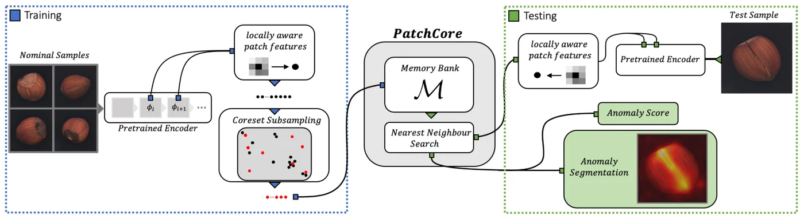
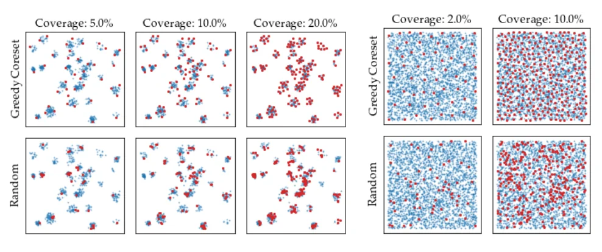
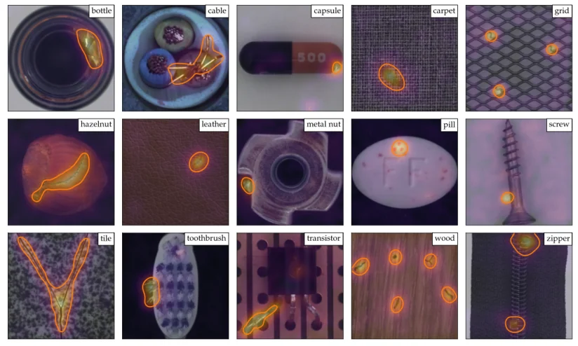

> - **논문**: Towards Total Recall in Industrial Anomaly Detection
> - **저자**: Karsten Roth, Latha Pemula, Joaquin Zepeda, Bernhard Schölkopf, Thomas Brox, Peter Gehler (University of Tübingen, Amazon AWS)
> - **학회**: CVPR 2022 · [arXiv:2106.08265](https://arxiv.org/abs/2106.08265) · [코드](https://github.com/amazon-research/patchcore-inspection)
{: .prompt-tip }

> Segmentation 카테고리의 첫 글이다. 공장의 외관 검사에서는 결함 사진은 거의 없고 정상 제품 사진만 많다. **PatchCore**는 정상 이미지의 패치 특징을 메모리에 저장해 두고, 새 이미지의 각 패치가 그 메모리와 얼마나 다른지로 **이미지 단위 판정과 픽셀 단위 결함 위치(segmentation)**를 동시에 얻는다.

## 1. Anomaly Detection이란

**주어진 데이터에서 예상하지 못한 패턴을 찾는 과정**이다. 비전 검사 분야의 산업용 이상 탐지는 제품 외관에 생긴 결함(긁힘, 찍힘, 오염, 누락 등)을 찾는 것이 목적이다.

### 왜 일반 분류로 풀기 어렵나

- 결함 사진은 매우 드물고, 결함 종류도 예측할 수 없음
- 학습 때 보지 못한 새로운 결함도 잡아야 함

그래서 정상 데이터만으로 학습하고, 정상과 다른 것을 이상으로 판단하는 **semi-supervised(또는 one-class)** 방식으로 푼다. PatchCore도 학습에 정상 이미지만 쓴다.

## 2. 핵심 아이디어: 특징점 기반 이상 감지

1. 사전학습된 CNN으로 이미지의 각 위치(패치)에서 지역 특징을 뽑는다.
2. 정상 이미지들의 패치 특징을 모아 **메모리 뱅크**를 만든다.
3. 테스트 이미지의 각 패치를 메모리 뱅크에서 가장 가까운 정상 패치와 비교한다.
4. 가까운 정상 패치가 없을수록(거리가 멀수록) 이상 점수가 높다.
5. 패치별 점수를 모으면 **결함 위치 지도(anomaly map)**가 되고, 그중 최댓값이 이미지 전체의 이상 점수가 된다.

학습이라고 할 것이 거의 없다. 특징 추출기는 ImageNet으로 사전학습된 것을 그대로 쓰고, 정상 특징을 저장하기만 한다.


_Figure 2. PatchCore 개요. 학습(왼쪽): 정상 이미지를 사전학습 encoder에 넣어 지역 패치 특징을 뽑고, coreset subsampling으로 줄여 메모리 뱅크 $$\mathcal{M}$$에 저장한다. 테스트(오른쪽): 각 패치의 최근접 이웃 거리로 이상 점수와 segmentation을 만든다. (출처: Roth et al., 2022)_

## 3. Locally Aware Patch Features

### 어느 층의 특징을 쓸까

ImageNet으로 사전학습된 **WideResNet-50**에서

- **너무 얕은 층**: 일반적이지만 문맥이 부족함
- **너무 깊은 층**: ImageNet 분류에 특화되어 산업 결함과 거리가 있고 해상도가 낮음

그래서 **중간 층(layer 2, layer 3)**의 특징을 쓴다. Layer 3 특징은 layer 2 해상도로 upsampling해서 이어 붙인다.

### 지역 문맥 집계

각 위치의 특징을 그대로 쓰지 않고, 주변 3×3 이웃의 특징을 평균 풀링으로 모아 패치 특징으로 쓴다. 해상도는 유지하면서 receptive field를 넓혀, 작은 위치 변화에 강건해진다.

$$
\phi_{i,j} = \text{AvgPool}_{3\times3}\Big(\big[f^{(2)},\ \text{Up}(f^{(3)})\big]\Big)_{i,j}
$$

논문의 실제 순서는 layer 2와 layer 3 각각에 3×3 이웃 집계(adaptive average pooling)를 먼저 적용하고, layer 3 결과를 bilinear로 키워 layer 2와 맞춘 뒤 합치는 방식이다. 위 식은 이를 한 줄로 줄여 쓴 것이다.

Ablation(논문 Figure 4)에서는 이웃 크기 $$p$$를 바꿔 보면 지역성과 문맥 사이에 뚜렷한 최적점이 있어 $$p = 3$$을 골랐고, 층 조합은 layer 2만으로도 당시 최고 수준이지만 2+3을 함께 쓸 때 더 좋았다. 메모리를 줄이려고 패치를 듬성듬성(stride) 뽑으면 해상도 손실로 성능이 떨어진다. 이미지 AUROC가 stride 2에서 97.6%, stride 3에서 96.8%였다.

## 4. Memory Bank와 Coreset Subsampling

모든 정상 이미지의 모든 패치를 저장하면 메모리 뱅크가 너무 커서 최근접 탐색이 느리다. 이미지 200장, 이미지당 28×28 패치라면 약 15만 개이다.

PatchCore는 **Greedy Coreset Subsampling**으로 전체 분포를 잘 대표하는 **부분집합(coreset)**만 남긴다. 아이디어는 "이미 고른 점들로부터 가장 먼 점을 하나씩 추가"하는 것이다.

$$
m^* = \arg\max_{m \in \mathcal{M} \setminus \mathcal{M}_C}\ \min_{n \in \mathcal{M}_C}\big\lVert\psi(m) - \psi(n)\big\rVert_2
$$

($$\psi$$: 계산을 빠르게 하기 위한 무작위 선형 투영)

이렇게 고르면 전체 특징 공간을 고르게 덮는 점들이 남는다. 메모리 뱅크를 **1~10%**로 줄여도 성능이 거의 유지되고, 추론은 훨씬 빨라진다. 단순 무작위 샘플링은 드문 정상 패턴을 놓치기 쉽다(아래 Figure 3).


_Figure 3. 2D 장난감 데이터(파랑)에서 고른 점(빨강). 위: greedy coreset, 아래: random. 왼쪽 여러 덩어리 분포에서 random은 일부 덩어리를 놓치고, 오른쪽 균일 분포에서도 덜 고르게 퍼진다. (출처: Roth et al., 2022)_

원래 문제는 "전체 점에서 가장 가까운 coreset 점까지의 거리의 최댓값"을 최소화하는 minimax facility location이고, 정확한 해는 NP-hard라서 위의 greedy 근사를 쓴다. $$\psi$$는 Johnson–Lindenstrauss 정리에 기대어 차원을 줄이는 무작위 투영이다. 논문은 메모리 뱅크를 $$n$$%로 줄인 설정을 **PatchCore-$$n$$%**로 부른다.

Coreset이 중복을 줄인다는 것은 숫자로도 보인다. 줄이지 않은 메모리 뱅크에서는 테스트 때 최근접 이웃으로 한 번이라도 쓰이는 샘플이 30% 미만이었지만, 1% coreset에서는 거의 95%가 쓰였다. 학습 가능한 proxy를 두는 방법이나 random subsampling과 비교해도 coreset의 성능 유지가 가장 좋았다.

## 5. 이상 점수 계산

### 패치 단위

테스트 이미지의 각 패치 특징 $$m^{test}$$에 대해 메모리 뱅크에서 **최근접 이웃(Nearest Neighbour Search)**까지의 거리를 구한다.

$$
s(m^{test}) = \min_{m \in \mathcal{M}_C}\big\lVert m^{test} - m\big\rVert_2
$$

메모리 뱅크에 저장된 정상 패치와의 최소 거리가 멀수록, 그 패치는 정상 범위를 벗어난 것이다.

### 이미지 단위

모든 패치 점수 중 **최댓값**을 이미지 점수로 쓴다. 결함은 작은 영역에만 있을 수 있으므로 평균보다 최댓값이 맞다. 논문은 최근접 정상 패치 주변이 얼마나 촘촘한지에 따라 점수를 약간 보정(re-weighting)한다. 주변에 다른 정상 패치가 드물면, 즉 그 정상 패치 자체가 이미 드문 정상 패턴이면 점수를 높인다.

$$
s = \left(1 - \frac{\exp \lVert m^{test,*} - m^* \rVert_2}{\sum_{m \in \mathcal{N}_b(m^*)} \exp \lVert m^{test,*} - m \rVert_2}\right) \cdot s^*
$$

$$s^*$$는 가장 이상한 테스트 패치 $$m^{test,*}$$와 그 최근접 정상 패치 $$m^*$$ 사이의 거리이고, $$\mathcal{N}_b(m^*)$$는 $$m^*$$의 메모리 뱅크 내 이웃 $$b$$개이다. 논문은 이 보정이 최대 거리만 쓰는 것보다 안정적이었다고 설명한다.

### 픽셀 단위 (Segmentation)

패치 점수 지도를 원래 이미지 크기로 **bilinear upsampling**하고 **가우시안 smoothing**($$\sigma = 4$$, 따로 튜닝하지 않은 값)하면, 결함이 있는 위치를 보여 주는 anomaly map이 된다. 임계값을 넘는 픽셀이 결함 영역이다.

```python
import torch
import torch.nn.functional as F

def greedy_coreset(features, ratio=0.1, proj_dim=128):
    """features: (N, D) 정상 패치 특징 → coreset 인덱스"""
    N = features.shape[0]
    proj = features @ torch.randn(features.shape[1], proj_dim) / proj_dim ** 0.5   # 무작위 투영
    selected = [torch.randint(N, (1,)).item()]
    min_dist = torch.cdist(proj, proj[selected]).squeeze(1)
    for _ in range(int(N * ratio) - 1):
        idx = torch.argmax(min_dist).item()                     # 지금까지 고른 점에서 가장 먼 점
        selected.append(idx)
        min_dist = torch.minimum(min_dist, torch.cdist(proj, proj[idx:idx + 1]).squeeze(1))
    return torch.tensor(selected)

def anomaly_map(test_feats, memory, H, W, out_size):
    """test_feats: (H*W, D) 한 이미지의 패치 특징"""
    d = torch.cdist(test_feats, memory).min(dim=1).values      # 패치별 최근접 정상 패치까지 거리
    amap = d.view(1, 1, H, W)
    amap = F.interpolate(amap, size=out_size, mode="bilinear", align_corners=False)
    return amap.squeeze(), d.max()                               # 픽셀 지도, 이미지 점수

# 장난감 예: 정상 이미지 20장 × 28x28 패치(64차원 특징)로 메모리를 만들고,
# 테스트 이미지의 (10, 5) 위치 패치 하나에만 이상을 심어 본다
torch.manual_seed(0)
normal = torch.randn(20 * 28 * 28, 64)
memory = normal[greedy_coreset(normal, ratio=0.01)]           # 15,680개 → 156개만 저장
test = torch.randn(28 * 28, 64)
test[10 * 28 + 5] += 6.0
amap, score = anomaly_map(test, memory, 28, 28, out_size=(224, 224))
d = torch.cdist(test, memory).min(dim=1).values
print(memory.shape, divmod(int(d.argmax()), 28))              # torch.Size([156, 64]) (10, 5)
print(round(float(score), 2), round(float(d.median()), 2))    # 48.59 9.93 → 이상 패치만 크게 튐
```

메모리 뱅크를 1%(156개)로 줄였는데도, 이상을 심은 위치가 정확히 가장 큰 점수를 받는다. 실제 사용에서는 위 `normal`, `test` 자리에 WideResNet-50 중간 층에서 뽑은 패치 특징이 들어간다. 메모리 뱅크가 커지면 `torch.cdist` 대신 FAISS 같은 근사 최근접 탐색 라이브러리를 쓰는 것이 일반적이다.

## 6. 실험: MVTec AD

산업 이상 탐지의 표준 벤치마크인 **MVTec AD**(병, 케이블, 나사, 카펫 등 15개 카테고리, 총 5,354장 중 테스트 1,725장, 학습은 정상 이미지만)에서 평가했다.


_Figure 1. MVTec AD 15개 카테고리의 PatchCore segmentation 결과. 주황색 윤곽이 실제 결함 영역이고, 겹쳐 그린 색이 anomaly map이다. (출처: Roth et al., 2022)_

### 구현 디테일

| 항목 | 값 |
|---|---|
| 백본 | ImageNet 사전학습 WideResNet-50 (torchvision, timm), block 2·3 출력 사용 |
| 입력 | 256×256으로 resize 후 224×224 center crop, data augmentation 없음 |
| 패치 특징 | 이웃 크기 $$p = 3$$, stride $$s = 1$$ |
| 메모리 뱅크 | greedy coreset으로 25% / 10% / 1%까지 축소 |
| 최근접 탐색 | faiss |
| Anomaly map | bilinear upsampling + Gaussian $$\sigma = 4$$ |
| 환경 | Python 3.7, PyTorch, Tesla V4 GPU |
| 지표 | 이미지 AUROC(클래스 평균), 픽셀 AUROC, PRO |

### 정량 결과

| 방법 | 이미지 AUROC | 픽셀 AUROC | PRO |
|---|---|---|---|
| SPADE | 85.5 | 96.0 | 91.7 |
| PaDiM | 95.3 | 97.5 | 92.1 |
| PaDiM (문제별 백본 선택) | 97.9 | - | - |
| **PatchCore-25%** | **99.1** | **98.1** | 93.4 |
| **PatchCore-10%** | 99.0 | **98.1** | **93.5** |
| **PatchCore-1%** | 99.0 | 98.0 | 93.1 |

<small>MVTec AD, % (논문 Table 1~3)</small>

- 기본 설정(224×224, WideResNet-50)에서 **이미지 단위 AUROC 99.1%**로 당시 최고 성능을 기록했다. PaDiM의 오류율 2.1%를 0.9%로 줄인 것이라, 오류를 57% 줄인 셈이다. F1 최적 임계값에서 1,725장 중 틀린 이미지는 42장이고, 15개 카테고리 중 3분의 1은 완벽하게 풀었다.
- 초록과 제목에서 강조하는 **99.6%**는 PatchCore-1%에 해상도 320과 백본 3개(DenseNet-201, ResNeXt-101, WideResNet-101) 앙상블을 쓴 결과이다. Coreset 덕분에 이런 무거운 설정도 추론 시간을 감당할 수 있다.
- 픽셀 단위 segmentation도 픽셀 AUROC 98.1(PaDiM 97.5), PRO 93.5(PaDiM 92.1)로 기존 방법보다 좋았다.
- Coreset 비율을 1%까지 줄여도 성능이 거의 떨어지지 않아, 메모리와 속도 효율이 좋았다. 줄이지 않은 메모리 뱅크와 100배 작은 coreset의 성능이 비슷했고, 50%~10% 구간에서는 오히려 조금 오르기도 했다.

### 추론 시간

| 방법 | (이미지 AUROC, 픽셀 AUROC, PRO) | 이미지당 시간 (s) |
|---|---|---|
| PatchCore-100% | (99.1, 98.0, 93.3) | 0.6 |
| PatchCore-10% | (99.0, 98.1, 93.5) | 0.22 |
| PatchCore-1% | (99.0, 98.0, 93.1) | **0.17** |
| PatchCore-100% + IVFPQ (근사 최근접) | (98.0, 97.9, 93.0) | 0.2 |
| SPADE | (85.3, 96.6, 91.5) | 0.66 |
| PaDiM | (95.4, 97.3, 91.8) | 0.19 |

<small>논문 Table 5, 백본 forward 시간 포함</small>

Coreset을 쓰면 PaDiM보다도 빠르면서 성능은 더 좋다. 근사 최근접 탐색(IVFPQ)만으로 속도를 올리면 특히 이미지 단위 성능이 떨어지고, 시간도 PatchCore-1%보다 길다.

### Few-shot과 다른 데이터셋

- 정상 학습 이미지를 1장(전체의 0.4%)부터 50장(21%)까지 줄여 본 실험에서, PatchCore는 **정상 데이터의 5분의 1만으로 이전 최고 성능과 비슷한 수준**을 냈다. 같은 WideResNet-50으로 다시 구현한 SPADE·PaDiM보다 일관되게 좋았다.
- 자석 타일 결함 데이터셋 MTD에서는 이미지 AUROC 97.9(DifferNet 97.7), 보행자 영상 mSTC에서는 픽셀 AUROC 91.8(PaDiM 91.2)이었다. mSTC는 자연 영상에 가까워 더 깊은 layer 3·4 특징을 썼다.
- 한계로는 사전학습 특징이 대상 도메인으로 얼마나 잘 옮겨 가느냐에 성능이 묶여 있다는 점을 논문이 직접 꼽는다.

## 7. 정리

| 단계 | 방법 | 목적 |
|---|---|---|
| 특징 추출 | 사전학습 WideResNet-50의 중간 층 + 3×3 이웃 집계 | 일반적이면서 지역 문맥을 담은 패치 특징 |
| 메모리 뱅크 | 정상 이미지 패치 특징 저장 | 정상의 기준 |
| Coreset | Greedy coreset subsampling (1~10%) | 메모리·속도 절감, 분포 보존 |
| 패치 점수 | 최근접 정상 패치까지 거리 | 국소적인 이상 정도 |
| 이미지 판정 | 패치 점수의 최댓값 | 결함 유무 |
| 위치 지도 | Upsampling + Gaussian smoothing | **픽셀 단위 결함 영역** |

PatchCore는 별도의 학습 없이 강한 성능을 내 산업 이상 탐지의 표준 baseline이 됐다.

## References

- Roth et al., "Towards Total Recall in Industrial Anomaly Detection (PatchCore)," CVPR 2022. [arXiv:2106.08265](https://arxiv.org/abs/2106.08265)
- [anomalib](https://github.com/openvinotoolkit/anomalib) (PatchCore 등 이상 탐지 구현 모음)
- Bergmann et al., "MVTec AD — A Comprehensive Real-World Dataset for Unsupervised Anomaly Detection," CVPR 2019.
- Defard et al., "PaDiM: a Patch Distribution Modeling Framework for Anomaly Detection and Localization," ICPR 2021.
- Sener & Savarese, "Active Learning for Convolutional Neural Networks: A Core-Set Approach," ICLR 2018.
