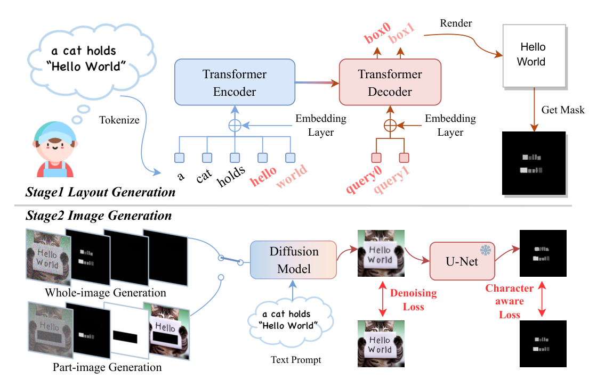
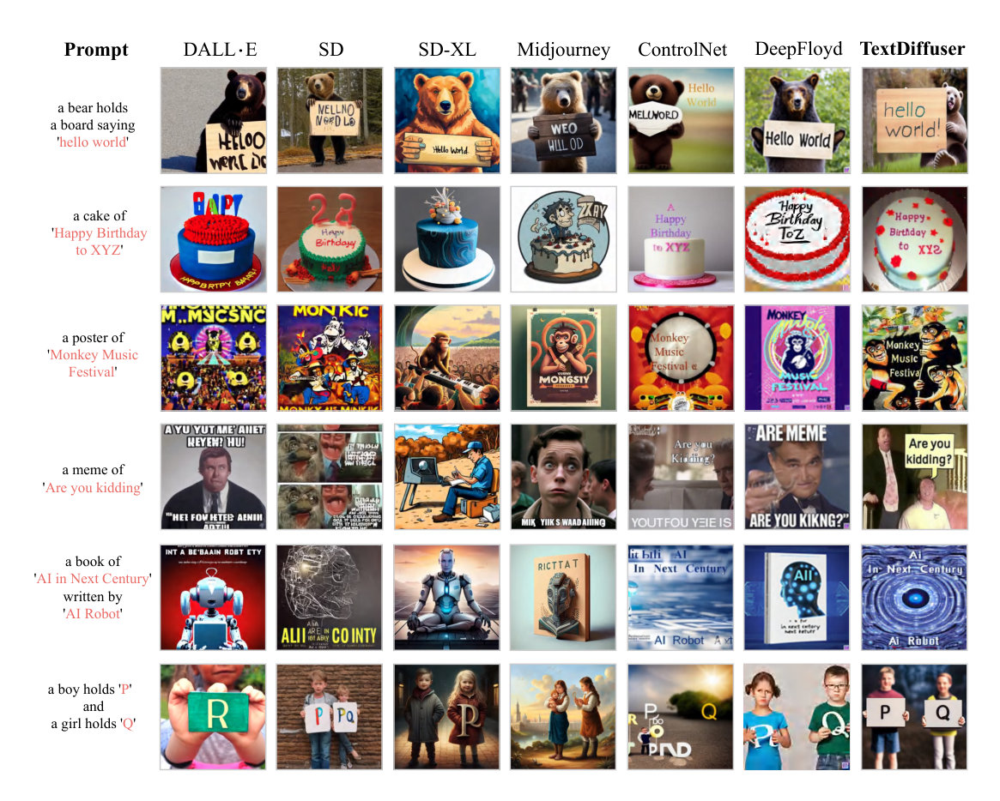
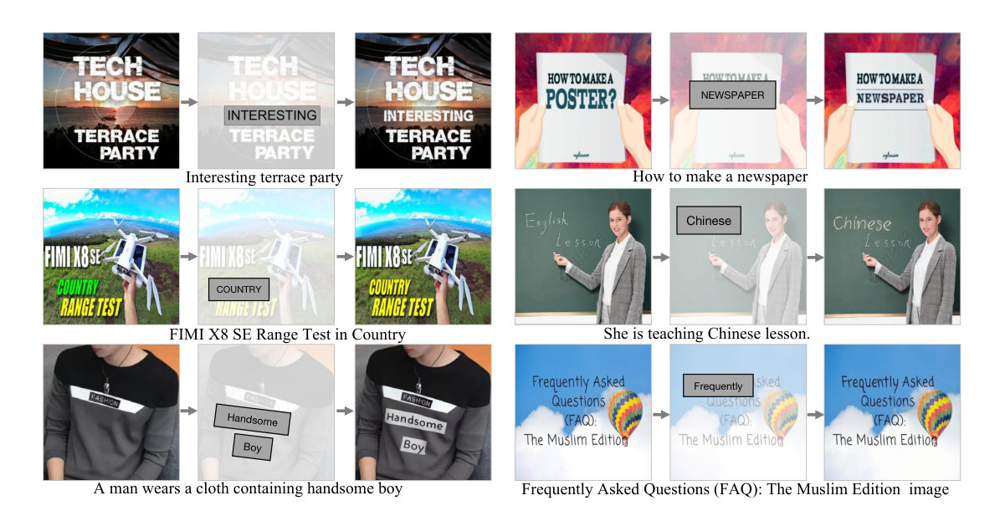

> - **논문**: TextDiffuser: Diffusion Models as Text Painters
> - **저자**: Jingye Chen, Yupan Huang, Tengchao Lv, Lei Cui, Qifeng Chen, Furu Wei (HKUST, Sun Yat-sen University, Microsoft Research)
> - **학회**: NeurIPS 2023 · [arXiv:2305.10855](https://arxiv.org/abs/2305.10855) · [코드·모델](https://aka.ms/textdiffuser)
{: .prompt-tip }

Stable Diffusion에 "'OPEN'이라고 쓰인 카페 간판"을 그려 달라고 하면, 간판은 그럴듯한데 글자는 알아볼 수 없는 경우가 많다. **TextDiffuser**는 [Latent Diffusion Model]()을 fine-tuning해서 이미지 속 글자를 정확하게 그리는 문제를 다룬다. 이 글은 먼저 "왜 어려운가"를 직관적으로 정리하고, 이어서 논문의 수식·구현 설정·실험 수치를 그림과 함께 살펴본다.

## 1. 문제: Diffusion은 글자에 약하다

Diffusion 모델은 사진 같은 이미지 생성에서는 뛰어난 성능을 보이지만, **글자(text rendering)**에서는 성능이 떨어진다.

- 글자 모양이 뭉개지거나, 존재하지 않는 글자가 생김
- 철자가 틀리거나 글자가 반복됨
- 글자를 어디에 얼마나 크게 둘지(레이아웃)를 제어하기 어려움

포스터, 책 표지, 간판, 광고 이미지처럼 글자가 핵심인 이미지를 만들 때 큰 문제이다. 아래 Figure 4의 SD 열을 보면 "hello world"를 엉뚱한 철자로 그린 것을 볼 수 있다.

### 왜 어려울까

- 텍스트 인코더(CLIP)는 문장의 의미는 잘 담지만, 단어를 이루는 글자 하나하나의 모양은 잘 담지 못한다. 대부분의 텍스트 인코더는 단어를 글자가 아니라 **subword 토큰**(예: `hello` 전체가 토큰 하나)으로 쪼개서 받기 때문에, 모델 입장에서는 그 토큰이 h-e-l-l-o로 이루어졌다는 정보가 처음부터 없다. Liu et al.(2023)은 이런 인코더를 "character-blind"라고 부르고, 글자 단위로 토큰을 받는 인코더(ByT5 등)를 쓰면 글자 렌더링이 크게 좋아진다는 것을 보였다. Imagen, eDiff-I, DeepFloyd가 CLIP 대신 큰 T5 인코더를 써서 글자를 더 잘 그린 것도 같은 맥락이다.
- 학습 데이터의 캡션에 이미지 속 글자 내용이 정확히 적혀 있지 않은 경우가 많다.
- 일반적인 denoising loss는 이미지 전체의 픽셀 차이를 보기 때문에, 작은 영역인 글자 획이 틀려도 loss가 거의 늘지 않는다.

논문은 인코더만 바꾸는 기존 접근이 "생성 과정을 제어하지 못한다"고 지적한다. 그래서 TextDiffuser는 인코더 대신 **글자의 위치와 모양을 명시적인 조건(마스크)으로 넣는** 방향을 택한다.

## 2. TextDiffuser의 2단계 구조

TextDiffuser는 "**어디에 어떤 글자를 쓸지 먼저 정하고(Layout), 그 계획에 맞춰 그린다(Image)**"는 두 단계로 나눈다.

_Figure 2. 위: Stage 1 Layout Generation, 아래: Stage 2 Image Generation. 실제 diffusion은 latent 공간에서 동작하지만 그림에서는 이해를 위해 픽셀로 표시했다. (출처: Chen et al., 2023)_

사용자는 프롬프트에서 그릴 글자를 따옴표로 표시한다.

> A poster of a movie named **'Hello World'** with a dark background

### Stage 1. Layout Generation

[Layout Transformer]()에서 아이디어를 가져와, 따옴표 안 키워드마다 bounding box를 예측한다.

1. 토큰화한 프롬프트 $$P = (p_0, \dots, p_{L-1})$$를 CLIP과 linear layer 2개로 임베딩한다. 여기에 키워드인지 아닌지(2가지 값)를 알려 주는 임베딩, 키워드 너비 임베딩, 학습 가능한 위치 임베딩을 더한다.

   $$
   \text{Embedding}(P) = \text{CLIP}(P) + \text{Pos}(P) + \text{Key}(P) + \text{Width}(P)
   $$

   너비는 키워드를 Arial 폰트(크기 24)로 렌더링했을 때의 폭이다. 박스 너비가 키워드 길이와 맞도록 돕는 힌트이다.
2. Transformer encoder $$\Phi_E$$와 decoder $$\Phi_D$$가 키워드 $$K$$개의 박스 $$B \in \mathbb{R}^{K\times 4}$$를 autoregressive하게 하나씩 생성한다. decoder의 query로 위치 임베딩을 써서 $$n$$번째 query가 $$n$$번째 키워드에 대응하게 한다. 학습은 정답 박스와의 L1 loss $$\lvert B_{GT} - B \rvert$$로 한다.

   $$
   B = \Phi_D(\Phi_E(\text{Embedding}(P))) = (b_0, b_1, \dots, b_{K-1})
   $$

3. 박스 안에 키워드를 Pillow로 렌더링해서 **글자 단위 segmentation mask** $$C$$를 만든다. 채널 수는 알파벳 크기 $$\lvert A \rvert$$로, 대문자 26 + 소문자 26 + 숫자 10 + 문장부호 32 + 공백 1 = 95자이다.

박스는 좌상단·우하단 두 점으로 표현하는 **수평 박스**이다. MARIO-10M의 글자 영역 약 90%가 5도 미만으로 기울어진 수평 배치였기 때문이다.

이 마스크가 다음 단계에서 "이 위치에 이 글자를 이런 모양으로"라는 정밀한 설계도 역할을 한다.

### Stage 2. Image Generation

Stable Diffusion v1.5의 U-Net을 fine-tuning한다. 512×512 이미지는 VAE를 거쳐 $$4\times 64\times 64$$ latent $$F$$가 되고, 여기에 노이즈를 섞은 $$\hat{F} = \sqrt{\bar\alpha_T}F + \sqrt{1-\bar\alpha_T}\,\epsilon$$이 원래 diffusion 입력이다. TextDiffuser는 여기에 세 가지 조건을 채널 방향으로 이어 붙인다.

| 입력 | 채널 | 역할 |
|---|---|---|
| Noisy latent $$\hat{F}$$ | 4 | 원래 diffusion 입력 |
| **글자 마스크** $$\hat{C}$$ | 8 | 95채널 마스크 $$C$$를 conv 3층으로 64×64까지 줄인 것. 글자의 위치와 모양 |
| Feature mask $$\hat{M}$$ | 1 | 새로 그릴 영역 표시 (inpainting용) |
| Masked feature $$\hat{F}_M$$ | 4 | 유지할 영역의 원본 latent (inpainting용) |
| **합계** | **17** | U-Net 첫 conv 입력 채널만 4 → 17로 수정 |

> 바뀌는 곳이 입력 conv 한 층뿐이라 원래 SD와 파라미터 수, 연산량이 거의 같다. Stage 2에서 늘어난 파라미터는 0.75M, Stage 1 Layout Transformer가 25M로, SD 1.5(859M) 대비 약 3%이다.
{: .prompt-info }

학습할 때는 두 가지 모드를 섞는다.

- **Whole-image generation**: 이미지 전체를 새로 생성 ($$\hat{M}$$이 전체 영역, $$\hat{F}_M$$은 완전히 가린 이미지의 latent)
- **Part-image generation**: 이미지 일부(글자 영역)만 다시 그림 → **텍스트 inpainting**. 검출된 글자 박스를 50% 확률로 가린다.

샘플마다 확률 $$\sigma$$로 whole, $$1-\sigma$$로 part 모드를 고른다. 논문은 $$\sigma = 0.5$$를 쓴다(아래 Table 3).

## 3. Character-Aware Loss

일반 denoising loss만으로는 글자 획의 정확도를 잡기 어렵다. 그래서 글자에 특화된 loss를 추가한다.

1. latent($$4\times 64\times 64$$)를 받아 글자 segmentation($$96\times 64\times 64$$, 95자 + 배경)을 내는 **작은 U-Net**을 MARIO-10M으로 미리 학습하고 고정한다. downsampling 4번, upsampling 4번 구조이다.
2. Diffusion이 예측한 노이즈로부터 복원한 latent $$\hat{F}_0$$를 이 U-Net에 넣어 글자 segmentation을 예측한다.
3. 예측과 64×64로 줄인 정답 글자 마스크 $$C'$$ 사이의 **cross-entropy**를 loss로 쓴다.

$$
l = l_{denoising} + \lambda_{char}\, l_{char}
$$

$$
l_{denoising} = \big\lVert \epsilon - \epsilon_\theta(\hat{F}, \hat{C}, \hat{M}, \hat{F}_M, P, T) \big\rVert_2^2,\qquad
l_{char} = \text{CE}\big(\text{U-Net}_{\text{seg}}(\hat{F}_0),\ C'\big)
$$

글자 모양이 조금만 틀려도 segmentation 결과가 달라지므로, 모델은 글자 하나하나의 형태를 정확히 그리도록 학습된다.

> 이 loss가 latent 공간에서 계산된다는 점이 실용적인 장점이다. 픽셀 공간에서 OCR 모델로 감독하려면 step마다 VAE decoder로 이미지를 복원해야 해서 비싸지만, latent에서 바로 동작하는 작은 segmenter를 쓰면 그 비용이 없다.
{: .prompt-info }

## 4. 데이터셋: MARIO-10M

글자 렌더링을 학습하려면 이미지 속 글자 위치와 내용이 표시된 대규모 데이터가 필요하다. 논문은 **MARIO-10M**을 새로 구축했다. 총 10,061,720쌍 중 10,000,000쌍을 학습, 61,720쌍을 테스트에 쓴다.

| 서브셋 | 출처 | 필터링 후 | 캡션 |
|---|---|---|---|
| MARIO-LAION | LAION-400M | 9,194,613 | 원래 캡션 |
| MARIO-TMDB | 영화·TV 포스터 (759,859장 수집) | 343,423 | 제목으로 템플릿 생성 |
| MARIO-OpenLibrary | 책 표지 (6,352,989장 수집) | 523,684 | 제목으로 템플릿 생성 |

주석은 모두 OCR 도구로 자동 생성한다. 검출은 DB, 인식은 PARSeq, 글자 단위 segmentation은 직접 학습한 U-Net을 쓴다. 필터링 규칙은 다섯 가지이다.

- 가로·세로 모두 256 픽셀 초과
- NSFW 플래그가 없을 것
- 검출된 글자 박스가 1~8개 (너무 많으면 글자가 작아 읽기 어려움)
- 글자 영역이 이미지의 10% 이상
- 검출된 글자 중 적어도 하나가 캡션에 나올 것

함께 공개한 **MARIO-Eval** 벤치마크는 5,414개 프롬프트로 구성된다. 기존 벤치마크의 DrawBenchText 21개, DrawTextCreative 175개, ChineseDrawText 218개에 MARIO-10M 테스트셋 5,000쌍(LAIONEval4000, TMDBEval500, OpenLibraryEval500)을 더했다.

## 5. 구현 디테일

재현할 때 필요한 설정을 한곳에 모았다.

| 항목 | 값 |
|---|---|
| Layout Transformer | 2층, 차원 $$d = 512$$, 최대 토큰 길이 $$L = 77$$ |
| 키워드 표시 | 한 단어가 여러 subtoken으로 나뉘면 첫 subtoken만 키워드로 표시 |
| 렌더링 폰트 | Arial.ttf, 크기 24 |
| Diffusion 백본 | `runwayml/stable-diffusion-v1-5` (Hugging Face Diffusers) |
| 해상도 | 이미지 512×512, latent 64×64 |
| 학습 | batch 768, 2 epoch, V100 32GB 8장으로 4일 |
| Optimizer | AdamW, lr 1e-5, gradient checkpointing, xformers |
| Diffusion 설정 | $$T_{max} = 1000$$, 캡션 10% drop (classifier-free guidance용) |
| 추론 | 50 step, CFG scale 7.5 |
| 글자 segmentation U-Net | MARIO-10M으로 1 epoch, Adadelta lr 1 |

추론 시간은 Stage 1이 키워드 수에 따라 1.07초(1개)에서 1.95초(32개)로 늘고, Stage 2는 키워드 수와 무관하게 약 7.12초이다.

## 6. 실험

### 평가 지표

| 지표 | 무엇을 보나 |
|---|---|
| FID | 이미지 전체의 품질·사실성 |
| CLIPScore | 프롬프트와 이미지의 일치도 |
| **OCR Accuracy / Precision / Recall / F-measure** | 생성 이미지에서 OCR로 읽은 글자가 의도한 키워드와 맞는가 |

### 정량 결과 (Table 4, MARIO-Eval)

| 지표 | Stable Diffusion | ControlNet | DeepFloyd | **TextDiffuser** |
|---|---|---|---|---|
| FID ↓ | 51.295 | 51.485 | **34.902** | 38.758 |
| CLIPScore ↑ | 0.3015 | 0.3424 | 0.3267 | **0.3436** |
| OCR Accuracy ↑ | 0.0003 | 0.2390 | 0.0262 | **0.5609** |
| OCR Precision ↑ | 0.0173 | 0.5211 | 0.1450 | **0.7846** |
| OCR Recall ↑ | 0.0280 | 0.6707 | 0.2245 | **0.7802** |
| OCR F-measure ↑ | 0.0214 | 0.5865 | 0.1762 | **0.7824** |

- OCR F-measure가 SD보다 **0.761**, DeepFloyd보다 **0.606** 높다. SD는 키워드를 정확히 그린 비율(Accuracy)이 0.03%로 사실상 0이다.
- ControlNet에도 Stage 1이 만든 글자 이미지의 Canny edge를 조건으로 줬는데, 같은 레이아웃 정보를 받고도 F-measure가 0.587에 그쳤다. 글자 단위 마스크와 character-aware loss가 edge 조건보다 효과적이라는 뜻이다.
- FID는 DeepFloyd(1024×1024 출력)가 더 좋고, TextDiffuser는 SD·ControlNet보다 좋다. 이미지 품질을 크게 해치지 않으면서 글자 정확도를 올린 셈이다.

### 정성 결과

_Figure 4. 위 세 줄은 프롬프트만으로, 아래 세 줄은 인쇄된 글자 템플릿 이미지를 주고 생성한 결과이다. 오른쪽 끝이 TextDiffuser. (출처: Chen et al., 2023)_

SD-XL과 Midjourney는 이미지 자체는 보기 좋지만, 원하는 글자가 아예 빠지거나 Midjourney의 "WEO HLL OD"처럼 획이 틀린 글자를 그리는 경우가 있다. ControlNet은 글자 윤곽을 조건으로 받고도 배경과 어울리지 않는 글자를 그린다. DALL·E, SD-XL, Midjourney는 API로 생성한 정성 비교만 있고 정량 비교에는 들어가지 않았다.

### Ablation

| 실험 | 설정별 결과 | 결론 |
|---|---|---|
| Layout Transformer 층 수·너비 임베딩 (IoU) | 1층 0.268 → 0.289, **2층 0.269 → 0.298**, 4층 0.294 → 0.297 (너비 임베딩 없음 → 있음) | 2층 + 너비 임베딩이 최선 |
| $$\lambda_{char}$$ (DrawBenchText Acc) | 0: 0.396, 0.001: 0.486, **0.01: 0.494**, 0.1: 0.420, 1: 0.400 | 너무 크면 오히려 떨어짐 |
| whole/part 비율 $$\sigma$$ (Acc / Det-F / Spot-F) | 0: 0.344 / 0.870 / 0.663, **0.5: 0.552 / 0.881 / 0.715**, 1: 0.494 / 0.380 / 0.218 | 두 모드를 반반 섞을 때 평균 0.716으로 최선 |

- Character-aware loss를 0.01 가중치로 넣으면 Accuracy가 0.396에서 0.494로 **9.8%p** 오른다.
- $$\sigma = 1$$(whole만 학습)이면 inpainting 성능(Det-F 0.380)이 크게 무너진다. part 모드 학습이 inpainting에 필수라는 뜻이다.

### 사용자 평가

15개 사례로 설문 30부를 모았다. Whole-image 생성에서는 글자 품질(294표)과 이미지–텍스트 일치도(277표) 모두 TextDiffuser가 가장 많은 표를 받았다. 2위 ControlNet은 176표, 156표였다. Inpainting은 4점 만점 평가에서 글자 품질 기준 4점이 274표, 3~4점이 전체의 약 88%였다.

### 활용 방식

- **Text-to-Image**: 프롬프트만으로 레이아웃과 이미지를 모두 생성. 중간에 생성된 레이아웃을 사용자가 고칠 수도 있다.
- **Template 기반 생성**: 장면 사진, 손글씨, 인쇄물 이미지를 주면 글자 segmentation 모델로 마스크를 뽑아 Stage 2부터 시작
- **Text Inpainting**: 이미지에서 특정 영역의 글자만 다른 글자로 바꾸기. 여러 번 반복할 수도 있다.

_Figure 6. 원본 → 다시 그릴 영역과 글자 지정 → 결과. 원래 글자 스타일을 그대로 복사하지 않고 주변과 어울리는 스타일로 그린다. (출처: Chen et al., 2023)_

## 7. 한계

- **작은 글자**: VAE가 512×512 이미지를 64×64 latent로 압축하면서 작은 글자의 획이 뭉개진다. 원본을 VAE로 복원만 해도 'World'의 'l' 같은 글자가 깨진다. SD 2.1로 바꿔 768×768(latent 96×96)로 키우면 나아지지만, 추론 시간이 8.5초에서 12.0초로 늘어난다.
- **긴 문장**: 키워드가 많으면 레이아웃에서 단어 박스가 겹치거나 순서가 꼬인다. 키워드가 많은 학습 이미지일수록 글자가 작고 촘촘해 OCR 주석이 부정확하기 때문으로 본다.
- **언어**: 알파벳이 95자 라틴 문자 중심이라 한글처럼 글자 종류가 많은 문자는 그대로 다룰 수 없다. 논문도 다국어 확장을 향후 과제로 남긴다.
- **오류 전파**: Layout Transformer가 만든 박스가 어색하면 최종 이미지도 어색해진다. 2단계 구조의 대가이다.

후속 연구 **TextDiffuser-2**는 레이아웃 생성을 언어 모델에 맡겨 더 유연한 배치와 긴 문장을 다룬다.

## 8. 정리

| 요소 | 핵심 |
|---|---|
| Layout Generation | 2층 Transformer가 키워드별 박스 생성 → 95채널 글자 마스크 |
| Image Generation | SD 1.5 U-Net 입력을 4 → 17채널로 늘려 글자 마스크·inpainting 조건 추가 |
| Character-aware loss | latent 글자 segmenter로 글자 모양을 직접 감독, $$\lambda_{char} = 0.01$$ |
| MARIO-10M | OCR 주석이 달린 1,000만 쌍 데이터셋, 평가용 MARIO-Eval 5,414 프롬프트 |
| 결과 | OCR F-measure 0.782 (SD 0.021, ControlNet 0.587), FID는 SD보다 좋고 DeepFloyd보다 약간 나쁨 |
| 비용 | 파라미터 약 3% 증가, V100 8장 4일 학습 |

## References

- Chen et al., "TextDiffuser: Diffusion Models as Text Painters," NeurIPS 2023. [arXiv:2305.10855](https://arxiv.org/abs/2305.10855)
- Chen et al., "TextDiffuser-2: Unleashing the Power of Language Models for Text Rendering," ECCV 2024.
- Rombach et al., "High-Resolution Image Synthesis with Latent Diffusion Models," CVPR 2022.
- Zhang et al., "Adding Conditional Control to Text-to-Image Diffusion Models (ControlNet)," ICCV 2023.
- Liu et al., "Character-Aware Models Improve Visual Text Rendering," ACL 2023. [arXiv:2212.10562](https://arxiv.org/abs/2212.10562)
- Gupta et al., "LayoutTransformer: Layout Generation and Completion with Self-attention," ICCV 2021.
