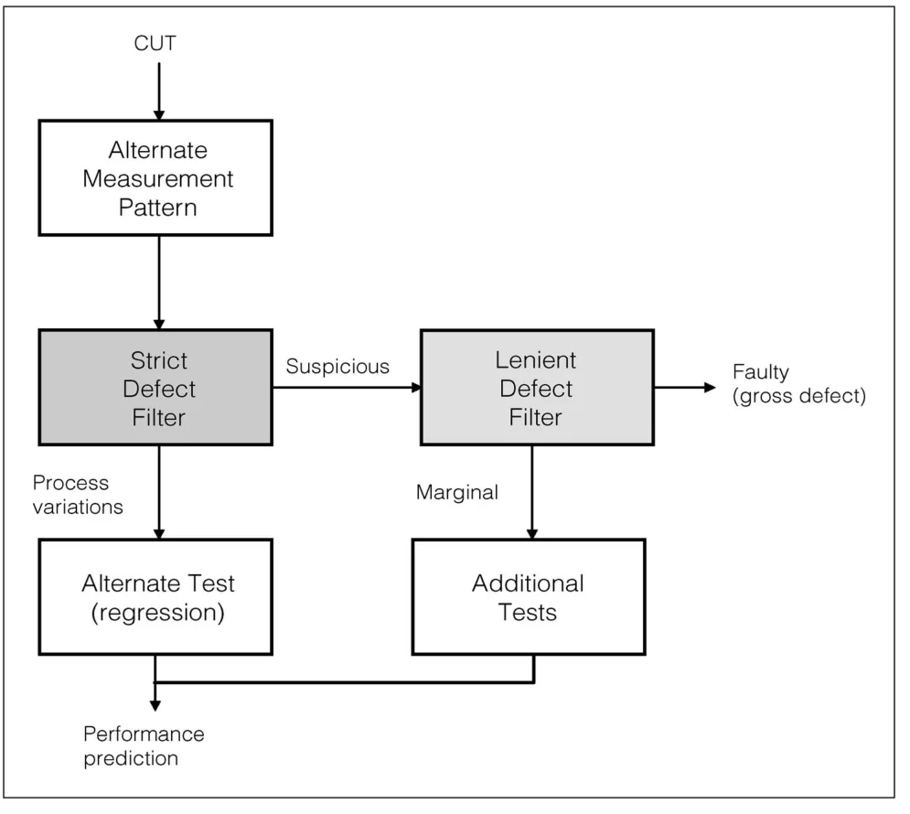
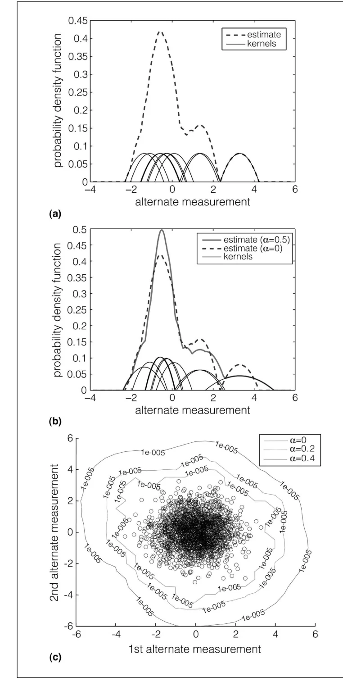
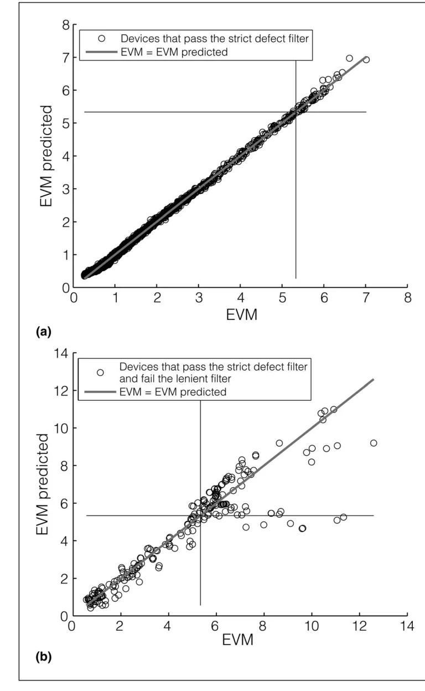

> - **논문**: Adaptive Alternate Analog Test
> - **저자**: Haralampos-G. Stratigopoulos, Salvador Mir (TIMA Laboratory, CNRS-Grenoble INP-UJF)
> - **학회**: IEEE Design & Test of Computers 29(4), 2012 · [DOI:10.1109/MDT.2012.2205480](https://doi.org/10.1109/MDT.2012.2205480)
{: .prompt-tip }

> 아날로그 회로는 다이 면적의 5%도 안 되지만 테스트 비용은 전체의 절반까지 차지한다. 사양마다 다른 고가 장비와 긴 측정 시간 때문이다. **Alternate test**는 사양(이득, 잡음 지수, EVM 등)을 직접 재는 대신 한 가지 구성으로 빠르게 뽑는 간단한 측정에서 회귀 모델로 사양을 예측한다. 문제는 무작위 결함이 있거나 사양 경계에 걸친 칩에서 예측이 틀릴 위험이다. 이 논문은 **결함 데이터 없이** 학습 분포만으로 만든 두 개의 커널 밀도 필터로 위험한 칩을 골라내고, 대다수는 싸게, 소수만 정밀하게 테스트하는 **적응형 흐름**을 제안한다.

## 1. 문제: 회귀 모델은 본 적 없는 칩을 예측하지 못한다

Alternate test의 전제는 성능 벡터 $$P = [P_1, \ldots, P_m]$$과 대체 측정 $$X = [X_1, \ldots, X_d]$$가 **같은 공정 변동**을 겪으므로, 학습 표본에서 $$P_j = g_j(X)$$를 배우면 새 칩의 $$X$$만으로 $$P$$를 예측할 수 있다는 것이다. 그러나 회귀 함수는 학습 표본이 덮은 영역에서만 믿을 수 있다.

- 학습 분포의 **꼬리에 있는 한계 칩**은 외삽 영역이라 예측이 임의적이다.
- **결함 칩**(단락, 단선, 과도한 파라미터 변동)은 통계적 분포 밖의 물리적 원인이라 회귀로 설명되지 않고, 학습에 넣으면 적합을 망친다.

가장 단순한 안전 영역은 학습 집합의 측정별 최솟값·최댓값으로 만든 초직육면체 $$[\min X_1, \max X_1] \times \cdots \times [\min X_d, \max X_d]$$이지만, 실제 학습 표본은 그 안의 일부만 채우고 모서리 쪽에는 큰 빈 공간이 남으므로 너무 거친 근사이다. 그래서 alternate test는 "이 칩의 $$X$$가 학습 데이터로 대표되는가"를 더 정밀하게 판단해야 한다. 기존 방법(저자들의 2008년 연구)은 결함 칩 데이터를 모아 분류기를 학습해야 했는데, 양산 초기에는 그런 데이터가 없다.

## 2. 방법

### 적응형 흐름


_Figure 1. 적응형 alternate test 흐름. 엄격 필터를 통과한 칩은 회귀로 성능을 예측하고, 의심 칩은 관대 필터에서 큰 결함(바로 불량)과 한계 칩(추가 테스트)으로 나뉜다. (출처: Stratigopoulos & Mir, 2012)_

1. 모든 칩에서 대체 측정 $$X$$를 얻는다.
2. **엄격한 결함 필터**: $$X$$가 학습 데이터로 충분히 대표되면 회귀 모델로 성능을 예측하고 합격/불합격을 결정한다. 아니면 "의심 칩"으로 분리한다. 통과시킨 칩은 정확히 예측된다고 보장하는 쪽으로 보수적이다.
3. **관대한 결함 필터**: 의심 칩이 완전 고장 수준의 큰 결함이면 바로 불량 처리한다. 그렇지 않으면(사양 경계에 걸친 가벼운 결함) 2차 테스트 단계로 보내 사양 테스트나 결함 지향 구조 테스트를 한다.

대다수 칩은 분포의 주요 부분에 있어 싼 경로로 끝나고, 자원은 소수의 한계 칩에 집중된다.

### 커널 밀도 결함 필터

필터의 근거는 대체 측정의 결합 밀도 $$f(X)$$이다. 형태를 모르므로 학습 표본 $$X_1, \ldots, X_n$$으로 **Epanechnikov 커널 밀도 추정**을 쓴다.

$$
\hat f(X) = \frac{1}{n} \sum_{i=1}^{n} \frac{1}{h^d} K_e\!\left(\frac{X - X_i}{h}\right), \qquad
K_e(t) = \begin{cases} \frac{1}{2} c_d^{-1} (d + 2)(1 - t^\top t) & t^\top t < 1 \\ 0 & \text{otherwise} \end{cases}
$$

$$c_d$$는 단위 $$d$$차원 구의 부피, 대역폭 $$h$$는 Silverman의 규칙 $$h = \{8 c_d^{-1}(d+4)(2\sqrt{\pi})^d\}^{1/(d+4)} n^{-1/(d+4)}$$이다. 커널이 유한 지지를 가지므로 **밀도 추정이 정확히 0이 되는 영역**이 생기고, $$\hat f(X) = 0$$이 필터의 경계이다.


_Figure 2. (a) 1차원 관측 10개에 커널을 얹어 만든 밀도 추정. 추정이 0이 되는 곳이 필터 경계이다. (b) $$\alpha = 0.5$$로 지역 대역폭을 키우면 꼬리 쪽 커널이 넓어진다. (c) 공정 변동 칩 2,000개(원)로 만든 2차원 필터 경계, $$\alpha$$ = 0, 0.2, 0.4. (출처: Stratigopoulos & Mir, 2012)_

경계의 위치를 조절하려고 **적응형 KDE**를 쓴다. 각 표본에 지역 대역폭 인자 $$\lambda_i = (\hat f(X_i) / g)^{-\alpha}$$($$g$$는 $$\hat f(X_i)$$의 기하평균)를 곱해, 밀도가 낮은 꼬리의 커널을 넓힌다. $$\alpha$$가 클수록 꼬리가 길고 매끄러워져 필터가 **관대**해지고, $$\alpha = 0$$이면 원래 KDE이다. 엄격 필터와 관대 필터는 같은 추정기의 $$\alpha_s < \alpha_l$$ 두 값일 뿐이다.

장점은 넷이다. 비모수적이라 어떤 대체 측정에도 적용되고, 결함 칩 데이터 없이 학습 표본만으로 만들 수 있어 양산 시작과 동시에 쓸 수 있으며, 파라미터가 $$\alpha$$ 하나라 유연하고, 새 통계가 쌓이면 쉽게 재학습된다.

## 3. 코드로 보기: 적응형 KDE 필터

2차원 대체 측정에서 공정 변동 칩 2,000개로 필터를 만들고, 공정 변동(PV)·과도 변동(EPV)·하드 결함(HD) 테스트 집합이 $$\alpha$$에 따라 얼마나 걸러지는지, 그리고 엄격 필터를 통과한 EPV 칩과 걸러진 칩에서 회귀 예측이 얼마나 믿을 만한지 본다.

```python
import numpy as np
rng = np.random.default_rng(0)
d, n = 2, 2000
# training set: alternate measurements of fault-free devices under process variation (correlated Gaussian)
L = np.array([[1.0, 0.0], [0.6, 0.8]])
X = rng.standard_normal((n, d)) @ L.T
perf = 5.0 + 1.5 * X[:, 0] - 0.8 * X[:, 1] + 0.1 * rng.standard_normal(n)      # the specification (e.g. EVM)
spec_limit = 7.5

cd = np.pi                                                                     # volume of the unit disk (d = 2)
h = (8 / cd * (d + 4) * (2 * np.sqrt(np.pi)) ** d) ** (1 / (d + 4)) * n ** (-1 / (d + 4))
def kde(Q, bw):                                                                # Epanechnikov kernel density estimate
    t2 = (((Q[:, None, :] - X[None, :, :]) / bw) ** 2).sum(-1)
    K = np.where(t2 < 1, 0.5 / cd * (d + 2) * (1 - t2), 0.0)
    return (K / bw ** d).mean(1)
f_train = kde(X, h)
g = np.exp(np.mean(np.log(f_train + 1e-300)))
def adaptive_kde(Q, alpha):                                                    # local bandwidth factors lambda_i = (f(X_i)/g)^-alpha
    lam = (f_train / g) ** (-alpha)
    t2 = (((Q[:, None, :] - X[None, :, :]) / (h * lam[None, :, None])) ** 2).sum(-1)
    K = np.where(t2 < 1, 0.5 / cd * (d + 2) * (1 - t2), 0.0)
    return (K / (h * lam[None, :]) ** d).mean(1)

# test sets: 1000 process-variation devices, 300 marginal (excessive variation), 300 hard defects (outliers)
PV = rng.standard_normal((1000, d)) @ L.T
EPV = rng.standard_normal((300, d)) @ L.T * 2.2
HD = rng.standard_normal((300, d)) @ L.T + rng.choice([-6, 6], (300, d))
print("share of devices screened out (density estimate = 0) by a filter with parameter alpha")
print("alpha   PV set   EPV set   HD set")
for a in (0.0, 0.2, 0.5, 0.8, 1.0):
    row = [100 * np.mean(adaptive_kde(S, a) == 0) for S in (PV, EPV, HD)]
    print(f"{a:>4}   {row[0]:5.1f}%   {row[1]:5.1f}%   {row[2]:5.1f}%")

# regression test accuracy for devices that pass a strict filter vs. for the devices it would send to retest
w = np.linalg.lstsq(np.c_[X, np.ones(n)], perf, rcond=None)[0]
def predict(S): return np.c_[S, np.ones(len(S))] @ w
true_epv = 5.0 + 1.5 * EPV[:, 0] - 0.8 * EPV[:, 1] + 0.3 * np.sign(EPV[:, 0]) * EPV[:, 0] ** 2 / 4   # marginal devices deviate from the fit
passed = adaptive_kde(EPV, 0.2) > 0
for name, idx in (("pass the strict filter", passed), ("are screened out", ~passed)):
    c = np.corrcoef(predict(EPV[idx]), true_epv[idx])[0, 1]
    esc = np.mean((predict(EPV[idx]) <= spec_limit) & (true_epv[idx] > spec_limit)) * 100
    print(f"\nEPV devices that {name:<22}: n={idx.sum():3d}, prediction correlation {c:.3f}, test escapes {esc:.1f}%")
```

```text
share of devices screened out (density estimate = 0) by a filter with parameter alpha
alpha   PV set   EPV set   HD set
 0.0     0.1%    22.3%   100.0%
 0.2     0.0%    10.7%    99.7%
 0.5     0.0%     0.0%    51.7%
 0.8     0.0%     0.0%     0.0%
 1.0     0.0%     0.0%     0.0%

EPV devices that pass the strict filter: n=268, prediction correlation 0.996, test escapes 3.7%

EPV devices that are screened out      : n= 32, prediction correlation 0.988, test escapes 0.0%
```

- $$\alpha = 0$$이면 PV 칩도 0.1%가 걸러지고 EPV 22%, HD 100%가 걸러진다. $$\alpha$$를 올리면 꼬리가 넓어져 PV는 모두 통과하고 EPV·HD의 걸러지는 비율이 줄어든다. 논문 Figure 5·6의 추세와 같다. 엄격 필터는 작은 $$\alpha$$(여기서는 0.2: PV 전부 통과, EPV 11%, HD 거의 전부 분리), 관대 필터는 큰 $$\alpha$$로 잡아 HD만 직접 불량 처리하는 식으로 조합한다.
- 엄격 필터를 통과한 EPV 칩은 회귀 예측과 실제의 상관이 0.996이지만, 사양 경계 근처라 테스트 누락(합격 예측인데 실제 불합격)이 3.7% 생긴다. 걸러진 32개는 재검사로 가므로 누락이 0이다. 필터는 **예측을 믿어도 되는 칩과 아닌 칩을 가르고**, 어디에 선을 긋는지는 누락률과 재검사 비용의 트레이드오프이다.

## 4. 실험: RF 수신기의 EVM 대체 테스트

**회로와 측정.** LNA와 믹서로 구성된 900MHz RF 수신기 프론트엔드. 대체 테스트는 1ms 동안 3쌍의 2톤 자극(채널 대역폭을 덮도록 선택)을 가하고 I/Q 채널을 480kHz로 샘플링해 FFT한 기본파의 진폭·위상을 쓴다. 표준 EVM 테스트는 QPSK 변조 신호와 100kHz 샘플링이 필요하므로 대체 테스트가 장비 비용(디지털 변조 RF 소스 불필요)과 시간 모두에서 싸다. EVM 사양 한계는 5.33%이다.

**데이터.** Monte Carlo로 공정 변동 칩 3,000개(학습 2,000, 테스트 1,000), 국소 파라미터 결함(공칭값에서 크게 벗어난 변동, 논문 표기 5%) 45곳 × 20 = 900개(EPV), 단락 18곳·단선 18곳 × 20 = 720개(HD).

| 항목 | 값 |
|---|---|
| 회로 | 900MHz RF 수신기 프론트엔드 (LNA + 믹서) |
| 대체 자극 | 2톤 3쌍, 각 톤 1mV, 총 1ms. 예: {900.08, 900.12}, {900.1, 900.14}, {900.1, 900.16} MHz |
| 대체 측정 | I/Q 채널을 480kHz로 샘플링 → FFT → 각 채널 기본파의 진폭·위상 |
| 표준 EVM 테스트 | QPSK, 심볼 속도 25kHz, I/Q 100kHz 샘플링 |
| 사양 | EVM ≤ 5.33% |
| 공정 변동 | 트랜지스터 크기, R, L, C를 정규분포에서 표본추출 |
| 결함 모델 | 국소 파라미터 결함, 단선(끊어진 배선), 단락(노드 사이 10Ω 브리지) |
| 필터·회귀 학습 | 공정 변동 칩 2,000개 |
| 평가 | PV 1,000 / EPV 900 / HD 720개 (독립 테스트 집합) |

데이터 집합은 Intel의 E. Acar와 Arizona State University의 S. Ozev가 제공했다고 감사의 글에 적혀 있다. 회귀 모델의 종류는 이 글에 나오지 않는다.

**트레이드오프.** $$\alpha_s$$를 키우면 통과 칩이 늘지만 0.6을 넘으면 예측 상관이 급락한다(학습 분포 밖의 칩이 섞이기 시작). $$\alpha_l = 0$$이면 PV 칩의 2.3%까지 직접 불량 처리되지만 $$\alpha_l \ge 0.2$$면 PV는 모두 통과하고, HD는 $$\alpha_l$$이 커져도 85% 이상 직접 불량으로 잡힌다. EPV는 $$\alpha_l = 0$$에서 40%가 직접 불량이다가 $$\alpha_l = 1$$에서 0%로 지수적으로 줄어든다.

**선택 예.** $$\alpha_s = 0.2$$를 고르면 예측 상관이 0.993이고 PV 칩은 모두 회귀 테스트로 간다. $$\alpha_s = 0$$도 상관은 높지만 PV 칩의 2.3%를 불필요하게 재검사하게 된다. 여기에 EPV 칩 상당수가 실제로는 동작할 수 있으므로 재검사로 돌리는 쪽을 택해 $$\alpha_l = 0.8$$을 고르면, 테스트 집합별 행선지는 다음과 같다.

| 집합 | 직접 불량 | 재검사 | 회귀 테스트 (정확히 예측) |
|---|---|---|---|
| PV | 0% | 0% | 100% |
| EPV | 3.11% | 20.78% | 약 76.11% |
| HD | 86.11% | 5.28% | 약 8.5% (EVM이 정상 범위인 결함 칩) |


_Figure 7. 예측 EVM 대 실제 EVM. (a) 엄격 필터($$\alpha_s = 0.2$$)를 통과한 칩은 45도 선 위에 놓인다. (b) 재검사로 보낸 칩을 가정적으로 회귀 테스트에 넣으면 예측이 크게 빗나간다. 가로·세로선은 사양 5.33%이다. (출처: Stratigopoulos & Mir, 2012)_

Figure 7(b)처럼 재검사로 보낸 칩을 회귀 테스트에 넣으면 실제 EVM이 8~12%인데 5% 안팎으로 예측되는 칩이 나와 **테스트 누락**이 되고, 반대 방향 오차는 **수율 손실**이 된다. 필터가 꼭 필요한 이유이다.

## 5. 해석

**1. "모델을 믿어도 되는 입력인가"를 먼저 묻는 설계이다.** 머신러닝 테스트의 핵심 위험은 모델 오류가 아니라 분포 밖 입력이고, 이 논문은 그것을 밀도 추정으로 직접 다룬다. 오늘날의 OOD 검출, 선택적 예측(selective prediction)과 같은 문제를 2012년에 테스트 공학의 언어로 푼 셈이다.

**2. 결함 데이터 없이 시작할 수 있다는 점이 실용적 차별점이다.** 분류기 기반 접근은 불량 칩을 충분히 모을 때까지 쓸 수 없는데, 밀도 필터는 양품 분포만 있으면 된다. [PatchCore]()가 정상 데이터만으로 결함 위치를 찾는 것과 같은 발상이 아날로그 테스트에서 먼저 나온 것이다.

**3. 파라미터 하나로 흐름을 조절하는 단순함이 운영에 맞는다.** $$\alpha_s, \alpha_l$$ 두 값으로 (예측 정확도, 재검사율, 직접 불량률)의 삼각 트레이드오프를 그래프에서 읽어 정하고, 새 로트 데이터가 쌓이면 재학습한다. 적응형 테스트의 "결정 트리" 비전이 가장 단순한 형태로 구현된 예이다.

**4. 한계는 차원과 데이터이다.** KDE는 측정 차원 $$d$$가 커지면 표본이 희박해져 "밀도 0" 영역이 과도하게 넓어진다. 사례는 2톤 3쌍의 진폭·위상이라 저차원이지만, 측정이 수십 개면 차원 축소가 필요하다. 또 모든 결과가 Monte Carlo 시뮬레이션이라 실리콘 데이터의 비정규성은 검증되지 않았다.

**5. 평가를 읽을 때 주의할 점.** 결함 모델(5% 변동, 10Ω 단락, 단선)은 저자들이 선택한 것이고, 실제 결함 분포는 다르다. 재검사 비용과 테스트 누락의 금전적 가중치는 논문에 없어 "최적" $$\alpha$$는 정성적으로만 정해진다. 위 toy는 2차원 가우시안이라 실제 측정보다 필터가 쉽게 동작한다.

## 6. 정리

| 항목 | 내용 |
|---|---|
| 배경 | 아날로그 테스트 비용 최대 50%; alternate test는 싸지만 한계 칩·결함 칩에서 예측 위험 |
| 흐름 | 대체 측정 → 엄격 필터(통과: 회귀로 판정) → 관대 필터(큰 결함: 직접 불량, 나머지: 2차 정밀 테스트) |
| 필터 | Epanechnikov KDE의 $$\hat f(X) = 0$$ 경계, 적응형 대역폭 $$\lambda_i = (\hat f(X_i)/g)^{-\alpha}$$, $$\alpha$$로 엄격/관대 조절 |
| 장점 | 비모수, 결함 데이터 불필요, 파라미터 1개, 재학습 용이 |
| 사례 | RF 수신기 EVM: $$\alpha_s = 0.2$$(상관 0.993), $$\alpha_l = 0.8$$(HD 86% 직접 불량, EPV 21% 재검사) |
| 한계 | 저차원 측정에 적합, 시뮬레이션 검증 |

## References

- Stratigopoulos, Mir, "Adaptive Alternate Analog Test," IEEE Design & Test of Computers 29(4), 2012. [DOI:10.1109/MDT.2012.2205480](https://doi.org/10.1109/MDT.2012.2205480)
- Variyam, Cherubal, Chatterjee, "Prediction of Analog Performance Parameters Using Fast Transient Testing," IEEE TCAD 2002.
- Halder, Chatterjee, "Low-Cost Alternate EVM Test for Wireless Receiver Systems," VTS 2005.
- Stratigopoulos, Makris, "Error Moderation in Low-Cost Machine-Learning-Based Analog/RF Testing," IEEE TCAD 2008.
- Silverman, "Density Estimation for Statistics and Data Analysis," Chapman & Hall, 1986.
