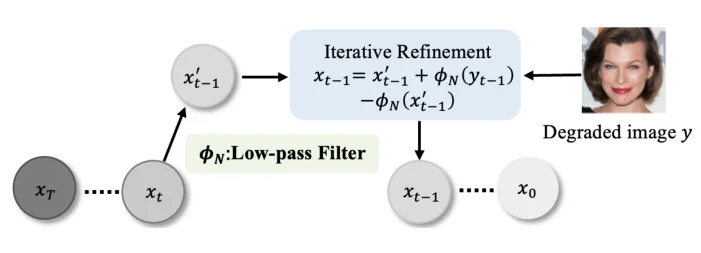
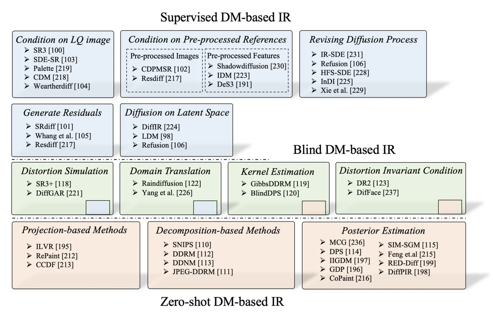
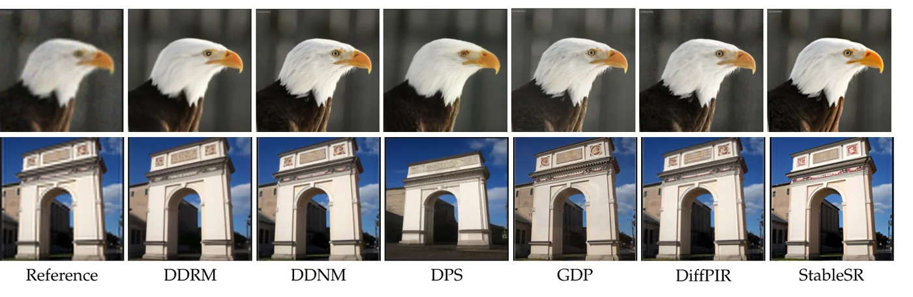

> - **논문**: Diffusion Models for Image Restoration and Enhancement – A Comprehensive Survey
> - **저자**: Xin Li, Yulin Ren, Xin Jin, Cuiling Lan, Xingrui Wang, Wenjun Zeng, Xinchao Wang, Zhibo Chen (USTC, NUS, EIT, MSRA)
> - **학회**: arXiv preprint, 2023 · [arXiv:2308.09388](https://arxiv.org/abs/2308.09388) · [자료 저장소](https://github.com/lixinustc/Awesome-diffusion-model-for-image-processing)
{: .prompt-tip }

> [MWCNN]()처럼 CNN으로 영상을 복원하면 PSNR은 오르지만 질감은 흐릿하다. 픽셀 손실(MSE, L1)이 가능한 정답들의 **평균**을 내기 때문이고, SRGAN·ESRGAN은 적대 손실로 질감을 살렸지만 학습이 불안정하고 생성된 질감이 가짜처럼 보이는 문제가 남았다. 디퓨전 모델이 생성 품질에서 GAN을 넘자 "디퓨전이 복원도 끌어올릴까"가 자연스러운 질문이 됐고, 이 서베이는 그 답을 처음으로 체계화했다고 스스로 밝힌다. 서베이의 기본 구분은 **지도 학습**(왜곡/정답 쌍으로 디퓨전을 처음부터 학습)과 **제로샷**(사전학습 생성 디퓨전의 사전 지식을 학습 없이 활용)이다.

## 1. 배경

NCSN(점수 + 담금질 랑주뱅), DDPM(고정 분산 순방향 + 변분 하한), SDE(둘을 연속 시간으로 통일)의 세 기초 모델을 정리하고, 최적화 전략·샘플링 효율·구조·조건 전략 면의 개선을 훑는다. [디퓨전 서베이]()와 겹치므로 여기서는 복원에 중요한 점만 적는다. 복원의 목표는 왜곡 이미지 $$y$$가 주어졌을 때 **사후 분포** $$p_\theta(x_{t-1} \mid y, x_t)$$를 배워 $$x_0 \sim q(x \mid y)$$를 뽑는 것이고, 관건은 $$y$$를 어떻게 조건으로 넣느냐이다.

## 2. 두 가지 작업 흐름

### 지도 학습: SR3

SR3는 DDPM 틀에서 저해상도 $$y$$를 bicubic으로 목표 해상도로 키운 뒤 **$$x_t$$와 채널 방향으로 이어 붙여** U-Net에 넣는 가장 직접적인 조건화이다. 학습 설정은 batch 32, 1M iteration, lr 1e-4, 학습·추론 모두 2,000 step이다(서베이 Table 9). 질감 생성은 뛰어나지만 두 한계가 있다. 처음부터 학습하려면 대량의 쌍 데이터가 필요하고, 실세계에서 왜곡/정답 쌍을 모으기 어렵다.

### 제로샷: ILVR

사전학습된 무조건 디퓨전은 ImageNet·FFHQ 같은 대규모 자연 이미지로 학습되어 구조와 질감의 저장소로 볼 수 있다. ILVR은 샘플링의 매 단계에서 예측된 $$x'_{t-1}$$의 **저주파 성분을 참조 이미지의 것으로 교체**한다.

$$
x_{t-1} = x'_{t-1} + \Phi_N(y_{t-1}) - \Phi_N(x'_{t-1})
$$


_Figure 6. ILVR. 매 단계 예측 $$x'_{t-1}$$의 저주파 성분 $$\phi_N(x'_{t-1})$$을 왜곡 이미지 $$y$$를 같은 단계까지 확산시킨 것의 저주파 성분으로 바꾼다. (출처: Li et al., 2023)_

$$\Phi_N$$은 저역 통과 필터, $$y_{t-1}$$은 $$y$$를 $$t-1$$단계까지 확산시킨 것이다. 구조는 참조에서, 고주파 질감은 생성 사전에서 온다. 제로샷 방법의 주된 과제는 왜곡 이미지의 데이터 구조를 보존하면서 지각적 사전을 끌어내는 방법이고, 이후 방법들은 대부분 이 정제 전략을 개선한다.

## 3. 분류


_Figure 4. 서베이의 분류. 위(파랑)는 지도 학습, 가운데(초록)는 블라인드 복원, 아래(주황)는 제로샷 방법이다. (출처: Li et al., 2023)_

**지도 학습 디퓨전**은 조건 전략으로 (1) 저화질 참조 이미지(SR3처럼 직접 이어 붙임), (2) 전처리된 참조(다른 네트워크로 먼저 복원한 이미지를 조건으로 쓰는 CDPMSR·ResDiff, 특징을 조건으로 쓰는 IDM 등), (3) 디퓨전 과정 수정(저화질 이미지에서 시작하거나 순방향 자체를 왜곡 과정으로 정의, IR-SDE·Refusion 등)으로 나뉘고, 생성 공간으로 이미지·**잔차**(SRDiff·ResDiff처럼 전처리 결과와 정답의 차이만 생성)·**잠재**(DiffIR·LDM처럼 저차원에서 생성)로 나뉜다.

**제로샷 디퓨전**은 데이터 일관성을 어떻게 강제하느냐로 나뉜다. 저주파 교체(ILVR), 선형 역문제의 **분해**(DDRM의 SVD, DDNM의 영공간 분해로 측정과 일치하는 성분은 $$y$$에서, 나머지는 생성에서), **사후 기울기**(DPS는 $$\nabla_{x_t} \log p(y \mid x_t)$$를 근사해 매 단계 보정, GDP는 경험적 공식), **플러그 앤 플레이**(DiffPIR은 디퓨전을 디노이저 사전으로 쓰는 HQS 분할) 등이다.

**블라인드/실세계 복원**은 왜곡이 미지이고 다양해 두 흐름 모두 어렵다. 네 방향이 있다. **왜곡 시뮬레이션**(Real-ESRGAN류의 고차 왜곡 파이프라인으로 쌍을 합성), **커널 추정**(블러 커널을 디퓨전으로 함께 추정), **도메인 변환**(실세계 왜곡을 합성 왜곡 도메인으로 옮긴 뒤 복원), **왜곡 불변 디퓨전**(왜곡에 불변인 표현에서 생성).

## 4. 코드로 보기: 지각-왜곡 트레이드오프

체커보드 질감의 깨끗한 이미지에 블러와 잡음을 더한 관측에 대해, (a) MSE로 학습한 회귀기처럼 잡음을 평균 내는 평활 추정과 (b) 질감 통계는 정확하지만 패턴이 2픽셀 어긋난 생성 표본의 PSNR·SSIM·선명도를 비교하고, 샘플러별 디노이저 평가 횟수를 센다.

```python
import numpy as np
rng = np.random.default_rng(0)
n = 64
yy, xx = np.mgrid[0:n, 0:n]
# a clean image with sharp edges and texture, and a noisy, slightly blurred observation
clean = ((xx // 8 + yy // 8) % 2).astype(float) * 0.6 + 0.2 + 0.05 * np.sin(xx / 2.0)
def blur(img, k=1):
    out = np.zeros_like(img)
    for dy in range(-k, k + 1):
        for dx in range(-k, k + 1): out += np.roll(np.roll(img, dy, 0), dx, 1)
    return out / (2 * k + 1) ** 2
degraded = blur(clean) + 0.15 * rng.standard_normal((n, n))
def psnr(a, b): mse = np.mean((a - b) ** 2); return 10 * np.log10(1.0 / mse) if mse > 0 else float("inf")
def ssim(a, b):
    mu_a, mu_b = a.mean(), b.mean(); va, vb = a.var(), b.var(); cov = np.mean((a - mu_a) * (b - mu_b))
    c1, c2 = 0.01 ** 2, 0.03 ** 2
    return (2 * mu_a * mu_b + c1) * (2 * cov + c2) / ((mu_a ** 2 + mu_b ** 2 + c1) * (va + vb + c2))
def sharpness(a): return np.mean(np.abs(np.diff(a, axis=1))) + np.mean(np.abs(np.diff(a, axis=0)))
# two "restorations": an MSE-trained regressor (averages the noise away, blurs edges) and a generative sample
# (sharp, right texture statistics, but the pattern is placed 2 px off: pixel-wise it is wrong)
mse_estimate = blur(degraded, 1)
sample = np.roll(clean, 2, 1) + 0.03 * rng.standard_normal((n, n))
print("perception-distortion trade-off on a toy image")
print("candidate                 PSNR(dB)   SSIM    sharpness (edge energy)")
for name, img in (("degraded input", degraded), ("MSE-trained estimate", mse_estimate), ("generative sample (2px off)", sample), ("ground truth", clean)):
    print(f"{name:<26} {psnr(img, clean):7.2f}   {ssim(img, clean):.3f}   {sharpness(img):.3f}")
print("-> the blurry estimate wins PSNR/SSIM; the sharp sample keeps real edges but is punished pixel-wise")
print()
for name, steps in (("DDPM sampling", 1000), ("DDIM", 50), ("DPM-Solver", 15), ("one-step distilled", 1)):
    print(f"{name:<20} {steps:>5} denoiser evaluations per restored image")
```

```text
perception-distortion trade-off on a toy image
candidate                 PSNR(dB)   SSIM    sharpness (edge energy)
degraded input               13.89   0.758   0.378
MSE-trained estimate         15.93   0.812   0.141
generative sample (2px off)   10.36   0.501   0.205
ground truth                   inf   1.000   0.147
-> the blurry estimate wins PSNR/SSIM; the sharp sample keeps real edges but is punished pixel-wise

DDPM sampling         1000 denoiser evaluations per restored image
DDIM                    50 denoiser evaluations per restored image
DPM-Solver              15 denoiser evaluations per restored image
one-step distilled       1 denoiser evaluations per restored image
```

- 평활 추정은 PSNR 15.9dB, SSIM 0.81로 가장 좋고, 가장자리 에너지도 0.141로 정답(0.147)과 비슷하게 나온다. 인접 픽셀 차이의 평균인 이 지표는 흐려진 경계와 남은 잡음을 구분하지 못해, 이 toy에서는 흐림을 잡아내지 못한다. 생성 표본은 가장자리 에너지가 0.205로 정답보다 오히려 크고, 2픽셀 어긋났다는 이유로 PSNR이 10.4dB, 즉 **왜곡된 입력보다도 낮다**. PSNR·SSIM이 픽셀 정렬을 요구하는 왜곡 지표이고, 지각 품질과 상충한다는 Blau & Michaeli의 트레이드오프가 가장 단순한 형태로 보인다. 서베이가 FID·LPIPS 같은 지각 지표를 함께 보고하는 이유이다.
- DDPM 1,000회에서 DDIM 50회, DPM-Solver 15회, 증류 1회로 줄어드는 디노이저 평가 횟수는 6.1절 "샘플링 효율"이 다루는 가속 방향(비마르코프 과정, ODE 솔버, 증류)을 흔히 쓰는 step 수로 나타낸 예시이다. 서베이는 이런 방법으로 10~20 step까지 줄었다고 정리한다. SR3가 224×224 한 장에 약 50초 걸리는 것이 1,000회 평가 때문이다.

## 5. 실험 비교

데이터셋(DIV2K, Urban100, ImageNet 1K, CelebA 1K 등), 구현 세부, 지표(PSNR, SSIM, FID, LPIPS, 실행 시간, 파라미터, FLOPs)를 정리한 뒤 공개 구현을 직접 돌려 비교한다.

**구현 세부(서베이 Table 9·10에서 발췌).** 지도 학습 방법은 저마다 학습 설정이 크게 다르고, 제로샷 방법은 추론 step 수가 20에서 1,000까지 퍼져 있다. 실행 시간 차이의 상당 부분이 이 step 수에서 나온다.

| 방법 | 종류 | batch | iteration | lr | 학습 step | 추론 step |
|---|---|---|---|---|---|---|
| SR3 | 지도 | 32 | 1M | 1e-4 | 2000 | 2000 |
| SRDiff | 지도 | 16 | 400K | 2e-4 | 100 | 100 |
| CDPMSR | 지도 | 16 | 300K | 1e-4 | 1000 | 100 |
| ResDiff | 지도 | 4 | 250K | 1e-4 | 1000 | - |
| IDM | 지도 | 64 | 1.5M | 1e-4 | 2000 | 2000 |
| DDRM | 제로샷 | - | - | - | - | 20 |
| DDNM | 제로샷 | - | - | - | - | 100 |
| DPS | 제로샷 | - | - | - | - | 1000 |
| ILVR / RePaint / CoPaint | 제로샷 | - | - | - | - | 250 |

**4배 초해상도, 지도 학습 (Table 3).**

| 방법 | DIV2K PSNR / SSIM / LPIPS / FID | Urban100 PSNR / SSIM / LPIPS / FID | 시간(s/장) | 파라미터 |
|---|---|---|---|---|
| Bicubic | 25.36 / 0.643 / 0.31 / 108.2 | 24.26 / 0.628 / 0.34 / 134.3 | - | - |
| SR3 | 26.17 / 0.682 / 0.24 / 111.23 | 25.18 / 0.693 / 0.21 / 61.15 | 50.4 | 155.3M |
| SRDiff | 26.87 / 0.694 / 0.21 / 110.33 | 26.49 / 0.791 / 0.17 / 51.37 | 4.5 | 13.2M |
| **ResDiff** | **27.94 / 0.723** / 0.23 / 107.69 | **27.43 / 0.824** / 0.14 / 42.35 | - | - |
| CDPMSR | 27.43 / 0.712 / 0.19 / **101.23** | 26.98 / 0.801 / 0.16 / **39.87** | - | - |
| IDM | 27.13 / 0.703 / **0.18** / 106.32 | 26.76 / 0.657 / **0.13** / 43.98 | 59.5 | 116.6M |

ResDiff가 PSNR·SSIM에서 가장 좋고, PSNR은 다음으로 좋은 CDPMSR보다 약 0.5dB 높다. 잔차를 생성하고 전처리 이미지를 조건으로 써서 픽셀 수준 일관성이 보장되기 때문이다. IDM과 CDPMSR은 전처리 이미지·특징을 조건으로 써 지각 지표가 좋다. SRDiff는 84.22 GFLOPs, 13.2M 파라미터로 IDM·SR3보다 훨씬 가볍고 100 step만 쓴다. 서베이 본문은 SRDiff의 한 장 생성 시간을 43.5초라고 쓰지만 표에는 4.5초로 나와 있어, 둘 중 하나는 오기로 보인다. 본문은 SRDiff가 잠재 공간에서 동작해 가볍다고 설명하는데, 같은 서베이의 분류 그림(Figure 4)은 SRDiff를 잔차 생성으로 분류한다.

**4배 초해상도, 제로샷 (Table 4).** ImageNet 1K와 CelebA 1K에서 비교했다.

| 방법 | ImageNet PSNR / SSIM / LPIPS / FID | CelebA PSNR / SSIM / LPIPS / FID | 시간(s/장) |
|---|---|---|---|
| ILVR | 27.40 / 0.871 / 0.21 / 43.76 | 31.59 / 0.878 / 0.22 / 32.24 | 41.3 |
| SNIPS | 24.31 / 0.684 / 0.21 / 124.54 | 27.34 / 0.675 / 0.27 / 105.19 | 31.4 |
| DDRM | 27.38 / 0.869 / 0.22 / 40.75 | **31.64 / 0.946** / 0.19 / 31.04 | 10.1 |
| DPS | 25.88 / 0.814 / 0.15 / 39.24 | 29.65 / 0.878 / 0.18 / 29.97 | 141.2 |
| **DDNM** | **27.46 / 0.871** / 0.15 / 40.15 | **31.64** / 0.945 / **0.16** / 28.27 | 15.5 |
| GDP | 26.51 / 0.832 / **0.14 / 38.45** | 28.65 / 0.876 / 0.17 / **27.51** | **3.1** |
| StableSR(지도, 참고) | 25.76 / 0.842 / 0.09 / 25.29 | 25.34 / 0.823 / 0.08 / 16.12 | 18.15 |

DDRM과 DDNM이 PSNR·SSIM에서 좋고 ILVR이 뒤따른다. 분해 관점의 데이터 일관성이 저주파 일관성보다 강하기 때문이다. DPS와 GDP는 지각 지표에 집중하며, GDP는 25 step으로 가장 빠르고(3.1초) DPS는 매 step 보정 때문에 DDIM 가속을 못 써 한 장에 약 141초이다. 실세계 복원용으로 학습된 StableSR은 PSNR은 낮지만 LPIPS·FID가 압도적으로 좋아, 지각-왜곡 트레이드오프를 그대로 보여 준다.


_Figure 15. 제로샷 방법과 StableSR의 4배 초해상도 결과. 맨 왼쪽이 정답 이미지이다. (출처: Li et al., 2023)_

Figure 15의 아래 줄에서 DPS는 개선문의 시점과 배경까지 달라진 이미지를 내놓는다. 그럴듯하지만 정답과 픽셀이 맞지 않으니 PSNR이 낮고 FID·LPIPS는 상대적으로 좋은, 위 toy의 "어긋난 생성 표본"과 같은 상황이다.

**가우시안 디블러링 (Table 5).**

| 방법 | ImageNet PSNR / SSIM / LPIPS / FID | CelebA PSNR / SSIM / LPIPS / FID | 시간(s/장) |
|---|---|---|---|
| 블러 입력 | 19.56 / 0.553 / 0.61 / 168.20 | 19.95 / 0.578 / 0.53 / 164.31 | - |
| DPS | 21.51 / 0.516 / 0.41 / 52.61 | 25.56 / 0.688 / 0.25 / 65.67 | 130.1 |
| DDRM | 24.54 / 0.668 / 0.39 / 71.65 | 27.21 / 0.767 / 0.29 / 87.32 | **8.9** |
| DDNM | **25.37 / 0.731** / 0.33 / 56.54 | 27.25 / 0.782 / 0.25 / 62.65 | 16.2 |
| Dirac-DO | 25.18 / 0.719 / 0.43 / 75.29 | **28.46 / 0.848** / 0.31 / 91.32 | - |
| Dirac-PO | 24.23 / 0.673 / 0.34 / 53.91 | 26.76 / 0.742 / **0.24 / 59.45** | - |
| DiffPIR | 25.26 / 0.721 / **0.32 / 53.21** | 28.35 / 0.832 / 0.25 / 58.56 | 23.5 |

서베이 본문은 DiffPIR과 Dirac-DO가 DDRM·DDNM보다 PSNR이 평균 1.0~1.4dB 높다고 쓰지만, 표를 보면 그 차이는 **CelebA에서만** 성립한다(DiffPIR 28.35, Dirac-DO 28.46 대 DDNM 27.25). ImageNet에서는 DDNM이 25.37로 오히려 가장 높다. Dirac-PO와 DiffPIR은 지각 지표가 좋고, DiffPIR은 플러그 앤 플레이에 DDIM을 합쳐 충실도와 사실성을 함께 잡는다. DiracDiffusion은 점진적 복원과 조기 종료로 지각 최적화(PO)·왜곡 최적화(DO) 두 버전을 만든다. DDRM은 20 step으로 한 장 10초 미만이다. 제로샷 방법은 모두 ImageNet 552.8M, CelebA 126M 파라미터의 사전학습 모델을 쓴다.

**인페인팅, 좁은 마스크 (Table 6).**

| 방법 | ImageNet PSNR / SSIM / LPIPS / FID | CelebA-HQ PSNR / SSIM / LPIPS / FID | 시간(s/장) |
|---|---|---|---|
| RePaint | 31.87 / 0.967 / 0.07 / 4.31 | 35.23 / 0.982 / **0.04** / 6.19 | 353.4 |
| DDRM | 31.72 / 0.966 / 0.18 / 8.82 | **35.73** / 0.967 / 0.16 / 10.82 | **8.8** |
| DPS | 30.87 / 0.929 / 0.23 / 28.32 | 33.48 / 0.943 / 0.08 / 5.37 | 136.3 |
| DDNM | **32.06** / 0.969 / 0.11 / 7.89 | 35.64 / **0.982** / 0.11 / 7.54 | 16.4 |
| CoPaint | 31.93 / **0.976** / 0.08 / **4.23** | 34.97 / 0.975 / **0.04** / **4.86** | 293.8 |

왜곡 지표는 DDRM·DDNM이, 지각 지표는 인페인팅 전용인 RePaint·CoPaint가 좋다. 대신 RePaint와 CoPaint는 resampling·time travel 때문에 한 장에 5분 안팎이 걸린다.

**처음 보는 왜곡으로의 일반화 (Table 7).** DIV2K 합성 데이터로 학습해 실세계 RealSR에서 시험하면, CNN(RRDB)·Transformer(SwinIR)·SRDiff 모두 LPIPS가 0.43~0.45로 무너진다. Real-ESRGAN식 왜곡 합성으로 학습한 StableSR만 LPIPS 0.095를 유지한다(PSNR은 21.14dB로 가장 낮음).

## 6. 다섯 가지 과제

1. **샘플링 효율.** DDIM, ODE 솔버, 증류, 조건 사전으로 10~20스텝까지 줄었고 DDRM은 8초이지만 실시간에는 멀었다. 복원 특유의 해법은 순수 잡음 대신 저화질 이미지에서 샘플링을 시작하는 것으로, 저화질 이미지에 이미 풍부한 구조가 있다는 점을 이용한다.
2. **모델 압축.** DDPM 113.7M, SR3 155.3M 파라미터는 CNN·Transformer 복원 백본보다 훨씬 크다. 블록 제거 증류, 스텝별 중요도 기반 가지치기, 양자화가 디퓨전 일반에서 시작됐지만 복원 특화 압축은 거의 없다.
3. **왜곡 시뮬레이션과 추정.** 실세계 쌍을 모을 수 없으므로 시뮬레이션의 현실성과 왜곡 추정의 정확성이 관건이다.
4. **왜곡 불변 학습.** 왜곡 종류와 무관한 표현에서 복원.
5. **프레임워크 설계.** 조건화와 생성 공간의 더 나은 조합.

## 7. 해석

**1. "지도 대 제로샷"은 데이터와 사전의 교환이다.** 지도 학습은 쌍 데이터로 과제 특화 성능을 얻지만 왜곡이 바뀌면 다시 학습해야 하고, 제로샷은 하나의 생성 사전으로 여러 선형 역문제를 풀지만 왜곡 모델을 알아야 하며(DDRM의 SVD는 왜곡 연산자가 필요) 느리다. 블라인드 복원이 어려운 이유는 두 흐름의 전제가 모두 깨지기 때문이다.

**2. 평가 지표 문제가 복원에서 가장 첨예하다.** 위 toy가 보여 주듯 PSNR이 높은 결과와 좋아 보이는 결과가 다르고, 서베이의 표들도 PSNR 순위와 LPIPS·FID 순위가 자주 엇갈린다. [Perceptual Losses]()가 "PSNR이 낮지만 더 좋다"고 했던 주장이 디퓨전에서는 설계 선택(DiracDiffusion의 PO/DO)으로 명시화된다. 어느 지표를 쓸지는 응용(의료 영상이면 왜곡, 사진이면 지각)이 정한다.

**3. 복원 특화 가속의 방향이 분명하다.** 생성과 달리 복원은 출발점이 잡음일 필요가 없다. 저화질 이미지에서 짧은 역방향만 도는 방법, 잔차만 생성하는 방법, 잠재 공간 방법은 모두 "복원은 생성보다 쉬운 문제"라는 점을 이용하며, [잠재 디퓨전]()의 교훈이 복원에서 더 강하게 적용된다.

**4. 서베이의 실측 비교가 가치 있다.** 공개 구현을 같은 데이터셋에서 직접 돌려 PSNR·SSIM·FID·LPIPS·시간·FLOPs를 함께 보고한 것은 논문마다 다른 설정으로 보고된 수치를 그대로 옮긴 서베이보다 신뢰할 만하다. 제로샷 방법의 비교에서 DPS 141초 대 DDRM 10초 같은 비용 차이가 드러나는 것도 그 덕이다.

**5. 평가를 읽을 때 주의할 점.** 2023년 8월 기준이라 이후의 StableSR·DiffBIR·SUPIR 같은 잠재 디퓨전 기반 블라인드 복원과 일관성 모델 기반 가속은 얕게 다뤄지거나 빠져 있다. 비교는 공개 구현에 한정되고, 디블러링 표의 참조 번호가 본문에서 누락된 곳도 있다. 위 toy의 "생성 표본"은 손으로 2픽셀 어긋나게 만든 것으로 실제 디퓨전 표본의 오류 유형과 같지는 않다.

## 8. 정리

| 항목 | 내용 |
|---|---|
| 두 흐름 | 지도 학습(SR3: 쌍 데이터로 처음부터, 조건 = 저화질 이미지 연결) / 제로샷(ILVR: 사전학습 생성 사전 + 저주파 교체) |
| 지도 분류 | 조건: 저화질 참조·전처리 참조·과정 수정 / 공간: 이미지·잔차·잠재 |
| 제로샷 분류 | 저주파 교체, 분해(DDRM·DDNM), 사후 기울기(DPS·GDP), 플러그 앤 플레이(DiffPIR) |
| 블라인드 | 왜곡 시뮬레이션, 커널 추정, 도메인 변환, 왜곡 불변 학습 |
| 실측 | SR: ResDiff(DIV2K PSNR 27.94), IDM·CDPMSR(지각), SRDiff(13.2M, 경량); 제로샷 SR: DDRM·DDNM(PSNR), GDP(3.1초); 디블러: CelebA에서 DiffPIR·Dirac-DO, ImageNet에서 DDNM |
| 과제 | 샘플링 효율(SR3 50초/장), 모델 압축(SR3 155M), 왜곡 시뮬레이션·추정, 왜곡 불변, 프레임워크 |

## References

- Li et al., "Diffusion Models for Image Restoration and Enhancement – A Comprehensive Survey," 2023. [arXiv:2308.09388](https://arxiv.org/abs/2308.09388)
- Saharia et al., "Image Super-Resolution via Iterative Refinement" (SR3), TPAMI 2022. [arXiv:2104.07636](https://arxiv.org/abs/2104.07636)
- Choi et al., "ILVR: Conditioning Method for Denoising Diffusion Probabilistic Models," ICCV 2021. [arXiv:2108.02938](https://arxiv.org/abs/2108.02938)
- Kawar, Elad, Ermon, Song, "Denoising Diffusion Restoration Models" (DDRM), NeurIPS 2022. [arXiv:2201.11793](https://arxiv.org/abs/2201.11793)
- Wang, Yu, Zhang, "Zero-Shot Image Restoration Using Denoising Diffusion Null-Space Model" (DDNM), ICLR 2023. [arXiv:2212.00490](https://arxiv.org/abs/2212.00490)
- Chung et al., "Diffusion Posterior Sampling for General Noisy Inverse Problems" (DPS), ICLR 2023. [arXiv:2209.14687](https://arxiv.org/abs/2209.14687)
- Zhu et al., "Denoising Diffusion Models for Plug-and-Play Image Restoration" (DiffPIR), CVPRW 2023. [arXiv:2305.08995](https://arxiv.org/abs/2305.08995)
- Blau, Michaeli, "The Perception-Distortion Tradeoff," CVPR 2018. [arXiv:1711.06077](https://arxiv.org/abs/1711.06077)
