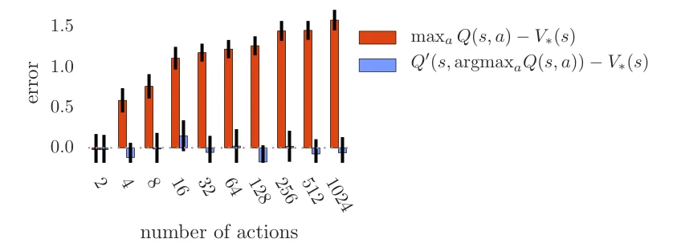
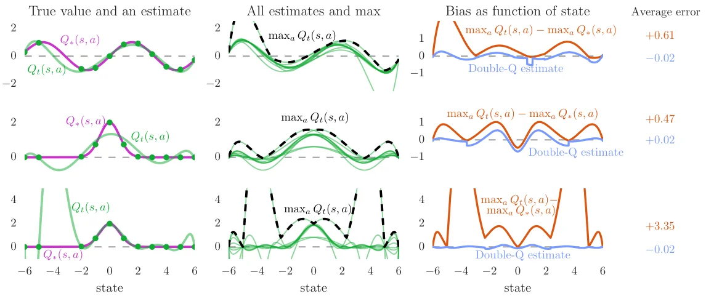
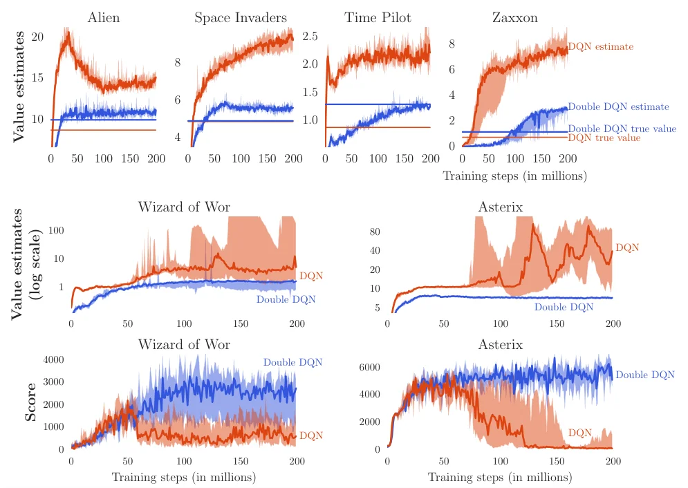

> - **논문**: Deep Reinforcement Learning with Double Q-learning
> - **저자**: Hado van Hasselt, Arthur Guez, David Silver (Google DeepMind)
> - **학회**: AAAI 2016 · [arXiv:1509.06461](https://arxiv.org/abs/1509.06461)
{: .prompt-tip }

> DQN 계열 글의 첫 편입니다. Q-Learning과 DQN의 기본은 [AI 기초 1편]()에 정리했습니다. 이번 글에서는 Q-Learning이 **Q 값을 체계적으로 부풀려 추정하는 문제**와, 이를 거의 공짜로 해결한 **Double DQN**을 다룹니다.

## 1. 논문이 던진 세 가지 질문

Q-Learning 계열 알고리즘에서 행동 가치의 **과대평가(overestimation)**가 자주 일어난다는 사실은 알려져 있었습니다. 하지만 이를 체계적으로 분석한 연구는 없었습니다. 논문은 세 가지 질문에 답합니다.

1. 과대평가는 **흔한** 현상인가?
2. 과대평가가 실제로 **성능을 해치는가**?
3. 과대평가를 **막을 수** 있는가?

## 2. Q-Learning 복습

Q-Learning은 상태–행동 쌍의 기대 보상인 **Q 값**을 학습합니다. 매 시점 에이전트는 행동 $$a_t$$를 하고 보상 $$r_t$$를 받으며 다음 상태로 넘어가고, Q 값을 갱신합니다.

$$
Q(s_t, a_t) \leftarrow Q(s_t, a_t) + \alpha\Big[\underbrace{r_t + \gamma\max_{a}Q(s_{t+1}, a)}_{Y_t^Q} - Q(s_t, a_t)\Big]
$$

기존 값과 새 정보의 가중합으로 조금씩 갱신하는 **TD(Temporal Difference) 학습** 방식이고, 새 정보(target)의 미래 가치는 다음 상태에서 가능한 행동들의 **최댓값**으로 구합니다.

### DQN

DQN은 Q-table을 신경망 $$Q(s, a; \theta)$$로 대체하고, 학습 안정을 위해 일정 주기로 복사해 두는 **target network** $$\theta^-$$를 씁니다.

$$
Y_t^{DQN} = r_t + \gamma\max_{a}Q(s_{t+1}, a; \theta^-)
$$

## 3. 왜 과대평가가 생기나

### max 연산의 함정

Q 값 추정에는 항상 **오차**가 있습니다. 실제 가치가 모두 같은 행동 10개가 있는데 추정값에 ±노이즈가 섞여 있다면, 그중 **최댓값을 고르면 노이즈가 양수로 튄 값**을 고르게 됩니다. 평균적으로 0인 오차라도 max를 취하면 **양의 편향**이 생깁니다.

$$
\mathbb{E}\big[\max_a \hat{Q}(s, a)\big] \ge \max_a \mathbb{E}\big[\hat{Q}(s, a)\big]
$$

간단한 시뮬레이션으로 확인할 수 있습니다. 모든 행동의 실제 가치가 0이고, 추정값에는 표준정규 노이즈가 섞여 있다고 하겠습니다.

```python
import numpy as np

rng = np.random.default_rng(0)
trials = 100_000

for m in [2, 4, 10, 30]:
    # 모든 행동의 실제 가치는 0, 추정값 = 0 + 표준정규 노이즈
    q_a = rng.normal(0, 1, size=(trials, m))   # 추정기 A (예: online network)
    q_b = rng.normal(0, 1, size=(trials, m))   # 독립적인 추정기 B (예: target network)

    single = q_a.max(axis=1)                               # A로 선택 + A로 평가 (Q-learning)
    double = q_b[np.arange(trials), q_a.argmax(axis=1)]    # A로 선택 + B로 평가 (Double Q)
    print(f"행동 {m:>2}개  max 추정 편향 {single.mean():+.3f}   double 추정 편향 {double.mean():+.3f}")
```

```text
행동  2개  max 추정 편향 +0.567   double 추정 편향 +0.000
행동  4개  max 추정 편향 +1.030   double 추정 편향 +0.005
행동 10개  max 추정 편향 +1.537   double 추정 편향 -0.005
행동 30개  max 추정 편향 +2.044   double 추정 편향 +0.002
```

실제 값은 모두 0인데 max로 고른 추정값은 평균 +0.6~+2.0이고, **행동이 많을수록 편향이 커집니다.** 선택과 평가에 서로 독립인 추정기를 쓰면 편향이 거의 0입니다. 아래 Double DQN의 아이디어가 바로 이것입니다.

논문도 같은 실험을 행동 2개에서 1,024개까지 넓혀 보였습니다.


_Figure 1. 행동 가치에 독립 표준정규 오차를 넣었을 때 한 번의 업데이트에서 생기는 편향(100회 평균). 주황은 Q-learning의 max 추정, 파랑은 독립된 두 번째 추정값 $$Q'$$으로 평가한 Double Q 추정입니다. (출처: van Hasselt et al., 2016)_

DQN target의 $$\max_a Q(s', a; \theta^-)$$는 **같은 추정값으로 행동을 "선택"하고 그 행동을 "평가"까지** 합니다. 노이즈 때문에 높게 추정된 행동이 뽑히고, 그 높은 값이 그대로 target이 됩니다. 이렇게 부풀려진 target으로 학습하면 다음 추정이 또 부풀려지며 누적됩니다.

### 오차의 원인

- **Function approximation**: 신경망 근사 자체의 오차
- **Environmental noise**: 환경의 확률적 보상·전이
- **Non-stationarity**: 학습 중 정책과 데이터 분포가 계속 변함

원인은 달라도 **target 값이 커지는 방향**으로 작용한다는 공통점이 있습니다.

### 이론적 하한 (Theorem 1)

어떤 상태에서 모든 행동의 실제 최적 가치가 $$V^*(s)$$로 같고, 추정 오차는 전체적으로 **편향이 없지만**(합이 0) 완전히 정확하지는 않다고 가정합니다($$\frac{1}{m}\sum_a (Q_t(s,a) - V^*(s))^2 = C > 0$$, $$m$$은 행동 수). 그러면

$$
\max_a Q_t(s, a) \ge V^*(s) + \sqrt{\frac{C}{m - 1}}
$$

즉, 오차가 편향 없이 고르게 퍼져 있어도 **max는 반드시 실제보다 크게 추정**됩니다. 반면 Double Q-Learning 방식의 추정은 같은 조건에서 하한이 **0**입니다.

또 Thrun & Schwartz(1993)는 오차가 $$[-\epsilon, \epsilon]$$에 균일하게 분포하면 target이 최대 다음만큼 과대평가된다는 것을 보였습니다.

$$
\gamma\,\epsilon\,\frac{m - 1}{m + 1}
$$

논문 부록은 오차가 $$[-1, 1]$$에 균일할 때 과대평가가 정확히 $$\frac{m-1}{m+1}$$임을 보입니다. **행동 수 $$m$$이 많을수록 과대평가가 커집니다.** Theorem 1의 하한 $$\sqrt{C/(m-1)}$$은 오히려 $$m$$이 클수록 작아지는데, 논문은 이것이 하한을 달성하는 아주 특수한 경우를 따진 탓이고 보통은 Figure 1처럼 행동 수와 함께 커진다고 설명합니다. Theorem 1은 행동별 오차가 서로 독립이라는 가정도 필요 없습니다.

### 함수 근사에서도 생긴다

논문은 잡음이 전혀 없는 결정론적 예제로도 과대평가를 보였습니다. 상태가 연속이고 행동이 10개이며 모든 행동의 실제 가치가 같은 문제에서, 행동마다 조금씩 다른 상태 표본으로 다항식을 맞춥니다.


_Figure 2. 왼쪽: 실제 가치(보라)와 한 행동의 다항식 추정(초록). 가운데: 10개 행동의 추정과 그 최댓값(검은 점선). 오른쪽: 최댓값과 실제 가치의 차이(주황)와 Double Q 추정의 차이(파랑), 오른쪽 숫자는 평균 오차입니다. 세 줄은 실제 가치 함수(sin, $$2e^{-s^2}$$)와 다항식 차수(6, 9)를 바꾼 것입니다. (출처: van Hasselt et al., 2016)_

평균 오차가 Q-learning은 +0.61, +0.47, +3.35인 반면 Double Q는 -0.02, +0.02, -0.02입니다. 특히 셋째 줄은 표본점을 모두 정확히 지나갈 만큼 **유연한** 9차 다항식인데도, 표본이 없는 상태에서 오차가 커져 과대평가가 가장 심합니다. 신경망처럼 유연한 근사기도 과대평가에서 자유롭지 않다는 뜻입니다.

## 4. Double DQN

### Double Q-Learning (2010)

원래 Double Q-Learning은 가중치 두 세트 $$\theta$$와 $$\theta'$$를 둡니다. 하나로 **행동을 선택**하고, 다른 하나로 그 행동을 **평가**합니다. 업데이트마다 두 세트의 역할을 무작위로 바꿉니다.

$$
Y_t^{DoubleQ} = r_t + \gamma\,Q\big(s_{t+1},\ \arg\max_a Q(s_{t+1}, a; \theta_t);\ \theta'_t\big)
$$

선택과 평가에 서로 독립적인 오차를 쓰니, 선택에서 생긴 양의 노이즈가 평가에서 그대로 반영되지 않습니다.

### DQN에 적용하기

DQN에는 이미 **online network $$\theta$$와 target network $$\theta^-$$** 두 개가 있습니다. 따로 네트워크를 추가할 필요 없이 이 둘의 역할만 나누면 됩니다.

$$
Y_t^{DoubleDQN} = r_t + \gamma\,Q\big(s_{t+1},\ \underbrace{\arg\max_a Q(s_{t+1}, a; \theta_t)}_{\text{online으로 선택}};\ \underbrace{\theta_t^-}_{\text{target으로 평가}}\big)
$$

추가 파라미터도, 추가 연산도 거의 없이 **target 계산 한 줄**만 바뀝니다.

> 엄밀히 말하면 target network는 online network의 **조금 전 복사본**이라 두 추정의 오차가 완전히 독립은 아닙니다. 논문도 이 점을 인정하고, 그럼에도 "새 네트워크 없이 얻을 수 있는 가장 가까운 근사"로 이 방식을 택했습니다. 위 시뮬레이션처럼 편향이 완전히 0이 되지는 않고 **크게 줄어드는** 것입니다.
{: .prompt-info }

```python
import torch

def dqn_target(r, s_next, done, target_net, gamma=0.99):
    with torch.no_grad():                                       # target에는 기울기가 흐르면 안 됨
        q_next = target_net(s_next).max(dim=1).values          # 선택과 평가 모두 target_net
    return r + gamma * q_next * (1 - done)

def double_dqn_target(r, s_next, done, online_net, target_net, gamma=0.99):
    with torch.no_grad():
        a_star = online_net(s_next).argmax(dim=1, keepdim=True)          # online으로 선택
        q_next = target_net(s_next).gather(1, a_star).squeeze(1)         # target으로 평가
    return r + gamma * q_next * (1 - done)
```

### 탐험: ε-greedy

학습 중 행동은 DQN과 같이 **ε-greedy**로 고릅니다. 확률 $$\varepsilon$$으로 무작위 행동, $$1-\varepsilon$$으로 Q 값이 가장 큰 행동을 합니다. 예를 들어 $$\varepsilon = 0.4$$면 40%는 아무 주사위나 던지고, 60%는 지금까지 가장 좋았던 주사위를 던지는 식입니다.

## 5. 실험

### 과대평가는 흔하다

Atari 2600 게임에서 학습 중 **추정한 가치**와, 학습된 정책을 실제로 실행해 얻은 **실제 가치(true value)**를 비교했습니다. 실험 설정은 DQN(Mnih et al., 2015)을 그대로 따릅니다.

| 항목 | 값 |
|---|---|
| 네트워크 | conv 3층 + 완전연결 은닉층 1개, 약 1.5M 파라미터, 최근 4프레임 입력 |
| 학습 | 게임마다 GPU 1장으로 200M 프레임(약 1주), 시드 6개 |
| 가치 추정 측정 | 학습 중 $$T = 125{,}000$$ step 평가 구간에서 $$\max_a Q$$의 평균 |
| No-op 평가 | 시작 시 no-op 최대 30회, 5분(18,000프레임), $$\epsilon = 0.05$$, 100 에피소드 평균 |
| Human start 평가 | 전문가 궤적에서 뽑은 시작점 100개, 최대 108,000프레임(30분) |
| Double DQN(tuned) | target 복사 주기 10,000 → 30,000프레임, 학습 $$\epsilon$$ 0.1 → 0.01, 평가 $$\epsilon = 0.001$$, 출력층 bias를 모든 행동이 공유 |


_Figure 3. 위: 네 게임에서 DQN(주황)과 Double DQN(파랑)의 가치 추정 곡선과, 학습이 끝난 정책의 실제 가치(수평선). 가운데: DQN의 과대평가가 극단적인 두 게임(로그 축). 아래: 같은 두 게임의 점수. (출처: van Hasselt et al., 2016)_

- DQN의 추정치는 **실제 가치를 크게 넘었습니다.** 그림에 나온 것은 일부지만, 논문은 정도의 차이만 있을 뿐 **49개 게임 모두에서** DQN의 과대평가가 관찰됐다고 보고합니다. Wizard of Wor와 Asterix에서는 학습이 진행될수록 추정치가 폭주했습니다.
- Double DQN의 추정치는 **훨씬 낮고 실제 가치에 가까웠습니다.** 파란 수평선(Double DQN 정책의 실제 가치)이 주황 수평선보다 높은 경우가 많아, 추정만 정확해진 것이 아니라 정책 자체도 좋아졌습니다.

### 과대평가는 성능을 해친다

과대평가가 모든 행동에 **일정하게** 일어나면 행동 순위는 바뀌지 않으니 문제가 없습니다. 실제로 Pong에서는 DQN이 가치를 약간 과대평가하면서도 최적 행동을 배웠습니다. 하지만 과대평가가 **불균일하게** 일어나면 나쁜 행동이 좋아 보이게 되고, bootstrapping으로 잘못된 상대 정보가 퍼져 정책이 나빠집니다. Figure 3 아래 줄처럼 DQN의 추정치가 폭주하기 시작한 시점에 **점수도 함께 떨어졌습니다.** Double DQN에서는 같은 게임의 학습이 훨씬 안정적이어서, 이 불안정의 원인이 off-policy 함수 근사 자체보다 Q-learning의 과대평가에 있다는 근거가 됩니다.

Double DQN은 DQN의 하이퍼파라미터를 **그대로** 쓰고 target만 바꿨습니다. DQN에 맞춰 조정된 값이라 Double DQN에는 오히려 불리한 비교입니다. 게임별 정규화 점수는 $$\frac{\text{agent} - \text{random}}{\text{human} - \text{random}}$$입니다.

| 게임 | DQN | Double DQN |
|---|---|---|
| Road Runner | 233% | 617% |
| Asterix | 70% | 180% |
| Zaxxon | 54% | 111% |
| Double Dunk | 17% | 397% |

(사람 대비 정규화 점수, no-op 평가)

49개 게임 전체의 요약은 다음과 같습니다.

| 평가 | 지표 | DQN | Double DQN | Double DQN (tuned) |
|---|---|---|---|---|
| No-op, 5분 (Table 1) | 중앙값 | 93.5% | 114.7% | - |
| No-op, 5분 (Table 1) | 평균 | 241.1% | 330.3% | - |
| Human starts, 30분 (Table 2) | 중앙값 | 47.5% | 88.4% | 116.7% |
| Human starts, 30분 (Table 2) | 평균 | 122.0% | 273.1% | 475.2% |

하이퍼파라미터를 조정한 tuned 버전은 human start 평가에서만 보고됐습니다. target 복사 주기를 늘린 이유는, 복사 직후에는 online과 target이 같아져 Double DQN도 일시적으로 Q-learning과 같아지기 때문입니다. 무작위 시작점에서 평가해도 개선이 유지된다는 것은, 결정론적 환경에서 행동 순서를 외운 것이 아니라 일반화된 정책을 배웠다는 뜻으로 해석됩니다.

## 6. 정리

| 질문 | 답 |
|---|---|
| 과대평가는 흔한가? | 예. max 연산 때문에 오차가 있으면 **반드시** 생기고, 행동 수가 많을수록 커짐 |
| 성능을 해치는가? | 예. 불균일한 과대평가가 잘못된 행동을 고르게 함 |
| 막을 수 있는가? | 예. **선택(online)과 평가(target)를 분리**하면 됨 |
| 효과는? | No-op 중앙값 93.5% → 114.7%, human starts 중앙값 47.5% → 88.4% (tuned 116.7%) |

Double DQN은 이후 Dueling DQN, Prioritized Replay, [Noisy Network](), [Distributional RL(C51)]() 등과 함께 **Rainbow**에 통합되어 DQN 계열의 기본 구성 요소가 됐습니다.

## References

- van Hasselt, Guez & Silver, "Deep Reinforcement Learning with Double Q-learning," AAAI 2016. [arXiv:1509.06461](https://arxiv.org/abs/1509.06461)
- van Hasselt, "Double Q-learning," NeurIPS 2010.
- Mnih et al., "Human-level control through deep reinforcement learning," Nature 2015.
- Thrun & Schwartz, "Issues in Using Function Approximation for Reinforcement Learning," 1993.
- Hessel et al., "Rainbow: Combining Improvements in Deep Reinforcement Learning," AAAI 2018.
