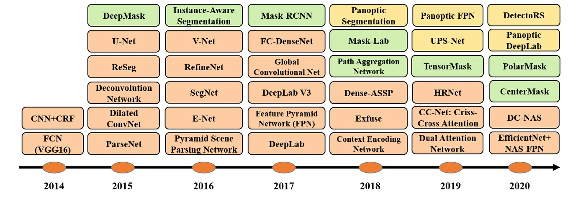
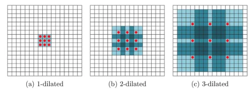

> - **논문**: Image Segmentation Using Deep Learning: A Survey
> - **저자**: Shervin Minaee, Yuri Boykov, Fatih Porikli, Antonio Plaza, Nasser Kehtarnavaz, Demetri Terzopoulos (Snap, University of Waterloo, Qualcomm, University of Extremadura, UT Dallas, UCLA)
> - **학회**: IEEE TPAMI 2021 · [arXiv:2001.05566](https://arxiv.org/abs/2001.05566)
{: .prompt-tip }

> [CNN 기초]()와 [객체 검출]()을 거쳐 픽셀 단위로 내려가면 분할이다. 의미 분할은 모든 픽셀에 클래스를, 인스턴스 분할은 거기에 개체 구분까지 붙인다. **Image Segmentation Using Deep Learning: A Survey**는 FCN(2015) 이후 2019년까지 쏟아진 100개 이상의 방법을 기술적 기여를 기준으로 10개 계보로 묶은 지도이다. 이 글은 각 계보가 어떤 문제를 풀려고 나왔는지를 축으로 정리하고, 데이터셋·지표·성능표의 요점을 옮긴다. 서베이의 시점이 Transformer 이전이라는 점은 마지막에 짚는다.

## 1. 열 개의 계보

아래 Figure 32는 서베이가 정리한 2014~2020년 대표 모델의 연표이다. 주황은 의미 분할, 초록은 인스턴스 분할, 노랑은 파놉틱 분할이다.


_Figure 32. 2D 영상 분할 딥러닝 모델의 연표(2014~2020). 주황·초록·노랑이 각각 의미·인스턴스·파놉틱 분할이다. (출처: Minaee et al., 2021)_

**1. 완전 합성곱 네트워크(FCN).** Long 등은 분류 CNN의 FC 층을 합성곱으로 바꿔 임의 크기 입력에 대해 분할 맵을 내게 했다. 깊은 층의 거친 맵을 얕은 층과 **스킵 연결**로 합쳐 세부를 복원한다(FCN-8s). 문제는 느리고, 전역 문맥을 못 보고, 3D로 바로 안 간다는 점이다. ParseNet은 전역 평균 특징을 각 위치에 붙여 문맥을 더했다.

**2. 그래프 모델 결합.** FCN의 출력은 경계가 흐릿하고 지역 일관성이 약하다. DeepLab v1은 CRF를 후처리로, CRF-RNN은 CRF 평균장 추론을 RNN으로 펼쳐 종단간 학습하고, Piecewise·DPN은 쌍별 포텐셜을 네트워크로 모델링한다.

**3. 인코더-디코더.** 다운샘플로 압축하고 업샘플로 복원한다. Deconvolution Network와 SegNet(풀링 인덱스를 저장해 비선형 업샘플), 고해상도 표현을 끝까지 유지하는 HRNet이 일반 분할 쪽이고, 의료 영상에서는 **U-Net**(대칭 스킵 연결, 적은 데이터로 학습), V-Net(3D, Dice 손실), 그리고 다수의 변형이 있다.

**4. 다중 스케일·피라미드.** 물체 크기가 다양하므로 여러 해상도의 특징을 합친다. FPN(검출에서 왔지만 분할에도), **PSPNet**(피라미드 풀링 모듈로 전역·부분 문맥을 네 스케일로 풀링해 결합), DM-Net, APC-Net, MSCI 등.

**5. R-CNN 기반(인스턴스 분할).** Faster R-CNN의 제안 영역마다 마스크를 예측하는 **Mask R-CNN**(RoIAlign으로 정렬 오차 제거)이 중심이고, PANet(경로 집계), MaskLab, TensorMask(밀집 슬라이딩 윈도우), 실시간 YOLACT 등이 뒤따른다.

**6. 팽창 합성곱과 DeepLab.** 이 계보는 풀링 없이 수용 영역을 키우는 **팽창(atrous) 합성곱**에 기반한다. DeepLab v2는 여러 팽창률의 병렬 가지 **ASPP**로 다중 스케일을, v3는 배치 정규화와 이미지 수준 특징을 더하고, v3+는 인코더-디코더 구조와 Xception 백본, 깊이별 분리 팽창 합성곱을 합쳐 PASCAL VOC 89.0%에 이른다(COCO·JFT 사전학습). DenseASPP, DUC-HDC도 이 계보이다.


_Figure 21. 팽창률 1, 2, 3인 3×3 커널. 가중치는 9개 그대로인데 덮는 영역이 넓어진다. (출처: Minaee et al., 2021)_

**7. 순환 네트워크.** 픽셀 간 장거리 의존을 RNN·LSTM으로 모델링한다(ReSeg, 2D LSTM, Graph LSTM, DA-RNN). 자연스럽지만 느리고 이후 attention으로 대체된다.

**8. Attention.** 어디를 볼지 학습한다. 다중 스케일 입력에 소프트 attention(Chen 등), 역 attention(RAN), 쌍별 attention(PSANet), 위치·채널 이중 attention(**DANet**), 교차 attention으로 비용을 줄인 CCNet, 객체 문맥 풀링의 OCNet, EMANet, 채널 attention을 쓰는 DFN. 2019~2020년 Cityscapes 상위권에 이 계열과 아래 OCR 같은 문맥 모델이 많이 올라 있다.

**9. 생성·적대 학습.** 판별기가 분할 맵의 사실성을 판단해 공간적 일관성을 강제하고(Luc 등), 반지도 학습으로 라벨 없는 이미지를 활용한다.

**10. 능동 윤곽 결합.** 고전적 능동 윤곽 모델(ACM)의 에너지를 손실로 쓰거나(ACWE 손실), 네트워크가 윤곽의 변형을 예측하게 한다(Deep Active Contours, DARNet).

그 밖에 EncNet(문맥 인코딩), RefineNet(다중 경로 정제), 픽셀과 객체 영역의 관계로 표현을 보강하는 **OCR**(Object-Contextual Representations), Gated-SCNN(모양 흐름), 포인트 클라우드 분할(PointNet 계열), 그리고 **파놉틱 분할**(의미+인스턴스, Panoptic FPN, UPSNet, Panoptic-DeepLab)이 "기타"에 묶인다.

## 2. 데이터셋

2D에 PASCAL VOC(21클래스), PASCAL Context(400+), COCO(80 물체 + stuff), **Cityscapes**(50개 도시 주행 장면, 5,000 정밀 + 20,000 거친 라벨), ADE20k(150클래스), SiftFlow, Stanford background, BSD, YouTube-Objects, KITTI, 2.5D(RGB-D)에 NYU-D v2, SUN RGB-D, SUN-3D, ScanNet, 3D에 Stanford 2D-3D-S, ShapeNet Core, Sydney Urban Objects가 정리된다.

## 3. 지표

$$p_{ij}$$를 클래스 $$i$$ 픽셀이 $$j$$로 예측된 수라 할 때,

$$
\text{PA} = \frac{\sum_i p_{ii}}{\sum_{i,j} p_{ij}}, \quad
\text{MPA} = \frac{1}{K+1}\sum_i \frac{p_{ii}}{\sum_j p_{ij}}, \quad
\text{IoU} = \frac{|A \cap B|}{|A \cup B|}, \quad
\text{Dice} = \frac{2|A \cap B|}{|A| + |B|}
$$

mIoU는 클래스별 IoU의 평균이고 현대 분할의 표준 지표이다. Dice는 의료 영상에서 흔하고, 이진 분할에서 **F1과 같다**($$2TP/(2TP+FP+FN)$$). 정확도뿐 아니라 속도와 메모리도 평가해야 하지만 대부분의 연구가 정확도만 보고한다는 점을 서베이가 지적한다.

## 4. 코드로 보기: 지표들의 관계와 수용 영역

배경·큰 물체·작은 물체 3클래스의 합성 정답에 무작위 오류와 작은 클래스에 대한 체계적 오류를 섞은 예측을 만들어 PA, MPA, mIoU, Dice를 계산하고, 팽창·풀링에 따른 수용 영역을 센다.

```python
import numpy as np
rng = np.random.default_rng(0)
H = W = 32; K = 3
gt = np.zeros((H, W), int); gt[8:24, 8:24] = 1; gt[20:30, 2:12] = 2
pred = gt.copy(); flip = rng.random((H, W)) < 0.12; pred[flip] = rng.integers(0, K, flip.sum())     # a noisy prediction
pred[22:28, 4:10] = 1                                                                                 # plus a systematic error on the small class
def metrics(gt, pred):
    pa = (gt == pred).mean()
    ious, dices, accs = [], [], []
    for k in range(K):
        g, p = gt == k, pred == k
        inter, union = (g & p).sum(), (g | p).sum()
        ious.append(inter / union); dices.append(2 * inter / (g.sum() + p.sum())); accs.append(inter / g.sum())
    return pa, np.array(ious), np.array(dices), np.array(accs)
pa, ious, dices, accs = metrics(gt, pred)
print(f"pixel accuracy       {pa:.3f}")
print(f"mean pixel accuracy  {accs.mean():.3f}   per class {np.round(accs, 3)}")
print(f"mean IoU             {ious.mean():.3f}   per class {np.round(ious, 3)}")
print(f"mean Dice (= F1)     {dices.mean():.3f}   per class {np.round(dices, 3)}")
print(f"Dice = 2 IoU / (1 + IoU) holds per class: {np.allclose(dices, 2 * ious / (1 + ious))}")
print(f"\nclass pixel shares: {np.round([(gt == k).mean() for k in range(K)], 3)} -> pixel accuracy is dominated by the background, mIoU is not")
def rf(layers):
    r, j = 1, 1
    for k, s, d in layers: r += d * (k - 1) * j; j *= s
    return r
print()
print(f"receptive field: 8 plain 3x3 convs {rf([(3,1,1)]*8)} | 4 convs with dilation 1,2,4,8 {rf([(3,1,1),(3,1,2),(3,1,4),(3,1,8)])} | 4 convs with 3 stride-2 pools between {rf([(3,1,1),(2,2,1),(3,1,1),(2,2,1),(3,1,1),(2,2,1),(3,1,1)])}")
```

```text
pixel accuracy       0.899
mean pixel accuracy  0.829   per class [0.925 0.942 0.62 ]
mean IoU             0.712   per class [0.915 0.734 0.488]
mean Dice (= F1)     0.819   per class [0.955 0.846 0.656]
Dice = 2 IoU / (1 + IoU) holds per class: True

class pixel shares: [0.668 0.234 0.098] -> pixel accuracy is dominated by the background, mIoU is not

receptive field: 8 plain 3x3 convs 17 | 4 convs with dilation 1,2,4,8 31 | 4 convs with 3 stride-2 pools between 38
```

- PA는 0.90으로 높지만 mIoU는 0.71이다. 픽셀의 67%가 배경이라 배경만 잘 맞춰도 PA가 오르는 반면, mIoU는 클래스를 동등하게 평균해 작은 클래스(IoU 0.49)의 실패를 드러낸다. 분할 벤치마크가 PA 대신 mIoU를 쓰는 이유이다. Dice = 2·IoU/(1+IoU)의 관계가 클래스마다 정확히 성립하고, Dice가 IoU보다 항상 크다.
- 3×3 합성곱 8층의 수용 영역은 17픽셀인데, 팽창률 1·2·4·8의 4층은 31픽셀, stride-2 풀링 3번을 끼운 4층은 38픽셀이다. 풀링은 해상도를 잃고 수용 영역을 키우며, 팽창은 해상도를 유지하면서 키운다. DeepLab 계보가 팽창 합성곱을 택한 근거가 이 산술이다.

## 5. 성능

서베이의 Table 1·2에서 계보별 대표 모델을 골라 옮겼다. *는 COCO·ImageNet·JFT-300M 같은 다른 데이터로 사전학습한 모델이다.

| 모델 (계보) | 백본 | PASCAL VOC test mIoU | Cityscapes test mIoU |
|---|---|---|---|
| FCN / FCN-8s (1) | VGG-16 | 62.2 | 65.3 |
| CRF-RNN (2) | - | 72.0 | - |
| DeepLab-CRF / DeepLabv2 (6) | ResNet-101 | 79.7 | 70.4 |
| RefineNet (기타) | ResNet-152 / ResNet-101 | 84.2 | 73.6 |
| PSPNet (4) | ResNet-101 | 85.4 | 85.4 (원 논문 78.4, 아래 참고) |
| DeepLabv3 (6) | ResNet-101 | 85.7 | 81.3 |
| DANet (8) | ResNet-101 | - | 81.5 |
| OCR (기타) | ResNet-101 | - | 82.4 |
| DeepLabv3+ (6) | Xception-71 | 87.8 (사전학습* 89.0) | - |
| HRNetV2+OCR (w/ASPP) | HRNetV2-W48 | - | 83.7 |
| EfficientNet+NAS-FPN | - | 90.5 | - |
| Hierarchical MSA | HRNet-OCR | - | 85.1 |

- PASCAL VOC는 FCN 62.2에서 90.5까지 5년 사이 28%p 올랐다.
- Cityscapes 표의 PSPNet 85.4는 VOC 수치를 잘못 옮긴 것으로 보인다. PSPNet 원 논문의 Cityscapes 결과(fine 라벨만 사용)는 78.4이다. 서베이는 FCN 대비 약 23% 상대 개선이라고 적었지만, FCN-8s 65.3과 Hierarchical MSA 85.1로 계산하면 약 30%(19.8%p)이다.

나머지 데이터셋은 훨씬 어렵다. **COCO stuff**(Table 3)는 최고가 OCR(HRNetV2-W48) 40.5, **ADE20k** validation(Table 4)은 AC-Net 45.9 mIoU이다. 파놉틱 분할(Table 6, COCO val PQ)은 UPSNet(ResNet-50, deformable conv) 42.5, OCFusion(ResNeXt-101) 45.7이다. RGB-D(NYUD-v2, SUN-RGBD)도 Table 7로 정리된다.

인스턴스 분할(Table 5, COCO test-dev 2017, 모두 R-101-FPN 백본)은 정확도와 속도를 함께 적어 둔 드문 표이다.

| 모델 | FPS | mask AP |
|---|---|---|
| YOLACT-550 | 33.5 | 29.8 |
| YOLACT-700 | 23.8 | 31.2 |
| RetinaMask | 10.2 | 34.7 |
| TensorMask | 2.6 | 37.1 |
| Mask R-CNN | 10.6 | 37.9 |
| CenterMask | 13.2 | 38.3 |

25 FPS를 넘는 것은 YOLACT-550뿐이고, AP 8%p 정도를 내주고 얻은 속도이다.

## 6. 과제와 방향

서베이가 꼽는 과제는 **더 어려운 데이터셋**(더 많은 물체·겹침·3D·시퀀스), **해석 가능한 모델**(왜 그 픽셀을 그렇게 분류했나), **약지도·비지도 학습**(픽셀 라벨은 비싸므로 바운딩 박스·이미지 라벨·자기지도 활용), **실시간 모델**(자율주행·로봇에는 25 FPS 이상이 필요한데 대부분 못 미침, 팽창 합성곱이 한 해법), **메모리 효율**(모바일 배포를 위한 압축·증류), **3D 포인트 클라우드**(불규칙·비정렬 데이터의 표현), 그리고 응용 시나리오(의료, 주행, 원격 탐사)의 특수 요구이다.

## 7. 해석

**1. 계보의 축은 "문맥을 어떻게 얻는가"이다.** FCN의 약점(지역적, 흐린 경계)을 CRF(2), 피라미드(4), 팽창(6), RNN(7), attention(8)이 각각 다른 방식으로 메운다. 수용 영역을 키우되 해상도를 잃지 않는 것이 공통 목표이고, 위 toy의 산술이 그 트레이드오프의 뼈대이다. 이 관점에서 보면 이후의 SegFormer·Mask2Former는 attention 계보가 백본까지 올라간 것이다.

**2. 인코더-디코더와 U-Net의 영향이 분할을 넘어선다.** 대칭 스킵 연결은 [잠재 디퓨전]()의 디노이저 백본으로, [MWCNN]()처럼 웨이블릿을 풀링 대신 쓰는 변형으로, 의료 영상의 거의 모든 구조로 퍼졌다. 서베이가 의료 인코더-디코더를 별도 절로 둔 이유이다.

**3. 지표 선택이 결과를 바꾼다.** PA 대 mIoU의 차이는 클래스 불균형의 문제이고, Dice와 F1의 동일성은 의료와 일반 비전이 같은 것을 다른 이름으로 부른다는 뜻이다. 속도와 메모리를 보고하지 않는 관행에 대한 서베이의 지적은 [EdgeViTs]()류의 실측 지연 시간 보고가 왜 필요한지와 같은 맥락이다.

**4. 성능표의 수치는 조건을 봐야 한다.** 사전학습 데이터(COCO, JFT-300M), 백본 크기, 테스트 시 증강(다중 스케일·뒤집기)이 mIoU를 수 %p 바꾼다. 서베이도 "표준 데이터셋과 지표를 쓰지 않는 논문이 있어 비교가 어렵다"고 적는다.

**5. 평가를 읽을 때 주의할 점.** 2019년까지의 방법이라 Transformer 기반 분할(SETR, Segmenter, SegFormer, Mask2Former, SAM)은 없다. 성능표는 원 논문 수치를 옮긴 것이라 조건이 통일되지 않았고, 위에 적은 PSPNet Cityscapes 수치처럼 오기도 있다. 서베이의 가치는 방법 간 우열보다 분류와 맥락에 있다. 위 toy의 지표 계산은 3클래스 합성 맵이라 실제 벤치마크의 규모와 다르다.

## 8. 정리

| 항목 | 내용 |
|---|---|
| 범위 | 2015~2019 딥러닝 분할 100여 편, 10개 계보, 20여 데이터셋 |
| 계보 | FCN / 그래프 모델 / 인코더-디코더(U-Net) / 피라미드(PSPNet) / R-CNN(Mask R-CNN) / 팽창·DeepLab / RNN / attention(DANet, OCR) / 생성·적대 / 능동 윤곽 |
| 지표 | PA, MPA, IoU·mIoU(표준), Dice(= 이진 F1), 정밀도·재현율 |
| 성능 | VOC 62.2→90.5 mIoU, Cityscapes 65.3→85.1, COCO stuff ~40, ADE20k ~46, 인스턴스 AP ~38, 파놉틱 PQ ~46 |
| 과제 | 어려운 데이터셋, 해석성, 약지도, 실시간, 메모리, 3D |
| 빠진 것 | Transformer 기반 분할(2020 이후) |

## References

- Minaee et al., "Image Segmentation Using Deep Learning: A Survey," TPAMI 2021. [arXiv:2001.05566](https://arxiv.org/abs/2001.05566)
- Long, Shelhamer, Darrell, "Fully Convolutional Networks for Semantic Segmentation," CVPR 2015. [arXiv:1411.4038](https://arxiv.org/abs/1411.4038)
- Ronneberger, Fischer, Brox, "U-Net: Convolutional Networks for Biomedical Image Segmentation," MICCAI 2015. [arXiv:1505.04597](https://arxiv.org/abs/1505.04597)
- Chen et al., "Encoder-Decoder with Atrous Separable Convolution for Semantic Image Segmentation" (DeepLabv3+), ECCV 2018. [arXiv:1802.02611](https://arxiv.org/abs/1802.02611)
- Zhao et al., "Pyramid Scene Parsing Network," CVPR 2017. [arXiv:1612.01105](https://arxiv.org/abs/1612.01105)
- He, Gkioxari, Dollár, Girshick, "Mask R-CNN," ICCV 2017. [arXiv:1703.06870](https://arxiv.org/abs/1703.06870)
- Fu et al., "Dual Attention Network for Scene Segmentation," CVPR 2019. [arXiv:1809.02983](https://arxiv.org/abs/1809.02983)
