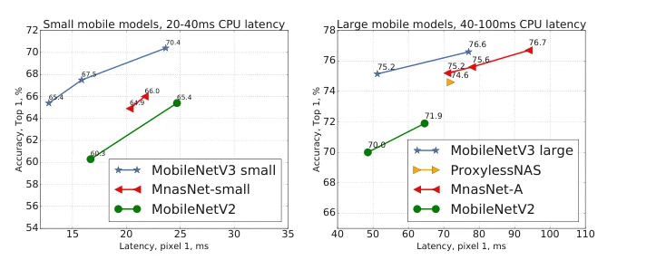
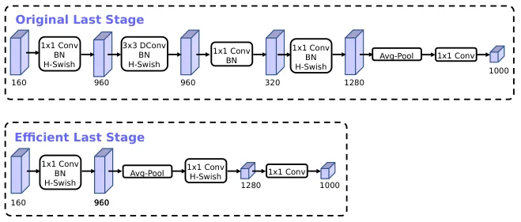
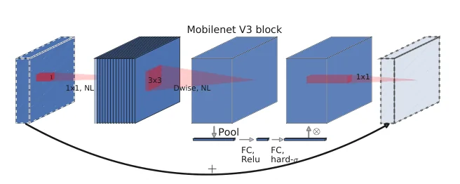

> - **논문**: Searching for MobileNetV3
> - **저자**: Andrew Howard, Mark Sandler, Grace Chu, Liang-Chieh Chen, Bo Chen, Mingxing Tan, Weijun Wang, Yukun Zhu, Ruoming Pang, Vijay Vasudevan, Quoc V. Le, Hartwig Adam (Google AI, Google Brain)
> - **학회**: ICCV 2019 · [arXiv:1905.02244](https://arxiv.org/abs/1905.02244)
{: .prompt-tip }

> [MobileNetV2]()까지는 사람이 블록을 설계했다. **MobileNetV3**는 자동 탐색과 수작업 설계를 섞는다. 플랫폼 인식 NAS로 전체 구조를, NetAdapt로 층별 필터 수를 찾은 뒤, 탐색이 놓친 비싼 층을 손으로 고치고 새 비선형성 h-swish와 SE 블록을 넣는다. 결과는 두 모델이다. V3-Large는 ImageNet 75.2%를 Pixel 1에서 51ms에, V3-Small은 67.4%를 15.8ms에 낸다.


_Figure 1. Pixel 1 지연 대비 ImageNet top-1. 왼쪽은 20~40ms의 작은 모델, 오른쪽은 40~100ms의 큰 모델이고, 점은 multiplier 0.35·0.5·0.75·1·1.25(입력 224)이다. (출처: Howard et al., 2019)_

## 1. 문제: FLOPs가 아니라 지연 시간

모바일 모델의 목표는 **실제 기기에서의 지연 시간 대비 정확도**이다. MAdds가 같아도 연산 종류와 메모리 접근 패턴에 따라 속도가 다르고, 이것은 아키텍처 설계만으로는 알기 어렵다. 그래서 이 논문은 처음부터 Pixel 폰의 측정 지연을 목적 함수에 넣는다. 또한 V2에서 비싼 부분이 어디인지(첫 층과 마지막 층), 어떤 비선형성이 양자화와 잘 맞는지 같은 실무적 질문을 함께 다룬다.

## 2. 방법

### 플랫폼 인식 NAS + NetAdapt

**블록 단위 탐색**은 MnasNet과 같은 RNN 컨트롤러와 분해된 계층적 탐색 공간을 쓴다. 보상은 정확도와 지연의 곱 $$ACC(m) \times [LAT(m)/TAR]^w$$이다. 원래 MnasNet의 $$w = -0.07$$로 목표 지연 80ms 근처를 탐색하면 MnasNet과 비슷한 결과가 나오므로, Large 모델은 탐색을 새로 하지 않고 MnasNet-A1을 시작 모델로 그대로 재사용한다. Small 모델은 $$w = -0.15$$로 처음부터 새로 탐색한다. 작은 모델은 지연이 조금만 변해도 정확도가 크게 움직이므로 지연에 더 민감한 가중치가 필요하다.

**층 단위 미세 조정**은 NetAdapt를 보완해 쓴다. 매 단계에서 확장 층 크기나 bottleneck 채널 수(residual 연결을 유지하도록 같은 크기를 공유하는 블록 전체)를 줄이는 제안들을 만들고(각 제안은 이전 단계보다 지연을 최소 $$\delta$$만큼 줄여야 하며, $$\delta = 0.01 \lvert L \rvert$$, $$L$$은 시작 모델의 지연), 각 제안을 $$T = 10000$$ step fine-tuning한 뒤 $$\Delta Acc / \lvert \Delta Latency \rvert$$가 가장 큰 제안을 고른다. 원래 NetAdapt는 정확도 변화만 보지만, 지연당 정확도 변화로 바꾸면 모든 제안이 같은 지연 절감을 주지는 않는다는 점을 반영할 수 있다. 목표 지연에 도달할 때까지 반복하고, 최종 구조는 처음부터 다시 학습한다.

### 비싼 층 재설계

탐색 결과를 보면 마지막 몇 층과 첫 층이 유독 비싸다.


_Figure 5. 위: 원래 마지막 단계(7×7에서 1×1 960 → 3×3 depthwise → 1×1 320 → 1×1 1280 → pooling). 아래: pooling을 앞당긴 효율적 마지막 단계. 비싼 층 셋이 빠진다. (출처: Howard et al., 2019)_

- **마지막 단계.** 위 Figure 5처럼 V2 구조에서는 7×7 해상도에서 1×1 conv로 960채널로 넓히고 depthwise conv를 거쳐 320으로 투영한 뒤, 다시 1280으로 확장하고 pooling한다. V3는 **average pooling을 앞으로 옮겨** 1×1 conv로 960채널을 만든 직후 1×1 해상도로 줄이고, 그 뒤에 1280채널 층을 둔다. 특징 추출이 7×7이 아니라 1×1에서 이뤄지므로 앞의 bottleneck 블록의 투영과 depthwise 층도 필요 없어진다. 이것만으로 지연 7ms(11%), 30M MAdds가 줄고 정확도는 거의 그대로이다.
- **첫 층.** 32개 필터 대신 **16개 필터 + h-swish**를 쓰면 정확도를 유지하며 2ms, 10M MAdds를 아낀다. 32개 필터는 서로 거울상인 경우가 많아 중복이라는 관찰이다.

### h-swish

swish $$x \cdot \sigma(x)$$는 정확도를 올리지만 시그모이드가 모바일에서 비싸다. 그래서 시그모이드를 조각 선형 함수로 바꾼다.

$$
\text{h-swish}(x) = x \cdot \frac{\text{ReLU6}(x + 3)}{6}
$$

장점은 셋이다. 정확도 차이가 거의 없고, 조각 선형이라 양자화 때 수치 정밀도 손실이 없으며, ReLU6 하나로 구현되어 메모리 접근을 줄인다. 비선형성의 비용은 텐서 크기에 비례하므로, 해상도가 큰 앞쪽 층에서는 ReLU를 쓰고 **뒤쪽 절반에서만 h-swish**를 쓴다.

### Squeeze-and-Excite

[SENet]()의 SE 블록을 MnasNet처럼 residual 블록 안(depthwise 뒤)에 넣되, MnasNet에서는 conv bottleneck 크기에 비례하던 SE의 bottleneck 채널을 확장 층의 **1/4**로 고정하고 시그모이드 대신 h-sigmoid를 쓴다. 파라미터는 조금 늘지만 지연 증가 없이 정확도가 오른다.


_Figure 4. MobileNetV3 블록. V2의 inverted residual(1×1 확장 → 3×3 depthwise → 1×1 투영)에 pooling → FC(ReLU) → FC(hard-σ)의 SE 경로를 더했다. NL은 층에 따라 ReLU 또는 h-swish이다. (출처: Howard et al., 2019)_

### 분할용 헤드: LR-ASPP

분할에서는 Lite R-ASPP를 제안한다. SE처럼 큰 stride의 average pooling으로 전역 정보를 뽑아 곱하고, 저해상도 특징과 고해상도 특징을 1×1 conv로 합친다. Cityscapes에서 V2 기반 R-ASPP와 비슷한 mIOU로 34% 빠르다(초록 기준).

## 3. 코드로 보기: h-swish, SE, 마지막 단계

수식만 보면 작아 보이는 선택들이 실제로 어느 정도 차이인지 숫자로 확인한다.

```python
import numpy as np
x = np.linspace(-8, 8, 16001)
sigmoid = 1 / (1 + np.exp(-x)); swish = x * sigmoid
h_sigmoid = np.clip(x + 3, 0, 6) / 6; h_swish = x * h_sigmoid
print("hard approximations on [-8, 8]")
print(f"  max |h-sigmoid - sigmoid| = {np.abs(h_sigmoid - sigmoid).max():.4f}")
print(f"  max |h-swish  - swish|    = {np.abs(h_swish - swish).max():.4f}   (swish min = {swish.min():.4f}, h-swish min = {h_swish.min():.4f})")
print("  h-swish is piecewise linear: exact in 8-bit fixed point, no exp/division")

# squeeze-and-excite with 1/4 reduction
def se_params(C, r=4): return C * (C // r) + C // r + (C // r) * C + C
print()
print("SE block params (reduction 1/4):", ", ".join(f"C={c}: {se_params(c):,}" for c in (72, 120, 480, 672)))

# efficient last stage (MobileNetV3-Large, 7x7 input, 160 channels)
S, C = 7, 160
orig = S*S*C*960 + S*S*960*9 + S*S*960*320 + S*S*320*1280 + 1280*1000
eff = S*S*C*960 + 960*1280 + 1280*1000
print()
print("last stage MAdds")
print(f"  original  (1x1 960 -> dw3x3 -> 1x1 320 -> 1x1 1280 at 7x7 -> pool -> fc): {orig/1e6:.1f}M")
print(f"  efficient (1x1 960 at 7x7 -> pool -> 1x1 1280 -> fc):                     {eff/1e6:.1f}M")
print(f"  saved: {(orig-eff)/1e6:.1f}M MAdds   (paper: ~30M MAdds, 7 ms = 11% of latency)")

# where h-swish pays off: cost is per-element, so it is cheap only where the tensor is small (deep layers)
print()
print("activation elements per layer (batch 1): h-swish is per element, so its cost tracks this column")
for res, c in [(112, 16), (56, 24), (28, 40), (14, 80), (14, 112), (7, 160)]:
    print(f"  {res:>3}x{res:<3} x {c:>3} ch -> {res*res*c:>9,} elements")
```

```text
hard approximations on [-8, 8]
  max |h-sigmoid - sigmoid| = 0.0692
  max |h-swish  - swish|    = 0.1423   (swish min = -0.2785, h-swish min = -0.3750)
  h-swish is piecewise linear: exact in 8-bit fixed point, no exp/division

SE block params (reduction 1/4): C=72: 2,682, C=120: 7,350, C=480: 115,800, C=672: 226,632

last stage MAdds
  original  (1x1 960 -> dw3x3 -> 1x1 320 -> 1x1 1280 at 7x7 -> pool -> fc): 44.4M
  efficient (1x1 960 at 7x7 -> pool -> 1x1 1280 -> fc):                     10.0M
  saved: 34.3M MAdds   (paper: ~30M MAdds, 7 ms = 11% of latency)

activation elements per layer (batch 1): h-swish is per element, so its cost tracks this column
  112x112 x  16 ch ->   200,704 elements
   56x56  x  24 ch ->    75,264 elements
   28x28  x  40 ch ->    31,360 elements
   14x14  x  80 ch ->    15,680 elements
   14x14  x 112 ch ->    21,952 elements
    7x7   x 160 ch ->     7,840 elements
```

- h-sigmoid는 시그모이드와 최대 0.07, h-swish는 swish와 최대 0.14 차이 난다. 모양은 거의 같고 모두 조각 선형이라 8비트 고정소수점에서 정확히 표현된다.
- 마지막 단계 재설계로 7×7 해상도에서 수행되던 15M + 20M MAdds가 사라지고 34M가 절감된다. 논문이 측정한 30M MAdds, 7ms와 같은 차수이다.
- 비선형성 비용은 원소 수에 비례한다. 112×112×16 층은 7×7×160 층보다 원소가 25배 많으므로, h-swish를 앞쪽에 넣으면 정확도 이득보다 지연 비용이 크다. 뒤쪽 절반에만 쓰는 이유이다.

## 4. 실험

### 학습·측정 설정

| 항목 | 값 |
|---|---|
| 데이터 | ImageNet, Inception과 같은 전처리 |
| 하드웨어 | 4×4 TPU Pod, 동기식 학습 |
| Optimizer | RMSProp, momentum 0.9 |
| Learning rate | 초기 0.1, 3 epoch마다 0.01 비율로 감소 |
| Batch | 4096 (칩당 128장) |
| 정규화 | dropout 0.8, L2 weight decay 1e-5, BN average decay 0.99 |
| 기타 | 가중치 EMA decay 0.9999 |
| 지연 측정 | Pixel 1/2/3, TFLite Benchmark Tool, 큰 코어 1개 단일 스레드, batch 1 |

### ImageNet (Table 3, 4)

Pixel 1 단일 코어, TFLite 벤치마크 기준이다.

| 모델 | Top-1 | MAdds | Params | P-1 지연 |
|---|---|---|---|---|
| V3-Large 1.0 | 75.2% | 219M | 5.4M | 51ms |
| MnasNet-A1 | 75.2% | 315M | 3.9M | 71ms |
| V2 1.0 | 72.0% | 300M | 3.4M | 64ms |
| V3-Small 1.0 | 67.4% | 56M | 2.5M | 15.8ms |
| V2 0.35 | 60.8% | 59.2M | 1.6M | 16.6ms |

V3-Large는 V2보다 **3.2% 정확하면서 20% 빠르고**, V3-Small은 비슷한 지연의 V2 0.35보다 6.6% 정확하다. 양자화해도 Large 73.8%/44ms 대 V2 70.9%/52ms, Small 64.9%/15.5ms 대 V2 0.35 57.2%/16.7ms로 우위가 유지된다(Pixel 1). Figure 7에서는 MobileNetV3-Small이 multiplier를 줄여 지연을 맞춘 Large보다 약 3% 정확하다. 해상도 조절이 width multiplier보다 좋은 트레이드오프를 주지만, 해상도는 과제가 정하는 경우가 많아 항상 쓸 수 있는 손잡이는 아니다.

### Ablation: 비선형성 위치 (Table 5)

h-swish @N은 h-swish를 처음 켜는 층의 채널 수이다. 기본 V3는 80채널 층부터 쓴다.

| 설정 | Top-1 | P-1 지연(ms), 최적화 h-swish | P-1 지연(ms), 미최적화 |
|---|---|---|---|
| V3-Large 1.0 (h-swish @80) | 75.2 | 51.4 | 57.5 |
| ReLU만 | 74.5 (-0.7%) | 50.5 (-1%) | 50.5 |
| h-swish @16 | 75.4 (+0.2%) | 53.5 (+4%) | 68.9 |
| h-swish @112 | 75.0 (-0.3%) | 51 (-0.5%) | 54.4 |

- 최적화된 h-swish는 ReLU 대비 약 1ms만 추가하고, 미최적화 구현 대비 6ms(실행 시간의 10% 이상)를 아낀다.
- h-swish를 첫 층부터 켜면 정확도는 0.2% 오르지만, 미최적화 구현에서는 지연이 68.9ms로 크게 늘어난다.

### 구성 요소별 효과와 다운스트림

Figure 9의 개발 진행을 보면 MnasNet 75.2% → +SE/4 75.5% → +h-swish 76.1% → +NetAdapt와 compact 재설계로 정확도를 75.2%로 유지하면서 지연이 크게 줄어든다.

**검출 (Table 6).** SSDLite의 백본만 바꿔 COCO test에서 비교한다. C4는 stride 16의 마지막 층(Large는 13번째 bottleneck의 확장 층), C5는 pooling 직전 층이고, †는 C4~C5 사이 채널을 절반으로 줄인 것이다(COCO는 90클래스라 1000클래스용 채널이 남는다는 이유).

| 백본 | mAP | 지연(ms) | Params(M) | MAdds(B) |
|---|---|---|---|---|
| V1 | 22.2 | 228 | 5.1 | 1.3 |
| V2 | 22.1 | 162 | 4.3 | 0.80 |
| MnasNet | 23.0 | 174 | 4.88 | 0.84 |
| V3 | 22.0 | 137 | 4.97 | 0.62 |
| V3† | 22.0 | 119 | 3.22 | 0.51 |
| V3-Small | 16.0 | 52 | 2.49 | 0.21 |
| V3-Small† | 16.1 | 43 | 1.77 | 0.16 |

V3-Large†는 V2(22.1)와 거의 같은 22.0 mAP로 27% 빠르다. 채널 절반 트릭만으로 두 모델 모두 mAP 손실 없이 지연이 약 15% 줄었다.

**분할 (Table 7, 8).** Cityscapes fine 라벨만 쓰고 ImageNet 사전학습 없이 처음부터 학습하며, 지연은 Pixel 3 큰 코어 1개 기준이다. val에서 V2 + R-ASPP(72.84 mIOU, 전체 해상도 3.90s)를 V3 + LR-ASPP(필터 128, 마지막 블록 채널 절반)로 바꾸면 72.36 mIOU에 2.47s이다. test 결과는 다음과 같다.

| 백본 | OS | mIOU | MAdds (반 해상도) | CPU (반 해상도) |
|---|---|---|---|---|
| V3 | 16 | 72.6 | 2.48B | 657ms |
| V3 | 32 | 72.0 | 1.98B | 534ms |
| V3-Small | 16 | 69.4 | 0.74B | 327ms |
| V3-Small | 32 | 68.3 | 0.53B | 275ms |
| ESPNetv2 | - | 66.2 | 2.7B | - |
| CCC2 | - | 62.0 | 3.15B | - |
| ESPNetv1 | - | 60.3 | 4.5B | - |

OS 16은 마지막 블록에 atrous conv를 쓴 것이다. 이 표의 V3 모델은 전체 해상도 입력을 받고(ESPNet·CCC2는 반 해상도 입력), MAdds·CPU 열은 반 해상도 입력으로 잰 값이다. V3는 ESPNetv2보다 6.4%p 높다.

## 5. 해석

**1. 탐색과 수작업은 경쟁이 아니라 분업이다.** NAS가 찾은 구조에서 사람이 비싼 층을 보고 고친 두 수정(마지막 단계, 첫 층)이 합쳐서 9ms를 아꼈다. 탐색 공간 안에 없는 변경은 탐색이 찾을 수 없고, 사람은 탐색 결과를 읽고 공간 밖의 수정을 떠올릴 수 있다.

**2. 측정 가능한 목적 함수가 설계를 바꾼다.** $$w$$를 모델 크기에 따라 달리 둔 것, NetAdapt의 기준을 지연당 정확도로 바꾼 것, 비선형성을 텐서 크기에 따라 선택한 것 모두 "실제 지연"을 기준으로 삼았기 때문에 가능한 결정이다. FLOPs만 봤다면 h-swish를 전 층에 넣었을 것이다.

**3. h-swish는 양자화 친화 설계의 좋은 예이다.** [양자화]()에서 비선형 함수는 룩업 테이블이나 정밀도 손실의 원인이다. 조각 선형으로 바꾸면 정수 연산만으로 정확하게 계산된다. 저자들이 TFLite에 h-swish 연산자를 기여했다는 점이 보여 주듯, 모델 설계와 런타임 최적화는 함께 가야 한다.

**4. SE 1/4 고정은 작은 선택이지만 반복 등장한다.** 확장 채널의 1/4라는 비율은 이후 EfficientNet, [EdgeViTs]() 같은 경량 모델에서도 기본값처럼 쓰인다. 파라미터는 늘지만 7×7 등 작은 해상도에서는 지연 비용이 작기 때문이다.

**5. 평가를 읽을 때 주의할 점.** 모든 지연은 Pixel 폰 단일 큰 코어 기준이고, 멀티코어나 GPU·NPU에서는 depthwise conv와 SE의 상대 비용이 다르다. NAS 비용(TPU Pod 학습)은 논문에 상세히 나오지 않아 재현 비용을 가늠하기 어렵다. 위 toy의 마지막 단계 계산은 논문 Figure 5의 구조를 단순화한 추정이라 30M과 정확히 일치하지는 않는다.

## 6. 정리

| 항목 | 내용 |
|---|---|
| 탐색 | 플랫폼 인식 NAS(블록 구조, $$w = -0.07/-0.15$$) + NetAdapt(층별 채널, $$\Delta Acc / \Delta Latency$$) |
| 수작업 | 마지막 단계 pooling 선행(-7ms, -30M MAdds), 첫 층 16필터(-2ms) |
| 비선형성 | h-swish $$= x \cdot \text{ReLU6}(x+3)/6$$, 뒤쪽 절반에만 적용 |
| 블록 | V2 inverted residual + SE(1/4, h-sigmoid) |
| 결과 | Large 75.2% / 51ms(V2 대비 +3.2%, -20%), Small 67.4% / 15.8ms |
| 다운스트림 | SSDLite 22.0 mAP로 V2보다 27% 빠름, LR-ASPP는 V2 R-ASPP보다 34% 빠름(동급 정확도), Cityscapes test 72.6 mIOU |

## References

- Howard et al., "Searching for MobileNetV3," ICCV 2019. [arXiv:1905.02244](https://arxiv.org/abs/1905.02244)
- Tan et al., "MnasNet: Platform-Aware Neural Architecture Search for Mobile," CVPR 2019. [arXiv:1807.11626](https://arxiv.org/abs/1807.11626)
- Yang et al., "NetAdapt: Platform-Aware Neural Network Adaptation for Mobile Applications," ECCV 2018. [arXiv:1804.03230](https://arxiv.org/abs/1804.03230)
- Ramachandran, Zoph, Le, "Searching for Activation Functions," 2017. [arXiv:1710.05941](https://arxiv.org/abs/1710.05941)
- Hu, Shen, Sun, "Squeeze-and-Excitation Networks," CVPR 2018. [arXiv:1709.01507](https://arxiv.org/abs/1709.01507)
