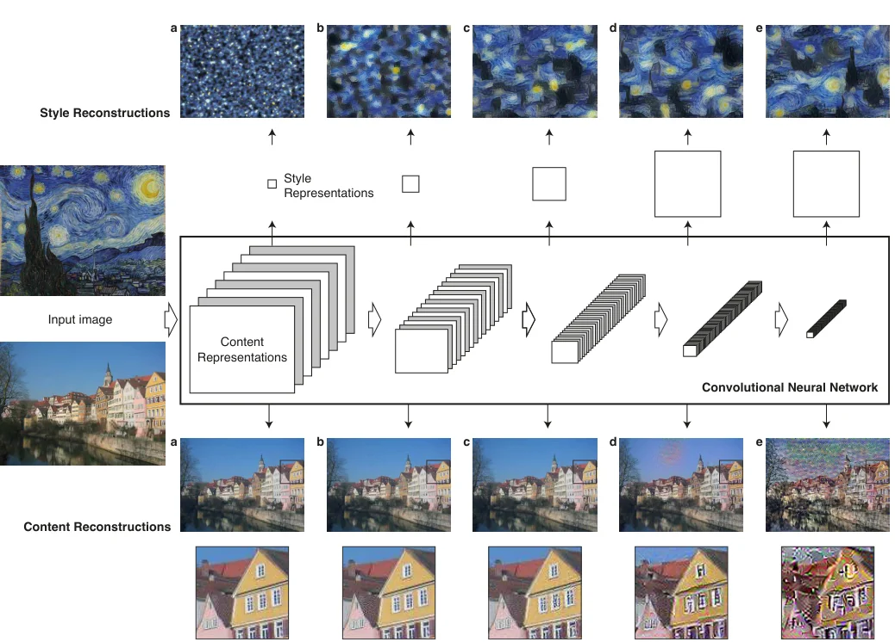
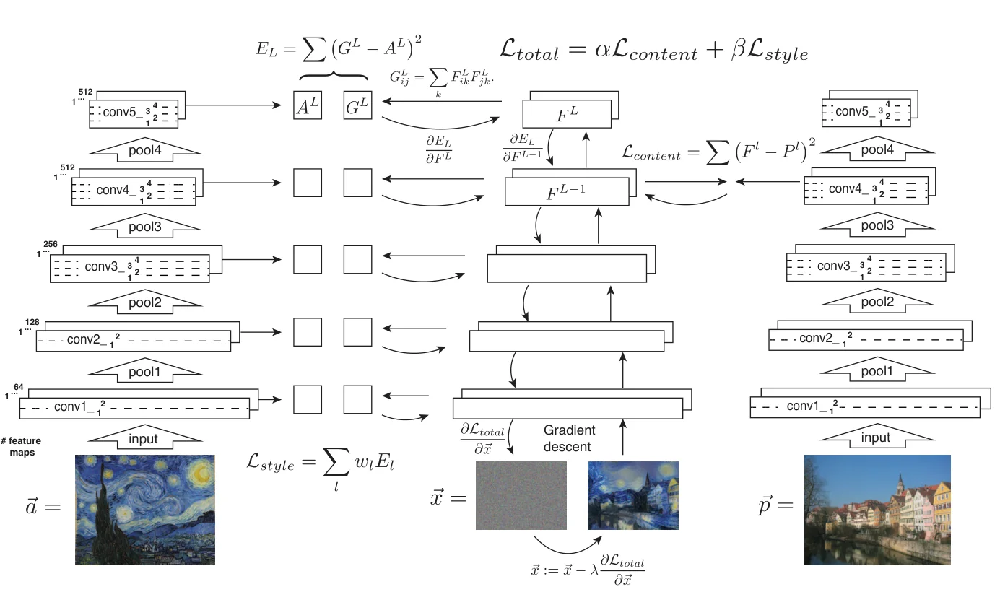
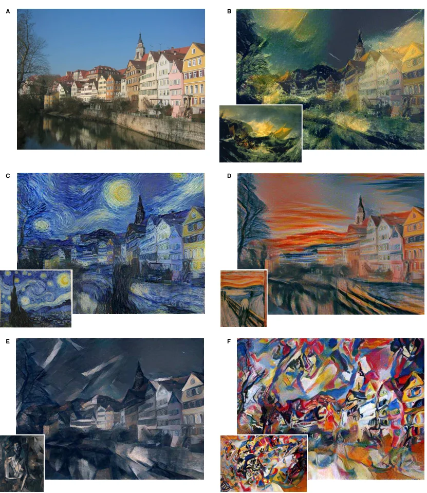

> - **논문**: Image Style Transfer Using Convolutional Neural Networks
> - **저자**: Leon A. Gatys, Alexander S. Ecker, Matthias Bethge (University of Tübingen, Bernstein Center for Computational Neuroscience, Max Planck Institute for Biological Cybernetics, Baylor College of Medicine)
> - **학회**: CVPR 2016 · 선행 arXiv 버전 「A Neural Algorithm of Artistic Style」 [arXiv:1508.06576](https://arxiv.org/abs/1508.06576)
{: .prompt-tip }

> Image Synthesis 카테고리의 첫 글이다. 사진을 고흐의 「별이 빛나는 밤」 화풍으로 다시 그려 주는 **Neural Style Transfer**의 원조, *Image Style Transfer Using Convolutional Neural Networks*를 정리한다. 같은 저자들이 2015년 arXiv에 먼저 공개한 「A Neural Algorithm of Artistic Style」을 학회 논문으로 확장한 버전이다. 사전학습된 CNN의 특징으로 이미지의 **내용(content)**과 **화풍(style)**을 분리해서 다시 합친다.

## 1. Content와 Style

- **Content**: 이미지에 실제로 나타나는 객체, 장면, 구조. 예: 건물의 배치와 종류, 사진의 구도
- **Style**: 색상, 질감, 붓 터치 같은 시각적 특징. 예: 「별이 빛나는 밤」의 색 대비와 소용돌이 질감

두 장의 이미지를 입력으로 받아, content 이미지의 구조를 style 이미지의 화풍으로 다시 그린 결과를 만드는 것이 style transfer이다.

## 2. 기존 방법의 한계

이전의 **texture transfer** 방법은 질감 이미지 조각을 반복해서 붙인 뒤, 붙인 조각들 사이의 차이를 최소화하는 방식이었다(image quilting 등).

- 이미지 복원이나 질감 전이에서는 좋은 성과
- 하지만 **저수준(low-level) 특징**(픽셀)만 써서, 이미지의 고수준 의미를 이해하지 못함
- content와 style을 분리하는 표현도 얼굴, 글꼴, 손글씨 숫자처럼 단순하고 통제된 환경에서만 얻을 수 있었음

기존 생성 모델은 이미지를 encoding하는 능력이 부족해, content와 style을 분리하기 어려웠다. 이 논문은 **CNN이 학습한 고수준 특징**을 써서 둘을 분리한다.

## 3. 특징 추출기: VGG-19

ImageNet으로 사전학습된 **VGG-19**의 특징을 쓴다.

- 당시 이미지 인식 성능이 가장 좋았고, 특징 추출에 효과적이라고 입증된 모델
- 사전학습 덕분에 물체 인식과 위치 파악 능력을 갖춤
- 여러 층에서 **다양한 scale의 feature map**을 얻을 수 있음
- 네트워크 자체는 **학습하지 않고 고정**
- 19층 VGG 중 합성곱 16층과 pooling 5층만 쓰고 FC 층은 버린다. 각 필터의 평균 활성값이 이미지·위치에 걸쳐 1이 되도록 가중치를 다시 스케일한 **정규화된 VGG**를 쓴다. ReLU만 있고 feature map 간 정규화가 없어서 출력은 바뀌지 않는다.

### CNN 층에 따른 표현의 변화

CNN은 층이 깊어질수록 feature map은 작아지고 채널은 많아지며, 값 하나가 담당하는 영역(receptive field)이 커진다.

- **Content**: 흰 노이즈에서 시작해 특정 층의 반응만 맞추도록 이미지를 복원해 보면, conv1_2~conv3_2에서는 픽셀 세부까지 거의 그대로 나오지만, conv4_2·conv5_2에서는 정확한 픽셀 값은 사라지고 구조와 배치만 남는다. 그래서 content는 **깊은 층** 하나로 표현한다.
- **Style**: 반대 경향이다. conv1_1 하나의 style 표현으로는 작은 규모의 색과 질감만 재현되지만, 뒤쪽 층까지 여러 층을 합칠수록 style 이미지의 질감을 큰 규모로 재현한다. 장면의 전체 배치는 어느 경우에도 사라진다.


_Figure 1. 위: `conv1_1`부터 `conv5_1`까지 층을 하나씩 더해 만든 style 표현으로 복원한 이미지. 아래: `conv1_2`~`conv5_2` 각 층의 content 표현으로 복원한 이미지. 깊은 층일수록 픽셀 세부는 사라지고 배치만 남는다. (출처: Gatys et al., 2016)_

## 4. Content Loss

결과 이미지 $$\vec{x}$$와 content 이미지 $$\vec{p}$$를 같은 VGG에 넣어, 층 $$l$$의 feature map을 비교한다.

$$
\mathcal{L}_{content}(\vec{p}, \vec{x}, l) = \frac{1}{2}\sum_{i,j}\big(F^l_{ij} - P^l_{ij}\big)^2
$$

- $$F^l, P^l$$: 결과 이미지와 content 이미지의 층 $$l$$ feature map
- $$i$$: 채널, $$j$$: 채널 안의 위치

Feature map을 원소별로 비교해 제곱합을 구한다. 논문은 VGG-19의 **conv4_2** 층을 쓴다.

## 5. Style Loss와 Gram Matrix

### Gram Matrix

Style은 "**어떤 특징들이 함께 나타나는가**"로 표현한다. 층 $$l$$에서 채널 $$i$$와 $$j$$의 feature map을 원소별로 곱해 더하면, 두 특징의 **상관관계**가 된다.

$$
G^l_{ij} = \sum_k F^l_{ik}\,F^l_{jk}
$$

예를 들어 3채널 2×2 feature map이라면 $$G_{12}$$는 채널 1과 채널 2의 feature map을 원소별로 곱해 더한 값이다. Gram matrix는 **채널 수 × 채널 수** 크기라, 채널이 많은 뒤쪽 층일수록 표현력이 커진다.

Gram matrix는 위치 정보를 버리고(모든 위치를 합산) 특징의 동시 출현만 남기므로, 구도와 무관한 **질감과 화풍**을 나타낸다.

### Style Loss

결과 이미지의 Gram matrix $$G^l$$과 style 이미지의 Gram matrix $$A^l$$을 층마다 비교한다.

$$
E_l = \frac{1}{4N_l^2M_l^2}\sum_{i,j}\big(G^l_{ij} - A^l_{ij}\big)^2,\qquad \mathcal{L}_{style}(\vec{a}, \vec{x}) = \sum_{l} w_l\,E_l
$$

- $$N_l$$: 층 $$l$$의 채널 수, $$M_l$$: feature map 크기(높이×너비)
- $$w_l$$: 층별 가중치. 논문은 **conv1_1, conv2_1, conv3_1, conv4_1, conv5_1** 다섯 층을 같은 가중치로 사용

Content와 달리 style은 **여러 층**에서 loss를 구한다.

## 6. 전체 Loss와 최적화

$$
\mathcal{L}_{total}(\vec{p}, \vec{a}, \vec{x}) = \alpha\,\mathcal{L}_{content}(\vec{p}, \vec{x}) + \beta\,\mathcal{L}_{style}(\vec{a}, \vec{x})
$$

$$\alpha / \beta$$ 비율로 content와 style 중 어느 쪽을 더 살릴지 조절한다. 비율이 작을수록 화풍이 강해진다(논문 예시: $$10^{-3}$$, $$10^{-4}$$).


_Figure 2. 왼쪽: style 이미지 $$\vec a$$의 다섯 층 Gram matrix $$A^l$$을 저장. 오른쪽: content 이미지 $$\vec p$$의 `conv4_2` 특징 $$P^l$$을 저장. 가운데: 흰 노이즈 $$\vec x$$를 통과시켜 두 loss를 구하고, 픽셀에 대한 기울기로 $$\vec x$$를 갱신한다. (출처: Gatys et al., 2016)_

위 Figure 2처럼 이 방법은 **네트워크가 아니라 이미지를 최적화**한다. 결과 이미지 $$\vec{x}$$를 흰 노이즈(또는 content 이미지)로 시작해, 고정된 VGG를 통과시킨 loss의 기울기로 픽셀 값 자체를 업데이트한다. 최적화에는 이미지 합성에서 가장 잘 동작했다는 **L-BFGS**를 쓴다. 또 VGG의 max pooling을 **average pooling**으로 바꾸면 결과가 조금 더 보기 좋아서, 논문의 그림은 모두 average pooling으로 만들었다.

### 논문의 실험 설정

| 항목 | 값 |
|---|---|
| 특징 추출기 | 정규화된 VGG-19 (합성곱 16층 + pooling 5층, FC 없음, max → average pooling), Caffe |
| Content 층 | conv4_2 |
| Style 층 | conv1_1, conv2_1, conv3_1, conv4_1, conv5_1, 각 $$w_l = 1/5$$ (나머지 층 0) |
| $$\alpha/\beta$$ | Figure 3: 터너 $$1\times10^{-3}$$, 고흐 $$8\times10^{-4}$$, 뭉크 $$5\times10^{-3}$$, 피카소·칸딘스키 $$5\times10^{-4}$$ |
| 초기화 | 흰 노이즈 (Figure 7의 사진 간 전이만 content 이미지에서 시작) |
| 최적화 | L-BFGS, 이미지 prior(정규화 항) 없음 |
| 전처리 | style 이미지를 content 이미지와 같은 크기로 리사이즈 |
| 해상도·시간 | 약 512×512, Nvidia K40 GPU에서 최대 1시간 (이미지 크기와 종료 조건에 따라 다름) |

```python
import torch
import torch.nn.functional as F
from torchvision.models import vgg19, VGG19_Weights

vgg = vgg19(weights=VGG19_Weights.DEFAULT).features.eval()
for p in vgg.parameters():
    p.requires_grad_(False)

LAYERS = {"0": "conv1_1", "5": "conv2_1", "10": "conv3_1", "19": "conv4_1", "21": "conv4_2", "28": "conv5_1"}
STYLE = ["conv1_1", "conv2_1", "conv3_1", "conv4_1", "conv5_1"]

def features(x):
    out = {}
    for name, layer in vgg._modules.items():
        x = layer(x)
        if name in LAYERS:
            out[LAYERS[name]] = x
    return out

def gram(f):
    b, c, h, w = f.shape
    f = f.view(c, h * w)
    return f @ f.t()

def style_transfer(content, style, alpha=1.0, beta=1e3, steps=300):
    target_c = features(content)["conv4_2"].detach()
    target_s = {l: gram(features(style)[l]).detach() for l in STYLE}
    x = content.clone().requires_grad_(True)                 # 이미지 자체를 최적화
    opt = torch.optim.LBFGS([x])

    def closure():
        opt.zero_grad()
        f = features(x)
        c_loss = 0.5 * ((f["conv4_2"] - target_c) ** 2).sum()
        s_loss = 0.0
        for l in STYLE:
            _, ch, h, w = f[l].shape
            s_loss += ((gram(f[l]) - target_s[l]) ** 2).sum() / (4 * ch ** 2 * (h * w) ** 2) / len(STYLE)
        loss = alpha * c_loss + beta * s_loss
        loss.backward()
        return loss

    for _ in range(steps // 20):
        opt.step(closure)
    return x.detach()
```

실제로 돌릴 때 챙겨야 할 것들은 다음과 같다.

- `content`, `style`은 `(1, 3, H, W)` 텐서여야 하고, VGG가 학습된 방식대로 ImageNet 평균·표준편차로 정규화해서 넣어야 한다(`transforms.Normalize((0.485, 0.456, 0.406), (0.229, 0.224, 0.225))`). 결과를 저장할 때는 반대로 되돌린다.
- 처음 실행하면 VGG-19 사전학습 가중치(약 550MB)를 내려받는다. CPU로도 돌지만 512px 이미지 기준 GPU를 권장한다.
- `torch.optim.LBFGS`는 기울기가 아주 작으면(`tolerance_grad`, 기본 1e-7) 바로 멈춘다. loss의 크기가 너무 작아지는 $$\alpha, \beta$$ 조합을 쓰면 이미지가 전혀 안 바뀐 채 끝날 수 있으므로, 결과가 입력과 같다면 $$\beta$$를 키워야 한다. (이 글을 정리하며 사전학습 가중치 없이 구조만 시험했을 때 실제로 이 현상이 나왔다.)

## 7. 결과

이 논문에는 정량 지표가 없다. 결과는 모두 그림으로 보여 준다.


_Figure 3. A: 원본 사진(튀빙겐 네카어 강변). B: 터너 「미노타우르호의 난파」, C: 고흐 「별이 빛나는 밤」, D: 뭉크 「절규」, E: 피카소 「앉아 있는 나부」, F: 칸딘스키 「구성 VII」. 왼쪽 아래 작은 그림이 style 이미지이다. (출처: Gatys et al., 2016)_

- 같은 사진(튀빙겐 강변)을 고흐, 터너, 뭉크, 피카소, 칸딘스키의 화풍으로 바꿔, 구조는 유지하면서 화풍이 뚜렷한 결과를 만들었다(위 Figure 3).
- Style을 **얕은 층만으로** 표현하면 국소적인 색과 작은 질감만, **깊은 층까지** 쓰면 더 큰 규모의 화풍 구조가 재현됐다.
- $$\alpha / \beta$$를 바꾸면 사진에 가까운 결과부터 원래 그림에 가까운 결과까지 연속적으로 조절됐다. $$1\times10^{-4}$$이면 그림을 질감으로만 다시 짠 것처럼 사진 내용이 거의 보이지 않고, $$1\times10^{-1}$$이면 사진은 뚜렷하지만 화풍이 약하다(Figure 4).
- Content를 **conv2_2**에서 맞추면 그림의 질감이 사진 위에 얹힌 것처럼 보이고, **conv4_2**에서 맞추면 사진의 윤곽과 색까지 화풍에 맞게 바뀌면서 내용과 질감이 섞인다(Figure 5, $$\alpha/\beta = 10^{-3}$$).
- 초기화를 content 이미지나 style 이미지로 바꾸면 결과가 그 공간 구조 쪽으로 조금 치우치지만 큰 차이는 없다. 노이즈로 시작해야 서로 다른 결과를 여러 장 만들 수 있다(Figure 6).
- 밤의 뉴욕 사진의 style을 낮의 런던 사진에 옮기는 사진 간 전이도 보였지만, 사실감이 완전히 유지되지는 않는다(Figure 7, $$\alpha/\beta = 10^{-2}$$).

### 한계와 후속 연구

이미지 한 장마다 수백 번의 최적화가 필요해 느리다. 논문 기준 512×512 한 장에 K40 GPU로 최대 1시간이 걸리고, 최적화 변수와 네트워크 유닛 수가 픽셀 수에 비례해 늘어나므로 해상도가 가장 큰 제약이다. 저자들은 결과에 네트워크 필터를 닮은 저수준 노이즈가 남는 경우가 있다는 점(특히 사진 간 전이에서)과, content와 style을 어디까지 나눌 수 있는지 자체가 잘 정의된 문제가 아니라는 점도 함께 적는다. 이후 연구는 특정 화풍을 **한 번의 forward로** 입히는 feed-forward 네트워크(Johnson et al., Perceptual Loss), 아무 화풍이나 즉시 입히는 **AdaIN** 등으로 발전했다. AdaIN은 [Instance Normalization]()의 평균·분산을 style 이미지의 것으로 바꿔 끼우는 방식이다.

## 8. 정리

| 개념 | 표현 | 사용 층 |
|---|---|---|
| Content | Feature map 자체 | 깊은 층 하나 (conv4_2) |
| Style | **Gram matrix** (채널 간 상관, 위치 무시) | 여러 층 (conv1_1 ~ conv5_1) |
| 최적화 대상 | 네트워크가 아니라 **결과 이미지의 픽셀** | L-BFGS |
| 조절 | $$\alpha / \beta$$ | content ↔ style 비중 |

다음 Image Synthesis 글에서는 픽셀이 아니라 **벡터 그래픽(SVG)**을 생성하는 [DeepSVG]()를 다룬다.

## References

- Gatys, Ecker & Bethge, "Image Style Transfer Using Convolutional Neural Networks," CVPR 2016.
- Gatys, Ecker & Bethge, "A Neural Algorithm of Artistic Style," 2015. [arXiv:1508.06576](https://arxiv.org/abs/1508.06576)
- [PyTorch Tutorial – Neural Transfer Using PyTorch](https://pytorch.org/tutorials/advanced/neural_style_tutorial.html)
- Efros & Freeman, "Image Quilting for Texture Synthesis and Transfer," SIGGRAPH 2001.
- Simonyan & Zisserman, "Very Deep Convolutional Networks for Large-Scale Image Recognition," ICLR 2015.
- Johnson et al., "Perceptual Losses for Real-Time Style Transfer and Super-Resolution," ECCV 2016.
- Huang & Belongie, "Arbitrary Style Transfer in Real-time with Adaptive Instance Normalization," ICCV 2017.
