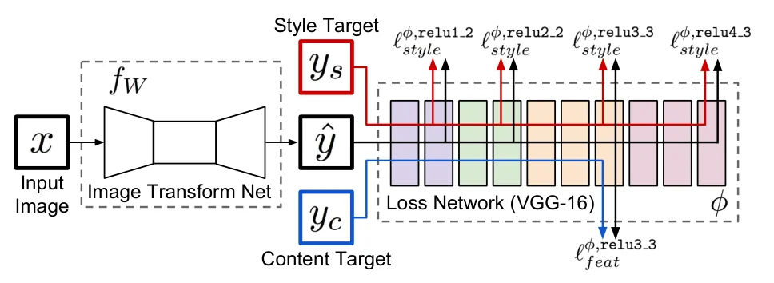
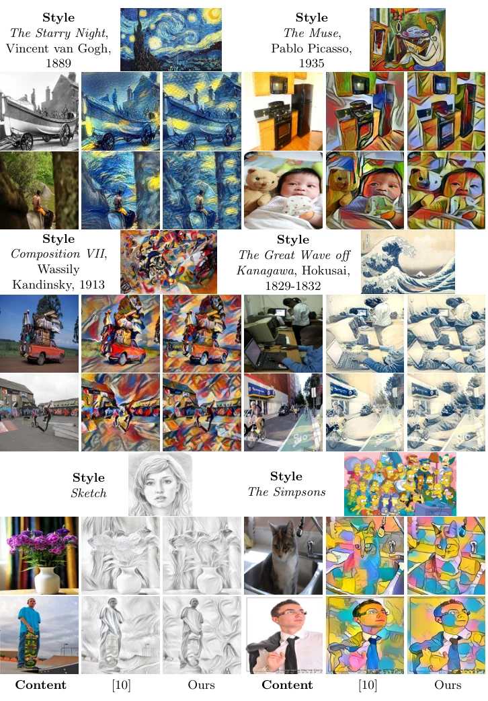
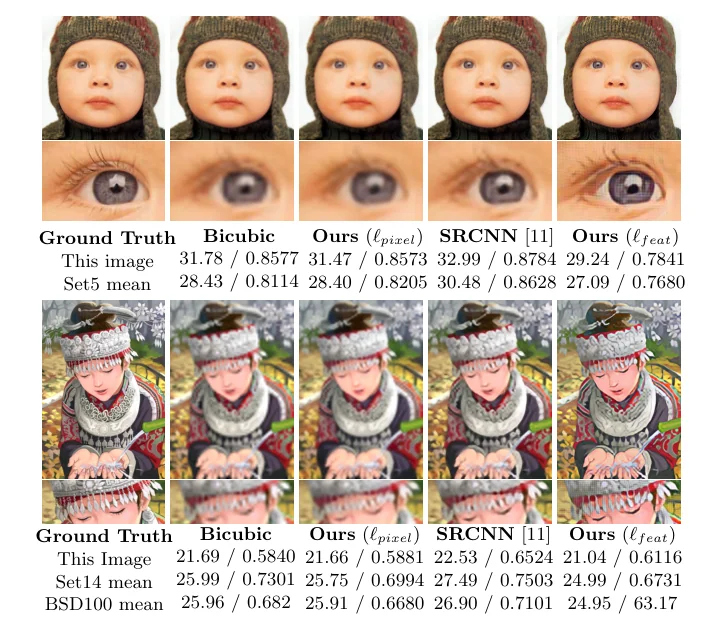

> - **논문**: Perceptual Losses for Real-Time Style Transfer and Super-Resolution
> - **저자**: Justin Johnson, Alexandre Alahi, Li Fei-Fei (Stanford University)
> - **학회**: ECCV 2016 · [arXiv:1603.08155](https://arxiv.org/abs/1603.08155)
{: .prompt-tip }

> [Neural Style Transfer]()에서 본 Gatys의 방법은 콘텐츠·스타일 손실을 **이미지 픽셀에 대해 직접 최적화**합니다. 결과는 훌륭하지만 L-BFGS를 수백 번 반복하며 매번 VGG를 앞뒤로 통과해야 해서 한 장에 수십 초가 걸립니다. 반대로 초해상도·채색 같은 이미지 변환 과제는 순전파 네트워크를 **픽셀별 손실**로 학습하므로 빠르지만, 한 픽셀만 밀린 두 이미지를 완전히 다르다고 보는 손실이 흐릿한 결과를 만듭니다. **Perceptual Losses**는 둘을 합칩니다. 순전파 변환 네트워크를 학습하되, 손실을 **고정된 사전학습 VGG-16의 특징 공간**에서 정의하는 것입니다. 스타일 전이는 Gatys와 비슷한 품질로 세 자릿수 배 빨라졌고, 초해상도는 PSNR은 낮아도 사람 눈에 훨씬 또렷해졌습니다.

## 1. 문제: 픽셀 손실은 지각적 차이를 재지 못한다

이미지 변환 네트워크 $$\hat y = f_W(x)$$를 학습하는 표준 방법은 $$\lVert \hat y - y \rVert^2$$입니다. 그런데 같은 이미지를 1픽셀 옮긴 두 장은 픽셀 손실로는 크게 다르고, 색만 약간 바뀐 두 장은 작게 다릅니다. 사람의 지각과 반대입니다. 한편 특징 반전, 특징 시각화, Gatys의 텍스처 합성·스타일 전이는 사전학습 CNN 특징의 차이를 최소화하도록 이미지를 **최적화**해 고품질 결과를 얻었지만, 추론 자체가 최적화라 느립니다.

## 2. 방법

### 두 네트워크


_Figure 2. 이미지 변환 네트워크 $$f_W$$의 출력 $$\hat y$$를 고정된 VGG-16 손실 네트워크에 넣어, style target $$y_s$$와는 네 층의 style loss를, content target $$y_c$$와는 feature loss를 잽니다. 그림에는 feature loss가 `relu3_3`로 그려져 있지만, 실험은 `relu2_2`를 씁니다. (출처: Johnson et al., 2016)_

- **이미지 변환 네트워크 $$f_W$$**: 학습 대상. 풀링 없이 stride 2 합성곱 둘로 다운샘플, 잔차 블록 5개(블록마다 3×3 합성곱 2층), stride 1/2 합성곱 둘로 업샘플. 첫·마지막 층만 9×9, 나머지 3×3, 잔차가 아닌 합성곱 뒤에는 batch normalization과 ReLU, 출력은 scaled tanh로 [0, 255]. 다운샘플링은 같은 비용으로 더 넓은 네트워크를 쓰게 하고(3×3 conv의 비용은 $$9HWC^2$$라 해상도를 $$D$$배 줄이면 채널을 $$D$$배 늘려도 같음), 3×3 층마다 수용 영역이 $$2D$$씩 커져 큰 영역을 일관되게 바꾸는 스타일 전이에 유리합니다. 잔차 블록은 출력이 입력 구조를 대체로 공유하므로 항등 함수를 배우기 쉽게 합니다.
- **손실 네트워크 $$\phi$$**: ImageNet으로 사전학습한 VGG-16, **고정**. 손실 함수가 깊은 CNN인 셈이고, 분류용으로 배운 지각·의미 정보가 변환 네트워크로 전이됩니다.

### 특징 재구성 손실

$$j$$번째 층의 활성 $$\phi_j(x) \in \mathbb{R}^{C_j \times H_j \times W_j}$$에 대해

$$
\ell^{\phi, j}_{\text{feat}}(\hat y, y) = \frac{1}{C_j H_j W_j} \lVert \phi_j(\hat y) - \phi_j(y) \rVert_2^2
$$

낮은 층에서 재구성하면 원본과 거의 같은 이미지가, 높은 층(relu4_3, relu5_1)에서는 내용과 전체 공간 구조는 보존되지만 색·질감·정확한 모양은 보존되지 않는 이미지가 나옵니다. 픽셀을 정확히 맞추라고 강요하지 않고 **지각적으로 비슷하라**고 요구하는 손실입니다.

### 스타일 재구성 손실

Gram 행렬 $$G^\phi_j(x)_{c,c'} = \frac{1}{C_j H_j W_j} \sum_{h,w} \phi_j(x)_{h,w,c}\, \phi_j(x)_{h,w,c'}$$는 각 위치를 독립 표본으로 본 특징의 비중심 공분산이고, 어떤 특징이 **함께 활성화되는지**를 담습니다. $$\psi \psi^\top / C_j H_j W_j$$로 효율적으로 계산되고, 크기가 다른 이미지끼리도 비교할 수 있습니다.

$$
\ell^{\phi, j}_{\text{style}}(\hat y, y) = \lVert G^\phi_j(\hat y) - G^\phi_j(y) \rVert_F^2
$$

이 손실을 최소화하는 이미지는 스타일 특징은 보존하되 공간 구조는 보존하지 않으며, 높은 층일수록 큰 스케일의 구조가 옮겨집니다. 여러 층 $$J$$에 대해서는 합을 씁니다.

### 학습

스타일 전이는 Gatys의 목적 $$\lambda_c \ell_{\text{feat}}^{relu2\_2} + \lambda_s \ell_{\text{style}}^{relu1\_2, 2\_2, 3\_3, 4\_3} + \lambda_{TV} \ell_{TV}$$를 **콘텐츠 이미지 $$x$$에 대해 기댓값으로** 최소화하도록 스타일당 네트워크 하나를 학습합니다. 초해상도는 relu2_2의 특징 재구성 손실만 쓰고(스타일 손실 없음), 배율 $$f$$마다 네트워크 하나를 학습하며, 입력을 bicubic으로 미리 키우지 않고 $$\log_2 f$$개의 stride 1/2 합성곱으로 네트워크 안에서 업샘플합니다.

| 항목 | 스타일 전이 | 초해상도 (×4, ×8) |
|---|---|---|
| 데이터 | MS-COCO train 8만 장, 256×256으로 리사이즈 | MS-COCO train 1만 장에서 288×288 패치 |
| 입력 | 3×256×256 컬러 이미지 | 288/$$f$$ 크기 패치 (가우시안 블러 $$\sigma = 1.0$$ 후 bicubic 다운샘플) |
| 손실 | feat relu2_2 + style relu1_2·2_2·3_3·4_3 + TV | feat relu2_2만 |
| 반복 | 배치 4, 4만 반복(약 2 epoch) | 배치 4, 20만 반복 |
| Optimizer | Adam, lr $$10^{-3}$$ | Adam, lr $$10^{-3}$$ |
| 정규화 | TV $$10^{-6} \sim 10^{-4}$$ (스타일마다 교차 검증), weight decay·dropout 없음 | weight decay·dropout 없음 |
| 후처리 | 없음 | 출력과 저해상도 입력의 히스토그램 매칭 |
| 구현·시간 | Torch + cuDNN, GTX Titan X 1장에서 약 4시간 | - |

비교 대상인 Gatys 방법은 저자들이 다시 구현했습니다. 흰 노이즈에서 시작하고, 변환 네트워크 출력이 [0, 255]로 묶여 있는 것과 맞추기 위해 매 반복 픽셀을 [0, 255]로 자르는 projected L-BFGS를 씁니다. 대부분 500회 안에 수렴합니다.

## 3. 코드로 보기: 픽셀 손실 대 특징 손실, Gram 행렬

고정된 무작위 합성곱 3층(풀링 포함)을 손실 네트워크 삼아, 가는 줄무늬 텍스처를 1픽셀 옮긴 이미지와 전혀 다른 텍스처에 대한 픽셀 손실·특징 손실을 비교하고, 같은 텍스처의 두 크롭과 다른 텍스처의 Gram 거리를 봅니다.

```python
import torch, torch.nn.functional as F
torch.manual_seed(0)
# a fixed random "loss network": 3 conv layers with ReLU and pooling (stands in for frozen VGG features)
convs = [torch.randn(16, 1, 3, 3) / 3, torch.randn(32, 16, 3, 3) / 12, torch.randn(64, 32, 3, 3) / 17]
def feats(x, upto=3):
    for i, w in enumerate(convs[:upto]):
        x = F.relu(F.conv2d(x, w, padding=1))
        if i < 2: x = F.avg_pool2d(x, 2)
    return x
def gram(f):
    B, C, H, W = f.shape; f = f.reshape(B, C, -1); return f @ f.transpose(1, 2) / (C * H * W)
def texture(seed, n=64, scale=1.2):              # a fine stripy texture with a random orientation and phase
    g = torch.Generator().manual_seed(seed)
    yy, xx = torch.meshgrid(torch.arange(n, dtype=torch.float32), torch.arange(n, dtype=torch.float32), indexing="ij")
    th = torch.rand(1, generator=g) * 3.14; ph = torch.rand(1, generator=g) * 6.28
    return torch.sin((xx * torch.cos(th) + yy * torch.sin(th)) / scale + ph)[None, None]
img = texture(1)
shifted = torch.roll(img, shifts=1, dims=3)      # the same image moved by one pixel
other = texture(2)
def rel(a, b): return ((a - b) ** 2).mean() / (a ** 2).mean()
print("relative distance            pixel loss   feature loss (layer 1)   feature loss (layer 3)")
print(f"image vs. 1-px shifted copy   {rel(img, shifted):9.3f}   {rel(feats(img, 1), feats(shifted, 1)):18.3f}   {rel(feats(img), feats(shifted)):18.3f}")
print(f"image vs. different texture   {rel(img, other):9.3f}   {rel(feats(img, 1), feats(other, 1)):18.3f}   {rel(feats(img), feats(other)):18.3f}")
print("-> per pixel, a one-pixel shift of a fine texture looks as bad as a different image; deeper pooled features forgive the shift")

# style (Gram) loss ignores spatial layout: two crops of the same texture vs. a different texture
big = texture(3, n=96); crop1, crop2 = big[..., :64, :64], big[..., 32:, 32:]
print()
print(f"Gram distance: two crops of one texture {rel(gram(feats(crop1)), gram(feats(crop2))):.3f}   vs. another texture {rel(gram(feats(crop1)), gram(feats(texture(4)))):.3f}")
print(f"feature distance of the same two crops: {rel(feats(crop1), feats(crop2)):.3f}  (the layout differs, so a content loss is large)")
print()
print("cost model: optimisation needs a forward and a backward pass through the loss network per step; the transform net needs one forward pass")
for steps in (100, 300, 500): print(f"  {steps} L-BFGS steps ~ {2*steps} loss-network passes  vs.  1 transform-net pass")
```

```text
relative distance            pixel loss   feature loss (layer 1)   feature loss (layer 3)
image vs. 1-px shifted copy       0.348                0.232                0.095
image vs. different texture       1.999                1.052                0.454
-> per pixel, a one-pixel shift of a fine texture looks as bad as a different image; deeper pooled features forgive the shift

Gram distance: two crops of one texture 0.007   vs. another texture 0.842
feature distance of the same two crops: 0.489  (the layout differs, so a content loss is large)

cost model: optimisation needs a forward and a backward pass through the loss network per step; the transform net needs one forward pass
  100 L-BFGS steps ~ 200 loss-network passes  vs.  1 transform-net pass
  300 L-BFGS steps ~ 600 loss-network passes  vs.  1 transform-net pass
  500 L-BFGS steps ~ 1000 loss-network passes  vs.  1 transform-net pass
```

- 가는 텍스처를 1픽셀 옮기면 픽셀 손실의 상대 거리는 0.348(다른 텍스처와의 거리 1.999의 17%)이지만, 풀링을 거친 3층 특징에서는 0.095로 줄어 0.1 이하가 됩니다(다른 텍스처와의 거리 0.454에 대한 비율은 21%로 비슷합니다). 깊고 풀링된 특징일수록 작은 이동에 둔감해져 "지각적으로 같은" 이미지를 가깝게 봅니다. 논문이 relu2_2 같은 중간 층을 콘텐츠 손실에 쓰는 이유입니다.
- 같은 텍스처의 두 크롭은 공간 배치가 달라 특징 거리가 0.49로 크지만 Gram 거리는 0.007로 거의 0이고, 다른 텍스처와는 0.84입니다. Gram 행렬이 "무엇이 어디에"를 지우고 "무엇이 함께"만 남긴다는 뜻이고, 이것이 스타일의 정의입니다.
- 순전파 네트워크는 추론 때 손실 네트워크를 전혀 쓰지 않습니다. 비용 모델이 보여 주듯 500회 최적화 대비 1,000배의 차이가 여기서 나옵니다.

## 4. 실험

**스타일 전이.** 같은 하이퍼파라미터($$\lambda_c, \lambda_s, \lambda_{TV}$$)로 비교한 정성 결과는 아래 Figure 6처럼 Gatys와 비슷합니다.


_Figure 6. 여섯 스타일(고흐, 피카소, 칸딘스키, 호쿠사이, 스케치, 심슨)에 대해 왼쪽부터 콘텐츠, Gatys et al.의 최적화 결과, 변환 네트워크 결과. 모두 256×256입니다. (출처: Johnson et al., 2016)_

 변환 네트워크가 VGG 특징을 보존하도록 학습됐기 때문에 사람과 동물은 알아볼 수 있게 남고 배경은 크게 변형되는 **의미 인식** 경향이 보입니다. 정량적으로 MS-COCO validation 50장에 피카소 「The Muse」 스타일로 목적 함수 값을 재면 변환 네트워크 한 번의 출력이 **L-BFGS 50~100회 반복**과 비슷한 손실을 내고, 256으로 학습했어도 512·1024에서도 같은 수준을 유지합니다.

속도는 GTX Titan X 기준입니다(Table 1).

| 크기 | Gatys 100회 | 300회 | 500회 | 변환 네트워크 | 가속(100 / 300 / 500회 대비) |
|---|---|---|---|---|---|
| 256×256 | 3.17s | 9.52s | 15.86s | 0.015s | 212× / 636× / 1060× |
| 512×512 | 10.97s | 32.91s | 54.85s | 0.05s | 205× / 615× / 1026× |
| 1024×1024 | 42.89s | 128.66s | 214.44s | 0.21s | 208× / 625× / 1042× |

변환 네트워크는 최적화 **한 번의 반복보다 두 배 빠르고**, 512×512를 20FPS로 처리해 비디오 실시간 스타일 전이가 가능합니다.

**초해상도.** ×4, ×8에서 relu2_2 특징 손실로 학습한 네트워크($$\ell_{feat}$$)는 같은 구조·데이터·학습 절차에 손실만 픽셀 손실로 바꾼 네트워크($$\ell_{pixel}$$)나 SRCNN보다 가장자리와 세부(속눈썹, 모자 장식, 말의 다리)가 또렷합니다. 평가는 Set5, Set14, BSD100에서 YCbCr의 Y 채널로 PSNR / SSIM을 잽니다.


_Figure 8. ×4 초해상도. 왼쪽부터 정답, bicubic, 픽셀 손실 모델, SRCNN, 특징 손실 모델. 아래 숫자는 PSNR / SSIM입니다. (출처: Johnson et al., 2016)_

| 배율 | 데이터셋 | Bicubic | Ours ($$\ell_{pixel}$$) | SRCNN | Ours ($$\ell_{feat}$$) |
|---|---|---|---|---|---|
| ×4 | Set5 | 28.43 / 0.8114 | 28.40 / 0.8205 | **30.48 / 0.8628** | 27.09 / 0.7680 |
| ×4 | Set14 | 25.99 / 0.7301 | 25.75 / 0.6994 | **27.49 / 0.7503** | 24.99 / 0.6731 |
| ×4 | BSD100 | 25.96 / 0.682 | 25.91 / 0.6680 | **26.90 / 0.7101** | 24.95 / 0.6317 |
| ×8 | Set5 | 23.80 / 0.6455 | **24.77** / 0.6864 | - | 23.26 / **0.7058** |
| ×8 | Set14 | 22.37 / 0.5518 | **23.02** / 0.5787 | - | 21.64 / **0.5837** |
| ×8 | BSD100 | 22.11 / 0.5322 | **22.54 / 0.5526** | - | 21.35 / 0.5474 |

- PSNR은 모든 경우에 특징 손실 모델이 가장 낮습니다. PSNR이 픽셀 손실과 같은 양이라 픽셀 손실로 학습한 모델이 이기는 것이 당연하다는 것이 저자들의 설명이고, 확대해 보면 특징 손실 모델에 옅은 격자무늬(cross-hatch)가 생겨 PSNR·SSIM을 깎습니다.
- SSIM은 ×4에서는 특징 손실 모델이 가장 낮지만, ×8의 Set5·Set14에서는 오히려 가장 높습니다.
- SRCNN은 ×8용으로 학습되지 않아 ×4에서만 비교했고, $$10^9$$회 이상 학습한 모델이라 학습량에서도 차이가 큽니다.
- BSD100 ×4의 특징 손실 SSIM은 논문 그림에 「63.17」로 적혀 있는데, 0.6317의 오기로 보고 옮겼습니다.

저자들은 PSNR·SSIM이 사람의 판단과 잘 맞지 않는다는 선행 연구를 들어, 이 실험의 목표가 최고 수치가 아니라 두 손실의 정성적 차이를 보이는 것이라고 밝힙니다.

## 5. 해석

**1. "손실 함수도 네트워크"라는 관점을 정착시켰습니다.** 사전학습 분류기를 고정된 지각 측정기로 쓰는 발상은 이후 LPIPS, GAN의 특징 매칭 손실, [디퓨전 모델의 LPIPS 기반 증류](), [잠재 디퓨전의 오토인코더 학습]()까지 이어지는 표준 도구가 됐습니다.

**2. 최적화 문제를 순전파 네트워크로 "상각"한 전형입니다.** 이미지마다 풀던 최적화를 분포 전체에 대해 한 번 풀어 두고 추론은 순전파 한 번으로 끝냅니다. 이 상각(amortization)은 [AdaIN]()이 임의 스타일로 확장하고, 이후 변환 네트워크 자체가 Transformer([StyTr²]())로 바뀌어도 유지되는 틀입니다.

**3. 한계는 스타일당 네트워크 하나라는 점입니다.** 스타일마다 4시간 학습이 필요하고 새 스타일에 즉시 대응할 수 없습니다. 이것이 조건부 IN(Dumoulin), 그리고 AdaIN의 동기가 됩니다.

**4. 평가 지표 논쟁을 공개적으로 꺼냈습니다.** 초해상도에서 "PSNR이 낮지만 더 좋아 보인다"는 주장은 이후 지각-왜곡 트레이드오프(Blau & Michaeli)로 정식화됩니다. [영상 복원 서베이]()에서 다루는 디퓨전 복원의 평가 문제가 여기서 시작됩니다.

**5. 평가를 읽을 때 주의할 점.** 스타일 전이의 정량 비교는 Gatys와 **같은 목적 함수 값**을 재는 것이라 품질의 독립적 증거는 아닙니다. 초해상도는 사용자 연구 없이 정성 비교와, 저자들 스스로 신뢰하지 않는 PSNR·SSIM만 있습니다. 위 toy의 손실 네트워크는 무작위 가중치라 VGG처럼 의미를 담지는 않으며, 이동 불변성은 풀링 구조에서만 나옵니다.

## 6. 정리

| 항목 | 내용 |
|---|---|
| 문제 | 픽셀 손실은 지각 차이를 못 재고, 최적화 기반 지각 손실은 느림 |
| 핵심 | 순전파 변환 네트워크 + 고정 VGG-16 특징 공간의 지각 손실 |
| 손실 | 특징 재구성(정규화 L2), 스타일 재구성(Gram 행렬 Frobenius), 총변동 |
| 변환 네트워크 | 다운샘플 → 잔차 5블록 → 업샘플, 9×9/3×3, scaled tanh |
| 결과 | 스타일 전이 Gatys 500회 대비 약 1,000배(512² 20FPS), 손실은 L-BFGS 50~100회 수준. 초해상도 ×4/×8 더 또렷(×4 Set5 PSNR 27.09로 가장 낮음) |
| 영향 | LPIPS·특징 매칭 손실의 출발점, AdaIN·StyTr² 등 순전파 스타일 전이의 틀 |

## References

- Johnson, Alahi, Fei-Fei, "Perceptual Losses for Real-Time Style Transfer and Super-Resolution," ECCV 2016. [arXiv:1603.08155](https://arxiv.org/abs/1603.08155)
- Gatys, Ecker, Bethge, "Image Style Transfer Using Convolutional Neural Networks," CVPR 2016.
- Mahendran, Vedaldi, "Understanding Deep Image Representations by Inverting Them," CVPR 2015. [arXiv:1412.0035](https://arxiv.org/abs/1412.0035)
- Dong, Loy, He, Tang, "Image Super-Resolution Using Deep Convolutional Networks," TPAMI 2016. [arXiv:1501.00092](https://arxiv.org/abs/1501.00092)
- Zhang et al., "The Unreasonable Effectiveness of Deep Features as a Perceptual Metric," CVPR 2018. [arXiv:1801.03924](https://arxiv.org/abs/1801.03924)
