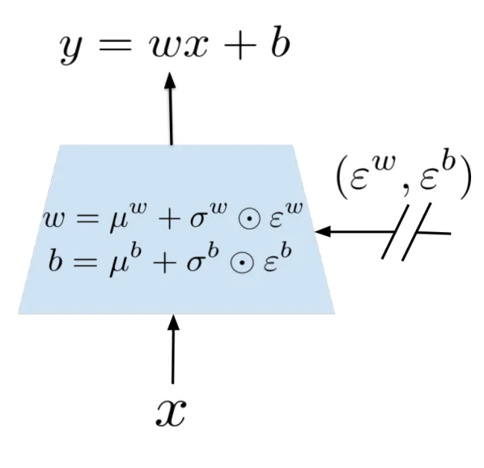
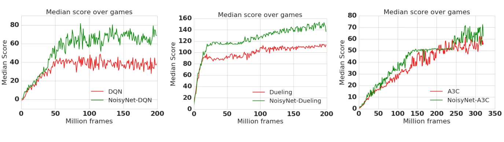
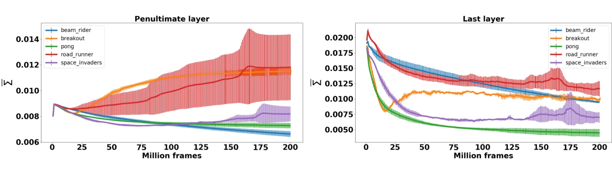

> - **논문**: Noisy Networks for Exploration
> - **저자**: Meire Fortunato, Mohammad Gheshlaghi Azar, Bilal Piot, Jacob Menick, Matteo Hessel, Ian Osband, Alex Graves, Volodymyr Mnih, Remi Munos, Demis Hassabis, Olivier Pietquin, Charles Blundell, Shane Legg (DeepMind)
> - **학회**: ICLR 2018 · [arXiv:1706.10295](https://arxiv.org/abs/1706.10295)
{: .prompt-tip }

> [Double DQN]()이 가치 추정을 개선했다면, **NoisyNet**은 **탐험(exploration)** 방식을 바꾼다. ε-greedy처럼 행동에 무작위성을 더하는 대신, 네트워크 가중치 자체에 학습 가능한 노이즈를 넣는다.

## 1. 기존 탐험 방식의 한계

DQN은 **ε-greedy**, A3C는 **entropy bonus**로 탐험한다.

- **ε-greedy**: step마다 독립적으로 확률 $$\varepsilon$$만큼 무작위 행동. 상태와 무관하게 무작위성이 들어가고, 연속적이고 일관된 탐험(예: 한 방향으로 꾸준히 가 보기)을 하기 어렵다.
- **Entropy bonus**: 정책이 너무 빨리 확정되지 않게 막지만, 역시 행동 수준의 국소적인 무작위성이다.

두 방법 모두 얼마나 탐험할지($$\varepsilon$$, 엔트로피 계수)를 사람이 정해야 하고, 상태마다 다르게 조절하지 못한다.

## 2. 핵심 아이디어

> 네트워크의 **가중치와 bias에 파라미터화된 노이즈**를 더하고, **노이즈의 크기도 학습**하자.

### Contribution

- 가중치에 perturbation을 줘서 탐험하게 만드는 **NoisyNet** 제안
- 노이즈 파라미터는 네트워크의 다른 파라미터와 **함께 경사하강법으로 학습**
- 구현이 간단하고 **연산 오버헤드가 거의 없음**
- DQN, Dueling DQN, A3C 등 **어떤 Deep RL 알고리즘에도** 적용 가능

## 3. Noisy Linear Layer

일반 선형층은

$$
y = wx + b
$$

NoisyNet의 선형층은 가중치와 bias를 **평균 + 학습되는 표준편차 × 노이즈**로 바꾼다.

$$
y = (\mu^w + \sigma^w \odot \varepsilon^w)\,x + \mu^b + \sigma^b \odot \varepsilon^b
$$

- $$\mu^w, \sigma^w, \mu^b, \sigma^b$$: **학습 가능한 파라미터**
- $$\varepsilon^w, \varepsilon^b$$: 평균 0인 무작위 노이즈 (학습 X)
- $$\odot$$: 원소별 곱


_Figure 4. Noisy linear layer. 학습 파라미터 $$\mu, \sigma$$와 외부에서 들어오는 노이즈 $$\varepsilon$$로 가중치·bias를 만든 뒤, 일반 선형층처럼 $$y = wx + b$$를 계산한다. (출처: Fortunato et al., 2018)_

네트워크가 $$\sigma$$를 키우면 탐험을 많이, 줄이면 적게 하게 된다. 탐험 정도를 데이터로부터 스스로 정하는 것이다.

### 노이즈를 만드는 두 가지 방법

입력이 $$p$$차원, 출력이 $$q$$차원인 층이라면

| | Independent Gaussian | Factorized Gaussian |
|---|---|---|
| 방식 | 가중치·bias **원소마다** 독립 노이즈 | **입력별**·**출력별** 노이즈를 곱해서 만듦 |
| 필요한 난수 개수 | $$pq + q$$ | $$p + q$$ |
| 사용처 | A3C (분산 학습이라 난수 비용이 문제되지 않음) | DQN, Dueling DQN (단일 스레드라 난수 생성 비용 절감이 중요) |

Factorized 방식은 다음과 같다.

$$
\varepsilon^w_{i,j} = f(\varepsilon_i)\,f(\varepsilon_j),\qquad \varepsilon^b_j = f(\varepsilon_j),\qquad f(x) = \text{sgn}(x)\sqrt{\lvert x\rvert}
$$

bias에는 $$f(x) = x$$를 써도 되지만, 논문은 가중치와 bias가 같은 출력 노이즈를 공유하도록 같은 $$f$$를 썼다.

### 기울기 계산

NoisyNet의 loss는 노이즈에 대한 기댓값 $$\bar{L}(\zeta) = \mathbb{E}_\varepsilon[L(\theta)]$$이므로, 기울기를 쉽게 구할 수 있다.

$$
\nabla\bar{L}(\zeta) = \mathbb{E}_\varepsilon\big[\nabla_{\mu, \Sigma}L(\mu + \Sigma \odot \varepsilon)\big]
$$

실제로는 최적화 step마다 노이즈 샘플 하나로 Monte Carlo 근사한다.

### 초기화

| | $$\mu$$ | $$\sigma$$ |
|---|---|---|
| Independent | $$\mathcal{U}\left[-\sqrt{3/p},\ \sqrt{3/p}\right]$$ | $$0.017$$ |
| Factorized | $$\mathcal{U}\left[-1/\sqrt{p},\ 1/\sqrt{p}\right]$$ | $$\sigma_0/\sqrt{p}$$, $$\sigma_0 = 0.5$$ |

Independent 쪽의 0.017은 저자들의 이전 지도학습 연구에서 잘 동작한 값을 가져온 것이고, 따로 튜닝하지 않았다고 밝힌다.

```python
import math
import torch
import torch.nn as nn
import torch.nn.functional as F

class NoisyLinear(nn.Module):
    """Factorized Gaussian NoisyNet layer"""
    def __init__(self, in_f, out_f, sigma0=0.5):
        super().__init__()
        self.in_f, self.out_f = in_f, out_f
        self.mu_w = nn.Parameter(torch.empty(out_f, in_f).uniform_(-1 / math.sqrt(in_f), 1 / math.sqrt(in_f)))
        self.sigma_w = nn.Parameter(torch.full((out_f, in_f), sigma0 / math.sqrt(in_f)))
        self.mu_b = nn.Parameter(torch.empty(out_f).uniform_(-1 / math.sqrt(in_f), 1 / math.sqrt(in_f)))
        self.sigma_b = nn.Parameter(torch.full((out_f,), sigma0 / math.sqrt(in_f)))
        self.register_buffer("eps_in", torch.zeros(in_f))
        self.register_buffer("eps_out", torch.zeros(out_f))
        self.reset_noise()

    @staticmethod
    def _f(x):
        return x.sign() * x.abs().sqrt()

    def reset_noise(self):                      # p + q개의 난수만 생성
        self.eps_in.copy_(self._f(torch.randn(self.in_f)))
        self.eps_out.copy_(self._f(torch.randn(self.out_f)))

    def forward(self, x):
        if self.training:
            w = self.mu_w + self.sigma_w * torch.outer(self.eps_out, self.eps_in)
            b = self.mu_b + self.sigma_b * self.eps_out
        else:                                   # 평가 때는 평균 가중치만
            w, b = self.mu_w, self.mu_b
        return F.linear(x, w, b)

torch.manual_seed(0)
layer = NoisyLinear(4, 2)
x = torch.ones(1, 4)
for _ in range(3):                              # 노이즈를 바꿀 때마다 출력이 달라짐
    layer.reset_noise()
    print(layer(x).detach().numpy().round(3))
layer.eval()
print("eval:", layer(x).detach().numpy().round(3))
```

```text
[[-0.745  0.576]]
[[-0.837  0.066]]
[[-0.151  1.065]]
eval: [[-0.559  0.46 ]]
```

같은 입력이라도 노이즈를 다시 뽑을 때마다 Q 값(출력)이 달라지고, 그에 따라 greedy 행동도 바뀔 수 있다. NoisyNet의 탐험은 이렇게 일어난다. 평가 모드에서는 평균 가중치 $$\mu$$만 쓰므로 출력이 고정된다. (평가 때 노이즈를 끌지는 구현마다 다르며, 논문 공식 설정과 다를 수 있다.)

## 4. 알고리즘에 적용하기

NoisyNet 에이전트는 **최적화 step마다 새 노이즈를 샘플링**하고, 그 사이에는 고정된 가중치로 행동한다. 논문의 DQN·Dueling 설정은 행동 한 번마다 최적화를 한 번 하므로 행동할 때마다 노이즈를 새로 뽑고, A3C는 $$n$$-step rollout마다 한 번 최적화하므로 rollout 하나 동안 같은 노이즈로 행동한다. 노이즈가 행동이 아니라 가중치에 들어가므로, ε-greedy보다 **상태에 의존하는 탐험**이 된다.

> 왜 "상태에 의존"할까? ε-greedy의 무작위성은 상태와 상관없이 동전을 던지는 것이지만, NoisyNet은 가중치가 흔들리므로 같은 노이즈라도 상태에 따라 Q 값이 흔들리는 정도가 달라진다. 어떤 상태에서는 노이즈가 있어도 최선의 행동이 분명해 거의 바뀌지 않고, 애매한 상태에서는 쉽게 다른 행동이 선택된다.
{: .prompt-info }

### NoisyNet-DQN / Dueling DQN

- **ε-greedy를 쓰지 않는다.** 노이즈가 섞인 Q 값에 대해 그냥 greedy하게 행동한다.
- Value network의 **FC layer**를 noisy layer로 바꾼다. (Factorized Gaussian)
- Replay batch 하나를 학습하는 동안에는 현재 노이즈 샘플을 batch 전체에 고정한다.
- Online network와 target network에 **서로 독립적인 노이즈** $$\varepsilon, \varepsilon'$$를 써서, 두 네트워크 노이즈의 상관관계로 생기는 편향을 피한다. 행동 선택에는 online network에 또 다른 독립 노이즈 $$\varepsilon''$$를 쓴다.

$$
\bar{L}(\zeta) = \mathbb{E}\Big[\mathbb{E}_{(x, a, r, y) \sim D}\big[r + \gamma\max_{b}Q(y, b, \varepsilon'; \zeta^-) - Q(x, a, \varepsilon; \zeta)\big]^2\Big]
$$

Dueling DQN에서는 target 계산에 Double DQN 방식을 함께 쓴다. 다음 상태의 행동 $$b^*(y)$$는 online network(노이즈 $$\varepsilon''$$)로 고르고, 그 행동의 값은 target network(노이즈 $$\varepsilon'$$)로 평가한다.

$$
\bar{L}(\zeta) = \mathbb{E}\Big[\mathbb{E}_{(x, a, r, y) \sim D}\big[r + \gamma Q(y, b^*(y), \varepsilon'; \zeta^-) - Q(x, a, \varepsilon; \zeta)\big]^2\Big],\qquad b^*(y) = \arg\max_b Q(y, b, \varepsilon''; \zeta)
$$

```python
# 매 학습 step마다 노이즈 재샘플링
for module in q_net.modules():
    if isinstance(module, NoisyLinear):
        module.reset_noise()
action = q_net(state).argmax(dim=1)        # ε-greedy 없이 greedy
```

### NoisyNet-A3C

- Policy loss의 **entropy bonus를 제거**한다.
- Policy network의 FC layer를 noisy layer로 바꾼다. (Independent Gaussian)
- A3C는 on-policy라서, rollout 하나 안에서 노이즈가 일정해야 기울기가 편향되지 않는다. 그래서 rollout 동안 같은 $$\varepsilon$$을 쓴다.

A3C는 원래 정책에서 행동을 샘플링하므로 별도의 탐험 장치가 없고, 정책이 너무 빨리 결정적으로 굳지 않게 entropy bonus를 더했다. NoisyNet에서는 가중치를 새로 뽑는 것 자체가 다른 정책을 고르는 셈이라 entropy bonus 없이도 탐험이 된다.

## 5. 결과

### 실험 설정

| 항목 | 값 |
|---|---|
| 환경 | Atari 57개 게임, random no-op start |
| Baseline | DQN, Dueling(duel clip 변형), A3C. 네트워크 구조와 하이퍼파라미터는 각 원 논문 그대로 |
| 학습 길이 | DQN 200M frame, A3C 320M frame (Dueling은 본문에 적혀 있지 않지만 학습 곡선은 200M frame까지) |
| 평가 | 1M frame마다 학습을 멈추고 500K frame 동안 평가, 에피소드는 108K frame(30분)에서 자름 |
| Seed | 3개 평균 |
| 지표 | 사람 대비 정규화 점수 $$100 \times \frac{\text{Score}_{agent} - \text{Score}_{random}}{\text{Score}_{human} - \text{Score}_{random}}$$의 57게임 평균·중앙값 |

### 정량 결과

Atari 57개 게임에서 DQN, Dueling DQN, A3C 세 baseline 모두에 NoisyNet을 적용했을 때

| 에이전트 | Baseline 평균 | Baseline 중앙값 | NoisyNet 평균 | NoisyNet 중앙값 | 중앙값 향상 |
|---|---|---|---|---|---|
| DQN | 319 | 83 | **379** | **123** | 48% |
| Dueling | 524 | 132 | **633** | **172** | 30% |
| A3C | 293 | 80 | **347** | **94** | 18% |
| A3C (factorized 노이즈) | 293 | 80 | 276 | 99 | 24% |

<small>사람 대비 정규화 점수(%), 논문 Table 1·2</small>

- 대부분의 게임에서 점수가 올랐고
- 사람 대비 정규화 점수의 **중앙값이 세 알고리즘 모두에서 향상**. 평균도 세 알고리즘 모두 올랐다. (A3C에 factorized 노이즈를 쓴 추가 실험에서는 중앙값은 99로 더 좋았지만 평균은 276으로 baseline보다 낮았다.)
- Dueling처럼 이미 여러 개선이 들어간 에이전트에서도 효과가 있어, NoisyNet이 다른 DQN 개선과 겹치지 않는다는 근거가 된다.
- 아래 Figure 2처럼 학습 곡선 전 구간에서 더 높은 점수를 유지하고, 차이는 DQN과 Dueling에서 특히 크다.


_Figure 2. 57개 게임의 사람 대비 정규화 점수 중앙값 학습 곡선. 왼쪽부터 DQN, Dueling, A3C이고 초록색이 NoisyNet이다. (출처: Fortunato et al., 2018)_

특히 baseline이 사람보다 크게 못하던 Beam Rider(DQN), Asteroids(Dueling), Freeway(A3C)에서는 NoisyNet 버전이 사람 수준을 넘었다. 일부 게임에서는 점수가 10배 이상 오르기도 했다. 다만 논문도 비용 함수가 바뀐 만큼 최적화 측면의 효과가 섞여 있을 수 있어, 탐험 효과와 분리하는 분석이 더 필요하다고 적는다.

### 노이즈는 결국 사라질까?

$$\sigma$$는 학습되는 값이므로, 최적해가 결정적(deterministic)이라면 네트워크가 $$\sigma$$를 0으로 줄여 노이즈를 없앨 것이라고 예상할 수 있다. 이를 확인하기 위해 noisy layer의 평균 노이즈 크기를 측정했다.

$$
\bar{\Sigma} = \frac{1}{N_{weights}}\sum_i \lvert\sigma_i^w\rvert
$$


_Figure 3. NoisyNet-DQN에서 5개 게임의 $$\bar{\Sigma}$$ 학습 곡선 (3 seed 평균, 막대는 표준편차). 왼쪽: 마지막 직전 층, 오른쪽: 마지막 층. (출처: Fortunato et al., 2018)_

- **마지막 층**에서는 모든 게임에서 $$\bar{\Sigma}$$가 줄었지만
- **그 앞 층(penultimate layer)**에서는 5개 중 2개 게임(Pong, Beam Rider)에서만 줄었고, 나머지 3개(Breakout, Road Runner, Space Invaders)에서는 오히려 늘었다.
- 게임마다, 같은 게임이라도 seed마다 변화 양상이 크게 달랐다.

이는 에이전트가 무조건 결정적인 해로 수렴하는 것이 아니라, **문제마다 다른 탐험 전략**을 스스로 만들어 낸다는 뜻이다.

## 6. 정리

| | ε-greedy / Entropy | NoisyNet |
|---|---|---|
| 무작위성 위치 | 행동 | **가중치** |
| 탐험 정도 | 사람이 정함 | **$$\sigma$$로 학습** |
| 탐험의 성격 | step마다 독립 | 상태 의존적 (A3C는 rollout 동안 같은 노이즈) |
| 추가 비용 | 없음 | 파라미터 약 2배, 연산은 거의 동일 |

NoisyNet은 [Double DQN](), [C51]() 등과 함께 **Rainbow**의 구성 요소가 됐다.

## References

- Fortunato et al., "Noisy Networks for Exploration," ICLR 2018. [arXiv:1706.10295](https://arxiv.org/abs/1706.10295)
- Mnih et al., "Asynchronous Methods for Deep Reinforcement Learning (A3C)," ICML 2016.
- Wang et al., "Dueling Network Architectures for Deep Reinforcement Learning," ICML 2016.
- Hessel et al., "Rainbow: Combining Improvements in Deep Reinforcement Learning," AAAI 2018.
