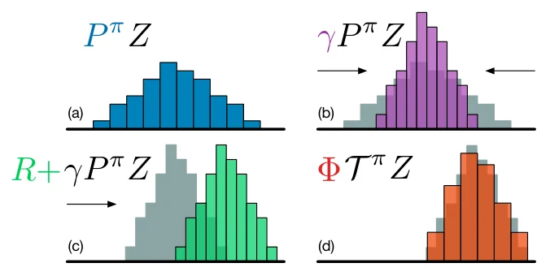
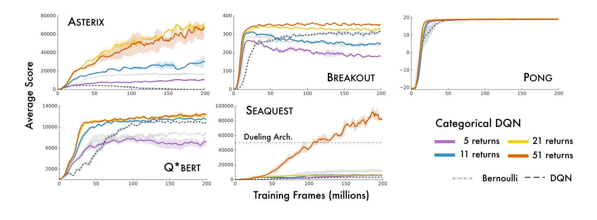
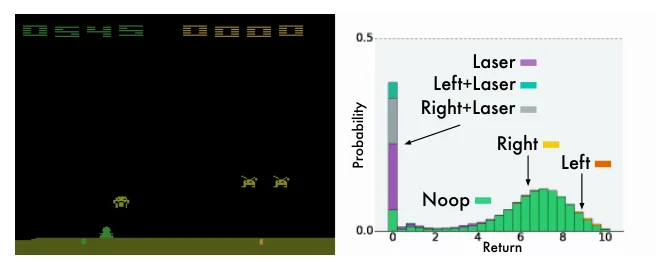

> - **논문**: A Distributional Perspective on Reinforcement Learning
> - **저자**: Marc G. Bellemare, Will Dabney, Rémi Munos (DeepMind)
> - **학회**: ICML 2017 · [arXiv:1707.06887](https://arxiv.org/abs/1707.06887)
{: .prompt-tip }

> DQN 계열의 Q 값은 **미래 보상의 평균(기댓값)** 하나입니다. 이 논문은 평균만이 아니라 **보상의 분포 전체**를 학습하자고 제안합니다. 이 논문의 알고리즘이 **C51(Categorical DQN)**이고, 이후 QR-DQN, IQN 등 Distributional RL 연구의 출발점이 됐습니다.

## 1. 기존 DQN: 기댓값 하나만 본다

DQN은 Bellman 방정식을 따라 **기대 return** $$Q(x, a)$$를 학습하고, 이 값이 가장 큰 행동을 고릅니다.

$$
Q(x, a) = \mathbb{E}\big[R(x, a)\big] + \gamma\,\mathbb{E}\big[Q(X', A')\big]
$$

($$x$$: 상태, $$X'$$: 다음 상태)

하지만 같은 평균이라도 분포는 전혀 다를 수 있습니다.

### 예시: 출근 경로 고르기

평균 소요 시간이 같은 30분인 두 경로가 있다고 합시다.

- **경로 A**: 거의 항상 29~31분
- **경로 B**: 보통 20분인데, 가끔 사고가 나면 60분

기댓값만 보면 두 경로는 구분되지 않습니다(B는 25% 확률로 사고가 나면 평균 30분). 하지만 9시까지 반드시 도착해야 하는 날이라면 A가 낫고, 운에 맡겨도 되는 날이라면 B가 나을 수 있습니다. **분포를 알면 이런 차이를 반영할 수 있습니다.** 실제 환경의 return도 이처럼 **여러 봉우리(multi-modal)**를 갖는 경우가 많습니다.

> 이 예시는 "분포가 담는 정보"를 보여 주기 위한 것입니다. 아래에서 보듯 **C51도 행동은 평균으로 고르기 때문에**, A와 B 중 위험이 적은 쪽을 스스로 고르지는 않습니다. 분포를 이용해 위험을 피하는 행동(risk-sensitive control)은 이후 IQN 같은 연구에서 다룹니다.
{: .prompt-info }

## 2. Distributional Bellman Equation

Return을 기댓값이 아니라 **확률변수** $$Z(x, a)$$로 둡니다. $$Q$$는 $$Z$$의 평균입니다.

$$
Q(x, a) = \mathbb{E}\big[Z(x, a)\big]
$$

그러면 Bellman 방정식도 **분포 사이의 등식**이 됩니다.

$$
Z(x, a) \overset{D}{=} R(x, a) + \gamma\,Z(X', A')
$$

$$\overset{D}{=}$$는 "양변의 **확률 분포가 같다**"는 뜻입니다. 지금 받은 보상에, 다음 상태의 return 분포를 $$\gamma$$배로 줄여서 옮긴 것이 현재 return 분포라는 의미입니다. 아래 Figure 1이 이 과정을 네 단계로 보여 줍니다.


_Figure 1. (a) 다음 상태의 return 분포, (b) 할인율 $$\gamma$$로 분포가 좁아짐, (c) 보상 $$R$$만큼 이동, (d) 원래 atom 위치로 다시 나눠 담는 projection $$\Phi$$(3장 참고). (출처: Bellemare et al., 2017)_

논문은 이 분포 Bellman 연산자가 정책 평가(policy evaluation)에서는 Wasserstein 거리(의 최댓값 형태) 기준으로 **$$\gamma$$-수축(contraction)**한다는 것을 보였습니다. 거리의 종류가 중요해서, 같은 연산자가 total variation, KL divergence, Kolmogorov 거리로는 수축하지 않습니다. 반면 최적 제어(control)의 최적성 연산자는 기댓값으로는 수축하지만 **분포 사이의 어떤 거리로도 수축하지 않습니다.** 그래서 실제 알고리즘은 근사적인 방법을 씁니다.

## 3. Categorical DQN (C51)

### 분포를 어떻게 표현하나: Support와 Atom

연속적인 분포를 그대로 다루기는 어려우므로, return의 범위를 **고정된 $$N$$개의 점(atom)**으로 나누고 각 점에 확률을 할당하는 **이산(categorical) 분포**로 근사합니다.

$$
z_i = V_{\min} + i\,\Delta z,\qquad \Delta z = \frac{V_{\max} - V_{\min}}{N - 1},\qquad i = 0, \dots, N-1
$$

- **Support**: atom $$\{z_i\}$$의 집합 (분포의 가로축, return 값)
- $$V_{\min}, V_{\max}$$: support의 최솟값·최댓값 (Atari에서 -10, 10)
- $$N$$: atom 개수

네트워크는 각 행동마다 **$$N$$개 atom의 확률**을 softmax로 출력합니다.

$$
p_i(x, a) = \frac{e^{\theta_i(x, a)}}{\sum_j e^{\theta_j(x, a)}}
$$

논문은 atom 수를 5, 11, 21, 51개로 바꿔 가며 실험했고, 시험한 범위에서는 **많을수록 성능이 좋아져** 가장 큰 **51개**를 최종 설정으로 썼습니다. 그래서 이 알고리즘을 **C51**이라고 부릅니다.

### 행동 선택

분포에서 기댓값을 계산해 Q 값을 얻고, 기존 DQN처럼 Q가 가장 큰 행동을 고릅니다.

$$
Q(x, a) = \sum_{i} z_i\,p_i(x, a),\qquad a^* = \arg\max_a Q(x, a)
$$

행동은 여전히 평균으로 고르지만, **학습을 분포로** 한다는 점이 다릅니다.

### 학습: Projected Bellman Update

목표 분포는 다음 상태의 분포를 $$r + \gamma z_j$$로 옮긴 것입니다. 그런데 옮긴 위치는 **원래 atom 위치와 맞지 않습니다.** 예를 들어 $$r = 0.3$$, $$\gamma = 0.99$$면 $$z_j$$가 모두 조금씩 밀려납니다. 예측 분포와 support가 달라 바로 비교할 수 없으므로, 옮긴 확률을 **가장 가까운 두 atom에 거리 비율로 나눠 줍니다(projection, 위 Figure 1의 (d)).**

1. 다음 상태에서 최적 행동 $$a^* = \arg\max_a \sum_i z_i\,p_i(x', a)$$
2. 각 atom $$j$$에 대해
   - $$\hat{T}z_j = \text{clip}(r + \gamma z_j,\ V_{\min},\ V_{\max})$$
   - $$b_j = (\hat{T}z_j - V_{\min}) / \Delta z$$, $$l = \lfloor b_j\rfloor$$, $$u = \lceil b_j\rceil$$
   - $$m_l \mathrel{+}= p_j(x', a^*)\,(u - b_j)$$, $$m_u \mathrel{+}= p_j(x', a^*)\,(b_j - l)$$
3. 투영된 목표 분포 $$m$$과 예측 분포 $$p(x, a)$$의 **Cross Entropy**를 최소화

숫자로 보면 이해가 쉽습니다. Support가 $$[-10, 10]$$, atom 51개면 $$\Delta z = 0.4$$입니다. 다음 상태의 분포가 $$z = 0$$에 확률 1로 몰려 있고 보상 $$r = 0.3$$을 받았다면, 목표 위치 $$0.3$$은 atom $$0$$과 $$0.4$$ 사이에 떨어집니다. 거리에 반비례하게 나누면 $$0$$에 0.25, $$0.4$$에 0.75가 갑니다. 이렇게 나누면 **확률의 합(1)과 기댓값(0.3)이 그대로 보존**됩니다.

```text
[(0.0, 0.25), (0.4, 0.75)]
합: 1.0  기댓값: 0.29999...
```

(아래 코드의 projection 부분만 떼어 실행한 결과입니다.)

$$
\mathcal{L} = -\sum_i m_i\,\log p_i(x, a)
$$

DQN이 **스칼라 Q 값을 MSE**로 맞췄다면, C51은 **분포를 Cross Entropy(KL divergence)**로 맞춥니다.

```python
import torch

N, V_MIN, V_MAX = 51, -10.0, 10.0
z = torch.linspace(V_MIN, V_MAX, N)                 # support
dz = (V_MAX - V_MIN) / (N - 1)

def c51_loss(online, target, s, a, r, s_next, done, gamma=0.99):
    # online(s), target(s): (B, n_actions, N) 확률 분포 (softmax 출력)
    with torch.no_grad():
        p_next = target(s_next)                                   # (B, A, N)
        a_star = (p_next * z).sum(-1).argmax(1)                    # 기댓값으로 행동 선택
        p_next = p_next[torch.arange(len(a_star)), a_star]         # (B, N)

        Tz = (r[:, None] + gamma * (1 - done[:, None]) * z[None]).clamp(V_MIN, V_MAX)
        b = (Tz - V_MIN) / dz
        l, u = b.floor().long(), b.ceil().long()
        l[(u > 0) & (l == u)] -= 1                                 # b가 정수일 때 질량이 사라지지 않게
        u[(l < N - 1) & (l == u)] += 1

        m = torch.zeros_like(p_next)
        m.scatter_add_(1, l, p_next * (u.float() - b))             # 아래 atom에 분배
        m.scatter_add_(1, u, p_next * (b - l.float()))             # 위 atom에 분배

    log_p = torch.log(online(s)[torch.arange(len(a)), a] + 1e-8)  # (B, N)
    return -(m * log_p).sum(1).mean()                             # cross entropy
```

`l == u`를 보정하는 두 줄은, $$b_j$$가 정확히 정수(atom 위)일 때 위 식의 두 가중치 $$(u - b_j)$$, $$(b_j - l)$$이 모두 0이 되어 확률이 사라지는 것을 막기 위한 것입니다. 또 실무에서는 네트워크가 softmax 확률 대신 logit을 내게 하고 `torch.log_softmax`로 로그 확률을 바로 구하는 편이 수치적으로 안정적입니다.

## 4. 구현 디테일

네트워크와 학습 절차는 DQN(Mnih et al., 2015)을 그대로 따르고, 출력층만 행동별 Q 값 대신 행동별 atom 확률 $$p_i(x, a)$$로 바꿨습니다. 논문은 이 구조를 **Categorical DQN**이라고 부릅니다.

| 항목 | 값 |
|---|---|
| 네트워크 | DQN 구조, 출력만 (행동 수 × 51) 확률 |
| Support | $$V_{\min} = -10$$, $$V_{\max} = 10$$, atom 51개 ($$V_{\max} \in \{3, 10, 100\}$$ 중 선택) |
| Optimizer | Adam (DQN의 RMSProp 대신), lr $$\alpha = 0.00025$$ (DQN과 동일) |
| Adam $$\epsilon$$ | $$0.01/L$$ ($$L = 32$$, minibatch 크기) |
| 탐험 | $$\epsilon$$-greedy (기댓값 기준). atom 수 실험은 $$\epsilon = 0.05$$, 최종 결과는 $$\epsilon = 0.01$$ |
| 평가 | 100만 frame마다 $$\epsilon = 0.001$$로 평가, 학습 중 최고 점수를 비교 |
| 학습 길이 | 200M frame, target network 사용 (DQN과 동일) |
| 종료 상태 | $$\gamma_t = 0$$으로 처리 |
| 속도 | TensorFlow 구현 기준 DQN의 약 75% 속도 ($$N = 51$$) |

하이퍼파라미터는 학습용 5개 게임(Asterix, Q\*Bert, Breakout, Pong, Seaquest)에서만 고르고, 나머지 52개 게임은 테스트용으로 썼습니다.

## 5. 결과

Atari 57개 게임에서 DQN, Double DQN, Dueling, Prioritized replay 등 다른 value-based 방법들과 비교했습니다.

### Atom 수에 따른 성능


_Figure 3. 학습용 5개 게임에서 atom 수(5, 11, 21, 51)를 바꾼 Categorical DQN과 DQN, Bernoulli(atom 2개) 비교. 500만 frame 이동 평균. (출처: Bellemare et al., 2017)_

- atom이 5개처럼 적으면 성능이 낮고, 늘릴수록 좋아졌습니다. 51개 버전은 5개 게임 모두에서 DQN을 이겼고, Seaquest에서는 당시 최고 기록(Dueling 구조의 점수선 위)을 냈습니다.
- 파라미터 하나짜리 Bernoulli 버전도 5개 중 3개 게임에서 DQN보다 좋았습니다.

### 57개 게임 종합 (Figure 6)

| 방법 | 평균 (사람 대비 %) | 중앙값 (사람 대비 %) | 사람보다 나은 게임 수 | DQN보다 나은 게임 수 |
|---|---|---|---|---|
| DQN | 228% | 79% | 24 | 0 |
| Double DQN | 307% | 118% | 33 | 43 |
| Dueling | 373% | 151% | 37 | 50 |
| Prioritized | 434% | 124% | 39 | 48 |
| Prioritized + Dueling | 592% | 172% | 39 | 44 |
| **C51** | **701%** | **178%** | **40** | **50** |
| UNREAL† | 880% | 250% | - | - |

- C51은 비교 가능한 방법 중 평균과 중앙값 모두 가장 높았습니다. †UNREAL은 비동기 설정에 게임별 하이퍼파라미터 튜닝을 했기 때문에 논문도 직접 비교 대상이 아니라고 적어 둡니다.
- 평균 701%는 정정된 값입니다. 학회 camera-ready판에는 1010%로 실렸는데, Atlantis 한 게임의 평가 에피소드가 표준인 30분 제한을 넘겨 돌았던 탓입니다. 30분으로 자르면 Atlantis 점수가 22824%에서 5199%로 줄고 평균이 701%가 됩니다. 중앙값 178%는 그대로입니다. 평균이 이상치 하나에 얼마나 흔들리는지 보여 주는 예입니다.
- Venture, Private Eye 같은 **보상이 드문 게임**에서 특히 좋았습니다. 논문은 분포가 드물게 일어나는 사건을 더 잘 전파하기 때문이라고 봅니다.
- 3 seed 평균으로 보면 C51은 5,000만 frame 안에 57개 중 45개 게임에서 **200M frame을 다 학습한 DQN**을 넘었습니다.
- 행동이 확률 0.25로 무시되는 stochastic ALE에서도 random·DQN 기준 정규화 점수의 평균과 중앙값이 각각 126%, 21.5% 올랐습니다.

### 학습된 분포

학습된 분포를 시각화하면 실제로 **여러 봉우리를 가진 분포**가 나타났습니다.


_Figure 4. Space Invaders의 한 장면에서 행동별 return 분포. 레이저를 쏘는 세 행동은 return 0(게임 종료)에 큰 확률을 두고, 안전한 행동들은 비슷한 분포를 갖습니다. (출처: Bellemare et al., 2017)_

위 Figure 4에서 레이저를 너무 일찍 쏘는 행동은 결국 게임에서 지기 때문에 return 0에 확률이 몰리고, 나머지 행동은 높은 return 쪽에 분포가 놓입니다. 기댓값 하나로 합쳤다면 "지는 경우"와 "살아남는 경우"가 실현되지 않는 중간값 하나로 뭉개졌을 것입니다. 반대로 결정론적인 ALE인데도 분포가 한두 값에 몰리지 않고 가우시안에 가까운 경우가 많았는데, 논문은 $$\gamma$$가 만드는 확산 과정을 이산화했기 때문으로 봅니다. Pong에서는 보상 시점이 관측할 수 없는 내부 상태에 달려 있어서, 분포가 두 봉우리로 갈라지는 것도 관찰됐습니다.

### 왜 분포를 학습하면 좋아질까

행동 선택에는 결국 평균만 쓰는데도 성능이 오르는 이유로 논문은 "근사(함수 근사)가 있을 때 분포 학습이 중요하다"고 보고 다음을 제시합니다.

- **더 풍부한 학습 신호**: 스칼라 하나 대신 분포 전체를 맞추므로, 같은 경험에서 더 많은 정보를 얻음 (auxiliary task 효과)
- **학습 안정성**: 최적성 연산자의 불안정성 때문에 정책이 수렴하지 못하고 흔들리는 현상(chattering)을, 여러 분포를 평균하는 효과로 완화함
- **다봉 분포 보존**: 평균으로 뭉개지는 정보를 유지해 표현 학습에 도움. 결정론적 환경에서도 상태 aliasing이 만드는 사실상의 확률성을 더 안정적인 target으로 다룸
- **다루기 쉬운 최적화**: categorical 분포 사이의 KL divergence는 최소화하기 쉬운 loss임

<details markdown="1">
<summary>더 알아보기: 분포 학습의 이득은 어디서 오나</summary>

Lyle et al.(2019)은 테이블(tabular) 설정이나 선형 함수 근사에서는 분포를 학습해도 기댓값 학습과 **같은 결과**가 나온다는 것을 보였습니다. 즉 이득은 "분포 Bellman 방정식 자체"보다, **딥러닝 함수 근사와 결합했을 때** 표현 학습이 좋아지는 데서 나온다는 해석입니다. 위의 "auxiliary task 효과"가 이와 같은 맥락입니다.
</details>

## 6. 정리

| | DQN | C51 |
|---|---|---|
| 예측 대상 | 기대 return $$Q(x, a)$$ (스칼라) | return 분포 $$Z(x, a)$$ (51개 atom 확률) |
| Bellman 방정식 | 기댓값 등식 | **분포 등식** |
| Loss | MSE | **Cross Entropy** (projection 후) |
| 행동 선택 | $$\arg\max Q$$ | $$\arg\max \sum z_i p_i$$ |

C51은 [Double DQN](), [NoisyNet]() 등과 함께 **Rainbow**에 통합됐습니다. 이후 atom 위치를 고정하지 않고 분위수(quantile)를 학습하는 **QR-DQN**, 임의의 분위수를 샘플링하는 **IQN**으로 발전했습니다.

## References

- Bellemare, Dabney & Munos, "A Distributional Perspective on Reinforcement Learning," ICML 2017. [arXiv:1707.06887](https://arxiv.org/abs/1707.06887)
- Lyle, Castro & Bellemare, "A Comparative Analysis of Expected and Distributional Reinforcement Learning," AAAI 2019. [arXiv:1901.11084](https://arxiv.org/abs/1901.11084)
- Dabney et al., "Distributional Reinforcement Learning with Quantile Regression (QR-DQN)," AAAI 2018.
- Dabney et al., "Implicit Quantile Networks for Distributional Reinforcement Learning (IQN)," ICML 2018.
- Hessel et al., "Rainbow: Combining Improvements in Deep Reinforcement Learning," AAAI 2018.
- Sudharsan Ravichandiran, 『Deep Reinforcement Learning with Python』 2nd ed.
