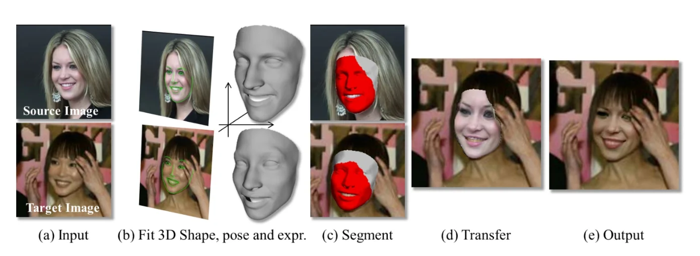
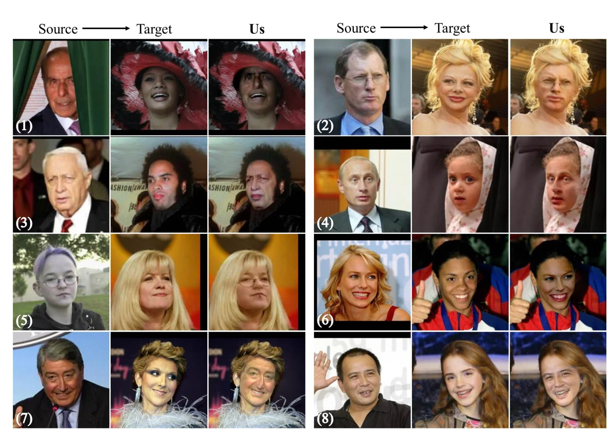

> - **논문**: On Face Segmentation, Face Swapping, and Face Perception
> - **저자**: Yuval Nirkin, Iacopo Masi, Anh Tuấn Trần, Tal Hassner, Gérard Medioni (The Open University of Israel, USC)
> - **학회**: FG 2018 · [arXiv:1704.06729](https://arxiv.org/abs/1704.06729)
{: .prompt-tip }

> 2008년부터 10년간 얼굴 교체 논문은 많았지만 **정량 평가는 한 번도 없었다.** 대부분 보기 좋은 그림 몇 장을 보이는 데 그쳤고, 많은 방법이 [Bitouk 등]()처럼 바꾸기 쉬운 목표를 골랐다. 이 논문은 세 가지를 바꾼다. 분할 전용 구조 대신 **표준 FCN**을 충분히 다양한 데이터로 학습하면 더 빠르고 정확하다는 것, 그 분할과 3D 프록시로 포즈·표정·가림이 제멋대로인 **임의의 쌍**을 바꿀 수 있다는 것, 그리고 LFW 벤치마크로 교체가 기계 얼굴 인식에 미치는 영향을 잴 수 있다는 것이다. 마지막 실험은 "얼굴 인식에는 얼굴과 맥락이 모두 필요하다"는 Sinha & Poggio의 지각 연구를 기계에서 처음 정량 확인한 것이기도 하다.

## 1. 파이프라인

소스와 목표를 똑같이 처리한다. (a) 랜드마크 검출, (b) 3D 포즈와 표정 추정, (c) FCN 얼굴 분할, (d) 소스 질감을 3D 프록시로 목표에 옮기고 블렌딩. 아래 Figure 2가 이 순서를 그대로 보여 준다. 목표 이미지에서 얼굴을 가린 손이 (c) 분할에서 빠지고, (e) 결과에서도 손이 그대로 남는다는 점을 눈여겨볼 만하다.


_Figure 2. (a) 소스(위)·목표(아래) 입력, (b) 랜드마크로 3D 형상·포즈·표정 맞추기, (c) FCN 분할(빨강)을 투영한 3D 얼굴(회색) 위에 겹쳐 표시, (d) 블렌딩 전 전이, (e) 블렌딩 후 결과. (출처: Nirkin et al., 2018)_

**3D 형상.** 두 선택지를 비교한다. 평균 Basel 얼굴에 포즈만 맞추는 **일반 형상**과, 단일 이미지 3D 복원 네트워크(Trần 등)로 99차원 형상 계수를 회귀한 **추정 형상**. 둘 다 3DDFA의 29차원 표정 기저를 더해 $$V = \bar v + W_S\alpha + W_E\gamma$$로 표현하고, 2D 랜드마크와 3D 정점의 대응으로 EPnP로 포즈를, 유계 선형 최소제곱으로 표정을 추정한다(표정 계수는 각 성분 표준편차의 3배 이내로 제한). 논문은 일반 형상도 자주 추정 형상만큼 잘 된다고 말한다. 동일인 교체에서는 두 형상의 검증 정확도가 거의 같다. 다만 타인 교체에서는 추정 형상이 소스 얼굴을 목표에 더 잘 섞어서, 일반 형상보다 검증 정확도를 약 3.7%p 더 떨어뜨린다(아래 Table 2, 논문 본문은 "~3.5%"). "3D 복원이 전혀 쓸모없다"가 아니라 "없어도 결과는 나온다" 정도로 읽어야 한다.

**분할.** FCN-8s-VGG를 그대로 쓰되 데이터를 새로 만든다. IARPA Janus CS2 동영상 1,275개에서 옵티컬 플로 기반 영역 계층을 만들고, 랜드마크 윤곽과 겹치는 영역을 간단한 클릭 인터페이스로 고르면 프레임당 약 5초, 하루 남짓에 **9,818장**이 나온다. 여기에 추정한 3D 형상 위에 CG 선글라스 등을 투영한 **합성 가림**(물체당 9,500장)과 손 이미지(egohands) 오버레이를 더한다. COFW 테스트 507장에서 잰 결과는 다음과 같다(Table 1).

| 방법 | mean IoU | Global | ave(face) | FPS |
|---|---|---|---|---|
| Structured Forest\* | – | 83.9 | 88.6 | – |
| RPP | 72.4 | – | – | 0.03 |
| SAPM | 83.5 | 88.6 | 87.1 | – |
| Liu et al. | 72.9 | 79.8 | 89.9 | 0.29 |
| Saito et al.\* + GraphCut | **83.9** | 88.7 | 92.7 | 43.2 |
| **이 논문 (FCN-8s)** | 83.7 | **88.8** | **94.1** | **48.6** |

\* 테스트셋 일부(각각 300장, 437장)로만 보고한 결과이다. Global은 전체 픽셀 정확도, ave(face)는 얼굴 픽셀 재현율이다. 분할 전용 구조(Saito et al.)와 mIoU는 0.2 차이로 대등하고, 얼굴 재현율과 속도는 가장 좋다.

**교체.** 소스 3D 형상을 소스 이미지에 투영해 정점마다 색을 bilinear로 샘플링하고, 정점 인덱스가 대응하므로 그대로 목표 형상에 옮겨 목표 포즈로 렌더링한 뒤, **목표 분할 마스크**로 가린 영역을 제외하고 Poisson 블렌딩으로 섞는다. GPU에서 1.3 FPS, CPU에서 0.8 FPS이다.

## 2. 평가 프로토콜

두 가정에서 출발한다. **가정 1**: 타인 간 교체는 얼굴의 맥락(머리, 피부톤, 머리 형태)을 바꾸므로, 잘된 교체일수록 소스 얼굴이 **덜 알아볼 수 있게** 된다(Sinha & Poggio의 Clinton-Gore 착시). **가정 2**: 같은 사람의 사진 사이 교체(동일인 교체)는 맥락이 같으므로 그대로 알아볼 수 있어야 하며, 그렇지 않으면 방법이 아티팩트를 만든 것이다.

LFW의 6,000쌍 검증 프로토콜을 수정해 ResFace101로 100%−EER, 정확도, nAUC를 잰다. **타인 교체**는 각 테스트 이미지의 얼굴을 무작위 LFW 인물의 사진에 옮긴 뒤 원본과 교체본의 쌍으로 검증한다(교체본끼리 비교하면 둘 다 망가진 경우를 못 잡으므로). **얼굴 보존** 테스트는 벤치마크 이미지를 소스로, **맥락 보존** 테스트는 목표로 쓴다. 실패한 교체도 걸러내지 않고 그대로 쓴다.

## 3. 결과

**동일인 교체**는 검증 정확도가 원본과 거의 같다. 방법이 신원을 해치는 아티팩트를 넣지 않는다는 뜻이다. **타인 교체**(얼굴 보존)는 정확도가 떨어지며, ablation에서 분할과 3D 추정을 더해 교체가 좋아질수록 더 떨어진다. 더 자연스럽게 섞일수록 맥락이 얼굴을 압도해 덜 알아보게 된다는 가정 1과 같다. 맥락 보존 테스트(얼굴은 타인, 맥락은 원본)는 맥락만으로도 상당한 인식이 된다는 것을 보여 주어, 기계 인식기도 사람처럼 맥락에 기댄다는 것이 드러난다.

LFW 검증 정확도(Acc., %, 두 번 시행 평균)를 ablation별로 옮기면 다음과 같다(Table 2, 3). Generic은 일반 형상·분할 없음, Est. 3D는 추정 형상·분할 없음, Seg.는 일반 형상+분할, Est. 3D+Seg.는 전체 파이프라인이다.

| 설정 | 타인 교체: 맥락 보존 | 타인 교체: 얼굴 보존 | 동일인 교체 |
|---|---|---|---|
| Baseline (원본 LFW) | 98.12 | 98.12 | 98.12 |
| Generic | 64.56 | **92.25** | 97.02 |
| Est. 3D | 68.93 | 88.53 | 97.03 |
| Seg. | 69.00 | 89.98 | 97.08 |
| Est. 3D+Seg. | **72.94** | 86.38 | **97.12** |

- **얼굴 보존**: 전체 파이프라인(86.38)이 가장 단순한 Generic(92.25)보다 약 6%p 낮다(논문 본문은 "~8%"라고 적었지만 표의 정확도 차이는 5.87%p이다). 3D 추정만 더해도 92.25 → 88.53으로 약 3.7%p 떨어진다. 교체가 좋을수록 덜 알아본다는 가정 1과 맞는다.
- **맥락 보존**: 얼굴이 타인으로 바뀌었는데도 64~73%를 맞히고, 반대로 블렌딩이 좋을수록(64.56 → 72.94) 맥락이 더 잘 보존되어 인식이 오른다.
- **동일인 교체**: 모든 설정이 원본보다 약 1%p 낮은 97% 수준이고, nAUC도 99.5 안팎으로 원본(99.71)과 비슷하다. 일반 형상과 추정 형상의 차이도 거의 없다.


_Figure 5. LFW 타인 교체 결과. 포즈(4,7,8), 성별(1,2,7,8), 표정(1,7), 인종(1,3,6,8), 나이(3-8), 가림(1,5)이 크게 다른 쌍을 일부러 골랐다. (출처: Nirkin et al., 2018)_

정성적으로는 위 Figure 5처럼 LFW의 극단적 포즈·성별·표정·인종·나이·가림 차이의 쌍에서도 결과가 나오며, Kemelmacher-Shlizerman의 방법과 같은 쌍 비교에서 머리선 처리가 낫다(분할 품질 차이). 실패는 주로 랜드마크 오류, 큰 해상도 차이, 극단적 피부톤 블렌딩이다(Figure 7).

## 4. 구현 디테일

| 항목 | 값 |
|---|---|
| 랜드마크 | Kazemi & Sullivan 검출기 (DLIB) |
| 3D 모델 | Basel Face Model(형상 99차원) + 3DDFA 표정 기저(29차원), 추정 형상은 Trần et al. 네트워크로 회귀 |
| 포즈·표정 | EPnP로 회전·이동, 표정은 유계 선형 최소제곱 |
| 분할 네트워크 | FCN-8s-VGG (PASCAL로 fine-tuning된 모델에서 시작), MatConvNet 구현 |
| 분할 데이터 | IARPA Janus CS2 동영상 1,275개(LFW에 없는 309명)에서 9,818장, CG 물체당 9,500장 합성 가림, egohands 손 오버레이 |
| 블렌딩 | Poisson image editing, 나머지 영상 처리는 OpenCV |
| 하드웨어 | Intel Core i7 4820K, 32GB RAM, NVIDIA GeForce Titan X |
| 속도 | 교체 1.3 FPS(GPU) / 0.8 FPS(CPU), 분할 48.6 FPS |
| 평가 인식기 | ResFace101, 지표는 100%−EER, Acc., nAUC |

## 5. 코드로 보기: 가림 인식 전이와 맥락 의존 인식

합성 얼굴 위에 손이 가린 목표에 소스 질감을 (a) 3D 얼굴 투영 전체에, (b) FCN 분할처럼 **보이는 얼굴 픽셀에만** 붙여 이상적 결과와의 차이를 세고, 얼굴 특징과 맥락 특징을 이어 붙인 최근접 이웃 인식기로 원본·동일인 교체·타인 교체의 인식률을 맥락 가중치별로 잰다.

```python
import numpy as np
rng = np.random.default_rng(0)
# (1) occlusion-aware transfer: a hand covers part of the target face
n = 64; yy, xx = np.mgrid[0:n, 0:n]; face_region = ((xx - 32) ** 2 / 400 + (yy - 32) ** 2 / 600) < 1
source = 0.6 + 0.2 * np.sin(xx / 3.0) * face_region          # source skin texture
target = 0.4 + 0.1 * np.cos(yy / 4.0) * face_region
hand = (xx > 40) & (yy > 20) & (yy < 50); target_img = np.where(hand, 0.9, target)   # bright hand occluding the target
seg_target = face_region & ~hand                                                     # FCN output: visible face pixels only
naive = np.where(face_region, source, target_img)                                    # paste onto the whole 3-D face projection
aware = np.where(seg_target, source, target_img)                                     # paste only where the target face is visible
ideal = np.where(face_region & ~hand, source, target_img)
print("occlusion handling: pixels where the swap differs from the ideal (hand kept, visible face replaced)")
print(f"  no segmentation (hand overwritten)   {int((np.abs(naive - ideal) > 1e-6).sum()):>5} px")
print(f"  with face segmentation               {int((np.abs(aware - ideal) > 1e-6).sum()):>5} px")
# (2) Sinha & Poggio: recognition uses face AND context; a 'recognizer' on concatenated features
ids = 200; face_f = rng.standard_normal((ids, 16)); ctx_f = rng.standard_normal((ids, 16))
def photo(i, noise=0.45): return np.concatenate([face_f[i], ctx_f[i]]) + noise * rng.standard_normal(32)
gallery = np.stack([photo(i) for i in range(ids)])
def recog(probe, w_ctx):                                    # nearest neighbour with a context weight
    w = np.concatenate([np.ones(16), w_ctx * np.ones(16)])
    return int(np.argmin(((gallery - probe) ** 2 * w).sum(1)))
for w_ctx in (0.0, 0.5, 1.0):
    orig = np.mean([recog(photo(i), w_ctx) == i for i in range(ids)])
    intra = np.mean([recog(np.concatenate([photo(i)[:16], photo(i)[16:]]), w_ctx) == i for i in range(ids)])        # same subject, other photo
    inter = np.mean([recog(np.concatenate([photo(i)[:16], photo(rng.integers(ids))[16:]]), w_ctx) == i for i in range(ids)])   # face kept, context swapped
    print(f"context weight {w_ctx:.1f}: original {orig*100:5.1f}%  intra-subject swap {intra*100:5.1f}%  inter-subject swap (face preserved) {inter*100:5.1f}%")
print("-> a recognizer that also relies on context recognises the transferred face less; intra-subject swaps are unaffected")
```

```text
occlusion handling: pixels where the swap differs from the ideal (hand kept, visible face replaced)
  no segmentation (hand overwritten)     288 px
  with face segmentation                   0 px
context weight 0.0: original  95.5%  intra-subject swap  94.0%  inter-subject swap (face preserved)  97.0%
context weight 0.5: original 100.0%  intra-subject swap  99.5%  inter-subject swap (face preserved)  62.5%
context weight 1.0: original  99.5%  intra-subject swap 100.0%  inter-subject swap (face preserved)  26.5%
-> a recognizer that also relies on context recognises the transferred face less; intra-subject swaps are unaffected
```

- 분할 없이 붙이면 손 위에까지 소스가 덮여 288픽셀이 틀리고, 분할로 보이는 영역만 바꾸면 0픽셀이다. 가림을 "학습된 분할"로 푸는 것이 이 논문의 첫 기여이고, [FaceShifter]()는 이를 라벨 없는 재구성 오차로 대체한다.
- 맥락 가중치가 0이면 타인 교체(얼굴 보존)의 인식률이 원본(95.5%)과 비슷하지만(97.0%), 맥락을 절반만 봐도 62.5%, 동등하게 보면 26.5%로 떨어진다. 동일인 교체는 어느 경우에도 원본과 1.5%p 이내로 비슷하다. 논문의 두 가정을 가장 단순한 인식기로 재현한 것이고, 인식기가 맥락에 기댈수록 "좋은 교체 = 덜 알아봄"이 강해진다.

## 6. 해석

**1. 평가 프로토콜이 가장 오래 남은 기여이다.** 얼굴 인식기로 교체 결과의 신원을 재는 발상은 [FaceShifter]()의 ID 검색률, [SimSwap]()·[HifiFace]()의 표준 표로 이어진다. 다만 방향이 뒤집혔다. 이 논문은 교체가 **덜 알아보이는** 것을 성공으로 봤고(비식별화·지각 연구 관점), 이후 연구는 소스로 **더 잘 검색되는** 것을 성공으로 본다(신원 전이 관점). 같은 지표가 목적에 따라 반대로 읽히는 드문 사례이다.

**2. "정밀한 3D 추정 없이도 된다"는 관찰이 FSGAN으로 이어진다.** 일반 형상 프록시로도 교체가 된다는 관찰(추정 형상은 타인 교체에서 조금 더 잘 섞는 정도)은 [FSGAN]()이 3D를 완전히 버리고 랜드마크 히트맵으로 재연기를 학습하는 근거가 된다.

**3. 데이터 만들기가 구조 설계를 이겼다.** 분할 전용 구조를 제안한 선행 연구들보다, 표준 FCN에 동영상 모션 큐와 합성 가림으로 만든 1만 장이 더 정확하고 빠르다. [분할 서베이]()가 정리한 FCN 계보의 교훈과 같다.

**4. 맥락 효과의 양면성.** 사람과 기계 모두 맥락에 기댄다는 발견은 비식별화에는 희소식(얼굴만 바꿔도 신원이 가려짐)이고, 얼굴 교체 탐지에는 경고(맥락 일관성이 깨지면 눈에 띔)이다. [DeeperForensics]()가 스타일 불일치를 주요 실패 원인으로 꼽는 것과 연결된다.

**5. 평가를 읽을 때 주의할 점.** 인식기 하나(ResFace101)로 사람의 지각을 대신했고, 저자들도 사람과 기계의 차이를 인정한다. 교체는 정점 색을 그대로 옮기는 질감 전이라 조명·피부톤 차이는 블렌딩에 맡겨져 극단 사례에서 실패한다. 1.3 FPS는 실시간이 아니다. 위 toy의 인식기는 유클리드 최근접 이웃이라 실제 심층 인식기의 맥락 민감도를 정량적으로 대변하지는 않는다.

## 7. 정리

| 항목 | 내용 |
|---|---|
| 분할 | 표준 FCN-8s + 동영상 모션 큐 반지도 라벨 9,818장 + 3D 합성 가림(선글라스, 손) → COFW mIoU 83.7, 48.6 FPS |
| 교체 | 일반 또는 추정 3D 형상을 프록시로 정점 대응 질감 전이, 목표 분할로 가림 보존, 블렌딩 |
| 발견 | 일반 형상으로도 교체가 됨(추정 형상은 타인 교체에서 더 잘 섞임), 임의 쌍(포즈·성별·가림 차이)에서도 동작 |
| 평가 | LFW 검증(ResFace101)으로 동일인·타인 교체의 인식률을 처음 정량화 |
| 결과 | 동일인 교체 97.0~97.1%(원본 98.1%), 타인 교체(얼굴 보존)는 92.3% → 86.4%로 교체 품질이 좋을수록 인식 저하(Sinha-Poggio를 기계에서 확인) |
| 한계 | 랜드마크 오류·해상도 차·피부톤 실패, 1.3 FPS, 인식기 하나로 지각 대체 |

## References

- Nirkin, Masi, Trần, Hassner, Medioni, "On Face Segmentation, Face Swapping, and Face Perception," FG 2018. [arXiv:1704.06729](https://arxiv.org/abs/1704.06729)
- Sinha, Poggio, "I think I know that face…," Nature 384, 1996.
- Long, Shelhamer, Darrell, "Fully Convolutional Networks for Semantic Segmentation," CVPR 2015. [arXiv:1411.4038](https://arxiv.org/abs/1411.4038)
- Trần, Hassner, Masi, Medioni, "Regressing Robust and Discriminative 3D Morphable Models with a Very Deep Neural Network," CVPR 2017. [arXiv:1612.04904](https://arxiv.org/abs/1612.04904)
- Kemelmacher-Shlizerman, "Transfiguring Portraits," SIGGRAPH 2016.
- Masi et al., "Do We Really Need to Collect Millions of Faces for Effective Face Recognition?," ECCV 2016. [arXiv:1603.07057](https://arxiv.org/abs/1603.07057)
