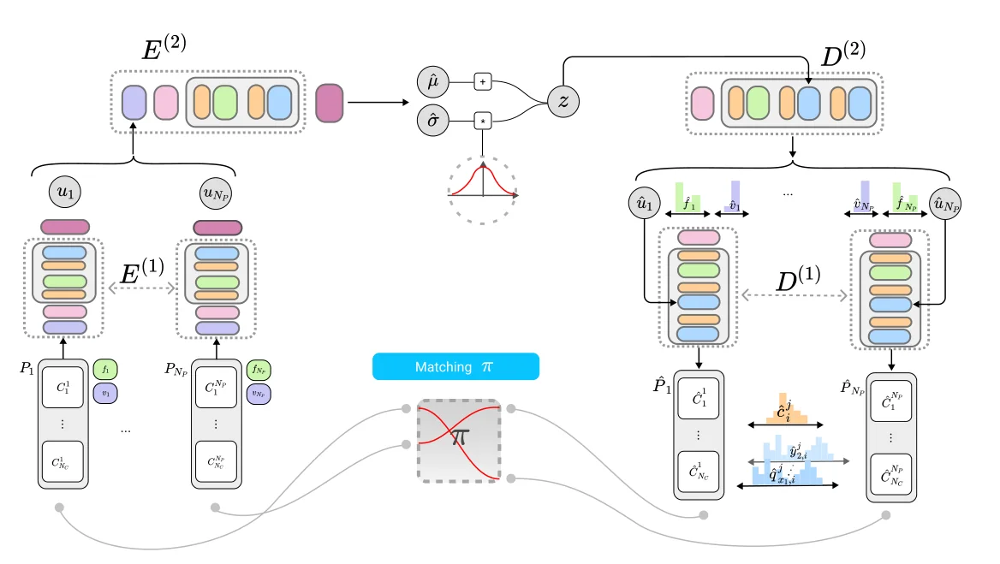
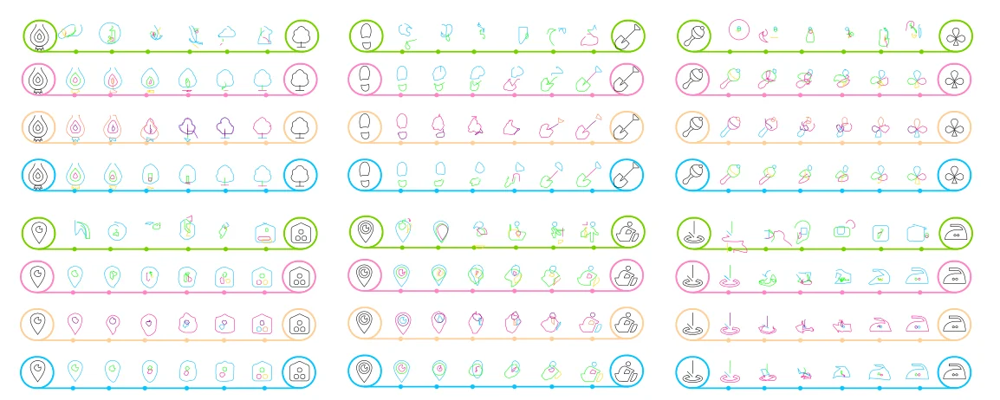
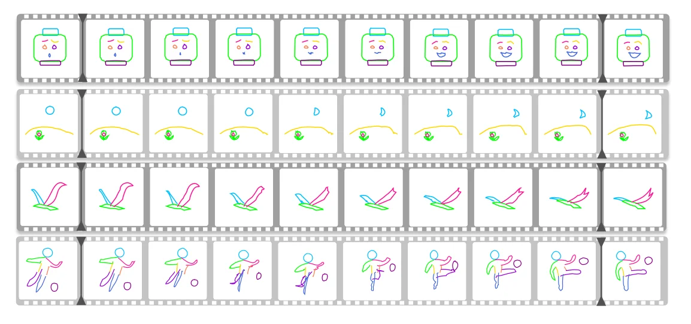

> - **논문**: DeepSVG: A Hierarchical Generative Network for Vector Graphics Animation
> - **저자**: Alexandre Carlier, Martin Danelljan, Alexandre Alahi, Radu Timofte (EPFL, ETH Zurich)
> - **학회**: NeurIPS 2020 · [arXiv:2007.11301](https://arxiv.org/abs/2007.11301) · [코드·데이터셋](https://github.com/alexandre01/deepsvg)
{: .prompt-tip }

> 지금까지 다룬 생성 모델([LDM](), [Style Transfer]())은 모두 픽셀 이미지를 만들었다. **DeepSVG**는 아이콘이나 로고 같은 **벡터 그래픽(SVG)**을 직접 생성한다. 그림을 픽셀이 아니라 선과 곡선을 그리는 명령어의 나열로 보고, 계층적인 Transformer VAE로 학습한다.

## 1. Raster Image vs Vector Image

| | Raster Image | Vector Image |
|---|---|---|
| 구성 | 색과 톤을 가진 **픽셀(점)**의 격자 | **고정된 점**들과 이를 잇는 **선·곡선** |
| 확대 | 계단 현상, 흐려짐 | 어떤 크기로 키워도 선명 |
| 용량 | 해상도에 따라 증가 | **해상도와 무관하게 고정** |
| 용도 | 사진, 복잡한 표현 | 아이콘, 로고, 폰트, 일러스트 |

복잡한 표현은 아직 raster를 선호하지만, 디자인 작업에서는 벡터가 표준이다.

## 2. SVG의 구조

### Path와 Command

SVG 이미지는 여러 개의 **path**로 이루어지고, 각 path는 **명령어(command)의 시퀀스**이다. 펜을 든 커서가 명령에 따라 움직이며 그림을 그린다고 보면 된다.

```xml
<path d="M 1995,2510 c 0,41 -5,67 -5,5 z" class="c1"/>
```

- **M** (Move to): 펜을 들고 (1995, 2510)으로 이동
- **c** (Cubic Bézier): 상대 좌표의 두 제어점 (0, 41), (-5, 67)과 끝점 (-5, 5)로 3차 베지어 곡선을 그림 → 커서는 (1990, 2515)로
- **z** (Close path): path를 닫고 시작점과 연결

DeepSVG는 명령어를 **M(이동), L(직선), C(3차 베지어), z(닫기)**와 시작·끝 표시(SOS, EOS)로 단순화한다. 모든 곡선은 3차 베지어로 통일한다.

### 벡터로 표현하기

각 명령어를 **고정 길이 벡터**로 바꾼다.

- 명령어 종류 (one-hot)
- 제어점·끝점 좌표 등 인자(argument) (커서의 시작 좌표는 직전 명령어의 끝점이라 따로 넣지 않음)
- **사용하지 않는 인자는 -1**로 채움 (예: M은 제어점이 없음)

논문은 인자 목록을 $$(q_{x1}, q_{y1}, q_{x2}, q_{y2}, x_2, y_2)$$의 6개로 고정한다(아래 예제 코드의 `n_args=11`과는 다른 설정이다). 병렬 처리를 위해 path 수 $$N_P$$와 path당 명령어 수 $$N_C$$도 고정하고, 모자라면 보이지 않는(invisible) 원소로 채운다. 원, 사각형, 타원 같은 기본 도형도 직선·베지어 곡선의 path로 바꿀 수 있어서 명령어를 줄여도 표현력은 크게 줄지 않는다.

Path에는 추가로

- **Visibility**: 이 path를 그릴지 여부
- **Fill**: path 내부를 어떻게 칠할지 (0: 외곽선만, 1: 채우기, 2: 지우기)

## 3. Interpolation: 두 그림 사이를 잇기

**보간(interpolation)**은 연속적인 변수에서 두 값 사이의 함숫값을 구하는 방법이다. 생성 모델에서는 두 이미지의 잠재 벡터 사이를 이어 중간 이미지를 만드는 것을 말한다.

SVG 아이콘 두 개의 잠재 벡터 사이를 조금씩 보간하면, 한 아이콘이 다른 아이콘으로 부드럽게 변하는 애니메이션이 된다. DeepSVG의 주요 응용이다.

## 4. DeepSVG 구조

**2단계 Encoder + 2단계 Decoder**로 된 계층적 VAE이고, 모든 출력을 한 번에(non-autoregressive) 생성한다. 아래 Figure 4가 전체 구조이다.


_Figure 4. 왼쪽: path마다 $$E^{(1)}$$로 인코딩한 뒤 $$E^{(2)}$$가 모아 $$z$$를 만든다. 오른쪽: $$D^{(2)}$$가 path별 표현 $$\hat{u}_i$$와 fill·visibility를, $$D^{(1)}$$이 각 path의 명령어와 좌표를 출력한다. 가운데 Matching $$\pi$$는 예측 path와 정답 path의 대응이다. (출처: Carlier et al., 2020)_

Encoder와 Decoder는 모두 Transformer이고, 크기는 Sketchformer를 따라 4층, feed-forward 차원 512, 임베딩 차원 $$d_E = 256$$이다.

### Embedding

[ViT]()처럼 Transformer에 넣으려면 먼저 임베딩이 필요하다. $$j$$번째 path의 $$i$$번째 명령어 임베딩은 세 가지의 합이다.

$$
e^j_i = e_{cmd} + e_{coord} + e_{ind}
$$

- $$e_{cmd}$$: 명령어 종류 **6가지**의 one-hot을 임베딩
- $$e_{coord}$$: 좌표 인자를 **8bit로 양자화**(256단계 + 미사용 -1 = **257가지**)한 뒤 임베딩
- $$e_{ind}$$: 시퀀스 안에서 명령어의 **위치(index)** one-hot을 임베딩

### Encoder (1): Path 단위

각 path의 명령어 시퀀스를 Transformer encoder로 encoding하고, 출력을 **평균 풀링**해 path 하나를 벡터 $$u_j$$로 요약한다. 모든 path가 같은 encoder를 공유한다.

### Encoder (2): 그림 단위

Path 벡터들 $$\{u_1, \dots, u_{N_P}\}$$를 다시 Transformer로 encoding해 그림 전체의 잠재 분포 **평균 $$\mu$$와 표준편차 $$\sigma$$**를 출력하고, 잠재 벡터 $$z$$를 샘플링한다(VAE).

Encoder (1)이 index embedding으로 순서를 이해하는 것과 달리, Encoder (2)는 path 순서에 index embedding을 쓰지 않아 **순서에 무관(permutation invariant)**하다. 그림을 이루는 path들은 순서가 의미 없기 때문이다.

### Decoder (2): 그림 → Path들

$$z$$를 받아 각 path의 잠재 벡터 $$\hat{u}_j$$와 visibility, fill을 예측한다. $$z$$는 선형 변환을 거쳐 Transformer 블록마다 반복해서 더해진다. 입력으로 학습 가능한 **index embedding**을 넣어 path마다 다른 출력을 내게 한다(대칭성을 깨뜨림). 마지막에 MLP로 각 index의 값을 출력한다.

### Decoder (1): Path → 명령어들

각 $$\hat{u}_j$$를 받아 그 path의 명령어 시퀀스(종류와 좌표)를 한꺼번에 출력한다.

```
SVG ─▶ [Embedding] ─▶ Encoder(1): path별 Transformer + avg pool ─▶ u_1..u_N
                         Encoder(2): path 집합 Transformer ─▶ μ, σ ─▶ z
z ─▶ Decoder(2): index embedding + Transformer ─▶ û_1..û_N (+ visibility, fill)
       Decoder(1): path별 Transformer ─▶ 명령어 종류 + 좌표 (non-autoregressive)
```

```python
import torch
import torch.nn as nn

class SVGEmbedding(nn.Module):
    def __init__(self, d=256, n_cmd=6, n_args=11, max_len=32):
        super().__init__()
        self.cmd = nn.Embedding(n_cmd, d)
        self.coord = nn.Embedding(257, 64)                       # 8bit 좌표 + 미사용(-1)
        self.coord_proj = nn.Linear(64 * n_args, d)
        self.ind = nn.Embedding(max_len, d)

    def forward(self, cmds, args):
        """cmds: (B, L) 명령어 id, args: (B, L, n_args) 0..255 또는 -1"""
        L = cmds.shape[1]
        a = self.coord(args + 1).flatten(2)                      # -1 → 0 번 임베딩
        idx = torch.arange(L, device=cmds.device)
        return self.cmd(cmds) + self.coord_proj(a) + self.ind(idx)

emb = SVGEmbedding()
cmds = torch.randint(0, 6, (2, 32))              # 배치 2, path 하나당 명령어 32개
args = torch.randint(-1, 256, (2, 32, 11))       # 인자 11개, 미사용은 -1
print(emb(cmds, args).shape)                     # torch.Size([2, 32, 256])
```

좌표를 연속값 그대로 넣지 않고 **256단계로 양자화해 분류 문제처럼** 다룬다는 점을 눈여겨볼 만하다. 회귀(MSE)로 좌표를 맞추면 여러 가능한 위치의 평균, 즉 어정쩡한 중간 위치를 내놓기 쉽지만, 분류로 바꾸면 여러 후보 중 하나를 또렷하게 고를 수 있다. [Trajectory Transformer]()가 연속값을 이산화한 이유와 같은 맥락이다.

### 학습

재구성 loss(명령어 종류의 cross entropy + 좌표의 cross entropy + visibility·fill loss)와 VAE의 KL 항을 함께 최소화한다. 좌표도 256단계 분류이므로 모든 항이 cross entropy이다. 정답 path가 보이지 않는(padding) 경우에는 fill·명령어·좌표 loss를 가리고 visibility만 학습한다.

문제는 path 집합에 **정해진 순서가 없다**는 점이다. 예측한 $$\hat{\imath}$$번째 path를 어느 정답 path와 비교할지(assignment $$\pi$$) 정해야 하고, 논문은 두 가지를 비교한다.

- **Ordered**: 정답 path를 시작점 위치의 사전순(lexicographic)으로 정렬해 그 순서대로 맞춤
- **Hungarian**: 매 샘플마다 loss 합이 최소가 되는 대응을 Hungarian algorithm으로 찾음

순서를 강제하지 않는 Hungarian이 더 자연스러워 보이지만, 실험에서는 Ordered가 더 좋았다(아래 Table 2). 논문은 정해진 순서가 decoder에 명시적인 prior를 줘서 path 사이의 대칭을 깨고, 예측 path끼리 같은 정답을 두고 경쟁하는 일을 줄이기 때문이라고 해석한다.

## 5. 구현 디테일

| 항목 | 값 |
|---|---|
| 데이터 정규화 | 모든 SVG를 256×256 viewbox로 스케일, path 시작점을 가장 위·왼쪽 점으로, 방향은 시계 방향으로 통일 |
| Path 단순화 | 150° 미만의 꺾인 점에서 path를 나누고, 직선은 Ramer-Douglas-Peucker, 베지어는 Schneider 알고리즘으로 단순화, 길이 5 초과 구간은 분할 |
| Augmentation | SVG마다 20개: 배율 [0.8, 1.2], 평행이동 $$t_x, t_y \in [-2.5, 2.5]$$ |
| Transformer | 4층, feed-forward 512, $$d_E = 256$$, 개선된 Transformer 변형(PolyGen과 같은 블록) |
| Optimizer | AdamW, 초기 lr $$10^{-4}$$, 5 epoch마다 0.9배, 처음 500 step linear warmup |
| 정규화 | dropout 0.1 (모든 Transformer 층), gradient clipping 1.0 |
| 학습 | 100 epoch, 전체 batch 120, GTX 1080Ti 2장으로 약 하루 |
| 애니메이션 | 사용자가 그린 두 keyframe으로 약 1,000 step fine-tuning 후 보간 |

## 6. 데이터셋과 결과

### SVG-Icons8

- icons8.com에서 모은 56개 카테고리, **10만 개**의 아이콘. 크기·색·스타일은 비슷하지만 의미, 모양, path 수는 제각각이다.
- 논문과 함께 데이터셋과 SVG 조작 라이브러리를 공개했다.

### Ablation (Table 2)

One-stage 모델은 모든 path를 이어 붙여 path가 하나인 것처럼($$N_P = 1$$) $$E^{(1)}$$, $$D^{(1)}$$만 쓰는 비교 모델이다. 사람 평가는 무작위 아이콘 100쌍의 보간 결과를 10명에게 보여 주고 1~4위로 순위를 매기게 했다.

| 모델 | Feed-forward | 계층 구조 | 1위 비율 ↑ | 평균 순위 | RE ↓ (train / test) | IS ↓ (train / test) |
|---|---|---|---|---|---|---|
| One-stage autoregressive | | | 9.7% | 3.26 | 0.102 / 0.170 | 0.25 / 0.36 |
| One-stage feed-forward | ✓ | | 19.5% | 2.40 | 0.007 / 0.014 | 0.12 / 0.17 |
| DeepSVG – Hungarian | ✓ | ✓ | 25.8% | 2.29 | 0.011 / 0.017 | 0.09 / 0.14 |
| **DeepSVG – Ordered** | ✓ | ✓ | **44.8%** | **1.99** | **0.007 / 0.012** | **0.08 / 0.12** |

- **RE(Reconstruction Error)**는 정답과 재구성 SVG 사이의 Chamfer 거리, **IS(Interpolation Smoothness)**는 보간 프레임 사이 Chamfer 거리의 합이다. 둘 다 낮을수록 좋다. 평균 순위는 1위가 가장 좋으므로 낮을수록 좋다(논문 표에는 ↑로 표기돼 있다).
- Autoregressive를 feed-forward로 바꾸는 것만으로 test RE가 0.170에서 0.014로 줄었다. 한 번에 생성하면 학습과 추론 조건이 같아진다는 점(autoregressive는 학습 때 정답을, 추론 때 자기 출력을 조건으로 받음)이 큰 이유로 제시된다.
- 계층 구조와 Ordered 매칭을 더하면 IS가 0.12(test)로 가장 낮고, 사람 평가 1위 비율도 44.8%로 가장 높았다.


_Figure 5. 각 묶음의 네 줄은 위부터 one-stage autoregressive(초록), one-stage feed-forward(분홍), DeepSVG – Hungarian(주황), DeepSVG – Ordered(파랑). path는 index에 따라 색을 칠했다. (출처: Carlier et al., 2020)_

위 Figure 5에서 autoregressive 모델(초록)은 양 끝 아이콘조차 제대로 재구성하지 못하고, Ordered(파랑)가 가장 매끄럽게 변한다. 다만 논문은 일부 예시에서는 Hungarian 쪽 전환이 시각적으로 더 그럴듯했다고도 적어 둔다.

### 응용 결과

- **Interpolation 애니메이션**: 사용자가 그린 두 keyframe 사이를 보간해 중간 프레임을 만든다. 평행이동과 변형을 모두 잘 다루지만, 축구 선수의 다리처럼 큰 변형은 매끄럽지 않은 실패 사례도 있다(Figure 7 마지막 줄).
- **잠재 공간 연산**: 비슷한 두 아이콘의 잠재 벡터 차이 $$\Delta$$를 더하거나 빼서 속성을 바꾼다. $$\Delta_{square}$$는 아이콘을 더 각지게/둥글게 만들고, 마지막 path를 지운 아이콘과의 차이를 500개 아이콘에서 평균한 $$\Delta_{add}$$는 path를 더하거나 뺀다. 계층 구조 덕분에 path 하나의 표현 $$\hat{u}_i$$에만 같은 연산을 적용할 수도 있다.
- **폰트 생성**: SVG-Fonts 데이터셋에서 클래스 조건부 글리프 생성도 했다. non-autoregressive 모델들이 후처리나 골라내기 없이도 더 정확한 글자를 그렸지만, 데이터가 단순해서 계층 구조의 이점은 눈에 띄지 않았다고 논문은 밝힌다.


_Figure 7. 각 줄의 양 끝 프레임은 사용자가 그린 것이고 사이는 DeepSVG의 보간이다. 마지막 줄은 오른쪽 다리 변형이 매끄럽지 않은 실패 사례이다. (출처: Carlier et al., 2020)_

## 7. 정리

| 구성 | 역할 |
|---|---|
| Embedding | 명령어 종류 + 8bit 좌표 + 위치 |
| Encoder (1) | 명령어 시퀀스 → path 벡터 (평균 풀링) |
| Encoder (2) | path 집합 → $$\mu, \sigma$$ → $$z$$ (순서 무관) |
| Decoder (2) | $$z$$ → path별 잠재 벡터 + visibility·fill |
| Decoder (1) | path 잠재 벡터 → 명령어 시퀀스 (한 번에) |
| 응용 | 아이콘 생성, **보간 애니메이션**, 잠재 공간 편집 |

## References

- Carlier et al., "DeepSVG: A Hierarchical Generative Network for Vector Graphics Animation," NeurIPS 2020. [arXiv:2007.11301](https://arxiv.org/abs/2007.11301)
- [W3C SVG 2 – Paths](https://www.w3.org/TR/SVG2/paths.html)
- Lopes et al., "A Learned Representation for Scalable Vector Graphics (SVG-VAE)," ICCV 2019.
- Kingma & Welling, "Auto-Encoding Variational Bayes," ICLR 2014.

