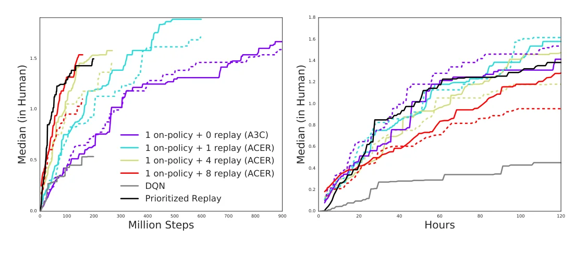
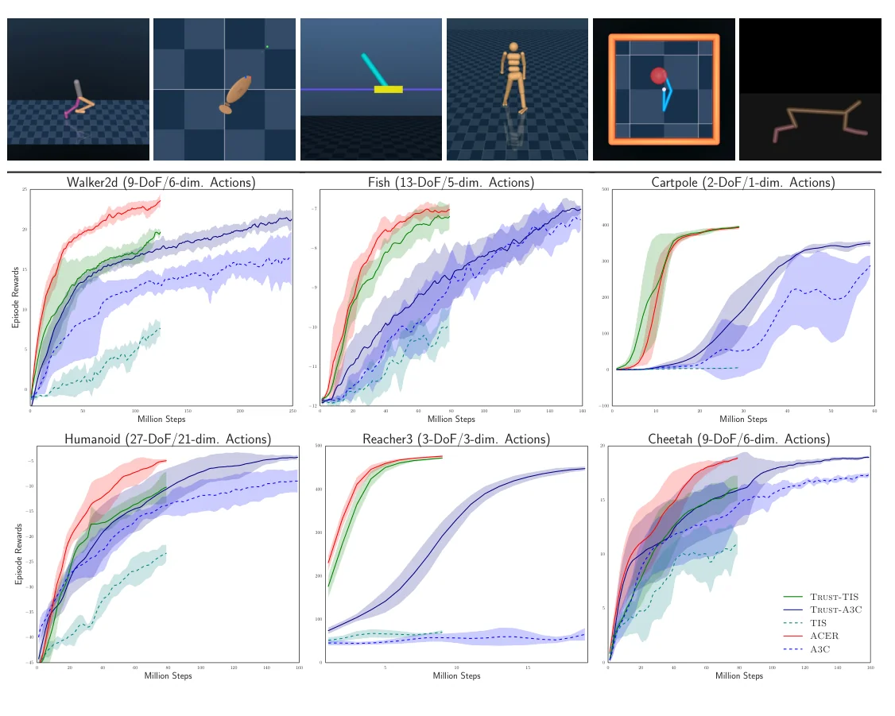
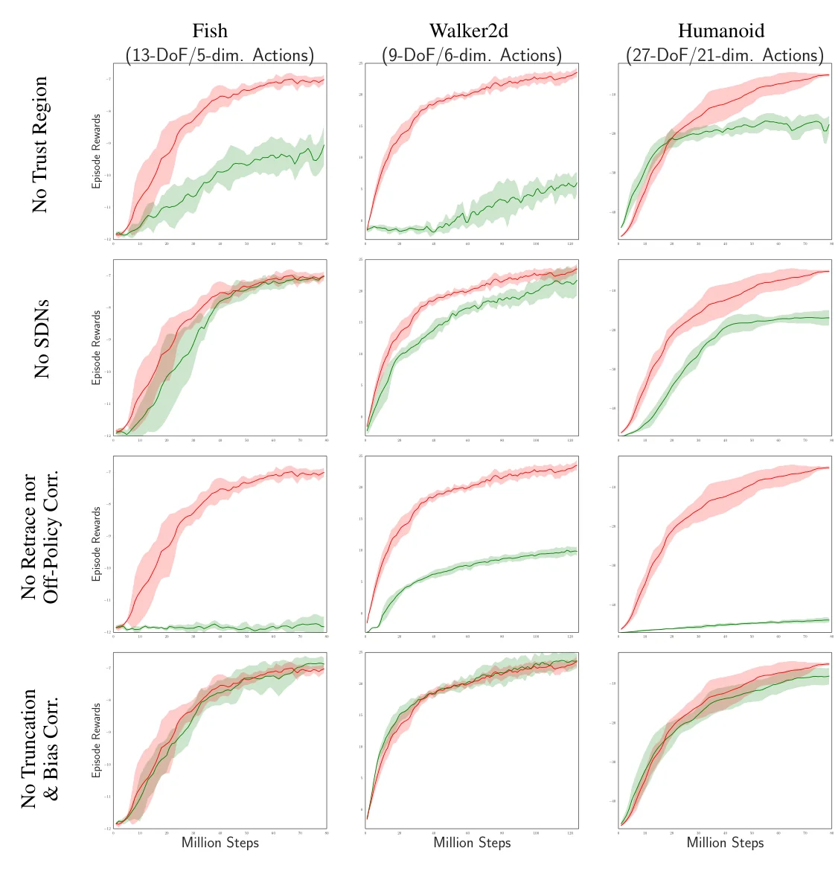

> - **논문**: Sample Efficient Actor-Critic with Experience Replay
> - **저자**: Ziyu Wang, Victor Bapst, Nicolas Heess, Volodymyr Mnih, Rémi Munos, Koray Kavukcuoglu, Nando de Freitas (DeepMind, CIFAR, Oxford University)
> - **학회**: ICLR 2017 · [arXiv:1611.01224](https://arxiv.org/abs/1611.01224)
{: .prompt-tip }

> [PPO 글]()에서 on-policy 알고리즘은 지금 정책이 모은 데이터만 쓸 수 있어 샘플 효율이 낮다고 했다. **ACER**(Actor-Critic with Experience Replay)는 A3C를 **off-policy**로 확장해, 경험을 replay buffer에 저장하고 재사용하면서도 학습을 안정적으로 유지한다.

## 1. Contribution

ACER는 안정적이고(stable), 샘플 효율적이며(sample efficient), 성능이 좋은 experience replay 기반 actor-critic이다. 이를 위해 세 가지 기법을 쓴다.

1. **Truncated Importance Sampling with Bias Correction**: off-policy 보정의 분산을 제한
2. **Retrace**를 이용한 Q 값 추정 (+ 연속 행동을 위한 **Stochastic Dueling Network**)
3. **Efficient TRPO**: 계산이 가벼운 trust region 업데이트

## 2. 배경: Policy Gradient와 A3C

Policy gradient의 기본 형태는 다음과 같다.

$$
g = \mathbb{E}_{x_{0:\infty}, a_{0:\infty}}\Big[\sum_{t \ge 0} A^\pi(x_t, a_t)\,\nabla_\theta\log\pi_\theta(a_t \mid x_t)\Big]
$$

$$A^\pi$$ 자리에는 Q 값, return, TD residual 등 여러 추정치를 넣을 수 있는데, 무엇을 쓰느냐에 따라 **분산과 편향(variance–bias)**의 trade-off가 생긴다. A3C는 $$k$$-step return과 가치 함수 근사를 섞어 균형을 맞췄다.

ACER는 이 **A3C의 off-policy 버전**이다.

> **용어 정리**
> - **Actor-Critic**: 행동을 고르는 정책(actor)과, 그 행동이 얼마나 좋은지 평가하는 가치 함수(critic)를 함께 학습하는 구조이다.
> - **On-policy / Off-policy**: 학습에 쓰는 데이터를 *지금 학습 중인 정책*이 모았으면 on-policy, *다른(예전) 정책*이 모았어도 쓸 수 있으면 off-policy이다.
> - **Replay buffer**: 에이전트가 겪은 (상태, 행동, 보상, 다음 상태)를 저장해 두는 메모리이다. 여기서 꺼내 여러 번 재학습하면 같은 경험으로 더 많이 배울 수 있다.
{: .prompt-info }

## 3. Off-policy의 문제: Importance Sampling

Replay buffer의 데이터는 예전 정책 $$\mu$$(behavior policy)가 모은 것이다. 이걸로 현재 정책 $$\pi$$의 gradient를 구하려면 **importance weight** $$\rho_t = \pi(a_t \mid x_t)/\mu(a_t \mid x_t)$$로 보정해야 한다.

궤적 전체를 보정하려면 importance weight를 여러 step 곱해야 하는데, 곱이 길어지면 값이 폭발하거나 0이 되어 **분산이 매우 커진다.** 그렇다고 weight를 잘라 내면(truncate) 분산은 줄지만 편향이 생긴다.

얼마나 심각한지 간단한 실험으로 확인해 볼 수 있다. 행동이 두 개인 상황에서 옛 정책 $$\mu$$는 반반, 현재 정책 $$\pi$$는 0번 행동을 70% 고른다고 하자.

```python
import numpy as np

rng = np.random.default_rng(0)
pi = np.array([0.7, 0.3])  # 현재 정책 π: 행동 0을 70% 확률로 고름
mu = np.array([0.5, 0.5])  # 데이터를 모은 옛 정책 μ: 반반

for T in [1, 10, 50, 100]:
    actions = rng.choice(2, size=(100_000, T), p=mu)  # μ로 길이 T 궤적 10만 개 생성
    rho = pi[actions] / mu[actions]                    # 각 step의 importance weight
    w = rho.prod(axis=1)                               # 궤적 전체 weight = 곱
    print(f"T={T:>3}  평균 {w.mean():8.3f}  표준편차 {w.std():10.3f}  최대 {w.max():12.1f}")
```

```text
T=  1  평균    1.001  표준편차      0.400  최대          1.4
T= 10  평균    0.990  표준편차      1.805  최대         28.9
T= 50  평균    0.913  표준편차     18.303  최대       4232.9
T=100  평균    0.796  표준편차     72.006  최대      20391.7
```

이론상 weight의 기댓값은 항상 1이지만, 궤적이 길어질수록 표준편차가 폭발하고 소수의 궤적이 엄청난 weight를 가져간다. 10만 개를 뽑아도 표본 평균이 1에서 멀어질 정도로 추정이 불안정해진다. (NumPy 2.x에서 실행)

ACER는 궤적 전체가 아니라 **각 시점의 marginal importance weight $$\rho_t$$ 하나만** 쓰는 형태의 gradient에서 출발한다.

$$
g^{marg} = \mathbb{E}_{x_t, a_t \sim \mu}\big[\rho_t\,\nabla_\theta\log\pi_\theta(a_t \mid x_t)\,Q^\pi(x_t, a_t)\big]
$$

이 식에는 두 가지가 필요하다. $$Q^\pi$$를 잘 추정하는 것(4절)과, $$\rho_t$$가 커질 때의 불안정을 막는 것(5절)이다.

## 4. Retrace로 Q 값 추정하기

**Retrace**(Munos et al., 2016)는 behavior policy가 만든 궤적으로 $$Q^\pi$$를 추정하는 off-policy, multi-step 방법이다. 재귀식으로 쓰면 다음과 같다.

$$
Q^{ret}(x_t, a_t) = r_t + \gamma\,\bar{\rho}_{t+1}\big[Q^{ret}(x_{t+1}, a_{t+1}) - Q(x_{t+1}, a_{t+1})\big] + \gamma\,V(x_{t+1})
$$

$$
\bar{\rho}_t = \min\{1, \rho_t\},\qquad \rho_t = \frac{\pi(a_t \mid x_t)}{\mu(a_t \mid x_t)}
$$

- Importance weight를 **1에서 잘라서(truncate)** 곱이 폭발하지 않게 함 (5절의 truncation 상수 $$c$$와는 별개이다)
- (테이블 형태의 정책 평가 설정에서) 어떤 behavior policy에서 나온 데이터든 target policy의 가치로 **수렴이 보장**됨
- **multi-step return**을 쓰므로 bias가 작고 critic이 빠르게 학습됨

이산 행동에서는 하나의 네트워크(CNN)가 정책 $$\pi_\theta(\cdot \mid x)$$와 행동별 $$Q_{\theta_v}(x, \cdot)$$를 함께 출력하고, $$V$$는 따로 출력하지 않고 $$V(x) = \sum_a \pi(a \mid x)\,Q(x, a)$$로 계산한다. Critic $$Q_{\theta_v}$$는 $$Q^{ret}$$를 목표로 MSE로 학습한다. Critic이 빨리 정확해지면 policy gradient의 bias도 줄어든다.

## 5. Truncation with Bias Correction

$$\rho_t$$가 커지면 학습이 불안정해진다. 그렇다고 단순히 잘라 버리면 편향이 생기므로, ACER는 gradient를 **두 항으로 분해**한다.

$$
\hat{g}^{acer}_t = \underbrace{\bar{\rho}_t\,\nabla_\theta\log\pi_\theta(a_t \mid x_t)\big[Q^{ret}(x_t, a_t) - V(x_t)\big]}_{\text{잘린 항: 분산 제한}} + \underbrace{\mathbb{E}_{a \sim \pi}\Big[\Big[\frac{\rho_t(a) - c}{\rho_t(a)}\Big]_+\nabla_\theta\log\pi_\theta(a \mid x_t)\big[Q_{\theta_v}(x_t, a) - V(x_t)\big]\Big]}_{\text{보정 항: 편향 제거}}
$$

($$\bar{\rho}_t = \min\{c, \rho_t\}$$, $$[x]_+ = \max(0, x)$$)

- **첫 번째 항**: weight가 $$c$$ 이하로 묶이므로 gradient 추정의 분산이 유계(bounded)로 유지됨 (논문의 Atari 실험에서는 $$c = 10$$)
- **두 번째 항 (correction term)**: $$\rho_t(a) > c$$일 때만 활성화되어, 잘라 낸 만큼을 현재 정책 $$\pi$$에서 샘플링한 행동으로 보충해 **불편(unbiased) 추정**을 유지. 이때 계수는 최대 1이라 역시 안정적

$$c$$를 크게 잡으면 correction term은 분산이 정말 클 때만 동작한다. 양 극단을 보면 의미가 분명해진다. $$c = \infty$$이면 (Retrace를 쓴) 일반 off-policy policy gradient가 되고, $$c = 0$$이면 Q 추정에만 의존하는 actor-critic 업데이트가 된다. 두 항 모두에서 $$V(x_t)$$를 baseline으로 빼 분산을 더 줄인다. 기댓값 안의 상태 분포는 behavior policy가 만든 궤적으로 근사한다.

## 6. Efficient Trust Region Policy Optimization

Actor-critic의 정책 업데이트는 분산이 커서, 한 번에 정책이 크게 바뀌면 성능이 무너질 수 있다. [TRPO]()는 이를 막지만, 업데이트마다 **Fisher-vector product**를 계산해야 해서 비싸다.

ACER는 더 가벼운 방법을 쓴다.

### Average Policy Network

과거 정책들의 평균을 나타내는 **average policy network** $$\phi_{\theta_a}$$를 따로 두고, 정책 파라미터가 업데이트될 때마다 부드럽게(soft update) 따라가게 한다.

$$
\theta_a \leftarrow \alpha\,\theta_a + (1 - \alpha)\,\theta
$$

현재 정책이 이 평균 정책에서 너무 멀어지지 않도록 제한한다.

### 2단계 업데이트

정책 네트워크를 "분포의 통계량 $$\phi_\theta(x)$$(예: softmax 확률)를 출력하는 신경망"과 "그 통계량으로 정의되는 분포 $$f$$"로 나눠 생각한다.

**Step 1.** 통계량 공간에서 선형화된 KL 제약을 가진 최적화 문제를 푼다.

$$
\min_z \frac{1}{2}\lVert\hat{g}_t - z\rVert_2^2 \quad \text{s.t.}\quad \nabla_{\phi_\theta(x_t)}D_{KL}\big[f(\cdot \mid \phi_{\theta_a}(x_t))\ \|\ f(\cdot \mid \phi_\theta(x_t))\big]^\top z \le \delta
$$

제약이 선형이라 간단한 이차 계획 문제가 되고, KKT 조건으로 **닫힌 해**가 나온다.

$$
z^* = \hat{g}_t - \max\left\{0,\ \frac{k^\top\hat{g}_t - \delta}{\lVert k\rVert_2^2}\right\}k,\qquad k = \nabla_{\phi_\theta(x_t)}D_{KL}[\cdot]
$$

제약을 만족하면 gradient는 그대로이고, 넘으면 $$k$$ 방향 성분만 줄어들어 평균 정책과의 변화율이 낮아진다.

**Step 2.** 이렇게 구한 $$z^*$$를 역전파로 네트워크 파라미터까지 흘린다.

trust region을 수백만 개의 파라미터 공간이 아니라 **작은 통계량 공간**에서 처리하므로 계산이 매우 가볍다. TRPO처럼 "직전 정책"에 묶지 않고 "과거 정책들의 평균"에 묶는다는 점도 다르다. 논문은 KL 항을 적당한 가중치로 목적 함수에 더하는 대안도 있지만, 경험상 하이퍼파라미터에 덜 강건했다고 적는다.

On-policy 단계만 놓고 보면 ACER는 baseline으로 $$V$$ 대신 $$Q$$를 쓰고 trust region을 더한 A3C이다. 전체 알고리즘은 on-policy 업데이트를 한 번 하고, replay buffer에서 꺼낸 데이터로 off-policy 업데이트를 여러 번(replay ratio) 하는 식으로 번갈아 돈다.

## 7. 연속 행동: Stochastic Dueling Network

Retrace에는 $$Q$$와 $$V$$가 모두 필요한데, 연속 행동 공간에서는 $$V(x) = \mathbb{E}_{a\sim\pi}[Q(x, a)]$$의 적분을 쉽게 계산할 수 없다. 그래서 **Stochastic Dueling Network(SDN)**를 제안한다.

$$
\tilde{Q}_{\theta_v}(x_t, a_t) \sim V_{\theta_v}(x_t) + A_{\theta_v}(x_t, a_t) - \frac{1}{n}\sum_{i=1}^{n}A_{\theta_v}(x_t, u_i),\qquad u_i \sim \pi_\theta(\cdot \mid x_t)
$$

매 시점 $$V$$는 결정적으로, $$Q$$는 정책에서 샘플링한 행동들로 확률적으로 추정해, 두 추정이 서로 일관되게 학습된다. $$\tilde{Q}$$의 기댓값을 다시 정책에 대해 평균하면 $$V$$가 되도록 만든 구조라서, $$\tilde{Q}$$에 주는 학습 신호가 $$V$$에도 전달된다. 정책 분포 $$f$$로는 대각 공분산이 고정된 Gaussian(평균만 네트워크가 출력)을 쓴다.

연속 행동에서는 몇 가지가 더 바뀐다.

- $$V$$ 학습용 target도 truncation 기법으로 따로 만든다: $$V^{target}(x_t) = \min\{1, \rho_t\}\big(Q^{ret}(x_t, a_t) - Q_{\theta_v}(x_t, a_t)\big) + V_{\theta_v}(x_t)$$
- $$Q^{ret}$$ 계산의 잘린 weight를 $$\bar{\rho}_t = \min\{1, \rho_t^{1/d}\}$$로 쓴다($$d$$: 행동 차원). 필수는 아니지만 학습이 더 빨랐다고 한다.
- Policy gradient에는 $$Q^{ret}$$ 대신 truncated weight를 1로 둔 $$Q^{opc}$$를 쓰고, 보정 항의 기댓값은 정책에서 행동 하나를 샘플링해 근사한다.

## 8. 구현 디테일

| 항목 | Atari | MuJoCo |
|---|---|---|
| 병렬 구조 | actor-learner 16 thread, GPU 없는 단일 머신 | 비동기 A3C 프레임워크 |
| 네트워크 | DQN 구조: conv 32×8×8 (stride 4) → 64×4×4 (stride 2) → 64×3×3 (stride 1) → FC 512, ReLU. softmax 정책과 Q를 함께 출력 | 정책·가치 공유 네트워크 + SDN의 A를 위한 작은 네트워크, $$n = 5$$ |
| Replay memory | thread당 50,000 frame (전체로는 DQN과 비슷한 크기) | thread당 5,000 frame |
| 업데이트 주기 | 20 step ($$k = 20$$) | 50 step ($$k = 50$$) |
| On/off-policy | on-policy 1번 + replay ratio만큼 off-policy | 완전히 off-policy, 경험을 평균 4번 재사용 |
| Truncation $$c$$ | 10 | 5 |
| Trust region | $$\delta = 1$$, $$\alpha = 0.99$$ | $$\delta \sim U[0.1, 2]$$, $$\alpha = 0.995$$ |
| Learning rate | 이전 A3C 구현의 값 하나를 튜닝 없이 사용, annealing 없음 | $$[10^{-4}, 10^{-3.3}]$$에서 log-uniform 샘플링 |
| 기타 | entropy 정규화 0.001, $$\gamma = 0.99$$ | 정책 표준편차 0.3 고정, 하이퍼파라미터 30개 샘플 중 상위 5개의 평균·표준편차 보고 |

## 9. 결과

### Atari

평가 지표는 57개 게임의 **사람 기준 정규화 점수의 중앙값**이다(사람 1, 무작위 0). 각 시점 점수는 직전 100만 frame의 평균이고, 그래프에는 그때까지의 최고값(cumulative maximum)을 그린다.


_Figure 1. 57개 Atari 게임 정규화 점수 중앙값. 왼쪽은 환경 step 기준, 오른쪽은 학습 시간 기준. 색은 replay ratio(0이면 A3C), 실선은 trust region 사용, 점선은 미사용. 회색은 DQN, 검은색은 Prioritized Replay. (출처: Wang et al., 2017)_

- Replay ratio(on-policy 업데이트 1번당 off-policy 업데이트 횟수)를 0, 1, 4, 8로 바꿔 실험했다. 0이면 A3C이다.
- 위 Figure 1 왼쪽처럼 **replay를 쓸수록 데이터 효율이 크게 향상**됐다. Trust region을 쓸 때는 replay ratio를 높일수록 같은 step에서의 점수가 올랐지만, 늘릴수록 이득은 줄어든다.
- Replay를 충분히 쓰면 가장 좋은 DQN 계열(Prioritized Replay)에 필적하고, on-policy인 A3C보다 훨씬 샘플 효율적이었다. 논문은 replay ratio 4인 ACER를 prioritized DQN과 A3C 모두의 좋은 대안으로 꼽는다.
- 오른쪽 그래프처럼 학습 시간 기준으로는 A3C와 비슷해, 계산 비용을 거의 늘리지 않고 데이터 효율을 높였다.
- Atari에서도 실선(trust region)이 대체로 점선보다 위에 있지만, 아래 연속 제어만큼 차이가 크지는 않다.

### MuJoCo (연속 제어)

Cartpole(1D), Reacher(3D), Fish(5D), Cheetah(6D), Walker(6D), Humanoid(21D)에서 on-policy인 A3C와 Trust-A3C, 궤적 단위로 weight를 자른 replay baseline인 TIS와 Trust-TIS를 비교했다.


_Figure 3. 위: 6개 연속 제어 과제. 아래: 과제별 학습 곡선. 빨간색이 ACER, 실선 초록·파랑이 trust region을 더한 TIS·A3C. (출처: Wang et al., 2017)_

- ACER가 다른 모든 방법보다 좋았고, **고차원 과제(Humanoid, Cheetah, Walker, Fish)에서 차이가 뚜렷**했다.
- Trust region 업데이트만 더해도 TIS, A3C 두 baseline이 크게 개선됐다. 고차원 연속 정책은 Atari의 이산 정책보다 최적화가 어려워 TR의 이득이 더 컸다.

### Ablation


_Figure 4. 각 줄은 구성 요소 하나를 뺀 결과(초록)와 전체 ACER(빨강) 비교. 위부터 trust region, SDN, Retrace·off-policy 보정, truncation·bias correction을 뺀 경우. (출처: Wang et al., 2017)_

- Trust region, SDN, Retrace(off-policy 보정)는 하나만 빼도 성능이 분명히 떨어졌다. 특히 Retrace를 빼면 Fish와 Humanoid에서 거의 학습이 되지 않는다.
- Truncation과 bias correction은 Fish, Walker2d에서는 차이가 없었지만, 행동이 21차원인 Humanoid에서는 큰 차이를 만들어 무릎을 꿇던 humanoid를 일으켜 세웠다. 행동 차원이 클수록 importance weight의 분산이 커지기 때문으로 해석한다. 3절의 실험에서 여러 weight를 곱할수록 분산이 폭발한 것과 비슷한 현상이다.

논문은 이론 분석에서 Retrace 자체가 이 논문의 truncation + bias correction 기법을 Bellman 방정식에 적용한 것으로 해석할 수 있음도 보인다.

## 10. 정리

| 문제 | ACER의 해결 |
|---|---|
| On-policy의 낮은 샘플 효율 | Experience replay로 off-policy 학습 |
| Importance weight 곱의 분산 폭발 | Marginal weight + **truncation** |
| Truncation이 만드는 편향 | **Bias correction** 항 |
| Q 추정 | **Retrace** (multi-step, 수렴 보장) |
| 큰 정책 변화 | **Average policy** 기반의 가벼운 trust region |
| 연속 행동의 V 계산 | **Stochastic Dueling Network** |

ACER의 아이디어(truncated importance sampling, Retrace)는 이후 IMPALA의 V-trace 등 대규모 분산 off-policy actor-critic으로 이어졌다.

<details markdown="1">
<summary>더 알아보기: ACER는 왜 PPO만큼 널리 쓰이지 않았을까</summary>

ACER는 샘플 효율이 좋지만 구현할 부품이 많다. Retrace target 계산, bias correction 항, average policy network, 연속 행동이면 SDN까지 필요하다. 같은 해 나온 PPO는 clipping 한 줄로 "정책이 크게 바뀌지 않게" 하는 목적을 달성했고, 환경 시뮬레이션이 싼 상황에서는 샘플 효율보다 구현 단순성과 안정성이 더 중요했다. 반대로 실제 로봇처럼 데이터 수집이 비싼 곳에서는 replay를 쓰는 off-policy 계열(SAC 등)이 선호된다.
</details>

## References

- Wang et al., "Sample Efficient Actor-Critic with Experience Replay," ICLR 2017. [arXiv:1611.01224](https://arxiv.org/abs/1611.01224)
- Munos et al., "Safe and Efficient Off-Policy Reinforcement Learning (Retrace)," NeurIPS 2016. [arXiv:1606.02647](https://arxiv.org/abs/1606.02647)
- Mnih et al., "Asynchronous Methods for Deep Reinforcement Learning (A3C)," ICML 2016.
- Schulman et al., "Trust Region Policy Optimization," ICML 2015.
- Espeholt et al., "IMPALA: Scalable Distributed Deep-RL with Importance Weighted Actor-Learner Architectures," ICML 2018.
