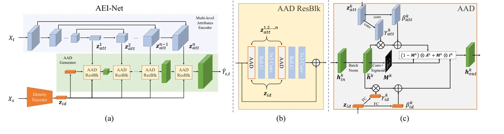
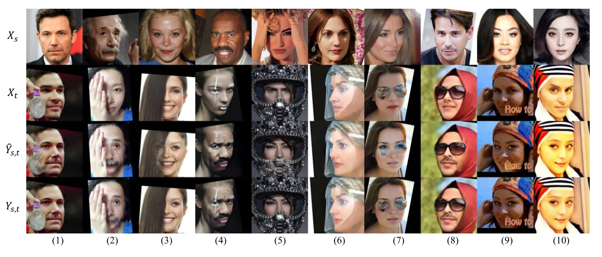
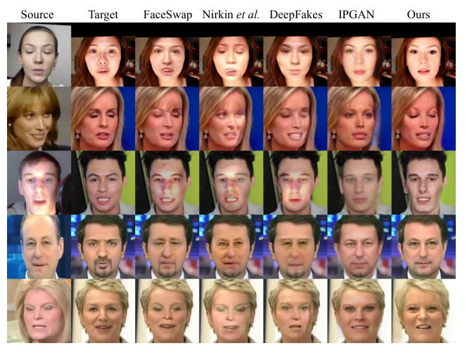

> - **논문**: Advancing High Fidelity Identity Swapping for Forgery Detection (FaceShifter)
> - **저자**: Lingzhi Li, Jianmin Bao, Hao Yang, Dong Chen, Fang Wen (Peking University, Microsoft Research)
> - **학회**: CVPR 2020
{: .prompt-tip }

> [FSGAN]()까지의 방법은 대부분 "얼굴 안쪽을 만든 뒤 목표에 붙이는" 전략이라, 목표의 **조명·해상도**는 생성 과정에 들어오지 않고 블렌딩에 맡겨졌으며, 목표 마스크 밖은 버려져 **소스의 얼굴 형태**가 보존되지 않았습니다(논문 Figure 2의 코 위 조명 결함, 형태 불일치, 해상도 불일치). RSGAN·IPGAN처럼 속성을 **벡터 하나로** 압축한 방법은 정보 손실로 흐렸습니다. **FaceShifter**는 목표 속성을 **공간 해상도별 다층 특징 맵**으로 뽑고, 생성기의 각 층에서 **AAD(Adaptive Attentional Denormalization)**가 위치마다 신원 임베딩과 속성 임베딩 중 무엇을 반영할지 학습하게 합니다. 가림은 분할 라벨 없이, 잘 학습된 1단계 네트워크에 같은 이미지를 소스·목표로 넣었을 때 **사라지는 부분**을 단서로 2단계 HEAR-Net이 복원합니다. 논문 제목이 말하듯 목적의 절반은 더 좋은 위조로 더 좋은 탐지기(Face X-Ray)를 만드는 것입니다.

## 1. 1단계: AEI-Net

세 부분입니다.

- **신원 인코더**: 사전학습 얼굴 인식 모델(ArcFace)의 마지막 FC 직전 특징 $$z_{id}(X_s)$$. 2D 데이터로 대규모 학습된 인식기가 3DMM보다 신원을 잘 담는다고 봅니다.
- **다층 속성 인코더**: 목표 $$X_t$$를 U-Net에 넣어 디코더의 $$n = 8$$개 특징 맵 $$z_{att}^k$$를 그대로 속성 임베딩으로 씁니다. 포즈·표정·조명·배경은 공간 정보가 필요하므로 벡터로 압축하지 않습니다. 속성 라벨 없이 "출력의 속성 임베딩이 목표의 것과 같아야 한다"는 자기지도 손실로 학습됩니다.
- **AAD 생성기**: 층 $$k$$의 활성 $$h^k_{in}$$을 배치 정규화한 $$\bar h^k$$에 대해 세 가지를 만듭니다. 속성 역정규화 $$A^k = \gamma^k_{att} \otimes \bar h^k + \beta^k_{att}$$(SPADE처럼 $$z^k_{att}$$에서 합성곱으로 공간별 $$\gamma, \beta$$), 신원 역정규화 $$I^k = \gamma^k_{id} \otimes \bar h^k + \beta^k_{id}$$(AdaIN처럼 $$z_{id}$$에서 FC로 채널별), 그리고 $$\bar h^k$$에서 합성곱 + sigmoid로 만든 **주의 마스크** $$M^k$$.

$$
h^k_{out} = (1 - M^k) \otimes A^k + M^k \otimes I^k
$$

신원은 눈·입·윤곽처럼 변별적인 부위에, 속성은 나머지에 집중해야 하므로 "어디에 무엇을"을 학습하게 한 것입니다. AAD 층을 쌓은 AAD ResBlk를 연쇄해 $$\hat Y_{s,t}$$를 만듭니다. 각 AAD ResBlk는 이전 층 활성을 업샘플해 받은 뒤 $$z_{id}$$와 그 해상도의 $$z^k_{att}$$를 넣습니다.


_Figure 3. (a) AEI-Net: 신원 인코더, 다층 속성 인코더(U-Net), AAD 생성기. (b) AAD ResBlk. (c) AAD 층: 정규화한 $$\bar h^k$$를 속성 쪽(conv로 만든 공간별 $$\gamma, \beta$$)과 신원 쪽(FC로 만든 채널별 $$\gamma, \beta$$)으로 각각 역정규화하고, 마스크 $$M^k$$로 섞습니다. (출처: Li et al., 2020)_

손실은 다중 스케일 판별기의 적대 손실, 신원 보존 $$1 - \cos(z_{id}(\hat Y), z_{id}(X_s))$$, 속성 보존 $$\frac12\sum_k \lVert z^k_{att}(\hat Y) - z^k_{att}(X_t) \rVert^2$$, 그리고 소스=목표일 때만 켜는 픽셀 재구성 손실입니다($$\lambda_{att} = \lambda_{rec} = 10$$, $$\lambda_{id} = 5$$). CelebA-HQ, FFHQ, VGGFace로 256×256에서 학습합니다.

## 2. 2단계: HEAR-Net

1단계 결과는 목표의 가림(머리카락, 터번의 사슬, 안경, 손)을 잃곤 합니다. 분할 네트워크를 라벨로 학습한 Nirkin 등과 달리, **휴리스틱 오차** $$\Delta Y_t = X_t - \text{AEI-Net}(X_t, X_t)$$를 씁니다. 같은 이미지를 재구성하게 해도 가림은 사라지므로, 그 차이가 이상 영역의 위치를 알려 줍니다. HEAR-Net은 U-Net으로 $$(\hat Y_{s,t}, \Delta Y_t)$$를 받아 정제된 $$Y_{s,t}$$를 내고, 신원 손실, 1단계 결과와의 변화 억제 손실, 소스=목표 재구성 손실로 **완전 자기지도** 학습합니다. 가림 데이터가 적어 EgoHands·GTEA 손, ShapeNet 렌더링을 무작위 회전·크기·색 맞춤으로 합성해 붙이되 **마스크 감독은 쓰지 않습니다.** 휴리스틱 오차 상위 10%의 얼굴로만 학습합니다. HEAR-Net의 U-Net은 다운/업샘플을 5번 합니다.


_Figure 10. 위에서부터 소스 $$X_s$$, 목표 $$X_t$$, 1단계 결과 $$\hat Y_{s,t}$$, 2단계 결과 $$Y_{s,t}$$. 메달(1), 손(2), 머리카락(3), 페이스 페인팅(4), 마스크(5), 반투명 물체(6), 안경(7), 두건(8), 떠 있는 글자(9)를 되살리고, (10)처럼 색 틀어짐도 고칩니다. (출처: Li et al., 2020)_

위 Figure 10에서 1단계 결과는 메달·손·글자 같은 가림을 지우고 소스 얼굴로 덮어 버리지만, 2단계를 거치면 가림이 돌아옵니다. 논문은 목표 포즈가 아주 클 때(6) HEAR-Net이 얼굴 형태도 바로잡는다고 적습니다.

## 3. 코드로 보기: 세 가지 통합 방식과 휴리스틱 오차

16×16 합성 특징에서 얼굴 안쪽은 4차원 신원 벡터가 정하는 공간 패턴, 바깥은 속성 맵(조명 기울기 + 잡음)을 따라야 하는 과제를 (a) 연결 후 합성곱(IPGAN류), (b) 속성 역정규화 + 신원 역정규화의 합, (c) AAD로 학습해 안팎 오차와 학습된 마스크를 비교하고, 6차원 "얼굴 공간" 최소제곱 재구성으로 가림 위치의 오차가 얼마나 큰지 봅니다.

```python
import torch, torch.nn as nn, torch.nn.functional as F
torch.manual_seed(0); torch.set_num_threads(1)
# synthetic 'feature maps' 1x16x16: the face interior (centre disc) should follow the IDENTITY vector, the rest the ATTRIBUTE map
yy, xx = torch.meshgrid(torch.linspace(-1, 1, 16), torch.linspace(-1, 1, 16), indexing="ij"); interior = ((xx ** 2 + yy ** 2) < 0.45).float()
def batch(n):
    zid = torch.randn(n, 4)                                                    # identity embedding
    att = torch.randn(n, 1, 16, 16) * 0.5 + torch.linspace(-1, 1, 16)[None, None, :, None]   # attribute map (lighting gradient + noise)
    id_img = (zid[:, :1, None, None] * xx + zid[:, 1:2, None, None] * yy + zid[:, 2:3, None, None] * (xx * yy) + zid[:, 3:4, None, None])
    target = interior * id_img + (1 - interior) * att                          # what a perfect swap should output
    return zid, att, target
class Head(nn.Module):
    def __init__(self, mode):
        super().__init__(); self.mode = mode
        self.g_att = nn.Conv2d(1, 16, 3, padding=1); self.b_att = nn.Conv2d(1, 16, 3, padding=1)
        self.g_id = nn.Linear(4, 16); self.b_id = nn.Linear(4, 16); self.mask = nn.Conv2d(16, 1, 3, padding=1)
        self.inp = nn.Parameter(torch.randn(1, 16, 16, 16) * 0.1); self.out = nn.Conv2d(16, 1, 1)
        self.cat = nn.Conv2d(16 + 1 + 4, 16, 1)
    def forward(self, zid, att):
        h = self.inp.expand(zid.shape[0], -1, -1, -1); h = (h - h.mean((2, 3), keepdim=True)) / (h.std((2, 3), keepdim=True) + 1e-5)
        if self.mode == "cat":                                                  # IPGAN/RSGAN style: concatenate and convolve
            return self.out(F.relu(self.cat(torch.cat([h, att, zid[:, :, None, None].expand(-1, -1, 16, 16)], 1))))
        A = self.g_att(att) * h + self.b_att(att)                               # SPADE-like attribute denormalisation
        I = self.g_id(zid)[:, :, None, None] * h + self.b_id(zid)[:, :, None, None]   # AdaIN-like identity denormalisation
        if self.mode == "add": return self.out(F.relu(A + I))
        M = torch.sigmoid(self.mask(h)); self.last_mask = M
        return self.out(F.relu((1 - M) * A + M * I))                            # AAD: learned where-to-use-which
for mode in ("cat", "add", "aad"):
    net = Head(mode); opt = torch.optim.Adam(net.parameters(), 3e-3)
    for s in range(3000):
        zid, att, tgt = batch(64); loss = F.mse_loss(net(zid, att), tgt); opt.zero_grad(); loss.backward(); opt.step()
    zid, att, tgt = batch(512); out = net(zid, att)
    e_in = ((out - tgt) ** 2 * interior).sum() / interior.sum(); e_out = ((out - tgt) ** 2 * (1 - interior)).sum() / (1 - interior).sum()
    extra = f"   learned mask: mean inside the face {net.last_mask.mean().item() if mode=='aad' else 0:.2f}, outside {(net.last_mask * (1-interior)).sum().item() / (1-interior).sum().item() / 512 if mode=='aad' else 0:.2f}" if mode == "aad" else ""
    print(f"{mode:<4} integration: MSE inside the face {e_in.item():.4f}, outside {e_out.item():.4f}{extra}")
# HEAR-Net heuristic: reconstructing a face with an occluder through a low-capacity face model leaves a large error AT the occluder
basis = torch.stack([torch.ones_like(xx), xx, yy, xx * yy, xx ** 2, yy ** 2]).flatten(1).T      # 6-dim 'face space'
face = (0.5 + 0.3 * xx - 0.2 * yy ** 2); occl = ((xx - 0.5) ** 2 + (yy + 0.4) ** 2) < 0.08; img = torch.where(occl, torch.tensor(1.5), face)
coef = torch.linalg.lstsq(basis, img.flatten()[:, None]).solution; recon = (basis @ coef).reshape(16, 16); err = (img - recon).abs()
print(f"\nheuristic error |X - AEI(X, X)|: mean on the occluder {err[occl].mean().item():.3f} vs elsewhere {err[~occl].mean().item():.3f}  -> the error map locates the occlusion without labels")
```

```text
cat  integration: MSE inside the face 3.8844, outside 0.0525
add  integration: MSE inside the face 0.0649, outside 0.0163
aad  integration: MSE inside the face 0.0062, outside 0.0104   learned mask: mean inside the face 0.31, outside 0.00

heuristic error |X - AEI(X, X)|: mean on the occluder 0.748 vs elsewhere 0.063  -> the error map locates the occlusion without labels
```

- 연결 방식은 신원 벡터와 공간 기저를 **곱할** 수 없어 얼굴 안쪽 오차가 3.9로 실패합니다. 역정규화(곱셈 변조)만 더해도 0.065로 내려가고, AAD는 0.006으로 10배 더 좋습니다. 이 toy에서는 3,000스텝이 지나서야 AAD가 합을 앞섰고 1,500스텝에서는 합이 더 좋았습니다. 마스크를 함께 배워야 하는 최적화가 더 어렵다는 뜻이고, 논문의 ablation(Add·Cat 대 AAD)이 보여 준 차이는 충분한 학습을 전제로 합니다.
- 학습된 마스크는 얼굴 안쪽 평균 0.31, 바깥 0.00입니다. 신원은 안쪽에만, 속성은 바깥에 쓰라고 아무도 가르치지 않았는데 손실이 그렇게 만들었습니다. 논문 Figure 8의 마스크 시각화(낮은 층에서는 신원이 넓게 쓰이고, 중간 층에서는 눈·입·얼굴 윤곽처럼 신원과 관련된 부위에만 드문드문 쓰임)와 같은 성격입니다.
- 6차원 얼굴 공간으로 재구성하면 가림 위에서 오차 0.748, 나머지 0.063입니다. "표현력이 제한된 재구성은 분포 밖 영역에서 실패한다"는 성질이 HEAR-Net의 라벨 없는 가림 검출의 원리입니다.

## 4. 구현 디테일

| 항목 | 값 |
|---|---|
| 전처리 | 5점 랜드마크로 정렬·크롭, 256×256(얼굴 전체와 배경 일부 포함) |
| 신원 인코더 | 사전학습 ArcFace, 마지막 FC 직전 특징 (고정) |
| 속성 임베딩 | U-Net 디코더의 $$n = 8$$개 층 특징 맵 |
| AEI-Net 손실 | $$L_{adv} + \lambda_{att}L_{att} + \lambda_{id}L_{id} + \lambda_{rec}L_{rec}$$, $$\lambda_{att} = \lambda_{rec} = 10$$, $$\lambda_{id} = 5$$, 다중 스케일 판별기 |
| AEI-Net 데이터 | CelebA-HQ, FFHQ, VGGFace |
| HEAR-Net | U-Net(다운/업샘플 5번), 손실 $$L'_{rec} + L'_{id} + L'_{chg}$$ (가중치 1:1:1) |
| HEAR-Net 데이터 | 위 데이터에서 휴리스틱 오차 상위 10% 얼굴 + EgoHands·GTEA Hand2K 손, ShapeNet 렌더링 합성 가림(마스크 감독 없음) |

Optimizer, 학습률, 반복 수 같은 나머지 학습 설정은 본문에 없고 보충 자료로 미룹니다.

## 5. 실험

**정성.** FaceSwap, Nirkin 등, DeepFakes, FSGAN은 모두 "안쪽 생성 후 블렌딩"이라 결과의 얼굴 윤곽이 **목표와 똑같고** 조명·해상도를 못 따릅니다. IPGAN은 단일 벡터 때문에 해상도가 떨어지고 감은 눈 같은 표정을 놓칩니다. FaceShifter는 소스의 얼굴 형태와 목표의 조명·해상도를 함께 지키고, FSGAN만큼 가림을 보존합니다.


_Figure 5. FaceForensics++ 얼굴에서 FaceSwap, Nirkin et al., DeepFakes, IPGAN과의 비교. 맨 오른쪽이 FaceShifter. (출처: Li et al., 2020)_

위 Figure 5의 셋째 줄을 보면 다른 방법들은 소스 얼굴의 조명을 그대로 가져오거나(FaceSwap·Nirkin·DeepFakes) 흐려지는데(IPGAN), FaceShifter는 목표 장면의 조명에 맞춥니다. 둘째 줄의 감은 눈은 IPGAN이 놓친 표정입니다.

**정량(FaceForensics++ 1만 프레임).** FaceSwap·DeepFakes는 FF++ 영상마다 10프레임씩 고르게 뽑아 1만 장을 만들고, IPGAN·Nirkin·FaceShifter는 같은 소스·목표 쌍으로 1만 장을 생성합니다. 다른 인식 모델(CosFace)로 교체 결과의 최근접 원본 프레임이 올바른 소스 영상인지 보는 **ID 검색**, 포즈 추정기(Ruiz et al.)의 L2, 3D 얼굴 모델 표정 벡터의 L2입니다.

| 방법 | ID 검색 ↑ | 포즈 ↓ | 표정 ↓ |
|---|---|---|---|
| DeepFakes | 81.96 | 4.14 | 2.57 |
| FaceSwap | 54.19 | 2.51 | 2.14 |
| Nirkin 등 | 76.57 | 3.29 | 2.33 |
| IPGAN | 82.41 | 4.04 | 2.50 |
| FaceShifter | **97.38** | 2.96 | **2.06** |

신원은 큰 차이로 1위, 표정 1위, 포즈는 FaceSwap 다음입니다. 랜드마크 거리는 신원 정보를 포함하므로 쓰지 않았습니다.

**사용자 연구**(100명, 사람마다 FF++ 테스트 1천 쌍에서 20쌍)는 네 방법의 결과를 섞어 보여 주고 질문마다 하나를 고르게 했습니다. 선택 비율(%)은 다음과 같습니다(Table 2).

| 방법 | 신원 | 속성(포즈·표정·조명) | 사실성 |
|---|---|---|---|
| DeepFakes | 13.7 | 6.8 | 6.1 |
| FaceSwap | 12.1 | 23.7 | 6.8 |
| Nirkin 등 | 21.3 | 7.4 | 4.2 |
| **FaceShifter** | **52.9** | **62.1** | **82.9** |

**Ablation**에서 마스크 없이 $$A^k + I^k$$로 더하는 Add와 $$[A^k, I^k]$$로 잇는 Cat은 결과가 흐리고 고스팅 아티팩트가 많습니다. 속성 임베딩을 처음 세 층($$k = 1, 2, 3$$)만 쓰고 $$z^3_{att}$$를 그 위 모든 층에 넣는 Compressed는 IPGAN처럼 흐려집니다(논문 Figure 7, 정성 비교만). 속성 임베딩이 무엇을 담는지 보려고 모든 층의 $$z^k_{att}$$를 256×256으로 올려 이어 붙이고 PCA로 512차원으로 줄여 학습셋에서 최근접 이웃을 찾으면, 포즈·머리색·표정·선글라스 유무가 비슷한 얼굴이 나옵니다(Figure 9). 그래서 AEI-Net만으로도 선글라스 같은 가림을 가끔 보존합니다.

**탐지.** 교체 이미지 5,000장과 실제 이미지 5,000장으로 탐지기를 시험했습니다(Table 3).

| 탐지기 | AUC ↑ | AP ↑ | EER ↓ |
|---|---|---|---|
| FF++ 탐지 모델 | 52.22 | 52.87 | 0.4805 |
| Face X-Ray | **96.82** | **90.53** | **0.0956** |

FF++로 학습한 기존 탐지기는 AUC 52로 사실상 동전 던지기 수준이지만, 같은 저자들의 Face X-Ray(블렌딩 경계를 찾는 방법)는 AUC 96.8로 탐지합니다. FaceShifter는 이후 FaceForensics++의 다섯 번째 조작 방법으로 포함됩니다.

## 6. 해석

**1. "목표 지향" 교체의 기준 모델입니다.** 소스 얼굴을 재연기해 붙이는 대신 목표 특징에 신원을 주입하는 방식이고, 이후 [SimSwap](), [HifiFace](), [InfoSwap](), [MegaFS]() 등 거의 모든 비교표의 첫 줄에 FaceShifter가 있습니다. ID 검색 97.38이라는 수치가 수년간 기준이었습니다.

**2. AAD는 SPADE와 AdaIN의 결합입니다.** 공간 조건(속성)은 SPADE처럼 맵으로, 전역 조건(신원)은 [AdaIN]()처럼 벡터로 역정규화하고, 둘을 학습된 마스크로 섞습니다. "정규화 통계가 스타일"이라는 AdaIN의 통찰이 얼굴 교체에서 "신원 = 채널별 변조, 속성 = 공간별 변조"로 번역된 것입니다.

**3. 라벨 없는 가림 검출이 우아합니다.** 분할 데이터를 모으는 대신 모델 자신의 실패를 단서로 쓰는 HEAR-Net은 가림 종류(안경, 그림자, 반사, 사슬)에 제한이 없습니다. 다만 2단계라는 복잡성이 생겨 [HifiFace]()와 [Smooth-Swap]()이 "한 모델로" 풀려는 동기가 됩니다.

**4. 이후 연구가 지적한 약점.** 신원을 **너무** 강하게 주입해 소스의 머리카락·눈썹·안경 같은 속성이 새어 들어오고(FaceInpainter, RAFSwap의 Figure 1), 표정·시선이 완전히 지켜지지 않습니다(SimSwap Figure 5). 신원 인코더가 고정이라 분리가 최적이 아니라는 지적(MegaFS)도 있습니다. 또 1단계만 421M 파라미터, 97 GFLOPs로 무겁습니다([MobileFaceSwap]()).

**5. 평가를 읽을 때 주의할 점.** 코드와 모델이 공개되지 않아 이후 논문들은 FF++에 수록된 결과 이미지나 자체 재구현으로 비교합니다. ID 검색은 소스 영상의 **어느 프레임이든** 맞으면 되는 관대한 지표입니다. 사용자 연구의 비교 대상에 FSGAN이 빠져 있습니다. 위 toy의 AAD 우위는 학습 길이에 민감했고, 휴리스틱 오차 실험은 선형 재구성이라 실제 네트워크의 "무엇을 재구성 못 하는가"와는 다릅니다.

## 7. 정리

| 항목 | 내용 |
|---|---|
| 문제 | 안쪽 생성 후 블렌딩은 조명·해상도·소스 얼굴 형태를 못 지킴, 단일 속성 벡터는 흐림 |
| 1단계 AEI-Net | ArcFace 신원 벡터 + U-Net 디코더의 8층 속성 맵 + AAD(속성 SPADE형 / 신원 AdaIN형 역정규화를 학습된 마스크로 결합) |
| 2단계 HEAR-Net | 휴리스틱 오차 $$X_t - \text{AEI}(X_t, X_t)$$로 가림을 찾아 자기지도 정제, 합성 가림 증강(마스크 감독 없음) |
| 결과 | FF++ ID 검색 97.38%, 표정 2.06(최저), 사용자 연구 사실성 82.9% |
| 탐지 | FF++ 탐지기 AUC 52.22로 실패, Face X-Ray는 AUC 96.82 → FF++에 조작 방법으로 추가 |
| 한계 | 소스 속성 누출, 표정·시선 손실, 2단계·421M의 복잡성, 코드 비공개 |

## References

- Li, Bao, Yang, Chen, Wen, "Advancing High Fidelity Identity Swapping for Forgery Detection" (FaceShifter), CVPR 2020. [arXiv:1912.13457](https://arxiv.org/abs/1912.13457)
- Li et al., "Face X-ray for More General Face Forgery Detection," CVPR 2020. [arXiv:1912.13458](https://arxiv.org/abs/1912.13458)
- Park, Liu, Wang, Zhu, "Semantic Image Synthesis with Spatially-Adaptive Normalization" (SPADE), CVPR 2019. [arXiv:1903.07291](https://arxiv.org/abs/1903.07291)
- Huang, Belongie, "Arbitrary Style Transfer in Real-time with Adaptive Instance Normalization," ICCV 2017. [arXiv:1703.06868](https://arxiv.org/abs/1703.06868)
- Bao, Chen, Wen, Li, Hua, "Towards Open-Set Identity Preserving Face Synthesis" (IPGAN), CVPR 2018. [arXiv:1803.11182](https://arxiv.org/abs/1803.11182)
- Deng, Guo, Xue, Zafeiriou, "ArcFace: Additive Angular Margin Loss for Deep Face Recognition," CVPR 2019. [arXiv:1801.07698](https://arxiv.org/abs/1801.07698)
