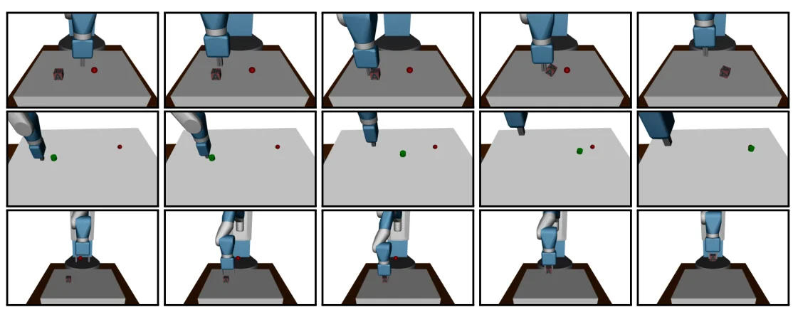
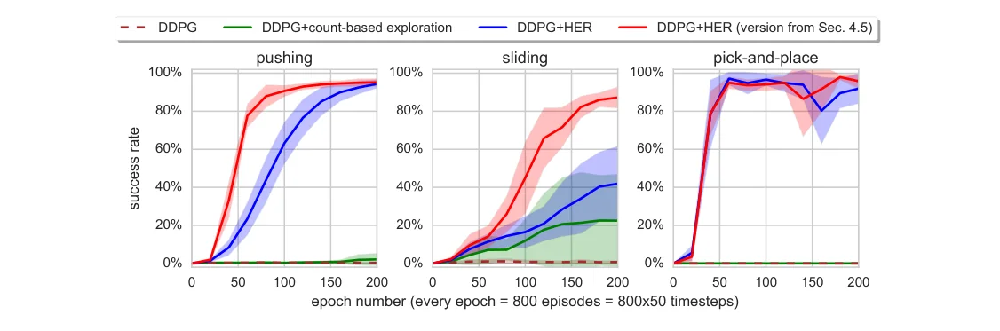
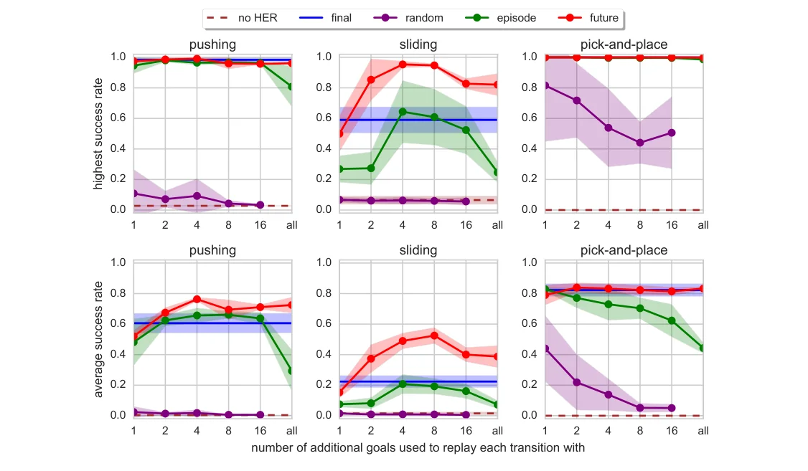

> - **논문**: Hindsight Experience Replay
> - **저자**: Marcin Andrychowicz, Filip Wolski, Alex Ray, Jonas Schneider, Rachel Fong, Peter Welinder, Bob McGrew, Josh Tobin, Pieter Abbeel, Wojciech Zaremba (OpenAI)
> - **학회**: NeurIPS 2017 · [arXiv:1707.01495](https://arxiv.org/abs/1707.01495)
{: .prompt-tip }

> 로봇 팔이 물체를 목표 위치로 옮기는 과제에서, **목표에 도달했을 때만 보상을 주면** 처음에는 거의 한 번도 성공하지 못해 아무것도 배우지 못합니다. **Hindsight Experience Replay(HER)**는 "원래 목표는 실패했지만, **실제로 도착한 곳을 목표로 했다면 성공**이다"라고 경험을 다시 해석해서 이 문제를 풉니다.

## 1. Contribution

- **Sparse reward 환경**에서 에이전트가 샘플 효율적으로 학습하는 방법
- **어떤 off-policy 알고리즘**(DQN, DDPG 등)에도 붙여 쓸 수 있음
- 복잡한 **reward engineering(보상 설계)**이 필요 없음

## 2. 배경

### DDPG (Deep Deterministic Policy Gradient)

DQN은 이산 행동에서만 잘 동작합니다($$\max_a Q$$를 구해야 하므로). **DDPG**는 이를 **연속 행동 공간**으로 확장한 알고리즘입니다.

- **Actor** $$\pi(s)$$: 상태에서 연속 행동을 바로 출력 (결정적 정책)
- **Critic** $$Q(s, a)$$: 행동의 가치를 평가하고, actor는 critic의 Q 값이 커지는 방향으로 학습
- DQN의 **replay buffer**와 **target network** 기법을 그대로 사용 (off-policy)

로봇 팔의 그리퍼를 어디로 움직일지처럼 연속적인 행동을 다루므로, HER 논문의 로봇 실험은 DDPG를 기반으로 합니다(bit-flipping 장난감 문제는 DQN).

### UVFA (Universal Value Function Approximator)

목표가 **여러 개**인 문제를 위해, 가치 함수를 목표 $$g$$에 대해서도 일반화한 것입니다.

- 목표마다 보상 함수 $$r_g: S \times A \to \mathbb{R}$$이 있음
- 에피소드 시작 때 초기 상태와 목표 $$(s_0, g)$$를 샘플링하고, 에피소드 동안 목표는 고정
- 정책과 Q 함수가 상태뿐 아니라 **목표도 입력**으로 받음

$$
\pi: S \times G \to A,\qquad Q^\pi(s_t, a_t, g) = \mathbb{E}\Big[\sum_{i \ge t}\gamma^{i-t}r_g(s_i, a_i)\Big]
$$

구현은 간단히 **상태와 목표를 이어 붙여(concat)** 네트워크에 넣으면 됩니다.

## 3. 동기: Bit-Flipping 문제

HER의 필요성을 보여 주는 장난감 문제입니다.

- 상태: $$n$$개의 비트 배열 $$s \in \{0, 1\}^n$$
- 행동: $$i$$번째 비트를 뒤집기 ($$n$$가지)
- 에피소드마다 초기 상태 $$s_0$$와 목표 상태 $$g$$를 무작위로 정함
- 보상: 목표 상태가 아니면 **-1**, 목표에 도달하면 0

$$
r_g(s, a) = -\big[s \neq g\big]
$$

상태 공간이 $$2^n$$개라, $$n$$이 조금만 커져도 무작위 탐험으로 목표에 도달할 확률은 거의 0입니다. 에이전트는 **항상 -1만** 받고, 어떤 행동이 좋은지 알려 주는 신호가 전혀 없습니다. 실제로 일반 DQN은 **$$n > 13$$이면 실패**했고, 같은 DQN에 HER을 붙이면 $$n = 50$$까지 풀었습니다.

목표까지의 거리로 보상을 주는 **reward shaping**($$-\lVert s - g\rVert^2$$ 등)으로 이 장난감 문제는 풀 수 있지만, 복잡한 실제 문제에서는 좋은 shaping을 설계하기 어렵고 잘못 설계하면 엉뚱한 행동을 학습합니다. 그래서 HER은 shaping 없이 이진 보상만 씁니다. 실제로 논문은 로봇 과제에서 shaping도 시험했는데 오히려 학습에 실패했습니다(6장). 또 이 문제는 방문하는 상태의 **다양성**이 부족해서가 아니라 상태 공간 자체가 너무 커서 생기므로, count-based exploration 같은 탐험 기법도 도움이 되지 않는다고 지적합니다.

## 4. HER의 아이디어

에피소드 $$s_1, s_2, \dots, s_T$$가 목표 $$g$$에 도달하지 못했다면, 모든 transition의 보상은 -1뿐입니다. 하지만 이 궤적은 **"$$s_T$$로 가는 방법"**으로서는 완벽한 시연입니다.

그래서 replay buffer에 **두 번** 저장합니다.

1. 원래 목표 $$g$$로: $$(s_t, a_t, r_g, s_{t+1}, g)$$ → 모두 실패(-1)
2. **실제로 도착한 상태 $$s_T$$를 목표로 바꿔서**: $$(s_t, a_t, r_{s_T}, s_{t+1}, s_T)$$ → 마지막에 **성공**

두 번째 궤적 덕분에 에이전트는 "이렇게 하면 $$s_T$$에 갈 수 있다"를 배웁니다. 이렇게 다양한 상태에 도달하는 법을 익히다 보면, 결국 원래 목표에 도달하는 법도 일반화됩니다. 사람이 축구공을 골대 옆으로 찼을 때 "저 방향으로 차려면 이렇게 하면 되는구나"를 배우는 것과 같습니다.

## 5. 알고리즘

1. Off-policy 알고리즘 $$\mathbb{A}$$(DQN, DDPG 등)와 replay buffer $$R$$ 초기화
2. 매 에피소드
   1. 목표 $$g$$와 초기 상태 $$s_0$$ 샘플링
   2. $$t = 0, \dots, T-1$$ 동안 **상태와 목표를 concat**해 행동 $$a_t = \pi(s_t \Vert g)$$ 선택, 실행
   3. 각 transition을 원래 목표로 $$R$$에 저장
   4. 추가 목표 집합 $$G' = \mathbb{S}(\text{현재 에피소드})$$를 샘플링하고, 각 $$g' \in G'$$로 **보상을 다시 계산해** $$R$$에 저장
3. $$N$$번 반복: $$R$$에서 미니배치를 샘플링해 $$\mathbb{A}$$로 학습

```python
import numpy as np

def her_relabel(episode, reward_fn, k=4, strategy="future"):
    """episode: [(s, a, s_next, g, achieved_next), ...]
    achieved_next: s_next에서 실제로 달성한 목표 (예: 물체의 위치)"""
    transitions = []
    T = len(episode)
    for t, (s, a, s_next, g, ach) in enumerate(episode):
        transitions.append((s, a, reward_fn(ach, g), s_next, g))            # 원래 목표

        if strategy == "final":
            new_goals = [episode[-1][4]]
        elif strategy == "future":                                          # 이후 시점에서 k개
            idx = np.random.randint(t, T, size=k)
            new_goals = [episode[i][4] for i in idx]
        else:                                                               # "episode"
            idx = np.random.randint(0, T, size=k)
            new_goals = [episode[i][4] for i in idx]

        for g_new in new_goals:                                             # 목표 바꿔서 다시 저장
            transitions.append((s, a, reward_fn(ach, g_new), s_next, g_new))
    return transitions

# 예: 목표와 거리 ε 이내면 0, 아니면 -1
def reward_fn(achieved, goal, eps=0.05):
    return 0.0 if np.linalg.norm(achieved - goal) <= eps else -1.0

# 1차원 예시: 목표는 위치 1.0인데 실제로는 0.3까지만 이동한 실패 에피소드
np.random.seed(0)
g = np.array([1.0])
pos = [np.array([x]) for x in [0.0, 0.1, 0.2, 0.3]]
episode = [(pos[t], +1, pos[t + 1], g, pos[t + 1]) for t in range(3)]

out = her_relabel(episode, reward_fn, k=2)
print("저장된 transition 수:", len(out))
print("원래 목표 보상:", [r for (_, _, r, _, gg) in out if gg is g])
print("바꾼 목표 보상:", [r for (_, _, r, _, gg) in out if gg is not g])
```

```text
저장된 transition 수: 9
원래 목표 보상: [-1.0, -1.0, -1.0]
바꾼 목표 보상: [0.0, -1.0, 0.0, -1.0, 0.0, 0.0]
```

원래 목표로는 모두 -1이지만, 목표를 바꿔 저장한 transition 중 절반 이상이 보상 0(성공)을 받습니다. 학습 신호가 없던 에피소드에서 신호가 생긴 것입니다.

보상 함수 $$r_g$$를 알고 있어야(목표가 바뀌었을 때 다시 계산할 수 있어야) 한다는 점이 HER의 전제입니다.

### 왜 off-policy 알고리즘에만 쓸 수 있나

목표를 $$g'$$로 바꾼 transition은 **에이전트가 $$g'$$를 노리고 한 행동이 아닙니다.** 실제로는 $$\pi(\cdot \mid s, g)$$로 행동했는데, 데이터에는 $$\pi(\cdot \mid s, g')$$의 경험처럼 저장됩니다. 즉 relabel된 데이터는 *지금 학습하려는 정책과 다른 정책이 만든 데이터*이므로, 이런 데이터로도 학습할 수 있는 off-policy 알고리즘(DQN, DDPG, SAC 등)이 필요합니다. PPO 같은 on-policy 알고리즘에 그대로 붙이면 데이터 분포가 맞지 않습니다.

> 위 코드는 이해를 위해 relabel한 transition을 미리 저장하지만, OpenAI Baselines 같은 실제 구현은 에피소드를 그대로 저장해 두고 **미니배치를 뽑을 때** 일정 확률(예: $$k = 4$$면 80%)로 목표를 바꿉니다. 메모리를 $$k+1$$배 쓰지 않아도 되고, 매번 다른 목표로 relabel되는 효과도 있습니다.
{: .prompt-info }

이렇게 쉬운 목표(우연히 도달한 곳)부터 다시 학습하게 되므로, 논문은 HER을 일종의 **암묵적 curriculum**으로 봅니다. 명시적 curriculum과 달리 초기 상태 분포를 조절할 필요도 없습니다.

## 6. 실험

### 로봇 조작 과제

MuJoCo로 시뮬레이션한 7자유도 Fetch 로봇 팔(두 손가락 그리퍼)로 세 가지 과제를 실험했습니다. 목표 $$g \in \mathbb{R}^3$$는 물체의 목표 위치이고, 물체가 목표에서 일정 거리 안에 있을 때만 성공입니다. HER에서 상태를 목표로 바꾸는 함수는 그냥 물체 위치 $$m(s) = s_{object}$$입니다.


_Figure 2. 위부터 pushing, sliding, pick-and-place. 빨간 공이 목표 위치입니다. (출처: Andrychowicz et al., 2017)_

| 과제 | 내용 | 성공 기준 |
|---|---|---|
| **Pushing** | 테이블 위 상자를 밀어서 목표 위치로 (손가락 잠금) | 7cm 이내 |
| **Sliding** | 퍽(puck)을 쳐서 미끄러뜨려 멀리 있는 목표로 (팔이 닿지 않는 곳) | 20cm 이내 |
| **Pick-and-place** | 상자를 집어 공중의 목표 위치로. 학습 에피소드의 절반은 상자를 잡은 상태에서 시작 | 7cm 이내 |

행동은 4차원으로, 다음 step의 그리퍼 상대 위치(3차원)와 두 손가락 사이 거리(1차원)입니다. 정책 입력은 그리퍼 절대 위치, 물체·목표의 상대 위치, 손가락 간격으로 제한하고, Q 함수에는 속도 정보를 더 줍니다. 실제 로봇으로 옮기기 쉽게 하려는 선택입니다.


_Figure 3. 과제별 성공률(5 seed 평균, 음영은 표준편차). 파란색이 final 전략의 HER, 빨간색이 future 전략($$k = 4$$)의 HER. 1 epoch = 800 에피소드. (출처: Andrychowicz et al., 2017)_

- 일반 **DDPG는 어떤 과제도 풀지 못했습니다.** HER 없는 DQN도 마찬가지였습니다.
- **Count-based exploration**을 더한 DDPG는 sliding에서만 약간 진전이 있었습니다(그래프상 약 20%).
- **DDPG + HER는 세 과제를 거의 완벽하게** 풀었습니다. 위 Figure 3에서 future 전략은 200 epoch 뒤 pushing과 pick-and-place에서 90% 이상, sliding에서 약 85~90%에 이릅니다. final 전략은 sliding에서 약 40%에 머물렀습니다.
- 시뮬레이션에서 future, $$k = 4$$로 학습한 pick-and-place 정책을 fine-tuning 없이 **실제 Fetch 로봇**에 옮겼습니다. 상자 위치는 시뮬레이션 이미지만으로(domain randomization) 학습한 CNN이 카메라 영상에서 추정합니다. 처음에는 5번 중 2번 성공했는데, 시뮬레이션의 완벽한 상태로만 학습해 위치 추정 오차에 약했기 때문입니다. 관측에 표준편차 1cm의 Gaussian noise를 넣어 다시 학습하자 5번 모두 성공했습니다.

### 목표가 하나뿐일 때도 도움이 되나

매 에피소드 목표가 **항상 같은** 환경에서도 HER을 쓰면 쓰지 않을 때보다 성능이 좋았습니다. 다만 **여러 목표로 학습할 때 더 빨리 수렴**해서, 실제로 원하는 목표가 하나여도 다양한 목표로 학습하는 편이 낫다는 결론입니다.

### Reward shaping을 쓰면

이진 보상 대신 $$r(s, a, g) = \lambda\lvert g - s_{object}\rvert^p - \lvert g - s'_{object}\rvert^p$$ ($$\lambda \in \{0, 1\}$$, $$p \in \{1, 2\}$$) 형태의 shaping 보상을 시험했는데, **DDPG도 DDPG + HER도 어떤 과제도 풀지 못했습니다.** 가장 나았던 $$-\lvert g - s'_{object}\rvert^2$$에서도 마찬가지였습니다. 논문이 드는 이유는 두 가지입니다.

- 최적화하는 값(거리)과 실제 성공 조건(마지막에 반경 안에 있는가) 사이의 괴리가 큼
- 잘못된 방향으로 상자를 미는 행동을 벌하므로 탐험이 위축됨. 실제로 상자를 아예 건드리지 않도록 학습하는 경우가 관찰됨

단순하고 도메인에 무관한 shaping은 잘 통하지 않았고, 이것이 이진 보상에서 학습하는 문제가 중요하다는 논문의 근거가 됩니다.

### 어떤 목표로 다시 저장할까

추가 목표를 고르는 전략 네 가지를 비교했습니다.

| 전략 | 추가 목표 |
|---|---|
| **final** | 에피소드의 **마지막 상태** |
| **future** | 현재 transition **이후**에 도달한 상태 중 무작위 $$k$$개 |
| **episode** | 같은 에피소드 안의 상태 중 무작위 $$k$$개 (위치 무관) |
| **random** | 학습 전체에서 도달한 상태 중 무작위 $$k$$개 |


_Figure 6. 가로축은 transition 하나당 추가 목표 수 $$k$$. 위 줄은 학습 중 최고 성공률, 아래 줄은 전체 학습 기간의 평균 성공률. (출처: Andrychowicz et al., 2017)_

- random을 뺀 모든 전략이 pushing과 pick-and-place는 $$k$$와 무관하게 거의 완벽하게 풀었습니다.
- **future 전략, $$k = 4 \sim 8$$**일 때 모든 과제에서 가장 좋았고, sliding을 거의 완벽하게 푼 것은 future뿐입니다(최고 성공률 약 0.95, final은 약 0.6).
- $$k$$가 8보다 커지면 replay buffer에서 원래 목표 데이터의 비중이 너무 작아져 오히려 성능이 떨어졌습니다.
- random 전략은 pushing과 sliding에서 HER을 안 쓴 것과 거의 같았습니다. 다른 에피소드의 상태는 지금 궤적으로는 도달하지 못한 곳이라 성공 신호가 거의 생기지 않기 때문으로 보입니다.

직관적으로, 지금 행동이 **실제로 영향을 줄 수 있는 가까운 미래 상태**를 목표로 삼는 것이 가장 유용한 학습 신호가 됩니다.

## 7. 구현 디테일

| 항목 | 값 |
|---|---|
| 네트워크 | actor·critic 모두 은닉층 3개 × 64 unit, ReLU. actor 출력은 tanh 후 $$[-5\text{cm}, 5\text{cm}]$$로 스케일 (tanh 포화를 막으려 pre-activation 제곱을 actor loss에 더함) |
| 학습 | 200 epoch, epoch당 50 cycle, cycle마다 16 에피소드 수집 후 40 step 최적화 |
| 미니배치·버퍼 | batch 128, replay buffer $$10^6$$ transition |
| Optimizer | Adam, lr 0.001 (나머지는 TensorFlow 기본값) |
| 할인율 | $$\gamma = 0.98$$, critic target을 $$[-\frac{1}{1-\gamma}, 0]$$으로 clip |
| Target network | cycle마다 decay 0.95로 갱신, 테스트에도 target network 사용 |
| 탐험 | 20% 확률로 무작위 행동, 아니면 정책 출력에 각 좌표 범위의 5% 표준편차 Gaussian noise |
| 입력 정규화 | 지금까지 본 관측의 평균·표준편차로 정규화 후 $$[-5, 5]$$로 clip |
| 에피소드 | 50 step (step당 MuJoCo 10 step, $$\Delta t = 0.002$$s) |
| 병렬 | 8 worker가 매 업데이트 후 파라미터 평균 (CPU 8코어) |
| 학습 시간 | pushing·pick-and-place 약 2.5시간, sliding 약 6시간 |
| Bit-flipping | 은닉층 1개 × 256, 에피소드 길이 = 비트 수 $$n$$ |

Count-based exploration baseline은 물체와 목표의 상대 위치를 격자로 나눠 $$\alpha/\sqrt{N}$$의 내적 보상을 줬고, 탐색한 값 중 가장 좋았던 $$\alpha = 1$$, 격자 1cm 결과를 보고합니다.

## 8. 정리

| 개념 | 핵심 |
|---|---|
| Sparse reward | 성공할 때만 보상 → 초기에는 학습 신호가 없음 |
| UVFA | 목표를 입력으로 받는 가치 함수 $$Q(s, a, g)$$ |
| HER | 실패한 궤적을 **실제로 도달한 상태를 목표로** 다시 저장 |
| 조건 | Off-policy 알고리즘, 목표별 보상을 다시 계산할 수 있어야 함 |
| 최적 전략 | future, $$k = 4 \sim 8$$ |

HER은 보상 설계 없이도 어려운 로봇 조작을 학습할 수 있다는 것을 보여 줬고, 이후 goal-conditioned RL과 로봇 학습의 기본 기법이 됐습니다.

## References

- Andrychowicz et al., "Hindsight Experience Replay," NeurIPS 2017. [arXiv:1707.01495](https://arxiv.org/abs/1707.01495)
- Lillicrap et al., "Continuous control with deep reinforcement learning (DDPG)," ICLR 2016.
- Schaul et al., "Universal Value Function Approximators," ICML 2015.
- Plappert et al., "Multi-Goal Reinforcement Learning: Challenging Robotics Environments and Request for Research," 2018.
