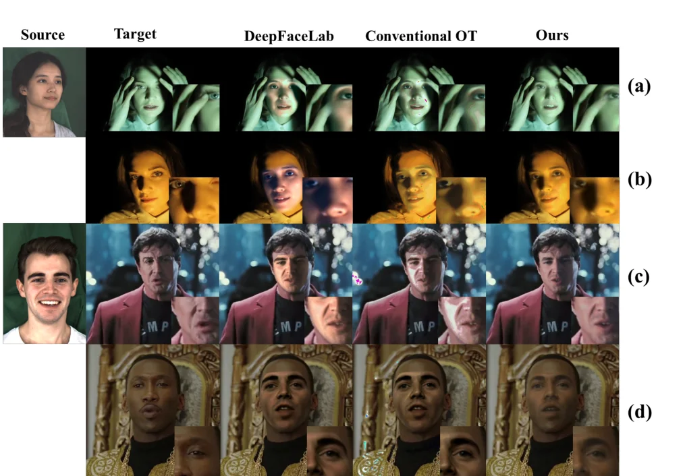
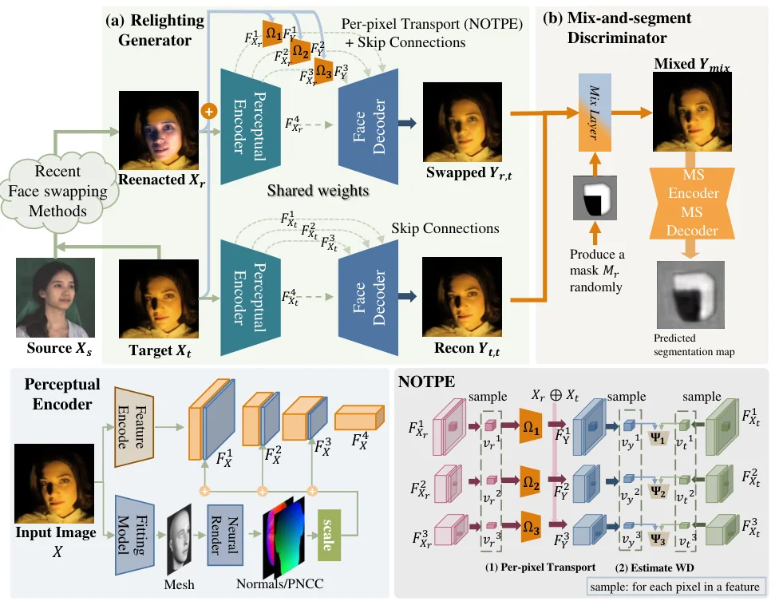
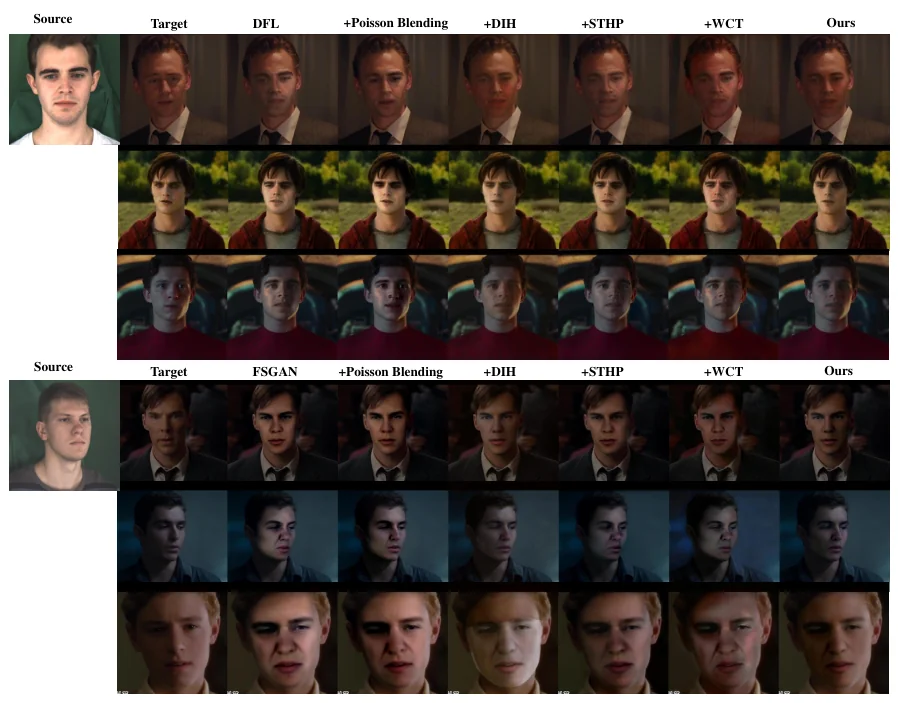

> - **논문**: AOT: Appearance Optimal Transport Based Identity Swapping for Forgery Detection
> - **저자**: Hao Zhu, Chaoyou Fu, Qianyi Wu, Wayne Wu, Chen Qian, Ran He (CASIA, Anhui University, UCAS, SenseTime Research)
> - **학회**: NeurIPS 2020 · [arXiv:2011.02674](https://arxiv.org/abs/2011.02674)
{: .prompt-tip }

> 위조 탐지기는 데이터 기반이라 학습에 없는 종류의 가짜에 약합니다. 그런데 기존 교체 방법은 소스와 목표의 **피부색·조명이 크게 다를 때** 눈에 띄게 망가지므로(Figure 1), 그런 가짜는 데이터셋에 거의 없습니다. **AOT**는 이 **외형 격차** 문제를 처음 정면으로 다룹니다. 색 히스토그램을 소스에서 목표로 옮기는 것은 최적 수송(OT)의 자연스러운 응용이지만, 픽셀 색에 직접 OT를 적용하면 히스토그램이 불균형할 때 불연속이 생기고 얼굴 기하를 무시하며 비쌉니다. AOT는 수송을 **잠재 공간**(특징 + 위치 + 법선)에서 신경망으로 추정하고, **픽셀 공간**에서는 패치를 섞어 분할하는 판별기로 다듬습니다. [DeepFaceLab]()과 [FSGAN]() 어느 쪽에든 뒤에 붙일 수 있는 **플러그인**입니다.

## 1. 왜 최적 수송인가


_Figure 1. 강한 색 조명·측면광 목표에서 DeepFaceLab과 기존 OT 색 전이는 결과가 목표 외형과 어긋나거나(3열) 얼룩·불연속이 생깁니다(4열). 오른쪽 끝이 AOT. (출처: Zhu et al., 2020)_

Monge의 수송 $$T^* = \arg\min_{T(X) \sim P_t} \mathbb{E}[c(X, T(X))]$$은 비볼록이라 Kantorovich의 완화 $$\gamma^* = \inf_{\gamma \in Q(P_s, P_t)} \mathbb{E}_{(x,y) \sim \gamma}[c(x - y)]$$를 씁니다. 결합 분포 $$\gamma$$를 찾는 문제라 해가 보장됩니다. 색 전이에 OT를 쓰는 연구는 있었지만, 얼굴 교체에는 세 문제가 있었습니다. (1) 소스는 균일광, 목표는 측면광이면 색 히스토그램이 **불균형**해 매칭이 잘못되고 결과가 불연속해집니다. (2) 수송이 **얼굴 기하**를 모르니 그림자가 엉뚱한 곳에 갑니다. (3) 계산이 무겁습니다. 위 Figure 1의 (a), (b)가 첫 번째, (c), (d)가 두 번째 문제의 예입니다.

## 2. 재조명 생성기: 잠재 공간의 OT


_Figure 2. (a) 재조명 생성기: 기존 교체기가 만든 재연기 얼굴 $$X_r$$과 목표 $$X_t$$를 지각 인코더에 넣고, NOTPE($$\Omega_i$$)로 특징을 수송한 뒤 얼굴 디코더로 되돌립니다. 아래 왼쪽은 특징에 PNCC·법선을 붙이는 지각 인코더, 아래 오른쪽은 픽셀 단위 수송과 Wasserstein 거리 추정($$\Psi_i$$). (b) mix-and-segment 판별기. (출처: Zhu et al., 2020)_

**지각 인코더**가 재연기 얼굴 $$X_r$$과 목표 $$X_t$$에서 4단계 특징을 뽑습니다. 앞의 세 단계 특징에는 3DDFA로 구한 **PNCC 좌표(3) + 법선(3)**을 스케일해 이어 붙여 속성 벡터 $$v = (f, x, n)$$으로 만들고(총 $$k + 6$$차원 히스토그램), 마지막 단계는 신원으로 둡니다. 위치와 법선이 붙어 있으므로 수송은 **기하와 조명 방향이 비슷한 픽셀끼리** 맺어집니다.

$$
W = \min_{\gamma \in Q(V_r, V_t \mid X_r, X_t)} \mathbb{E}_{(v_r, v_t) \sim \gamma}[c(v_r, v_t)]
= \sup_{\Psi \in \mathcal{F}_1}\big[\mathbb{E}_{v_r}\Psi(v_r) - \mathbb{E}_{v_t}\Psi(v_t)\big]
$$

Kantorovich-Rubinstein 쌍대성으로 1-Lipschitz 함수 $$\Psi$$의 최대화가 되고, 모든 연속 분포 사이의 $$\gamma$$를 푸는 대신 **조건부 매핑** $$\Omega(v_r \mid X_r, X_t)$$로 밀어 보내는 **push-forward** 방식을 씁니다. $$\min_\Omega \max_{\Psi} \mathbb{E}[\Psi(v_t)] - \mathbb{E}[\Psi(\Omega(v_r))]$$라는 WGAN형 minimax이고, $$\Omega_i$$는 3층 FC, $$\Psi_i$$는 2층 FC(가중치 클리핑)입니다. 이것이 **NOTPE**(Neural Optimal Transport Plan Estimation)입니다. 학습은 교대로 합니다. 매 반복마다 $$\Psi_i$$를 고정하고 $$\Omega_i$$를 $$d$$스텝 갱신한 뒤, $$\Omega_i$$를 고정하고 $$\Psi_i$$를 갱신합니다. 수송된 특징은 전치 합성곱 3층짜리 얼굴 디코더가 이미지로 되돌립니다(신원 특징은 업샘플 경로로, 속성 특징은 skip connection으로). 손실은 VGG 콘텐츠(소스 $$X_r$$ 대비), 외형 L1(목표 $$X_t$$ 대비), 재구성($$Y_{t,t}$$ 대 $$X_t$$)입니다.

## 3. Mix-and-Segment 판별기: 픽셀 공간의 OT

$$X_r$$, $$X_t$$, $$Y_{r,t}$$는 포즈·표정이 같고, $$Y_{r,t}$$와 $$X_t$$는 색 스타일이 같아야 합니다. 그렇다면 둘의 작은 패치를 무작위 마스크 $$M_r$$로 섞은 $$Y_{mix} = (1 - M_r) Y_{r,t} + M_r X_t$$에서 **어느 패치가 가짜인지** 찾기 어려워야 합니다. U-Net 판별기가 픽셀별 Wasserstein 거리 맵을 예측하고, $$\min_G \max_D \mathbb{E}[(1 - M_r) D(Y_{mix})] - \mathbb{E}[M_r D(Y_{mix})]$$로 학습합니다. 생성기가 이를 속이려면 **국소적으로도** 목표와 구분이 안 되게 만들어야 하므로, 잠재 공간의 전역 매칭이 놓친 세부가 보정됩니다.

## 4. 코드로 보기: 1차원 OT, 위치 조건, 패치 분리도

균일광 재연기 얼굴과 측면광(이봉 히스토그램) 목표의 밝기 분포를 AdaIN식 모멘트 매칭과 1차원 OT(분위수 매칭)로 옮겨 Wasserstein-1 거리를 비교하고, 색만으로 수송하면 그림자 경계의 어느 쪽에 픽셀이 가는지, 위치를 벡터에 붙이면 어떻게 달라지는지, 그리고 패치 단위 분리도를 봅니다.

```python
import numpy as np
rng = np.random.default_rng(0)
# intensities of a reenacted face (even skin, flat light) and a target face (darker skin, strong side light = bimodal histogram)
n = 4000
reenact = np.clip(rng.normal(0.65, 0.06, n), 0, 1)
target = np.clip(np.concatenate([rng.normal(0.25, 0.05, n // 2), rng.normal(0.55, 0.05, n // 2)]), 0, 1)
def w1(a, b): return np.abs(np.sort(a) - np.sort(b)).mean()                     # 1-D Wasserstein-1 distance via quantiles
adain = (reenact - reenact.mean()) / reenact.std() * target.std() + target.mean()  # moment matching
ot = np.sort(target)[np.argsort(np.argsort(reenact))]                              # 1-D optimal transport = quantile matching
print("appearance transfer of a flat-lit face to a side-lit, darker target (1-D intensity histograms)")
print(f"  W1(reenacted, target)      {w1(reenact, target):.3f}")
print(f"  W1(AdaIN result, target)   {w1(adain, target):.3f}   (mean/std match cannot create the bimodal shadow)")
print(f"  W1(OT result, target)      {w1(ot, target):.3f}   (exact in 1-D)")
# but pure colour OT ignores WHERE the shadow is: pixels are re-assigned by rank, not by position
x = np.linspace(-1, 1, n); reenact_sp = 0.65 + 0.02 * np.sin(20 * x); target_sp = np.where(x < 0, 0.25, 0.55) + 0.02 * np.sin(20 * x)
ot_sp = np.sort(target_sp)[np.argsort(np.argsort(reenact_sp))]
print(f"\nspatial check: fraction of pixels that OT puts on the WRONG side of the shadow boundary {np.mean((ot_sp < 0.4) != (x < 0)) * 100:.1f}%")
# AOT's fix: transport in a feature space that concatenates (feature, position, normal) so matched pixels share geometry
aug_r = np.stack([reenact_sp, x], 1); aug_t = np.stack([target_sp, x], 1)
# greedy nearest-neighbour transport in the augmented space (a cheap stand-in for the learned plan)
order = np.argsort(aug_t[:, 1]); match = order[np.searchsorted(aug_t[order, 1], aug_r[:, 1]).clip(0, n - 1)]
ot_aug = target_sp[match]
print(f"with position in the transported vector: wrong-side fraction {np.mean((ot_aug < 0.4) != (x < 0)) * 100:.1f}%, W1 to target {w1(ot_aug, target_sp):.3f}")
# mix-and-segment: if the transferred face is well blended, a patch-level real/fake discriminator cannot locate the mixed patches
def patch_sep(a, b, k=50):      # separability of 50-pixel patches by their mean intensity (AUC-like)
    pa, pb = a.reshape(-1, k).mean(1), b.reshape(-1, k).mean(1); return np.mean(pa[:, None] > pb[None, :])
print(f"\npatch separability (0.5 = indistinguishable): raw reenacted vs target {patch_sep(reenact_sp, target_sp):.2f}, OT+position vs target {patch_sep(ot_aug, target_sp):.2f}")
```

```text
appearance transfer of a flat-lit face to a side-lit, darker target (1-D intensity histograms)
  W1(reenacted, target)      0.248
  W1(AdaIN result, target)   0.046   (mean/std match cannot create the bimodal shadow)
  W1(OT result, target)      0.000   (exact in 1-D)

spatial check: fraction of pixels that OT puts on the WRONG side of the shadow boundary 47.1%
with position in the transported vector: wrong-side fraction 0.0%, W1 to target 0.000

patch separability (0.5 = indistinguishable): raw reenacted vs target 1.00, OT+position vs target 0.49
```

- 모멘트 매칭은 W1을 0.248에서 0.046까지만 줄입니다. 평균·분산으로는 이봉 분포(그림자와 밝은 쪽)를 만들 수 없기 때문이고, [AdaIN]()류 스타일 전이가 외형 격차에 약한 이유입니다. 1차원 OT는 정확히 0입니다.
- 그런데 색만으로 수송하면 픽셀의 47%가 그림자 경계의 **잘못된 쪽**에 갑니다. 순위로만 재배정하니 어두운 값이 어디에 있어야 하는지 모릅니다. 위치를 벡터에 붙여 같은 위치끼리 맺으면 0%가 되고 W1도 0입니다. PNCC와 법선을 이어 붙이는 설계의 요점이 이것입니다.
- 50픽셀 패치의 평균 밝기로 재연기 얼굴과 목표를 구분하면 분리도 1.00(완전 구분)인데, 위치 조건 OT 뒤에는 0.49(구분 불가)입니다. mix-and-segment 판별기가 속아야 할 상태가 이것입니다.

## 5. 구현 디테일

논문 본문에는 네트워크 구조 정도만 있고, 학습률·배치·반복 수 같은 학습 설정은 부록으로 미룹니다(이 PDF에는 부록이 없습니다).

| 항목 | 값 |
|---|---|
| 기반 교체기 | DeepFaceLab(인물마다 재학습), FSGAN(주체 비의존). AOT는 그 뒤에 붙는 모듈 |
| 지각 인코더 | 4단계 특징. 1~3단계는 속성(스케일한 PNCC 3차원 + 법선 3차원을 이어 붙임), 4단계는 신원. PNCC·법선은 3DDFA로 추출 |
| NOTPE | 단계마다 $$\Omega_i$$(FC 3층)와 $$\Psi_i$$(FC 2층), 가중치 클리핑으로 1-Lipschitz, 교대 최적화 |
| 얼굴 디코더 | 전치 합성곱 3층 |
| 판별기 | U-Net 변형(MSD), 픽셀별 Wasserstein 거리 맵 출력 |
| 전체 손실 | $$\lambda_1 L_{cont} + \lambda_2 L_{appear} + \lambda_3 L_{recon} + \lambda_4 L_{MSD}$$ (가중치 값은 본문에 없음) |

## 6. 실험

FaceForensics++(실환경)와 DeeperForensics-1.0(어려운 조명)에서, 주체 특정 DFL과 주체 비의존 FSGAN을 기반으로 AOT를 붙이고, 포아송 블렌딩, DIH(심층 조화), STHP(최적화 사진 스타일), WCT²(학습 사진 스타일)와 비교합니다.


_Figure 4. 위: DFL 기반, 아래: FSGAN 기반. 포아송 블렌딩·DIH·STHP·WCT²를 붙인 결과와 AOT(오른쪽 끝)를 비교합니다. (출처: Zhu et al., 2020)_

위 Figure 4처럼 포아송 블렌딩과 DIH는 고스팅을, STHP·WCT²는 전역 또는 국소 외형 오류를 냅니다.

**정량(Table 1).** SSIM-whole은 결과와 목표의 SSIM, Gram 손실은 스타일 차이, SSIM-edge는 HED로 뽑은 결과와 **소스**의 가장자리 SSIM(기하 일관성)입니다. 어려운 조명의 DPF-1.0 수치를 옮기면 다음과 같습니다.

| 방법 | SSIM-edge ↑ | SSIM-whole ↑ | Gram loss ↓ | 사실성 ↑ | 외형 ↑ |
|---|---|---|---|---|---|
| DFL | 0.8239 | 0.7153 | 0.013540 | 0.149 | 0.132 |
| DFL + 포아송 | 0.7711 | 0.6979 | 0.008128 | 0.007 | 0.028 |
| DFL + DIH | 0.8084 | 0.7182 | 0.006225 | 0.061 | 0.110 |
| DFL + WCT² | 0.7825 | 0.7193 | 0.003598 | 0.163 | 0.129 |
| DFL + STHP | 0.8163 | 0.7385 | 0.009185 | 0.072 | 0.089 |
| **DFL + AOT** | **0.8301** | **0.7810** | **0.003578** | **0.548** | **0.512** |
| FSGAN | **0.7487** | 0.6887 | 0.010041 | 0.191 | 0.157 |
| FSGAN + 포아송 | 0.7298 | 0.6621 | 0.097240 | 0.017 | 0.034 |
| FSGAN + DIH | 0.7224 | 0.6511 | 0.006777 | 0.085 | 0.072 |
| FSGAN + WCT² | 0.7304 | 0.6742 | 0.003972 | 0.099 | 0.070 |
| FSGAN + STHP | 0.7333 | 0.6408 | 0.008793 | 0.057 | 0.041 |
| **FSGAN + AOT** | 0.7446 | **0.7309** | **0.003674** | **0.551** | **0.627** |

DFL 기반에서는 세 지표 모두 최고입니다(Gram은 WCT²와 거의 같음). FSGAN 기반에서는 SSIM-whole과 Gram이 최고지만 SSIM-edge는 원래 FSGAN(0.7487)보다 조금 낮은 0.7446이라, 논문 표현대로 기하 일관성은 "비슷한 수준"입니다. FF++에서도 SSIM-whole(DFL 0.7331 → 0.8022, FSGAN 0.7395 → 0.7780)과 Gram 손실이 가장 좋습니다.

**사용자 연구(31명).** 영상 쌍을 보여 주고 "덜 조작된 것"과 "목표 외형을 더 잘 보존한 것"을 고르게 했습니다. 위 표의 사실성·외형 열이 여섯 방법 중 각 방법이 선택된 비율이고, AOT가 두 질문 모두 최고입니다. 특히 DPF-1.0에서 사실성 0.55, 외형 0.51~0.63입니다.

**Ablation(DPF-1.0, Table 2).**

| 설정 | SSIM-edge ↑ | SSIM-whole ↑ | Gram loss ↓ |
|---|---|---|---|
| (a) 3D 특징(PNCC·법선) 없음 | 0.7736 | 0.7183 | 0.019993 |
| (b) NOTPE 대신 Add | 0.7903 | 0.7196 | 0.036263 |
| (c) NOTPE 대신 Concat | 0.7883 | 0.7265 | 0.036814 |
| (d) NOTPE 대신 AdaIN | 0.8026 | 0.7522 | 0.007700 |
| (e) 판별기 없음 | 0.8065 | 0.7255 | 0.016075 |
| (f) 일반 판별기 | 0.7998 | 0.7154 | 0.019354 |
| **(g) 전체** | **0.8301** | **0.7810** | **0.003578** |

3D 특징을 빼면 그림자가 엉뚱한 위치에 가고(SSIM-whole 0.718), NOTPE를 Add·Concat으로 바꾸면 Gram 손실이 약 10배 나빠지며, AdaIN은 목표 속성은 맞추지만 소스 신원을 잃습니다. 판별기를 빼거나 일반 판별기로 바꾸면 SSIM-whole이 0.726, 0.715로 떨어집니다. 특징 수송을 PCA로 시각화하면 수송 전후 분포가 겹치는 것이 보입니다.

**실패 사례.** 앞 단계 교체기가 가림을 처리하지 못하면 AOT도 되살리지 못합니다. 목표가 안경을 썼는데 DFL 결과에서 안경이 사라졌다면 AOT 뒤에도 돌아오지 않습니다.

**탐지.** DPF-1.0의 hidden set에서 영상 분류기 I3D와 TSN으로 이진 탐지를 합니다. FF++의 네 조작(DeepFakes, Face2Face, FaceSwap, NeuralTextures)으로 학습한 뒤 AOT로 만든 영상 100개를 학습셋에 더하면 모든 탐지 정확도가 오릅니다. 구체적인 수치는 보충 자료에 있습니다. 이것이 제목의 "for forgery detection"입니다.

## 7. 해석

**1. 교체 파이프라인의 한 단계(색·조명 조정)를 독립 문제로 분리했습니다.** [Bitouk 등]()의 구면 조화 재조명, FSGAN의 포아송 손실, [Disney의 저주파 보존 블렌딩]()이 모두 같은 문제를 다루지만, AOT는 분포 매칭이라는 원리로 정식화하고 어떤 교체기에도 붙는 모듈로 만들었습니다.

**2. OT를 "쓰기 어려운 이유"를 정확히 짚고 각각 풀었습니다.** 불균형 히스토그램 → 잠재 공간 + push-forward, 기하 무시 → 위치·법선 연결, 비용 → 신경망 근사. 위 toy의 47% → 0%가 두 번째 해법의 효과를 보여 줍니다. 수송 벡터에 좌표를 붙이는 발상은 이후 [HeSer의 의미 영역별 색 참조]()처럼 "같은 의미끼리만 맺기"로 일반화됩니다.

**3. Mix-and-segment는 국소 사실성의 좋은 판별기입니다.** 패치를 섞어 분할하게 하는 설계는 CutMix 판별기(Schönfeld 등의 U-Net GAN)와 같은 계열이고, 전역 판별기가 놓치는 경계·질감 불일치를 잡습니다. [DeeperForensics]()가 스타일 불일치를 가짜의 주된 단서로 꼽은 것과 짝을 이룹니다.

**4. 한계는 신원 충실도입니다.** [HifiFace]()의 비교에서 AOT는 조명은 좋지만 신원 유사도와 충실도가 약하다고 평가됩니다. 외형을 목표에 맞추는 손실(L1)이 강할수록 소스의 질감 세부가 희생되는 트레이드오프이고, 재연기 단계의 품질에도 의존합니다.

**5. 평가를 읽을 때 주의할 점.** 지표가 SSIM·Gram 손실 중심이라 신원 보존은 직접 측정하지 않았고(SSIM-edge가 간접 지표), 탐지 성능 향상의 수치는 본문 요약에 없고 부록에 있습니다. 비교 대상은 조화·스타일 전이 방법이지 다른 교체기가 아닙니다. 위 toy는 1차원 밝기이고 신경 수송 계획 대신 정렬 기반 OT라 NOTPE의 학습 동역학은 다루지 않습니다.

## 8. 정리

| 항목 | 내용 |
|---|---|
| 문제 | 소스·목표의 피부색·조명 격차에서 교체가 붕괴, 그런 가짜가 탐지 데이터에 부족 |
| 정식화 | 외형 매핑 = 최적 수송(Kantorovich), 잠재 공간과 픽셀 공간에서 각각 |
| 잠재 공간 | (특징, PNCC 위치, 법선) 벡터를 push-forward 매핑 $$\Omega$$로 수송, 1-Lipschitz $$\Psi$$로 Wasserstein 추정(NOTPE) |
| 픽셀 공간 | 진짜·가짜 패치를 섞어 가짜 부분을 분할하는 U-Net 판별기 |
| 결과 | DPF-1.0 DFL 기반 SSIM-whole 0.715 → 0.781, Gram 0.0135 → 0.0036, 사용자 연구 사실성·외형 1위, DFL·FSGAN 모두에 적용 |
| 한계 | 신원 충실도 약함(HifiFace 비교), 재연기 품질·가림 처리 의존 |

## References

- Zhu, Fu, Wu, Wu, Qian, He, "AOT: Appearance Optimal Transport Based Identity Swapping for Forgery Detection," NeurIPS 2020. [arXiv:2011.02674](https://arxiv.org/abs/2011.02674)
- Arjovsky, Chintala, Bottou, "Wasserstein GAN," ICML 2017. [arXiv:1701.07875](https://arxiv.org/abs/1701.07875)
- Peyré, Cuturi, "Computational Optimal Transport," Foundations and Trends in ML 2019. [arXiv:1803.00567](https://arxiv.org/abs/1803.00567)
- Schönfeld, Schiele, Khoreva, "A U-Net Based Discriminator for Generative Adversarial Networks," CVPR 2020. [arXiv:2002.12655](https://arxiv.org/abs/2002.12655)
- Zhu et al., "Face Alignment Across Large Poses: A 3D Solution" (3DDFA), CVPR 2016. [arXiv:1511.07212](https://arxiv.org/abs/1511.07212)
