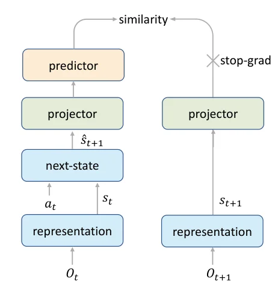
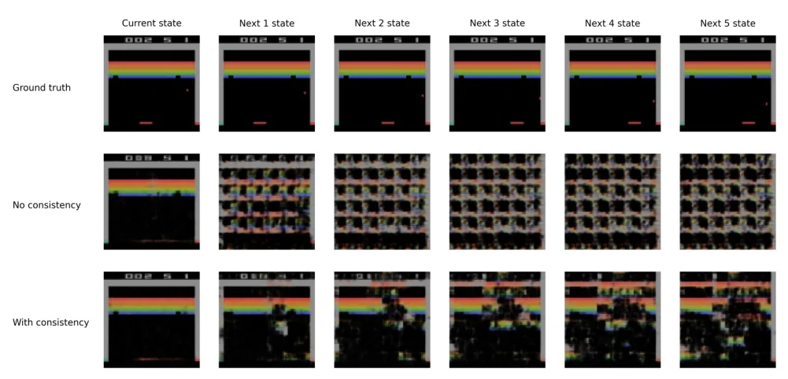

> - **논문**: Mastering Atari Games with Limited Data (EfficientZero)
> - **저자**: Weirui Ye, Shaohuai Liu, Thanard Kurutach, Pieter Abbeel, Yang Gao (Tsinghua University, UC Berkeley, Shanghai Qi Zhi Institute)
> - **학회**: NeurIPS 2021 · [코드](https://github.com/YeWR/EfficientZero)
{: .prompt-tip }

> Model-Based RL 카테고리의 첫 글입니다. 강화학습의 고질적인 문제인 **샘플 효율성**을, 환경 모델을 학습하는 MuZero를 개선해서 크게 끌어올린 **EfficientZero**(Ye et al., NeurIPS 2021)를 정리합니다.

## 1. 문제: 강화학습은 데이터를 너무 많이 먹는다

DQN, Double DQN 같은 대표적인 알고리즘은 Atari 게임 하나를 학습하는 데 **2억(200M) frame**을 씁니다. 사람이 실제로 플레이하는 시간으로 바꾸면 약 **925시간**입니다. 사람은 몇 시간이면 게임 요령을 익히는데, 에이전트는 그 수백 배의 경험이 필요한 것입니다.

시뮬레이터에서는 괜찮지만, **로봇처럼 실제 환경에서 데이터를 모아야 하는 경우**에는 이렇게 많은 시행착오를 감당할 수 없습니다. 그래서 적은 데이터로 학습하는 **샘플 효율성(sample efficiency)**이 중요한 연구 주제입니다.

### Atari 100k 벤치마크

샘플 효율성을 재는 대표적인 벤치마크입니다.

- Atari 26개 게임에서 에이전트가 **10만 step(= 40만 frame, frameskip 4)**만 환경과 상호작용
- 실제 플레이 시간으로 약 **2시간**
- DQN이 쓰는 데이터의 **약 1/500**
- 비교 기준인 사람 점수도 2시간 동안 게임에 익숙해진 뒤 잰 것

평가는 **Human Normalized Score**로 합니다.

$$
\text{HNS} = \frac{\text{Agent score} - \text{Random score}}{\text{Human score} - \text{Random score}}
$$

1.0(100%)이면 사람 수준입니다. EfficientZero 이전에는 Rainbow, SimPLe, MuZero 등 대부분의 알고리즘이 이 벤치마크에서 매우 저조했고, 당시 최고였던 **SPR**조차 평균이 사람의 약 70%였습니다.

## 2. 배경: Model-Free vs Model-Based

| | Model-Free | Model-Based |
|---|---|---|
| 학습하는 것 | 가치 함수나 정책을 **직접** | **환경 모델**(다음 상태, 보상)도 함께 |
| 예시 | DQN, [PPO]() | AlphaZero, MuZero, EfficientZero |
| 장점 | 단순, 모델 오차 없음 | 모델 안에서 **상상(planning)**할 수 있어 데이터 효율적 |
| 단점 | 데이터가 많이 필요 | 모델이 틀리면 오차가 누적됨 |

Model-Based RL은 환경을 직접 알지 못해도, **환경의 동작을 모델로 학습**해서 상태·행동·보상을 예측하고, 이 모델 안에서 미리 수를 읽어 볼 수 있습니다. 여기서 **MCTS(Monte Carlo Tree Search)**는 현재 상태를 뿌리로 하는 탐색 트리를 만들면서, 유망한 수는 더 깊이 읽고 덜 유망한 수는 덜 읽어 제한된 계산으로 좋은 행동을 찾는 탐색 방법입니다.

## 3. MuZero 복습

AlphaZero는 바둑처럼 **규칙(시뮬레이터)을 알고 있는** 환경에서 MCTS로 수를 읽었습니다. **MuZero**(Schrittwieser et al., 2020)는 규칙을 몰라도 되도록, 탐색에 필요한 모델 자체를 학습합니다. 핵심은 실제 화면을 복원하는 모델이 아니라 **계획(planning)에 필요한 것만 예측하는 잠재 모델**이라는 점입니다.

MuZero는 세 개의 함수로 구성됩니다.

### (1) Representation Function $$h_\theta$$

현재와 과거의 관측(observation)을 받아 **잠재 상태(hidden state)**를 만듭니다.

$$
s^0 = h_\theta(o_1, \dots, o_t)
$$

실제 픽셀을 그대로 쓰는 대신, 미래를 예측하는 데 **유용한 정보만 담긴 상태**를 학습합니다.

### (2) Dynamics Network $$g_\theta$$

잠재 상태와 **가상의 행동**을 받아, 다음 잠재 상태와 그 행동의 보상을 예측합니다.

$$
r^{k+1},\ s^{k+1} = g_\theta(s^k, a^{k+1})
$$

환경 시뮬레이터 대신 이 네트워크로 "이 행동을 하면 어떻게 될까"를 상상합니다. 각 행동의 보상을 예측해야 하므로, 탐색 중 고려하는 모든 행동에 대해 적용됩니다.

### (3) Prediction Network $$f_\theta$$

잠재 상태에서 **정책과 가치**를 예측합니다.

$$
p^k,\ v^k = f_\theta(s^k)
$$

### 탐색과 학습

1. 현재 관측 → $$h$$로 $$s^0$$
2. $$g$$와 $$f$$로 잠재 공간에서 **MCTS** → 방문 횟수 기반 정책 $$\pi$$와 가치 추정
3. 실제 환경에서 행동하고 경험을 저장
4. 저장된 궤적에서 $$K$$ step(보통 5)을 펼쳐(unroll) 보상·가치·정책을 실제 값에 맞추도록 학습

$$
\mathcal{L} = \sum_{k=0}^{K}\Big[\ell^r(u_{t+k}, r^k) + \ell^v(z_{t+k}, v^k) + \ell^p(\pi_{t+k}, p^k)\Big]
$$

MuZero는 Atari에서 최고 수준이었지만, **데이터가 적은 Atari 100k에서는 성능이 낮았습니다.** EfficientZero는 그 이유를 세 가지로 진단하고 각각을 고칩니다.

## 4. EfficientZero의 세 가지 개선

### 개선 1. Self-Supervised Temporal Consistency

**문제**: MuZero의 dynamics network는 **보상, 가치, 정책이라는 스칼라 신호**로만 학습됩니다. Atari처럼 보상이 드문 환경에서 데이터까지 적으면, 이 신호만으로는 잠재 상태가 제대로 학습되지 않습니다.

**해결**: Dynamics가 예측한 다음 상태 $$\hat{s}_{t+1} = g(s_t, a_t)$$이, 실제 다음 관측을 representation에 넣어 얻은 상태 $$s_{t+1} = h(o_{t+1})$$과 **같아지도록** 추가로 학습합니다. 보상이 없어도 "다음 상태를 맞혀라"라는 풍부한 학습 신호가 생깁니다. 맞혀야 할 대상이 스칼라 하나가 아니라 수백 차원 이상의 텐서이기 때문입니다.


_Figure 2. 왼쪽 가지는 $$o_t$$를 표현한 뒤 dynamics로 한 step 굴린 $$\hat s_{t+1}$$, 오른쪽 가지는 실제 다음 관측 $$o_{t+1}$$의 표현 $$s_{t+1}$$입니다. 두 가지가 같은 projector를 거치고, 왼쪽에만 predictor를 둔 뒤 오른쪽은 stop-gradient로 막습니다. (출처: Ye et al., 2021)_

실제로는 0~4픽셀 무작위 이동 같은 augmentation을 관측에 걸고, dynamics를 5 step까지 펼쳐 $$\hat s_{t+k}$$와 $$s_{t+k}$$ ($$k = 1, \dots, 5$$)를 모두 맞춥니다. SPR도 비슷한 시간 일관성 손실을 쓰지만 BYOL 기반이고 model-free에서만 표현을 쓰는 반면, EfficientZero는 SimSiam 기반이고 학습된 모델을 MCTS 탐색에 그대로 씁니다.

$$
\mathcal{L}_{sim} = -\cos\Big(P\big(g(s_t, a_t)\big),\ \text{sg}\big(h(o_{t+1})\big)\Big)
$$

SimSiam(자기지도 학습)의 구조를 그대로 가져와, 한쪽에 projection·prediction head를 두고 다른 쪽은 **stop-gradient**(sg)로 막아 표현이 한 점으로 무너지는(collapse) 것을 방지합니다.

```python
import torch
import torch.nn.functional as F

def consistency_loss(dynamics_state, next_obs_state, proj, pred):
    """dynamics_state: g(s_t, a_t), next_obs_state: h(o_{t+1})"""
    p = pred(proj(dynamics_state))                 # online branch
    with torch.no_grad():
        z = proj(next_obs_state)                   # target branch (stop-gradient)
    return -F.cosine_similarity(p, z, dim=-1).mean()
```

세 개선 중 이것을 빼면 성능이 가장 크게 떨어집니다(아래 Table 3).

### 개선 2. End-to-End Value Prefix

**문제**: 모델이 "**정확히 몇 번째 step에서** 보상을 받는지" 맞히기는 어렵습니다. 예를 들어 Pong에서 공이 상대편을 지나갈 때 점수를 얻는데, 그 정확한 시점은 몇 frame 오차가 나기 쉽습니다. 이렇게 step마다 보상을 따로 예측하면 오차가 누적되어 가치 추정이 크게 틀립니다(state aliasing).

**해결**: step별 보상 대신, 펼친 구간의 **보상 누적합(value prefix)**을 **LSTM**으로 예측합니다.

$$
\text{value prefix}_k = \sum_{i=0}^{k-1}\gamma^i r_{t+i}
$$

"언제" 받는지는 조금 틀려도 "**지금까지 얼마나** 받았는지"는 정확히 맞힐 수 있으므로, 누적 오차(compounding error)가 크게 줄어듭니다. value prefix는 새 상태가 들어올 때마다 계산할 수 있어서 LSTM을 매 step 감독할 수 있고, 이 촘촘한 감독 덕분에 데이터가 적어도 잘 학습됩니다. 논문은 반쯤 학습된 Pong 모델로 모은 10만 step 고정 데이터셋에서 비교했는데, step별 보상 예측이 학습 손실은 더 낮았지만 5 step을 펼친 검증 오차는 value prefix가 훨씬 작았습니다. 보상 예측이 과적합된 것입니다.

### 개선 3. Model-Based Off-Policy Correction

**문제**: Replay buffer에 저장된 오래된 데이터는 **예전 정책**으로 모은 것입니다. 이 데이터로 $$n$$-step 가치 목표를 만들면

$$
z_t = \sum_{i=0}^{n-1}\gamma^i u_{t+i} + \gamma^n v_{t+n}
$$

예전 정책의 보상이 섞여서 현재 정책의 가치와 맞지 않습니다(off-policy 문제).

**해결**

- 데이터가 **오래될수록 $$n$$을 줄여**(dynamic horizon), 예전 정책의 실제 보상은 적게 쓰고
- 나머지는 **현재 모델로 MCTS를 다시 돌려(reanalyze)** 얻은 가치로 bootstrap합니다.

학습된 모델을 이용해 오래된 데이터의 목푯값을 현재 정책에 맞게 **보정**하는 것입니다. 식으로는 $$z_t = \sum_{i=0}^{l-1}\gamma^i u_{t+i} + \gamma^l \nu^{MCTS}_{t+l}$$이고, $$l \le k$$이며 궤적이 오래될수록 $$l$$이 작아집니다. reanalyze 쪽 계산량은 두 배가 되지만 병렬 구현이라 학습 속도에는 영향이 없다고 합니다.

UpNDown에서 Monte Carlo로 구한 참값과 목푯값의 L1 오차를 비교하면(Table 4, 20k step 시점 궤적), 보정이 모든 경우 오차를 줄입니다.

| 상태 | 보정 없음 | 보정 있음 |
|---|---|---|
| 현재 상태 | 0.765 | **0.533** |
| 펼친 다음 5개 상태 평균 | 0.636 | **0.576** |
| 전체 평균 | 0.657 | **0.569** |

궤적을 모은 시점별로 보면(Table 5) 보정 없는 오차는 20k → 100k에서 0.657 → 0.441, 보정 있는 오차는 0.569 → 0.397로, 오래된 데이터일수록 오차가 크고 보정은 모든 시점에서 오차를 줄입니다.

## 5. 구현 디테일

논문 본문에 있는 설정만 모았습니다. 네트워크 구조와 하이퍼파라미터의 자세한 값은 부록으로 미루는데, 이 PDF에는 부록이 없습니다.

| 항목 | 값 |
|---|---|
| 기반 | MuZero Reanalyze (비교용 MuZero도 같은 하이퍼파라미터로 저자들이 구현) |
| Consistency | SimSiam 방식, 공통 projector + predictor(2층 MLP), 목표 가지 stop-gradient, 0~4픽셀 무작위 이동 augmentation, 5 step unroll |
| Value prefix | LSTM, unroll 구간의 매 step 감독 |
| Off-policy correction | 궤적이 오래될수록 짧은 horizon $$l$$, 마지막 상태에서 현재 정책으로 MCTS를 다시 돌린 root 값으로 bootstrap |
| Atari 100k | 26게임, 게임마다 10만 step(40만 frame), 32 seeds |
| DMControl 100k | 행동 차원마다 5칸으로 이산화, 저차원 과제 3개, 10 seeds |

## 6. 결과

| 알고리즘 | Atari 100k 평균 HNS | 중앙값 HNS |
|---|---|---|
| SimPLe | 44.3% | 14.4% |
| OTRainbow | 26.4% | 20.4% |
| CURL | 38.1% | 17.5% |
| DrQ | 35.7% | 26.8% |
| SPR (이전 SOTA) | 70.4% | 41.5% |
| MuZero (저자 구현) | 56.2% | 22.7% |
| **EfficientZero** | **190.4%** | **116.0%** |

- **2시간 분량의 플레이**만으로 Atari에서 처음으로 **평균·중앙값 모두 사람 수준을 넘었습니다.** 26개 중 14개 게임에서 사람보다 높습니다.
- DQN은 2억 frame으로 평균 220%, 중앙값 96%를 얻습니다. EfficientZero는 그 약 **500분의 1 데이터**로 평균은 근접하고 중앙값은 더 높습니다.
- 같은 하이퍼파라미터의 MuZero(평균 56.2%)와 비교하면 세 가지 수정만으로 평균이 3배 넘게 오른 셈입니다.

**Ablation (Table 3).** 세 요소를 하나씩 뺐을 때의 HNS입니다.

| 설정 | 평균 HNS | 중앙값 HNS |
|---|---|---|
| 전체 | **1.904** | **1.160** |
| consistency 없음 | 0.881 | 0.340 |
| value prefix 없음 | 1.482 | 0.552 |
| off-policy correction 없음 | 1.475 | 0.836 |

셋 다 빼면 성능이 떨어지고, consistency를 뺄 때 가장 크게 떨어집니다. 데이터가 많은 상황에서는 consistency가 학습을 크게 앞당기고, value prefix는 초반에만 도움이 되며, off-policy correction은 필요 없다고 논문은 덧붙입니다.


_Figure 4. 학습된 모델을 고정하고 잠재 상태를 이미지로 되돌리는 디코더를 따로 학습해, 현재 상태와 dynamics로 1~5 step 펼친 상태를 복원한 결과입니다. consistency가 없으면 펼친 상태가 화면으로 복원되지 않습니다. (출처: Ye et al., 2021)_

위 Figure 4가 consistency의 효과를 보여 줍니다. 현재 상태 $$s_t$$는 두 모델 모두 잘 복원되지만, consistency 없이 학습한 dynamics가 만든 다음 상태는 representation이 만드는 상태와 분포가 달라 디코더가 해석하지 못합니다.

**DMControl 100k (Table 2, 10 seeds).** 연속 행동을 이산화해야 하는 불리함에도 이전 SOTA인 CURL을 앞서고, 실제 상태를 입력으로 받는 State SAC와 비슷합니다.

| 과제 | CURL | MuZero | State SAC | **EfficientZero** |
|---|---|---|---|---|
| Cartpole, Swingup | 582 ± 146 | 218.5 ± 122 | 835 ± 22 | 813 ± 19 |
| Reacher, Easy | 538 ± 233 | 493 ± 145 | 746 ± 25 | **952 ± 34** |
| Ball in cup, Catch | 769 ± 43 | 542 ± 270 | 746 ± 91 | **942 ± 17** |

<details markdown="1">
<summary>더 알아보기: 이 숫자를 읽을 때 주의할 점</summary>

- **샘플 효율 ≠ 계산 효율**: Atari 100k는 *환경과 상호작용한 횟수*만 제한합니다. EfficientZero는 매 step MCTS를 돌리고, 오래된 데이터에 대해서도 MCTS를 다시 돌리므로(reanalyze) GPU 계산량은 model-free 방법보다 훨씬 많습니다. 시뮬레이터가 싼 환경이라면 오히려 비효율일 수 있고, 데이터 수집이 비싼 로봇 같은 환경에서 의미가 큽니다.
- **평균 HNS의 함정**: 사람 점수를 크게 뛰어넘는 몇몇 게임이 평균을 끌어올릴 수 있어서 중앙값을 함께 봐야 합니다. Agarwal et al.(NeurIPS 2021)은 실행(seed) 수가 적은 벤치마크에서 평균·중앙값 모두 불안정하다며 **IQM(사분위 평균)**과 신뢰구간을 쓰자고 제안했고, 이후 논문들은 이 지표도 함께 보고합니다.
</details>

## 7. 정리

| 문제 | EfficientZero의 해결 |
|---|---|
| 보상이 드물어 모델 학습 신호가 부족 | 다음 상태를 맞히는 **자기지도 consistency loss** |
| step별 보상 예측의 누적 오차 | LSTM으로 **value prefix** 예측 |
| 오래된 데이터의 off-policy 편향 | **짧아지는 n-step** + 현재 모델로 **reanalyze** |

EfficientZero는 "환경 모델을 잘 학습하면 데이터 효율이 극적으로 좋아진다"는 것을 보여 줬습니다. 같은 Model-Based 카테고리에서는 이어서 RL을 **시퀀스 생성 문제**로 바꿔 Transformer로 푼 [Trajectory Transformer]()를 다룹니다.

## References

- Ye et al., "Mastering Atari Games with Limited Data," NeurIPS 2021. [arXiv:2111.00210](https://arxiv.org/abs/2111.00210)
- Agarwal et al., "Deep Reinforcement Learning at the Edge of the Statistical Precipice," NeurIPS 2021. [arXiv:2108.13264](https://arxiv.org/abs/2108.13264)
- Schrittwieser et al., "Mastering Atari, Go, Chess and Shogi by Planning with a Learned Model (MuZero)," Nature 2020.
- Silver et al., "Mastering the game of Go without human knowledge (AlphaGo Zero)," Nature 2017.
- Schwarzer et al., "Data-Efficient Reinforcement Learning with Self-Predictive Representations (SPR)," ICLR 2021.
- Chen & He, "Exploring Simple Siamese Representation Learning (SimSiam)," CVPR 2021.
- Kaiser et al., "Model-Based Reinforcement Learning for Atari (SimPLe)," ICLR 2020.
