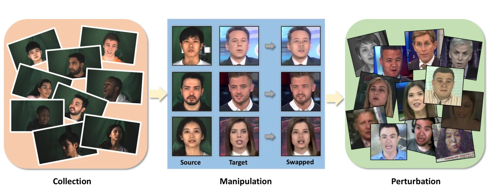
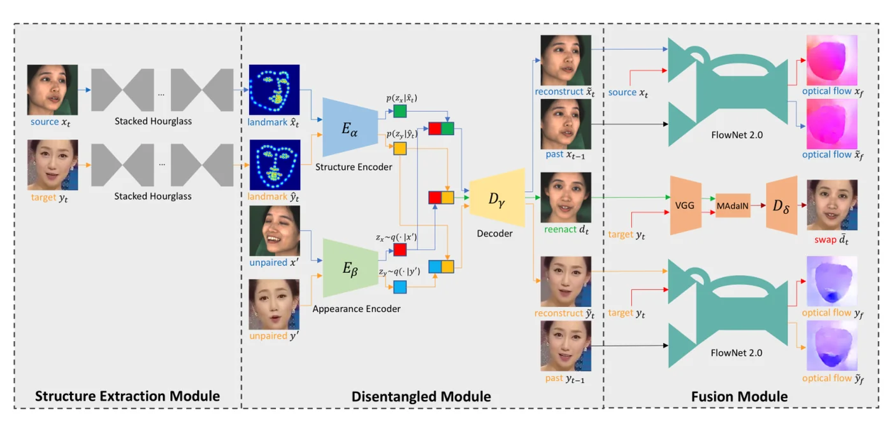
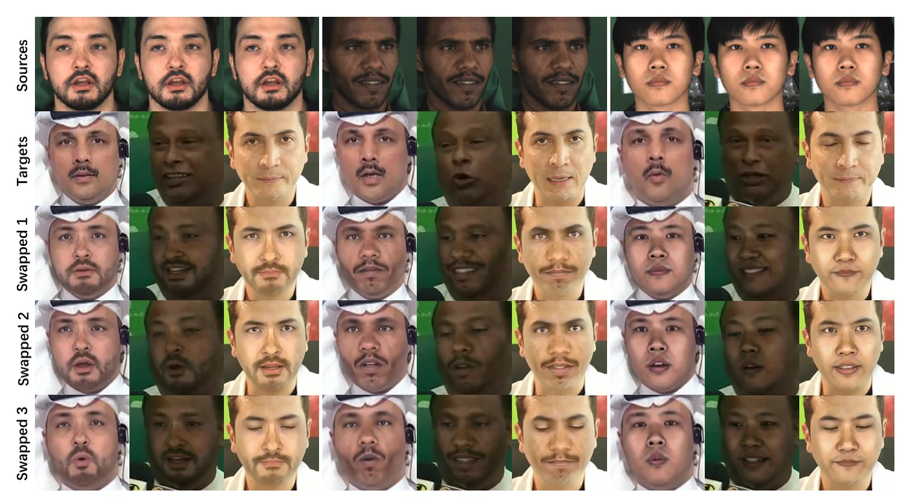

> - **논문**: DeeperForensics-1.0: A Large-Scale Dataset for Real-World Face Forgery Detection
> - **저자**: Liming Jiang, Ren Li, Wayne Wu, Chen Qian, Chen Change Loy (Nanyang Technological University, SenseTime Research)
> - **학회**: CVPR 2020 · [arXiv:2001.03024](https://arxiv.org/abs/2001.03024) · [코드·데이터](https://github.com/EndlessSora/DeeperForensics-1.0) · [프로젝트 페이지](https://liming-jiang.com/projects/DrF1/DrF1.html)
{: .prompt-tip }

> 얼굴 교체가 쉬워지자 탐지가 시급해졌고, FaceForensics++·DFD·DFDC 같은 데이터셋이 나왔습니다. 그런데 이들은 수가 적거나 품질이 낮거나 지나치게 인공적이었고, 학습과 테스트 분포가 비슷해 **실환경**(압축, 블러, 전송 오류가 섞인 영상)에서의 효력이 불분명했습니다. **DeeperForensics-1.0**은 세 기준을 세웁니다. **품질**(실제 분포에 가까운 사실적 영상), **규모**(60,000 영상, 1,760만 프레임, 기존의 10배), **다양성**(실세계 왜곡). 이를 위해 소스 데이터를 직접 촬영하고, 새 교체 방법 DF-VAE를 만들고, 7종 왜곡을 5단계로 섞어 넣었으며, 사람이 속은 영상만 모은 **숨은 테스트 집합**으로 다섯 탐지기를 평가합니다.


_Figure 1. 수집(배우 100명 촬영) → 조작(DF-VAE로 소스 얼굴을 목표 영상에 교체) → 왜곡(실환경 잡음·압축 등 적용)의 세 단계로 데이터셋을 만듭니다. (출처: Jiang et al., 2020)_

## 1. 데이터 수집: 소스가 품질을 정한다

저자들의 핵심 관찰은 **소스 얼굴**(교체되어 들어가는 얼굴)의 다양성이 목표 영상보다 품질에 훨씬 중요하다는 것입니다. 인터넷 영상은 포즈 범위가 좁아 극단 포즈에서 실패합니다(Figure 2). 그래서 26개국 55남 45녀, 20~45세, 네 피부톤을 1:1:1:1로 맞춘 **배우 100명**에게 정식 동의를 받고 실내 스튜디오에서 촬영합니다. 7대 HD 카메라(정면·좌·좌전·우·우전·위·아래), 1920×1080, 8개 기본 표정과 **3DMM 블렌드셰이프 53개**(과장 표정 보충), −90°~+90° 머리 회전, 9개 조명 방향. 결과는 5만 영상, 1,260만 프레임입니다. 배우는 균일 조명에서만 고개를 돌리게 해서, 여러 각도 카메라가 같은 장면을 중복으로 찍는 일을 줄였습니다. 소스는 LAB로 검출·크롭한 얼굴 영역만 쓰므로 배경은 신경 쓰지 않습니다. 초상권 문제가 없는 데이터라는 점도 기존 인터넷 수집 데이터셋과 다릅니다.

## 2. DF-VAE: 확장 가능한 교체 방법

세 요구사항은 일반성·확장성(대량 생성), **스타일 불일치** 해결(Figure 5의 색·조명 불일치), 시간 연속성입니다.


_Figure 6. DF-VAE. 왼쪽 구조 추출 모듈(stacked hourglass로 랜드마크 히트맵), 가운데 분리 모듈(구조 인코더 $$E_\alpha$$, 외형 인코더 $$E_\beta$$, 디코더 $$D_\gamma$$), 오른쪽 융합 모듈(MAdaIN과 FlowNet 2.0 시간 손실). 파란 화살표는 소스, 주황 화살표는 목표의 재구성이고, 초록 화살표가 추론 때의 재연기입니다. (출처: Jiang et al., 2020)_

**구조·외형 분리.** 재연기를 먼저 하고 교체를 그 뒤에 둡니다. 소스 $$x_t$$를 재구성할 때 자기 자신 대신 **같은 신원의 다른 프레임 $$x'$$**(외형 조건)와 **랜드마크 히트맵 $$\hat x_t$$**(구조 조건, 스택 아워글래스로 추출)를 조건으로 주는 조건부 VAE입니다. 구조 인코더 $$E_\alpha$$와 외형 인코더 $$E_\beta$$를 분리하고 잠재를 이어 디코더 $$D_\gamma$$에 넣습니다. 명시적 히트맵, 분리된 인코더, 비쌍 데이터 구성이 함께 $$E_\alpha$$는 구조를, $$E_\beta$$는 외형을 배우도록 강제합니다. 추론 때 목표의 구조 + 소스의 외형을 이으면 **다대다** 재연기가 한 모델로 됩니다(아래 Figure 7, 3×3).

**MAdaIN.** 스타일 불일치를 고치려고 재연기 얼굴 $$d_t$$를 콘텐츠, 목표 $$y_t$$를 스타일로 하는 [AdaIN]()을 **얼굴 마스크**(가우시안 블러한 $$m_t^b$$) 안에서만 적용하고, 같은 마스크로 배경과 합칩니다. 비용이 거의 없는 모듈이지만 논문 Figure 8에서 색 불일치가 사라집니다. 학습은 VGG-19 특징의 콘텐츠 손실과, 마스크 영역 안의 평균·표준편차를 맞추는 스타일 손실(relu1_1~relu4_1)로 합니다.


_Figure 7. 한 모델로 소스 3명 × 목표 3명을 교체한 결과. 맨 위가 소스, 둘째 줄이 목표, 아래 세 줄이 교체 결과입니다. (출처: Jiang et al., 2020)_

**시간 일관성.** 이전 프레임과의 옵티컬 플로(FlowNet 2.0)가 재구성 후에도 같아야 한다는 손실 $$\mathcal{L}_{temporal} = \frac{1}{CHW}\lVert \tilde x_f - x_f \rVert_1$$을 더합니다. 플로로 이전 프레임을 워핑하지 않는 이유는 플로 오차가 얼굴 세부를 망치기 때문입니다. 마르코프 가정으로 직전 $$P = 1$$프레임만 봅니다. 자기 재연기(정답이 있는 설정)에서 시간 손실을 넣으면 픽셀 재렌더링 오차가 줄어듭니다(부록 Figure 10). 다대다 덕에 모델 학습·생성 시간이 일반 DeepFakes의 1/5입니다.

부록의 방법 비교에서 FID와 IS는 다음과 같습니다(Table 7).

| 방법 | FID ↓ | IS ↑ |
|---|---|---|
| DeepFakes | 25.771 | 1.711 |
| faceswap-GAN | 24.718 | 1.685 |
| ReenactGAN | 26.325 | 1.690 |
| **DF-VAE** | **22.097** | **1.714** |

같은 30쌍으로 만든 영상을 100명에게 둘씩 비교하게 한 사용자 연구에서도 DF-VAE가 세 방법 모두를 크게 앞섭니다(쌍마다 3,210개 응답).

**구현 디테일.** 부록에 적힌 설정입니다.

| 항목 | 값 |
|---|---|
| 랜드마크 | 사전학습 stacked hourglass (stack 4, block 1) |
| 옵티컬 플로 | FlowNet 2.0 |
| 스타일 매칭 | 표준 AdaIN 네트워크, VGG-19 relu1_1~relu4_1 동일 가중치 |
| 전체 손실 | $$\lambda_1 L_{recon} + \lambda_2 L_{KL} + \lambda_3 L_{MAdaIN} + \lambda_4 L_{temporal}$$, 재구성은 픽셀 MAE + SSIM 손실 |
| Optimizer | Adam, $$\beta_1 = 0.5, \beta_2 = 0.999$$, lr 0.00005 (모든 부분 공통) |
| 하드웨어 | NVIDIA Tesla V100 |

## 3. 규모와 다양성

FF++의 정제된 YouTube 영상 1,000개를 목표로 100명의 얼굴을 각 10개 영상에 교체해 원본 조작 영상 1,000개를 만들고, IQA에서 정의된 7종 왜곡(채도, 블록 왜곡, 대비, 가우시안 블러, 색 가우시안 잡음, JPEG, 비디오 압축률)을 5강도로, 그리고 한 영상에 **여러 왜곡을 섞어** 적용해 1만 개의 조작 영상(500만 프레임)으로 늘립니다. 구성은 다음과 같습니다.

| 부분 | 영상 수 |
|---|---|
| 왜곡 없는 원본 조작 영상 | 1,000 |
| 무작위 종류 왜곡을 다섯 강도 각각으로 적용 | 5,000 |
| 무작위 종류·무작위 강도 왜곡 | 1,000 |
| 두 가지 이상 왜곡을 섞음 | 3,000 |
| **합계** | **10,000** |

**숨은 테스트 집합**은 400개 영상입니다. 여러 미공개 교체 방법으로 만든 가짜를 모으고(다중 출처), 실환경 왜곡을 여러 번 덧씌운 뒤(다양한 왜곡), 사용자 연구에서 100명 중 50명 이상을 속인 영상만 남깁니다(고품질). 정답 라벨은 공개하지 않고 저자들의 서버에서만 채점합니다.

**데이터셋 품질 사용자 연구.** 컴퓨터 비전 전공자 100명에게 데이터셋마다 30개 클립을 보여 주고 "진짜처럼 보인다"에 1~5점을 매기게 했습니다(4·5점을 "진짜"로 판정, Table 3).

| 데이터셋 | "진짜" 비율 |
|---|---|
| UADFV | 14.1% |
| DeepFake-TIMIT | 12.3% |
| Celeb-DF | 61.0% |
| FaceForensics++ | 8.4% |
| Deep Fake Detection | 21.9% |
| DFDC | 23.0% |
| **DeeperForensics-1.0** | **64.1%** |

## 4. 벤치마크

탐지 베이스라인은 다섯 개입니다. 영상 수준 방법 넷(C3D, TSN, I3D, ResNet+LSTM)과, FF++에서 가장 좋았던 이미지 수준 방법 XceptionNet 하나를 참고용으로 넣었습니다. 표준 집합은 원본 조작 영상 1,000개 + FF++ YouTube 원본 1,000개이고, 신원이 겹치지 않게 70·10·20명으로 나눠 7:1:2로 분할합니다. 이를 표준·단일 왜곡·혼합 왜곡·숨은 집합의 여러 설정에서 평가합니다. 요점은 (1) 깨끗한 데이터로 학습한 탐지기는 왜곡된 테스트에서 크게 떨어지고, (2) 왜곡을 학습에 포함하면 회복되며, (3) 숨은 테스트 집합이 가장 어렵다는 것입니다. 시간 정보가 단일 프레임 품질 외의 중요한 단서라는 점도 확인됩니다.

**학습 데이터별 숨은 집합 정확도(%, Table 4).** 같은 목표 영상을 쓰는 FF++의 네 조작으로 학습한 경우와 DeeperForensics-1.0 표준 집합으로 학습한 경우입니다.

| 탐지기 | FF++ DF | FF++ F2F | FF++ FS | FF++ NT | **DeeperForensics-1.0** |
|---|---|---|---|---|---|
| C3D | 57.50 | 57.75 | 52.13 | 58.25 | 74.75 |
| TSN | 57.63 | 57.25 | 53.50 | 57.38 | 77.00 |
| I3D | 56.63 | 58.38 | 54.63 | 63.63 | **79.25** |
| ResNet+LSTM | 57.38 | 56.13 | 54.88 | 59.50 | 78.25 |
| XceptionNet | 57.38 | 58.75 | 54.75 | 57.38 | 77.00 |

FF++로 학습하면 숨은 집합에서 52~64%에 그치고, DeeperForensics-1.0로 학습하면 75~79%입니다.

**왜곡의 영향(%, Table 5).** std는 왜곡 없음, std/sing은 강도 5의 단일 왜곡, std/rand는 무작위 강도 왜곡입니다.

| 탐지기 | std → std | std → std/sing | std → std/rand | std/sing → std/sing | std/rand → std/rand |
|---|---|---|---|---|---|
| C3D | 98.50 | 87.63 | 92.38 | 95.38 | 96.63 |
| TSN | 99.25 | 91.50 | 95.00 | 98.25 | 98.88 |
| I3D | 100.00 | 90.75 | 96.88 | 99.50 | 99.63 |
| ResNet+LSTM | 100.00 | 90.63 | 97.13 | 100.00 | 98.63 |
| XceptionNet | 100.00 | 88.38 | 94.75 | 99.63 | 99.63 |

같은 분포에서는 거의 100%이지만, 깨끗한 데이터로 학습하고 강한 왜곡으로 테스트하면 88~92%로 떨어집니다. 학습에도 같은 왜곡을 넣으면 회복되지만, 저자들은 이 설정이 학습·테스트 분포가 같아 비현실적이라고 지적합니다.

**학습 집합 변형(숨은 집합 정확도 %, Table 6).** std/mix는 무작위 왜곡 세 개를 섞은 1,000개 영상입니다.

| 탐지기 | std | std + std/sing | std + std/rand | std + std/mix |
|---|---|---|---|---|
| C3D | 74.75 | 78.25 | 78.13 | 78.88 |
| TSN | 77.00 | 78.75 | 79.50 | 79.50 |
| I3D | 79.25 | 80.13 | 80.13 | 80.13 |
| ResNet+LSTM | 78.25 | 80.25 | 79.50 | 80.25 |
| XceptionNet | 77.00 | 79.75 | 79.75 | 79.88 |

왜곡을 섞은 학습 집합을 더하면 모든 탐지기가 약 1~4%p 오르지만, 최고도 80% 남짓이라 숨은 집합은 여전히 어렵습니다.

**베이스라인 설정(부록).** C3D는 16프레임 클립·112×112, TSN은 BN-Inception 백본·RGB만·세그먼트 3개·224×224, I3D는 64프레임 스니펫·224×224, ResNet+LSTM은 ResNet-50 + 512 hidden LSTM·5배 다운샘플·224×224, XceptionNet은 FF++과 같은 모델을 층 고정 없이 299×299로 학습하고 프레임 점수를 평균합니다.

## 5. 코드로 보기: 왜곡은 어떤 단서를 지우는가

16프레임 × 64픽셀의 1차원 "영상"에서 가짜는 공간 고주파 아티팩트와 프레임 간 밝기 깜빡임(시간 불일치)을 가집니다. 고주파 에너지와 깜빡임 두 특징으로 로지스틱 탐지기를 깨끗한 데이터로만, 그리고 블러·잡음·압축을 섞어 학습한 뒤 왜곡 수준별 정확도를 비교합니다.

```python
import numpy as np
rng = np.random.default_rng(0)
# a 'video' = 16 frames x 64 pixels. real: smooth frames, steady brightness. fake: a faint high-frequency blending artefact in every
# frame AND a small frame-to-frame brightness flicker (temporal inconsistency). a detector sees two cues: HF energy and flicker.
T, L = 16, 64; t = np.arange(L)
def video(fake, dist=None, level=0):
    base = np.sin(2 * np.pi * rng.uniform(1, 3) * t / L + rng.uniform(0, 6))
    frames = np.stack([base + 0.02 * rng.standard_normal(L) for _ in range(T)])
    if fake:
        frames += 0.08 * np.sin(2 * np.pi * 20 * t / L)[None]                        # spatial HF artefact
        frames += (0.06 * rng.standard_normal(T))[:, None]                          # per-frame brightness flicker
    if dist == "blur":      k = 1 + 2 * level; frames = np.stack([np.convolve(f, np.ones(k) / k, mode="same") for f in frames])
    if dist == "noise":     frames = frames + 0.04 * level * rng.standard_normal(frames.shape)
    if dist == "compress":  q = 64 >> level; frames = np.round(frames * q) / q
    return frames
def feats(v):
    F = np.abs(np.fft.rfft(v, axis=1)).mean(0); hf = np.log(F[15:28].sum() + 1e-6) - np.log(F[1:8].sum() + 1e-6)
    flicker = np.std(v.mean(1)) * 10
    return np.array([hf, flicker, 1.0])
def train(dists, n=1500):
    X, y = [], []
    for _ in range(n):
        f = rng.random() < 0.5; d = dists[rng.integers(len(dists))]; lv = rng.integers(1, 6) if d else 0
        X.append(feats(video(f, d, lv))); y.append(f)
    X, y = np.array(X), np.array(y, float); w = np.zeros(3)
    for _ in range(3000):                                                            # logistic regression by gradient descent
        p = 1 / (1 + np.exp(-X @ w)); w -= 0.1 * X.T @ (p - y) / len(y)
    return w
def acc(w, dist, level, n=600):
    ys = rng.random(n) < 0.5; return np.mean([((feats(video(f, dist, level)) @ w) > 0) == f for f in ys]) * 100
clean, robust = train([None]), train([None, "blur", "noise", "compress"])
print(f"learned weights [HF cue, flicker cue, bias]: clean-trained {np.round(clean, 2)}, perturbation-trained {np.round(robust, 2)}")
print(f"\n{'distortion':<10} {'level':>5}   clean-trained   perturbation-trained   (accuracy %)")
for d in (None, "blur", "noise", "compress"):
    for lv in ((0,) if d is None else (1, 3, 5)):
        print(f"{str(d):<10} {lv:>5}      {acc(clean, d, lv):5.1f}            {acc(robust, d, lv):5.1f}")
print("-> blur/compression erase the spatial high-frequency cue; the detector trained on perturbed data shifts weight to the temporal cue")
```

```text
learned weights [HF cue, flicker cue, bias]: clean-trained [ 1.53 10.55  0.15], perturbation-trained [ 0.2 10.5 -2.7]

distortion level   clean-trained   perturbation-trained   (accuracy %)
None           0      100.0            100.0
blur           1       99.0             99.8
blur           3       92.5             99.5
blur           5       93.0            100.0
noise          1      100.0            100.0
noise          3       93.2            100.0
noise          5       50.3             90.0
compress       1      100.0             99.8
compress       3      100.0            100.0
compress       5       99.7             98.3
-> blur/compression erase the spatial high-frequency cue; the detector trained on perturbed data shifts weight to the temporal cue
```

- 깨끗한 데이터로 학습한 탐지기는 고주파 단서에 가중치 1.5를 두었다가 강한 잡음(수준 5)에서 50%로 무너집니다. 잡음이 진짜 영상에도 고주파를 더해 단서가 사라지기 때문입니다. 블러 수준 3~5에서도 93%로 떨어집니다.
- 왜곡을 섞어 학습하면 고주파 가중치가 0.2로 줄고 시간 단서(깜빡임)에 의존해 잡음 5에서도 90%를 유지합니다. 벤치마크의 두 메시지, 즉 왜곡 학습의 필요와 시간 단서의 가치가 가장 작은 모델에서 그대로 나옵니다. 물론 실제 탐지기의 단서는 훨씬 복잡하고, 깜빡임도 [FSGANv2]()나 [FSLSD]()처럼 시간 일관성을 다루는 교체기에서는 약해집니다.

## 6. 해석

**1. "데이터셋 논문"이지만 생성 방법도 기여입니다.** DF-VAE의 구조·외형 분리는 [FSGAN]()의 재연기와 비슷하지만 다대다를 한 모델로 하고, MAdaIN은 [AOT]()가 더 정교하게 풀 외형 격차 문제를 가장 싼 방법으로 완화합니다. 이후 [HifiFace]()는 DF-VAE를 "스타일 불일치는 줄였지만 신원 유사도가 약하다"고 평가합니다.

**2. 왜곡 혼합과 숨은 테스트 집합이 평가 관행을 바꿨습니다.** FF++의 압축률 변화 정도였던 강건성 평가를 7종×5강도×혼합으로 넓혔고, "사람이 속은 것만" 모은 테스트는 탐지기가 실제로 상대해야 할 분포에 가깝습니다. 이후 Celeb-DF·DFDC와 함께 교차 데이터셋 일반화가 탐지 연구의 표준 질문이 됩니다.

**3. 동의와 다양성을 설계에 넣었습니다.** 성별·피부톤·국적을 균형 잡고 정식 동의를 받은 소스 데이터는 윤리뿐 아니라 품질(극단 포즈·조명 커버)에도 기여합니다. [Bitouk 등]()이 인터넷에서 무단 수집한 라이브러리와 12년의 거리가 있습니다.

**4. 한계는 목표 영상과 생성 방법의 단일성입니다.** 목표는 FF++의 YouTube 영상 1,000개뿐이고, 학습용 조작은 DF-VAE 하나로만 만들어져 "방법 다양성"은 FF++보다 낮습니다(숨은 테스트 집합만 여러 미공개 방법을 씁니다). 탐지기가 DF-VAE 특유의 아티팩트를 배울 위험이 있고, 저자들도 "진행 중인 노력"이라 부르며 확장을 예고합니다.

**5. 평가를 읽을 때 주의할 점.** 설정이 많아 위 표처럼 학습·테스트 조합을 함께 봐야 합니다. 품질 우위의 근거는 주로 사용자 연구이고, FID·IS는 부록에 방법 비교로만 있습니다. 위 toy의 "가짜 단서"(정현파 아티팩트와 깜빡임)는 손으로 넣은 것이라 실제 교체 아티팩트의 주파수 특성과 다르며, 왜곡 학습이 항상 회복을 보장하지도 않습니다.

## 7. 정리

| 항목 | 내용 |
|---|---|
| 규모 | 60,000 영상, 1,760만 프레임(소스 5만 + 조작 1만), 기존의 10배 |
| 소스 수집 | 동의 배우 100명, 7카메라, 1080p, 8표정 + 53 블렌드셰이프, ±90° 회전, 9조명 |
| DF-VAE | 랜드마크 히트맵(구조) + 같은 신원 다른 프레임(외형) 조건부 VAE, MAdaIN 스타일 매칭, 옵티컬 플로 시간 손실, 다대다 |
| 다양성 | 7종 왜곡 × 5강도 + 혼합, 사용자 평가 기반 숨은 테스트 집합 |
| 벤치마크 | 영상 수준 4종 + XceptionNet, 숨은 집합 400개에서 최고 80% 남짓, 왜곡 학습의 필요와 시간 단서의 가치 확인 |
| 한계 | 목표 영상·조작 방법이 각 하나, 방법 다양성 부족 |

## References

- Jiang, Li, Wu, Qian, Loy, "DeeperForensics-1.0: A Large-Scale Dataset for Real-World Face Forgery Detection," CVPR 2020. [arXiv:2001.03024](https://arxiv.org/abs/2001.03024)
- Rössler et al., "FaceForensics++: Learning to Detect Manipulated Facial Images," ICCV 2019. [arXiv:1901.08971](https://arxiv.org/abs/1901.08971)
- Dolhansky et al., "The DeepFake Detection Challenge (DFDC) Preview Dataset," 2019. [arXiv:1910.08854](https://arxiv.org/abs/1910.08854)
- Li et al., "Celeb-DF: A Large-scale Challenging Dataset for DeepFake Forensics," CVPR 2020. [arXiv:1909.12962](https://arxiv.org/abs/1909.12962)
- Sohn, Lee, Yan, "Learning Structured Output Representation using Deep Conditional Generative Models," NeurIPS 2015.
- Ilg et al., "FlowNet 2.0: Evolution of Optical Flow Estimation with Deep Networks," CVPR 2017. [arXiv:1612.01925](https://arxiv.org/abs/1612.01925)
