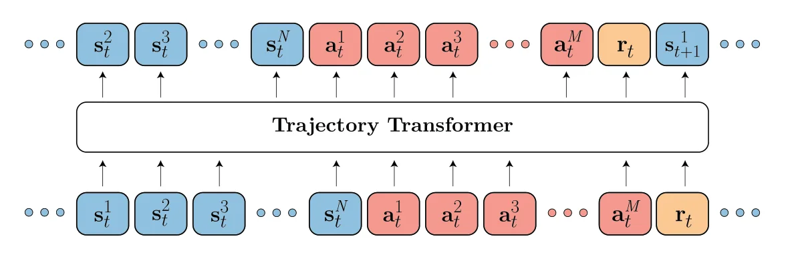
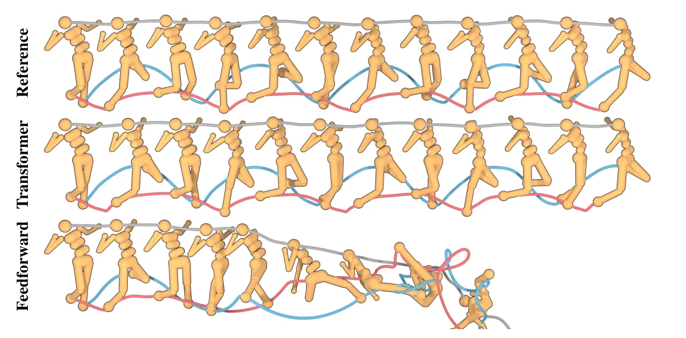
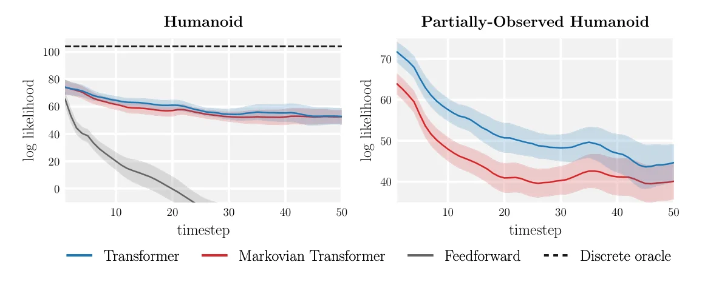

> - **논문**: Offline Reinforcement Learning as One Big Sequence Modeling Problem
> - **저자**: Michael Janner, Qiyang Li, Sergey Levine (UC Berkeley)
> - **학회**: NeurIPS 2021 · [arXiv:2106.02039](https://arxiv.org/abs/2106.02039) · [프로젝트 페이지](https://trajectory-transformer.github.io) · [코드](https://github.com/jannerm/trajectory-transformer)
{: .prompt-tip }

> [EfficientZero]()가 환경 모델을 **잘 학습하는 법**에 집중했다면, **Trajectory Transformer**는 질문을 바꿉니다. "정책, 모델, 가치 함수를 따로 만들 필요 없이, **궤적(trajectory) 전체를 하나의 문장처럼** 생성하면 되지 않을까?" [GPT]()가 다음 단어를 예측하듯, 다음 상태·행동·보상을 예측하는 강화학습입니다.

## 1. 기존 강화학습의 두 가지 기둥

기존 RL은 대부분 두 가정 위에 서 있습니다.

### Factorized Single-Step

현재 상태와 행동에서 **바로 다음 상태와 보상만** 예측합니다.

$$
P(s_{t+1}, r_t \mid s_t, a_t)
$$

이렇게 한 step씩 쪼개서 모델링하고, 이를 이어 붙여 먼 미래를 예측합니다.

### Markov Property

미래는 **현재 상태에만** 의존하고 과거 이력과는 무관하다고 가정합니다.

$$
P(s_{t+1} \mid s_t, a_t, s_{t-1}, a_{t-1}, \dots) = P(s_{t+1} \mid s_t, a_t)
$$

이 덕분에 문제가 단순해지지만, 대가가 있습니다.

### Long-Horizon 문제

체스나 바둑처럼 **당장의 한 수가 아니라 먼 미래의 결과**를 고려해야 하는 문제입니다. 기존 방법은 이를 작은 하위 문제(sub-problem)로 쪼개 가지치기하듯 풉니다. 그런데 single-step 모델을 여러 번 이어 붙이면 **한 step의 작은 오차가 누적(compounding error)**되어, 몇십 step만 지나도 예측이 크게 틀어집니다.

## 2. 아이디어: 궤적을 하나의 문장으로

강화학습의 목표는 결국 "**높은 보상을 얻는 행동 시퀀스를 생성하는 것**"입니다. 이는 언어 모델이 "그럴듯한 문장을 생성하는 것"과 구조가 같습니다.

그렇다면 궤적을 **구조가 없는 하나의 긴 시퀀스**로 보고, LLM에서 검증된 **Transformer**로 그 분포를 모델링하면 됩니다.

| 언어 모델 | Trajectory Transformer |
|---|---|
| 단어 토큰 | 상태·행동·보상의 **이산화된 토큰** |
| 다음 단어 예측 | 다음 상태/행동/보상 토큰 예측 |
| 문장 생성 (beam search) | **계획(planning)** (beam search) |

### 기존의 "Transformer를 쓴 RL"과 다른 점

AlphaStar나 일부 멀티에이전트 알고리즘 등에서도 Transformer를 쓰지만, 이들은 **기존 RL 학습 알고리즘(Q-learning, policy gradient)을 그대로 두고** 신경망 구조만 Transformer로 바꾼 것입니다. Trajectory Transformer는 반대로 **RL 학습 알고리즘을 빼고**, 궤적의 분포를 모델링하는 시퀀스 모델 하나만 남깁니다.

## 3. 궤적을 토큰으로: 이산화

Transformer에 넣으려면 연속적인 상태·행동·보상을 **이산 토큰**으로 바꿔야 합니다. 상태가 $$N$$차원, 행동이 $$M$$차원이라면, 각 시점을 **차원 하나당 토큰 하나**로 펼쳐 이어 붙입니다.

$$
\tau = \big(\dots,\ s_t^1, s_t^2, \dots, s_t^N,\ a_t^1, a_t^2, \dots, a_t^M,\ r_t,\ \dots\big)
$$

한 시점이 $$N + M + 1$$개의 토큰이 되고, 궤적 길이가 $$T$$면 시퀀스 길이는 $$T(N + M + 1)$$입니다. (Offline RL 실험에서는 계획에 쓰기 위해 reward-to-go도 토큰으로 함께 넣습니다.)


_Figure 1. 상태 차원(파랑), 행동 차원(빨강), 보상(주황)을 한 줄의 토큰으로 펼쳐 놓고, 언어 모델처럼 다음 토큰을 예측합니다. 계획도 언어 모델에서 문장을 생성하는 절차를 그대로 따릅니다. (출처: Janner et al., 2021)_

### 차원별로 따로 이산화

상태 벡터 전체를 한 번에 이산화하면 가능한 토큰 수가 차원 수에 대해 지수적으로 늘어납니다. 그래서 **차원마다 독립적으로** $$V$$개(논문은 100개)의 구간으로 나눕니다. 차원 사이의 관계는 Transformer가 앞 차원의 토큰을 보고 다음 차원의 토큰을 예측하면서 학습합니다.

구간을 나누는 방법은 두 가지입니다.

- **Uniform**: 각 차원의 최솟값~최댓값을 **같은 폭**으로 나눔
- **Quantile**: 각 구간에 **같은 개수의 데이터**가 들어가도록 나눔

```python
import numpy as np

def discretize(x, n_bins=100, mode="uniform"):
    """한 차원의 연속값 x를 0 ~ n_bins-1 토큰으로 바꿈"""
    if mode == "uniform":                                    # 같은 폭으로 나누기
        edges = np.linspace(x.min(), x.max(), n_bins + 1)
    else:                                                    # quantile: 같은 개수로 나누기
        edges = np.quantile(x, np.linspace(0, 1, n_bins + 1))
    return np.clip(np.searchsorted(edges, x, side="right") - 1, 0, n_bins - 1)

rng = np.random.default_rng(0)
x = rng.exponential(1.0, 10_000)                             # 꼬리가 긴 차원 (예: 속도)
for mode in ["uniform", "quantile"]:
    counts = np.bincount(discretize(x, mode=mode), minlength=100)
    print(f"{mode:8s} 빈 토큰 {(counts == 0).sum():2d}개, 토큰당 최대 {counts.max()}개, 최소 {counts.min()}개")
```

```text
uniform  빈 토큰 15개, 토큰당 최대 792개, 최소 0개
quantile 빈 토큰  0개, 토큰당 최대 100개, 최소 100개
```

(NumPy 2.5에서 실행)

지수 분포처럼 꼬리가 긴 차원을 uniform으로 나누면, 드문 큰 값 때문에 범위가 넓어져 **100개 중 15개 토큰에는 데이터가 하나도 없고**, 값이 몰린 앞쪽 구간은 토큰 하나에 792개가 들어가 해상도가 떨어집니다. Quantile은 모든 토큰이 정확히 같은 양의 데이터를 갖습니다.

### 학습

GPT와 같은 **decoder-only Transformer**를 쓰고, 이전 토큰들이 주어졌을 때 다음 토큰의 log-likelihood를 최대화합니다(teacher forcing).

$$
\mathcal{L}(\tau) = \sum_{t=1}^{T}\Big[\sum_{i=1}^{N}\log P_\theta(s_t^i \mid s_t^{<i}, \tau_{<t}) + \sum_{j=1}^{M}\log P_\theta(a_t^j \mid a_t^{<j}, s_t, \tau_{<t}) + \log P_\theta(r_t \mid a_t, s_t, \tau_{<t})\Big]
$$

강화학습 문제가 **순수한 지도학습** 문제로 바뀐 것입니다. 모델 자체는 언어 모델보다 훨씬 작은 4층, attention head 4개짜리 GPT입니다(구체적인 설정은 5장).

## 4. Planning = Beam Search

학습된 모델로 행동을 고르는 방법은 LLM의 **디코딩**과 같습니다. 논문은 한 step씩 가치를 계산하는 대신, 시퀀스 모델 위에서 **Beam Search**로 여러 step 앞을 한꺼번에 탐색합니다.

Beam search는 매 단계 가능한 확장 후보를 만들고, **점수가 가장 높은 $$B$$개(beam width)**만 남기며 진행합니다.

1. 빔 $$Y_0$$를 빈 시퀀스로 초기화
2. $$t = 1, \dots, T$$ 동안
   - 후보 집합 $$C_t$$ = 이전 빔 $$Y_{t-1}$$의 각 시퀀스에 가능한 모든 토큰 하나를 붙인 것
   - $$Y_t$$ = $$C_t$$ 중 점수가 높은 $$B$$개
3. 마지막 빔에서 점수가 가장 높은 시퀀스 반환

```python
def beam_search(model, prefix, horizon, beam_width, score_fn):
    beams = [(prefix, 0.0)]
    for _ in range(horizon):
        candidates = []
        for seq, score in beams:
            probs = model.next_token_probs(seq)                # (V,)
            for tok, p in enumerate(probs):
                candidates.append((seq + [tok], score + score_fn(seq, tok, p)))
        beams = sorted(candidates, key=lambda c: c[1], reverse=True)[:beam_width]
    return beams[0][0]
```

점수 함수만 바꾸면 여러 문제를 같은 모델로 풉니다.

| 목적 | 점수 | 의미 |
|---|---|---|
| **Imitation learning** | 토큰의 log-likelihood | 데이터에서 가장 그럴듯한 행동 (행동 복제) |
| **Goal-reaching** | log-likelihood, 단 **목표 상태를 시퀀스 맨 앞에** 넣음 | 목표에 도달하는 궤적 |
| **Offline RL** | 예측한 **누적 보상 + reward-to-go** | 보상을 최대화하는 궤적 |

Offline RL에서는 log-likelihood 대신 예측한 누적 보상에 마지막 시점의 reward-to-go $$R_t = \sum_{t'=t}^{T}\gamma^{t'-t} r_{t'}$$를 더한 값으로 점수를 매깁니다. 보상만 보면 눈앞의 보상만 좇는 근시안적인 계획이 나오기 쉬워서, 그 뒤의 가치를 reward-to-go로 대신 채우는 것입니다. 이 reward-to-go는 데이터를 모은 **behavior policy의 Monte Carlo 가치 추정**일 뿐이라 정확한 Q값은 아니지만, beam search의 휴리스틱으로 쓰기에는 충분하다는 것이 논문의 주장입니다. 보상이 거의 없는 AntMaze 같은 과제에서는 이 추정이 너무 정보가 없어서, IQL로 학습한 Q-function으로 바꿔 끼운 **TT (+Q)**를 따로 실험합니다(6장).

구현상으로는 보상과 reward-to-go가 $$N + M + 1$$ 토큰마다 한 번만 나오므로, 중간 토큰들은 likelihood 기준으로 샘플링해 transition $$(s_t, a_t, r_t, R_t)$$ 단위 후보를 만들고, 그 transition들을 누적 보상 + reward-to-go로 걸러 냅니다. 행동은 상태와 함께 모델이 생성하므로, 데이터에 없는 엉뚱한 행동을 모델에 넣어 보는 일(model exploitation)이 줄어든다는 장점도 있습니다.

## 5. 구현 디테일

논문 본문과 Appendix A, E에 나온 설정입니다.

| 항목 | 값 |
|---|---|
| 모델 | GPT 구조 Transformer decoder, 4층, self-attention head 4개, 토큰 임베딩 128차원, dropout 0.1 |
| 어휘 | 차원당 $$V = 100$$개 구간. 입력 어휘는 $$V \times (N + M + 2)$$(상태·행동·보상·reward-to-go), 출력 logit은 $$V$$개 |
| Optimizer | Adam, lr $$2.5 \times 10^{-4}$$ (2000 update 동안 0에서 선형 warmup), batch 256 |
| 학습 | 80 epoch, V100 1장으로 모델당 약 6~12시간 (데이터셋 크기에 따라) |
| Beam width | 256 |
| Planning horizon | 15 transition |
| Context | 입력 transition $$(s_t, a_t, r_t, R_t)$$ 5개 |
| 샘플링 | 행동은 상위 20개 토큰에서 샘플링($$k_{act} = 20$$), 관측은 greedy($$k_{obs} = 1$$) |
| 기반 코드 | NumPy, PyTorch, minGPT |

논문은 환경에 따라 beam width와 horizon을 줄여도 성능이 거의 그대로라서, 계획 속도를 높일 수 있다고 덧붙입니다.

## 6. 실험

### 장기 예측 정확도

Humanoid 환경에서 100 step 길이의 궤적을 생성해 실제 움직임(reference)과 비교했습니다.

- 비교 대상 **PETS**(Probabilistic Ensembles with Trajectory Sampling)는 single-step만 예측하는 Markovian 앙상블 모델입니다. 저자들이 앙상블 수, 층 수, 층 크기를 조정해 봤지만 **수십 step을 넘겨 정확하게 예측하는 모델은 만들지 못했습니다.**
- Trajectory Transformer는 **100 step을 예측한 뒤에도** reference와 눈으로 구분되지 않는 궤적을 생성했습니다.


_Figure 2. 같은 정책의 데이터로 학습한 두 모델이 생성한 100 step 궤적. 위부터 실제 궤적(Reference), Trajectory Transformer, PETS의 feedforward Gaussian 모델. feedforward 모델은 오차가 쌓여 중간부터 물리적으로 불가능한 자세가 됩니다. (출처: Janner et al., 2021)_

누적 오차를 정량적으로 보기 위해 고정된 시작점에서 각 모델로 궤적 1000개를 샘플링해 시점별 상태 분포를 추정하고, 별도로 남겨 둔 reference 궤적 상태의 log-likelihood를 계산했습니다. 이산화된 모델은 각 구간을 균등분포로 보고 likelihood를 계산합니다. 아래 Figure 3 왼쪽처럼 feedforward 모델은 시점이 지날수록 likelihood가 빠르게 떨어지지만, Transformer는 50 step까지 거의 평평하게 유지됩니다.


_Figure 3. 예측 시점별 reference 상태의 log-likelihood. 왼쪽은 Humanoid, 오른쪽은 상태 차원을 50% 확률로 가린 부분 관측 Humanoid. 점선(Discrete oracle)은 이산화 해상도에서 얻을 수 있는 최대 likelihood입니다. (출처: Janner et al., 2021)_

흥미로운 점은 **직전 1 step만 보도록 제한한 Markovian Transformer**도 비슷하게 좋았다는 것입니다. 즉 긴 문맥보다 **Transformer 구조와 차원별 autoregressive 이산화**에서 오는 표현력이 장기 정확도에 큰 역할을 했습니다. 다만 상태의 각 차원을 50% 확률로 가린 **부분 관측** 환경에서는 원래의 긴 문맥 버전이 더 좋아, 긴 조건부(long-horizon conditioning)의 역할도 확인됐습니다.

### Attention 패턴

학습된 attention에서 두 가지 패턴이 보였습니다.

1. **직전 transition에 집중**: Markovian 전략을 스스로 학습
2. **상태는 같은 차원에, 행동은 과거 행동에 집중**: 상태 차원은 여러 과거 시점의 같은 차원을 주로 보고(줄무늬 모양), 행동은 과거 상태보다 과거 행동을 더 봅니다. 행동이 과거 상태에만 의존하는 behavior cloning과 반대이고, 일부 궤적 최적화 알고리즘의 **action filtering**과 닮은 패턴

### Offline RL (D4RL)

D4RL 벤치마크의 MuJoCo 3개 환경, 3가지 데이터셋에서 비교했습니다.

| 데이터셋 | 구성 |
|---|---|
| medium | 중간 성능 정책이 만든 데이터 |
| med-expert | medium + 최고 성능 정책 데이터 혼합 |
| mixed (medium-replay) | medium 정책을 학습할 때 쌓인 replay buffer |

| 비교 대상 | 분류 |
|---|---|
| CQL (Conservative Q-Learning), BRAC | Model-free SOTA |
| MBOP | Single-step dynamics 기반 planning |
| Decision Transformer | Return-conditioning 시퀀스 모델 |
| BC | Behavior cloning |

D4RL locomotion(v2) 정규화 return입니다(Table 1). TT 값은 Transformer 5개 × 궤적 3개 = 15 seed의 평균 ± 표준오차입니다.

| 데이터셋 | 환경 | BC | MBOP | BRAC | CQL | DT | TT (uniform) | TT (quantile) |
|---|---|---|---|---|---|---|---|---|
| Med-Expert | HalfCheetah | 59.9 | 105.9 | 41.9 | 91.6 | 86.8 | 40.8 | 95.0 |
| Med-Expert | Hopper | 79.6 | 55.1 | 0.9 | 105.4 | 107.6 | 106.0 | **110.0** |
| Med-Expert | Walker2d | 36.6 | 70.2 | 81.6 | 108.8 | 108.1 | 91.0 | 101.9 |
| Medium | HalfCheetah | 43.1 | 44.6 | 46.3 | 44.0 | 42.6 | 44.0 | **46.9** |
| Medium | Hopper | 63.9 | 48.8 | 31.3 | 58.5 | 67.6 | 67.4 | 61.1 |
| Medium | Walker2d | 77.3 | 41.0 | 81.1 | 72.5 | 74.0 | **81.3** | 79.0 |
| Med-Replay | HalfCheetah | 4.3 | 42.3 | 47.7 | 45.5 | 36.6 | 44.1 | 41.9 |
| Med-Replay | Hopper | 27.6 | 12.4 | 0.6 | 95.0 | 82.7 | **99.4** | 91.5 |
| Med-Replay | Walker2d | 36.9 | 9.7 | 0.9 | 77.2 | 66.6 | 79.4 | **82.6** |
| **평균** | | 47.7 | 47.8 | 36.9 | 77.6 | 74.7 | 72.6 | **78.9** |

평균으로 보면 TT (quantile) 78.9가 CQL 77.6, DT 74.7과 **비슷하거나 약간 높은** 수준입니다. 모든 데이터셋에서 이기는 것은 아니고, 예를 들어 HalfCheetah med-expert는 MBOP(105.9)가, Walker2d med-expert는 CQL(108.8)이 더 높습니다. HalfCheetah med-expert에서는 expert 데이터의 속도 범위가 매우 넓어 **uniform 이산화가 세밀하지 못해** 40.8에 그쳤고, quantile 이산화는 그 두 배가 넘는 95.0을 냈습니다.

### Q-function과 결합 (AntMaze)

목표에 도달할 때만 보상이 나오는 AntMaze(v0)에서는 reward-to-go 추정이 거의 다 0이라 계획의 길잡이가 되지 못합니다. 이때 IQL로 학습한 Q-function을 가치 추정 대신 쓰면(TT (+Q)) 결과가 크게 달라집니다(Table 2, 기준선 수치는 IQL 논문에서 가져옴).

| 데이터셋 | BC | CQL | IQL | DT | TT (+Q) |
|---|---|---|---|---|---|
| Umaze | 54.6 | 74.0 | 87.5 | 59.2 | **100.0** |
| Medium-Play | 0.0 | 61.2 | 71.2 | 0.0 | **93.3** |
| Medium-Diverse | 0.0 | 53.7 | 70.0 | 0.0 | **100.0** |
| Large-Play | 0.0 | 15.8 | 39.6 | 0.0 | **66.7** |
| Large-Diverse | 0.0 | 14.9 | 47.5 | 0.0 | **60.0** |
| **평균** | 10.9 | 44.9 | 63.2 | 11.8 | **84.0** |

- Q-function을 빌려 온 IQL 자체(63.2)보다도 높습니다. 같은 Q-function이라도 정책을 뽑는 데 쓰는 것보다 **탐색의 휴리스틱으로 쓰는 편이 Q의 오차에 덜 민감하다**는 해석입니다.
- DT는 Medium·Large 미로에서 모두 0입니다. AntMaze 데이터에는 목표까지 가는 완전한 시연이 거의 없어서, 여러 조각 궤적을 이어 붙여야(stitching) 하는데 return-conditioning만으로는 이것이 어렵기 때문입니다.

### Imitation과 Goal-Reaching

Expert 데이터로 학습하고 likelihood를 최대화하는 beam search를 receding-horizon 제어기로 쓰면, Hopper와 Walker2d에서 정규화 return **104%, 109%**가 나왔습니다(15회 평균). 피드포워드 behavior cloning도 expert를 따라 할 수 있으므로 놀라운 결과는 아니지만, 언어 모델의 디코딩 알고리즘이 그대로 제어에 쓰인다는 것을 보여 줍니다.

연속 버전 Four Rooms 환경에서는 목표 상태를 시퀀스 맨 앞에 넣은 likelihood-maximizing planning만으로, **보상 설계(reward shaping)나 보상 정보 없이** 목표까지 계획하는 데 성공했습니다. Appendix F에서는 매 에피소드 지도가 바뀌는 MiniGrid-MultiRoom에서 처음 보는 지도의 목표 94%에 도달했습니다.

## 7. 의의와 한계

**의의**

- 정책, 모델, 가치 함수를 **하나의 시퀀스 모델로 통합**하고 beam search만으로 기존 offline RL 최고 수준과 비슷한 성능(D4RL 평균 78.9 vs CQL 77.6). IQL의 Q-function과 결합하면 AntMaze 평균 84.0으로 비교 대상 중 최고
- 연속 데이터를 이산화해 쓰는 것이 기존 연속 dynamics 모델보다 효과적
- 적절한 모델을 고르면 **RL을 지도학습으로 재구성**할 수 있음을 보여 줌

**한계**

- Single-step 모델보다 **느리고 자원 소모가 큼**. 차원마다 토큰을 생성하고 beam search까지 하므로, context가 길어지면 행동 하나를 고르는 데 **수 초**가 걸립니다. 실시간 제어나 온라인 RL 실험에는 부담
- 이산화 해상도에 성능이 좌우됨. 연속값을 구간으로 나누는 순간 예측 정밀도에 상한이 생깁니다
- 보상이 희소한 과제에서는 reward-to-go만으로 부족해 결국 dynamic programming(Q-function)의 도움이 필요

### Decision Transformer와의 비교

같은 시기에 나온 [**Decision Transformer**]()(Chen et al., 2021)도 RL을 시퀀스 모델링으로 풀지만, 방향이 다릅니다.

| | Trajectory Transformer | Decision Transformer |
|---|---|---|
| 토큰 단위 | 상태·행동의 **차원별** 이산 토큰 | 상태·행동·return을 **벡터 그대로** 임베딩 |
| 예측 대상 | 상태, 행동, 보상 모두 (환경 모델 역할) | **행동만** |
| 행동 선택 | **Beam search로 계획** | 원하는 return을 조건으로 주고 바로 출력 |
| 성격 | Model-based planning에 가까움 | Return-conditioned 정책에 가까움 |

이 "시퀀스 모델로 계획하기" 아이디어는 이후 **Diffusion 모델로 궤적 전체를 생성**하는 [Diffuser]() 계열 연구로 이어집니다.

## References

- Janner, Li & Levine, "Offline Reinforcement Learning as One Big Sequence Modeling Problem," NeurIPS 2021. [arXiv:2106.02039](https://arxiv.org/abs/2106.02039)
- Chen et al., "Decision Transformer: Reinforcement Learning via Sequence Modeling," NeurIPS 2021.
- Chua et al., "Deep Reinforcement Learning in a Handful of Trials using Probabilistic Dynamics Models (PETS)," NeurIPS 2018.
- Kumar et al., "Conservative Q-Learning for Offline Reinforcement Learning," NeurIPS 2020.
- Yu et al., "MOPO: Model-based Offline Policy Optimization," NeurIPS 2020.
- Fu et al., "D4RL: Datasets for Deep Data-Driven Reinforcement Learning," 2020.
- Kostrikov et al., "Offline Reinforcement Learning with Implicit Q-Learning (IQL)," 2021. [arXiv:2110.06169](https://arxiv.org/abs/2110.06169)
