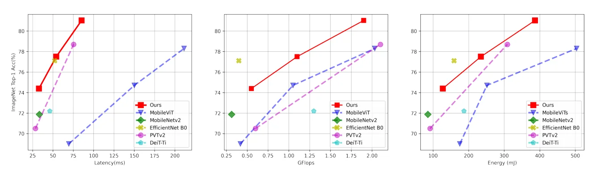
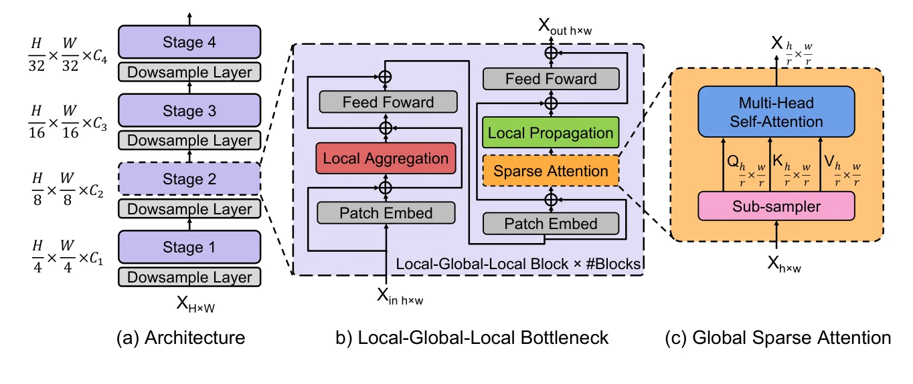
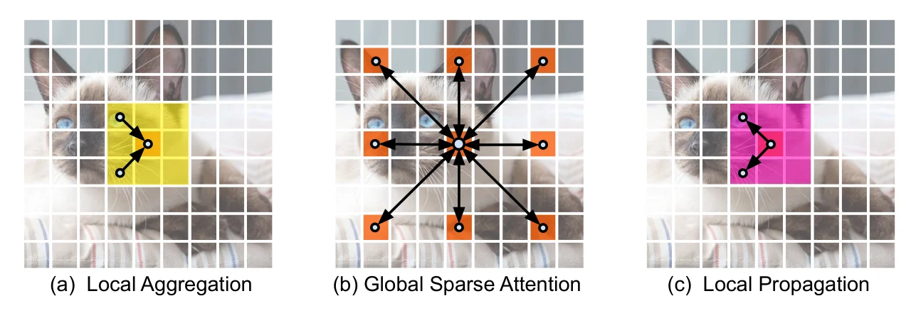

> - **논문**: EdgeViTs: Competing Light-weight CNNs on Mobile Devices with Vision Transformers
> - **저자**: Junting Pan, Adrian Bulat, Fuwen Tan, Xiatian Zhu, Lukasz Dudziak, Hongsheng Li, Georgios Tzimiropoulos, Brais Martinez (CUHK, Samsung AI Cambridge, Queen Mary University of London)
> - **학회**: ECCV 2022 · [arXiv:2205.03436](https://arxiv.org/abs/2205.03436) · [코드](https://github.com/saic-fi/edgevit)
{: .prompt-tip }

> [경량 ViT 동향]()에서 보았듯 ViT는 토큰 수의 제곱에 비례하는 attention과 큰 파라미터 때문에 모바일에서 CNN에 밀렸습니다. **EdgeViTs**는 두 가지를 합니다. 모든 토큰이 모든 토큰을 보는 대신 **대표 토큰만 전역 attention에 참여**시키는 Local-Global-Local(LGL) 병목을 설계하고, FLOPs가 아니라 **Samsung Galaxy S21의 지연과 Snapdragon 888의 에너지**로 모델을 평가합니다. EdgeViT-XXS는 4.1M 파라미터, 0.6 GFLOPs로 74.4%, EdgeViT-S는 11.1M, 1.9 GFLOPs로 81.0%를 냅니다.

## 1. 문제: FLOPs는 기기 효율을 대변하지 않는다

논문의 첫 번째 주장은 평가 방법에 관한 것입니다. 파라미터 수나 FLOPs가 같아도 연산자의 종류, 메모리 접근, 병렬화 정도에 따라 **같은 기기에서 속도와 에너지가 다릅니다**. 예컨대 가장 가벼운 EdgeViT-XXS는 EfficientNet-B0보다 FLOPs가 많지만 폰에서는 더 빠릅니다(32.8ms 대 52.1ms). 모바일 모델은 배터리에 묶여 있으므로 지연만큼 에너지도 중요한데, 기존 ViT 논문은 거의 측정하지 않았습니다.


_Figure 1. ImageNet-1K 정확도를 지연(왼쪽), GFLOPs(가운데), 에너지(오른쪽)에 대해 그린 그래프. 빨간 선이 EdgeViT입니다. FLOPs 축(가운데)에서는 EfficientNet-B0와 MobileNetV2가 앞서 보이지만, 지연·에너지 축에서는 EdgeViT가 왼쪽 위 경계에 붙습니다. (출처: Pan et al., 2022)_

두 번째 주장은 구조에 관한 것입니다. 전역 self-attention은 토큰 수 $$N$$에 대해 $$O(N^2)$$이고, 초기 단계처럼 해상도가 높은 곳에서 특히 비쌉니다. 지역 윈도우 attention(Swin)이나 토큰 피라미드(PVT)는 비용을 줄이지만, 전역 정보 교환이 제한되거나 여전히 모바일에는 무겁습니다.

## 2. 방법: Local-Global-Local 병목

LGL 병목은 세 연산을 순서대로 적용합니다. 핵심 직관은 "이웃한 토큰은 비슷하므로, **$$r \times r$$ 윈도우마다 대표 하나만** 전역 attention에 보내고, 결과를 이웃에 퍼뜨리면 된다"입니다.


_Figure 2. (a) 해상도를 1/4, 1/8, 1/16, 1/32로 줄이는 4단계 피라미드, (b) 한 단계를 이루는 LGL 블록, (c) sub-sampler로 대표 토큰만 뽑아 MHSA를 하는 global sparse attention. (출처: Pan et al., 2022)_

$$
\begin{aligned}
X &= \text{LocalAgg}(\text{Norm}(X_{in})) + X_{in} \\
Y &= \text{FFN}(\text{Norm}(X)) + X \\
Z &= \text{LocalProp}(\text{GlobalSparseAttn}(\text{Norm}(Y_{\text{delegates}}))) + Y \\
X_{out} &= \text{FFN}(\text{Norm}(Z)) + Z
\end{aligned}
$$

- **Local aggregation.** 각 토큰이 $$k \times k$$ 이웃의 정보를 depthwise conv와 pointwise conv로 모읍니다. 지역 attention을 conv로 대체한 것으로, ablation에서 Twins식 지역 attention(LSA)보다 정확도가 높았습니다.
- **Global sparse attention.** 공간에서 stride $$r$$로 **대표 토큰**을 균일하게 뽑아 그들끼리만 self-attention을 합니다. 토큰 수가 $$N / r^2$$로 줄어 attention 비용이 $$1/r^4$$이 됩니다. 대표 선택은 max, avg, center 중 center가 약간 빠르고 정확도는 비슷합니다.
- **Local propagation.** 대표 토큰이 받은 전역 정보를 **transposed depthwise conv**($$r \times r$$, stride $$r$$)로 윈도우 안의 이웃에게 되돌려 줍니다. bilinear 보간보다 낫고, 이 단계를 빼면 정확도가 떨어집니다.


_Figure 3. 가운데 주황 토큰 기준으로 본 정보 교환. (a) 노란 영역의 이웃 정보를 모으고, (b) 다른 대표 토큰(주황)들과 전역 attention을 한 뒤, (c) 얻은 전역 정보를 분홍 영역의 이웃에게 퍼뜨립니다. 세 단계를 거치면 같은 feature map의 어떤 두 토큰 사이에도 정보가 오갈 수 있습니다. (출처: Pan et al., 2022)_

전체 복잡도는 $$O(N^2 / r^4 \cdot C + N \cdot (k^2 + r^2) \cdot C)$$ 수준이라, $$r$$이 크면 attention 항이 사라지고 conv 항만 남습니다. 네 단계의 $$r$$은 **4, 2, 2, 1**입니다. 해상도가 큰 초기 단계에서 공격적으로 줄이고, 7×7 마지막 단계는 전역 attention을 그대로 씁니다.

세 모델(XXS, XS, S)은 단계별 채널과 블록 수를 달리하며, 모두 ImageNet-1K에서 300 epoch, 지식 증류 없이 학습합니다(Table 1).

| 모델 | 단계별 채널 | 단계별 LGL 블록 수 | 단계별 head 수 | FLOPs | Params |
|---|---|---|---|---|---|
| EdgeViT-XXS | 36, 72, 144, 288 | 1, 1, 3, 2 | 1, 2, 4, 8 | 0.56G | 4.1M |
| EdgeViT-XS | 48, 96, 240, 384 | 1, 1, 2, 2 | 1, 2, 4, 8 | 1.1G | 6.7M |
| EdgeViT-S | 48, 96, 240, 384 | 1, 2, 3, 2 | 1, 2, 4, 8 | 1.9G | 11.1M |

### 구현 디테일

| 항목 | 값 |
|---|---|
| 다운샘플링 | 1단계는 4×4 conv(stride 4), 나머지는 2×2 conv(stride 2) |
| 위치 인코딩 | conditional positional encoding (3×3 depthwise conv + residual), local aggregation과 sparse attention 앞에 둠 |
| FFN | linear 2층, 사이에 GELU |
| Local propagation | depthwise separable transposed conv, kernel = stride = $$r$$ |
| ImageNet 학습 | DeiT 레시피. AdamW, batch 1024, lr 1e-3, weight decay 0.05, 300 epoch(warmup 5 epoch 후 cosine), 224×224 random crop, mixup, random erasing, label smoothing |
| 지연 측정 | Galaxy S21(Snapdragon 888) CPU, FP32, batch 1, TorchScript lite interpreter로 forward 50회 |
| 에너지 측정 | Snapdragon 888 HDK(HDK8350)에 Monsoon 전력계 연결, 배경 전력을 뺀 뒤 50회 추론 구간을 적분 |
| COCO | RetinaNet / Mask R-CNN 1× (12 epoch), AdamW lr 1e-4, batch 16, 짧은 변 800 |
| ADE20K | Semantic FPN, 80K iteration, AdamW lr 1e-4, batch 16, 512×512 crop |

NPU 같은 전용 하드웨어를 쓰지 않은 이유는, 그쪽은 실행 가능한 연산 제약이 많아 비교 대상 모델 상당수가 돌아가지 않았기 때문이라고 밝힙니다. 모든 모델을 같은 조건에서 돌릴 수 있는 유일한 조합이 CPU·FP32·batch 1이었습니다.

## 3. 코드로 보기: LGL 블록의 연산량

56×56 토큰에 $$r = 4$$인 LGL 블록이 입력 모양을 보존하는지 확인하고, 단계별로 MHSA 대비 attention 관련 FLOPs가 얼마나 줄어드는지 셉니다.

```python
import torch, torch.nn as nn

def mhsa_flops(N, C):
    # q/k/v/out projections + QK^T + AV
    return 4 * N * C * C + 2 * N * N * C

def lgl_flops(N, C, r, k=3):
    M = N // (r * r)                      # delegate tokens
    local_agg = N * C * k * k             # depthwise k x k conv
    sparse_attn = 4 * M * C * C + 2 * M * M * C
    local_prop = N * C * r * r            # transposed depthwise r x r conv
    return local_agg + sparse_attn + local_prop

class LGL(nn.Module):
    def __init__(self, C, r, heads=4):
        super().__init__()
        self.r = r
        self.agg = nn.Conv2d(C, C, 3, padding=1, groups=C)             # local aggregation
        self.attn = nn.MultiheadAttention(C, heads, batch_first=True)  # global sparse attention
        self.prop = nn.ConvTranspose2d(C, C, r, stride=r, groups=C)    # local propagation
    def forward(self, x):
        B, C, H, W = x.shape
        y = self.agg(x)
        d = y[:, :, ::self.r, ::self.r]                   # one delegate per r x r window
        h, w = d.shape[-2:]
        t = d.flatten(2).transpose(1, 2)                  # B x M x C
        t, _ = self.attn(t, t, t)
        d = t.transpose(1, 2).reshape(B, C, h, w)
        return x + self.prop(d)                           # diffuse back to all tokens

torch.manual_seed(0)
x = torch.randn(1, 48, 56, 56)
blk = LGL(48, r=4)
print("input", tuple(x.shape), "-> delegates", 56 // 4, "x", 56 // 4, "-> output", tuple(blk(x).shape))
print()
print("stage  tokens  C    r   MHSA MFLOPs  LGL MFLOPs  ratio")
for stage, (res, C, r) in enumerate([(56, 48, 4), (28, 96, 2), (14, 240, 2), (7, 384, 1)], 1):
    N = res * res
    a, b = mhsa_flops(N, C), lgl_flops(N, C, r)
    print(f"{stage:>5}  {N:>6}  {C:>3}  {r:>2}  {a/1e6:>11.1f}  {b/1e6:>10.1f}  {b/a:>5.2f}")
```

```text
input (1, 48, 56, 56) -> delegates 14 x 14 -> output (1, 48, 56, 56)

stage  tokens  C    r   MHSA MFLOPs  LGL MFLOPs  ratio
    1    3136   48   4        973.0         9.3   0.01
    2     784   96   2        146.9        15.6   0.11
    3     196  240   2         63.6        13.1   0.21
    4      49  384   1         30.7        30.9   1.01
```

- 1단계(3136 토큰, $$r = 4$$)에서 전역 MHSA는 973M FLOPs인데 LGL은 9M으로 **1% 수준**입니다. 대표 토큰이 196개뿐이라 $$N^2$$ 항이 사라지고 depthwise conv 비용만 남습니다.
- 단계가 깊어질수록 토큰은 줄고 채널은 늘어 projection 항($$4NC^2$$)이 지배적이 되고, $$r = 1$$인 4단계에서는 LGL이 MHSA와 같아집니다. LGL이 겨냥한 것은 **고해상도 초기 단계의 $$N^2$$ 항**입니다.

## 4. 실험

**ImageNet-1K.** 약 2 GFLOPs 이하 모델들과 비교합니다. 지연은 Galaxy S21 CPU에서 224×224 입력(MobileViT만 원 구현대로 256×256), 50회 평균입니다. 에너지는 추론 1회당 mJ입니다(Table 2, 3에서 발췌).

| 모델 | Params | GFLOPs | 지연(ms) | 에너지(mJ) | Top-1 |
|---|---|---|---|---|---|
| MobileNetV2 | 3.4M | 0.3 | 33.3 | 85.7 | 72.0 |
| MobileNetV3 0.75 | 4.0M | 0.16 | 23.0 | 63.0 | 73.3 |
| EfficientNet-B0 | 5.3M | 0.4 | 52.1 | 159.0 | 77.1 |
| PVTv2-B0 | 3.4M | 0.6 | 26.0 | 91.7 | 70.5 |
| Twins-SVT-Tiny(축소) | 4.1M | 0.6 | 36.9 | 114.5 | 71.2 |
| MobileViT-XXS | 1.3M | 0.4 | 69.5 | 175.3 | 69.0 |
| **EdgeViT-XXS** | 4.1M | 0.6 | 32.8 | 127.4 | **74.4** |
| MobileViT-XS | 2.4M | 1.1 | 150.1 | 251.5 | 74.7 |
| DeiT-Tiny | 5.7M | 1.3 | 46.2 | 187.2 | 72.2 |
| **EdgeViT-XS** | 6.7M | 1.1 | 54.1 | 234.6 | **77.5** |
| PVTv2-B1 | 14M | 2.1 | 75.4 | 309.0 | 78.7 |
| MobileViT-S | 5.6M | 2.0 | 221.3 | 503.6 | 78.3 |
| LeViT-384(재학습) | 39.1M | 2.4 | 71.3 | 455.2 | 79.5 |
| **EdgeViT-S** | 11.1M | 1.9 | 85.3 | 386.7 | **81.0** |

ViT끼리 비교하면 비슷한 FLOPs의 PVTv2보다 2.3~3.9%, MobileViT보다 2.7~5.4% 높습니다. MobileViT는 FLOPs가 비슷한데도 폰에서 EdgeViT보다 2~2.7배 느린 것이 눈에 띕니다. CNN과 비교하면 EdgeViT-XXS가 MobileNetV2보다 2.4% 높으면서 약간 빠르고, [MobileNetV3]()보다는 1.1% 높지만 9.8ms 느립니다. 정확도-FLOPs 축에서는 아직 경량 CNN이 조금 앞섭니다.

**에너지.** 추론당 에너지(mJ)와 "1mJ당 정확도 이득"을 정의해 비교하면, 덜 정확한 모델일수록 효율이 높아 보이는 편향이 있어 Pareto 최적 모델만 가립니다. EdgeViT 세 모델은 지연과 에너지 양쪽에서 Pareto 최적이고, ViT 중에서는 LeViT-384(재학습)만 EdgeViT-XS와 S 사이에 끼어 있습니다. 1mJ당 정확도로 정의한 효율은 MobileNetV3 0.75가 1.164, MobileNetV2가 0.841, EdgeViT-XXS가 0.584로, 절대 효율은 여전히 경량 CNN이 높습니다. 논문 도입부는 "에너지 효율이 비슷한 조건에서 EdgeViT-XXS가 MobileNetV2보다 2.2% 높다"고 쓰지만, Table 3의 정확도 차이는 2.4%p이고 효율 값도 꽤 달라서 이 문장은 그대로 받아들이기 어렵습니다.

**검출·분할.** COCO val2017(1× schedule)과 ADE20K(Semantic FPN) 결과입니다(Table 5, 6).

| Backbone | RetinaNet AP | Mask R-CNN AP$$^b$$ / AP$$^m$$ | ADE20K mIoU |
|---|---|---|---|
| PVTv2-B0 | 37.2 | 38.2 / 36.2 | 37.2 |
| **EdgeViT-XXS** | **38.7** | **39.9 / 36.9** | **39.7** |
| EdgeViT-XS | 40.6 | 41.4 / 38.3 | 41.4 |
| ResNet18 | 31.8 | 34.0 / 31.2 | 32.9 |
| PVTv2-B1 | 41.2 | 41.8 / 38.8 | 42.5 |
| **EdgeViT-S** | **43.4** | **44.8 / 41.0** | **45.9** |

비슷한 크기의 PVTv2와 비교하면 XXS는 RetinaNet +1.5 AP, mIoU +2.5, S는 RetinaNet +2.2 AP, mIoU +3.4입니다.

**Ablation(XXS, 0.5 GFLOPs로 맞춤, Table 4).**

| 바꾼 부분 | 설정 | 지연(ms) | Top-1 |
|---|---|---|---|
| Local aggregation | 없음 | 33.9 | 72.7 |
| | LSA(Twins식 지역 attention) | 36.1 | 74.0 |
| | **depthwise conv (기본)** | **32.8** | **74.4** |
| 대표 토큰 선택 | max | 34.8 | 74.3 |
| | avg | 34.5 | 74.5 |
| | **center (기본)** | **32.8** | 74.4 |
| Local propagation | 없음 | 32.4 | 73.9 |
| | bilinear 보간 | 34.1 | 74.1 |
| | **transposed conv (기본)** | 32.8 | **74.4** |

local aggregation을 빼면 1.7%p로 가장 크게 떨어지고, conv가 LSA보다 빠르면서 정확도도 높습니다. local propagation은 0.4ms만 더 쓰고 0.5%p를 올립니다. 대표 토큰 선택 방식은 정확도에 거의 영향이 없어서 가장 빠른 center를 씁니다.

## 5. 해석

**1. 평가 지표가 설계를 바꿉니다.** 이 논문의 가장 큰 기여는 LGL보다 "폰에서 재고, 에너지도 재라"는 요구일 수 있습니다. MobileViT가 FLOPs로는 뒤지지 않지만 지연에서는 2~2.7배 느리다는 표 하나가, 그동안의 경량 ViT 논문들이 무엇을 놓쳤는지 보여 줍니다. [MobileNetV3]()가 지연을 목적 함수에 넣은 것과 같은 흐름입니다.

**2. LGL은 "attention을 어디에 쓸 것인가"의 답입니다.** 위 계산처럼 LGL은 초기 단계의 $$N^2$$ 항을 없애고 conv로 대체합니다. 결과적으로 EdgeViT는 앞쪽은 거의 CNN, 뒤쪽은 거의 ViT인 하이브리드입니다. [Mobile-Former]()가 병렬 다리로, [PoolFormer]()가 pooling으로 같은 질문에 답한 것과 비교해 읽으면 좋습니다.

**3. 대표 토큰 + 되돌리기는 오래된 아이디어의 재조합입니다.** 공간 축소 attention(PVT), 지역 attention(Swin), 그리고 transposed conv로 복원하는 구조는 각각 있었습니다. 세 연산을 하나의 병목으로 묶고 $$r$$을 단계별로 정한 것이 설계의 핵심입니다.

**4. CNN을 완전히 이긴 것은 아닙니다.** 저자들도 정확도-FLOPs에서는 경량 CNN이 조금 앞서고, MobileNetV3 대비 지연에서 뒤진다고 적습니다. "경쟁한다"는 제목이 정확한 표현이고, 이후 EfficientFormer, FastViT 등이 이 격차를 더 좁혔습니다.

**5. 평가를 읽을 때 주의할 점.** 지연은 Galaxy S21 CPU, 특정 런타임 기준이라 NPU나 다른 폰에서는 순위가 바뀔 수 있습니다. LeViT는 원래 1000 epoch 증류 학습 모델이라 300 epoch로 재학습한 값과 비교했고, Twins-SVT-Tiny와 Uniformer-Tiny는 저자들이 모바일 예산에 맞춰 직접 축소한 버전이라 원 논문 모델과 같지 않습니다. MobileViT는 256×256 입력으로 측정해 다른 모델(224×224)보다 입력이 큽니다. 에너지 효율 지표는 저자들이 정의한 것이라 다른 논문과 직접 비교하기 어렵습니다. 위 toy는 attention과 conv의 FLOPs만 센 것이고 FFN, 정규화, 메모리 접근은 포함하지 않았습니다.

## 6. 정리

| 항목 | 내용 |
|---|---|
| 문제 | ViT의 $$O(N^2)$$ attention이 고해상도 초기 단계에서 비싸고, FLOPs 기준 비교가 기기 효율을 반영하지 못함 |
| LGL 병목 | local aggregation(depthwise conv) → 대표 토큰(stride $$r$$) 전역 attention → local propagation(transposed conv) |
| $$r$$ | 단계별 4, 2, 2, 1 |
| 평가 | Galaxy S21 지연 + Snapdragon 888 에너지, Pareto 최적 여부로 비교 |
| 결과 | XXS 74.4% / 32.8ms, XS 77.5% / 54.1ms, S 81.0% / 85.3ms; MobileViT 대비 2~2.7배 빠름 |
| 한계 | 정확도-FLOPs와 MobileNetV3 대비 지연에서는 아직 CNN이 우세 |

## References

- Pan et al., "EdgeViTs: Competing Light-weight CNNs on Mobile Devices with Vision Transformers," ECCV 2022. [arXiv:2205.03436](https://arxiv.org/abs/2205.03436)
- Mehta, Rastegari, "MobileViT: Light-weight, General-purpose, and Mobile-friendly Vision Transformer," ICLR 2022. [arXiv:2110.02178](https://arxiv.org/abs/2110.02178)
- Wang et al., "PVTv2: Improved Baselines with Pyramid Vision Transformer," 2021. [arXiv:2106.13797](https://arxiv.org/abs/2106.13797)
- Chu et al., "Twins: Revisiting the Design of Spatial Attention in Vision Transformers," NeurIPS 2021. [arXiv:2104.13840](https://arxiv.org/abs/2104.13840)
- Graham et al., "LeViT: a Vision Transformer in ConvNet's Clothing for Faster Inference," ICCV 2021. [arXiv:2104.01136](https://arxiv.org/abs/2104.01136)
