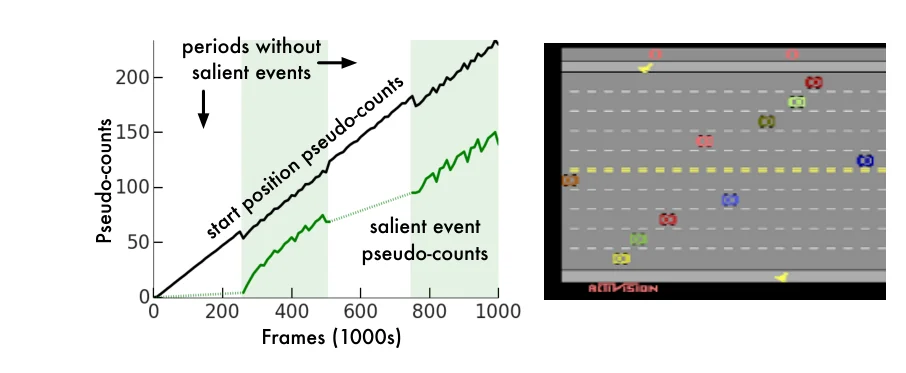
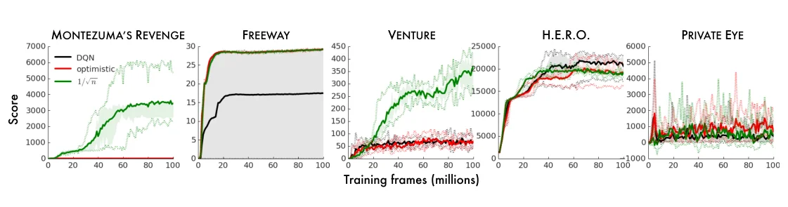
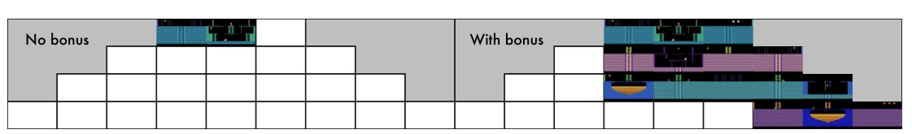

> - **논문**: Unifying Count-Based Exploration and Intrinsic Motivation
> - **저자**: Marc G. Bellemare, Sriram Srinivasan, Georg Ostrovski, Tom Schaul, David Saxton, Rémi Munos (Google DeepMind)
> - **학회**: NeurIPS 2016 · [arXiv:1606.01868](https://arxiv.org/abs/1606.01868)
{: .prompt-tip }

> Exploration 카테고리의 첫 글이다. 보상이 거의 없는(sparse reward) 환경에서 에이전트가 스스로 탐험할 이유를 만들어 주는 **intrinsic motivation** 연구의 출발점이 된 이 논문을 정리한다.

## 1. 왜 탐험이 어려운가

가장 기본적인 탐험 방법은 **ε-greedy**이다. 대부분은 가치가 높은 행동을 고르고, 일정 확률로 무작위 행동을 한다. 하지만 **Montezuma's Revenge** 같은 게임에서는 거의 쓸모가 없다.

- 열쇠를 얻으려면 사다리를 내려가고, 밧줄을 타고, 해골을 피해 점프하는 등 **수십~수백 개의 정확한 행동**을 연속으로 해야 한다.
- 그 전까지는 **보상이 0**이다.
- 무작위 행동으로 이 순서를 우연히 맞힐 확률은 사실상 0이다.

그래서 "아직 가 보지 않은 상태를 방문하면 스스로 보상을 주자"는 아이디어, **intrinsic motivation**이 등장했다. 환경이 주는 보상을 **extrinsic reward**, 에이전트가 스스로 만드는 보상을 **intrinsic reward(exploration bonus)**라고 부른다.

## 2. Count-Based Exploration

가장 직관적인 방법은 방문 횟수를 세는 것이다. MBIE-EB(Strehl & Littman, 2008)는 상태–행동 방문 횟수 $$N(s, a)$$로 보너스를 만들어 Bellman 방정식에 더했다.

$$
r^+(s, a) = \frac{\beta}{\sqrt{N(s, a)}}
$$

적게 방문한 곳일수록 보너스가 크고, 여러 번 방문하면 보너스가 줄어든다.

### 문제: 같은 상태는 다시 오지 않는다

Atari 화면처럼 **상태 공간이 거대**하면 정확히 같은 화면을 두 번 볼 일이 거의 없다. 캐릭터가 같은 자리에 있어도 적이나 시계가 조금만 움직이면 다른 상태가 된다. 그러면 모든 상태의 count가 1이라 보너스가 아무 정보도 주지 못하고, ε-greedy보다도 실용적이지 않다.

논문은 이를 **Pseudo-count**로 해결한다. "정확히 같은 상태를 몇 번 봤는가" 대신 "비슷한 상태를 얼마나 봤는가"를 일반화해서 추정한다.

## 3. 밀도 모델에서 Count로

### Density Model

상태 시퀀스 $$x_{1:n}$$을 본 뒤, 다음에 상태 $$x$$가 나올 확률을 주는 **밀도 모델** $$\rho_n(x) = \rho(x \mid x_{1:n})$$을 학습한다. 논문은 **CTS(Context Tree Switching)**를 썼다.

- 원본 화면(210×160)을 흑백으로 바꾸고 평균으로 42×42까지 축소, 밝기는 3bit(8단계)로 전처리
- 각 픽셀의 확률을 위·왼쪽 이웃 픽셀 4개((i−1, j), (i, j−1), (i−1, j−1), (i+1, j−1))를 문맥으로 예측하는 위치별 CTS 모델로 계산
- 이미지 전체 확률은 픽셀 확률의 곱
- 시간 의존성은 무시한다. 이전 프레임과의 관계를 보는 forward model이 아니라 **프레임 하나의 밀도 모델**이다.

CTS는 최신 이미지 생성 모델보다 훨씬 단순하지만, 내부가 count 기반이라 학습이 매우 빠르다는 점 때문에 탐험용으로 골랐다고 한다.

### Empirical Count와의 관계

방문 횟수 $$N_n(x)$$를 실제로 셀 수 있다면, 경험적 분포는

$$
\mu_n(x) = \frac{N_n(x)}{n}
$$

이다. 여기서 $$x$$를 한 번 더 본 뒤의 분포는

$$
\mu'_n(x) = \frac{N_n(x) + 1}{n + 1}
$$

이 된다.

### Recoding Probability와 Pseudo-Count

밀도 모델에도 같은 일을 한다. 지금 확률 $$\rho_n(x)$$와, $$x$$를 한 번 더 학습한 직후의 확률(**recoding probability**) $$\rho'_n(x)$$를 구한다. 그리고 두 식을 실제 count처럼 맞춰 주는 가상의 count $$\hat{N}_n(x)$$와 총 개수 $$\hat{n}$$을 푼다.

$$
\rho_n(x) = \frac{\hat{N}_n(x)}{\hat{n}},\qquad \rho'_n(x) = \frac{\hat{N}_n(x) + 1}{\hat{n} + 1}
$$

연립하면 **pseudo-count**가 나온다.

$$
\hat{N}_n(x) = \frac{\rho_n(x)\big(1 - \rho'_n(x)\big)}{\rho'_n(x) - \rho_n(x)}
$$

직관적으로, 한 번 더 봤을 때 확률이 크게 오르는 상태(분모가 큼)는 아직 익숙하지 않은 상태이므로 pseudo-count가 작다.

```python
def pseudo_count(rho, rho_prime, eps=1e-8):
    """rho: 지금 x의 확률, rho_prime: x를 한 번 더 학습한 뒤의 확률"""
    gain = max(rho_prime - rho, eps)        # 한 번 더 봤을 때 확률이 오른 정도
    return rho * (1 - rho_prime) / gain

def exploration_bonus(n_hat, beta=0.05):
    return beta / (n_hat + 0.01) ** 0.5

# 검증: 밀도 모델이 정확한 경험적 분포(N/n)라면 pseudo-count는 실제 count와 같아야 한다
n = 100
for N in [0, 1, 10, 50]:
    rho, rho_prime = N / n, (N + 1) / (n + 1)
    n_hat = pseudo_count(rho, rho_prime)
    print(N, round(n_hat, 4), round(exploration_bonus(n_hat), 4))
# 0 0.0 0.5 / 1 1.0 0.0498 / 10 10.0 0.0158 / 50 50.0 0.0071
```

밀도 모델이 단순히 "센 횟수 / 전체"라면 pseudo-count는 실제 방문 횟수를 그대로 돌려준다. 식이 count의 **일반화**라는 것을 확인할 수 있다. 한 번도 안 본 상태의 보너스(0.5)는 50번 본 상태(0.007)보다 약 70배 크다.

> 논문에서 말하는 **prediction gain**은 확률의 차이가 아니라 로그 확률의 차이 $$\text{PG}_n(x) = \log \rho'_n(x) - \log \rho_n(x)$$이다. 논문은 pseudo-count가 $$\hat{N}_n(x) \le \big(e^{\text{PG}_n(x)} - 1\big)^{-1}$$로 prediction gain과 연결된다는 것을 보이고, 이를 통해 count 기반 탐험과 정보 이득 기반 intrinsic motivation을 잇는다.
{: .prompt-info }

### Pseudo-Count의 성질

논문은 pseudo-count가 다음과 같이 행동한다고 정리한다.

- **처음 보는 사건**에 대해 거의 0
- 믿을 만한 크기를 가짐
- 상태 빈도의 **순서**를 지킴
- 평균적으로 실제 count처럼 **선형으로 증가**
- 비정상(non-stationary) 데이터에도 강건함

Atari **Freeway**(닭이 도로를 건너는 게임)에서 확인한 결과는 다음과 같다. 일부러 비정상(non-stationary) 정책을 썼는데, 25만 frame 동안 가만히 기다리고, 25만 frame 동안 위로만 가고, 다시 기다렸다가 위로 가는 식이다. 도로를 다 건너는 사건(salient event)은 위로 가는 구간에서만 일어난다.


_Figure 1. 검은 선은 시작 위치의 pseudo-count, 초록 선은 도로를 다 건너는 사건의 pseudo-count. 음영 구간이 사건을 관측하는 기간이다(1만 frame 평균). (출처: Bellemare et al., 2016)_

- **시작 위치**: 차가 계속 움직여 매 frame 화면은 다르지만, pseudo-count는 선형으로 꾸준히 증가했다. 사실상 같은 상태라는 것을 일반화해서 알아본 것이다.
- **도로를 건너는 순간**: 처음 일어날 때는 pseudo-count가 거의 0이고, 위로 가는 구간에서만 올라가며, 기다리는 구간에서는 거의 증가하지 않았다. 세 번째 구간(다시 기다림)에서 조금 오르는 것은 두 사건이 화면 구조를 일부 공유하기 때문이다. 내내 시작 위치의 pseudo-count보다 작아서 빈도의 순서도 지킨다.
- 다만 절댓값은 실제 count의 일부에 불과하다. 실험이 끝날 때 실제로는 시작 위치를 약 14만 번, 화면 맨 위를 1,285번 방문했지만 pseudo-count는 그래프에서 각각 약 230, 150이다. 두 값의 비율도 실제 비율과 다르다. 논문은 이 차이를 점근 분석으로 설명한다(밀도 모델이 $$\Theta(1/n)$$ 속도로 수렴해야 실제 count와 비교할 수 있음).

## 4. Exploration Bonus

Pseudo-count로 intrinsic reward를 만든다.

$$
R^+_n(x, a) = \beta\,\big(\hat{N}_n(x) + 0.01\big)^{-1/2}
$$

$$\beta$$는 보너스의 비중을 정하는 hyper-parameter로, DQN 실험에서는 대략적인 sweep으로 **0.05**를 골랐다(A3C+ 실험은 0.01). 에이전트는 extrinsic reward와 이 보너스의 합을 최대화한다. 형태는 MBIE-EB의 $$\beta / \sqrt{N}$$과 같고, 상수 0.01은 pseudo-count가 0일 때 0으로 나누지 않기 위한 것이다.

논문은 또 정보 이론 관점에서 pseudo-count가 **information gain(정보 이득)**과 연결된다는 것을 보여, count-based exploration과 intrinsic motivation을 하나의 틀로 **통합(unifying)**했다. 제목은 이 통합을 가리킨다. 구체적으로 정보 이득 IG, prediction gain PG, pseudo-count 사이에 다음 부등식이 성립한다(Theorem 1).

$$
\text{IG}_n(x) \le \text{PG}_n(x) \le \hat{N}_n(x)^{-1},\qquad \text{PG}_n(x) \le \hat{N}_n(x)^{-1/2}
$$

그래서 $$\hat{N}^{-1/2}$$에 비례하는 보너스는 정보 이득 보너스보다 적어도 그만큼은 탐험적이다. 반대로 Kolter & Ng(2009)의 결과(보너스가 $$\beta N^{-1}$$ 이하로 줄어드는 방법은 PAC-MDP 최적성을 보장할 수 없음)와 합치면, 그때그때의 정보 이득이나 prediction gain만으로 주는 보너스는 탐험이 부족하다는 결론이 나온다.

## 5. 실험 설정

| 항목 | DQN 실험 | A3C+ 실험 |
|---|---|---|
| 게임 | ε-greedy로는 탐험이 어려운 5개 (Freeway, Montezuma's Revenge, Private Eye, H.E.R.O., Venture) | Atari 60개 |
| 기반 알고리즘 | Double DQN, target에 Monte Carlo return을 섞음 | A3C, 16 thread (thread마다 밀도 모델 사본, 25만 step마다 동기화) |
| 보너스 | $$\beta(\hat{N} + 0.01)^{-1/2}$$, $$\beta = 0.05$$ | 같은 형태, $$\beta = 0.01$$. extrinsic reward와 더한 뒤 $$[-1, 1]$$로 clip |
| 반복 | 5회 평균 | 200M frame |
| 밀도 모델 | 42×42, 3bit 흑백 CTS | 같음 |

Monte Carlo return을 섞은 것은 보너스 유무와 관계없이 성능을 올렸다. 섞지 않아도 보너스를 준 에이전트가 더 많이 탐험하지만, 신경망이 가치 함수를 충분히 잘 근사하지 못해 성능이 곧 떨어졌다고 한다.

## 6. 실험 결과

### DQN + Exploration Bonus

ε-greedy로는 탐험이 비효율적인 5개 게임에서 보너스 유무와 optimistic initialization(초기 Q를 높게 두는 고전적 탐험 기법)을 비교했다.


_Figure 2. 검은색은 보너스 없는 DQN, 빨간색은 optimistic initialization, 초록색은 pseudo-count 보너스($$1/\sqrt{n}$$). 음영은 사분위 범위, 점선은 최소·최대. (출처: Bellemare et al., 2016)_

- Optimistic initialization은 Freeway에서만 도움이 되고 나머지는 DQN과 비슷했다.
- 보너스는 **Montezuma's Revenge**와 **Venture**에서 특히 큰 향상을 보였다. 위 그래프에서 Venture는 보너스 없이 100 안팎이던 점수가 300~400대로 올라간다. 반면 H.E.R.O.와 Private Eye에서는 뚜렷한 차이가 없다.


_Figure 3. 5,000만 frame 학습 후 DQN이 한 번이라도 방문한 방. 왼쪽은 보너스 없음, 오른쪽은 보너스 사용. (출처: Bellemare et al., 2016)_

**Montezuma's Revenge**의 첫 레벨은 24개 방으로 이뤄져 있고, 첫 방을 빠져나가는 데만 사다리 오르기, 적 피하기, 열쇠 줍기, 되돌아가 문 열기가 필요하다. 게임 RAM에서 에이전트가 있는 방 번호를 읽어(분석용으로만, 에이전트 입력에는 쓰지 않음) 방문한 방을 기록했다.

| 지표 | 보너스 없음 | 보너스 사용 |
|---|---|---|
| 5,000만 frame까지 방문한 방 | 2개 | **15개** (24개 중) |
| 평균 점수 (5,000만 frame) | 0 근처 (Figure 2) | 2,461 |
| 평균 점수 (1억 frame) | 0 근처 (Figure 2) | 3,439 |

1억 frame(DQN 원 논문 학습량의 절반)에서 한 run은 꾸준히 6,600점을 냈고, 당시 보고된 어떤 에이전트보다 높은 점수였다. 대부분의 기존 에이전트는 평균 점수가 0에 가까웠다.

### A3C+

A3C는 replay memory 없이 여러 병렬 에이전트의 샘플로 global network를 업데이트한다. 정책과 가치 함수가 분리돼 있어 행동이 다양할 수 있지만, 바로 그 분리 때문에 entropy 정규화 없이는 제대로 된 결과가 안 나올 만큼 탐험이 부족하다고 저자들은 본다. 그래서 pseudo-count 보너스를 결합한 **A3C+**를 정의했다.

- 무작위 에이전트보다 50% 이상 나은 점수를 못 낸 게임이 A3C는 **15개**, A3C+는 **10개**였다. A3C+가 실패한 10개 중 8개는 DQN도 같은 의미로 실패한 게임이다.
- Atari 60개 게임에서 A3C+의 학습 중 점수 중앙값이 A3C보다 조금 높았고, 적어도 4분의 1의 게임에서는 A3C를 크게 앞섰다. ε-greedy로도 탐험이 충분한 게임이 많다는 점을 생각하면 의미 있는 차이라고 논문은 본다.

200M frame 뒤 탐험이 어려운 일부 게임의 평균 점수이다(부록 Table 2, stochastic ALE).

| 게임 | A3C | A3C+ | DQN |
|---|---|---|---|
| Freeway | 0.00 | 27.33 | 30.59 |
| Montezuma's Revenge | 0.06 | 142.50 | 0.02 |
| Private Eye | 94.87 | 100.00 | 69.53 |
| Gravitar | 204.65 | 246.02 | 43.04 |
| Venture | 0.00 | 0.00 | 54.86 |
| H.E.R.O. | 32612.96 | 15077.42 | 12140.76 |

A3C+라고 모든 탐험 게임에서 좋아지지는 않았다. Venture는 여전히 0점이고 H.E.R.O.는 오히려 떨어졌다. Montezuma's Revenge에서는 생명을 잃을 때 에피소드를 끝내는 life loss 신호가 오히려 해가 됐다. 부록에 따르면 200M frame 뒤 A3C+ 평균 점수가 stochastic ALE에서 life loss를 쓰면 142.50(위 표의 값과 같음), 쓰지 않으면 1,127.05(최고 3,600)였다.

부록에서는 보너스 형태도 비교했다. 200M frame 기준으로 $$\hat{N}^{-1/2}$$ 보너스가 prediction gain 보너스와 보너스 없음보다 좋았고, $$\hat{N}^{-1}$$ 보너스는 성능이 나빴다. Prediction gain은 초반에는 강했지만 결국 1위는 못 했는데, 앞의 이론처럼 탐험이 부족하다는 해석과 맞는다.

## 7. 정리

| 개념 | 핵심 |
|---|---|
| Intrinsic motivation | 새로운 상태 방문에 스스로 보상 |
| Count-based bonus | $$\beta / \sqrt{N}$$, 적게 본 곳일수록 큼 |
| 문제 | 큰 상태 공간에서는 같은 상태가 반복되지 않음 |
| Pseudo-count | 밀도 모델의 확률 변화로 "비슷한 상태를 본 횟수" 추정 |
| 결과 | Montezuma's Revenge에서 15개 방 탐험 |

이후 연구들은 밀도 모델 대신 **예측 오차**로 새로움을 측정하는 방향으로 갔다. 다음 글에서는 그 대표인 [ICM(Curiosity)]()을 다룬다.

## References

- Bellemare et al., "Unifying Count-Based Exploration and Intrinsic Motivation," NeurIPS 2016. [arXiv:1606.01868](https://arxiv.org/abs/1606.01868)
- Strehl & Littman, "An analysis of model-based Interval Estimation for Markov Decision Processes (MBIE-EB)," JCSS 2008.
- Bellemare et al., "Skip Context Tree Switching," ICML 2014.
- Ostrovski et al., "Count-Based Exploration with Neural Density Models," ICML 2017.
